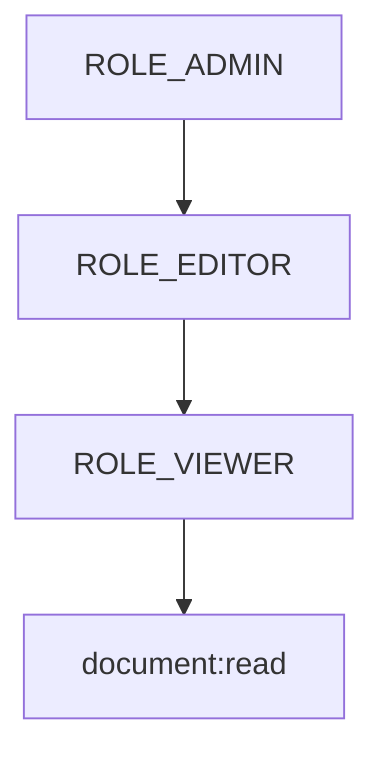

# Distinguishing Role Inheritance from Data Ownership Conditions

> **Topic:** Spring Security - authorization  
> **Group:** Role hierarchy  
> **Prompt:** Distinguish role inheritance from data ownership conditions  
> **Learning outcome:** Understand that `RoleHierarchy` only expands the authority set used for checks and never verifies a record's owner/tenant/ACL; know how to combine functional permissions with resource-level permissions, enforce policies at the right execution point, and write tests catching actors who **hold the right role yet lack permission on the object**.

## 1. Two security questions that cannot replace each other

Suppose a document management application has the hierarchy:

```text
ROLE_ADMIN > ROLE_EDITOR
ROLE_EDITOR > ROLE_VIEWER
```

Alice holds `ROLE_VIEWER` and owns document 42. Bob holds `ROLE_ADMIN` but does not own document 42. Bob calls `GET /api/documents/42`. Should he be allowed to view it?

**There is not enough information to decide yet.** The hierarchy says `ROLE_ADMIN` can be evaluated as implying `ROLE_EDITOR` and `ROLE_VIEWER` when authorization components use the hierarchy. It **does not alter** `document.ownerId`, does not grant an ACL, and does not ensure Bob has permission to read Alice's data.

If policy states private documents are readable only by the owner, Bob must receive **DENY**. If application policy has an explicit rule allowing same-tenant admins to read member documents, Bob may receive **ALLOW**; that access comes from **an explicitly declared capability and policy**, not from any inherent meaning of the word ADMIN.

This is the core principle:

> **Role hierarchy answers “which functional permissions does the actor have?”. Object authorization answers “is the actor allowed to perform this action on this specific resource in this context?”.**

Both must succeed before executing a protected operation.

## 2. A complete decision model

Let us express granting an operation as:

```text
allow(actor, action, object, context)
    = authenticated(actor)
      AND functionalPermission(actor, action)
      AND authorizedScope(actor, object, context)
      AND objectGrantOrOwnership(actor, action, object)
      AND domainConstraints(actor, action, object)
```

Where:
- `authenticated`: actor comes from a verified identity; never trust a client-supplied `userId`.
- `functionalPermission`: actor holds the role/capability for this action, possibly via role inheritance.
- `authorizedScope`: valid tenant, project, organization, or resource boundary.
- `objectGrantOrOwnership`: actor is the owner or holds an explicit ACL/delegation/grant.
- `domainConstraints`: state, limits, separation of duties, workflow, version.

Not every use case needs all five steps identically, yet **a single `hasRole` check alone is rarely sufficient for owner- or tenant-bound documents**.

### Comparison table

| Criterion | Role hierarchy | Ownership / ACL / domain policy |
| --- | --- | --- |
| Data | Principal's roles/authorities | Actor ID, object ID, owner ID, tenant, ACL, status |
| Example | `ROLE_ADMIN > ROLE_VIEWER` | `document.ownerId == actor.id` |
| Scope | Broad capabilities of the actor | A specific object or set of objects |
| Spring mechanism | `RoleHierarchy`, `RoleHierarchyImpl`, `hasRole` | Policy bean, `PermissionEvaluator`, ACL, service guard |
| Changes when | Roles or hierarchy change | Owner, share grants, tenant, or state changes |
| Question | “Can they use the read feature?” | “Can they read document 42?” |
| Failure if used alone | May miss general feature access | May lack active role/permission |
| Risk when misunderstood | Over-granting, role escalation | IDOR/BOLA, cross-tenant access |

## 3. What do RoleHierarchy and RoleHierarchyImpl compute?

Spring Security represents roles and permissions via `GrantedAuthority`, typically a string like `ROLE_ADMIN`, `ROLE_VIEWER`, or `document:read`. `RoleHierarchy` has the method:

```java
Collection<? extends GrantedAuthority>
    getReachableGrantedAuthorities(
        Collection<? extends GrantedAuthority> authorities
    );
```

It returns the authorities reachable from the input authorities along hierarchy edges, **including the input authorities**. `RoleHierarchyImpl` is the common implementation.

Example declaration:

```java
import org.springframework.security.access.hierarchicalroles.RoleHierarchy;
import org.springframework.security.access.hierarchicalroles.RoleHierarchyImpl;

RoleHierarchy hierarchy = RoleHierarchyImpl.fromHierarchy("""
    ROLE_ADMIN > ROLE_EDITOR
    ROLE_EDITOR > ROLE_VIEWER
    ROLE_VIEWER > document:read
    """);
```

If `Authentication` holds only `ROLE_ADMIN`, a hierarchy-aware consumer can use the reachable authorities:

```text
ROLE_ADMIN
ROLE_EDITOR
ROLE_VIEWER
document:read
```

However, **none of the following data appears in that result**:

```text
document42.owner = alice
document42.tenant = organization-A
document42.isLocked = true
document42.grants contains bob
request.action = RENAME
```

That is domain data. A `hasAuthority('document:read')` check, even when satisfied through the hierarchy, can never tell by itself which records an actor is permitted to read.

### One-way and transitive



`ROLE_ADMIN` implies `ROLE_EDITOR` and `ROLE_VIEWER` along arrow direction; `ROLE_VIEWER` does not infer up to ADMIN. Never add `ROLE_VIEWER > ROLE_ADMIN` just because someone wants “viewers to also open one admin page”: that is a system-wide privilege change causing privilege escalation.

An edge `ROLE_ADMIN > document:read` can be valid if business policy wants admins to have general read capability. Still, it **is not** an edge meaning ownership or access across every tenant.

## 4. How do owner, creator, tenant, and ACL differ?

| Attribute | Meaning | Common misconception |
| --- | --- | --- |
| `createdBy` | Who created the document | The creator remains the owner forever |
| `ownerId` | Current responsible party or owner | Owner automatically keeps all rights even when locked |
| `tenantId` | Organization owning the resource | Same tenant means viewing all data |
| `projectId` | Project/collection containing the document | Project membership always grants delete rights |
| `sharedWith` | Directly shared recipients | Sharing READ means sharing WRITE |
| ACL READ/WRITE/DELETE | Grants on a specific object | All higher roles hold grants by default |
| `status` | DRAFT, LOCKED, ARCHIVED... | Being owner/role overrides status |
| `classification` | PUBLIC, INTERNAL, CONFIDENTIAL | Reading PUBLIC implies reading CONFIDENTIAL |

Ownership is a business rule, not a type of `GrantedAuthority` synthesized by Spring. An object can have multiple “owners” in business terms: creator, current owner, owning group, and owning tenant. Define clearly which permissions apply to each kind of owner.

For example, Alice owns document 42, yet the document is `LOCKED`: policy may still permit reading while forbidding edits. On a payment record, the creator may **be forbidden from self-approving** (separation of duties). That is why you should never write one `isOwner` helper and treat it as sufficient for all READ/WRITE/APPROVE operations.

## 5. IDOR example: right role, wrong object

Unsafe method:

```java
@PreAuthorize("hasRole('VIEWER')")
public DocumentView readDocument(long id) {
    return repository.findViewById(id);
}
```

If Alice holds `ROLE_VIEWER`, `GET /api/documents/42` may be valid. However, if Alice changes the ID to 43 and `findViewById(43)` returns Bob's document, the service **never checks object permissions**.

This is IDOR/BOLA: the client chooses the ID of an object they are unauthorized to access while the system checks only functional permissions.

Two-layer fix:

```java
@PreAuthorize("hasRole('VIEWER')")
public DocumentView readDocument(long id) {
    Actor actor = actorResolver.requireAuthenticatedActor();

    Document document = repository
        .findByIdAndTenantId(id, actor.activeTenantId())
        .orElseThrow(DocumentNotFoundException::new);

    documentPolicy.requireCanRead(actor, document);
    return mapper.toView(document);
}
```

This is an **integration Spring snippet, not a standalone Java file**: `Actor`, `Document`, repository, policy, mapper, and exceptions are defined by the application.

Steps:
1. `@PreAuthorize` checks functional permission via role/authority.
2. Actor ID and tenant are verified from `Authentication`/server context.
3. Query selects only documents within the valid tenant.
4. Policy checks owner, ACL, status, and other grants.
5. Only after ALLOW is the content DTO returned.

Merely adding `ROLE_ADMIN > ROLE_VIEWER` will never supply steps 3–4.

## 6. High role in another tenant is still denied

Example:

```text
Actor:
    id = bob
    directRole = ROLE_ADMIN
    activeTenant = org-A

Document:
    id = 44
    ownerId = bob
    tenantId = org-B
```

If policy requires every access to belong to the verified active tenant, Bob gets DENY despite holding ADMIN **and even despite matching `ownerId`**. Role hierarchy never shifts tenant boundaries.

Dangerous code:

```java
if (hasRole(actor, "ADMIN")
        || document.ownerId().equals(actor.id())) {
    return document;
}
```

The ADMIN branch bypasses tenant, status, and ACL. An admin in `org-A` can read `org-B`'s data, creating an organization-isolation vulnerability.

Conservative design:

```java
if (!actor.activeTenantId().equals(document.tenantId())) {
    throw new AccessDeniedException("Not accessible");
}

if (document.ownerId().equals(actor.id())
        || policy.hasTenantWideRead(actor, document)) {
    return document;
}

throw new AccessDeniedException("Not accessible");
```

This is a domain policy snippet; `hasTenantWideRead` must verify an **explicit permission** and tenant scope. If a global operator genuinely needs cross-tenant access, design a dedicated capability with appropriate MFA/approval/auditing rather than inferring it from ordinary `ROLE_ADMIN`.

An `X-Tenant-ID` HTTP header, `/tenants/{id}` path variable, or `?tenantId=...` query parameter is merely client-supplied input. The backend must verify the user belongs to that tenant and is permitted to select it, never trusting it directly as authorization proof.

## 7. Where do roles and object policies sit in the Spring Security flow?

```text
GET /api/documents/42
       |
       v
Spring Security FilterChainProxy / SecurityFilterChain
       |
       v
Authentication -> principal and authorities
       |
       v
AuthorizationFilter:
  HTTP matcher requires document:read?
       | NO -> DENY
       v YES
Method interceptor:
  @PreAuthorize hasRole('VIEWER')?
       | NO -> DENY
       v YES
Application service:
  load document 42 within permitted tenant
       | missing / out of scope -> NOT FOUND or DENY
       v
Domain policy:
  actor is owner / has ACL READ / delegated?
  status allows reading?
       | NO -> DENY
       v YES
Serialize DTO and send response
```

`RoleHierarchyImpl` participates at authority-checking checkpoints **configured to use it**. It does not turn `AuthorizationFilter` into an engine querying owners from the database. `SecurityFilterChain` selects by matcher, URL rules evaluate in declared order, and then the service loads concrete entity data to evaluate permissions.

In systems with GraphQL, schedulers, or message consumers, HTTP filters do not cover non-HTTP paths. Therefore, **domain guards inside application services** are an essential reusable boundary. Method-security interceptors must also be invoked through Spring AOP proxies, never bypassed via self-invocation.

## 8. Spring 6.5+ example: configuring role hierarchy

```java
import org.springframework.context.annotation.Bean;
import org.springframework.context.annotation.Configuration;
import org.springframework.security.access.hierarchicalroles.RoleHierarchy;
import org.springframework.security.access.hierarchicalroles.RoleHierarchyImpl;

@Configuration
class HierarchyConfiguration {
    @Bean
    static RoleHierarchy roleHierarchy() {
        return RoleHierarchyImpl.fromHierarchy("""
            ROLE_ADMIN > ROLE_EDITOR
            ROLE_EDITOR > ROLE_VIEWER
            ROLE_VIEWER > document:read
            ROLE_EDITOR > document:rename
            """);
    }
}
```

The `>` sign means “implies”, so ADMIN reaches VIEWER. Permissions `document:read` and `document:rename` are **general functional permissions** and must still be paired with document scope in services.

Method security configuration for `@PreAuthorize`:

```java
import org.springframework.context.annotation.Bean;
import org.springframework.context.annotation.Configuration;
import org.springframework.security.access.expression.method.DefaultMethodSecurityExpressionHandler;
import org.springframework.security.access.expression.method.MethodSecurityExpressionHandler;
import org.springframework.security.access.hierarchicalroles.RoleHierarchy;
import org.springframework.security.config.annotation.method.configuration.EnableMethodSecurity;

@Configuration
@EnableMethodSecurity
class MethodSecurityConfiguration {

    @Bean
    static MethodSecurityExpressionHandler
            methodSecurityExpressionHandler(RoleHierarchy hierarchy) {
        var handler = new DefaultMethodSecurityExpressionHandler();
        handler.setRoleHierarchy(hierarchy);
        return handler;
    }
}
```

**This is a Spring configuration snippet** and does not run standalone with `javac`. Declare the hierarchy bean in one appropriate place; avoid duplicating multiple beans of the same type unintentionally. For Spring Security 7, check version-specific manager/factory APIs; do not blindly apply 7.x syntax to older branches.

If creating a custom `AuthorityAuthorizationManager` rather than using the default DSL, that manager may need `setRoleHierarchy(roleHierarchy)`. Manually constructed custom managers do not automatically consume hierarchy beans merely because they exist in the context.

## 9. @PreAuthorize can combine both policy types

An expression combining two conditions:

```java
@PreAuthorize(
    "hasAuthority('document:read') "
    + "and @documentPolicy.canRead(authentication, #id)"
)
public DocumentView get(long id) {
    return repository.getView(id);
}
```

Meaning:
- `hasAuthority('document:read')` checks functional permission, resolvable via hierarchy if the handler is hierarchy-aware.
- `documentPolicy.canRead(...)` must verify owner, tenant, and status from **trusted server data**.
- Both conditions are joined with **AND**, not OR.

However, there are two caveats:
1. `#id` requires parameter names to be resolvable from compiler metadata or appropriate annotations.
2. Querying policy before the body and querying again inside the body can introduce a race (TOCTOU) if permissions or ownership change in between. For write commands, load the entity and check policy inside the same transaction right before mutating.

When expressions grow complex, keeping domain policy inside a Java class is easier to test than a long SpEL string loading resources twice.

## 10. Data-mutating commands: policy must run before side effects

Document rename example:

```java
import org.springframework.security.access.AccessDeniedException;
import org.springframework.security.access.prepost.PreAuthorize;
import org.springframework.stereotype.Service;
import org.springframework.transaction.annotation.Transactional;

@Service
public class DocumentCommandService {
    private final ActorResolver actorResolver;
    private final DocumentRepository repository;
    private final DocumentPolicy policy;

    public DocumentCommandService(
            ActorResolver actorResolver,
            DocumentRepository repository,
            DocumentPolicy policy) {
        this.actorResolver = actorResolver;
        this.repository = repository;
        this.policy = policy;
    }

    @PreAuthorize("hasAuthority('document:rename')")
    @Transactional
    public void rename(long documentId, String newTitle) {
        Actor actor = actorResolver.requireAuthenticatedActor();

        Document doc = repository
            .findForUpdateWithinTenant(
                documentId, actor.activeTenantId()
            ).orElseThrow(DocumentNotFoundException::new);

        if (!policy.canRename(actor, doc)) {
            throw new AccessDeniedException("Rename denied");
        }

        doc.rename(newTitle);
    }
}
```

This is an **integration snippet**; `Actor`, repository, policy, and entity are project-defined types. `findForUpdateWithinTenant` expresses the contract and requires real DB/JPA locking or optimistic versioning in practice.

Decision steps:
1. Role/permission gate at `@PreAuthorize` rejects callers lacking functional permission before the body runs.
2. Tenant-scoped query blocks resources from other organizations.
3. Domain policy checks owner or WRITE ACL, DRAFT status, locks, and related constraints.
4. **Only after all conditions pass** is the title modified.

A `ROLE_ADMIN` user may inherit `document:rename` through the hierarchy and still be denied by policy if they are not the owner, lack a tenant-wide grant, or the document is LOCKED. That is intentional security, not a hierarchy bug.

## 11. Each action needs its own policy

A single `isOwner(actor, doc)` helper should not decide every operation:

| Action | Functional permission | Additional resource permission |
| --- | --- | --- |
| READ | `document:read` | Owner, PUBLIC, READ ACL, granted tenant-wide READ |
| RENAME | `document:rename` | Owner/WRITE ACL, not LOCKED, valid version |
| DELETE | `document:delete` | Owner/DELETE ACL, retention policy |
| SHARE | `document:share` | Owner/ADMINISTER ACL, eligible recipient |
| TRANSFER | `document:transfer` | Current owner, valid recipient, approval |
| EXPORT | `document:export` | READ across target objects, limits, audit |
| APPROVE PAYMENT | `payment:approve` | No self-approval, matching tenant, limits, status |
| READ AUDIT | `audit:read` | Project/organization scope and access reason |

Why: owning data does not override business rules. A payment creator can be barred from self-approving despite being the owner; the owner of a locked document may read it without being allowed to edit it.

Role hierarchy only removes role repetition in the **functional permission column**; it never implements the **resource permission column**.

## 12. Tenant-wide permission does not mean global admin

If policy lets an organization admin read members' documents, define a dedicated capability:

```text
ROLE_ADMIN > ROLE_EDITOR
ROLE_EDITOR > ROLE_VIEWER
ROLE_ADMIN > document:read:tenant
```

Then the policy:

```text
canRead(actor, document)
    = hasDocumentRead(actor)
      AND sameAuthorizedTenant(actor, document)
      AND notRestrictedForRead(document)
      AND (
        isOwner(actor, document)
        OR hasAclRead(actor, document)
        OR (
            hasAuthority(actor, "document:read:tenant")
            AND tenantPolicyAllows(actor, document)
        )
      )
```

Key points:
- `document:read:tenant` is an **explicitly designed grant**, not an automatic property of `ROLE_ADMIN`.
- In this example, tenant-wide permission still requires matching tenant.
- Cross-tenant privileges should be a separate capability with MFA and approval/auditing as required.
- If support impersonation exists, record both the acting user and original operator in audit logs.
- Changing role-to-permission edges can affect multiple endpoints simultaneously; review it as a policy change.

Avoid writing `if (admin) return true;` at the top of `canRead`: it bypasses tenant, ACL, and status checks.

## 13. Role hierarchy and ACL inheritance are two distinct graphs

```text
Actor role graph:
  ROLE_ADMIN -> ROLE_EDITOR -> ROLE_VIEWER

Resource ACL graph:
  Project Alpha
       |
       +-- Folder Contracts
               |
               +-- Document 42
```

The role graph states which authorities an actor holds. The ACL graph states that child resources can **inherit access control entries** from parent resources under an ACL model.

Spring Security ACL uses `Acl`, `AccessControlEntry`, `Sid`, `ObjectIdentity`, `Permission`, and `AclService`. When a project uses the ACL module, `PermissionEvaluator` can back `hasPermission` in method-security expressions. Never assume that module is configured merely because `RoleHierarchyImpl` is used.

A `ROLE_EDITOR` does not automatically hold a WRITE ACE on every document. Likewise, a user with READ ACL on document 42 does not automatically gain DELETE permission on document 42, regardless of their general role.

## 14. Never put individual object owners into role strings

An unsustainable pattern is creating authorities like:

```text
OWNER_DOCUMENT_42
OWNER_DOCUMENT_43
OWNER_DOCUMENT_44
...
```

and trying to model ownership in the role hierarchy. That breaks down because:
- Tokens/JWTs bloat proportionally with object count.
- Ownership transfers make invalidating stale authorities hard to control.
- Permissions stay cached too long.
- Object metadata may leak to other applications.
- Rules become unmanageable across millions of documents.

Role hierarchies fit relatively stable role/permission sets. Per-object permissions belong in scoped DB queries, ACLs, and policies evaluated against current state.

When optimizing high-volume ACL checks, use tenant- and grant-indexed queries, batch lookups, and invalidated caches — never turn an entire ownership database into static authorities.

## 15. Lists and pagination: a role gate alone easily leaks all data

Unsafe:

```java
@PreAuthorize("hasRole('VIEWER')")
public List<DocumentView> listDocuments() {
    return repository.findAll().stream()
        .map(mapper::toView)
        .toList();
}
```

Any viewer passes the role gate and receives everyone else's documents. The proper solution is a **scoped query**:

```sql
SELECT d.*
FROM documents d
WHERE d.tenant_id = :authorized_tenant
  AND (
       d.owner_id = :actor_id
       OR EXISTS (
            SELECT 1
            FROM document_grants g
            WHERE g.document_id = d.id
              AND g.user_id = :actor_id
              AND g.permission = 'READ'
       )
  )
ORDER BY d.created_at DESC
LIMIT :page_size OFFSET :offset;
```

This SQL is illustrative; if policy allows tenant-wide reads, public visibility, statuses, or delegations, add those conditions **explicitly**. Never tack on `OR role_admin=true` ignoring the tenant filter.

`@PostFilter` can filter a collection after the method loads it, but is unsuitable as a default for large lists: unauthorized rows already hit memory, pagination counts break, and export/download paths easily bypass the filter.

## 16. Runnable Java 17+: hierarchy does not turn someone else into the owner

The following program **simulates** a role graph and document-read policy in pure Java. It uses no Spring, Servlet, JWT, or DB; actors are constructed as test fixtures. It illustrates clearly that ADMIN implies VIEWER while still being denied on cross-tenant, locked, or unowned objects.

Save `RoleOwnershipDemo.java`:

```java
import java.util.ArrayDeque;
import java.util.Deque;
import java.util.HashSet;
import java.util.Map;
import java.util.Set;

public class RoleOwnershipDemo {

    record Actor(String id, String tenant, Set<String> direct) {}
    record Document(long id, String tenant,
                    String owner, boolean locked) {}

    private static final Map<String, Set<String>> IMPLIES = Map.of(
        "ROLE_ADMIN", Set.of("ROLE_EDITOR", "document:read:tenant"),
        "ROLE_EDITOR", Set.of("ROLE_VIEWER")
    );

    static Set<String> reachable(Set<String> direct) {
        Set<String> reached = new HashSet<>(direct);
        Deque<String> queue = new ArrayDeque<>(direct);
        while (!queue.isEmpty()) {
            String current = queue.removeFirst();
            for (String next : IMPLIES.getOrDefault(current, Set.of())) {
                if (reached.add(next)) {
                    queue.addLast(next);
                }
            }
        }
        return reached;
    }

    static boolean hasRole(Actor actor, String role) {
        return reachable(actor.direct()).contains("ROLE_" + role);
    }

    static boolean has(Actor actor, String authority) {
        return reachable(actor.direct()).contains(authority);
    }

    static String canRead(Actor actor, Document doc) {
        if (!hasRole(actor, "VIEWER")) return "DENY missing-role";
        if (!actor.tenant().equals(doc.tenant())) return "DENY tenant";
        if (doc.locked()) return "DENY locked";
        if (actor.id().equals(doc.owner())) return "ALLOW owner";
        if (has(actor, "document:read:tenant")) {
            return "ALLOW tenant-grant";
        }
        return "DENY owner";
    }

    public static void main(String[] args) {
        Actor alice = new Actor("alice", "A", Set.of("ROLE_VIEWER"));
        Actor bob = new Actor("bob", "A", Set.of("ROLE_ADMIN"));
        Actor carol = new Actor("carol", "A", Set.of("ROLE_EDITOR"));
        Actor guest = new Actor("alice", "A", Set.of("ROLE_GUEST"));

        Document own = new Document(42, "A", "alice", false);
        Document other = new Document(43, "A", "bob", false);
        Document cross = new Document(44, "B", "bob", false);
        Document locked = new Document(45, "A", "alice", true);

        System.out.println("Admin has VIEWER: "
            + hasRole(bob, "VIEWER"));
        System.out.println("Viewer has ADMIN: "
            + hasRole(alice, "ADMIN"));
        System.out.println("Alice own: " + canRead(alice, own));
        System.out.println("Alice other: " + canRead(alice, other));
        System.out.println("Carol other: " + canRead(carol, other));
        System.out.println("Bob admin same tenant: "
            + canRead(bob, own));
        System.out.println("Bob admin cross tenant: "
            + canRead(bob, cross));
        System.out.println("Bob admin locked: "
            + canRead(bob, locked));
        System.out.println("Guest own: " + canRead(guest, own));
        System.out.println("Bob own: " + canRead(bob, other));
    }
}
```

Compile/run with JDK 17 or newer:

```bash
javac RoleOwnershipDemo.java
java RoleOwnershipDemo
```

**Exact** stdout:

```text
Admin has VIEWER: true
Viewer has ADMIN: false
Alice own: ALLOW owner
Alice other: DENY owner
Carol other: DENY owner
Bob admin same tenant: ALLOW tenant-grant
Bob admin cross tenant: DENY tenant
Bob admin locked: DENY locked
Guest own: DENY missing-role
Bob own: ALLOW owner
```

Explanation:
- ADMIN inherits EDITOR and VIEWER; VIEWER does not inherit ADMIN.
- Alice holds VIEWER and owns document 42, so she can read it.
- Alice cannot read document 43 even though she also holds VIEWER.
- Carol holds reachable EDITOR and VIEWER, yet cannot read Bob's object without a grant.
- Bob reads Alice's document in tenant A via an **explicit tenant-wide permission in the hierarchy**, not because admins automatically own everything.
- Bob cannot read tenant B's document even though its owner ID is Bob.
- Locked documents are denied read access per the demo policy.
- Guest shares the owner name yet lacks the required functional role.
- Bob can read his own document because role, tenant, state, and ownership all pass.

**Limitation:** `reachable` only illustrates graph traversal with `HashSet`/`ArrayDeque`; it does not replace `RoleHierarchyImpl`. Granting tenant-wide permission in the demo is a **policy choice for illustration**, not a safe default for every product.

## 17. Role graph unit tests and domain policy tests are two separate groups

### Test A: verify transitivity

```java
RoleHierarchy h = RoleHierarchyImpl.fromHierarchy("""
    ROLE_ADMIN > ROLE_EDITOR
    ROLE_EDITOR > ROLE_VIEWER
    """);

var roles = h.getReachableGrantedAuthorities(
    List.of(new SimpleGrantedAuthority("ROLE_ADMIN"))
).stream()
 .map(GrantedAuthority::getAuthority)
 .collect(Collectors.toSet());

assertThat(roles)
    .contains("ROLE_ADMIN", "ROLE_EDITOR", "ROLE_VIEWER");
```

This is a JUnit/AssertJ/Spring Security snippet requiring imports and dependencies. It validates only the graph, not whether HTTP/method managers actually use the hierarchy.

### Test B: verify object permissions

```java
@Test
void roleEditorWithoutOwnershipCannotRename() {
    Actor actor = actor("carol", "tenant-A", "ROLE_EDITOR");
    Document doc = document(43L, "tenant-A", "bob", "DRAFT");

    assertThat(policy.canRename(actor, doc)).isFalse();
}

@Test
void tenantAdminCannotReadOtherTenant() {
    Actor admin = actor("bob", "tenant-A", "ROLE_ADMIN");
    Document doc = document(44L, "tenant-B", "bob", "DRAFT");

    assertThat(policy.canRead(admin, doc)).isFalse();
}
```

`actor`, `document`, and `policy` are test fixtures/domain contracts, not built-in APIs. The key is constructing scenarios with **sufficient role yet no object permission**.

### Test C: integration test through Spring

```java
// JUnit 5 + Spring Security Test snippet, requires service bean through AOP.
@Test
@WithMockUser(roles = {"ADMIN"})
void adminCanPassViewerGateWhenHierarchyIsWired() {
    assertThat(profileService.viewPublicProfile())
        .isNotNull();
}
```

The fixture assigns only `ROLE_ADMIN` directly; if `ROLE_VIEWER` were also assigned, an ALLOW test would not prove hierarchy works. Next, test a service reading a document in another tenant and verify it denies **at the domain policy**, never letting `ROLE_ADMIN` skip the object guard.

## 18. MockMvc: a 403 status can come from many places

For the document-read route:

```java
import static org.springframework.security.test.web.servlet.request
    .SecurityMockMvcRequestPostProcessors.user;
import static org.springframework.test.web.servlet.request
    .MockMvcRequestBuilders.get;
import static org.springframework.test.web.servlet.result
    .MockMvcResultMatchers.status;

@Test
void viewerCanReadOwnDocument() throws Exception {
    mvc.perform(get("/api/documents/42")
            .with(user("alice").roles("VIEWER")))
        .andExpect(status().isOk());
}

@Test
void viewerCannotReadOthersDocument() throws Exception {
    mvc.perform(get("/api/documents/43")
            .with(user("alice").roles("VIEWER")))
        .andExpect(status().isForbidden());
}
```

This is an **integration snippet** requiring real controller mappings, MockMvc, document 42/43 fixtures, `actorResolver`, and matching error handling. If the system intentionally hides unauthorized document existence with 404, adjust expectations per contract; if no controller exists, a 404 does not prove object authorization.

For write tests, provide a valid CSRF token when CSRF is enabled so a 403 **from CSRF** is never mistaken for an ownership denial. Also verify the entity remains unchanged after DENY and external side effects never fire.

Cover at least:
1. Lower roles cannot access higher features.
2. Higher roles inherit lower features when hierarchy is wired.
3. Higher roles **cannot** implicitly read cross-tenant objects.
4. Higher roles **cannot** edit documents without grant/ownership.
5. Owners with sufficient roles are permitted according to state.
6. Owners lacking the required functional role cannot invoke the feature.
7. READ ACL does not implicitly grant WRITE.
8. LOCKED state blocks writes regardless of role/ownership.
9. Admin tenant-wide grants remain bounded by tenant.
10. Unauthenticated requests are rejected per the configured entry point.

## 19. TOCTOU: owner can change between check and use

Example:

```java
@PreAuthorize("@policy.isOwner(authentication, #id)")
public void rename(long id, String title) {
    repository.renameById(id, title);
}
```

If the owner changes or the document becomes locked after the pre-expression reads the DB but before the body updates, the operation can violate policy. This is **time-of-check/time-of-use**.

For critical commands:
- Load the entity inside a tenant-scoped transaction.
- Check policy against the exact state the transaction will mutate.
- Use optimistic locking (`@Version`), row locks, or conditional updates as needed.
- When using conditional SQL, include tenant/owner/status/version in `WHERE` and check affected row count.
- Never send emails or call payment gateways before permissions are confirmed.
- Guard outbox/side effects until the transaction commits cleanly.

Illustrative SQL for “only the owner may rename a DRAFT document”:

```sql
UPDATE documents
SET title = :new_title,
    version = version + 1
WHERE id = :document_id
  AND tenant_id = :authorized_tenant
  AND owner_id = :actor_id
  AND status = 'DRAFT'
  AND version = :expected_version;
```

If affected rows = 0, return DENY/CONFLICT/NOT_FOUND per contract instead of treating it as success. This SQL does not yet cover delegation/WRITE ACLs; extend it when business policy requires.

## 20. Why cannot @PostAuthorize be the primary write guard?

Read example:

```java
@PostAuthorize("returnObject.ownerId == authentication.name")
public DocumentView read(long id) {
    return repository.loadView(id);
}
```

Post-checks help when the owner is only known after the method returns, yet the method **already executed** to build `returnObject`. If the method had side effects, throwing DENY afterwards does not guarantee undoing mutations or outbound messages.

For writes:

```java
@PostAuthorize("returnObject.ownerId == authentication.name")
public Document renameAndReturn(long id, String title) {
    return repository.renameAndReturn(id, title);
}
```

This is an **anti-pattern** if used as the sole guard. Domain policy must run before modifying state inside the proper transaction. `@Transactional` does not roll back external API calls or emails, and AOP advisor ordering can affect commit timing.

Additionally, `authentication.name` might be an email or OIDC subject while `ownerId` in the DB is a UUID; always normalize identities before comparing.

## 21. Multi-tenant roles are not global roles

A user can be:
- ADMIN in tenant A.
- VIEWER in tenant B.
- Not a member of tenant C.

If `Authentication` holds only a global `ROLE_ADMIN`, hierarchy can cause URL checks to ignore tenant boundaries. Scope checks by both actor and verified active tenant.

Practical options:
- Resolve tenant context after verifying membership, then construct tenant-scoped actor/authorities.
- Evaluate `membership(actor, tenant, role)` separately inside domain policies.
- Use tenant-scoped permission names if the architecture supports them.
- Never treat client-supplied tenant headers/paths as proof of membership.
- For superadmins, require a dedicated capability and auditing for cross-tenant access.

**Never automatically** treat `ROLE_ADMIN > ROLE_VIEWER` as VIEWER read access across all tenants. Role relations describe authorities; which scope an authority belongs to must be modeled separately.

## 22. Permissions can be revoked even when roles have not changed

Examples:
- Alice transfers ownership of document 42 to Bob.
- Document 42 transitions to LOCKED.
- Carol's READ ACL grant is revoked.
- Bob's tenant membership expires.
- Carol's EDITOR role still sits inside an old JWT.

From that moment on, object policies must obey the defined revocation contract instead of relying forever on login-time authorities. Role hierarchies change relatively infrequently, whereas ownership, ACLs, and data state change constantly.

If the app caches policies/ACLs:
- Use invalidation, versioning, or TTL aligned with risk.
- For sensitive writes, revalidate prior to side effects.
- For JWTs, account for lifetimes, revocation, and membership sync.
- Never cram every document owner grant into long-lived tokens.
- Never key caches solely by role while omitting object ID, tenant, and policy version.

## 23. Common mistakes

| Misconception | Consequence | Right approach |
| --- | --- | --- |
| “ADMIN inherits VIEWER, so ADMIN owns every document” | IDOR/BOLA | Check owner/ACL on the real entity |
| “ROLE_ADMIN bypasses all tenants” | Cross-tenant data leak | Verified active tenant + policy |
| “Having READ role lets you view any ID” | Reading others' documents | Scoped query + resource policy |
| “Client sent matching ownerId, so caller is owner” | Easy ownership spoofing | Fetch owner from DB by `documentId` |
| “Owner can always DELETE” | Deleting retention-locked data | Per-action policy and state guard |
| “ROLE_EDITOR is higher, so it has WRITE ACL everywhere” | Unauthorized data edits | Explicit ACL/owner/delegation |
| “A RoleHierarchy bean means every manager uses it” | Inconsistent HTTP/method behavior | Wire managers/handlers and test |
| “@PreAuthorize works even with self-invocation” | AOP bypass | Protect use-case boundary and test proxy |
| “@PostAuthorize deny means nothing was modified” | Side effects already happened | Guard writes before mutating |
| “Same tenant means same owner” | Cross-reading inside tenant | Owner/ACL policy after tenant check |
| “Testing admin passes proves security” | Misses admin accessing wrong objects | Add negative tests for wrong owner/tenant |
| “HTTP 403 must come from ownership policy” | CSRF/role/filter could be denying | Isolate the exact checkpoint |
| “ACL inheritance is the same as role hierarchy” | Broken permission graph design | Separate authority graphs from object ACL graphs |

## 24. Review checklist for a data read/write service

1. Is the actor constructed from a trusted `Authentication`?
2. Is the role hierarchy directed properly and actually used by managers?
3. Does the action require a specific permission rather than just `authenticated()`?
4. Is tenant/organization scope verified server-side?
5. Is the resource fetched via a tenant/owner-scoped query?
6. Is the true owner loaded from the entity instead of the request?
7. Do ACLs/delegations verify the corresponding READ/WRITE grant?
8. Does ADMIN have any bypass? If so, where are its scope, justification, and audit?
9. Does entity status allow the action?
10. Do list/export endpoints scope queries before returning data?
11. Do writes use transactions, locks, versions, or conditional updates?
12. Do side effects run strictly after ALLOW?
13. Are there tests with the right role but wrong owner?
14. Are there tests with the right role/owner but wrong tenant?
15. Are there tests for disallowed states and token/revocation changes?
16. Are there tests proving lower roles cannot escalate to higher roles?
17. Do non-HTTP paths enforce equivalent policies?
18. Is method security protected against self-invocation bypasses?
19. On DENY, do 403/404 responses match contract without leaking metadata?
20. Do audit logs record actor, action, object ID, and outcome without secrets?

### Self-check questions

**1.** `ROLE_ADMIN > ROLE_EDITOR > ROLE_VIEWER`. Bob has ADMIN. Can he automatically read Alice's document?  
→ **Not automatically**. Bob passes the VIEWER role gate, yet owner/ACL/tenant/state policies still apply.

**2.** Alice has VIEWER and owns document 42. Can she always DELETE it?  
→ **No**. DELETE has its own permission, retention/state checks, and domain policy.

**3.** Bob holds ADMIN in tenant A; document 44 belongs to tenant B. Is he permitted?  
→ **No** under tenant isolation policy, even with a higher role and matching owner ID.

**4.** A user sends `ownerId=alice` with Alice's valid token but Bob's `documentId`. Is comparing `ownerId` to the principal safe?  
→ **No**. Load the real owner from the DB record for that ID.

**5.** Does a READ ACL on Document 42 let `ROLE_VIEWER` read every document?  
→ **No**. A READ ACL binds to a specific object; role hierarchy binds to actor authorities.

**6.** A command is guarded by `@PostAuthorize` on owner. Is it guaranteed not to write to the DB before DENY?  
→ **No**. Post-checks run after the method; write guards must run before mutating.

**7.** A `@PreAuthorize("hasRole('VIEWER')")` method is called via `this` inside the same bean. Is the security proxy guaranteed to run?  
→ **No** under standard AOP proxies; structure invocation boundaries cleanly and add domain guards.

**8.** A test mocks an actor with both `ROLE_ADMIN` and `ROLE_VIEWER` directly and hits a VIEWER endpoint. Does that prove hierarchy works?  
→ **No**. Test with only `ROLE_ADMIN` and verify inheritance through the manager/handler.

**9.** What should you do if ownership changes between a pre-check and an update?  
→ Check permissions at point of use with transactions, locking, versioning, or conditional updates to prevent TOCTOU.

**10.** Why is a single 403 response insufficient proof that an owner guard works?  
→ It could come from an HTTP matcher, missing role, CSRF, or another exception. Test real data and invocations.

## Conclusion

**Role inheritance does not mean data ownership inheritance.** `RoleHierarchy`/`RoleHierarchyImpl` lets higher-role actors satisfy lower-role checks, yet never evaluates `document.ownerId`, `tenantId`, ACLs, or business state. A secure design **combines functional permissions with real object-level policies**, enforces tenant isolation, authorizes before side effects, and includes negative tests for actors who hold the right role yet lack permission on the target resource.

## Official references

- [Spring Security 6.5 — Authorization Architecture (Hierarchical Roles)](https://docs.spring.io/spring-security/reference/6.5/servlet/authorization/architecture.html).
- [Spring Security 6.5 — Method Security](https://docs.spring.io/spring-security/reference/6.5/servlet/authorization/method-security.html).
- [Spring Security 6.5 — Domain Object Security (ACLs)](https://docs.spring.io/spring-security/reference/6.5/servlet/authorization/acls.html).
- [Spring Security 6.5 — RoleHierarchy API](https://docs.spring.io/spring-security/reference/6.5/api/java/org/springframework/security/access/hierarchicalroles/RoleHierarchy.html).
- [Spring Security 6.5 — RoleHierarchyImpl API](https://docs.spring.io/spring-security/reference/6.5/api/java/org/springframework/security/access/hierarchicalroles/RoleHierarchyImpl.html).
- [Spring Security 6.5 — Authorize HTTP Requests](https://docs.spring.io/spring-security/reference/6.5/servlet/authorization/authorize-http-requests.html).
- [Spring Security 6.5 — Testing Method Security](https://docs.spring.io/spring-security/reference/6.5/servlet/test/method.html).
