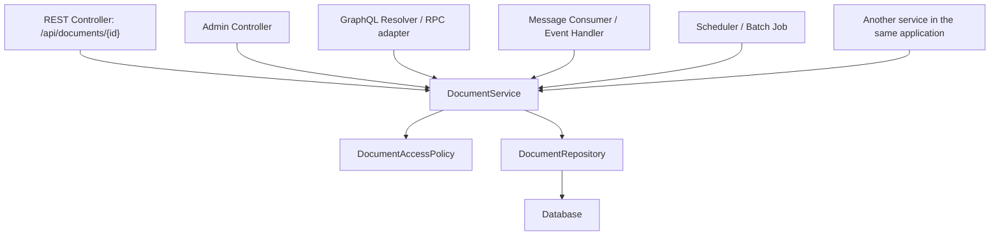
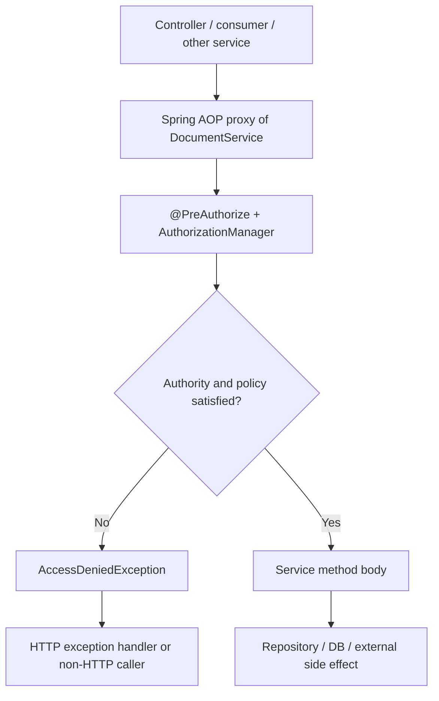

# Why Protect Services Beyond HTTP Rules in Controllers?

## Lesson Objectives

When a Spring Boot application declares HTTP authorization rules, for example requiring `document:read` for `GET /api/documents/**`, we have protected an **HTTP entry point**. However, business operations such as **reading, editing, approving, or deleting a document** are not necessarily invoked only from a single controller. The same `DocumentService` can be called from another endpoint, a GraphQL resolver, a message consumer, a scheduled job, an internal module call, or another service. If permissions exist only in the Controller or are described only by URL, another call path can **bypass the security intent**.

This lesson explains **why an additional security boundary is needed at the service layer**, how Spring Security enforces **method security**, how to design a combination of HTTP + method + object-level authorization, the limitations of Spring AOP proxies, and how to test so you do not confuse "the endpoint is locked" with "the business operation is protected".

After this lesson, you will:

1. Distinguish between **HTTP authorization**, **controller-level checks**, **method security**, and **permissions on individual data objects**.
2. Explain the risks when business logic is reused across multiple entry points.
3. Enable `@EnableMethodSecurity` and write `@PreAuthorize` on Spring-managed services.
4. Combine `hasAuthority`, `hasRole`, and owner/tenant policies from method parameters.
5. Know the limitations of proxies, self-invocation, background jobs, `@PostAuthorize`, and transactions.
6. Write tests that call the service directly to prove permissions cannot be bypassed simply by **not going through the controller**.

**Scope:** Spring Security authorization on the **Servlet stack** and **service layer** (Spring Security 6.x/7.x, Java 17+). Some examples use Spring Boot/Spring MVC to illustrate HTTP entry points. They do not automatically apply identically to WebFlux or calls without a Spring-managed context.

## 1. The Core Problem: The Controller Is Not the Service's Only Caller

Suppose a document storage system has the following structure:

```text
DocumentController
    → DocumentService
        → DocumentRepository
```

The controller receives HTTP requests, validates input, and calls the service. As the application grows, the real structure often becomes:



Putting `@PreAuthorize` **only on controller methods** or `hasAuthority` **only on URLs** does not automatically guarantee that all those other arrows will be checked. An unprotected service method can run from a caller that never goes through the original URL.

For example:

- Endpoint `GET /api/documents/42` has the `document:read` rule. Later, the team adds `GET /api/preview/42` and calls the same `documentService.read(42)` while forgetting the corresponding permission rule.
- A GraphQL query `document(id: 42)` uses `DocumentService` without going through REST's `requestMatchers("/api/documents/**")`.
- A message consumer receives an "export document 42" event sent from an untrusted source, then calls the service.
- An internal controller misconfigures permissions: a regular user is allowed to call a document deletion method that should only be for administrators.
- Another bean reuses the service because the service author assumed "the controller already checked".

The risk does not lie in reusing the service — that is good design — but in **assuming every caller has already been checked at the same layer**.

## 2. Defense-in-Depth Mindset: Two Layers Answering Different Questions

| Layer | Question | Example | Limitation |
| --- | --- | --- | --- |
| HTTP authorization | Is the request URL/method allowed into the application? | `GET /api/documents/**` requires `document:read` | Only protects requests passing through the matching filter chain |
| Controller validation / mapping | Is the request format valid and which handler does it map to? | `@GetMapping`, `@Valid` | Input validation does not replace authorization |
| Method security at the service | Is the principal allowed to perform this **business action**? | `DocumentService.delete` requires `document:delete` | Requires Spring AOP/interceptor to be active; does not automatically grant specific data permissions |
| Object-level policy | Does the principal have permission on this **exact record**? | Tenant, owner, ACL of document 42 | Must fetch trustworthy data from the server/repository |
| Database/query scope | Which records are actually read/written? | Query filtering by tenant/owner, conditional update | A wrong query can still leak data even if HTTP has rules |

In a real system, a request may need **all of the following simultaneously**:

```text
ALLOW =
    valid HTTP request passing HTTP rules
    AND principal has sufficient authority for the action
    AND principal is allowed to access the specific object
    AND resource state permits the operation
```

These layers **complement each other**; it is not an "either HTTP or service" choice. Adding method security does not mean removing all HTTP security. HTTP is still needed to block sensitive routes, handle authentication/CORS/CSRF, and apply request protections; the service adds a boundary right where the business action is executed.

### Before and After Example

**Before — blocking only at HTTP:**

```java
http.authorizeHttpRequests(auth -> auth
    .requestMatchers(HttpMethod.DELETE, "/api/documents/**")
        .hasAuthority("document:delete")
    .anyRequest().authenticated()
);
```

If another endpoint `POST /api/batch/cleanup` enters the `deleteDocument(...)` service but is only protected by `authenticated()`, the original HTTP DELETE rule **has no effect** on calls from the batch endpoint.

**After — keeping the HTTP rule and adding a service invariant:**

```java
// Place on the actual service bean, not only on the controller.
@PreAuthorize("hasAuthority('document:delete')")
public void deleteDocument(long id) {
    // verify the object and perform the delete operation
}
```

Now any caller **going through the Spring-managed service proxy** must pass the `document:delete` check, regardless of which controller calls it.

**Important:** this does not guarantee protection for callers that instantiate the service with `new`, invoke internally via `this`, or run outside a valid security context. You must understand the boundaries of the method interceptor.

## 3. What Does HTTP Authorization Do Well — and What Can It Not Do?

In Spring Security Servlet, `authorizeHttpRequests` typically builds request authorization rules via `AuthorizationFilter` and `AuthorizationManager`. For example:

```java
import org.springframework.context.annotation.Bean;
import org.springframework.context.annotation.Configuration;
import org.springframework.http.HttpMethod;
import org.springframework.security.config.Customizer;
import org.springframework.security.config.annotation.web.builders.HttpSecurity;
import org.springframework.security.web.SecurityFilterChain;

@Configuration
public class HttpSecurityConfig {

    @Bean
    SecurityFilterChain apiSecurity(HttpSecurity http) throws Exception {
        http
            .authorizeHttpRequests(auth -> auth
                .requestMatchers(HttpMethod.GET, "/health")
                    .permitAll()
                .requestMatchers(HttpMethod.GET, "/api/documents/**")
                    .hasAuthority("document:read")
                .requestMatchers(HttpMethod.DELETE, "/api/documents/**")
                    .hasAuthority("document:delete")
                .anyRequest().denyAll()
            )
            .httpBasic(Customizer.withDefaults());
        return http.build();
    }
}
```

This is a **Spring Security snippet** and cannot run standalone with `javac`; the project must have the framework, an authentication source, controllers, and data. For form login or OAuth2 Bearer, configure the appropriate authentication/entry point instead of HTTP Basic.

That configuration is useful because it:

- Blocks requests lacking the role/authority right at the HTTP gate.
- Separates read and delete permissions by HTTP method.
- Uses `anyRequest().denyAll()` so new endpoints are not left open by default.
- Integrates with authentication mechanisms, `SecurityContext`, exception translation, and security filters.

However, it does **not** directly apply to:

- A `documentService.deleteDocument(42)` call from another bean in the same process.
- A consumer processing messages outside the HTTP filter chain.
- A scheduler calling the service on a schedule.
- A GraphQL/RPC entrypoint with an HTTP mapping different from the REST route.
- A business operation executed via an endpoint accidentally configured as `permitAll` or `authenticated`.

And `requestMatchers(HttpMethod.GET, "/api/documents/**")` only expresses permission **on the path**; it does not automatically verify **who owns document 42**.

### Multiple SecurityFilterChains Do Not Replace Service Protection

If the application uses `http.securityMatcher("/api/**")`, rules inside that chain **only** apply to requests matched by the API chain. URLs like `/admin`, `/graphql`, or `/internal` may be handled by another chain, or even **have no matching chain** if misconfigured. In such cases, a service-level guard still helps maintain a business boundary for calls through the proxy, but **must not be treated as a complete substitute for filter-chain coverage gaps**. Protect both.

## 4. What Are the Weaknesses of Controller-Level Checks?

An approach that is easy to write but hard to maintain is scattering permission checks in controllers:

```java
@DeleteMapping("/api/documents/{id}")
public void delete(@PathVariable long id, Authentication auth) {
    if (!auth.getAuthorities().stream()
            .anyMatch(a -> a.getAuthority().equals("document:delete"))) {
        throw new AccessDeniedException("Forbidden");
    }
    documentService.deleteDocument(id);
}
```

This is an illustrative snippet requiring appropriate Spring classes/controller/imports. It may block this specific HTTP endpoint, but remaining issues include:

1. **Rule is not bound to the action:** if the service is called from another controller, the check does not travel with it.
2. **Duplicated logic:** multiple adapters checking the same `document:delete` easily drift out of sync, especially when renaming permissions.
3. **Data permissions lack context:** the controller usually has `id` but should not load data and decide owner/tenant at every endpoint itself.
4. **Hard to test independently:** proving `deleteDocument` is safe requires testing every controller.
5. **Easy to forget during refactoring:** splitting controller methods, adding GraphQL, or adding async handlers can drop an existing `if`.

Controllers should still handle authentication-related request handling, input validation, and format/HTTP status mapping. **The authorization policy of a business operation can be enforced in the service**, close to where the critical operation occurs and reused across adapters.

### Do Not Misunderstand: Does Every Service Method Need an Annotation?

Not necessarily. You need to identify the **business boundaries that need protection**: public service operations reading/writing sensitive data, updating critical state, exporting reports, granting permissions, or modifying accounts. Pure computation helpers or private methods inside an already-protected operation may not need separate annotations. Avoid scattering identical `@PreAuthorize` annotations on every method without intent, as policies become hard to review.

## 5. How Does Method Security Work in Spring Security?

Method security allows checking **method invocations on Spring-managed beans**, rather than only checking request URLs.

Enable it with:

```java
import org.springframework.context.annotation.Configuration;
import org.springframework.security.config.annotation.method.configuration.EnableMethodSecurity;

@Configuration
@EnableMethodSecurity
public class MethodSecurityConfig {
}
```

**Do not skip this step:** Spring Boot Starter Security **does not automatically enable** `@PreAuthorize`/`@PostAuthorize`. `@EnableMethodSecurity` is the modern configuration replacing the legacy `@EnableGlobalMethodSecurity`.

Once enabled, Spring Security registers method security interceptors; for `@PreAuthorize`, the Spring AOP proxy intercepts the method call, obtains `Authentication` from the context, evaluates the expression via the authorization manager, and then:

- **ALLOW:** forwards execution to the service method body.
- **DENY:** throws `AccessDeniedException` (or the corresponding subclass in the version used). Inside an HTTP request, the exception can propagate to `ExceptionTranslationFilter` to be converted into 401/403/redirect depending on authentication status and entry point/handler.
- For **non-HTTP** calls, there is no `ExceptionTranslationFilter` to generate a response; the scheduler/consumer/caller must handle the error explicitly.



**Key point:** the interceptor sits at the **method boundary**. It does not depend on the controller's URL name; therefore, the same method called from two different HTTP routes still retains the same permission check.

### Commonly Used Annotations

| Annotation | When Evaluated | Use Case |
| --- | --- | --- |
| `@PreAuthorize` | **Before** invoking the method | Blocks actions based on principal, authorities, and method arguments |
| `@PostAuthorize` | **After** the method returns a result | Checks the returned object, e.g., owner of the read object |
| `@PreFilter` | Filters a collection argument before running the method | Forwards only items the user is allowed to process; requires understanding filter semantics |
| `@PostFilter` | Filters a collection result after running the method | Small datasets; does not replace pagination/query scoping |
| `@Secured` | Before the method, based on roles/authorities | Legacy mechanism; requires `securedEnabled = true` if used |
| `@RolesAllowed` | Before the method | JSR-250; requires `jsr250Enabled = true` if used |

`@EnableMethodSecurity` enables pre/post annotations by default. `@Secured` and JSR-250 require opt-in. If a method has **multiple types of security annotations**, the checks are executed sequentially, effectively as **AND**; do not repeat `@PreAuthorize` twice on the same method. If OR logic is needed, write it in a single expression using `or`/`hasAnyAuthority`.

## 6. Practical Example: HTTP Rule + Service `@PreAuthorize`

Suppose a system allows reading and deleting documents. The service must protect the delete operation even if a caller does not go through `DELETE /api/documents/{id}`.

### 6.1. Configuration Enabling Method Security

```java
@Configuration
@EnableMethodSecurity
public class ApplicationSecurity {
    // @Bean SecurityFilterChain beans can be declared in another configuration.
}
```

This snippet requires importing `@Configuration` and `@EnableMethodSecurity` as shown in section 5.

### 6.2. Service Containing the Business Operation Boundary

```java
import org.springframework.security.access.prepost.PreAuthorize;
import org.springframework.stereotype.Service;

@Service
public class DocumentService {

    private final DocumentRepository repository;

    public DocumentService(DocumentRepository repository) {
        this.repository = repository;
    }

    @PreAuthorize("hasAuthority('document:read')")
    public Document read(long id) {
        return repository.findById(id)
            .orElseThrow(() -> new DocumentNotFoundException(id));
    }

    @PreAuthorize("hasAuthority('document:delete')")
    public void delete(long id) {
        repository.deleteById(id);
    }
}
```

This is an **integration snippet**: `Document`, `DocumentRepository`, and `DocumentNotFoundException` must be defined by the project. These service-level rules check **functional permissions**, not owner/tenant yet; the next section extends the policy. `deleteById` is illustrative only; production code needs existence checks, owner/tenant checks, transactions, and race condition handling.

### 6.3. Controller Simply Delegates Calls to the Service

```java
import org.springframework.web.bind.annotation.DeleteMapping;
import org.springframework.web.bind.annotation.GetMapping;
import org.springframework.web.bind.annotation.PathVariable;
import org.springframework.web.bind.annotation.RequestMapping;
import org.springframework.web.bind.annotation.RestController;

@RestController
@RequestMapping("/api/documents")
public class DocumentController {

    private final DocumentService documents;

    public DocumentController(DocumentService documents) {
        this.documents = documents;
    }

    @GetMapping("/{id}")
    public Document read(@PathVariable long id) {
        return documents.read(id);
    }

    @DeleteMapping("/{id}")
    public void delete(@PathVariable long id) {
        documents.delete(id);
    }
}
```

Another controller can inject this exact `DocumentService`. If it calls `delete` **through the Spring proxy**, `@PreAuthorize` still requires `document:delete`; there is no need to duplicate authorization `if` checks into the new controller.

### 6.4. Decisions Across Three Tiers

| Scenario | HTTP layer | Service layer | Outcome |
| --- | --- | --- | --- |
| Anonymous GET document | Fails `hasAuthority("document:read")` | Does not reach service | Denied/challenged |
| Full user with `document:read` GET | Passes HTTP | Passes `@PreAuthorize` read | Can return document after data policy |
| Full user with only `document:read` DELETE | Fails HTTP delete rule | Does not reach service | Denied |
| A new endpoint calls `documents.delete(id)` with a user who only has `document:read` | May accidentally pass the new endpoint's HTTP rule | **Denied by `@PreAuthorize` at the service** | Method body is not executed |
| A scheduler calls `documents.delete(id)` directly | No HTTP layer | Check depends on the job's SecurityContext | Not automatically allowed; requires explicit system identity/policy design |
| Full user with `document:delete` but the document belongs to another tenant | Can pass HTTP and service authority | Requires additional **object-level policy** | Must be denied at service/query |

The second layer reduces the impact of a missed HTTP mapping, **without** turning the service into something that automatically solves every authentication, transaction, or data issue.

## 7. Object-Level Protection at the Service: Same Functional Permission, Different Resource

This is a very important reason to keep authorization close to **business data**. Two people who both have `document:read` are not necessarily allowed to read the same document.

For example:
- Alice has `document:read` in tenant A.
- Bob also has `document:read` in tenant B.
- Document 42 belongs to tenant B.
- Alice knows or guesses ID 42 and sends `GET /api/documents/42`.

The HTTP rule `hasAuthority("document:read")` is **not enough** to protect document 42. The service must combine **authority + object policy**.

### Policy Bean Used in `@PreAuthorize`

```java
import org.springframework.security.core.Authentication;
import org.springframework.stereotype.Component;

@Component("documentPolicy")
public class DocumentPolicy {

    private final DocumentRepository repository;

    public DocumentPolicy(DocumentRepository repository) {
        this.repository = repository;
    }

    public boolean canRead(Authentication actor, long documentId) {
        if (actor == null || !actor.isAuthenticated()) {
            return false;
        }
        // Production: filter tenant/owner by authenticated identity
        // and server data, do not trust client-supplied tenantId.
        return repository.isReadableBy(documentId, actor.getName());
    }
}
```

**Note:** `DocumentRepository.isReadableBy` is a project-designed API that must execute a real query/policy. `actor.isAuthenticated()` alone is **not sufficient** to reject anonymous tokens in all configurations; `@PreAuthorize` below also requires the matching authority, and a production policy should use a trust resolver/real principal check or verified identity source. The code above illustrates part of the logic, not the entire production authentication policy.

### Service Reading a Document with Per-Record Permission

```java
import org.springframework.security.access.method.P;
import org.springframework.security.access.prepost.PreAuthorize;

@PreAuthorize(
    "hasAuthority('document:read') and " +
    "@documentPolicy.canRead(authentication, #documentId)"
)
public Document read(@P("documentId") long documentId) {
    return repository.findById(documentId)
        .orElseThrow(() -> new DocumentNotFoundException(documentId));
}
```

This snippet **replaces/completes the `read` method** in section 6; do not paste two methods with the same signature in one class. `@P` keeps the parameter name in SpEL stable if the class is not compiled with `-parameters`. Spring Security takes `authentication` from the security context, not a principal self-declared by the client.

**Do not use a client-sent `tenantId`** as proof of permission. For multi-tenant applications, derive tenant membership/ACL from the authenticated identity and database; if multiple tenants are selectable, verify the user is allowed to operate in that tenant. Beware of time-of-check/time-of-use issues: owner/ACL data can change between the check and the query. For sensitive write operations, apply **query scoping/conditional updates/transactions**.

### Why Relying Only on `@PostAuthorize` Can Be Dangerous

```java
@PostAuthorize("returnObject.ownerUsername == authentication.name")
public Document read(long id) { ... }
```

`@PostAuthorize` is useful for read results: the interceptor evaluates the returned object **after the method runs**. However:
- For operations that send emails, delete files, transfer money, or update the DB, post-checking is **too late**; side effects may have already occurred.
- With a very large collection, loading everything and then using `@PostFilter` can waste resources, break pagination, and risk data being used uncontrollably before filtering.
- Prefer **checking before side effects**, scoping data in queries, or using appropriate object policies.

If you need to hide the existence of out-of-scope resources, the API may intentionally return 404 instead of 403, but this must be a consistent decision at the endpoint/query level, not an arbitrary status choice.

## 8. Standalone Java 17 Example: Controller Guard Does Not Protect the Service

To see the risk without Spring, let us write a Java 17 program simulating **controller check vs service check**. This example runs standalone with `javac`, without Spring.

Save the file with the exact name **`ServiceBoundaryDemo.java`**:

```java
import java.util.Set;

public class ServiceBoundaryDemo {

    record Actor(String name, Set<String> authorities) {
        boolean has(String authority) {
            return authorities.contains(authority);
        }
    }

    static class UnsafeService {
        String delete(long id) {
            return "DELETED document " + id;
        }
    }

    static class ControllerOnly {
        private final UnsafeService service = new UnsafeService();

        String deleteThroughHttp(Actor actor, long id) {
            if (!actor.has("document:delete")) {
                return "HTTP DENIED";
            }
            return service.delete(id);
        }

        // Another entrypoint accidentally bypasses the controller.
        String deleteFromOtherCaller(long id) {
            return service.delete(id);
        }
    }

    static class ProtectedService {
        String delete(Actor actor, long id) {
            if (!actor.has("document:delete")) {
                return "SERVICE DENIED";
            }
            return "DELETED document " + id;
        }
    }

    public static void main(String[] args) {
        Actor reader = new Actor("alice", Set.of("document:read"));
        Actor editor = new Actor("bob", Set.of("document:delete"));

        ControllerOnly controller = new ControllerOnly();
        ProtectedService protectedService = new ProtectedService();

        System.out.println(
            "Controller, reader: "
                + controller.deleteThroughHttp(reader, 42)
        );
        System.out.println(
            "Other caller, reader: "
                + controller.deleteFromOtherCaller(42)
        );
        System.out.println(
            "Service, reader: "
                + protectedService.delete(reader, 42)
        );
        System.out.println(
            "Service, editor: "
                + protectedService.delete(editor, 42)
        );
    }
}
```

Run on **JDK 17+**:

```bash
javac ServiceBoundaryDemo.java
java ServiceBoundaryDemo
```

**Exact stdout:**

```text
Controller, reader: HTTP DENIED
Other caller, reader: DELETED document 42
Service, reader: SERVICE DENIED
Service, editor: DELETED document 42
```

What the output demonstrates:

1. The controller has an `if` blocking the reader, so the HTTP caller does not delete.
2. Another caller invoking the **unprotected** service directly "deletes" successfully in the simulation.
3. When the service checks the authority itself, the reader is denied regardless of who the caller is.
4. The editor with the right authority is allowed. In production, owner/tenant and transactions must be added.

**Do not confuse the plain Java model with Spring method security:** the example passes `Actor` manually to the service. Real Spring Security pulls `Authentication` from `SecurityContextHolder`/AOP interceptors and has proxy limitations; do not rely on a client-constructed `Actor` for security.

## 9. AOP Proxies Are a Technical Boundary You Must Understand

`@PreAuthorize` works on **method invocations intercepted by Spring Security**. Therefore, the presence of the annotation in source code does not mean every call pattern is protected.

### 9.1. Calls from Outside the Spring Bean Through the Proxy

```text
Controller bean → DocumentService proxy
                    → @PreAuthorize
                    → target DocumentService method (if ALLOW)
```

This is the intended usage: inject `DocumentService` into controllers/other beans via the Spring container.

### 9.2. Self-Invocation Can Bypass the Interceptor

```java
@Service
public class DocumentService {

    public void cleanup(long id) {
        // Calls via this, does not go back through the Spring proxy.
        this.delete(id);
    }

    @PreAuthorize("hasAuthority('document:delete')")
    public void delete(long id) {
        // illustrative side effect
    }
}
```

If `cleanup` is called through the proxy while `cleanup` is unprotected, the internal call `this.delete(id)` typically **bypasses the method interceptor** in default Spring AOP proxy mode. In that case, you cannot expect the annotation on `delete` to block calls from inside the same class.

**Design fix:** protect the `cleanup` entrypoint with the proper permission, or extract `delete` into a **separate protected bean** and call it through the injected proxy. AspectJ weaving has different semantics and requires separate configuration/testing; do not assume enabling `@EnableMethodSecurity` automatically solves self-invocation.

### 9.3. No Spring Bean, No Proxy

The following situations do not automatically trigger method security:

- Using `new DocumentService(...)` instead of obtaining the bean from the Spring context.
- Calling private/helper methods that do not pass through an interception point.
- Calling through self-invocation, final/static methods, or call forms that the proxy mechanism cannot intercept.
- Mocking the entire service in a test and assuming the real service's `@PreAuthorize` ran.

Some limitations depend on JDK dynamic proxies, class-based proxies, visibility, final methods, and AspectJ configuration. **Testing a call through the real bean** is more reliable proof than just reading annotations.

## 10. Background Jobs and Message Consumers: Protecting the Service Is Not Enough Without Identity

In an HTTP request, authentication filters usually populate `SecurityContextHolder`. However, a `@Scheduled` job, message listener, or async task **does not automatically have the same `SecurityContext`**.

For example:

```java
@Scheduled(fixedDelayString = "PT10M")
public void cleanupExpiredDocuments() {
    documentService.deleteExpired();
}
```

If `deleteExpired` is protected by `@PreAuthorize` and has no appropriate authentication, it can be denied. That is not necessarily a bug; the job must have an **explicit authorization model**.

Options to consider:

- **User-initiated async work:** propagate/forward identity through a framework-supported and appropriate context propagation mechanism, while verifying the token/session/roles are still valid at execution time.
- **Message consumer:** authenticate the **message source** and authorization to perform the action using trustworthy metadata; do not accept `userId`/`ROLE_ADMIN` in the body as proof of permission.
- **System job:** use a **system principal/service identity** with least privilege, explicitly granted and audited, or design a dedicated internal operation with its own safety policy. Do not grant full admin privileges by default.
- **Cross-service call:** if the service call crosses into another process, this process's proxy annotations **do not travel over the network**; each service must authenticate and authorize at its own trust boundary.

**Do not share a mutable SecurityContext across all threads**, do not arbitrarily pass an entire HTTP session, and do not assume `InheritableThreadLocal` solves all async/thread-pool semantics. Outside an HTTP request, an `AccessDeniedException` must be handled by the caller as a business/security error rather than automatically producing a 403 response.

## 11. `@PreAuthorize` vs Programmatic Permission Checks in the Service

Not every policy is convenient to write in SpEL.

### When Is `@PreAuthorize` Appropriate?

- Clear permissions: `hasAuthority("document:delete")`.
- Conditions from method parameters: `#documentId`, `#tenantId` safely mapped.
- A policy bean with a clear API: `@documentPolicy.canRead(authentication, #documentId)`.
- Need to ensure **the method body does not run** if permission is denied.

### When to Consider a Java Policy / `AuthorizationManager`?

- Multi-step rules requiring data queries or complex auditing.
- Decisions combining tenant membership, owner, resource state, product plan, and approval chain.
- Wanting to reuse the policy across method security, HTTP, or non-web adapters.
- Needing to unit-test authorization logic independently of SpEL.

Example bean:

```java
@Component("approvalPolicy")
public class ApprovalPolicy {

    public boolean canApprove(
            Authentication actor, PurchaseOrder order) {
        // Check permission, matching tenant, and state
        // based on real server data.
        return hasApprovalAuthority(actor)
            && isSameTenant(actor, order)
            && order.isPending();
    }
}
```

This is **illustrative Java pseudocode**, without defining `PurchaseOrder` and helper methods. In production, separate helpers for testing and do not use client-supplied `tenant` values as proof. It can be called inside `@PreAuthorize` via a SpEL bean or implemented as a custom `AuthorizationManager<MethodInvocation>` when greater control is needed.

**An invariant should have a clear source of truth.** Do not write completely different business policies across Controller, GraphQL, and service. HTTP checks coarse route permissions, service/policy holds business rules, and DB/query enforces data scope.

## 12. Data, Transactions, and Authorization Timing

### Deny Before Side Effects

If a service transfers money, approves orders, or deletes data, `@PreAuthorize` checks **before the method body runs**. `@PostAuthorize` only checks after the method returns, so it is unsuitable as the sole guard for actions that have already:

- written to the database;
- sent an email;
- called a payment API;
- written files to storage;
- published events to a message broker.

`@Transactional` does not automatically make post-checks safe. Side effects outside the database may have already happened and cannot be rolled back. Choose a **checkpoint before effects occur**.

### Race Condition / TOCTOU

Suppose a service checks that Alice is still the owner of document 42; between the check and `DELETE`, ownership may have changed. For sensitive operations, you can use:

- Database queries conditioned on `id`, `tenantId`, and `ownerId`.
- Appropriate transactions/locking to control changing data.
- Policy by ID and state fetched **within the same business scope** as the write operation.
- Re-checking invariants when external non-DB systems or asynchronous workflows are involved.

Do not rely solely on `existsByIdAndOwner(...)` followed by `deleteById(id)` in every environment; if data/ACLs change between the two statements, mechanisms ensuring consistency are required.

### Listing Queries

A `listAllDocuments()` service protected with `hasAuthority("document:read")` that returns the **entire** DB still violates multi-tenant policy. Do not load every record and rely only on `@PostFilter` to strip out-of-scope data when query filtering/pagination at the source is possible. Returning scoped data straight from the repository reduces leaks, lowers cost, and keeps pagination/counts consistent.

## 13. Testing Method Security Directly Without Depending on the Controller

An important test point is **calling the proxied service bean** from a JUnit test without going through MockMvc. If a user lacks permission and the method still runs, the service boundary is not working.

### Minimal, Structurally Complete JUnit/Spring Test

The following example uses JUnit 5, `spring-test`, and `spring-security-test`, without requiring Spring Boot. It requires compatible Spring Security dependencies and must be run via a build tool (Maven/Gradle); **it does not run with plain `javac`**.

```java
import org.junit.jupiter.api.Test;
import org.springframework.beans.factory.annotation.Autowired;
import org.springframework.context.annotation.Bean;
import org.springframework.context.annotation.Configuration;
import org.springframework.security.access.AccessDeniedException;
import org.springframework.security.access.prepost.PreAuthorize;
import org.springframework.security.config.annotation.method.configuration.EnableMethodSecurity;
import org.springframework.security.test.context.support.WithAnonymousUser;
import org.springframework.security.test.context.support.WithMockUser;
import org.springframework.test.context.junit.jupiter.SpringJUnitConfig;

import static org.junit.jupiter.api.Assertions.assertEquals;
import static org.junit.jupiter.api.Assertions.assertThrows;

@SpringJUnitConfig(ServiceAuthorizationTest.Config.class)
class ServiceAuthorizationTest {

    @Autowired
    GuardedDocumentService service;

    @Test
    @WithMockUser(authorities = "document:delete")
    void correctAuthorityAllowsMethodCall() {
        assertEquals("deleted:42", service.delete(42L));
    }

    @Test
    @WithMockUser(authorities = "document:read")
    void missingDeleteAuthorityDeniesMethodCall() {
        assertThrows(
            AccessDeniedException.class,
            () -> service.delete(42L)
        );
    }

    @Test
    @WithAnonymousUser
    void anonymousDoesNotGetDeletePermission() {
        assertThrows(
            AccessDeniedException.class,
            () -> service.delete(42L)
        );
    }

    @Configuration
    @EnableMethodSecurity
    static class Config {
        @Bean
        GuardedDocumentService guardedDocumentService() {
            return new GuardedDocumentService();
        }
    }

    public static class GuardedDocumentService {
        @PreAuthorize("hasAuthority('document:delete')")
        public String delete(long id) {
            return "deleted:" + id;
        }
    }
}
```

With compatible dependencies, these tests prove that **method invocations through the Spring bean** are checked. There is no HTTP URL in the example; this is precisely why method security is a boundary independent of the Controller.

When integrating into a real project, do not use `@MockBean`/Mockito mocks to replace **the exact service under test**: mocking can prevent the real service's proxy/annotations from running. You can mock dependent repositories, but the service must be a real bean from the application context. Add tests verifying the repository is **not called** on denial.

### Object-Level Business Tests

Another test suite should cover:

| Principal | Authority | Document | Expected |
| --- | --- | --- | --- |
| Alice | `document:read` | Alice's document in tenant A | ALLOW |
| Alice | `document:read` | Bob's document in tenant B | DENY |
| Alice | `document:delete` | Alice's document, deletable state | ALLOW |
| Alice | `document:delete` | Document in another tenant | DENY |
| Alice | Only `ROLE_USER` | Any document | DENY by `hasAuthority` |
| Anonymous | None | Public/private document per policy | Choose an explicit rule; never treat anonymous as a logged-in user |
| System job | Explicitly designed system identity/authorization | Expired documents | Decide per job policy, with audit |

Write tests directly on the service to prove the object policy; then add **MockMvc tests** to verify URLs, HTTP methods, CSRF, entry points, and response mapping. Testing only HTTP 403 without testing the service makes it hard to detect another call path bypassing it.

## 14. Exceptions and HTTP Status Codes When the Service Denies Access

A `@PreAuthorize` denial typically throws `AccessDeniedException` or its subclass `AuthorizationDeniedException`. When the method is called during a Servlet HTTP request and the exception propagates out through the security filter chain, `ExceptionTranslationFilter` can handle it:

- Fully authenticated user lacking permission → usually via `AccessDeniedHandler`, returning **403**.
- Anonymous or insufficiently authenticated → possibly via `AuthenticationEntryPoint`, returning **401** (Basic/Bearer) or redirecting to login (form).
- A call inside a scheduler/consumer → **no HTTP response**, the caller must handle the exception.

`@ControllerAdvice` can handle exceptions from controllers/services in MVC, but **is not guaranteed to handle all authorization errors thrown from filters before `DispatcherServlet`**. Standardize the error contract and test both HTTP-level denial and service-level denial.

Important: **403 does not prove method security ran**. A 403 can come from CSRF, HTTP rules, or another policy. To test the service, invoke the bean directly with `@WithMockUser` or verify the interceptor/side effects in integration tests.

## 15. Common Design Mistakes

1. **Using only `requestMatchers` and assuming every business call is protected:** HTTP filters only cover requests passing through the matching chain and matchers.
2. **Putting `@PreAuthorize` on controllers without protecting reused services:** another GraphQL/consumer/entrypoint can call the method directly.
3. **Forgetting `@EnableMethodSecurity`:** annotations look right, but the method interceptor is never enabled.
4. **Using `new Service()` or mocking the service under test:** bypasses the Spring-managed proxy.
5. **Self-invocation via `this.method()`:** usually bypasses the interceptor on the internally called method.
6. **Putting annotations on private/static/final methods and expecting proxy interception:** depending on proxy type, those calls are not protected like public methods called through a proxy.
7. **Assuming a service with `hasAuthority("read")` allows reading any ID:** owner/tenant/ACL and query scoping are required.
8. **Trusting client-sent `tenantId`/`ownerId`:** attackers can alter values; check against server-side identity and DB.
9. **Using `@PostAuthorize` on methods that already wrote/deleted:** checking after side effects is too late.
10. **Running background jobs as full system admin:** requires verifying the work source, least privilege, and auditing.
11. **Passing SecurityContext arbitrarily across async threads:** the context can be lost, stale, or carry the wrong principal.
12. **Duplicating business policies across adapters:** easily diverges during refactoring; extract a shared policy service.
13. **Testing only controller HTTP 403:** the 403 could be from CSRF, not proving the service guard blocks other callers.
14. **Ignoring transactions/TOCTOU:** permissions can change between check and action; use conditional updates/queries when needed.
15. **Using `anyRequest().authenticated()` and assuming every endpoint has business permissions:** `authenticated` only proves identity status, not permission.
16. **Assuming service security completely replaces HTTP security:** routes, authentication, CSRF, CORS, and filter-chain scope still need protection.
17. **Repeating `@PreAuthorize` twice on the same method to express OR:** repeatable annotations are not supported; use a single combined expression.
18. **Not testing non-REST call paths:** multi-adapter systems need direct service, message consumer, GraphQL, and job policy tests.

## 16. Checklist for Applying at the Service Boundary

- [ ] List critical **business operations** and every place that can call each operation, not just REST URLs.
- [ ] Place HTTP rules by appropriate method/path with explicit fallbacks; do not overlook other filter chains.
- [ ] Enable `@EnableMethodSecurity` and verify the real interceptor works.
- [ ] Protect sensitive public service entrypoints with `@PreAuthorize` or an equivalent policy.
- [ ] Express functional permissions, owner/tenant, data state, and re-authentication requirements separately and clearly.
- [ ] Avoid self-invocation bypasses; extract protected beans when needed and call via Spring proxies.
- [ ] For jobs/messages/async, verify identity and security context; do not assume every task has an HTTP principal.
- [ ] Check permissions before side effects, using transactions/query scoping/conditional updates where appropriate.
- [ ] Test the service directly with sufficient authority, missing authority, anonymous, wrong tenant, and wrong resource ID.
- [ ] Test the HTTP layer separately for 401/403, CSRF, HTTP methods, request matchers, and unknown routes.
- [ ] Check auditing, correlation IDs, and avoid logging credentials or sensitive data in exceptions.
- [ ] Keep business policies consistent across REST, GraphQL, consumers, and internal callers.

### Self-Check

**Question 1.** `DELETE /api/documents/42` requires `document:delete` in HTTP rules, but another batch endpoint calls `documentService.delete(42)` and the service has no guard. What can happen?

**Answer:** The batch endpoint can pass its own HTTP policy and invoke the delete operation without the service re-checking. The action must be protected at the service in addition to per-endpoint HTTP rules.

**Question 2.** `DocumentService.read(42)` has `@PreAuthorize("hasAuthority('document:read')")`. Alice has that authority, but the document belongs to Bob's tenant. Should Alice be allowed to read it?

**Answer:** No. A functional read authority is **not** permission to read every document. The service/repository needs an owner/tenant/ACL policy.

**Question 3.** `@PreAuthorize` is placed on `delete()`, but the same class calls `this.delete()`. Is the interceptor guaranteed to run?

**Answer:** No. With default Spring AOP proxies, self-invocation usually bypasses the proxy. Protect the entrypoint or move the method to another protected bean.

**Question 4.** An HTTP test returns 403 for a PATCH lacking permission; is that enough to prove method security works?

**Answer:** No. The 403 could come from CSRF or HTTP authorization. Test **calling the service bean directly** with `@WithMockUser` and assert `AccessDeniedException`/no side effects.

**Question 5.** A scheduler calls a service protected by `@PreAuthorize` without an authentication context. Does it automatically receive `ROLE_ADMIN` because it runs inside the server?

**Answer:** No. System jobs need an explicit principal/policy, least privilege, and auditing; they do not inherit user/admin permissions by default.

## Official References

- Spring Security, *Method Security*: https://docs.spring.io/spring-security/reference/servlet/authorization/method-security.html
- Spring Security 7.0, *Method Security*: https://docs.spring.io/spring-security/reference/7.0/servlet/authorization/method-security.html
- Spring Security, *Authorize HttpServletRequests*: https://docs.spring.io/spring-security/reference/servlet/authorization/authorize-http-requests.html
- Spring Security, *Java Configuration and SecurityFilterChain*: https://docs.spring.io/spring-security/reference/servlet/configuration/java.html
- Spring Security, *Testing Method Security*: https://docs.spring.io/spring-security/reference/servlet/test/method.html
- Spring Security, *Test WithMockUser*: https://docs.spring.io/spring-security/reference/servlet/test/method.html#test-method-withmockuser
- Spring Framework, *Proxying Mechanisms and Self Invocation*: https://docs.spring.io/spring-framework/reference/core/aop/proxying.html
