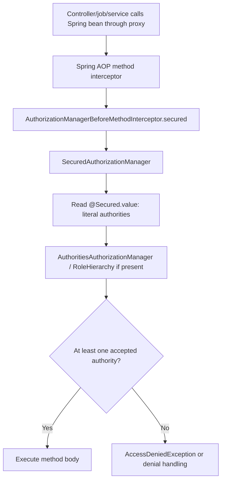

# `@Secured` and the Accepted Authority List

In Spring Security, `@Secured` is an annotation used to protect **Java method invocations** with one or more **accepted authority names**. For example:

```java
@Secured("ROLE_ADMIN")
public void deleteUser(String userId) {
    // Only users with authority ROLE_ADMIN pass this check.
}

@Secured({"ROLE_EDITOR", "ROLE_AUDITOR"})
public void reviewDocument(String documentId) {
    // Accepts ROLE_EDITOR OR ROLE_AUDITOR.
}
```

**Key point:** the strings in the `@Secured({"A", "B"})` array are evaluated with **OR semantics (at least one authority matches)**, **not AND (must hold all)**. The values are **literal authority names**, not Spring Expression Language (SpEL) expressions. `@Secured("hasRole('ADMIN')")` does not mean the same thing as `@PreAuthorize("hasRole('ADMIN')")`.

For the annotation to actually be enforced by Spring Security in modern method security configuration, you must enable:

```java
@Configuration
@EnableMethodSecurity(securedEnabled = true)
class MethodSecurityConfig {
}
```

`@Secured` is considered a **legacy** option by Spring Security; the documentation recommends `@PreAuthorize` for new designs, especially when policies need method parameters, owners, tenants, complex AND/OR logic, or return values. Still, `@Secured` remains useful for understanding existing applications and simple authority checks.

**Context:** Spring Security 6.5.x / Spring Boot 3.x / Java 17+, on Spring-managed service beans. This lesson clarifies how the authority list is evaluated, the `ROLE_` prefix, `RoleHierarchy`, proxies/AOP, denial cases, a runnable Spring Boot example, and testing strategies.

## 1. What Does `@Secured` Check and What Does It Not Check?

`@Secured` is in package:

```java
import org.springframework.security.access.annotation.Secured;
```

Its Javadoc describes one required attribute:

```java
String[] value();
```

It can be placed on a **type/class** or **method**, retained at runtime for infrastructure discovery. The strings in `value` are **security configuration attributes**, typically `GrantedAuthority` names such as `ROLE_USER` or `ROLE_ADMIN`, though they can also be application-specific permissions like `documents.export`.

Example:

```java
@Secured("ROLE_VIEWER")
public String readSummary() {
    return "summary";
}
```

For this call to be allowed, the system must confirm the current `Authentication` has the `ROLE_VIEWER` authority or an authority that **implies** it when `RoleHierarchy` is properly wired into `SecuredAuthorizationManager`.

Things `@Secured` **does not do automatically**:

- **Does not authenticate** passwords, sessions, or JWTs; `Authentication` must come from a trustworthy authentication mechanism.
- **Does not automatically enable** method security in Spring Boot.
- **Does not automatically declare** that `ROLE_ADMIN > ROLE_VIEWER`; the hierarchy must be defined.
- **Does not read parameters `#id` or `authentication.name` as a SpEL expression**.
- **Does not automatically check the owner/tenant** of a document whose ID is in a method parameter.
- **Does not expand** the authority list inside `Authentication` or modify issued tokens.
- **Does not protect** calls that bypass the Spring AOP proxy under standard proxy configuration.
- **Does not block** other endpoints if they invoke a code path that skips the protected method.

### Difference Between Role and Authority

In Spring Security, a role is commonly represented as a `GrantedAuthority` with the `ROLE_` prefix. For example:

```java
new SimpleGrantedAuthority("ROLE_ADMIN");
new SimpleGrantedAuthority("documents.export");
```

Both are `GrantedAuthority` instances; the second string is a business permission following application conventions. `@Secured` checks the **declared string name**; it does not turn `ADMIN` into `ROLE_ADMIN` just because a developer thinks of it as a role.

## 2. The Accepted List Means OR, Not AND

This is the most important semantic detail of this topic.

```java
@Secured({"ROLE_EDITOR", "ROLE_AUDITOR"})
public String review(String documentId) {
    return "reviewed";
}
```

Under **standard authority checking**, a caller with:

- Only `ROLE_EDITOR` → **ALLOW**.
- Only `ROLE_AUDITOR` → **ALLOW**.
- Both → **ALLOW**.
- Only `ROLE_VIEWER` → **DENY**.
- Only `ROLE_ADMIN` → **DENY if no hierarchy/mapping implies EDITOR or AUDITOR**.
- `ROLE_EDITOR` without valid authentication → must be denied by authentication policy; never trust client-asserted authorities.

Illustrative table **without `RoleHierarchy`**, assuming authenticated principals:

| User's Authority Set | `@Secured("ROLE_EDITOR")` | `@Secured({"ROLE_EDITOR", "ROLE_AUDITOR"})` | `@Secured("ROLE_ADMIN")` |
| --- | --- | --- | --- |
| `{ROLE_EDITOR}` | ALLOW | ALLOW | DENY |
| `{ROLE_AUDITOR}` | DENY | ALLOW | DENY |
| `{ROLE_EDITOR, ROLE_AUDITOR}` | ALLOW | ALLOW | DENY |
| `{ROLE_VIEWER}` | DENY | DENY | DENY |
| `{ROLE_ADMIN}` | DENY | DENY | ALLOW |
| `{}` | DENY | DENY | DENY |

**Do not assume** a two-element array "requires both authorities". In Spring Security 6.5, `SecuredAuthorizationManager` delegates to collection-based authority checking; the standard `AuthoritiesAuthorizationManager` permits access when **any required authority matches**.

### 2.1. Why Is Array Syntax Easily Misunderstood?

Java annotations accept an array:

```java
@Secured({"ROLE_EDITOR", "ROLE_AUDITOR"})
```

However, **the Java array is just syntax for passing choices**, not the logical operator. The **authorization manager** defines this as an OR list.

Comparing three intents:

```text
Intent A: EDITOR or AUDITOR
  @Secured({"ROLE_EDITOR", "ROLE_AUDITOR"})  -> suitable

Intent B: EDITOR and AUDITOR
  @Secured({"ROLE_EDITOR", "ROLE_AUDITOR"})  -> NOT suitable

Intent C: EDITOR, plus permission on documentId
  @Secured({"ROLE_EDITOR", "ROLE_AUDITOR"})  -> CANNOT express
```

To require AND or resource checks, use `@PreAuthorize` and an explicit policy bean; for example:

```java
@PreAuthorize(
    "hasAuthority('ROLE_EDITOR') and hasAuthority('ROLE_AUDITOR')"
)
public void requireBothRoles() {
    // Illustrative service fragment.
}
```

Or:

```java
@PreAuthorize(
    "hasAuthority('ROLE_EDITOR') and " +
    "@documentPolicy.canEdit(authentication, #documentId)"
)
public void editDocument(String documentId) {
    // Service fragment, requires a trustworthy documentPolicy bean.
}
```

These fragments **do not run standalone**; they require Spring-managed beans, method security, SpEL parameter metadata, and the matching `documentPolicy`. They demonstrate **SpEL capabilities that `@Secured` lacks**.

### 2.2. A Single Authority Is a Special Case of OR

`@Secured("ROLE_ADMIN")` is a single-element list. Declaratively, it is equivalent to:

```java
@Secured({"ROLE_ADMIN"})
```

If the user does not hold `ROLE_ADMIN` (directly or reachable via hierarchy), the result is DENY. There is no "element priority order" or "pick the strongest authority first" in the accepted list.

## 3. Enabling `@Secured` in Spring Security 6.5

Since Spring Security 6, the modern annotation to enable method-level authorization is `@EnableMethodSecurity`. It enables the pre/post expression annotations by default, but **does not enable `@Secured` by default**.

Required configuration:

```java
import org.springframework.context.annotation.Configuration;
import org.springframework.security.config.annotation.method.configuration.EnableMethodSecurity;

@Configuration
@EnableMethodSecurity(securedEnabled = true)
public class MethodSecurityConfig {
}
```

You may also write:

```java
@EnableMethodSecurity(
    securedEnabled = true,
    prePostEnabled = true,
    jsr250Enabled = false
)
```

Where:

- `securedEnabled = true`: enables the interceptor for `@Secured`.
- `prePostEnabled = true`: enables `@PreAuthorize`/`@PostAuthorize`/filter expressions; this is the default.
- `jsr250Enabled = false`: keeps JSR-250 annotations like `@RolesAllowed` disabled; this is the default.

**Merely adding `spring-boot-starter-security` does not automatically enforce `@Secured`.** Without `@EnableMethodSecurity(securedEnabled=true)`, the method can run normally even though the annotation is present — a serious configuration flaw if developers read the annotation and assume protection is active.

For applications still using legacy `@EnableGlobalMethodSecurity(securedEnabled = true)`, plan a migration to `@EnableMethodSecurity` per the migration guide; avoid mixing multiple configurations doing the same job without verifying the active advisors.

## 4. Where Does `@Secured` Run in the Spring Method Security Flow?

When invoking a proxied **Spring-managed service bean**:



Key points:

1. `@Secured` is checked **before invoking the method body** in the default method authorization mechanism.
2. `SecuredAuthorizationManager` reads the annotation to determine **the allowed authorities**.
3. An `AuthoritiesAuthorizationManager`-style manager checks whether `Authentication` has **at least one** authority from the list.
4. When `RoleHierarchy` is properly configured, **reachable** authorities are also considered.
5. When lacking permission, the method body normally **does not run**. `AccessDeniedException` can be translated to 403 in an HTTP app with proper exception handling; in CLI/batch code, the caller must handle the exception.

### 4.1. Do Not Confuse with the Legacy Voters Model

In older Spring Security generations, method security could rely on `MethodSecurityInterceptor`, `AccessDecisionManager`, and `RoleVoter`, where `@Secured` metadata was interpreted by voters.

In Spring Security 6.5 with modern `@EnableMethodSecurity`, the standard path uses **`AuthorizationManagerBeforeMethodInterceptor`** and **`SecuredAuthorizationManager`**. The two models have different histories and extension points; do not assume custom `RoleVoter` behavior from a legacy app applies automatically to the modern system.

Legacy docs contain examples like:

```java
@Secured("IS_AUTHENTICATED_FULLY")
```

Do not copy this assuming it is always the way to check authentication state in a modern `AuthorizationManager` setup. For authentication-state checks or SpEL, use `@PreAuthorize("isAuthenticated()")` or `isFullyAuthenticated()` per your policy.

### 4.2. Method-Level and HTTP-Level Are Two Protection Layers

Example:

```java
http.authorizeHttpRequests(auth -> auth
    .requestMatchers("/admin/**").hasRole("ADMIN")
    .anyRequest().authenticated()
);
```

and service:

```java
@Secured("ROLE_ADMIN")
public void deleteAccount(String accountId) {
    // ...
}
```

`HttpSecurity` protects the declared URLs; `@Secured` protects **method invocations** via the Spring proxy, even when called from elsewhere through a valid proxy. **Do not substitute HTTP-layer roles for method policies**, and do not omit service-layer data protection just because a controller URL is locked.

## 5. Authority Names Are Literals: `ROLE_` Prefix and Custom Permissions

In `@PreAuthorize("hasRole('ADMIN')")`, the `hasRole` helper conventionally looks for `ROLE_ADMIN`. In contrast:

```java
@Secured("ADMIN")
```

is the literal string **`ADMIN`**, and is not automatically converted to `ROLE_ADMIN`. If the user has:

```java
new SimpleGrantedAuthority("ROLE_ADMIN")
```

then `@Secured("ADMIN")` does not match merely because the word "ADMIN" looks similar. Use:

```java
@Secured("ROLE_ADMIN")
```

or standardize a different authority convention across the entire system.

### Illustrative Table Without Hierarchy

| Authentication Authority | Annotation | Outcome |
| --- | --- | --- |
| `ROLE_ADMIN` | `@Secured("ROLE_ADMIN")` | ALLOW |
| `ROLE_ADMIN` | `@Secured("ADMIN")` | DENY |
| `ADMIN` | `@Secured("ROLE_ADMIN")` | DENY |
| `documents.export` | `@Secured("documents.export")` | ALLOW |
| `SCOPE_documents.export` | `@Secured("documents.export")` | DENY |
| `SCOPE_documents.export` | `@Secured("SCOPE_documents.export")` | ALLOW |
| `ROLE_editor` | `@Secured("ROLE_EDITOR")` | DENY |

Authority names are case-sensitive and character-exact. This annotation performs no automatic normalization among `ROLE_ADMIN`, `ROLE_admin`, and `ADMIN`.

### 5.1. `@Secured` Accepts Non-Role Permissions

Although the annotation is named `Secured` and examples often use `ROLE_`, the value array can hold permissions:

```java
@Secured("documents.export")
public byte[] exportDocument(String documentId) {
    // Illustrative static authority only; still need permission check on the specific document.
    return new byte[0];
}
```

This is useful when a system defines explicit action-based authorities. However, `@Secured` only sees a **string**; it does not understand the business meaning of `documents.export`. If permissions depend on tenant/document ID, add resource checks in the business layer.

### 5.2. OAuth2/JWT: Do Not Automatically Equate Scopes with Roles

In Spring Security OAuth2 Resource Server, a scope like `documents.read` is typically converted to `SCOPE_documents.read` by the default converter. If a method declares:

```java
@Secured("documents.read")
```

while `Authentication` only holds `SCOPE_documents.read`, the method will be denied unless the application configures a matching mapping/hierarchy. A valid JWT does not guarantee literal authority alignment.

Never trust role claims self-supplied by a client; authorities must be built from an `Authentication` backed by verified tokens, issuer, audience, and trustworthy mapping policies.

## 6. `RoleHierarchy` Can Expand Accepted Authorities

In a parent **Role hierarchy**, you can define:

```text
ROLE_ADMIN > ROLE_EDITOR
ROLE_EDITOR > ROLE_VIEWER
ROLE_EDITOR > documents.export
ROLE_AUDITOR > audit.read
```

When Spring Security applies the `RoleHierarchy` properly to `@Secured`:

- Someone holding only `ROLE_ADMIN` is treated as having `ROLE_EDITOR`, `ROLE_VIEWER`, and `documents.export`.
- Someone holding `ROLE_EDITOR` is treated as having `ROLE_VIEWER` and `documents.export`.
- Someone holding `ROLE_AUDITOR` has `audit.read` but does not automatically gain `EDITOR` permissions.
- Someone holding only `ROLE_VIEWER` does not automatically gain `ROLE_EDITOR` or `ROLE_ADMIN`.

Example bean:

```java
@Bean
static RoleHierarchy roleHierarchy() {
    return RoleHierarchyImpl.fromHierarchy("""
            ROLE_ADMIN > ROLE_EDITOR
            ROLE_EDITOR > ROLE_VIEWER
            ROLE_EDITOR > documents.export
            ROLE_AUDITOR > audit.read
            """);
}
```

In Spring Security 6.5 architecture, method security hierarchy support includes **`SecuredAuthorizationManager`** for `@Secured`, alongside `DefaultMethodSecurityExpressionHandler` for pre/post annotations and `Jsr250AuthorizationManager` for JSR-250. Under default configuration, a `RoleHierarchy` bean can be picked up by the `@Secured` infrastructure; verify with an **integration test through a Spring-managed service**, especially if the project has custom managers or multiple contexts.

### 6.1. Distinguishing Two Kinds of Hierarchy Wiring

For **`@Secured`**:

```text
@Secured
  -> SecuredAuthorizationManager
  -> AuthoritiesAuthorizationManager
  -> RoleHierarchy when configured
```

For **`@PreAuthorize`**:

```text
@PreAuthorize (SpEL)
  -> PreAuthorizeAuthorizationManager
  -> MethodSecurityExpressionHandler
  -> RoleHierarchy used by the handler
```

If `@PreAuthorize` needs the hierarchy, the Spring Security 6.5 pattern is:

```java
@Bean
static MethodSecurityExpressionHandler methodSecurityExpressionHandler(
        RoleHierarchy roleHierarchy) {

    DefaultMethodSecurityExpressionHandler handler =
            new DefaultMethodSecurityExpressionHandler();
    handler.setRoleHierarchy(roleHierarchy);
    return handler;
}
```

**Do not confuse them:** declaring the expression handler above serves **SpEL pre/post**; `@Secured` uses a different manager and does not turn `@Secured`'s list into a SpEL expression.

### 6.2. OR Combined with Hierarchy

With:

```java
@Secured({"ROLE_EDITOR", "ROLE_AUDITOR"})
public void review() {}
```

and `ROLE_ADMIN > ROLE_EDITOR`, a user holding only `ROLE_ADMIN` can be **ALLOWED** because it *reaches* `EDITOR` — one of the two choices. This is not "AND between ADMIN and EDITOR"; it is:

```text
Allow if:
  reachableAuthorities(user) intersected with
  {"ROLE_EDITOR", "ROLE_AUDITOR"}
  is a non-empty set.
```

**Security boundary note:** `RoleHierarchy` does not by itself express "admin of tenant A has permission on record B". Coarse roles must be combined with owner/tenant/resource checks.

## 7. Runnable Example: Java 17, Maven, and Spring Boot 3.5.16

The following example runs **a Spring Boot CLI application** (no HTTP server required), retrieves the service from the Spring context, and tests `@Secured` for real through the Spring AOP proxy. Each user is directly granted **only one authority**; any implied permissions (if any) must come from the configured hierarchy.

**Requirements:** JDK 17+, Maven 3.6.3+, Internet access for Maven to download dependencies on first run. Spring Boot **3.5.16** is a released 3.5.x version suitable for Java 17; Spring Security belongs to the 6.5.x line managed via the parent BOM. For production applications, track support schedules and major-version upgrade plans rather than assuming a fixed demo version is always the latest security release.

Directory structure:

```text
secured-demo/
├── pom.xml
└── src/
    └── main/
        ├── java/
        │   └── demo/
        │       ├── SecuredDemoApplication.java
        │       └── DocumentOperations.java
        └── resources/
            └── application.properties
```

### 7.1. `pom.xml`

```xml
<project xmlns="http://maven.apache.org/POM/4.0.0"
         xmlns:xsi="http://www.w3.org/2001/XMLSchema-instance"
         xsi:schemaLocation="http://maven.apache.org/POM/4.0.0
             https://maven.apache.org/xsd/maven-4.0.0.xsd">
    <modelVersion>4.0.0</modelVersion>

    <parent>
        <groupId>org.springframework.boot</groupId>
        <artifactId>spring-boot-starter-parent</artifactId>
        <version>3.5.16</version>
        <relativePath/>
    </parent>

    <groupId>demo</groupId>
    <artifactId>secured-demo</artifactId>
    <version>1.0.0</version>

    <properties>
        <java.version>17</java.version>
    </properties>

    <dependencies>
        <dependency>
            <groupId>org.springframework.boot</groupId>
            <artifactId>spring-boot-starter</artifactId>
        </dependency>
        <dependency>
            <groupId>org.springframework.boot</groupId>
            <artifactId>spring-boot-starter-security</artifactId>
        </dependency>
    </dependencies>

    <build>
        <plugins>
            <plugin>
                <groupId>org.springframework.boot</groupId>
                <artifactId>spring-boot-maven-plugin</artifactId>
            </plugin>
        </plugins>
    </build>
</project>
```

Do not add `spring-boot-starter-web` because this exercise **only needs method security**, without creating a REST API. In projects with a Spring Boot parent/BOM, do not manually mix incompatible `spring-security-*` versions.

### 7.2. `src/main/java/demo/SecuredDemoApplication.java`

```java
package demo;

import java.util.List;
import java.util.function.Supplier;

import org.springframework.boot.CommandLineRunner;
import org.springframework.boot.SpringApplication;
import org.springframework.boot.autoconfigure.SpringBootApplication;
import org.springframework.context.annotation.Bean;
import org.springframework.security.access.AccessDeniedException;
import org.springframework.security.access.hierarchicalroles.RoleHierarchy;
import org.springframework.security.access.hierarchicalroles.RoleHierarchyImpl;
import org.springframework.security.authentication.UsernamePasswordAuthenticationToken;
import org.springframework.security.config.annotation.method.configuration.EnableMethodSecurity;
import org.springframework.security.core.authority.SimpleGrantedAuthority;
import org.springframework.security.core.context.SecurityContext;
import org.springframework.security.core.context.SecurityContextHolder;

@SpringBootApplication
@EnableMethodSecurity(securedEnabled = true)
public class SecuredDemoApplication {

    public static void main(String[] args) {
        SpringApplication.run(SecuredDemoApplication.class, args);
    }

    @Bean
    static RoleHierarchy roleHierarchy() {
        return RoleHierarchyImpl.fromHierarchy("""
                ROLE_ADMIN > ROLE_EDITOR
                ROLE_EDITOR > ROLE_VIEWER
                ROLE_EDITOR > documents.export
                ROLE_AUDITOR > audit.read
                """);
    }

    @Bean
    CommandLineRunner runDemo(DocumentOperations service) {
        return args -> {
            runFor("ADMIN", "ROLE_ADMIN", service);
            runFor("EDITOR", "ROLE_EDITOR", service);
            runFor("AUDITOR", "ROLE_AUDITOR", service);
            runFor("GUEST", "ROLE_GUEST", service);
        };
    }

    private static void runFor(
            String label, String authority, DocumentOperations service) {

        SecurityContext context = SecurityContextHolder.createEmptyContext();
        context.setAuthentication(
                new UsernamePasswordAuthenticationToken(
                    label.toLowerCase(),
                    "demo-only",
                    List.of(new SimpleGrantedAuthority(authority))
                )
        );
        SecurityContextHolder.setContext(context);

        try {
            check(label + " read", service::read);
            check(label + " edit", service::edit);
            check(label + " review", service::review);
            check(label + " export", service::export);
            check(label + " admin", service::admin);
        } finally {
            SecurityContextHolder.clearContext();
        }
    }

    private static void check(String label, Supplier<String> invocation) {
        try {
            System.out.println(label + ": " + invocation.get());
        } catch (AccessDeniedException denied) {
            System.out.println(label + ": DENY");
        }
    }
}
```

Intentional details in the code:

- `@EnableMethodSecurity(securedEnabled=true)` ensures the `@Secured` infrastructure is registered.
- The `RoleHierarchy` bean defines the graph; if this bean is removed, ADMIN's outcome on methods requiring EDITOR/VIEWER can change.
- `DocumentOperations` is **injected** into `CommandLineRunner`, so method calls go through the **Spring-managed proxy**, unlike manual `new DocumentOperations()`.
- The three-argument `UsernamePasswordAuthenticationToken` constructor with authorities creates an **authenticated `Authentication`** in the demo; never construct tokens from client-claimed roles in production apps.
- Each case uses its own `SecurityContext`, calling `SecurityContextHolder.clearContext()` in `finally` so identity does not leak across cases.
- The example prints only **application output lines**; Maven/JVM messages depend on the environment.

### 7.3. `src/main/java/demo/DocumentOperations.java`

```java
package demo;

import org.springframework.security.access.annotation.Secured;
import org.springframework.stereotype.Service;

@Service
public class DocumentOperations {

    @Secured("ROLE_VIEWER")
    public String read() {
        return "ALLOW";
    }

    @Secured("ROLE_EDITOR")
    public String edit() {
        return "ALLOW";
    }

    @Secured({"ROLE_EDITOR", "ROLE_AUDITOR"})
    public String review() {
        return "ALLOW";
    }

    @Secured("documents.export")
    public String export() {
        return "ALLOW";
    }

    @Secured("ROLE_ADMIN")
    public String admin() {
        return "ALLOW";
    }
}
```

In `review()`, the list `ROLE_EDITOR` and `ROLE_AUDITOR` is **OR**: either editor or auditor is allowed. ADMIN in the example is also allowed because `RoleHierarchy` implies EDITOR. `export()` accepts the exact **literal permission** `documents.export`; ADMIN and EDITOR hold this permission via hierarchy.

### 7.4. `src/main/resources/application.properties`

```properties
spring.main.web-application-type=none
spring.main.banner-mode=off
logging.level.root=OFF
```

This file disables the banner/root logging so the lines from `CommandLineRunner` are easy to observe. In production environments, never turn off audit/operational logs just to reduce terminal output.

### 7.5. Running with Maven

From the `secured-demo` directory:

```bash
mvn -q spring-boot:run
```

**Stdout printed by the program** in exact order (excluding any Maven/JVM startup/build lines if present in the environment):

```text
ADMIN read: ALLOW
ADMIN edit: ALLOW
ADMIN review: ALLOW
ADMIN export: ALLOW
ADMIN admin: ALLOW
EDITOR read: ALLOW
EDITOR edit: ALLOW
EDITOR review: ALLOW
EDITOR export: ALLOW
EDITOR admin: DENY
AUDITOR read: DENY
AUDITOR edit: DENY
AUDITOR review: ALLOW
AUDITOR export: DENY
AUDITOR admin: DENY
GUEST read: DENY
GUEST edit: DENY
GUEST review: DENY
GUEST export: DENY
GUEST admin: DENY
```

### 7.6. Why Is Each Outcome Correct?

- **ADMIN** directly holds only `ROLE_ADMIN`, yet the hierarchy reaches `ROLE_EDITOR`, `ROLE_VIEWER`, and `documents.export`; therefore read/edit/review/export all pass, and admin passes via the base `ROLE_ADMIN`.
- **EDITOR** gets read via `ROLE_EDITOR > ROLE_VIEWER`; edit/review via `ROLE_EDITOR`; export via `ROLE_EDITOR > documents.export`; lacks `ROLE_ADMIN`, so admin is denied.
- **AUDITOR** has `ROLE_AUDITOR`. It satisfies one of the two options in `@Secured({"ROLE_EDITOR","ROLE_AUDITOR"})` on `review`, without being promoted to VIEWER/EDITOR.
- **GUEST** only has `ROLE_GUEST`; with no outgoing edges from guest, all five methods deny.

**If `securedEnabled=true` is forgotten**, `@Secured` annotations may not be enforced, and expected DENY lines can turn into ALLOW. That is why **missing-permission cases** must be tested, not only sufficient-permission cases.

**If the hierarchy bean is removed**, ADMIN still gets `admin()`, yet it does not directly have `ROLE_VIEWER` or `ROLE_EDITOR`. The changed results on those methods clearly prove the hierarchy affects authority lookup.

### Limitations of the Example

The example contains no controller, persistence, or HTTP security; it intentionally keeps everything in a CLI to observe the **method interceptor**. In a real application, you must also configure authentication providers, sessions/JWTs, CSRF, request authorization, resource policies, and proper exception handling.

## 8. `@Secured` Is Not SpEL: Distinguishing Syntax and Capabilities

Compare:

```java
@Secured("ROLE_ADMIN")
public void oneRole() {}

@Secured({"ROLE_EDITOR", "ROLE_AUDITOR"})
public void eitherRole() {}

@PreAuthorize("hasRole('ADMIN')")
public void expressionRole() {}

@PreAuthorize(
    "hasRole('EDITOR') and @documentPolicy.canEdit(authentication, #id)"
)
public void expressionAndResource(String id) {}
```

Capability matrix:

| Requirement | `@Secured` | `@PreAuthorize` |
| --- | --- | --- |
| Need a single literal authority | Suitable | Suitable |
| Accept one of multiple authorities | Suitable, OR array | Suitable, SpEL OR/`hasAnyAuthority` |
| Require all N authorities | **Cannot express directly** | Use `and` or custom manager |
| Need method parameter `#id` | **No** | Yes |
| Need policy bean call `@docPolicy` | **No** | Yes |
| Need ownership/tenant/status check | Not built in | Expressible via bean/service policy |
| Need time/feature-flag condition | Not directly | Expression or policy bean |
| Need result filtering/`returnObject` check | No | Use `@PostAuthorize`/`@PostFilter` |
| Project already uses legacy `@Secured` | Can maintain for simple policies | Can migrate with tests |
| Writing new security policies | Limited; Spring docs prefer alternatives | **Generally recommended** |

**Note:** `@PreAuthorize("hasAnyAuthority('ROLE_EDITOR','ROLE_AUDITOR')")` has the same OR semantics as `@Secured`'s list for pure authority matching when both share matching hierarchy/prefix configuration. However, do not claim the two annotations are identical in interceptors, lifecycle, or customizations.

### Can Expressions Be Put Inside `@Secured`?

Incorrect example:

```java
@Secured("hasRole('ADMIN')")
public void bad() {}
```

`@Secured` treats `hasRole('ADMIN')` as a literal authority string. It **does not parse the string as SpEL**. Unless `Authentication` literally has an authority with that strange name, the rule will not behave as the author expected. Correct approach:

```java
@PreAuthorize("hasRole('ADMIN')")
public void good() {}
```

Or if using `@Secured`:

```java
@Secured("ROLE_ADMIN")
public void alsoGood() {}
```

## 9. Class-Level `@Secured` and Method-Level `@Secured`

`@Secured` has `@Target({METHOD, TYPE})`, so it can be placed on a class:

```java
@Service
@Secured("ROLE_SUPPORT")
public class SupportService {

    public String searchTickets() {
        return "tickets";
    }

    public String readTicket(String id) {
        return "ticket " + id;
    }
}
```

When the class is Spring-managed and `@Secured` is enabled, the type-level annotation can apply the condition to service methods according to metadata/pointcut rules. This is how default class-level policies are set.

If one method has a different policy:

```java
@Service
@Secured("ROLE_SUPPORT")
public class SupportService {

    public void readTickets() {
        // Class-level permission.
    }

    @Secured("ROLE_ADMIN")
    public void purgeTickets() {
        // Specific method-level permission.
    }
}
```

Explicitly **verify how method annotations take precedence/are interpreted** in your version and proxy strategy, especially with interfaces, inheritance, or multiple annotation layers. Do not assume class-level and method-level annotations are ANDed together by default. If an operation requires **two conditions simultaneously**, write an explicit policy with `@PreAuthorize` or a custom manager and test denial cases.

### 9.1. Annotations on Interfaces

An interface can carry method annotations, and Spring method security can discover them under many common proxy styles. However, placing annotations on interfaces vs implementations behaves differently across JDK proxies, CGLIB, inheritance, and AspectJ weaving.

Recommendations:

- Pick one consistent convention (typically placing policies on the service interface or implementation per architectural design, verified with integration tests).
- Avoid two different `@Secured` declarations on the same method across multiple interfaces without unambiguous rules.
- Do not rely on assumptions from Java's `@Inherited` for methods: Java does not inherit method annotations the same way as classes.
- When migrating to AspectJ, re-check interface annotation support because weaving and Spring AOP proxies differ.

## 10. `@Secured`, `@PreAuthorize`, and `@RolesAllowed`: Do Not Equate Them

All three annotations serve method security, yet use different infrastructure and syntax:

| Annotation | Requires Enabling | Condition Form | Modern Manager/Infrastructure |
| --- | --- | --- | --- |
| `@Secured` | `securedEnabled=true` | Literal authority list, OR | `SecuredAuthorizationManager` |
| `@PreAuthorize` | `prePostEnabled=true` (default) | SpEL, AND/OR, parameters, policy beans | `PreAuthorizeAuthorizationManager` |
| `@RolesAllowed` | `jsr250Enabled=true` | Role list per JSR-250 rules | `Jsr250AuthorizationManager` |

`@RolesAllowed` belongs to the corresponding Jakarta Annotations/Jakarta Security API in Boot 3, not the same annotation or namespace as `@Secured`. JSR-250 role-prefix and list semantics must be checked against configuration; do not mechanically replace `@Secured("ROLE_ADMIN")` with `@RolesAllowed("ROLE_ADMIN")` without verifying how the manager transforms authority names.

### 10.1. Multiple Different Annotation Types on the Same Method

Spring Security 6.5 states that multiple method security annotations **are checked in sequence**, which in policy terms means **all checks must pass**. Example:

```java
@Secured({"ROLE_EDITOR", "ROLE_AUDITOR"})
@PreAuthorize("@tenantPolicy.isAllowed(authentication, #tenantId)")
public void reviewForTenant(String tenantId) {
    // Business logic.
}
```

Here:

1. `@Secured` requires EDITOR **or** AUDITOR.
2. `@PreAuthorize` requires the tenant policy to allow access.
3. Both conditions must hold for the method body to run.

This snippet requires `@EnableMethodSecurity(securedEnabled=true)`, the `tenantPolicy` bean, discoverable SpEL parameter names, and proper Spring beans/proxies. For complex policies, it is usually **easier to read** when consolidated into a single `@PreAuthorize` rather than stacking multiple annotations.

**Do not repeat two `@Secured` annotations on one method**; this annotation is not an API for expressing AND across multiple lists. If the requirement is "EDITOR and APPROVER", write a single expression or manager according to policy.

## 11. `@Secured` Works When Calls Pass Through the Spring AOP Proxy

`@Secured` is not a Java keyword executed automatically by the JVM upon seeing an annotation. Spring Security registers the interceptor, while Spring AOP must **wrap calls to the Spring bean**.

### 11.1. Calls Through the Proxy

Example:

```java
@Service
public class ReportService {
    private final DocumentOperations operations;

    public ReportService(DocumentOperations operations) {
        this.operations = operations;
    }

    public String build() {
        return operations.export(); // Calls through Spring-managed bean/proxy.
    }
}
```

If `operations` is injected from the Spring context and `@Secured` is enabled, `export` is checked before its body runs.

### 11.2. Self-Invocation Can Bypass

Common pitfall:

```java
@Service
public class UnsafeService {

    public void runJob() {
        deleteSensitiveData(); // this.deleteSensitiveData(): bypasses proxy.
    }

    @Secured("ROLE_ADMIN")
    public void deleteSensitiveData() {
        // Sensitive operation.
    }
}
```

In standard Spring AOP proxy mode, `runJob()` directly calls another method on the **same instance**, bypassing the proxy around `deleteSensitiveData()`. This is an interception mechanism bug, **not an authority-array bug**.

Better design: move the sensitive operation to **another service bean** and call it through the injected bean/proxy; protect the business operation at the needed boundary. If using AspectJ weaving, interception rules differ; configure and test accordingly.

### 11.3. Common Ways Annotations Get Bypassed

- Instantiating objects with `new` instead of retrieving them from the Spring context.
- Writing `@Secured` without `@EnableMethodSecurity(securedEnabled=true)`.
- Calling a method within the same instance instead of via the proxy.
- Putting the annotation on a `private` method that standard proxies cannot intercept.
- `final` classes/methods or proxy settings differing from assumptions, preventing proxy interception.
- Multiple `ApplicationContext`s where method security is enabled only in a different context.
- Calls running on worker threads lacking a `SecurityContext` or valid principal.
- Tests using Mockito/mock services instead of the real advisor-backed bean, skipping method security.

Never fix these issues by adding roles to every principal. First prove **the interceptor actually runs** and negative tests work.

## 12. Why Does 403 Not Necessarily Come from `@Secured`?

In a Web Servlet application, a request can be blocked at multiple layers:

```text
HTTP request
  -> Spring Security filter chain (authentication, CSRF, URL authorization...)
  -> controller
  -> Spring AOP method security (@Secured / @PreAuthorize)
  -> domain/service policy
  -> repository
```

If the client receives 403, the cause could be:

- `CsrfFilter` rejecting a POST missing a CSRF token.
- URL authorization (e.g., `hasRole("ADMIN")` at the HTTP layer) denying **before** the controller runs.
- Service `@Secured` denying due to missing authority.
- `@PreAuthorize`/another resource policy denying.
- Unauthenticated user handled by entry point/exception handling per configuration, potentially returning 401 or redirecting instead of 403.

**Do not infer from an HTTP 403 status that `@Secured` is working.** If `securedEnabled=true` is not enabled yet but an HTTP filter already blocked the request, a 403 test will still pass even though the method itself is unprotected.

To prove `@Secured` is enforced, write **integration tests calling the Spring-managed service directly** with sufficient and insufficient principals, in addition to MockMvc tests at the HTTP layer.

## 13. Testing: Case Matrix for the OR List

Suppose the method is:

```java
@Secured({"ROLE_EDITOR", "ROLE_AUDITOR"})
public String review() {
    return "review";
}
```

With **no hierarchy enabled**. Matrix:

| Directly Granted Authority | Outcome | Reason |
| --- | --- | --- |
| `ROLE_EDITOR` | ALLOW | First element matches |
| `ROLE_AUDITOR` | ALLOW | Second element matches |
| `ROLE_EDITOR, ROLE_AUDITOR` | ALLOW | Has at least one (in fact both) |
| `ROLE_VIEWER` | DENY | No match |
| `ROLE_ADMIN` | DENY | No automatic inheritance/mapping |
| `ROLE_editor` | DENY | Case-sensitive |
| `EDITOR` | DENY | Missing prefix vs literal string |
| No authority | DENY | No option satisfied |

If the graph `ROLE_ADMIN > ROLE_EDITOR` is enabled, a user holding only `ROLE_ADMIN` becomes **ALLOW** on this method when the manager applies `RoleHierarchy`. Therefore, tests should cover **two separate configurations** (with/without hierarchy) to make the cause clear.

### 13.1. Integration Test with `@WithMockUser`

In a Spring Boot project with `spring-boot-starter-test` and `spring-security-test` in test scope, you can use:

```java
@SpringBootTest
class SecuredMethodTests {

    @Autowired
    DocumentOperations operations;

    @Test
    @WithMockUser(authorities = "ROLE_EDITOR")
    void editorCanReview() {
        assertEquals("ALLOW", operations.review());
    }

    @Test
    @WithMockUser(authorities = "ROLE_AUDITOR")
    void auditorCanReview() {
        assertEquals("ALLOW", operations.review());
    }

    @Test
    @WithMockUser(authorities = "ROLE_GUEST")
    void guestCannotReview() {
        assertThrows(AccessDeniedException.class, operations::review);
    }
}
```

This is a **JUnit 5 test fragment**, not included in the minimal CLI example unless test dependencies and imports are added: `@SpringBootTest`, `@Autowired`, `@Test`, `@WithMockUser`, `assertEquals`, `assertThrows`, `AccessDeniedException`. It tests the **real bean/proxy** for the `review` method. Add a test disabling `securedEnabled` in a separate context to verify your tests can detect an inactive policy.

### 13.2. Testing Hierarchy and Literal Permissions

Add:

```java
@Test
@WithMockUser(authorities = "ROLE_ADMIN")
void adminCanReadViaRoleHierarchy() {
    assertEquals("ALLOW", operations.read());
}

@Test
@WithMockUser(authorities = "ROLE_AUDITOR")
void auditorCannotExport() {
    assertThrows(AccessDeniedException.class, operations::export);
}
```

If `ROLE_ADMIN > ROLE_EDITOR > ROLE_VIEWER` is declared and the `@Secured` infrastructure uses the hierarchy properly, the admin read test passes even though `@WithMockUser` grants only **one base authority `ROLE_ADMIN`**. If it fails, inspect `RoleHierarchy` wiring or role names rather than adding all authorities to the mock user to hide the bug.

### 13.3. Testing AND Logic When Migrating

If changing a method to:

```java
@PreAuthorize(
    "hasAuthority('ROLE_EDITOR') and hasAuthority('audit.approve')"
)
public void approveAudit() {
}
```

you must test:

- Both `ROLE_EDITOR` and `audit.approve` → ALLOW.
- Only `ROLE_EDITOR` → DENY.
- Only `audit.approve` → DENY.
- Neither → DENY.

These cases **differ completely** from `@Secured({"ROLE_EDITOR", "audit.approve"})`, because the latter is OR and can grant access when the user holds only one of the two.

## 14. Security Context in Batch, Async, and Event Listeners

`@Secured` operates on the `Authentication` **present in `SecurityContext` when the method interceptor runs**. In an HTTP request, authentication is normally populated by the Spring Security filter chain. However, scheduled jobs, message listeners, Kafka consumers, async executors, and background threads **do not have a user `Authentication` by default**.

If a job calls a `@Secured("ROLE_ADMIN")` service without an appropriate `Authentication`, it can be denied. The safe fix is **not** disabling method security or granting admin to every job. Design:

- A dedicated **service identity** with least privilege, authenticated by the system.
- **Context propagation** when genuinely handing a user's work off to another thread, using `DelegatingSecurityContextRunnable`/appropriate executors.
- **Separation** between job entry points and operations requiring user permissions, with explicit service policies.
- **Auditing** of who/what initiated the action, rather than substituting a fixed `"system"` name for every sensitive operation.
- **Freshness** of roles/permissions in sessions/tokens for long-running work.

`@Secured` checks authorities at the moment the interceptor runs; it does not refresh JWT claims, check revocation, or verify the user still holds the role in the database.

## 15. Common Design Mistakes and Fixes

| Mistake/Misconception | Why Dangerous or Wrong | How to Fix |
| --- | --- | --- |
| Interpreting `@Secured({"ROLE_EDITOR","ROLE_AUDITOR"})` as AND | Allows users with only one role, bypassing policy | Remember **OR**; use `@PreAuthorize` for AND |
| Declaring `@Secured` without enabling `securedEnabled` | Annotation is not enforced | `@EnableMethodSecurity(securedEnabled=true)` |
| Accepting roles from request body to build `Authentication` | Client can escalate its own privileges | Use only trusted authentication/token validation |
| Writing `@Secured("ADMIN")` when user has `ROLE_ADMIN` | String mismatch | Standardize literal authority names |
| Writing `@Secured("hasRole('ADMIN')")` | Treated as a literal authority string, not SpEL | Use `@PreAuthorize("hasRole('ADMIN')")` |
| Assuming `ROLE_ADMIN` implies all roles | Without hierarchy, ADMIN lacks lower roles | Define an explicit graph and test reachability |
| Putting `@Secured` on a non-Spring-managed class | No proxy/interceptor | Register as bean and invoke through Spring |
| Calling method inside the same bean | Self-invocation can bypass AOP proxy | Split services, inspect call paths |
| Enabling `@Secured` but testing only HTTP 403 | 403 may come from another filter | Integration-test service/proxy directly |
| Using `@Secured` to check owner/tenant | Knows only static authorities, not record ID | Resource policy or `@PreAuthorize` with bean |
| Using `@Secured` for both read and destructive permissions | Overly broad permissions | Separate `documents.read` and `documents.delete` clearly |
| Mixing class-level/method-level annotations untested | Metadata resolution across proxy/interface hierarchy unclear | Clear conventions, negative tests |
| Testing only an allowed principal | Misses inactive annotation or overly broad OR | Test missing both, each single role, wrong prefix |
| Using `@PostAuthorize` to guard side effects | Method already ran before denial | Guard beforehand with `@PreAuthorize`/`@Secured` |
| Forgetting JWT scope converter | `SCOPE_...` does not match literal permission | Align mapping/annotations |
| Removing role from DB and assuming session/JWT updates immediately | `Authentication` may hold stale snapshot | Refresh/revoke/live policy per SLA |
| Using legacy annotation as standard for complex new policies | Hard to express AND, owner, tenant | Consider `@PreAuthorize` or custom manager |

## 16. Self-Check Questions

**1. Does `@Secured({"ROLE_USER","ROLE_ADMIN"})` require both roles?**  
No. It is **OR**: at least one accepted authority.

**2. Does Spring Boot starter security enable `@Secured` automatically?**  
No. `@EnableMethodSecurity(securedEnabled=true)` or an equivalent method security configuration is required.

**3. User has `ROLE_ADMIN` while the method uses `@Secured("ADMIN")`; allowed by default?**  
No. `@Secured` compares literal authority names; `ADMIN` and `ROLE_ADMIN` differ.

**4. Can you write `@Secured("hasRole('ADMIN')")` to use SpEL?**  
No. That string is treated as a literal authority, not a parsed expression.

**5. Why can a user with only `ROLE_ADMIN` pass `@Secured("ROLE_VIEWER")`?**  
Because a properly wired `RoleHierarchy` may define `ROLE_ADMIN > ROLE_EDITOR > ROLE_VIEWER`.

**6. Does `@Secured` check before or after the method body?**  
In the modern default infrastructure, it checks **before** calling the body via `AuthorizationManagerBeforeMethodInterceptor`.

**7. Why does testing with `new DocumentOperations()` fail to prove security?**  
Because a manually instantiated object does not pass through the Spring AOP proxy, so the annotation is never intercepted by the framework.

**8. To require the user to be both EDITOR and have `audit.approve`, is `@Secured({"ROLE_EDITOR","audit.approve"})` right?**  
Wrong. That is OR. Use `@PreAuthorize("hasAuthority('ROLE_EDITOR') and hasAuthority('audit.approve')")` or an equivalent manager.

**9. With `@Secured` in place, do you still need tenant/owner checks?**  
Yes, if business rules require them. Static authorities do not replace decisions on specific resources.

**10. Do `@Secured` and `@RolesAllowed` use the same interceptor?**  
No. Those annotations are handled by different authorization managers and have separate enable flags.

**11. An admin's role was just revoked in the DB, while their session still holds `ROLE_ADMIN`; can the method keep allowing access?**  
Possibly. `@Secured` checks the current `Authentication`; it does not query the DB to refresh roles.

**12. Why can a user with `ROLE_AUDITOR` in the example call `review` but not `edit`?**  
`review` accepts the OR list `ROLE_EDITOR` or `ROLE_AUDITOR`; `edit` accepts only `ROLE_EDITOR` and there is no hierarchy edge from AUDITOR to EDITOR.

## 17. Pre-Merge Application Checklist

- [ ] Is `@EnableMethodSecurity(securedEnabled=true)` in the right `ApplicationContext`?
- [ ] Is the protected service a **Spring-managed bean** and do calls go through the proxy?
- [ ] Are `@Secured` authority arrays reviewed with **OR** semantics, not mistaken for AND?
- [ ] Are literal names, `ROLE_`, `SCOPE_` prefixes, and casing consistent?
- [ ] If using `RoleHierarchy`, have you directly tested both that higher roles gain lower permissions **and** the reverse direction is blocked?
- [ ] If object, owner, tenant, or state policies exist, are they enforced in the service/appropriate `@PreAuthorize`?
- [ ] Are class, interface, and method annotations unambiguous and tested under the real proxy strategy?
- [ ] Are all entry points into the service (HTTP, jobs, listeners, async, export, batch) protected?
- [ ] Are there negative tests with principals having each single authority, no authority, and wrong-prefix roles?
- [ ] Are there tests proving the method is blocked by `@Secured` itself, not just HTTP filters/CSRF?
- [ ] Is there a session/token update or revocation strategy when permissions change?
- [ ] Have you evaluated migrating new policies to `@PreAuthorize` instead of adding complex logic to a legacy annotation?

## Conclusion

**`@Secured` takes a list of accepted literal authorities and evaluates them with OR semantics.** If any authority matches (directly or reachable via a properly configured `RoleHierarchy`), the method is allowed to run; otherwise it is denied **before the method body** in modern Spring method security infrastructure.

To use it properly:

1. Enable `@EnableMethodSecurity(securedEnabled=true)`.
2. Place `@Secured("ROLE_X")` or `@Secured({"ROLE_X","ROLE_Y"})` on **Spring-managed beans**.
3. Align authority names, JWT/session converters, and `RoleHierarchy` if used.
4. Verify calls through the AOP proxy with **positive + negative integration tests**.
5. When AND logic, parameters, tenants, owners, or complex logic are needed, choose `@PreAuthorize` or an explicit custom policy.

**Short rule to remember:** `@Secured({"A","B"})` = **A or B**, not **A and B**.

## References

- [Spring Security 6.5 – Method Security: Authorizing Method Invocation with @Secured](https://docs.spring.io/spring-security/reference/6.5/servlet/authorization/method-security.html)
- [Spring Security 6.5 – Secured annotation Javadoc](https://docs.spring.io/spring-security/reference/6.5/api/java/org/springframework/security/access/annotation/Secured.html)
- [Spring Security 6.5 – SecuredAuthorizationManager Javadoc](https://docs.spring.io/spring-security/reference/6.5/api/java/org/springframework/security/authorization/method/SecuredAuthorizationManager.html)
- [Spring Security 6.5 – AuthoritiesAuthorizationManager Javadoc](https://docs.spring.io/spring-security/reference/6.5/api/java/org/springframework/security/authorization/AuthoritiesAuthorizationManager.html)
- [Spring Security 6.5 – Authorization Architecture: Hierarchical Roles](https://docs.spring.io/spring-security/reference/6.5/servlet/authorization/architecture.html)
- [Spring Security 6.5 – EnableMethodSecurity Javadoc](https://docs.spring.io/spring-security/reference/6.5/api/java/org/springframework/security/config/annotation/method/configuration/EnableMethodSecurity.html)
- [Spring Boot 3.5 – Java and Maven Requirements](https://docs.spring.io/spring-boot/3.5/system-requirements.html)
