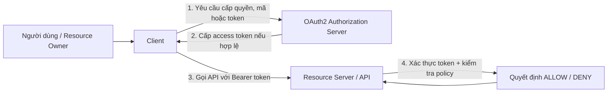

# Phân biệt chức năng authorization với vai trò OAuth2 Authorization Server

Trong chủ đề **Spring Security – authorization**, từ “authorization” xuất hiện ở hai ngữ cảnh dễ gây nhầm lẫn:

- **Authorization (phân quyền truy cập)** là hành động ra quyết định một chủ thể đã xác thực có được thực hiện thao tác cụ thể trên tài nguyên cụ thể hay không. Ví dụ: Alice có được xem đơn hàng 42 không?
- **OAuth2 Authorization Server (máy chủ ủy quyền)** là **một vai trò trong giao thức OAuth 2.0**, chịu trách nhiệm tiếp nhận yêu cầu ủy quyền/đăng nhập theo luồng được hỗ trợ, kiểm tra client và điều kiện cấp quyền, rồi **phát hành token** cho client. Nó không mặc nhiên quyết định mọi quyền truy cập từng đơn hàng của API.

Hai khái niệm có liên hệ, nhưng **tên giống nhau không đồng nghĩa cùng nhiệm vụ**. Một API chỉ cần kiểm tra quyền vẫn có chức năng authorization, ngay cả khi không triển khai OAuth2 Authorization Server.

## 1. Định nghĩa và câu hỏi mà mỗi bên trả lời

### 1.1. Authorization như một quyết định truy cập

Câu hỏi điển hình:

> Chủ thể S, với các quyền và ngữ cảnh hiện tại, có được thực hiện hành động A trên tài nguyên R hay không?

Các thành phần thường xét:

| Thành phần | Ví dụ |
| --- | --- |
| Chủ thể (subject) | Người dùng `alice`; service `billing-job` |
| Hành động (action) | `read`, `create`, `update`, `approve` |
| Tài nguyên (resource) | Đơn hàng `order-42`, API `GET /api/orders/42` |
| Ngữ cảnh (context) | Tenant, người sở hữu, trạng thái đơn, thời điểm |
| Chính sách (policy) | Cần `orders.read` **và** đúng chủ sở hữu; quản trị viên có ngoại lệ đã quy định |
| Kết quả | Cho phép hoặc từ chối; ghi nhận phục vụ audit nếu cần |

Đây là **bài toán kiểm soát truy cập**. Quyết định có thể dựa trên role (RBAC), permission/scope, thuộc tính (ABAC), quan hệ sở hữu (ReBAC) hoặc quy tắc nghiệp vụ. Xác thực danh tính (**authentication**) trả lời “là ai?”; phân quyền (**authorization**) trả lời “được làm gì?”. Việc đã đăng nhập không tự cho quyền xem mọi dữ liệu.

Trong Spring Security Servlet, quy tắc ở tầng HTTP thường đi qua `authorizeHttpRequests`, `AuthorizationFilter` và `AuthorizationManager`. Ở tầng method/service có thể dùng `@EnableMethodSecurity` và `@PreAuthorize` hoặc một `AuthorizationManager`/service chính sách riêng.

### 1.2. OAuth2 Authorization Server như một vai trò giao thức

Câu hỏi điển hình:

> Client này, theo grant/luồng đã cấu hình, được cấp token loại nào, cho đối tượng và scope nào, theo chính sách của Authorization Server?

Authorization Server (AS) thường đảm nhiệm các nhóm việc:

1. Nhận biết và kiểm tra **client** đã đăng ký, grant type, redirect URI và PKCE/client authentication khi áp dụng.
2. Phối hợp xác thực người dùng và/hoặc lấy sự chấp thuận (consent) đối với luồng có tương tác người dùng; với `client_credentials`, chủ thể thường là chính client, không cần người dùng đăng nhập.
3. Áp dụng chính sách **cấp token**: scope yêu cầu có hợp lệ/được chấp thuận không, thời hạn token, audience, các điều kiện cấp.
4. Phát hành **access token**; có thể phát hành refresh token và hỗ trợ các endpoint như `/oauth2/authorize`, `/oauth2/token`, metadata, JWKS, introspection, revocation tùy cấu hình/kiểu token và sản phẩm.
5. Khi bật OpenID Connect (OIDC), có thể thực hiện thêm vai trò OpenID Provider, phát hành **ID token** và cung cấp các endpoint OIDC tương ứng.

Điểm cốt lõi: AS **có thực hiện authorization đối với quá trình cấp quyền cho client**, nhưng việc AS cấp token chứa scope `orders.read` **không tự chứng minh** Alice là chủ sở hữu của `order-42`.

## 2. Bốn vai trò OAuth2 và nơi ra quyết định

| Vai trò OAuth2 | Trách nhiệm trong ví dụ “xem đơn hàng” |
| --- | --- |
| Resource Owner | Chủ thể có quyền cho phép truy cập tài nguyên được bảo vệ; thường là người dùng trong luồng tương tác |
| Client | Ứng dụng web/mobile hoặc dịch vụ yêu cầu token để gọi API |
| Authorization Server | Xác thực/kiểm tra yêu cầu theo grant và chính sách cấp token; phát hành token |
| Resource Server | API chứa dữ liệu đơn hàng; kiểm tra token và **áp dụng chính sách truy cập tài nguyên** |

**Resource Server có thể là một ứng dụng Spring Boot được bảo vệ bằng Spring Security**. Authorization Server có thể là một dịch vụ khác, một sản phẩm IdP, hoặc dịch vụ tự xây bằng chức năng Authorization Server của hệ sinh thái Spring. Một ứng dụng vẫn có thể kiêm nhiều vai trò, nhưng cần phân biệt từng trách nhiệm.

Mô hình logic:



Mũi tên (4) là **authorization của API**, không phải thao tác phát hành token ở (2). Nếu cần, API có thể gọi AS để **introspect** opaque token; dù vậy, kiểm tra chính sách nghiệp vụ vẫn thuộc trách nhiệm thực thi của API hoặc hệ thống chính sách mà API tin cậy.

## 3. So sánh trực tiếp: không đánh đồng hai chữ “authorization”

| Tiêu chí | Authorization trong Spring Security | OAuth2 Authorization Server |
| --- | --- | --- |
| Bản chất | Cơ chế/policy ra quyết định truy cập | Vai trò/dịch vụ trong giao thức OAuth2/OIDC |
| Câu hỏi | “Request này có được vào endpoint hoặc đọc bản ghi không?” | “Client này có được cấp token với phạm vi đã yêu cầu không?” |
| Đầu vào thường gặp | `Authentication`, authority, HTTP method/path, tài nguyên và thuộc tính nghiệp vụ | Client registration, grant, mã ủy quyền, PKCE, phiên người dùng, consent, scope |
| Đầu ra | Cho phép/từ chối hành động; thường dẫn đến HTTP 2xx/401/403 tùy ngữ cảnh | Authorization code, access token, refresh token, ID token nếu OIDC; hoặc lỗi OAuth |
| Nơi áp dụng | Gateway/API/Resource Server/service hoặc chính AS để bảo vệ endpoint của AS | Endpoint giao thức của dịch vụ cấp token |
| Thành phần Spring tiêu biểu | `AuthorizationManager`, `authorizeHttpRequests`, `@PreAuthorize` | OAuth2 Authorization Server configuration, token endpoint, `RegisteredClient`, token services |
| Có phát hành token không? | **Không**, chỉ vì đã cấu hình quy tắc `authorizeHttpRequests` | **Có**, đây là trách nhiệm trung tâm |
| Có tự biết đơn hàng thuộc ai không? | Có thể kiểm tra khi được cung cấp policy và dữ liệu liên quan | **Không mặc định**; scope/claim không thay thế quyền trên từng bản ghi |

**Cẩn thận với từ “scope”:** Scope thường mô tả mức ủy quyền mà client được cấp đối với một nhóm API/hoạt động (ví dụ `orders.read`). Scope không nhất thiết tương ứng một role nội bộ; càng không phải bằng chứng về quyền sở hữu từng resource. Tên và ngữ nghĩa scope là một phần hợp đồng giữa AS, client và Resource Server.

## 4. Đi qua một luồng OAuth2 cụ thể

Ví dụ: Alice dùng ứng dụng quản lý đơn hàng với **Authorization Code + PKCE**.

1. Client chuyển trình duyệt tới authorization endpoint của AS, kèm `client_id`, `redirect_uri`, `scope=orders.read`, `state` và tham số PKCE phù hợp.
2. AS xác thực người dùng nếu cần, kiểm tra client và yêu cầu cấp quyền, xử lý consent theo chính sách. Khi được phép, AS trả **authorization code** về redirect URI.
3. Client gửi authorization code cùng PKCE verifier và thông tin client cần thiết tới token endpoint. AS kiểm tra và có thể cấp access token mang `orders.read`.
4. Client gọi `GET /api/orders/42` với `Authorization: Bearer <access-token>`.
5. API với vai trò Resource Server **xác thực token** (chữ ký và claims đối với JWT, hoặc cơ chế introspection đối với opaque token); sau đó Spring Security kiểm tra quyền gọi endpoint.
6. Service nghiệp vụ kiểm tra thêm: đơn hàng 42 có thuộc Alice/tenant hiện tại không? Nếu sai, **từ chối** dù token hợp lệ và có `orders.read`.

Có **hai cửa** cần qua:

- **Cửa cấp quyền của AS:** client có nhận được access token/phạm vi đã yêu cầu không?
- **Cửa truy cập của API:** token/danh tính đó có được thực hiện thao tác này trên tài nguyên cụ thể không?

Khi token là JWT, API thường có thể xác minh chữ ký bằng khóa công khai từ JWKS, không cần hỏi AS về mọi request. Với opaque token, API thường gọi introspection theo cấu hình. Dù dùng loại token nào, **quy tắc nghiệp vụ tại API không biến mất**.

## 5. Ví dụ Spring Security: API kiểm tra quyền nhưng không cấp token

Giả sử dự án **Spring Boot 3.x / Spring Security 6.x, Java 17+**, có dependency Spring Web, Spring Security và Spring OAuth2 Resource Server (bao gồm hỗ trợ JOSE/JWT), và AS bên ngoài phát hành JWT.

Cấu hình `application.yml` của **API/Resource Server**:

```yaml
spring:
  security:
    oauth2:
      resourceserver:
        jwt:
          issuer-uri: https://auth.example.test
```

`https://auth.example.test` là **issuer minh họa**, phải thay bằng issuer thực của AS và cấu hình metadata/JWKS phù hợp. Resource Server dùng issuer để cấu hình xác minh JWT; phải kiểm tra thêm `aud` (audience) khi hệ thống yêu cầu token chỉ dùng được cho API này.

Ví dụ `ApiSecurityConfig.java`: đây là **một lớp cấu hình đầy đủ trong ứng dụng Spring Boot** có các dependency nêu trên; không phải chương trình Java thuần tự chạy bằng `javac`.

```java
import org.springframework.context.annotation.Bean;
import org.springframework.context.annotation.Configuration;
import org.springframework.http.HttpMethod;
import org.springframework.security.config.Customizer;
import org.springframework.security.config.annotation.method.configuration.EnableMethodSecurity;
import org.springframework.security.config.annotation.web.builders.HttpSecurity;
import org.springframework.security.web.SecurityFilterChain;

@Configuration
@EnableMethodSecurity
public class ApiSecurityConfig {

    @Bean
    SecurityFilterChain apiSecurityFilterChain(HttpSecurity http) throws Exception {
        http
            .authorizeHttpRequests(authorize -> authorize
                .requestMatchers(HttpMethod.GET, "/api/orders/**")
                    .hasAuthority("SCOPE_orders.read")
                .requestMatchers(HttpMethod.POST, "/api/orders/**")
                    .hasAuthority("SCOPE_orders.write")
                .anyRequest().denyAll()
            )
            .oauth2ResourceServer(oauth2 -> oauth2
                .jwt(Customizer.withDefaults())
            );

        return http.build();
    }
}
```

**Điều gì xảy ra?**

- `oauth2ResourceServer(...jwt(...))` cấu hình **Resource Server tiếp nhận/kiểm tra Bearer JWT**. Nó **không tự cung cấp** `/oauth2/token` và không phát hành token.
- `authorizeHttpRequests` định nghĩa **quyết định quyền truy cập tại API**. Với cấu hình ánh xạ mặc định, Spring Security biến scope `orders.read` trong JWT thành authority `SCOPE_orders.read`; `hasAuthority` so khớp đúng chuỗi đó.
- `anyRequest().denyAll()` giúp tránh vô tình mở endpoint chưa khai báo; trong ứng dụng thực tế cần phân loại rõ health check, endpoint công khai và security chain tương ứng.
- `@EnableMethodSecurity` cho phép dùng `@PreAuthorize` tại method của Spring bean; chẳng hạn có thể kết hợp policy `@PreAuthorize("@orderPolicy.canRead(authentication, #id)")` với một bean `orderPolicy` **do ứng dụng tự cài đặt** để kiểm tra owner/tenant từ dữ liệu tin cậy. Dòng SpEL này là **minh họa tích hợp**, chưa thể chạy nếu thiếu bean và method tương ứng.
- Ví dụ tập trung vào authorization. Với request thay đổi trạng thái như POST, cấu hình CSRF/session phải phù hợp kiểu ứng dụng; không tự tắt CSRF cho ứng dụng dùng cookie/session.

**Giới hạn chủ ý của ví dụ:** Cấu hình trên chưa có controller, cơ sở dữ liệu, JWT thực hay kiểm tra ownership. Nó chỉ chứng minh rằng **một Resource Server có thể phân quyền bằng Spring Security dù không đóng vai trò Authorization Server**.

## 6. Mô phỏng nhỏ bằng Java 17 để hiểu hai lớp kiểm tra

Sau khi token đã được xác thực, ứng dụng nhận một danh tính đáng tin cậy và quyết định quyền trên đơn hàng. Chương trình dưới đây **chỉ mô phỏng bước quyết định trong API**; không sinh token và không tự xác minh JWT.

Lưu thành `AuthorizationDecisionDemo.java`:

```java
import java.util.Set;

public class AuthorizationDecisionDemo {

    record VerifiedIdentity(String subject, Set<String> scopes) {}

    static boolean mayReadOrder(VerifiedIdentity identity, String orderOwner) {
        return identity != null
                && identity.scopes().contains("orders.read")
                && identity.subject().equals(orderOwner);
    }

    public static void main(String[] args) {
        var aliceRead = new VerifiedIdentity("alice", Set.of("orders.read"));
        var aliceProfile = new VerifiedIdentity("alice", Set.of("profile"));

        System.out.println("Alice owns order: " + mayReadOrder(aliceRead, "alice"));
        System.out.println("Bob owns order: " + mayReadOrder(aliceRead, "bob"));
        System.out.println("Missing scope: " + mayReadOrder(aliceProfile, "alice"));
    }
}
```

Biên dịch và chạy với JDK 17 trở lên:

```bash
javac AuthorizationDecisionDemo.java
java AuthorizationDecisionDemo
```

```text
Alice owns order: true
Bob owns order: false
Missing scope: false
```

Kết quả: **có scope đúng chưa đủ** nếu dữ liệu thuộc người khác. `VerifiedIdentity` chỉ đại diện cho danh tính **sau khi** lớp bảo mật đã xác thực token; ứng dụng thực không được tin một chuỗi subject/scope do client tự khai.

## 7. Nếu chính ứng dụng là OAuth2 Authorization Server thì sao?

Một ứng dụng Spring có thể sử dụng chức năng OAuth2 Authorization Server để mở các endpoint giao thức như:

- `/oauth2/authorize`: xử lý yêu cầu ủy quyền trong các flow có authorization code.
- `/oauth2/token`: xử lý việc trao đổi grant phù hợp để phát hành token.
- `/oauth2/jwks`: cung cấp khóa công khai khi có cấu hình JWK source thích hợp.
- `/oauth2/introspect` và `/oauth2/revoke`: hỗ trợ tra cứu hiệu lực/thu hồi token theo đặc tả và cấu hình.
- Metadata và, khi được bật, các endpoint OIDC như UserInfo/ID Token.

Đây là **endpoint của AS**, không phải các endpoint được tạo bởi `authorizeHttpRequests` của một API thông thường. Để xây AS, ngoài một `SecurityFilterChain` còn cần cấu hình client, token/authorization persistence, issuer, signing keys, grant support, bảo vệ key và endpoint, v.v. Không nên hiểu rằng thêm `.hasRole("ADMIN")` sẽ biến API thành AS.

**Lưu ý về cách gọi trong hệ sinh thái Spring:** “Spring Authorization Server” là tên framework/dự án cung cấp triển khai AS, xây trên Spring Security; tài liệu Spring Security hiện cũng trình bày chức năng Authorization Server trong nhóm OAuth2. “Authorization” ở `AuthorizationManager` và “Authorization Server” ở OAuth2 vẫn là **hai khái niệm ở hai tầng khác nhau**, dù cùng dựa trên thành phần bảo mật của Spring.

Ngay bên trong AS cũng có thể dùng chính sách authorization để hạn chế ai truy cập giao diện quản trị hoặc endpoint của AS. Việc một dịch vụ mang vai trò AS **không loại trừ** nhu cầu phân quyền nội bộ.

## 8. Những trường hợp dễ nhầm khi vận hành

| Tình huống | Nhận định đúng |
| --- | --- |
| Chỉ dùng `http.authorizeHttpRequests(...)` | Có quy tắc access control tại ứng dụng; **chưa** trở thành OAuth2 Authorization Server |
| Chỉ bật `oauth2ResourceServer(...jwt(...))` | API có khả năng nhận/kiểm JWT; **không** phát hành JWT |
| AS cấp JWT có `scope=orders.read` | Client được cấp phạm vi đó; API vẫn phải quyết định path/method, owner/tenant và điều kiện nghiệp vụ |
| JWT hợp lệ nhưng thiếu scope | Resource Server có thể từ chối với **403 Forbidden** sau khi xác thực thành công |
| Thiếu/không hợp lệ Bearer token với tài nguyên được bảo vệ | Thường bị thách thức xác thực, phản hồi **401 Unauthorized**; chi tiết phụ thuộc cấu hình |
| JWT hợp lệ, có scope, nhưng đơn thuộc người khác | Policy ownership phải trả **deny**; thông thường 403, hoặc 404 nếu chính sách che giấu sự tồn tại tài nguyên |
| Có ID token từ OIDC | ID token phục vụ thông tin đăng nhập cho client; **không mặc nhiên** là access token để gọi API |
| AS cấp token cho `client_credentials` | Có thể chỉ có danh tính client/service; không tự suy diễn có một người dùng cuối đang thao tác |
| Token JWT đã phát hành nhưng cần thu hồi ngay | Phải thiết kế TTL, rotation, deny-list/introspection hoặc chiến lược thu hồi phù hợp; không mặc định giả định JWT đã phát hành sẽ bị từ chối ngay |
| API kiểm tra signature nhưng bỏ `issuer` hoặc `audience` cần thiết | Có nguy cơ nhận token từ sai nguồn/cho sai API; cần xác minh đầy đủ claims theo trust boundary |

Một thiết kế tốt thường có **hai tầng kiểm soát**: tầng protocol quyết định **ai được nhận token/phạm vi nào**, tầng Resource Server quyết định **token đó được làm gì với tài nguyên thực tế**. Có thể dùng policy engine chung cho nhiều dịch vụ, nhưng **vị trí thực thi quyết định truy cập** vẫn phải rõ.

## 9. Chọn thành phần Spring nào cho yêu cầu nào?

- **“API của tôi cần bảo vệ endpoint bằng JWT do IdP cấp.”** Dùng Spring Security OAuth2 **Resource Server**, cấu hình issuer/JWT decoder và các `AuthorizationManager`/method policy tương ứng.
- **“Ứng dụng cần đăng nhập qua một IdP hoặc gọi API thay người dùng.”** Xem Spring Security **OAuth2 Client / OAuth2 Login**; đây là vai trò client, không phải AS.
- **“Tổ chức cần tự cấp access token, quản lý OAuth client, consent và các luồng grant.”** Cần **OAuth2 Authorization Server** (tự xây bằng stack phù hợp hoặc dùng sản phẩm IdP được quản lý). Việc bảo vệ API vẫn cần cấu hình Resource Server và policy riêng.
- **“Người dùng đã được cấp quyền xem danh sách, nhưng chỉ được xem đơn của mình.”** Thêm kiểm tra **resource ownership/tenant** ở API/service/database. Chỉ cấu hình AS hoặc chỉ kiểm `hasAuthority("SCOPE_orders.read")` là chưa đủ.
- **“Ứng dụng chỉ có đăng nhập session và role nội bộ, chưa dùng OAuth2.”** Vẫn sử dụng được toàn bộ cơ chế **authorization** của Spring Security mà không cần AS.

## 10. Tự kiểm tra hiểu đúng

1. Alice có access token hợp lệ và scope `orders.read` nhưng gọi `GET /api/orders/42` của Bob: **ai cần từ chối?** → API/Resource Server hoặc policy engine mà API sử dụng, dựa trên ownership/tenant.
2. Thêm `@PreAuthorize("hasRole('ADMIN')")` có làm ứng dụng phát hành access token? → **Không**. Đây là ràng buộc truy cập method.
3. Có thể tồn tại authorization mà không có OAuth2? → **Có**: session + role/permission nội bộ vẫn cần phân quyền.
4. Có thể có AS mà ứng dụng API không dùng Spring Authorization Server? → **Có**: AS là dịch vụ bên ngoài; API nhận token trong vai trò Resource Server.
5. AS hoàn toàn không làm authorization? → **Sai**: AS ra quyết định về **cấp token/scope**; điều cần phân biệt là quyết định đó không thay thế mọi **quyết định truy cập resource** tại API.

**Điểm cần nhớ:** **Authorization** là *quyết định cho phép hành động trên tài nguyên*. **OAuth2 Authorization Server** là *vai trò cấp token/ủy quyền theo giao thức*. Trong Spring Security, `authorizeHttpRequests`, `AuthorizationManager` và `@PreAuthorize` giải quyết bài toán đầu; chức năng Authorization Server giải quyết bài toán cấp token; Resource Server kết nối token đã xác thực với policy truy cập tài nguyên.

## Tài liệu đọc thêm

- [Spring Security — Authorize HttpServletRequests](https://docs.spring.io/spring-security/reference/servlet/authorization/authorize-http-requests.html)
- [Spring Security — Method Security](https://docs.spring.io/spring-security/reference/servlet/authorization/method-security.html)
- [Spring Security — OAuth2](https://docs.spring.io/spring-security/reference/servlet/oauth2/)
- [Spring Security — OAuth2 Resource Server JWT](https://docs.spring.io/spring-security/reference/servlet/oauth2/resource-server/jwt.html)
- [Spring Security — OAuth2 Authorization Server](https://docs.spring.io/spring-security/reference/servlet/oauth2/authorization-server/)
- [RFC 6749 — OAuth 2.0 Authorization Framework](https://www.rfc-editor.org/rfc/rfc6749)
