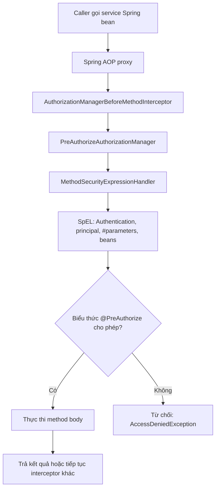

# @PreAuthorize và quyết định trước khi nghiệp vụ được thực thi

**`@PreAuthorize`** là annotation của Spring Security dùng để **quyết định có cho phép gọi một phương thức Java trước khi thân phương thức chạy hay không**. Nó thuộc **method security** – lớp kiểm soát quyền ở ranh giới service/business logic, độc lập với việc controller đã được phép nhận HTTP request hay chưa.

Ví dụ ngắn:

```java
@PreAuthorize("hasAuthority('documents.read')")
public Document readDocument(String documentId) {
    // Thân phương thức chỉ được chạy sau khi kiểm quyền cho phép.
    return repository.getDocument(documentId);
}
```

Người dùng có authority `documents.read` có thể vượt qua kiểm tra này; người không có authority đó bị từ chối **trước khi body chạy** trong cơ chế method security mặc định. Tuy nhiên, quyền tổng quát `documents.read` **không đồng nghĩa** được đọc mọi tài liệu, đặc biệt khi có owner, tenant, chia sẻ, trạng thái hoặc nhãn bảo mật.

Để kiểm thêm tài nguyên:

```java
@PreAuthorize(
    "hasAuthority('documents.read') and " +
    "@documentPolicy.canRead(authentication, #documentId)"
)
public Document readDocument(@P("documentId") String documentId) {
    return repository.getDocument(documentId);
}
```

Ở đây Spring Security cần authority **và** policy kiểm document cụ thể đều cho phép thì mới thực thi body. `@documentPolicy` là bean do ứng dụng triển khai, không phải class Spring Security có sẵn; `@P` giúp biểu thức nhận diện tên tham số khi cần.

Bài học này tập trung vào **quyết định trước khi nghiệp vụ thực thi**, gồm cơ chế Spring AOP/`PreAuthorizeAuthorizationManager`, cách bật method security, SpEL, quyền theo tham số/tài nguyên, ví dụ Spring Boot chạy với Java 17, xử lý từ chối, lỗi proxy và các tình huống test. Ngữ cảnh API: **Spring Security 6.5.x / Spring Boot 3.x (Servlet hoặc ứng dụng imperative) / Java 17+**.

## 1. Vì sao cần kiểm quyền trước khi gọi phương thức?

Một endpoint HTTP có thể bảo vệ bằng:

```java
http.authorizeHttpRequests(auth -> auth
    .requestMatchers("/api/documents/**").authenticated()
    .anyRequest().denyAll()
);
```

Điều này yêu cầu người dùng đã đăng nhập để vào nhóm URL. Nhưng một service có thể được gọi qua **nhiều đường**:

- Controller REST `GET /api/documents/{id}`.
- Controller GraphQL hoặc RPC.
- Job, message listener hoặc batch operation trong ứng dụng.
- Service khác được Spring inject.
- Một endpoint mới mà lập trình viên thêm sau này.

Nếu chính sách đọc tài liệu chỉ nằm ở URL, một đường vào khác có thể vô tình gọi đến service mà không qua rule đúng. Việc đặt `@PreAuthorize` tại **lớp service có ý nghĩa bảo mật** giúp chính sách gắn gần thao tác dữ liệu hơn.

Ví dụ:

```java
@Service
public class BillingService {

    @PreAuthorize("hasAuthority('invoices.approve')")
    public Receipt approveInvoice(String invoiceId) {
        // Không thực hiện thao tác duyệt nếu authority check từ chối.
        return billingWorkflow.approve(invoiceId);
    }
}
```

`@PreAuthorize` ở đây có giá trị rõ rệt: **lệnh duyệt không được bắt đầu nếu điều kiện không đạt**. Dù vậy, nếu cần tách người lập và người duyệt, kiểm tenant hoặc hạn mức giao dịch, phải thêm policy tương ứng trước khi commit.

### Không thay thế authentication hay HTTP authorization

`@PreAuthorize` không xác minh mật khẩu, không tự đọc JWT claim từ HTTP header và không tạo `Authentication`. Nó sử dụng danh tính do **Spring Security authentication** đã thiết lập và có thể truy xuất qua `SecurityContextHolder` trong context của lời gọi.

Nó cũng không mặc định thay URL authorization, CSRF, CORS hoặc security headers. Thiết kế tốt thường kết hợp:

```text
HTTP authentication / security filters
          |
          v
Controller / API adapter
          |
          v
Spring-managed service bean qua proxy
          |
          v
@PreAuthorize: quyết định trước method
          |
          v
Business operation và data/resource policy
```

Nếu service bị gọi mà không qua Spring-managed proxy, annotation có thể không được thực thi dù source code nhìn có vẻ đã “khóa” phương thức.

## 2. Bật @PreAuthorize bằng @EnableMethodSecurity

Trong Spring Boot 3.x, chỉ thêm `spring-boot-starter-security` **không tự động kích hoạt method security**. Phải chủ động bật:

```java
package com.example.security;

import org.springframework.context.annotation.Configuration;
import org.springframework.security.config.annotation.method.configuration.EnableMethodSecurity;

@Configuration
@EnableMethodSecurity
public class MethodSecurityConfig {
}
```

`@EnableMethodSecurity` (mặc định `prePostEnabled = true`) đăng ký hạ tầng bảo vệ các annotation:

- `@PreAuthorize`: **kiểm trước body**.
- `@PostAuthorize`: **kiểm sau khi body trả về**.
- `@PreFilter`: lọc đầu vào được hỗ trợ, thường trước lời gọi.
- `@PostFilter`: lọc kết quả được hỗ trợ sau lời gọi.

Ngược lại, `@Secured` chỉ được bật khi `securedEnabled = true`; `@RolesAllowed` thuộc nhóm JSR-250 cần `jsr250Enabled = true`. Đây là các cơ chế riêng, không phải chỉ đổi tên của `@PreAuthorize`.

**Đừng để cấu hình sau trong ứng dụng sử dụng @PreAuthorize:**

```java
@EnableMethodSecurity(prePostEnabled = false)
```

Nếu cố ý tắt pre/post để tự đăng ký authorization manager khác, phải cấu hình interceptor thay thế và test nó. Nếu không, annotation `@PreAuthorize` có thể không còn là lớp bảo vệ bạn kỳ vọng.

### Tại sao không nên chỉ kiểm annotation có tồn tại?

Java compiler cho phép gắn annotation ngay cả khi không có Spring Security runtime xử lý nó. Một test chỉ gọi `new DocumentService()` rồi thấy method hoạt động **không chứng minh annotation được áp dụng**. Cần test thông qua **Spring ApplicationContext** và có ít nhất một ca principal không đủ quyền bị chặn.

## 3. Cơ chế bên trong: authorization xảy ra trước body như thế nào?

Trong Spring Security 6.5, cơ chế method security hiện đại sử dụng **`AuthorizationManager`**, thay cho đường legacy `AccessDecisionManager`/voters ở cấu hình cũ.

Luồng điển hình:



Chi tiết từng bước:

1. Caller lấy **Spring-managed service bean** và gọi method qua proxy.
2. Advisor/interceptor tìm annotation `@PreAuthorize` tại method, class hoặc metadata được hỗ trợ.
3. `AuthorizationManagerBeforeMethodInterceptor` gọi `PreAuthorizeAuthorizationManager`.
4. Manager sử dụng `MethodSecurityExpressionHandler` để tạo ngữ cảnh đánh giá **SpEL** từ `MethodInvocation` và `Supplier<Authentication>`.
5. Biểu thức đọc `Authentication`, authorities, method arguments và những policy beans cần thiết.
6. Nếu kết quả cho phép, interceptor gọi tiếp xuống **method body**.
7. Nếu từ chối, interceptor ném exception bảo mật (hoặc dùng cơ chế denial tùy biến đã cấu hình); body bình thường **không được thực thi**.

Javadoc phiên bản cụ thể có thể trình bày method `authorize(...)`/`check(...)` khác nhau trong lộ trình deprecation của `AuthorizationManager`. Khi viết ứng dụng, dùng DSL/annotation được hỗ trợ thay vì tự dựa vào một chữ ký nội bộ chưa kiểm phiên bản.

### Quyết định ở thời điểm gọi method

Ví dụ:

```text
Alice có documents.read:
  gọi documentService.read("D-42")
  -> biểu thức true
  -> body chạy

Bob không có documents.read:
  gọi documentService.read("D-42")
  -> biểu thức false
  -> từ chối
  -> body không chạy
```

Tác dụng quan trọng là **giữ phần nghiệp vụ nhạy cảm ở phía sau một cổng**. Điều này khác `@PostAuthorize`: kiểm sau khi body chạy có thể không kịp ngăn database write, thanh toán, gửi email hoặc xuất dữ liệu.

### Không đồng nghĩa “mọi code trước method đều chưa chạy”

Biểu thức `@PreAuthorize` được kiểm trước **thân của phương thức được advice**. Nhưng caller đã có thể làm việc khác trước đó; request filter, controller, arguments evaluation hoặc các AOP advisors khác (như tracing/transaction tùy order) có thể đã chạy. Không nên hứa rằng một request bị deny thì “chưa có bất kỳ side effect nào trong toàn ứng dụng”.

**Đặt side effect nhạy cảm sau ranh giới kiểm quyền**, không chỉ sau khi route được gọi.

## 4. SpEL trong @PreAuthorize: điều gì có thể viết?

`@PreAuthorize` nhận **một biểu thức SpEL dạng chuỗi**, ví dụ:

```java
@PreAuthorize("isAuthenticated()")
@PreAuthorize("hasRole('ADMIN')")
@PreAuthorize("hasAuthority('documents.read')")
@PreAuthorize("hasAnyAuthority('documents.read', 'documents.audit')")
```

Bốn dòng là **các ví dụ độc lập**, không phải gắn lặp bốn `@PreAuthorize` lên một method.

Bảng các biểu thức thường dùng:

| Biểu thức | Ý nghĩa | Ghi chú |
| --- | --- | --- |
| `permitAll` | Luôn true trong biểu thức security | Ít hữu ích khi đã đặt method security |
| `denyAll` | Luôn false | Có thể đóng hoàn toàn method |
| `isAuthenticated()` | Chủ thể đã xác thực | Không biểu diễn permission cụ thể |
| `isAnonymous()` | Chủ thể anonymous | Khác kiểm role/authority |
| `hasRole('ADMIN')` | Mặc định tìm authority `ROLE_ADMIN` | Prefix có thể được cấu hình |
| `hasAuthority('documents.read')` | Kiểm chuỗi authority chính xác | Không tự thêm `ROLE_` |
| `hasAnyRole('ADMIN','MANAGER')` | Có **ít nhất một** role | Quan hệ OR |
| `hasAnyAuthority('x','y')` | Có **ít nhất một** authority | Quan hệ OR |
| `hasAuthority('read') and hasAuthority('write')` | Phải có cả hai | Quan hệ AND |
| `authentication.name == 'alice'` | Kiểm thông tin principal | Không đủ cho policy đa tenant |
| `#documentId` | Tham số method có tên | Phụ thuộc parameter name discovery hoặc `@P` |
| `@documentPolicy.canRead(authentication, #documentId)` | Gọi Spring bean policy | Bean cần triển khai và kiểm dữ liệu đáng tin |
| `hasPermission(#documentId, 'Document', 'read')` | Gọi `PermissionEvaluator` khi được cấu hình | Không tự biết owner/tenant |

Trong Spring Security, role về cơ bản vẫn là authority string có quy ước `ROLE_`. `hasRole('ADMIN')` theo mặc định tìm `ROLE_ADMIN`; `hasAuthority('ROLE_ADMIN')` kiểm full string. Nếu JWT converter chỉ tạo `SCOPE_documents.read` thì `hasAuthority('documents.read')` **không tự khớp**, dù JWT hợp lệ.

### AND, OR và dấu ngoặc

Ví dụ cần role manager **và** quyền duyệt:

```java
@PreAuthorize(
    "hasRole('MANAGER') and hasAuthority('invoices.approve')"
)
```

Nếu ý định là manager **hoặc** auditor:

```java
@PreAuthorize(
    "hasAnyRole('MANAGER', 'AUDITOR')"
)
```

Nếu muốn một nhánh có điều kiện bổ sung:

```java
@PreAuthorize(
    "(hasRole('MANAGER') and hasAuthority('invoices.approve')) " +
    "or hasRole('FINANCE_ADMIN')"
)
```

**Luôn đặt dấu ngoặc khi chính sách có nhiều AND/OR** để dễ kiểm toán. Đừng biến biểu thức ngày càng phức tạp thành một chuỗi không còn người nào có thể review; hãy chuyển sang bean policy có test.

## 5. Quyền theo tham số: #documentId trước khi truy vấn dữ liệu

Ưu điểm của `@PreAuthorize` so với một rule chỉ kiểm URL là nó có thể **nhìn thấy tham số method** trước khi gọi body.

Ví dụ trong service:

```java
@PreAuthorize(
    "hasAuthority('documents.read') and " +
    "@documentPolicy.canRead(authentication, #documentId)"
)
public DocumentDto load(
        @P("documentId") String documentId) {
    return repository.load(documentId);
}
```

Những điểm chính:

- `#documentId` lấy giá trị argument của lời gọi hiện tại.
- `@P("documentId")` thuộc `org.springframework.security.access.method.P` giúp đặt tên argument rõ với SpEL, kể cả khi Java bytecode không giữ tên tham số theo cách framework kỳ vọng.
- `@documentPolicy` là **bean Spring** có tên tương ứng; ví dụ method `canRead(Authentication, String)` do ứng dụng viết.
- `authentication` đến từ SecurityContext đáng tin đã được authentication provider thiết lập.
- Cả authority `documents.read` **và** resource policy đều phải true.
- Nếu không đạt, method body `repository.load(...)` không được gọi theo luồng bình thường.

### Chính sách tài nguyên nên kiểm gì?

Đối với `documentId=D-42`, policy có thể cần:

```text
authenticated(user)
AND authority(user, "documents.read")
AND document.exists(D-42)
AND user.tenantId == document.tenantId
AND (user.id == document.ownerId OR sharedWith(user, D-42))
AND document.status != "RESTRICTED"
```

Không lấy `X-Tenant-Id`, `X-Owner` hay một role tự khai ở body/request để tin ngay. Các ID đến từ URL/method arguments là **dữ liệu do client kiểm soát**: phải liên hệ với principal đã xác thực và metadata tài liệu được server đọc từ nguồn đáng tin.

### Không nhầm method argument với route variable

Controller có thể ánh xạ:

```java
@GetMapping("/documents/{id}")
public DocumentDto read(@PathVariable String id) {
    return documentService.load(id);
}
```

Khi vào service `load(id)`, annotation của service dùng **giá trị argument** `#documentId` theo tên Java/`@P` đã khai báo ở service, không tự lấy biến `{id}` từ HTTP matcher. Vì thế method security có thể áp dụng được cả khi service được gọi từ HTTP hoặc job, miễn là caller có Authentication phù hợp.

### Khi cần tránh lộ sự tồn tại của tài nguyên

Một policy có thể trả false cho tài liệu không tồn tại hoặc không thuộc tenant, nhưng response HTTP mặc định từ method denial thường chuyển thành **403** cho người đã đăng nhập. Nếu sản phẩm cần 404 để hạn chế resource enumeration, hãy thiết kế xử lý lỗi nhất quán mà không tiết lộ dữ liệu, đồng thời không đánh đồng 404 với việc method chưa từng được phép.

## 6. Bean policy: nên tách logic phức tạp khỏi annotation

Khi quyết định dựa vào nhiều điều kiện, hãy dùng một Spring bean:

```java
@Component("documentPolicy")
public class DocumentPolicy {

    private final DocumentRepository repository;

    public DocumentPolicy(DocumentRepository repository) {
        this.repository = repository;
    }

    public boolean canRead(Authentication user, String documentId) {
        if (user == null || !user.isAuthenticated()) {
            return false;
        }

        Document doc = repository.findById(documentId).orElse(null);
        if (doc == null) {
            return false;
        }

        return doc.tenantId().equals(currentTrustedTenant(user))
            && (doc.ownerId().equals(user.getName())
                || isSharedWith(user, doc));
    }
}
```

Đây là **mảnh kiến trúc Spring**: `DocumentRepository`, `Document`, `currentTrustedTenant` và `isSharedWith` là thành phần do ứng dụng tự định nghĩa; đoạn code **không độc lập chạy ngay**. Với Authentication anonymous, có những implementation được đánh dấu authenticated theo nghĩa object, nên trong production cần kiểm rõ anonymous và security policy yêu cầu.

Để dùng:

```java
@PreAuthorize("@documentPolicy.canRead(authentication, #documentId)")
public DocumentDto read(@P("documentId") String documentId) {
    return repository.readDto(documentId);
}
```

Hoặc, nếu có một quyền tổng quát cần kiểm trước:

```java
@PreAuthorize(
    "hasAuthority('documents.read') and " +
    "@documentPolicy.canRead(authentication, #documentId)"
)
```

Giá trị của cách tách policy:

1. **Dễ test** ở mức Java unit test với cases owner, share, tenant, document locked.
2. **Dễ audit** vì logic được đặt tên rõ thay vì một SpEL string rất dài.
3. **Dễ cache có kiểm soát**, nhưng phải xem freshness của quyền/data.
4. **Có thể tái sử dụng** trong HTTP, service khác hoặc permission check khác với contract được thiết kế.
5. **Có thể đánh giá đúng thứ tự**: permission tĩnh trước, sau đó mới truy vấn tài liệu khi cần.

### Tối ưu không được đánh đổi an toàn

Policy được gọi **trước body**, nhưng việc đó không loại bỏ race condition: quyền có thể đổi hoặc record bị chuyển tenant giữa lúc policy đọc và transaction cập nhật dữ liệu. Với thao tác nhạy cảm, kiểm điều kiện tại điểm write (transaction/locking/versioning/conditional update) thay vì chỉ tin một snapshot từ đầu request.

## 7. So sánh @PreAuthorize với @PostAuthorize và @Secured

| Tiêu chí | `@PreAuthorize` | `@PostAuthorize` | `@Secured` |
| --- | --- | --- | --- |
| Thời điểm quyết định | **Trước body** | **Sau khi body trả về** | Trước body |
| Điều kiện | SpEL | SpEL với `returnObject` | Danh sách authority literal |
| Đọc method parameters | Có, qua `#param` | Có | Không theo SpEL |
| Kiểm returnObject | Không có kết quả method trước khi chạy | Có | Không |
| Kiểm owner/tenant qua bean | Có | Có nhưng sau body | Không trực tiếp |
| Toán tử AND/OR | Có | Có | Danh sách OR |
| Mặc định bật bởi @EnableMethodSecurity | Có | Có | Không, cần `securedEnabled=true` |
| Manager tiêu chuẩn | `PreAuthorizeAuthorizationManager` | `PostAuthorizeAuthorizationManager` | `SecuredAuthorizationManager` |
| Phù hợp ngăn side effect | **Phù hợp hơn** | Không dùng làm kiểm duy nhất cho write | Có thể, nếu chỉ cần authority tĩnh |

Ví dụ:

```java
@PreAuthorize("hasAuthority('payments.execute')")
public Receipt executePayment(String paymentId) {
    // Kiểm trước khi thực hiện payment.
    return paymentGateway.execute(paymentId);
}
```

Nếu thay bằng `@PostAuthorize` để quyết định sau khi trả về, giao dịch có thể đã được thực hiện trước lúc deny. Đó là lý do đề bài nhấn mạnh **“quyết định trước khi nghiệp vụ được thực thi”**.

### Nhiều annotation trên cùng method có ý nghĩa gì?

Spring Security cho phép các annotation **khác loại** trên một method; từng interceptor được xét theo thứ tự và **tất cả điều kiện phải vượt qua** để lời gọi thành công. Ví dụ:

```java
@PreAuthorize("hasAuthority('documents.read')")
@PostAuthorize("returnObject.ownerId == authentication.name")
public DocumentDto readWithPostCheck(String documentId) {
    return repository.getDocument(documentId);
}
```

Để method trả ra thành công: pre-check cho phép, body chạy, post-check tiếp tục cho phép. Nếu post-check deny, body đã chạy rồi. Ví dụ trên chỉ là mảnh tích hợp; cần repository/DTO thật và xử lý null, owner đáng tin, lỗi phù hợp.

**Không gắn hai `@PreAuthorize` lặp trên cùng method** để diễn đạt AND: annotation không được hỗ trợ lặp. Dùng một biểu thức:

```java
@PreAuthorize(
    "hasAuthority('documents.read') and @policy.canRead(authentication, #id)"
)
```

Đối với các annotation inherited ở class và method, method-level có thể override class-level cho cùng annotation. Không nên dựa vào việc class-level và method-level tự động kết hợp theo AND: kiểm đúng semantics qua test.

## 8. Ví dụ Spring Boot Java 17 chạy được – chứng minh body không chạy khi deny

Ví dụ này tạo một **Spring Boot CLI application** (không chạy web server) nhưng thực thi **method security thật** trên Spring-managed bean. Nó không giả định controller hoặc HTTP filter để từ chối; vì vậy rất dễ quan sát **body chỉ chạy ở trường hợp ALLOW**.

**Bộ môi trường:** Java 17+, Maven tương thích, Spring Boot **3.5.16**, dependencies được parent BOM quản lý (Spring Security 6.5.x). Spring Boot 3.5.16 đã phát hành, nhưng là bản cuối dòng 3.5 hỗ trợ OSS; khi tạo sản phẩm mới cần chọn nhánh còn được hỗ trợ. Phiên bản cố định ở đây để minh họa có thể tái lập.

Tổ chức file:

```text
preauthorize-demo/
├── pom.xml
└── src/
    └── main/
        ├── java/demo/
        │   ├── PreAuthorizeDemoApplication.java
        │   ├── DocumentService.java
        │   └── DocumentPolicy.java
        └── resources/
            └── application.properties
```

### 8.1. pom.xml

```xml
<project xmlns="http://maven.apache.org/POM/4.0.0"
         xmlns:xsi="http://www.w3.org/2001/XMLSchema-instance"
         xsi:schemaLocation="http://maven.apache.org/POM/4.0.0
             https://maven.apache.org/xsd/maven-4.0.0.xsd">

    <modelVersion>4.0.0</modelVersion>

    <parent>
        <groupId>org.springframework.boot</groupId>
        <artifactId>spring-boot-starter-parent</artifactId>
        <version>3.5.16</version>
        <relativePath/>
    </parent>

    <groupId>demo</groupId>
    <artifactId>preauthorize-demo</artifactId>
    <version>1.0.0</version>

    <properties>
        <java.version>17</java.version>
    </properties>

    <dependencies>
        <dependency>
            <groupId>org.springframework.boot</groupId>
            <artifactId>spring-boot-starter</artifactId>
        </dependency>
        <dependency>
            <groupId>org.springframework.boot</groupId>
            <artifactId>spring-boot-starter-security</artifactId>
        </dependency>
    </dependencies>

    <build>
        <plugins>
            <plugin>
                <groupId>org.springframework.boot</groupId>
                <artifactId>spring-boot-maven-plugin</artifactId>
            </plugin>
        </plugins>
    </build>
</project>
```

Không cần `spring-boot-starter-web` vì ví dụ chỉ chạy `CommandLineRunner` và service. Với ứng dụng REST thật, có thể thêm Web starter, cấu hình authentication, HTTP authorization và CSRF phù hợp.

### 8.2. PreAuthorizeDemoApplication.java

Đặt tại `src/main/java/demo/PreAuthorizeDemoApplication.java`:

```java
package demo;

import java.util.List;
import java.util.function.Supplier;

import org.springframework.boot.CommandLineRunner;
import org.springframework.boot.SpringApplication;
import org.springframework.boot.autoconfigure.SpringBootApplication;
import org.springframework.context.annotation.Bean;
import org.springframework.security.access.AccessDeniedException;
import org.springframework.security.authentication.UsernamePasswordAuthenticationToken;
import org.springframework.security.config.annotation.method.configuration.EnableMethodSecurity;
import org.springframework.security.core.authority.SimpleGrantedAuthority;
import org.springframework.security.core.context.SecurityContext;
import org.springframework.security.core.context.SecurityContextHolder;

@SpringBootApplication
@EnableMethodSecurity
public class PreAuthorizeDemoApplication {

    public static void main(String[] args) {
        SpringApplication.run(PreAuthorizeDemoApplication.class, args);
    }

    @Bean
    CommandLineRunner demonstrate(DocumentService documents) {
        return args -> {
            invoke("alice", "docs.read", "alice read DOC-1",
                    () -> documents.read("DOC-1"));

            invoke("alice", "docs.read", "alice read DOC-2",
                    () -> documents.read("DOC-2"));

            invoke("bob", "docs.read", "bob read DOC-1",
                    () -> documents.read("DOC-1"));

            invoke("alice", "docs.read", "alice publish",
                    documents::publish);

            invoke("writer", "docs.write", "writer publish",
                    documents::publish);

            invoke("admin", "ROLE_ADMIN", "admin audit",
                    documents::audit);

            invoke("writer", "docs.write", "writer audit",
                    documents::audit);

            invoke("admin", "ROLE_ADMIN", "admin read DOC-1",
                    () -> documents.read("DOC-1"));

            System.out.println("bodyCalls: " + documents.bodyCalls());
        };
    }

    private static void invoke(
            String name,
            String authority,
            String label,
            Supplier<String> action) {

        SecurityContext context =
                SecurityContextHolder.createEmptyContext();

        context.setAuthentication(
                new UsernamePasswordAuthenticationToken(
                    name,
                    "demo-only",
                    List.of(new SimpleGrantedAuthority(authority))
                )
        );

        SecurityContextHolder.setContext(context);

        try {
            System.out.println(label + " -> " + action.get());
        } catch (AccessDeniedException denied) {
            System.out.println(label + " -> DENY");
        } finally {
            SecurityContextHolder.clearContext();
        }
    }
}
```

**Điểm thiết kế có chủ đích:**

- `@EnableMethodSecurity` bật pre/post annotation interception.
- `CommandLineRunner` được inject **`DocumentService` từ Spring context**; các method references/lambda gọi qua bean được proxy.
- `UsernamePasswordAuthenticationToken` constructor ba tham số tạo một **Authentication đã xác thực** với đúng một authority; đây là **harness mô phỏng**, không phải cách xử lý thông tin role từ người dùng production.
- `SecurityContextHolder.clearContext()` dọn danh tính sau mỗi ca, tránh rò `ThreadLocal`.
- Ca "admin read DOC-1" dùng đúng `ROLE_ADMIN` nhưng **không có `docs.read`**; tên admin không tự bao hàm permission khi không khai báo role hierarchy.
- `documents.bodyCalls()` là phép quan sát quan trọng: nó cho biết chính xác có bao nhiêu lần **body được chạy**.

### 8.3. DocumentService.java

Đặt tại `src/main/java/demo/DocumentService.java`:

```java
package demo;

import org.springframework.security.access.method.P;
import org.springframework.security.access.prepost.PreAuthorize;
import org.springframework.stereotype.Service;

@Service
public class DocumentService {

    private int reads;
    private int publishes;
    private int audits;

    @PreAuthorize(
        "hasAuthority('docs.read') and " +
        "@documentPolicy.canRead(authentication, #documentId)"
    )
    public String read(@P("documentId") String documentId) {
        reads++;
        return "READ:" + documentId;
    }

    @PreAuthorize("hasAuthority('docs.write')")
    public String publish() {
        publishes++;
        return "PUBLISHED";
    }

    @PreAuthorize("hasRole('ADMIN')")
    public String audit() {
        audits++;
        return "AUDITED";
    }

    public String bodyCalls() {
        return "read=" + reads
                + ",publish=" + publishes
                + ",audit=" + audits;
    }
}
```

Trong ví dụ này, các bộ đếm chỉ được tăng ở **body**. Một phương thức bị `@PreAuthorize` deny không đến được câu lệnh `reads++`, `publishes++` hoặc `audits++`.

Bộ đếm `int` phục vụ demo CLI tuần tự, **không dùng làm metric thread-safe production**. Trong ứng dụng nhiều thread, dùng metrics/atomic counters thích hợp hoặc test side effects qua repository/fake gateway.

### 8.4. DocumentPolicy.java

Đặt tại `src/main/java/demo/DocumentPolicy.java`:

```java
package demo;

import org.springframework.security.core.Authentication;
import org.springframework.stereotype.Component;

@Component("documentPolicy")
public class DocumentPolicy {

    public boolean canRead(
            Authentication user,
            String documentId) {

        return user != null
                && user.isAuthenticated()
                && "alice".equals(user.getName())
                && "DOC-1".equals(documentId);
    }
}
```

Đây là policy **cố định để bài chạy không cần database**: chỉ Alice đọc được DOC-1, **nếu cô ấy còn có authority docs.read** theo biểu thức `@PreAuthorize`. Trong hệ thống thật, thay điều kiện hard-code bằng truy vấn tenant/owner/share/status đáng tin cậy và xử lý anonymous authentication đúng chính sách.

### 8.5. application.properties

Đặt tại `src/main/resources/application.properties`:

```properties
spring.main.web-application-type=none
spring.main.banner-mode=off
logging.level.root=OFF
```

Cấu hình chỉ dành cho bài tập CLI, giúp ít dòng log hơn. Production cần log/audit hợp lý, không tự tắt logging an ninh.

### 8.6. Lệnh chạy và stdout dự kiến

Trong thư mục `preauthorize-demo`, chạy JDK 17+ và Maven:

```bash
mvn -q spring-boot:run
```

Các dòng **do chương trình in**, không tính thông báo Maven/JVM ngoài chương trình:

```text
alice read DOC-1 -> READ:DOC-1
alice read DOC-2 -> DENY
bob read DOC-1 -> DENY
alice publish -> DENY
writer publish -> PUBLISHED
admin audit -> AUDITED
writer audit -> DENY
admin read DOC-1 -> DENY
bodyCalls: read=1,publish=1,audit=1
```

### Phân tích output

1. **alice read DOC-1:** Alice có `docs.read` và `documentPolicy` cho phép đúng DOC-1; body chạy và tăng `reads`.
2. **alice read DOC-2:** Authority vẫn đúng nhưng policy trả false; body **không chạy**.
3. **bob read DOC-1:** Bob có authority nhưng không phải Alice; body không chạy.
4. **alice publish:** Thiếu `docs.write`, bị deny trước khi gọi `publishes++`.
5. **writer publish:** Có `docs.write`, body chạy một lần.
6. **admin audit:** Có `ROLE_ADMIN`, `hasRole('ADMIN')` thỏa; body chạy.
7. **writer audit:** Chỉ có `docs.write`, không có `ROLE_ADMIN`, bị deny.
8. **admin read DOC-1:** Dù tên gọi là admin, không có `docs.read`; không có hierarchy nên bị deny trước khi xét đầy đủ policy.
9. **bodyCalls cuối:** `read=1,publish=1,audit=1` chứng minh **chỉ ba lời gọi ALLOW** thực sự chạy body.

**Giới hạn:** Ví dụ chưa có HTTP request, database, transaction, token hay concurrency, và đặt một SecurityContext mô phỏng cố ý. Nó minh họa **kiểm quyền method trước body**. Trong production, Authentication phải được xác minh qua cơ chế đáng tin và việc cấp quyền cần chính sách least-privilege.

## 9. Chính sách theo vai trò, quyền và RoleHierarchy

Giả sử app có phân cấp:

```text
ROLE_ADMIN > ROLE_MANAGER
ROLE_MANAGER > ROLE_USER
ROLE_USER > docs.read
ROLE_MANAGER > docs.write
```

Khi **`RoleHierarchy`** được tích hợp vào `MethodSecurityExpressionHandler`, người có `ROLE_ADMIN` có thể được xem như có `docs.read` và `docs.write` trong phép kiểm `hasAuthority`.

Cấu hình Spring Security 6.5 mẫu:

```java
@Bean
static RoleHierarchy roleHierarchy() {
    return RoleHierarchyImpl.fromHierarchy("""
        ROLE_ADMIN > ROLE_MANAGER
        ROLE_MANAGER > ROLE_USER
        ROLE_USER > docs.read
        ROLE_MANAGER > docs.write
    """);
}

@Bean
static MethodSecurityExpressionHandler methodSecurityExpressionHandler(
        RoleHierarchy hierarchy) {

    DefaultMethodSecurityExpressionHandler handler =
            new DefaultMethodSecurityExpressionHandler();

    handler.setRoleHierarchy(hierarchy);
    return handler;
}
```

Đây là các **mảnh bean cấu hình**, cần import:

```java
import org.springframework.context.annotation.Bean;
import org.springframework.security.access.hierarchicalroles.RoleHierarchy;
import org.springframework.security.access.hierarchicalroles.RoleHierarchyImpl;
import org.springframework.security.access.expression.method.MethodSecurityExpressionHandler;
import org.springframework.security.access.expression.method.DefaultMethodSecurityExpressionHandler;
```

Các method bean `static` giúp cấu hình hạ tầng được công bố kịp thời; nhất là `MethodSecurityExpressionHandler`, tài liệu Spring Security khuyến nghị `static` để tránh khởi tạo quá muộn.

**Cần hiểu hai giới hạn:**

- Hierarchy chỉ mở rộng **authority reachability**. Nó không biến ADMIN thành owner của tài liệu bất kỳ hay bỏ qua `@documentPolicy.canRead(...)`.
- Hierarchy không tự sửa `Authentication#getAuthorities()` hoặc token claims. Custom code duyệt authority gốc có thể nhìn thấy khác với phép kiểm hierarchy-aware.

Nếu sửa ví dụ CLI ở mục 8 bằng việc thêm các bean này, kết quả có thể thay đổi cho admin, nên **stdout mục 8 chỉ áp dụng đúng cấu hình không có hierarchy**. Đừng lấy stdout cũ làm hợp đồng cho ứng dụng đã thêm policy khác.

## 10. AOP proxy: điều kiện thiết yếu để “trước method” có nghĩa

Một annotation gắn trên source code không tự thực thi khi JVM gọi method. Spring Security method interception dựa trên **Spring AOP proxy** ở mode mặc định.

### 10.1. Gọi qua Spring bean

```java
@Service
public class OrderControllerAdapter {

    private final OrderService orders;

    public OrderControllerAdapter(OrderService orders) {
        this.orders = orders;
    }

    public void process(String id) {
        orders.submit(id); // Spring-managed proxy nếu cấu hình đúng.
    }
}
```

Nếu `OrderService#submit` được annotate `@PreAuthorize` và bean được Spring inject, lời gọi có thể được intercept.

### 10.2. Self-invocation: bẫy dễ gây bỏ qua kiểm quyền

```java
@Service
public class DangerousOrderService {

    public void processBatch() {
        deleteInvoice("42"); // tương đương this.deleteInvoice: bỏ qua proxy
    }

    @PreAuthorize("hasRole('ADMIN')")
    public void deleteInvoice(String id) {
        // Thao tác nguy hiểm.
    }
}
```

Trong Spring AOP proxy mode phổ biến, `processBatch` gọi method khác trên **chính instance**, không đi qua proxy bên ngoài. Vì vậy `@PreAuthorize` trên `deleteInvoice` **có thể không được chạy**.

**Cách sửa được khuyến nghị:** tách protected method sang bean riêng và gọi qua injected bean, hoặc thiết kế một public entrypoint được bảo vệ tại điểm đúng. Nếu dùng AspectJ weaving thì cơ chế khác; phải cấu hình và test rõ.

### 10.3. Một số trường hợp annotation không được intercept

- Tạo service bằng `new` thay vì lấy từ Spring context.
- Lời gọi self-invocation `this.method()`.
- Method private/final hoặc class final trong proxy strategy không hỗ trợ.
- Annotation nằm trên type/method không được Spring AOP match theo cấu hình.
- Multiple ApplicationContexts nhưng advisor không nằm cùng context chứa service.
- Test dùng Mockito mock cả service nên không còn proxy thật.
- Gọi từ thread khác mà SecurityContext không được truyền đúng.
- Annotation trên method không được gọi trong flow thực tế.

**Cần test negative case qua Spring bean thực**, không chỉ xác nhận annotation tồn tại.

## 11. Exception và HTTP response khi @PreAuthorize từ chối

Trong cấu hình tiêu chuẩn, khi pre-check deny, method-security interceptor ném **`AccessDeniedException`** hoặc loại denial exception phù hợp. Ở ứng dụng servlet, nếu lỗi đi ngược qua `ExceptionTranslationFilter` và cấu hình xử lý tương ứng:

- Với người đã xác thực nhưng thiếu quyền: thường phản hồi **403 Forbidden**.
- Với người chưa xác thực: có thể kích hoạt `AuthenticationEntryPoint` và trả **401**, hoặc redirect đến login theo form-login.
- Nếu gọi từ CLI, scheduled job hoặc message consumer: không có HTTP response tự động; caller phải xử lý exception/cơ chế retry, DLQ hoặc fail-safe phù hợp.

**Đừng khẳng định mọi `@PreAuthorize` deny đều ra HTTP 403.** Nó phụ thuộc nơi gọi, trạng thái authentication, exception handling, và việc có controller/filter bao quanh hay không.

### Test ở service có thể chính xác hơn test HTTP

Một HTTP request có thể bị `CsrfFilter`, URL authorization hoặc authentication chặn **trước khi controller gọi service**. Khi đó status 403 không chứng minh `@PreAuthorize` đang hoạt động. Muốn test đúng method security, hãy inject service từ context rồi gọi nó với `@WithMockUser` hoặc SecurityContext phù hợp.

### Denial trước body nhưng policy vẫn có chi phí

Biểu thức `@PreAuthorize` có thể gọi DB/service trước khi body chạy. Nếu policy bean gặp timeout hoặc exception, invocation có thể thất bại trước body. Đừng cho policy bean tạo side effects như gửi email, phê duyệt hay ghi tiền; quyết định nên ngắn, ổn định và an toàn khi thất bại.

## 12. @PreAuthorize với transaction, concurrent update và TOCTOU

Một ví dụ nghiệp vụ:

```java
@PreAuthorize("@invoicePolicy.canApprove(authentication, #invoiceId)")
@Transactional
public void approve(String invoiceId) {
    invoiceRepository.changeStatusToApproved(invoiceId);
}
```

Điều kiện ở `invoicePolicy` được xét **trước method body**, nhưng quan hệ giữa method-security advisor và transaction advisor **còn phụ thuộc thứ tự AOP configuration**. Không được giả định kiểm quyền chắc chắn chạy trước khi transaction được mở, hoặc policy và write cùng một isolation snapshot.

**TOCTOU (time-of-check / time-of-use):** tài nguyên có thể bị chuyển owner, khóa hoặc đổi trạng thái sau khi policy vừa trả true. Nếu business yêu cầu tính nhất quán mạnh:

- Đọc và ghi trong transaction được thiết kế phù hợp.
- Dùng optimistic version check, row lock hoặc conditional UPDATE theo owner/tenant/status.
- Thực thi ràng buộc ở repository/database khi cần.
- Kiểm lại các điều kiện nhạy cảm tại điểm commit/ghi.
- Thiết kế idempotency và rollback đối với thao tác có side effect ngoài DB.

Ví dụ conditional update mang ý nghĩa (SQL minh họa):

```sql
UPDATE invoices
SET status = 'APPROVED'
WHERE id = :invoiceId
  AND tenant_id = :trustedTenantId
  AND approver_id = :authenticatedUserId
  AND status = 'PENDING';
```

Nếu cập nhật `0 rows`, policy có thể đã thay đổi hoặc không còn đúng. SQL này chỉ mang tính mô hình, cần bổ sung các điều kiện nghiệp vụ đầy đủ. `@PreAuthorize` là **lớp bảo vệ trước lời gọi**, không phải cơ chế lock tự động.

## 13. Kiểm thử: xác minh body không chạy khi thiếu quyền

Cần phân biệt ba loại test:

1. **Unit test policy bean**: kiểm đúng logic owner/tenant/permission.
2. **Integration test method-security proxy**: xác nhận `@PreAuthorize` được áp và body không chạy với user thiếu quyền.
3. **HTTP integration test**: xác nhận authentication, URL policy, controller/service wiring, CSRF và exception translation.

### 13.1. Positive + negative matrix

Cho ví dụ CLI ở mục 8, không có role hierarchy:

| Principal + authority | Method | Kết quả | Body có chạy? |
| --- | --- | --- | --- |
| alice + `docs.read` | `read("DOC-1")` | ALLOW | Có |
| alice + `docs.read` | `read("DOC-2")` | DENY (policy) | Không |
| bob + `docs.read` | `read("DOC-1")` | DENY (policy) | Không |
| alice + `docs.read` | `publish()` | DENY (thiếu write) | Không |
| writer + `docs.write` | `publish()` | ALLOW | Có |
| admin + `ROLE_ADMIN` | `audit()` | ALLOW | Có |
| writer + `docs.write` | `audit()` | DENY | Không |
| admin + `ROLE_ADMIN` | `read("DOC-1")` | DENY (thiếu docs.read) | Không |

Test cần đo **counter/repository call** để chứng minh denial thực sự ngăn body, chứ không chỉ trả ra response status bất kỳ.

### 13.2. Test với Spring Security Test

Ví dụ đặt trong `@SpringBootTest` context có `DocumentService` từ mục 8, cùng dependencies test `spring-boot-starter-test` và `spring-security-test` (test scope):

```java
@SpringBootTest
class DocumentMethodSecurityTests {

    @Autowired
    DocumentService documents;

    @Test
    @WithMockUser(username = "alice", authorities = "docs.read")
    void aliceCanReadHerDocument() {
        assertEquals("READ:DOC-1", documents.read("DOC-1"));
    }

    @Test
    @WithMockUser(username = "bob", authorities = "docs.read")
    void bobCannotReadAliceDocument() {
        assertThrows(AccessDeniedException.class,
                () -> documents.read("DOC-1"));
    }

    @Test
    @WithMockUser(username = "alice", authorities = "docs.read")
    void readAuthorityDoesNotAllowPublishing() {
        assertThrows(AccessDeniedException.class,
                () -> documents.publish());
    }
}
```

Đây là **mảnh lớp JUnit 5**, không nằm trong cấu hình CLI tối thiểu nếu chưa thêm test dependencies/imports. Do `@SpringBootTest` có thể chạy `CommandLineRunner` của demo, trong dự án thật nên tách runner demo khỏi test profile hoặc tắt runner trong context test để các phép đo side effect độc lập. Khi test bằng `@WithMockUser`, Spring Security Test đặt SecurityContext cho lời gọi, **không tự truy vấn database** để cấp roles.

Các assertions cần bổ sung:

- Method có annotation trên một Spring-managed bean được deny; cùng method gọi bằng `new` không còn interception (để chứng minh khác biệt trong bài học, **không dùng cách `new` ở production**).
- Không có `@EnableMethodSecurity`: test negative sẽ fail, cho thấy annotation không được thực thi.
- Trường hợp thiếu Authentication, anonymous, role prefix sai.
- `#documentId` được trích đúng bằng `@P` hoặc parameter name discovery.
- Owner/tenant sai, document không tồn tại, record locked.
- Authenticated user đúng authority nhưng policy bean trả false.
- Có `@PostAuthorize` kết hợp thì pre-check chạy trước body, post-check sau.
- Với custom hierarchy, xác nhận authority được bao hàm và không bao hàm ngược.

## 14. Annotation ở class, interface và method: precedence

`@PreAuthorize` có thể được đặt trên class/interface hoặc method. Theo method security hiện đại:

```java
@Service
@PreAuthorize("hasAuthority('documents.read')")
public class SearchService {

    public String list() {
        return "list";
    }

    @PreAuthorize("hasAuthority('documents.admin')")
    public void rebuildIndex() {
        // Dùng rule method-level cụ thể.
    }
}
```

Ở ví dụ trên, method `rebuildIndex` có `@PreAuthorize` riêng; metadata method-level có thể **override** annotation class-level cùng loại, **không mặc định AND hai biểu thức**. Nếu muốn cả quyền read và admin, phải viết một biểu thức kết hợp hoặc policy service.

Spring Security cũng kiểm các trường hợp annotation ở interface và concrete class. Nếu một class kế thừa annotation cùng loại từ nhiều interface với chính sách xung đột, framework có thể báo cấu hình không rõ ràng khi khởi động. Hãy đặt policy tại concrete method, tránh ý nghĩa nhập nhằng.

**Không gắn hai `@PreAuthorize` trên cùng method**; annotation không được thiết kế như list được lặp để biểu diễn nhiều điều kiện. Một biểu thức AND là cách rõ ràng:

```java
@PreAuthorize(
    "hasAuthority('documents.read') and " +
    "hasAuthority('documents.export')"
)
```

## 15. Async, event listener và scheduled jobs: Authentication đến từ đâu?

`@PreAuthorize` chỉ có thể kiểm đúng nếu lời gọi có **SecurityContext** phù hợp. Trong HTTP synchronous call, Spring Security filters thường thiết lập context. Nhưng scheduled jobs, Kafka listeners, thread pools và custom `CompletableFuture` không tự mang danh tính người dùng.

Các câu hỏi phải được trả lời trước khi bảo vệ service:

- Job chạy **với service identity nào**, quyền nào?
- Lời gọi bất đồng bộ có cần **ủy quyền thay mặt người dùng** không?
- SecurityContext được truyền tới worker thread bằng cơ chế nào?
- Có cần kiểm lại quyền trước khi công bố kết quả sau thời gian chờ không?
- Nếu user đã bị revoke trong lúc job chạy, có hủy job hoặc chặn export không?

Spring Security có các wrapper như `DelegatingSecurityContextRunnable`, `DelegatingSecurityContextCallable` và executor tương ứng. Không tạo một `ROLE_ADMIN` nhân tạo cho tất cả job chỉ để qua `@PreAuthorize`.

Một phương pháp an toàn hơn là **service identity có quyền tối thiểu**, cùng policy kiểm đúng tenant và tài nguyên tại ranh giới nghiệp vụ.

## 16. Những ngộ nhận và lỗi bảo mật thường gặp

| Ngộ nhận hoặc lỗi | Điều gì thực sự xảy ra | Cách xử lý |
| --- | --- | --- |
| Có `@PreAuthorize` là auto bảo vệ mọi lời gọi | Chỉ có interception khi method security và proxy được bật | Bật `@EnableMethodSecurity`, test bean thật |
| `@PreAuthorize` kiểm sau khi body đã chạy | Nó là **before-method authorization** | Đặt chính sách ở đây để chặn side effect |
| `@PreAuthorize("hasRole('ADMIN')")` tương đương `@Secured("ADMIN")` | Khác cơ chế và prefix/string semantics | Dùng đúng role/authority syntax |
| `@PreAuthorize` tự tạo Authentication | Nó chỉ đọc context đã có | Cấu hình authentication đáng tin |
| Có `docs.read` thì đọc được tài liệu tenant khác | Authority chỉ là quyền tổng quát | Bổ sung policy theo document |
| `@PreAuthorize("hasAuthority('read')")` kiểm JWT scope `read` mặc định | Resource server có thể tạo `SCOPE_read` | Đồng bộ converter và rule |
| Lời gọi `this.protectedMethod()` chắc chắn bị chặn | Self-invocation có thể bỏ qua proxy | Gọi qua Spring bean khác |
| Method private được bảo vệ như public service method | Proxy mode có hạn chế | Đặt security boundary ở method có thể intercept |
| Dùng `@PostAuthorize` để chặn chuyển tiền | Side effect có thể xảy ra trước khi deny | Dùng pre-check và DB transaction policy |
| `hasAnyAuthority('a','b')` đòi cả a và b | Nó mang ý nghĩa OR | Dùng `and` khi cần hai quyền |
| Hai `@PreAuthorize` trên cùng method nghĩa là AND | Lặp annotation không được hỗ trợ | Gom thành một expression |
| Method-level và class-level luôn bị AND | Rule cùng loại có thể override theo precedence | Test annotation inheritance/override |
| Chỉ nhìn HTTP 403 là biết method security hoạt động | HTTP filter/CSRF có thể từ chối sớm | Test service proxy trực tiếp |
| `@PreAuthorize` tự chống race giữa check và write | Kiểm và sử dụng tài nguyên có thể cách nhau về thời gian | Conditional update/lock/versioning |
| Có authority trong session thì role DB mới đã áp dụng | Session/token có thể giữ snapshot cũ | Thiết kế refresh/revocation/live check |
| Test mock service bằng Mockito đủ chứng minh authorization | Mock không phải proxied service có advisor | Dùng `@SpringBootTest` hoặc method-security slice phù hợp |
| Expression bean có thể sửa dữ liệu trước khi trả false | Policy có thể gây side effect dù body bị chặn | Giữ policy read-only và fail-safe |
| Đổi role hierarchy tự đồng bộ mọi API node | RoleHierarchy có thể được build ở startup | Quản lý lifecycle và consistency |

## 17. Checklist triển khai cho đội dự án

- [ ] `@EnableMethodSecurity` nằm trong ApplicationContext chứa service cần bảo vệ.
- [ ] Protected method là Spring-managed bean và lời gọi đi qua proxy/advisor.
- [ ] Mỗi rule `@PreAuthorize` mô tả **quyền tối thiểu**, tránh dùng một role ADMIN cho mọi nghiệp vụ.
- [ ] Chuỗi `ROLE_`, `SCOPE_`, permission names khớp đúng Authentication converter.
- [ ] Nếu có `RoleHierarchy`, đã kiểm đúng chiều, handler wiring, reachability và negative tests.
- [ ] Policy bean kiểm owner/tenant/status trên server từ nguồn dữ liệu tin cậy.
- [ ] `#parameter` ổn định qua `@P` hoặc compiler parameter metadata.
- [ ] Không lấy bất kỳ role/quyền nào chưa xác minh từ user input.
- [ ] Deny cases chứng minh body **không** chạy và side effect không xuất hiện.
- [ ] Có test cho self-invocation hoặc các đường gọi không qua Spring proxy.
- [ ] Có xử lý exception riêng cho HTTP, CLI, job, message listener tương ứng.
- [ ] Check/use race được xử lý ở transaction/repository khi cần tính nhất quán mạnh.
- [ ] SecurityContext propagation được thiết kế cho async/background workflows.
- [ ] Sửa quyền/thu hồi quyền có SLA và cơ chế session/token freshness.
- [ ] Khi upgrade Spring Security major version, rà lại API/behavior của expression handler/interceptors.
- [ ] Chính sách cho destructive actions được review với nguyên tắc least privilege, separation of duties và audit.

## 18. Câu hỏi tự kiểm tra

**1. `@PreAuthorize` quyết định trước hay sau body?**  
Trước body của method được interception. Nếu deny, method body bình thường không chạy.

**2. Vì sao `@EnableMethodSecurity` quan trọng?**  
Nó đăng ký hạ tầng method-security advisors; Spring Boot starter security không tự bật method-level authorization.

**3. `hasAuthority('docs.read')` có bảo đảm được đọc DOC-42 không?**  
Không. Authority là quyền khái quát; resource owner, tenant, share và trạng thái có thể cần kiểm thêm.

**4. `@PreAuthorize("hasRole('ADMIN')")` yêu cầu chuỗi gì mặc định?**  
`ROLE_ADMIN` trong tập effective authorities.

**5. `hasAnyAuthority('read','write')` là AND hay OR?**  
OR; có một trong hai đã đủ. Muốn cả hai, dùng `and`.

**6. Tại sao `#documentId` có thể cần `@P("documentId")`?**  
Để cung cấp tên method argument rõ ràng cho SpEL khi parameter name discovery không phù hợp.

**7. Đặt `@PreAuthorize` trên private method, rồi gọi từ cùng class có an toàn?**  
Không nên giả định. Proxy mode thường không intercept private/self-invocation; thiết kế protected public boundary qua Spring bean.

**8. Vì sao test chỉ nhận HTTP 403 chưa đủ?**  
403 có thể từ CSRF hoặc HTTP authorization, không chứng minh `@PreAuthorize` trên service đã chạy.

**9. Có thể dùng `@PreAuthorize` thay @PostAuthorize cho thao tác chuyển tiền không?**  
Nên kiểm trước side effect; đồng thời kiểm điều kiện nghiệp vụ tại transaction/write để tránh TOCTOU.

**10. Nếu có `@PreAuthorize` và `@PostAuthorize` cùng method, chúng được gộp thành một biểu thức?**  
Không. Mỗi annotation có interceptor, được đánh giá ở thời điểm riêng; cả hai phải cho phép để lời gọi thành công.

**11. Người có ROLE_ADMIN tự có docs.read không?**  
Không mặc định. Cần authority trực tiếp hoặc RoleHierarchy/mapping đã được cấu hình đúng.

**12. Tại sao có `@PreAuthorize` mà method vẫn bị gọi khi user thiếu quyền?**  
Có thể method security chưa bật, service không qua proxy, self-invocation, test mock, annotation bị override hoặc authentication/context không như dự kiến.

## Kết luận

**`@PreAuthorize` là cổng phân quyền nằm trước việc thực thi thân phương thức nghiệp vụ.** Trong Spring Security 6.5, Spring AOP intercept một lời gọi tới bean được quản lý, `PreAuthorizeAuthorizationManager` đánh giá biểu thức SpEL với Authentication, method arguments và bean policies, rồi **chỉ cho phép body chạy khi quyết định cho phép**.

Để dùng đúng:

1. Bật `@EnableMethodSecurity`.
2. Đặt `@PreAuthorize` ở **service boundary** có thể được intercept qua proxy.
3. Viết expression rõ: authority/role **và** chính sách theo resource khi cần.
4. Kiểm denied scenarios để chứng minh **body và side effects không chạy**.
5. Tổ chức transaction, async context, cache và quyền cập nhật để không bỏ qua những ranh giới bảo mật sau pre-check.

**Ghi nhớ:** *Quyết định trước body* là lợi thế trọng tâm của `@PreAuthorize`, nhưng nó **không tự thay authentication, kiểm quyền trên từng tài nguyên, hoặc bảo đảm mọi lời gọi không qua proxy đều an toàn**.

## Tài liệu tham khảo

- [Spring Security 6.5 – Method Security và @PreAuthorize](https://docs.spring.io/spring-security/reference/6.5/servlet/authorization/method-security.html)
- [Spring Security 6.5 – Authorization Architecture](https://docs.spring.io/spring-security/reference/6.5/servlet/authorization/architecture.html)
- [Spring Security 6.5 – PreAuthorizeAuthorizationManager Javadoc](https://docs.spring.io/spring-security/reference/6.5/api/java/org/springframework/security/authorization/method/PreAuthorizeAuthorizationManager.html)
- [Spring Security 6.5 – EnableMethodSecurity Javadoc](https://docs.spring.io/spring-security/reference/6.5/api/java/org/springframework/security/config/annotation/method/configuration/EnableMethodSecurity.html)
- [Spring Security 6.5 – PreAuthorize Javadoc](https://docs.spring.io/spring-security/reference/6.5/api/java/org/springframework/security/access/prepost/PreAuthorize.html)
- [Spring Security 6.5 – DefaultMethodSecurityExpressionHandler Javadoc](https://docs.spring.io/spring-security/reference/6.5/api/java/org/springframework/security/access/expression/method/DefaultMethodSecurityExpressionHandler.html)
- [Spring Boot 3.5.16 release announcement (June 25, 2026)](https://spring.io/blog/2026/06/25/spring-boot-3-5-16-available-now/)
