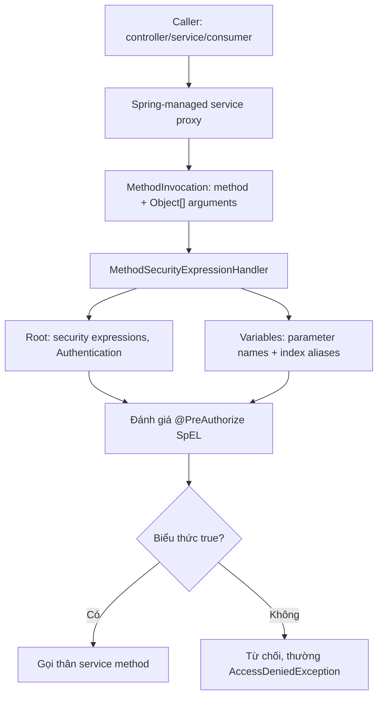

# Tham chiếu tham số bằng tên, #p0, #a0 hoặc #root.args trong Spring Security

## Mục tiêu học tập

Khi dùng `@PreAuthorize`, bạn thường phải kiểm tra **quyền đối với một hành động cụ thể** dựa trên tham số của service method: ID tài liệu, tên người sở hữu, tenant, loại thao tác hoặc trạng thái yêu cầu. Spring Security cho phép đưa **method arguments** vào Spring Expression Language (SpEL), nhưng mỗi cách viết có điều kiện và giới hạn riêng.

Bài học này tập trung vào bốn biểu thức dễ bị nhầm:

- **`#documentId`, `#owner`**: biến tham số theo **tên** được Spring Security tìm ra qua annotation hoặc metadata của class đã biên dịch.
- **`#p0`, `#p1`, ...**: bí danh theo **vị trí** của method arguments, bắt đầu từ 0.
- **`#a0`, `#a1`, ...**: bí danh vị trí tương đương `#p0`, `#p1` trong method-based evaluation context.
- **`#root.args`**: cú pháp có trong **một số ngữ cảnh SpEL của Spring Framework** như caching hoặc event listener, nhưng **không phải đường truy cập method arguments được bảo đảm trên root của `@PreAuthorize`**. Không được coi bốn hình thức là thay thế cho nhau một cách máy móc.

Sau khi học, bạn có thể viết chính sách `@PreAuthorize` đúng tên/vị trí, biết vì sao phép kiểm tra sai khi refactor method signature, dùng `@P` hoặc `-parameters` để ổn định tên, hiểu khác biệt **SpEL root và SpEL variables**, xác minh giới hạn `#root.args`, và kiểm thử bằng Spring Test với principal đủ/thiếu quyền.

**Phạm vi:** Spring Security 6.x/7.x, method-security trên Spring-managed Java service, dùng `@EnableMethodSecurity` và `@PreAuthorize`. Đoạn mã Spring cần framework dependencies. Chương trình Java 17 độc lập ở phần 12 minh họa việc bind tên/chỉ số, không phải trình thực thi SpEL của Spring.

## 1. Bối cảnh: tham số là ngữ cảnh của quyết định phân quyền

Giả sử API hỗ trợ:

```text
GET /api/documents/42
  → DocumentService.read(documentId = 42, owner = "alice")

POST /api/documents/42/share
  → DocumentService.share(documentId = 42, targetUser = "bob")
```

Không thể chỉ hỏi user có quyền `document:read` hay không; đôi khi còn phải biết **document nào**, **ai sở hữu** và **tenant nào đang được chọn**. Một cách thể hiện là:

```java
@PreAuthorize(
    "hasAuthority('document:read') and " +
    "@documentPolicy.canRead(authentication, #documentId)"
)
public Document read(long documentId) {
    return repository.findById(documentId).orElseThrow();
}
```

Ở đây:

1. `hasAuthority('document:read')` kiểm tra quyền chức năng được cấp trong `Authentication.getAuthorities()`.
2. `#documentId` tham chiếu **method argument** bằng tên.
3. `@documentPolicy` tham chiếu một **Spring bean** (ký tự `@` trong SpEL), không phải annotation Java đặt trên method.
4. `authentication` là object xác thực do Spring Security đưa vào method-security expression context.
5. `documentPolicy.canRead(...)` phải kiểm tra owner/tenant/ACL bằng dữ liệu tin cậy của server.

Đây là **snippet tích hợp**: `Document`, `repository` và `documentPolicy` phải được hiện thực trong dự án. Nếu tên tham số không được discover, `#documentId` có thể không lấy được giá trị như mong muốn; một biểu thức nhìn rất đúng trong source vẫn có thể bị lỗi khi chạy.

## 2. @EnableMethodSecurity và evaluation context

Kích hoạt Method Security với Spring Security hiện đại:

```java
import org.springframework.context.annotation.Configuration;
import org.springframework.security.config.annotation.method.configuration.EnableMethodSecurity;

@Configuration
@EnableMethodSecurity
public class MethodSecurityConfiguration {
}
```

Với một bean Spring có `@PreAuthorize`, Spring AOP proxy intercept lời gọi, `PreAuthorizeAuthorizationManager` sử dụng `MethodSecurityExpressionHandler` xây evaluation context rồi đánh giá biểu thức **trước khi chạy thân method**.



Khác biệt lớn:

- **Root object** là object mà SpEL mặc định sử dụng cho property/method expressions (ví dụ `hasAuthority(...)`, `authentication`).
- **Variables** được truy cập bằng dấu `#` (ví dụ `#documentId`, `#p0`, `#a0`).
- **`#root`** là biến đặc biệt trỏ đến root object hiện tại; `#root.args` nghĩa là “đọc property `args` của **root**”, chứ không phải “truy cập mọi biến tham số” một cách chung.

Spring Security tạo `MethodSecurityEvaluationContext` với khả năng bind parameter names và positional aliases. Đây không phải cùng root object/cùng variable set với mọi tính năng SpEL trong Spring Framework.

### Khi nào annotation thực sự hoạt động?

`@PreAuthorize` chỉ được thực thi nếu có interceptor ở đúng Spring context và lời gọi đi qua Spring-managed proxy. Các tình huống `new DocumentService()`, test chỉ dùng Mockito mock, hoặc `this.someProtectedMethod()` gọi nội bộ có thể bỏ qua Spring AOP proxy.

**Test phải gọi bean lấy từ ApplicationContext.** Đọc một annotation trong source không chứng minh security đã chạy.

## 3. Bốn cách viết — bảng so sánh để tránh nhầm

Giả sử khai báo method:

```java
public String transfer(String owner, long documentId) {
    return "sent";
}
```

Khi có đúng method-security evaluation context:

| Biểu thức | Ý nghĩa kỳ vọng | Cần metadata tên tham số? | Ghi chú |
| --- | --- | --- | --- |
| `#owner` | Đối số `owner`, vị trí 0 | **Có**, hoặc explicit alias `@P`/`@Param` | Dễ đọc, nhưng cần tên ổn định |
| `#documentId` | Đối số `documentId`, vị trí 1 | **Có**, hoặc explicit alias | Thích hợp gọi bean policy |
| `#p0` | Đối số thứ nhất | **Không** cần biết tên nguồn | Gắn với **vị trí**, dễ lỗi khi đổi chữ ký |
| `#p1` | Đối số thứ hai | **Không** | Bắt đầu đánh số từ 0, không phải 1 |
| `#a0` | Đối số thứ nhất | **Không** cần biết tên nguồn | Bí danh vị trí giống `#p0` |
| `#a1` | Đối số thứ hai | **Không** | Bí danh vị trí giống `#p1` |
| `#root` | Đối tượng root của SpEL hiện tại | Không | Không phải `Object[]` arguments |
| `#root.args[0]` | Đọc property `args` trên root rồi lấy phần tử đầu | Tùy root implementation | **Không nên dùng mặc định trong `@PreAuthorize`** |

**Quy tắc đọc:** với method có `N` tham số, các index hợp lệ của đối số truyền vào bắt đầu từ `0` tới `N - 1`. `#p0` và `#a0` nói về **đối số ở vị trí đầu tiên**, không có nghĩa đó luôn là `owner`: nếu signature thay đổi, ý nghĩa lập tức thay đổi.

### Ba cách an toàn thường gặp

```java
// Theo tên: cần name discovery hoặc annotation đặt alias.
@PreAuthorize("#owner == authentication.name")
public String view(String owner) { return "ok"; }

// Theo vị trí: trong method-security evaluation context thông thường.
@PreAuthorize("#p0 == authentication.name")
public String viewWithP0(String owner) { return "ok"; }

// Bí danh vị trí khác cùng giá trị.
@PreAuthorize("#a0 == authentication.name")
public String viewWithA0(String owner) { return "ok"; }
```

Ba method trên là snippet đặt trong **một Spring-managed class**; imports cho `@PreAuthorize` và cấu hình `@EnableMethodSecurity` ở các phần liên quan. Với hai hình thức theo index, ý định về tên chỉ tồn tại trong **người đọc source**, không ràng buộc vào tên tham số.

## 4. Tham chiếu theo tên: #owner, #documentId, #tenantId

Trong expression:

```java
@PreAuthorize(
    "hasAuthority('document:read') and " +
    "#owner == authentication.name"
)
public Document readDocument(String owner, long documentId) {
    // ...
}
```

Spring cần biết rằng tham số đầu có tên `owner`. `DefaultSecurityParameterNameDiscoverer` (hoặc API parameter-name discovery phù hợp với version) sử dụng nhiều nguồn:

1. Alias được đánh dấu bằng `@P("alias")` của Spring Security.
2. `@Param("alias")` của Spring Data nếu dependency và annotation tương ứng hiện diện.
3. Tên method parameters từ Java reflection **khi class được compile với `-parameters`**.
4. Một số version cũ hoặc tài liệu legacy có đề cập debug/local-variable metadata; **không nên dựa vào debug symbols thay cho `-parameters`** trong các Spring Framework hiện đại, vì khả năng này đã thay đổi giữa các versions.

**Khuyến nghị:** nếu muốn viết `#owner`, hãy cấu hình build tool tạo runtime parameter metadata bằng `-parameters` hoặc dùng `@P` tường minh. Không giả định tên viết trong source luôn tồn tại ở runtime.

### Ví dụ cấu hình Maven compiler cho Java 17

```xml
<plugin>
  <groupId>org.apache.maven.plugins</groupId>
  <artifactId>maven-compiler-plugin</artifactId>
  <configuration>
    <release>17</release>
    <parameters>true</parameters>
  </configuration>
</plugin>
```

Đây là **một đoạn cấu hình plugin**, cần đặt đúng trong `pom.xml` của dự án. Với Maven/Spring Boot plugin quản lý version, tuân thủ BOM/plugin management; không tự gán version bừa.

### Ví dụ cấu hình Gradle

```groovy
tasks.withType(JavaCompile).configureEach {
    options.compilerArgs += ['-parameters']
}
```

Snippet Gradle Groovy DSL; với Kotlin DSL cú pháp sẽ khác. Sau khi đổi build flags, **clean/recompile toàn bộ classes** có liên quan; một số class cũ build trước có thể chưa mang metadata.

### Những tình huống tên biến mất

- Compile không có `-parameters`, rồi đổi cách đóng gói build.
- Annotation đặt trên interface nhưng interface class không giữ parameter metadata như implementation.
- Code được tạo bởi tool, Kotlin/Java interop hoặc AOT proxy với đặc thù names/method signatures khác.
- Refactor tham số `owner` thành `requester` nhưng expression vẫn giữ `#owner`.
- Bật minification/obfuscation làm ảnh hưởng metadata cần thiết.
- Một phương thức được override bằng implementation có tên tham số khác interface, và matcher/discoverer lấy method metadata không như người viết dự đoán.

**Không dùng sai biến dẫn đến việc tự mở quyền.** Expression không resolve như mong muốn có thể ném SpEL evaluation exception hoặc đánh giá thành DENY, tùy ngữ cảnh biểu thức; tuyệt đối không thêm `permitAll` hoặc bỏ check để “chữa” lỗi này.

## 5. @P đặt tên rõ ràng, độc lập với Java parameter name

Nếu bạn muốn một alias nhất quán để dùng trong SpEL, có thể đặt `@P`:

```java
import org.springframework.security.access.method.P;
import org.springframework.security.access.prepost.PreAuthorize;

public class DocumentService {

    @PreAuthorize(
        "hasAuthority('document:read') and " +
        "@documentPolicy.canRead(authentication, #docId)"
    )
    public Document read(@P("docId") long documentId) {
        // ...
    }
}
```

`#docId` dùng tên do `@P("docId")` khai báo; tham số Java có thể vẫn mang tên `documentId`. Điều quan trọng là **SpEL tìm alias `docId`**, không suy rằng có cả hai alias và chọn tùy ý. Nếu đổi annotation từ `docId` sang `id` thì cũng phải đổi expression.

Đây là snippet Spring tích hợp, cần bean `documentPolicy`, class `Document` và dependencies. Một ứng dụng thường đặt `@Service` trên class và inject repository qua constructor; ví dụ rút ngắn để làm rõ annotation.

### Trường hợp compile interface

Interface có thể khai tham số alias mà implementation đặt tên khác:

```java
import org.springframework.security.access.method.P;
import org.springframework.security.access.prepost.PreAuthorize;

public interface DocumentOperations {

    @PreAuthorize(
        "hasAuthority('document:read') and " +
        "@documentPolicy.canRead(authentication, #docId)"
    )
    String summary(@P("docId") long id);
}
```

Trong cấu hình proxy mặc định có support annotation kế thừa từ interface, việc dùng `@P` giúp giảm phụ thuộc vào tên Java ở method implementation. Tuy nhiên, hãy test Spring-managed bean thực: AOP proxy strategy, compile flags, signature và cách annotations được kế thừa đều có thể ảnh hưởng trong một project cụ thể.

### Spring Data @Param

Nếu dự án đã có Spring Data, tài liệu Spring Security cũng hỗ trợ alias qua `org.springframework.data.repository.query.Param`:

```java
import org.springframework.data.repository.query.Param;

@PreAuthorize("#requestedOwner == authentication.name")
public String view(@Param("requestedOwner") String owner) {
    return "ok";
}
```

Không cần kéo thêm **Spring Data** chỉ để đặt tên security argument nếu project chưa dùng nó: `@P` là lựa chọn riêng của Spring Security.

## 6. #p0, #p1: bí danh theo vị trí của arguments

Trong `MethodBasedEvaluationContext` (Spring Framework), các đối số method được expose bằng những alias `pX` và `aX`. Spring Security method-security evaluation context được xây dựng trên cơ chế tương ứng để bind method arguments. Những biến này **không phụ thuộc vào tên viết trong source**.

Ví dụ:

```java
@PreAuthorize(
    "hasAuthority('document:read') and " +
    "@documentPolicy.canRead(authentication, #p0)"
)
public Document read(long documentId) {
    // ...
}
```

`#p0` là đối số thứ **nhất** — ở đây `documentId`. Nếu method thành:

```java
public Document read(String tenantId, long documentId) {
    // ...
}
```

thì `#p0` **chuyển thành `tenantId`**; ID tài liệu bây giờ là `#p1`. Nếu expression vẫn gọi `canRead(authentication, #p0)`, policy nhận sai loại dữ liệu/ý nghĩa; có thể ném exception hoặc ra quyết định sai nếu các loại dữ liệu đều là String/long compatible.

**Bẫy nguy hiểm:** hai tham số cùng kiểu `String` làm lỗi indexing có thể **không bị compiler phát hiện**.

```java
// Ban đầu:
@PreAuthorize("#p0 == authentication.name")
public String view(String owner, String key) {
    return "ok";
}

// Sau refactor chữ ký:
@PreAuthorize("#p0 == authentication.name")
public String view(String key, String owner) {
    return "ok";
}
```

Nếu vẫn dựa vào `#p0`, policy đã đổi từ so `owner` thành so `key`. Để tránh rủi ro, dùng **alias có tên** `@P("owner")` hoặc giữ một request object/policy method có ý nghĩa rõ.

### Mapping positional alias trong method 3 tham số

Với:

```java
public void grant(
    long documentId,
    String targetUser,
    boolean notify
) {
    // ...
}
```

mapping là:

| Tham số | Index | Bí danh `p` | Bí danh `a` |
| --- | ---: | --- | --- |
| `documentId` | 0 | `#p0` | `#a0` |
| `targetUser` | 1 | `#p1` | `#a1` |
| `notify` | 2 | `#p2` | `#a2` |

Không có `#p3` cho một method ba tham số. Nếu method có varargs hoặc Kotlin suspend arguments, cơ chế bind/metadata cần được kiểm thử riêng cho version và signature thực.

### Khi nào positional alias hợp lý?

- Ví dụ kiểm thử rất ngắn, method signature ổn định và không gây mơ hồ.
- Generated code không giữ tên tham số (nhưng vẫn cần test runtime expression context).
- Một phương thức đơn tham số, nơi `#p0` dễ kiểm tra bằng mắt.

Với service business có nhiều tham số hoặc policy quan trọng, **ưu tiên tên rõ nghĩa** và test regression khi refactor.

## 7. #a0, #a1: tương tự #p0, không phải biến “authentication”

`#a0` và `#p0` thường cùng trỏ tới **argument ở index 0**, còn `#a1`/`#p1` là index 1. Chữ `a` ở đây đại diện cho **argument index alias**, không phải `Authentication`.

Ví dụ:

```java
@PreAuthorize(
    "hasAuthority('invoice:approve') and " +
    "#a1 == authentication.name"
)
public void approve(long invoiceId, String approver) {
    // ...
}
```

Ý nghĩa: người gọi phải có authority approve và giá trị **đối số thứ hai** phải bằng tên người đăng nhập. Nó không có nghĩa `#a1` là đối tượng `Authentication`; nguồn authentication vẫn là biến/root property `authentication`.

Để rõ hơn, viết:

```java
import org.springframework.security.access.method.P;

@PreAuthorize(
    "hasAuthority('invoice:approve') and " +
    "#approver == authentication.name"
)
public void approve(
    @P("invoiceId") long invoiceId,
    @P("approver") String suppliedApprover
) {
    // ...
}
```

Cả hai ví dụ dùng dữ liệu caller gửi làm một **điều kiện bổ sung**, nhưng **không nên coi caller có thể chỉ định identity tùy ý**. Thông tin ai đang đăng nhập phải lấy từ `Authentication` do server xác thực; `suppliedApprover` chỉ là input để so với danh tính đáng tin.

### Có nên trộn #p0 và #a1?

Có thể về mặt kỹ thuật:

```java
@PreAuthorize(
    "#p0 > 0 and #a1 == authentication.name"
)
public void approve(long id, String owner) {
    // ...
}
```

Nhưng đây là expression khó đọc hơn `#id > 0 and #owner == authentication.name`, và rất dễ sai khi thêm hoặc đổi vị trí tham số. Một codebase nên có convention thống nhất: **tên/`@P` cho business policy**, index aliases chỉ dùng nơi có lý do cụ thể.

## 8. #root.args: vì sao không thể mặc định dùng trong @PreAuthorize?

Đây là chỗ nhiều tài liệu/blog gây hiểu nhầm nhất. **SpEL** là ngôn ngữ chung, nhưng **mỗi framework feature tự tạo evaluation context/root**.

Ví dụ:

- Trong Spring Cache `@Cacheable(key = "...")`, caching expression root **có metadata `args`**, nên cú pháp `#root.args[0]` được tài liệu Spring Cache giới thiệu.
- Trong `@EventListener(condition = "...")`, Spring event expression context cung cấp `#root.args` hoặc `args` để truy cập listener arguments.
- Trong **Spring Security method security**, root object là `MethodSecurityExpressionRoot` hoặc `MethodSecurityExpressionOperations` tương ứng. Nó cung cấp security operations/authentication, không phải mặc định một `args` property như caching root.

Vì vậy ví dụ:

```java
// KHÔNG dùng như cách tương đương được bảo đảm trong @PreAuthorize.
@PreAuthorize("#root.args[0] == authentication.name")
public String getForOwner(String owner) {
    return "ok";
}
```

có thể thất bại ở runtime với SpEL exception kiểu:

```text
EL1008E: Property or field 'args' cannot be found
on object of type '...MethodSecurityExpressionRoot'
```

Đây là **dạng lỗi minh họa**; text exception chi tiết có thể đổi theo version. Không đưa đoạn code này vào production chỉ vì một tài liệu về `@Cacheable` hoặc `@EventListener` nói `#root.args` hợp lệ.

### #root là gì?

`#root` là biến SpEL chỉ **root object** của expression context. Trong Method Security, một ví dụ chính thức về cách truyền root cho custom authorizer là:

```java
@PreAuthorize("@authz.decide(#root)")
public String securedOperation() {
    return "ok";
}
```

Bean `authz` có thể nhận kiểu `MethodSecurityExpressionOperations` và dùng những security operations mà root thực sự cung cấp. Nhưng `#root` **không biến thành `MethodInvocation`**, và nó không tự có `args`. Muốn truy cập args, dùng `#owner`/`#p0`/`#a0` hoặc chuyển policy sang `AuthorizationManager<MethodInvocation>` để truy cập `MethodInvocation.getArguments()` qua API đó.

### Nếu thật sự cần xử lý Object[] args?

Có hai hướng đúng ý:

**Hướng 1 — lấy những tham số cụ thể rồi gọi bean policy:**

```java
@PreAuthorize(
    "@documentPolicy.canShare(authentication, #p0, #a1)"
)
public void share(long documentId, String targetUser) {
    // ...
}
```

Policy nhận kiểu dữ liệu rõ ràng, kiểm tra tenant/ACL ở server. Trường hợp nhiều tham số, có thể đặt `@P` rồi gọi `#documentId`/`#targetUser` để dễ review.

**Hướng 2 — tạo custom authorization manager cho MethodInvocation:**

```java
// PSEUDOCODE CẤU TRÚC, không phải file Spring độc lập.
AuthorizationManager<MethodInvocation> manager = (auth, invocation) -> {
    Object[] arguments = invocation.getArguments();
    // Kiểm tra số lượng, kiểu và semantic của arguments.
    // Đánh giá principal / owner / tenant.
    return new AuthorizationDecision(customDecision(auth.get(), arguments));
};
```

Đây là sketch cho cách dùng `MethodInvocation.getArguments()`; bạn phải cung cấp implementation `customDecision`, wiring manager/interceptor và xử lý null/abstain đúng Spring Security version. Ưu tiên cho codebase lớn có policy đặc biệt; đừng dựng custom AOP chỉ để đọc một `documentId`.

**Kết luận quan trọng:** không lấy cú pháp SpEL của **Spring Cache hoặc Spring Events** và áp y nguyên vào **Spring Security method security**. Tên biến, property của root và thời điểm đánh giá phải được xác minh trong context thực.

## 9. Biểu thức tham số và quyền trên đối tượng

Một policy tốt phải diễn đạt đúng **đối tượng dữ liệu** được phép truy cập, không chỉ so chuỗi ID với username.

Ví dụ hệ thống đa tenant:

```java
@PreAuthorize(
    "hasAuthority('document:read') and " +
    "@documentPolicy.canRead(authentication, #documentId)"
)
public Document read(@P("documentId") long documentId) {
    return repository.findById(documentId).orElseThrow();
}
```

Trong `documentPolicy.canRead`, phải xem:

1. User/tenant từ `Authentication` có đáng tin và đã được xác thực không?
2. `documentId` tồn tại và thuộc tenant nào?
3. User có phải owner hoặc được cấp ACL cho document không?
4. Trạng thái document có cho phép thao tác hiện tại không?
5. Có time-of-check/time-of-use (TOCTOU) giữa lần kiểm tra và truy vấn/ghi dữ liệu không?

Không dùng một phép `#tenantId == principal.tenantId` rồi cho rằng đã đủ khi tenantId từ HTTP request có thể bị sửa. Tenant membership/ACL phải lấy từ nguồn server-side.

### Biến #principal và authentication.name

Thông thường:

```java
@PreAuthorize("#owner == authentication.name")
public String read(String owner) {
    return "ok";
}
```

so input `owner` với danh tính hiện tại đã xác thực. Nhưng user có thể **đưa owner trùng username của mình**, không đảm bảo document ID thực sự thuộc họ. Cần đọc dữ liệu server để xác nhận quyền với resource ID.

### Null-safety và biểu thức phức tạp

Ví dụ:

```java
@PreAuthorize(
    "#request != null and #request.documentId() > 0 and " +
    "@documentPolicy.canRead(authentication, #request.documentId())"
)
public Document read(@P("request") ReadDocumentRequest request) {
    // ...
}
```

Đoạn này cần `ReadDocumentRequest` (ví dụ Java record) được định nghĩa. `and` của SpEL là short-circuit trong boolean expressions thông thường, giúp tránh dereference khi request null ở ví dụ. Đối với nullable nested data, có thể dùng safe navigation nếu phù hợp với SpEL parser/version; không bỏ qua validation input phía service.

Nếu policy quá dài, chuyển logic về bean policy hoặc Java AuthorizationManager để test độc lập và tránh biểu thức khó review.

## 10. Thay đổi method signature: lỗi im lặng và cách chống hồi quy

Giả sử phiên bản 1:

```java
@PreAuthorize(
    "@documentPolicy.canEdit(authentication, #p0)"
)
public void edit(long documentId, String content) {
    // ...
}
```

Phiên bản 2 thêm `tenantId` phía trước:

```java
@PreAuthorize(
    "@documentPolicy.canEdit(authentication, #p0)"
)
public void edit(String tenantId, long documentId, String content) {
    // ...
}
```

Giờ `#p0` là `tenantId`, không còn là `documentId`. Nếu policy nhận `Object` hoặc các tham số cùng kiểu String, lỗi có thể **không được phát hiện lúc compile** và dẫn đến quyết định bảo mật sai.

### Một ví dụ có hai String: nguy cơ rõ hơn

```java
// V1
@PreAuthorize("#a0 == authentication.name")
void download(String owner, String documentKey);

// V2: đã đổi thứ tự đối số
@PreAuthorize("#a0 == authentication.name")
void download(String documentKey, String owner);
```

Với V2, user có thể đưa `documentKey` bằng username của mình để vượt điều kiện `#a0`, dù `owner` khác. Đây là lỗi **logic trong policy**, không phải bug parser.

**Giảm rủi ro:**

- Dùng `@P("owner")` và `#owner` cho đối số có ý nghĩa nghiệp vụ.
- Khi sửa signature, review **mọi SpEL expression** tham chiếu index.
- Đặt unit/integration tests gọi service trực tiếp với cùng ID nhưng owner/tenant khác.
- Đừng chỉ test quyền đúng; bắt buộc test **DENY** cho input trái policy.
- Với id/tenant/owner, kiểm tra dữ liệu gốc trong policy bean/repository.
- Dùng DTO/record input được validate rõ ràng nếu nhiều tham số nhưng không nhét mọi thứ vào một `Map<String,Object>` không type-safe.

### Interface và reflection metadata

Nếu `@PreAuthorize` khai trên interface nhưng implementation đổi tên tham số, quá trình discover parameter names có thể dựa vào method/annotation cụ thể và proxy strategy. Khi compile interface, debug local-variable metadata không thể giúp lấy parameter names như method có body; `-parameters` hoặc `@P` hữu ích hơn.

Test cần nạp cả interface-based và class-based proxy theo cấu hình của project, đặc biệt khi chuyển Spring Boot/Spring Framework versions.

## 11. Phân biệt Method Security SpEL với các context khác

| Công nghệ/cơ chế | Ví dụ SpEL | Đặc điểm |
| --- | --- | --- |
| Spring Security `@PreAuthorize` | `#owner`, `#p0`, `#a0`, `authentication`, `hasAuthority(...)` | Root là security expression root, arguments được bind thành variables |
| Spring Security `@PostAuthorize` | `returnObject`, `#owner` | Đánh giá sau method, còn có result |
| Spring Security `@PreFilter`/`@PostFilter` | `filterObject` | Mỗi phần tử đang lọc có context riêng |
| Spring Cache `@Cacheable(key=...)` | `#root.args[0]`, `#root.methodName` | Root metadata dành riêng cho caching |
| Spring Events `@EventListener(condition=...)` | `#root.args[0]`, `#a0` | Event listener expression context riêng |
| Spring Data repository queries | `?#{ principal?.id }` hoặc syntax tương ứng | Security extension cho query context, không phải `@PreAuthorize` |
| Custom SpEL evaluation context | Tùy custom root/variables | Phải kiểm tra implementation của context |

**Không có bảng biến SpEL áp dụng cho mọi annotation trong toàn bộ Spring**. Cùng tên `#root` nhưng object thực ở từng nơi có kiểu khác nhau.

### @PostAuthorize không phải trước phương thức

```java
@PreAuthorize("hasAuthority('document:read')")
@PostAuthorize("returnObject.owner() == authentication.name")
public DocumentView load(long id) {
    // ...
}
```

Ở đây `returnObject` chỉ tồn tại khi method trả kết quả để post-check. Không dùng `returnObject` trong `@PreAuthorize` vì chưa có return value. Với method ghi tiền/xóa dữ liệu, không dùng post-check làm hàng rào duy nhất: thân method đã chạy trước khi hậu kiểm.

### @PreFilter không nhất thiết từ chối cả batch

```java
@PreFilter("filterObject.owner() == authentication.name")
@PreAuthorize("hasAuthority('task:process')")
public void process(List<Task> tasks) {
    // ...
}
```

`filterObject` là phần tử đang xét của collection; nó **không** đồng nghĩa `#p0`. `#p0` có thể trỏ tới **toàn bộ List<Task>`, còn `filterObject` trỏ từng item. Với batch phải all-or-nothing, filtering âm thầm loại phần tử không được phép có thể sai nghiệp vụ; viết validation/policy từ chối cả batch trước khi tạo side effect.

## 12. Java 17 độc lập: ánh xạ tên và vị trí của method arguments

Chương trình Java 17 dưới đây **không dùng Spring**, nhưng minh họa bằng Java reflection và map aliases rằng:

- `-parameters` giữ **tên tham số Java** để đọc ở runtime.
- Bí danh `p0`/`a0` trỏ cùng vị trí; `p1`/`a1` trỏ vị trí thứ hai.
- Biến root tùy thuộc vào **kiểu object root**; một root không có property `args` thì không thể đọc nó qua `root.args`.
- Đổi thứ tự tham số làm nghĩa của `p0`/`a0` đổi theo.

Lưu file đúng tên **`ParameterReferenceDemo.java`**:

```java
import java.lang.reflect.Method;
import java.util.LinkedHashMap;
import java.util.Map;

public class ParameterReferenceDemo {

    record Context(Map<String, Object> variables) {
        Object get(String key) {
            return variables.get(key);
        }
    }

    static void example(String owner, long documentId) {
        // Chữ ký chỉ để Java reflection lấy metadata.
    }

    static Context bind(String owner, long documentId) {
        Map<String, Object> values = new LinkedHashMap<>();
        values.put("owner", owner);
        values.put("documentId", documentId);
        values.put("p0", owner);
        values.put("a0", owner);
        values.put("p1", documentId);
        values.put("a1", documentId);
        return new Context(values);
    }

    public static void main(String[] args) throws Exception {
        Method method = ParameterReferenceDemo.class
            .getDeclaredMethod("example", String.class, long.class);

        System.out.println(
            "parameter[0] name = "
                + method.getParameters()[0].getName()
        );
        System.out.println(
            "parameter[1] name = "
                + method.getParameters()[1].getName()
        );

        Context context = bind("alice", 42L);

        System.out.println(
            "#owner = " + context.get("owner")
        );
        System.out.println(
            "#p0 = " + context.get("p0")
        );
        System.out.println(
            "#a0 = " + context.get("a0")
        );
        System.out.println(
            "#p1 = " + context.get("p1")
        );
        System.out.println(
            "#a1 = " + context.get("a1")
        );

        Object[] reordered = {42L, "alice"};
        System.out.println(
            "after reorder p0 = " + reordered[0]
        );

        // Giả định root chỉ có security methods, không có args.
        boolean rootHasArgs = false;
        System.out.println(
            "root has args property = " + rootHasArgs
        );
    }
}
```

Biên dịch **bắt buộc với `-parameters`** để kết quả tên trong bài trùng khớp:

```bash
javac -parameters ParameterReferenceDemo.java
java ParameterReferenceDemo
```

**Stdout chính xác khi dùng đúng lệnh trên (JDK 17+):**

```text
parameter[0] name = owner
parameter[1] name = documentId
#owner = alice
#p0 = alice
#a0 = alice
#p1 = 42
#a1 = 42
after reorder p0 = 42
root has args property = false
```

**Giới hạn của chương trình:** `bind` tự đặt biến vào map và `rootHasArgs` là giả định minh họa để đối chiếu ngữ cảnh. Nó **không** kiểm tra thật `MethodSecurityEvaluationContext`, `MethodSecurityExpressionRoot` hay Spring Security AOP. Để xác nhận `#p0`/`#a0` và đánh giá root trong ứng dụng, dùng tests ở phần 13.

### Nếu quên -parameters thì sao?

Java reflection có thể báo các tên tổng quát như `arg0` và `arg1` khi không có metadata tên. Không dùng output `arg0` như một API contract bất biến trong mọi toolchain; test thật của dự án cần chứng minh `-parameters` đã được áp dụng cho **module chứa service method**. `#p0`/`#a0` không yêu cầu tên biến nguồn, nhưng vẫn gắn với index.

## 13. Spring JUnit tests: kiểm tra #owner, #p0 và #a0

Để xác minh Spring Security thực, test cần:

1. Bật `@EnableMethodSecurity`.
2. Lấy service **thật** từ ApplicationContext, không `new` hoặc thay bằng Mockito mock.
3. Dùng `@WithMockUser`/authentication được tạo đúng cách.
4. Test principal khớp và không khớp cho **từng cách viết**.
5. Test hai đối số để thấy index `1` đúng là tham số thứ hai.
6. Dùng `@P` cho named alias để test không phụ thuộc build flag.

Ví dụ JUnit 5 sau cần Spring Context, Spring Security Config/Test và Spring Test dependencies, không thể chạy bằng JDK thuần:

```java
import org.junit.jupiter.api.Test;
import org.springframework.beans.factory.annotation.Autowired;
import org.springframework.context.annotation.Bean;
import org.springframework.context.annotation.Configuration;
import org.springframework.security.access.AccessDeniedException;
import org.springframework.security.access.method.P;
import org.springframework.security.access.prepost.PreAuthorize;
import org.springframework.security.config.annotation.method.configuration.EnableMethodSecurity;
import org.springframework.security.test.context.support.WithMockUser;
import org.springframework.test.context.junit.jupiter.SpringJUnitConfig;

import static org.junit.jupiter.api.Assertions.assertEquals;
import static org.junit.jupiter.api.Assertions.assertThrows;

@SpringJUnitConfig(ParameterReferenceTest.Config.class)
class ParameterReferenceTest {

    @Autowired
    GuardedService service;

    @Test
    @WithMockUser(username = "alice")
    void namedAliasMatchesAuthenticatedUser() {
        assertEquals("alice",
            service.byName("alice"));
        assertThrows(AccessDeniedException.class,
            () -> service.byName("bob"));
    }

    @Test
    @WithMockUser(username = "alice")
    void p0MatchesFirstArgument() {
        assertEquals("alice",
            service.byP0("alice"));
        assertThrows(AccessDeniedException.class,
            () -> service.byP0("bob"));
    }

    @Test
    @WithMockUser(username = "alice")
    void a0MatchesFirstArgument() {
        assertEquals("alice",
            service.byA0("alice"));
        assertThrows(AccessDeniedException.class,
            () -> service.byA0("bob"));
    }

    @Test
    @WithMockUser(username = "alice")
    void secondArgumentIsP1AndA1() {
        assertEquals("accepted",
            service.bySecondArgument(42L, "alice"));
        assertThrows(AccessDeniedException.class,
            () -> service.bySecondArgument(42L, "bob"));
    }

    @Configuration
    @EnableMethodSecurity
    static class Config {
        @Bean
        GuardedService guardedService() {
            return new GuardedService();
        }
    }

    public static class GuardedService {

        @PreAuthorize("#owner == authentication.name")
        public String byName(@P("owner") String suppliedOwner) {
            return suppliedOwner;
        }

        @PreAuthorize("#p0 == authentication.name")
        public String byP0(String suppliedOwner) {
            return suppliedOwner;
        }

        @PreAuthorize("#a0 == authentication.name")
        public String byA0(String suppliedOwner) {
            return suppliedOwner;
        }

        @PreAuthorize(
            "#p1 == authentication.name and " +
            "#a1 == authentication.name"
        )
        public String bySecondArgument(
                long documentId, String suppliedOwner) {
            return "accepted";
        }
    }
}
```

Đây là một **test fixture Spring**; nó không xác minh object ownership thực mà chỉ minh họa cách bind tham số. Test `byName` dùng `@P("owner")` để không phụ thuộc tham số thực có tên `suppliedOwner` hay không. Test `byP0` và `byA0` chứng minh cách truy cập theo index trong context thực. Nếu nâng Spring Security/Framework, giữ tests này làm regression suite.

### Kiểm thử #root.args đúng cách

Không viết một “happy path” test giả định `#root.args[0]` tồn tại. Nếu project từng dùng expression này, hãy thêm một **test tách biệt** xác nhận root object thực tế của framework version đang chạy và lưu kết quả vào tài liệu kỹ thuật. Với cấu hình mặc định nơi root không có `args`, expression có thể ném `SpelEvaluationException` hoặc bị đóng gói trong lỗi evaluation của Spring Security.

**Cách sửa:** thay `#root.args[0]` bằng `#p0`/`#a0` hoặc `#owner`/`@P("owner")`. Với policy đòi `MethodInvocation.getArguments()`, dùng custom authorization manager ở tầng method invocation, không giả định `#root` là MethodInvocation.

## 14. Test đổi signature và kiểm tra security bằng negative cases

Một bộ kiểm thử đáng tin phải bao gồm:

| Ca | Input | Mong muốn |
| --- | --- | --- |
| Named param hợp lệ | `#owner`, user alice, owner alice | ALLOW |
| Named param sai | user alice, owner bob | DENY |
| Positional `p0` đúng | `#p0` = alice | ALLOW |
| Positional `p0` sai | `#p0` = bob | DENY |
| Positional `a0` đúng | `#a0` = alice | ALLOW |
| Index thứ hai | `#p1` / `#a1` là owner | ALLOW đúng owner |
| Index thứ hai sai | owner là bob | DENY |
| Thêm tham số đầu method | `#p0` không còn là owner | Test phải thất bại hoặc policy được cập nhật |
| Thiếu Java name metadata | `#owner` không có `@P`/`-parameters` | Test phát hiện mapping không đúng |
| Interface service có annotation | Kiểu proxy khác nhau | Rule vẫn đánh giá đúng |
| User không có authority | `hasAuthority(...)` thiếu quyền | DENY |
| Owner thuộc tenant khác | Có quyền đọc nhưng sai tenant | DENY bằng object policy |
| Self-invocation | `this.protectedMethod()` | Không âm thầm bypass guard |
| Method được gọi từ scheduler | Không có HTTP context | Thiết kế system principal/authorization rõ |
| Expression chứa `#root.args` | Root không có `args` | Không phụ thuộc vào syntax khác context |
| Request null | Named value `null` | Fail closed theo policy; tránh dereference exception |

**Không chỉ assert status HTTP 403**. HTTP filters hoặc CSRF có thể trả 403 trước khi service được gọi. Test direct service bằng `@WithMockUser` giúp xác minh method-security policy, và các test repository/service interactions bảo đảm không có side effect nếu DENY.

## 15. Những lỗi phổ biến và cách sửa

1. **Quên `@EnableMethodSecurity`:** annotation không được intercept; bật ở đúng Spring context.
2. **Dùng `#documentId` nhưng build không có parameter metadata:** thêm `-parameters` hoặc `@P("documentId")`.
3. **Nhầm index bắt đầu từ 1:** `#p0`/`#a0` là đối số đầu tiên.
4. **Nghĩ `#a0` là Authentication:** đây là alias của argument index 0; authentication có biến/root property riêng.
5. **Đổi thứ tự hai `String` arguments:** `#p0` có thể vẫn đánh giá hợp lệ nhưng so nhầm dữ liệu.
6. **Sao chép `#root.args` từ Spring Cache/EventListener:** các root objects khác nhau; cú pháp có thể fail ở Method Security.
7. **Dùng `#root` như một Object[]`:** root có các security operations, không mặc nhiên expose argument array.
8. **Gọi `@documentPolicy` mà quên đây là Spring bean:** phải có đúng bean name/typing và policy được test.
9. **Dùng tenant ID do request gửi làm authority:** phải kiểm tra membership/ACL từ server.
10. **Dùng tên tham số từ interface không có metadata:** thêm `@P` hoặc compile interface với `-parameters`.
11. **Lặp tên biến sau refactor:** SpEL literal trong annotation không được compiler kiểm tra như Java references.
12. **Viết expression dài toàn index:** dễ lỗi review; dùng named aliases hoặc policy bean có typed method.
13. **Đặt check trong `@PostAuthorize` cho thao tác ghi:** quá muộn, side effect đã xảy ra.
14. **Không kiểm tra null:** access property trên object null có thể ném SpEL exception; validate/fail closed.
15. **Tạo service bằng `new` trong test:** không đi qua Spring AOP proxy; test bean thật từ context.
16. **Self-invocation qua `this`:** có thể bỏ qua interceptor; bảo vệ entrypoint hoặc tách bean.
17. **Chỉ test user đủ quyền:** thiếu negative cases có thể giấu bypass sau sửa signature.
18. **Giải quyết lỗi SpEL bằng `permitAll`:** làm mất mục tiêu security; phải sửa root/variable/policy.
19. **Cho rằng HTTP và service expressions có cùng args:** HTTP `RequestMatcher` xem request, method security xem MethodInvocation, mỗi context khác nhau.
20. **Tin cú pháp từ ví dụ version cũ là bất biến:** Spring Framework/Security có thay đổi parameter name discovery và root implementation; chạy regression tests theo phiên bản thực.

## 16. Checklist code review

- [ ] `@EnableMethodSecurity` đã bật, service thật đi qua Spring-managed proxy.
- [ ] Trong `@PreAuthorize`, mỗi `#name` có nguồn bind rõ: `@P`, `@Param` hoặc Java `-parameters`.
- [ ] Bí danh `#p0`/`#a0` chỉ dùng khi biết chắc index và signature không bị thay âm thầm.
- [ ] Nếu có nhiều arguments, ưu tiên tên rõ và service/policy API typed.
- [ ] Không dùng `#root.args` từ caching/event listener làm assumption trong method security.
- [ ] Đã phân biệt `authentication`, `principal`, `#root`, `#p0` và `@beanName`.
- [ ] Role/authority cùng owner/tenant/ACL được kiểm tra đúng nguồn tin cậy.
- [ ] Không dùng raw client ownerId/tenantId làm bằng chứng identity hoặc permission.
- [ ] Có tests cho cả ALLOW và DENY, null, refactor signature, interface và wrong tenant.
- [ ] Test bằng service bean thật, không chỉ MockMvc hoặc Mockito mock.
- [ ] Khi thiếu metadata hoặc property, không sửa bằng nới quyền mà sửa binding.
- [ ] Nếu đổi Spring Security/Framework version, chạy lại toàn bộ Method Security regression suite.

### Câu hỏi tự kiểm tra

**1.** Với `void transfer(String owner, long id)`, `#p0` và `#a1` lần lượt là gì?

**Đáp án:** `#p0` là `owner` (String ở index 0), `#a1` là `id` (long ở index 1).

**2.** Vì sao `#owner` có thể không resolve dù source code có parameter tên `owner`?

**Đáp án:** Runtime method parameter metadata chưa được cung cấp/được discover. Dùng `@P("owner")` hoặc compile với `-parameters` và test.

**3.** `#root.args[0]` có phải cú pháp được bảo đảm trong `@PreAuthorize` không?

**Đáp án:** **Không.** `#root` của Method Security không mặc định có `args` như Spring Cache/EventListener. Dùng `#p0`/`#a0` hoặc named parameter, hoặc custom manager xử lý `MethodInvocation`.

**4.** Với `void share(String targetUser, String owner)`, đổi thứ tự tham số mà giữ `#a0 == authentication.name` có rủi ro gì?

**Đáp án:** Policy đổi ý nghĩa từ `targetUser` sang `owner` (hoặc ngược lại) theo vị trí; compiler không biết SpEL literal đã sai intent. Dùng named alias và tests.

**5.** Có thể dùng `#documentId` để chứng minh document thuộc tenant hiện tại chỉ bằng ID không?

**Đáp án:** Không. Phải lấy owner/tenant/ACL và trạng thái từ nguồn server-side trong policy/repository.

## Tài liệu tham khảo chính thức

- Spring Security 6.5 — *Method Security / Using Method Parameters*: https://docs.spring.io/spring-security/reference/6.5/servlet/authorization/method-security.html
- Spring Security 7.0 — *Method Security / Expression Root and Method Parameters*: https://docs.spring.io/spring-security/reference/7.0/servlet/authorization/method-security.html
- Spring Framework — *MethodBasedEvaluationContext API*: https://docs.spring.io/spring-framework/docs/6.2.18/javadoc-api/org/springframework/context/expression/MethodBasedEvaluationContext.html
- Spring Framework — *SpEL Language Reference*: https://docs.spring.io/spring-framework/reference/core/expressions/language-ref.html
- Spring Framework — *Cache SpEL Context*: https://docs.spring.io/spring-framework/reference/integration/cache/annotations.html
- Spring Framework — *EventListener SpEL Context*: https://docs.spring.io/spring-framework/reference/core/beans/context-introduction.html
- Spring Security — *Testing Method Security*: https://docs.spring.io/spring-security/reference/servlet/test/method.html
- Spring Framework — *Proxying and Self Invocation*: https://docs.spring.io/spring-framework/reference/core/aop/proxying.html
