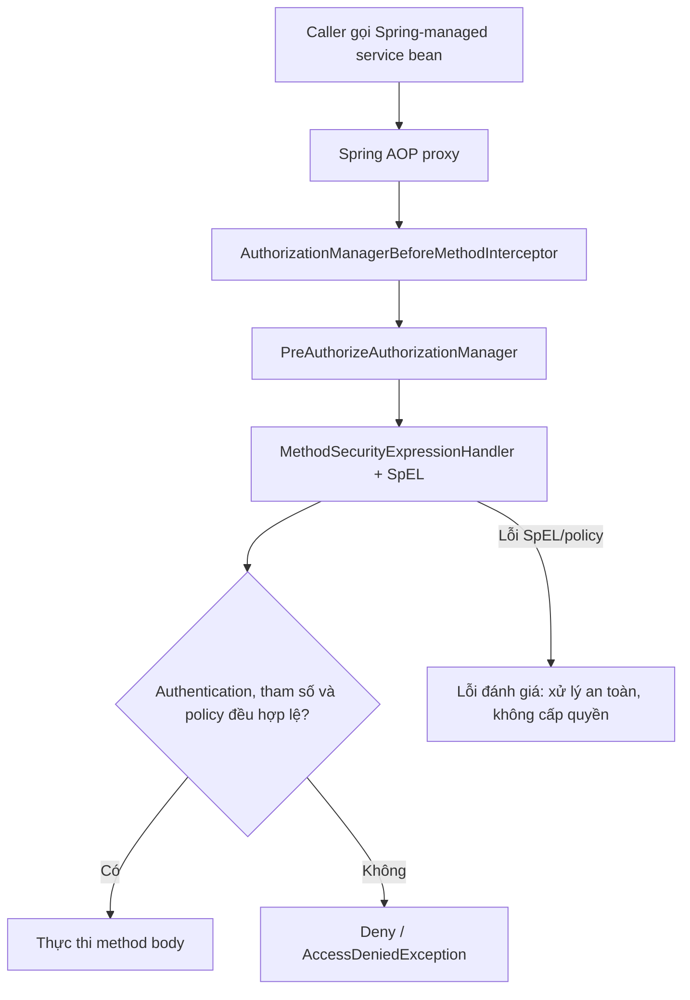

# Xử lý tham số null và chính sách từ chối rõ ràng

Trong **Spring Security method security**, một biểu thức `@PreAuthorize` thường dùng tham số của phương thức để quyết định người gọi có được thực hiện nghiệp vụ hay không. Ví dụ: `#documentId`, `#command`, `#tenantId`, hoặc một đối tượng DTO chứa nhiều trường. Nhưng các giá trị này có thể **`null`, rỗng, chỉ chứa khoảng trắng, sai định dạng, không tồn tại trong cơ sở dữ liệu, hoặc không nằm trong phạm vi quyền của người dùng**.

Nếu không xử lý cẩn thận, một biểu thức tưởng như đúng có thể ném lỗi khi truy cập thuộc tính trên `null`, cấp quyền sai khi có giá trị mặc định quá rộng, hoặc che giấu khác biệt giữa **dữ liệu không hợp lệ** và **quyết định từ chối truy cập**.

Ví dụ không an toàn:

```java
@PreAuthorize("#documentId.startsWith('DOC-') and hasAuthority('documents.read')")
public Document read(String documentId) {
    return repository.read(documentId);
}
```

Khi `documentId == null`, gọi `startsWith(...)` có thể gây lỗi SpEL/runtime. Ngay cả với chuỗi `DOC-123`, kiểm một tiền tố cũng **không chứng minh** tài liệu thuộc tenant hoặc người dùng được xem.

Ví dụ có ý định từ chối rõ ràng:

```java
@PreAuthorize(
    "hasAuthority('documents.read') " +
    "and #documentId != null " +
    "and !#documentId.isBlank() " +
    "and @documentPolicy.canRead(authentication, #documentId)"
)
public Document read(@P("documentId") String documentId) {
    return repository.read(documentId);
}
```

Ở đây **mọi điều kiện phải đúng**. Nếu thiếu quyền, ID bằng `null`, ID rỗng/blank, hoặc `documentPolicy` trả `false`, method body **không được gọi** trong đường interception thông thường. Phần `@documentPolicy` là bean ứng dụng tự triển khai và phải tự kiểm tra đầu vào một cách an toàn; không phải API tạo sẵn của Spring Security.

**Nguyên tắc xuyên suốt: _fail closed_** — khi thiếu dữ kiện cần thiết để xác nhận quyền, **không mặc định cho phép**, không biến `null` thành quyền công khai, không chọn một tài nguyên khác làm mặc định tùy tiện, và không coi lỗi đánh giá biểu thức là một cơ chế kiểm soát bảo mật chuẩn.

Bài học dành cho **Java 17+, Spring Boot 3.x và Spring Security 6.5.x**. Phạm vi chính là **kiểm tra trước phương thức** bằng `@PreAuthorize`, có đề cập `AuthorizationManager` và các API liên quan để phân biệt quyết định từ chối, abstain, lỗi và validation.

## 1. Bốn câu hỏi phải trả lời trước khi cấp quyền

Với lời gọi:

```java
documentService.readDocument(documentId);
```

hãy đánh giá **bốn điều kiện riêng biệt**:

1. **Có danh tính đáng tin không?** `Authentication` được tạo bởi authentication provider hoặc token validation đáng tin, không phải chuỗi role tự khai từ HTTP body.
2. **Input có hợp lệ không?** `documentId` có tồn tại, đúng kiểu, không `null`, không blank, đúng định dạng và thuộc namespace dự kiến?
3. **Người dùng có authority cần thiết không?** Ví dụ `documents.read`, hoặc quyền hiệu lực được tính qua `RoleHierarchy` nếu đã cấu hình.
4. **Người dùng có quyền trên tài nguyên cụ thể không?** Tài liệu tồn tại? Cùng tenant? Owner? Đã được chia sẻ? Có bị khóa/hết hiệu lực?

Một phép kiểm tổng quát `hasAuthority('documents.read')` mới trả lời câu 3. Nó **không tự trả lời câu 2 và câu 4**.

### Ma trận các trạng thái input

| Tình huống | Cách xử lý nên thiết kế | Không nên làm |
| --- | --- | --- |
| `documentId == null` | Không gọi repository nhạy cảm; trả deny hoặc validation error theo API contract | Dùng ID mặc định của admin/tenant khác |
| `documentId == ""` | Xem là thiếu ID nếu API yêu cầu ID | Coi chuỗi rỗng là “mọi tài liệu” |
| `documentId == "   "` | Kiểm `isBlank()` hoặc validator tương đương | Chỉ kiểm `!= null` rồi cho phép |
| `documentId` sai format | Reject ở validation/policy; không query bằng chuỗi tùy ý | Chỉ kiểm tiền tố dễ bị giả |
| `documentId` đúng format nhưng không tồn tại | Không trả dữ liệu, quyết định theo policy API | Coi “không tìm thấy” là permission granted |
| `documentId` thuộc tenant khác | Từ chối và tránh lộ dữ liệu | Tin tenant ID do caller tự khai |
| User không có authority | Deny trước khi gọi business code | Bỏ qua quyền nếu request “đã login” |
| Authentication thiếu/anonymous | Không tự nâng thành tài khoản hệ thống | Dùng principal mặc định có role ADMIN |
| Service kiểm quyền gặp lỗi phụ thuộc | Fail safely, log hạn chế, không allow tự động | `catch (Exception) { return true; }` |
| Permission không biết do thiếu dữ liệu | Từ chối theo chính sách rõ ràng, hoặc dùng cơ chế policy-error riêng an toàn | Coi `null`/abstain là “được phép” |

**Null không phải một sự lựa chọn nghiệp vụ thông thường khi ID là bắt buộc.** Tuy nhiên, nếu API thật sự có tham số *optional* với ý nghĩa rõ ràng, ứng dụng phải định nghĩa behavior cho trường hợp thiếu đó và bảo vệ bằng một policy riêng. Không nhất thiết mọi `null` trong mọi hệ thống đều là lỗi; điều cần tránh là **mặc định allow khi chưa chứng minh điều kiện cấp quyền**.

## 2. @PreAuthorize được đánh giá trước thân phương thức

Trong Spring Security 6.5, hạ tầng method security hiện đại gồm:



Cấu hình tối thiểu:

```java
import org.springframework.context.annotation.Configuration;
import org.springframework.security.config.annotation.method.configuration.EnableMethodSecurity;

@Configuration
@EnableMethodSecurity
public class MethodSecurityConfig {
}
```

`@EnableMethodSecurity` bật pre/post annotations theo mặc định; Spring Boot starter security **không tự bật method security**. `@PreAuthorize` chỉ có hiệu lực khi lời gọi đến phương thức được Spring intercept: bean cần thuộc ApplicationContext và lời gọi phải đi qua proxy/advisor tương ứng.

**Khác nhau giữa hai loại thất bại:**

- **Biểu thức trả `false`:** quyết định authorization âm, có cơ chế denial rõ ràng.
- **Biểu thức bị lỗi** (ví dụ truy cập method trên `null`): có thể ném exception trong bước đánh giá; không nên giả định nó luôn trở thành 403 hoặc đúng một loại `AccessDeniedException`.

Đích đến của một policy an toàn không chỉ là “tránh exception”: cần có **giá trị boolean từ chối có thể kiểm thử và giải thích**.

## 3. Sự khác biệt giữa null, empty, blank và invalid

Java có nhiều trạng thái cần kiểm riêng:

```java
String a = null;       // Không có đối tượng String.
String b = "";         // String tồn tại nhưng có 0 ký tự.
String c = "   ";      // Có ký tự nhưng chỉ khoảng trắng.
String d = "DOC-7";    // Hợp lệ về ví dụ định dạng.
String e = "DOC-XYZ";  // Có dữ liệu nhưng có thể sai quy ước ID.
```

- `id != null` chỉ chứng minh đối tượng không null.
- `!id.isEmpty()` từ chối chuỗi rỗng, nhưng chuỗi toàn dấu cách vẫn đi qua.
- `!id.isBlank()` từ chối chuỗi rỗng hoặc toàn whitespace theo cách kiểm của Java 11+.
- `id.matches("DOC-[0-9]+")` kiểm một phần cú pháp; không kiểm record tồn tại hoặc quyền đối với record.
- `id.equals("DOC-7")` cần bảo đảm `id` không null; `"DOC-7".equals(id)` là so sánh null-safe.
- `id.strip()`/`trim()` có thể giúp chuẩn hóa ở tầng validation, nhưng **không tự ý chuẩn hóa ID trước authorization** nếu hệ thống sử dụng ID có phân biệt ký tự, chữ hoa/thường hoặc khoảng trắng.

Trong `@PreAuthorize`, thứ tự kiểm có thể giúp tránh dereference null:

```java
@PreAuthorize(
    "#id != null and !#id.isBlank() and hasAuthority('documents.read')"
)
```

Vì `and` là toán tử logic short-circuit trong SpEL, khi `#id != null` trả false, biểu thức không cần gọi `#id.isBlank()`. Tốt hơn nữa, kiểm authority trước để tránh thao tác/đọc dữ liệu tốn kém khi người gọi không có quyền.

### Không dùng so sánh numeric với null để suy ra hợp lệ

Trong SpEL, quy tắc so sánh thứ tự với `null` không tương đương toán số thông thường; `null` không phải số 0. Đừng viết một expression so sánh kiểu:

```java
@PreAuthorize("#amount > null")
```

rồi nghĩ đó là validation. Hãy kiểm null, kiểu dữ liệu và ranh giới:

```java
@PreAuthorize(
    "#amount != null and #amount.signum() > 0 " +
    "and hasAuthority('payments.create')"
)
```

Ví dụ `#amount` ở đây giả định là `BigDecimal`; nếu dữ liệu đến từ request và nghiệp vụ nhạy cảm, còn cần validation giới hạn tối đa, currency, chống gian lận và service policy theo giao dịch.

## 4. Viết biểu thức fail-closed với AND và short-circuit

Mẫu đáng tin thường là:

```text
authenticated
AND hasRequiredAuthority
AND input != null
AND input is valid
AND resource policy returns true
```

Ví dụ Spring:

```java
@PreAuthorize(
    "isAuthenticated() " +
    "and hasAuthority('documents.read') " +
    "and #id != null " +
    "and !#id.isBlank() " +
    "and @documentPolicy.canRead(authentication, #id)"
)
```

**Tất cả điều kiện đều cần đúng.** Mẫu này tránh nhiều lỗi:

- Không có authentication phù hợp → không đạt điều kiện xác thực.
- Không có `documents.read` → không vào policy bean đọc document.
- ID null hoặc blank → không gọi policy bean với input đó.
- ID hợp lệ cú pháp nhưng document không thuộc user → bean trả `false`.
- Chỉ khi mọi điều kiện true → body được phép thực thi.

**Đừng đặt `OR` thiếu dấu ngoặc** như:

```java
@PreAuthorize(
    "hasRole('ADMIN') or #id != null and @policy.canRead(authentication, #id)"
)
```

Nếu ý định của hệ thống là **admin cũng phải qua resource scope**, biểu thức trên mở nhánh `hasRole('ADMIN')` quá rộng. Hãy viết đúng chính sách:

```java
@PreAuthorize(
    "(hasRole('ADMIN') or hasAuthority('documents.read')) " +
    "and #id != null " +
    "and @policy.canRead(authentication, #id)"
)
```

Đây là **mảnh cấu hình**: bean `policy` phải có method null-safe; biểu thức chỉ minh họa nhóm điều kiện. Nếu admin thực sự được phép bỏ qua resource scope, phải đánh giá và ghi rõ ngoại lệ thay vì vô tình tạo đường tắt.

### Vấn đề short-circuit khi gọi helper

Không nên:

```java
@PreAuthorize(
    "@policy.canRead(authentication, #id) and #id != null"
)
```

Policy bị gọi **trước** guard. Nếu policy không xử lý null, có thể sinh lỗi không mong muốn. Đúng hơn:

```java
@PreAuthorize(
    "#id != null and @policy.canRead(authentication, #id)"
)
```

Nhưng **policy bean vẫn cần kiểm null** vì nó có thể được tái sử dụng bởi Java code, batch job hoặc annotation khác.

## 5. Safe navigation của SpEL: ?. giúp tránh NPE, không tự deny

Spring Expression Language hỗ trợ toán tử **safe navigation `?.`**, ví dụ:

```java
@PreAuthorize(
    "#command?.getDocumentId() != null"
)
```

Nếu `#command` là `null`, `#command?.getDocumentId()` trả `null` thay vì cố gọi method và ném lỗi. So sánh `!= null` lúc này trả boolean `false`, nên có thể diễn đạt điều kiện từ chối rõ ràng.

Nếu `command` chứa DTO lồng nhau:

```java
@PreAuthorize(
    "#command?.getDocument()?.getId() != null " +
    "and @documentPolicy.canRead(authentication, #command.getDocument().getId())"
)
```

Hai chỗ `?.` dùng để bảo vệ **cả hai cấp truy cập**. Khi nhánh đầu false, biểu thức `and` không cần đánh giá vế còn lại. Không dùng `?.` chỉ ở cấp đầu rồi truy cập cấp sau như thể chắc chắn không null.

**Sai:**

```java
@PreAuthorize("#command?.getDocument().getId() != null")
```

Nếu `command` là null, kết quả null từ một bước safe navigation có thể tiếp tục bị dereference ở bước `.getId()` không null-safe.

**Đúng:**

```java
@PreAuthorize("#command?.getDocument()?.getId() != null")
```

Đừng dùng một giá trị nullable trực tiếp như **toàn bộ quyết định**:

```java
@PreAuthorize("#command?.getDocumentId()")
```

Biểu thức này có thể trả String hoặc null chứ **không được thiết kế là boolean authorization**. Hãy tạo một predicate rõ ràng:

```java
@PreAuthorize(
    "#command?.getDocumentId() != null and " +
    "@documentPolicy.canRead(authentication, #command.getDocumentId())"
)
```

### Safe navigation trong biểu thức ghép

Theo tài liệu Spring Framework, toán tử `?.` chỉ áp dụng cho **lần truy cập có đánh dấu**, không làm các phần còn lại của một chuỗi property/method truy cập tự động null-safe. Ví dụ `#person?.address.city` vẫn có thể lỗi nếu bước sau dùng `.city` trên null; cần `#person?.address?.city`.

**Với danh sách/collection:** một `List` null và một `List` rỗng cũng là hai trường hợp khác nhau. Nếu policy yêu cầu ít nhất một item và tất cả item thuộc tenant, hãy tính predicate rõ trong Java thay vì hy vọng `?.size()` trả đúng ý muốn khi null.

## 6. Elvis (?:), giá trị mặc định và nguy cơ cấp quyền sai

SpEL có toán tử **Elvis `?:`** giúp cung cấp fallback khi vế trái null (và có những quy tắc riêng với chuỗi rỗng theo phiên bản). Ví dụ diễn đạt ý tưởng giá trị hiển thị:

```java
String displayName = "Guest";
```

Nhưng trong **authorization**, fallback không phải lúc nào cũng an toàn. Biểu thức minh họa cần tránh:

```java
@PreAuthorize(
    "@policy.canRead(authentication, #documentId ?: 'PUBLIC')"
)
```

Nếu ID null, policy lại được hỏi về tài nguyên `PUBLIC` thay vì yêu cầu ban đầu. Điều đó có thể tạo quyền sai hoặc kiểm một tài nguyên khác với tài nguyên body thực sự thao tác.

Nguyên tắc:

- **Không dùng fallback ID khác** để lấp chỗ null nếu body vẫn dùng input gốc.
- **Không mặc định identity/tenant** khi input không có giá trị.
- Nếu dùng một bean policy trả `Boolean` nullable, nên chuyển null thành **false** ngay trong Java bằng `Boolean.TRUE.equals(result)`, hoặc trả primitive `boolean` và bảo đảm mọi nhánh đều có boolean.
- Nếu thực sự có *tài nguyên mặc định được nghiệp vụ định nghĩa*, chuẩn hóa và resolve **một lần ở tầng nghiệp vụ**, rồi bảo đảm authorization kiểm **chính tài nguyên được sử dụng**, không phải một bản sao logic khác.

Ví dụ Java null-safe:

```java
Boolean decision = externalPolicy.check(user, documentId);
boolean allowed = Boolean.TRUE.equals(decision);
```

Nếu `decision == null`, `allowed == false`. Đây là **fail-closed** rõ ràng hơn `decision == null ? true : decision`.

### Giá trị mặc định đúng trong quyền nên là deny

Các fallback chính sách đơn giản:

```java
boolean canRead(Authentication user, String id) {
    if (user == null || id == null || id.isBlank()) {
        return false;
    }
    return checkFromTrustedData(user, id);
}
```

`checkFromTrustedData(...)` là phần do ứng dụng viết, không phải API Spring mặc định. Với những lỗi như mất kết nối database, nên xử lý một **policy failure** riêng và bảo đảm không tạo authorization success; không nhất thiết biến mọi sự cố vận hành thành HTTP 403.

## 7. Phân biệt “false”, “null”, “abstain”, exception và missing rule

Trong hệ thống authorization có nhiều tầng, từ ngữ dễ gây hiểu nhầm:

| Tình huống | Ý nghĩa | Hướng xử lý an toàn |
| --- | --- | --- |
| Predicate/bean trả `false` | Quy tắc chủ động không cho phép | Từ chối |
| Predicate/bean trả `true` | Quy tắc đã xác nhận cho phép | Chỉ cho phép trong phạm vi chính sách |
| Bean trả `Boolean null` | Không có quyết định boolean | Không tự gán true; chuẩn hóa thành false hoặc xử lý lỗi |
| Custom AuthorizationManager trả `null` | Có thể là **abstain/no decision** theo contract manager | Không đồng nhất với deny; dùng kết quả deny tường minh |
| SpEL truy cập null gây exception | Lỗi trong lúc đánh giá policy | Không trả dữ liệu/không thực hiện side effect; sửa expression |
| Không có Authentication | Thiếu danh tính đáng tin | Không mặc định user hệ thống |
| Có Authentication anonymous | Một token anonymous có thể có trạng thái đặc biệt | Không dựa duy nhất vào `isAuthenticated()` của object |
| Không có annotation/advisor trên method | Có thể **không có kiểm tra method** | Bảo đảm interception, không giả định deny tự động |
| Có HTTP rule nhưng không có method rule | Request có thể được HTTP kiểm, nhưng method gọi nơi khác không được bảo vệ | Bảo vệ boundary service quan trọng |

**Điểm rất quan trọng:** Trong Spring Security, contract `AuthorizationManager` có thể dùng `null` để biểu diễn **abstain**, nhất là khi tùy biến manager. `null` **không có cùng nghĩa với `new AuthorizationDecision(false)`**. Tùy cách kết hợp manager/interceptor, một abstain có thể không tạo deny như mong muốn. Khi chưa có dữ kiện đủ để cho phép, policy nhạy cảm nên trả **`AuthorizationDecision(false)` / `AuthorizationResult` không granted** thay vì `null`.

Mẫu minh họa cho custom manager (phụ thuộc import và type của phiên bản 6.5):

```java
AuthorizationManager<MethodInvocation> manager =
    (authentication, invocation) -> {
        Authentication current = authentication.get();
        boolean allowed = current != null
                && current.isAuthenticated()
                && !current.getAuthorities().isEmpty();
        return new AuthorizationDecision(allowed);
    };
```

Đây là **mảnh API**, không phải một app chạy độc lập. Nó còn đơn giản hơn policy thật và không nên dùng để bảo vệ tài nguyên sản xuất; đặc biệt `isAuthenticated()` một mình không đủ thay phân biệt anonymous. Ý chính là **luôn có một quyết định boolean**, không trả `null` do thiếu input.

### Deny-by-default ở nơi được bảo vệ

Một rule rõ:

```java
@PreAuthorize("denyAll")
public void neverInvokeFromApplication() {
    // Body chỉ nên chạy khi policy thực sự thay đổi có chủ đích.
}
```

Tương tự HTTP DSL:

```java
http.authorizeHttpRequests(auth -> auth
    .requestMatchers("/public/**").permitAll()
    .anyRequest().denyAll()
);
```

**Khác biệt:** `anyRequest().denyAll()` bảo vệ URL *trong chain được chọn*. `@PreAuthorize("denyAll")` bảo vệ một method *khi có method-security interception*. Chúng **không biến mọi method không annotate thành mặc định deny**.

## 8. Java 17 standalone: mô phỏng fail-closed, có thể chạy bằng javac

Trước khi tích hợp SpEL, nên mô hình hóa chính sách thành một predicate Java dễ kiểm thử. Ví dụ sau sử dụng **Java SE 17 hoàn toàn độc lập**; không cần Spring, Maven hoặc network.

Tạo file **`NullPolicyDemo.java`**:

```java
import java.util.Set;

public class NullPolicyDemo {

    record User(String name, Set<String> authorities) {
        boolean has(String authority) {
            return authorities != null && authorities.contains(authority);
        }
    }

    static boolean canRead(User user, String id) {
        if (user == null || user.name() == null
                || user.authorities() == null) {
            return false;
        }

        if (!user.has("documents.read")) {
            return false;
        }

        if (id == null || id.isBlank()) {
            return false;
        }

        if (!id.matches("DOC-[0-9]+")) {
            return false;
        }

        return "alice".equals(user.name()) && "DOC-7".equals(id);
    }

    static void check(String label, User user, String id) {
        System.out.println(label + ": "
                + (canRead(user, id) ? "ALLOW" : "DENY"));
    }

    public static void main(String[] args) {
        User alice = new User(
                "alice", Set.of("documents.read"));
        User bob = new User(
                "bob", Set.of("documents.read"));
        User writer = new User(
                "alice", Set.of("documents.write"));

        check("null user", null, "DOC-7");
        check("null authorities", new User("alice", null), "DOC-7");
        check("null id", alice, null);
        check("empty id", alice, "");
        check("blank id", alice, "   ");
        check("bad format", alice, "DOC-ABC");
        check("different resource", alice, "DOC-8");
        check("different owner", bob, "DOC-7");
        check("missing read", writer, "DOC-7");
        check("valid", alice, "DOC-7");
    }
}
```

Biên dịch/chạy với JDK 17+:

```bash
javac NullPolicyDemo.java
java NullPolicyDemo
```

**Stdout dự kiến chính xác:**

```text
null user: DENY
null authorities: DENY
null id: DENY
empty id: DENY
blank id: DENY
bad format: DENY
different resource: DENY
different owner: DENY
missing read: DENY
valid: ALLOW
```

Chương trình cố ý từ chối tất cả dữ liệu thiếu/không hợp lệ. Đây là mô hình logic **thuần Java**, không có Spring AOP, `Authentication`, JWT, controller hoặc database; nó **không tự bảo vệ endpoint HTTP thật**.

### Vì sao vẫn nên có Java predicate?

Khi policy có nhiều nhánh, Java cho phép:

- Biểu đạt và đặt tên rõ từng tiền điều kiện.
- Test `null`/blank/format/owner/tenant thành từng trường hợp.
- Trả primitive `boolean`, tránh kết quả nullable.
- Tách policy ra khỏi cú pháp SpEL và tránh exception do null dereference.
- Thu thập audit reason **ở phía server** mà không lộ điều kiện nội bộ cho client.
- Kiểm hợp đồng dữ liệu giữa các thành phần thay vì chỉ dựa vào một chuỗi annotation.

Khi đưa vào Spring, truyền **Authentication đã xác minh** và đọc resource metadata từ nguồn server thật, không chỉ dùng các chuỗi hard-code như bài tập.

## 9. Ví dụ Spring Boot 3.5.16: pre-check từ chối null trước khi body chạy

Ví dụ hoàn chỉnh sau dùng **Spring Security method security thật**, không cần web server. Mục tiêu chính: quan sát rằng `@PreAuthorize` từ chối `null`/blank/thiếu quyền trước khi Java method body chạy và **trước khi policy bean được gọi** nếu điều kiện sớm đã false.

**Môi trường:** Java 17+, Maven 3.6.3+ hoặc Maven tương thích. Spring Boot **3.5.16** đã phát hành tháng 6/2026, dùng Spring Security 6.5.x tương thích. Dòng Spring Boot 3.5 đã hết hỗ trợ OSS theo thông báo phát hành; dùng version này để học đúng 6.5, còn sản phẩm mới nên chọn nhánh được hỗ trợ và đọc migration guide.

Cấu trúc:

```text
null-method-security/
├── pom.xml
└── src/
    └── main/
        ├── java/
        │   └── demo/
        │       ├── NullMethodSecurityApp.java
        │       ├── DocumentService.java
        │       └── DocumentPolicy.java
        └── resources/
            └── application.properties
```

### 9.1. pom.xml

```xml
<project xmlns="http://maven.apache.org/POM/4.0.0"
         xmlns:xsi="http://www.w3.org/2001/XMLSchema-instance"
         xsi:schemaLocation="http://maven.apache.org/POM/4.0.0
             https://maven.apache.org/xsd/maven-4.0.0.xsd">

    <modelVersion>4.0.0</modelVersion>

    <parent>
        <groupId>org.springframework.boot</groupId>
        <artifactId>spring-boot-starter-parent</artifactId>
        <version>3.5.16</version>
        <relativePath/>
    </parent>

    <groupId>demo</groupId>
    <artifactId>null-method-security</artifactId>
    <version>1.0.0</version>

    <properties>
        <java.version>17</java.version>
    </properties>

    <dependencies>
        <dependency>
            <groupId>org.springframework.boot</groupId>
            <artifactId>spring-boot-starter</artifactId>
        </dependency>
        <dependency>
            <groupId>org.springframework.boot</groupId>
            <artifactId>spring-boot-starter-security</artifactId>
        </dependency>
    </dependencies>

    <build>
        <plugins>
            <plugin>
                <groupId>org.springframework.boot</groupId>
                <artifactId>spring-boot-maven-plugin</artifactId>
            </plugin>
        </plugins>
    </build>
</project>
```

`spring-boot-starter-web` không cần thiết vì bài tập thực hiện trong `CommandLineRunner`. Nếu thêm web, phải cấu hình HTTP authentication, request authorization và controller theo nghiệp vụ; không lấy user giả trong demo làm xác thực production.

### 9.2. NullMethodSecurityApp.java

Đặt tại `src/main/java/demo/NullMethodSecurityApp.java`:

```java
package demo;

import java.util.List;
import java.util.function.Supplier;

import org.springframework.boot.CommandLineRunner;
import org.springframework.boot.SpringApplication;
import org.springframework.boot.autoconfigure.SpringBootApplication;
import org.springframework.context.annotation.Bean;
import org.springframework.security.access.AccessDeniedException;
import org.springframework.security.authentication.UsernamePasswordAuthenticationToken;
import org.springframework.security.config.annotation.method.configuration.EnableMethodSecurity;
import org.springframework.security.core.authority.SimpleGrantedAuthority;
import org.springframework.security.core.context.SecurityContext;
import org.springframework.security.core.context.SecurityContextHolder;

@SpringBootApplication
@EnableMethodSecurity
public class NullMethodSecurityApp {

    public static void main(String[] args) {
        SpringApplication.run(NullMethodSecurityApp.class, args);
    }

    @Bean
    CommandLineRunner demonstrate(
            DocumentService service,
            DocumentPolicy policy) {

        return args -> {
            invoke("null ID", "alice", "documents.read",
                    () -> service.read(null));

            invoke("empty ID", "alice", "documents.read",
                    () -> service.read(""));

            invoke("blank ID", "alice", "documents.read",
                    () -> service.read("   "));

            invoke("valid read", "alice", "documents.read",
                    () -> service.read("DOC-7"));

            invoke("unknown ID", "alice", "documents.read",
                    () -> service.read("DOC-8"));

            invoke("extra whitespace", "alice", "documents.read",
                    () -> service.read(" DOC-7 "));

            invoke("different user", "bob", "documents.read",
                    () -> service.read("DOC-7"));

            invoke("missing read permission", "alice", "documents.edit",
                    () -> service.read("DOC-7"));

            invoke("delete no permission", "alice", "documents.read",
                    () -> service.delete("DOC-7"));

            invoke("valid delete", "alice", "documents.delete",
                    () -> service.delete("DOC-7"));

            invoke("delete null ID", "alice", "documents.delete",
                    () -> service.delete(null));

            invoke("explicit deny", "alice", "ROLE_ADMIN",
                    service::never);

            System.out.println("bodyCalls: " + service.bodyCalls());
            System.out.println("policyCalls: " + policy.calls());
        };
    }

    private static void invoke(
            String label,
            String username,
            String authority,
            Supplier<String> action) {

        SecurityContext context = SecurityContextHolder.createEmptyContext();

        context.setAuthentication(
                new UsernamePasswordAuthenticationToken(
                    username,
                    "demo-only",
                    List.of(new SimpleGrantedAuthority(authority))
                )
        );

        SecurityContextHolder.setContext(context);

        try {
            System.out.println(label + " -> " + action.get());
        } catch (AccessDeniedException denied) {
            System.out.println(label + " -> DENY");
        } finally {
            SecurityContextHolder.clearContext();
        }
    }
}
```

**Giải thích:** Mỗi ca tự dựng `UsernamePasswordAuthenticationToken` ba tham số, nên Authentication đã xác thực và có đúng một authority. Đây là **test harness mô phỏng người dùng**, tuyệt đối không dùng role do browser tự khai để tạo Authentication trong môi trường production.

`CommandLineRunner` nhận `DocumentService` và `DocumentPolicy` từ **Spring ApplicationContext**. Service có thể được proxy bởi method security; các lời gọi `service.read(...)`/`service.delete(...)` đi qua interceptor. `clearContext()` được gọi sau từng case để tránh rò SecurityContext trên thread chạy CLI.

### 9.3. DocumentService.java

Đặt tại `src/main/java/demo/DocumentService.java`:

```java
package demo;

import java.util.concurrent.atomic.AtomicInteger;

import org.springframework.security.access.method.P;
import org.springframework.security.access.prepost.PreAuthorize;
import org.springframework.stereotype.Service;

@Service
public class DocumentService {

    private final AtomicInteger reads = new AtomicInteger();
    private final AtomicInteger deletes = new AtomicInteger();
    private final AtomicInteger neverCalls = new AtomicInteger();

    @PreAuthorize(
        "hasAuthority('documents.read') " +
        "and #documentId != null " +
        "and !#documentId.isBlank() " +
        "and @documentPolicy.canRead(authentication, #documentId)"
    )
    public String read(@P("documentId") String documentId) {
        reads.incrementAndGet();
        return "READ:" + documentId;
    }

    @PreAuthorize(
        "hasAuthority('documents.delete') " +
        "and #documentId != null " +
        "and !#documentId.isBlank() " +
        "and @documentPolicy.canDelete(authentication, #documentId)"
    )
    public String delete(@P("documentId") String documentId) {
        deletes.incrementAndGet();
        return "DELETED:" + documentId;
    }

    @PreAuthorize("denyAll")
    public String never() {
        neverCalls.incrementAndGet();
        return "NEVER";
    }

    public String bodyCalls() {
        return "read=" + reads.get()
                + ",delete=" + deletes.get()
                + ",never=" + neverCalls.get();
    }
}
```

Vì các bộ đếm chỉ tăng trong body, những ca bị deny **không làm tăng `reads`/`deletes`/`neverCalls`**. `AtomicInteger` ở đây phục vụ demo để dễ đọc số lần thực thi; trong nghiệp vụ thật cần transaction/audit và các biện pháp đồng bộ phù hợp, không chỉ đếm lời gọi.

Tham số `@P("documentId")` thuộc `org.springframework.security.access.method.P` giúp SpEL biết `#documentId`. Không phụ thuộc hoàn toàn vào việc compiler giữ tên tham số qua `-parameters`.

### 9.4. DocumentPolicy.java

Đặt tại `src/main/java/demo/DocumentPolicy.java`:

```java
package demo;

import java.util.concurrent.atomic.AtomicInteger;

import org.springframework.security.authentication.AnonymousAuthenticationToken;
import org.springframework.security.core.Authentication;
import org.springframework.stereotype.Component;

@Component("documentPolicy")
public class DocumentPolicy {

    private final AtomicInteger readChecks = new AtomicInteger();
    private final AtomicInteger deleteChecks = new AtomicInteger();

    public boolean canRead(Authentication user, String documentId) {
        readChecks.incrementAndGet();
        return validActorAndId(user, documentId)
                && "alice".equals(user.getName())
                && "DOC-7".equals(documentId);
    }

    public boolean canDelete(Authentication user, String documentId) {
        deleteChecks.incrementAndGet();
        return validActorAndId(user, documentId)
                && "alice".equals(user.getName())
                && "DOC-7".equals(documentId);
    }

    private boolean validActorAndId(
            Authentication user, String documentId) {

        if (user == null || !user.isAuthenticated()
                || user instanceof AnonymousAuthenticationToken) {
            return false;
        }

        if (documentId == null || documentId.isBlank()) {
            return false;
        }

        return documentId.matches("DOC-[0-9]+");
    }

    public String calls() {
        return "read=" + readChecks.get()
                + ",delete=" + deleteChecks.get();
    }
}
```

Mọi nhánh đều trả **primitive `boolean`**, không trả `Boolean null`. Policy kiểm lại null, authentication và format **dù biểu thức `@PreAuthorize` đã có guard**. Đây là defense in depth: code có thể được tái sử dụng qua đường gọi khác, và hạn chế phụ thuộc vào thứ tự logic của annotation.

Điều kiện `"alice".equals(user.getName())` và `"DOC-7".equals(documentId)` chỉ nhằm tạo môi trường học tập không cần database; **không phải permission model cho production**. Policy thật phải đối chiếu user ID/tenant đã xác minh với owner, share, ACL, trạng thái của record trong database đáng tin.

### 9.5. application.properties

Đặt tại `src/main/resources/application.properties`:

```properties
spring.main.web-application-type=none
spring.main.banner-mode=off
logging.level.root=OFF
```

Trong thư mục dự án chạy:

```bash
mvn -q spring-boot:run
```

**Các dòng do chương trình in theo đúng thứ tự**, không tính thông báo Maven/JVM nếu có:

```text
null ID -> DENY
empty ID -> DENY
blank ID -> DENY
valid read -> READ:DOC-7
unknown ID -> DENY
extra whitespace -> DENY
different user -> DENY
missing read permission -> DENY
delete no permission -> DENY
valid delete -> DELETED:DOC-7
delete null ID -> DENY
explicit deny -> DENY
bodyCalls: read=1,delete=1,never=0
policyCalls: read=4,delete=1
```

### 9.6. Đọc output như một kiểm thử chính sách

- `null ID`, `empty ID`, `blank ID` đều bị deny **trước khi policy bean được gọi**, vì chuỗi `and` short-circuit.
- `valid read`: đúng permission, đúng ID và owner mô phỏng, nên gọi body một lần.
- `unknown ID`: đúng format nhưng policy không công nhận `DOC-8`, deny.
- `extra whitespace`: chuỗi không trùng resource ID và không đúng format, deny; không tự trim để đổi ý nghĩa.
- `different user`: Bob có authority `documents.read` nhưng policy từ chối vì không phải owner mô phỏng.
- `missing read permission`: deny ở authority guard, không gọi policy.
- `delete no permission`: deny vì authority yêu cầu là `documents.delete`, không phải `documents.read`.
- `valid delete`: đi qua mọi guard và chạy body.
- `delete null ID`: bị chặn bởi null guard trước policy.
- `explicit deny`: `@PreAuthorize("denyAll")` từ chối ngay cả khi test principal có `ROLE_ADMIN`.
- `bodyCalls` chứng minh body chỉ chạy cho **hai lời gọi được phép**.
- `policyCalls` chứng minh policy chỉ được gọi cho **bốn ca read** có quyền và input không null/blank, cùng **một ca delete** được phép.

**Chú ý:** Ví dụ này không xử lý HTTP/CSRF/session, không gọi DB và không sử dụng authentication thực. Khi chuyển sang ứng dụng server, còn phải bảo vệ route, mapping request DTO, validate input, cấu hình exception handling và kiểm policy trên dữ liệu tài nguyên thật.

## 10. 400, 401, 403 hay 404: validation khác authorization

Một tham số null/blank có thể được xử lý **ở tầng validation** trước khi chạm tới service. Khi đó API có thể trả 400 Bad Request theo contract:

```java
@PostMapping("/documents")
public ResponseEntity<?> create(
        @Valid @RequestBody CreateDocumentRequest request) {
    // Chuyển input đã validate sang service.
    return ResponseEntity.ok(service.create(request));
}
```

Với Bean Validation:

```java
public record CreateDocumentRequest(
        @NotBlank String title,
        @NotNull String tenantId
) {}
```

Đây là mảnh Spring MVC/Validation, cần `spring-boot-starter-validation` và imports `jakarta.validation.*`; không nằm trong app CLI ở mục 9. `@NotBlank` từ chối null, empty và toàn khoảng trắng. `@NotNull` chỉ từ chối null, không tự từ chối chuỗi rỗng.

Dù controller đã validate, **service vẫn phải bảo vệ quyền** vì có thể được gọi qua batch, listener, GraphQL hoặc code nội bộ không đi qua controller đó.

### Phân biệt các trạng thái trả về

| Điều kiện | Response có thể phù hợp | Lưu ý |
| --- | --- | --- |
| JSON sai cấu trúc, trường bắt buộc thiếu | 400 | Validation ở API boundary |
| Chưa có authentication hợp lệ | 401 hoặc redirect login | Tùy authentication entry point |
| Đã xác thực, nhưng thiếu role/permission hoặc policy deny | Thường 403 | Phụ thuộc exception handling |
| Resource không tồn tại | 404 | Không coi 404 tự động là authorization |
| Muốn giấu sự tồn tại của resource không được phép | Có thể thiết kế 404 nhất quán | Không leak thông tin qua timing, logs, khác biệt response |
| Policy backend lỗi/timeout | Lỗi dịch vụ phù hợp, không cấp quyền | Không trả dữ liệu chỉ vì không kiểm được |

**Không có quy tắc “null luôn trả 403” hoặc “null luôn trả 400”**. Đó là quyết định thiết kế API. Điều kiện an toàn là request **không vượt qua kiểm soát quyền** và không gây side effect nhạy cảm khi thiếu dữ kiện.

### Không dùng exception như điều kiện deny

Ví dụ:

```java
try {
    return service.read(documentId);
} catch (NullPointerException exception) {
    return publicDocument();
}
```

Đây là cách xử lý sai vì một lỗi null bất ngờ khiến ứng dụng chuyển sang dữ liệu public không hề được user yêu cầu. Tương tự:

```java
catch (Exception ignored) {
    return true; // Nguy hiểm khi đang quyết định authorization!
}
```

Trong policy, ngoại lệ cần được ghi nhận an toàn và tạo **kết quả fail-safe** phù hợp, không làm logic chuyển sang allow.

## 11. Null trong DTO lồng nhau và collection

Nhiều method nhận một request object thay vì String đơn:

```java
public void transfer(CreateTransferCommand command);
```

`command` có thể null; `command.getTransfer()` hoặc `getDestination()` có thể null; danh sách beneficiary có thể null, empty hoặc chứa phần tử null.

**Thứ tự xử lý tốt:**

1. Kiểm `command != null`.
2. Kiểm đối tượng con bắt buộc khác null.
3. Kiểm các trường bắt buộc (tenant, beneficiary, amount, currency).
4. Kiểm authority/method action.
5. Dùng policy Java trên dữ liệu đáng tin để kiểm quyền của người gọi đối với **cả nguồn và đích**.
6. Body chỉ xử lý khi policy true.
7. Ở tầng transaction/write vẫn kiểm điều kiện nhạy cảm để tránh race.

Ví dụ có guard đầy đủ:

```java
@PreAuthorize(
    "#command != null " +
    "and #command.getTransfer() != null " +
    "and #command.getTransfer().getDestination() != null " +
    "and hasAuthority('transfers.create') " +
    "and @transferPolicy.canSubmit(authentication, #command)"
)
public void submit(@P("command") TransferCommand command) {
    // Thao tác nhạy cảm sau pre-check.
}
```

Với số nhánh lớn, policy Java:

```java
@PreAuthorize("@transferPolicy.canSubmit(authentication, #command)")
```

thường **dễ test và dễ review hơn**. Bean `transferPolicy` phải kiểm null, quyền và dữ liệu resource; không trả true cho command rỗng.

### Collection và nguyên lý tập rỗng

Một bẫy logic Java:

```java
boolean allAllowed = ids.stream().allMatch(this::canRead);
```

Trên **collection rỗng**, `allMatch(...)` trả true theo logic ∀ trên tập rỗng. Nếu nghiệp vụ yêu cầu ít nhất một ID, cần:

```java
boolean allAllowed = ids != null
        && !ids.isEmpty()
        && ids.stream().allMatch(
                id -> id != null && canRead(id));
```

Cũng cần xác định request chứa duplicate IDs, null elements, số lượng quá lớn và batch chứa nhiều tenant xử lý thế nào. Không mở quyền “export all” chỉ vì danh sách được gửi lên rỗng.

### Null, Optional và giá trị “chưa cung cấp”

Trong Java:

- `null` biểu thị thiếu reference, không nêu rõ lý do.
- `Optional.empty()` có thể biểu thị không có kết quả nhưng không tự có nghĩa authorization deny.
- `List.of()` là danh sách rỗng, không giống null.
- `""` là chuỗi rỗng, không giống missing field trong JSON.

Với Spring Framework 7, SpEL có mở rộng tương tác safe-navigation với `Optional`; **không áp quy tắc mới đó như thể chắc chắn tồn tại trong mọi dự án Spring 6.x**. Khi policy cần nhận diện Optional, xử lý rõ bằng Java và test đúng runtime.

## 12. Tenant, owner và null comparison: tránh “hai giá trị thiếu bằng nhau”

Một lỗi logic nghiêm trọng là so sánh hai thuộc tính có thể cùng null:

```java
boolean sameTenant =
        Objects.equals(userTenantId, documentTenantId);
```

Nếu **cả hai đều null**, `Objects.equals(null, null)` trả **true**. Điều đó là hành vi Java chính xác, nhưng **không đủ an toàn** nếu tenant là dữ kiện bắt buộc để cấp quyền.

Tương tự SpEL:

```java
@PreAuthorize("#tenantId == authentication.details.tenantId")
```

có thể không diễn đạt đủ quy tắc “cả hai tenant bắt buộc xác định và giống nhau”, nhất là nếu các thuộc tính null hoặc object/principal không như giả định. Hãy yêu cầu **mỗi ID phải có giá trị đáng tin** trước khi so sánh:

```java
boolean sameTenant(String userTenant, String resourceTenant) {
    return userTenant != null
            && resourceTenant != null
            && !userTenant.isBlank()
            && !resourceTenant.isBlank()
            && userTenant.equals(resourceTenant);
}
```

Đây là Java helper độc lập. `userTenant` phải đến từ authentication/DB đã xác minh; `resourceTenant` lấy từ record. Không tin giá trị request header chỉ vì tên là `X-Tenant-Id`.

### Tránh so tên principal thay vì ID bền vững

`authentication.name` có thể là username, email hoặc subject tùy provider. Một app đa issuer/tenant không nên mặc định tên hiển thị luôn là user ID canonical. Policy cần định danh ổn định, tenant scope và mapping đáng tin.

## 13. Null và RoleHierarchy không có quan hệ mặc định

Một `RoleHierarchy` như:

```text
ROLE_ADMIN > ROLE_MANAGER
ROLE_MANAGER > ROLE_USER
ROLE_USER > documents.read
```

có thể giúp người có `ROLE_ADMIN` thỏa `hasAuthority('documents.read')` **khi handler đã dùng hierarchy**. Nhưng không có quan hệ nào biến:

```text
documentId = null
```

thành tài nguyên hợp lệ. Dù user có quyền cao, policy cần xác định **tài nguyên và phạm vi**.

Ví dụ:

```java
@PreAuthorize(
    "hasAuthority('documents.read') " +
    "and #id != null " +
    "and @documentPolicy.canRead(authentication, #id)"
)
```

Nếu `id == null`, biểu thức vẫn deny dù effective authority chứa `documents.read`. Đây là hành vi mong muốn khi ID là mandatory.

**Cẩn thận với nhánh admin bypass:**

```java
@PreAuthorize("hasRole('ADMIN') or @policy.canRead(authentication, #id)")
```

Nếu admin có thể gọi method với `id == null`, body có thể phải xử lý input thiếu, gây lỗi hoặc thao tác sai. Khi ID bắt buộc, dùng một guard chung:

```java
@PreAuthorize(
    "#id != null " +
    "and (hasRole('ADMIN') or @policy.canRead(authentication, #id))"
)
```

Sau đó còn phải quyết định **admin có cần giới hạn tenant/owner không**. Không cho phép bypass theo role chỉ vì dễ viết expression.

## 14. Transaction, TOCTOU và thứ tự kiểm tra

`@PreAuthorize` được đánh giá **trước body của method được proxy**, nhưng không bảo đảm các điều kiện dữ liệu vẫn đúng vào lúc ghi. Ví dụ tài liệu có thể đổi owner, tenant hoặc trạng thái sau khi policy trả true.

```java
@PreAuthorize("@policy.canDelete(authentication, #id)")
@Transactional
public void deleteDocument(String id) {
    repository.deleteById(id);
}
```

Đây là **mảnh Spring service**; chưa có định nghĩa `policy`/`repository`. Khi cần bảo đảm chặt:

- Dùng transaction/locking/version check phù hợp.
- Kiểm điều kiện ở query/delete, không chỉ một lần trước body.
- Với cập nhật, dùng `UPDATE ... WHERE tenant_id = ... AND owner_id = ... AND status = ...` để DB cùng xác nhận chính sách.
- Chặn việc update nhầm row khi ID được chuẩn hóa khác cách policy match.
- Xác nhận policy và write dùng **cùng định danh resource** đã được canonical hóa một cách kiểm soát.
- Nếu quyền bị thu hồi trong khi job chạy, cần xác định thời điểm hiệu lực của revoke.

Không giả định `@Transactional` luôn bắt đầu sau khi policy check hoặc các advisor luôn có cùng order ở mọi ứng dụng. Với nghiệp vụ cần isolation mạnh, thiết kế/test cụ thể cho transaction order.

## 15. AOP self-invocation: fail closed trên giấy nhưng thực tế bỏ qua kiểm tra

Ví dụ nguy hiểm:

```java
@Service
public class DocumentJob {

    public void process(String id) {
        delete(id); // this.delete(id): có thể bỏ qua AOP proxy.
    }

    @PreAuthorize("#id != null and hasAuthority('documents.delete')")
    public void delete(String id) {
        // Thao tác xóa.
    }
}
```

Trong Spring AOP proxy mode thông dụng, lời gọi `this.delete(id)` từ cùng instance không qua proxy, nên `@PreAuthorize` **có thể không chạy**. Khi đó mọi kiểm tra null và quyền viết trong annotation đều **không có hiệu lực** cho đường gọi này.

Cách giải quyết:

1. Đặt thao tác bảo vệ trong Spring-managed bean khác.
2. Inject bean đó vào caller và gọi qua proxy.
3. Đưa policy vào service/domain layer nếu có nhiều adapter không dùng proxy.
4. Test **deny case qua đúng đường gọi production**, không chỉ test controller hoặc bean khác.
5. Nếu dùng AspectJ weaving thay vì proxy, hiểu rõ giới hạn khác và cấu hình test thích hợp.

Những rủi ro tương tự: tự `new` service, private method, proxy strategy không phù hợp, Spring context không có `@EnableMethodSecurity`, mock service thay bean thật, hoặc annotation bị override theo hierarchy khác.

**Một biểu thức fail-closed chỉ hữu ích khi nó thực sự được đánh giá.**

## 16. Khi thiếu dữ liệu quyền từ hệ thống phụ thuộc

Trong tổ chức lớn, `documentPolicy` có thể gọi database, ACL service hoặc authorization provider ngoài. Cần phân biệt:

- **Thông tin hợp lệ và được cấp quyền** → allow.
- **Thông tin hợp lệ nhưng thiếu quyền** → deny.
- **Không tìm thấy resource hoặc quan hệ** → deny hoặc kết quả nghiệp vụ thích hợp.
- **Dữ liệu cache không xác định/hết hạn** → không lấy mặc định từ cache “allow”.
- **Hệ thống quyền timeout/lỗi** → fail safely; không tiết lộ tài nguyên và không tự cấp quyền.

Một pattern Java đơn giản:

```java
public boolean canRead(Authentication user, String id) {
    if (user == null || id == null || id.isBlank()) {
        return false;
    }

    try {
        return permissionStore.hasPermission(user.getName(), id, "read");
    } catch (PermissionStoreUnavailableException ex) {
        auditPolicyFailureSafely(ex);
        return false;
    }
}
```

Đây là **mảnh minh họa**: `permissionStore`, exception và audit là lớp ứng dụng tự tạo. Trong hệ thống thật, có thể muốn ném exception chuyên biệt (để API trả lỗi hệ thống), nhưng kết quả cuối **không được là unauthorized success**. Nếu việc trả false che một outage quan trọng, hãy ghi metric/alert và tách HTTP status lỗi phù hợp thay vì đơn giản 403 toàn bộ.

### Khi nào không nên trả false một cách im lặng?

Nếu hệ thống phụ thuộc đã sập, trả `false` có thể làm người dùng nghĩ mình mất quyền. Điều này không làm lộ dữ liệu nhưng che vấn đề vận hành. Cách tốt hơn trong nhiều hệ thống là **fail closed + thông báo lỗi dịch vụ** (ví dụ 503) với logging/audit thích hợp, không tự biến thành allow.

## 17. Test null và denial: cả input, authority, ownership và side effect

Một bộ test tốt gồm **logic policy** và **method-security integration**.

### 17.1. Ma trận test

Giả sử rule `read` trong ví dụ mục 9:

| User / authority | documentId | Kỳ vọng | Body chạy? | Policy bean gọi? |
| --- | --- | --- | --- | --- |
| alice / documents.read | `null` | DENY | Không | Không |
| alice / documents.read | `""` | DENY | Không | Không |
| alice / documents.read | `"   "` | DENY | Không | Không |
| alice / documents.read | `"DOC-7"` | ALLOW | Có | Có |
| alice / documents.read | `"DOC-8"` | DENY | Không | Có |
| alice / documents.read | `" DOC-7 "` | DENY | Không | Có |
| bob / documents.read | `"DOC-7"` | DENY | Không | Có |
| alice / documents.edit | `"DOC-7"` | DENY | Không | Không |
| alice / documents.delete | `null` để delete | DENY | Không | Không |
| alice / documents.delete | `"DOC-7"` để delete | ALLOW | Có | Có |
| alice / ROLE_ADMIN | method `never()` | DENY | Không | Không |

Phải có test chứng minh **body không chạy**, chẳng hạn fake repository/gateway được verify `never()`, hoặc counters của demo. Chỉ thấy HTTP 403 chưa chứng minh method đã bị @PreAuthorize chặn: CSRF hoặc URL authorization có thể từ chối sớm.

### 17.2. Test unit policy Java

Ví dụ JUnit 5 đặt trong project có dependency JUnit/Spring Test:

```java
@Test
void nullNeverGrantsReadPermission() {
    DocumentPolicy policy = new DocumentPolicy();

    assertFalse(policy.canRead(null, "DOC-7"));
    assertFalse(policy.canRead(authenticationAlice, null));
    assertFalse(policy.canRead(authenticationAlice, ""));
    assertFalse(policy.canRead(authenticationAlice, "   "));
}
```

`authenticationAlice` là fixture Authentication đã xác thực do test tạo; snippet **không độc lập**, cần imports, JUnit, các fixtures. Nó kiểm **policy Java** nhưng chưa xác minh annotation/AOP.

### 17.3. Integration test @PreAuthorize thật

Với Spring Boot test context, `spring-boot-starter-test` và `spring-security-test` (test scope), gọi bean service qua DI:

```java
@SpringBootTest
class DocumentMethodTests {

    @Autowired
    DocumentService service;

    @Test
    @WithMockUser(username = "alice", authorities = "documents.read")
    void nullIdIsDeniedBeforeBody() {
        assertThrows(AccessDeniedException.class,
                () -> service.read(null));
    }

    @Test
    @WithMockUser(username = "alice", authorities = "documents.read")
    void validIdCanBeRead() {
        assertEquals("READ:DOC-7", service.read("DOC-7"));
    }

    @Test
    @WithMockUser(username = "bob", authorities = "documents.read")
    void ownershipPolicyDenies() {
        assertThrows(AccessDeniedException.class,
                () -> service.read("DOC-7"));
    }
}
```

Đây là **mảnh Spring Test**, không nằm sẵn trong project CLI tối thiểu. Cần `@SpringBootTest`, `@Autowired`, `@Test`, `@WithMockUser`, assertions và các test dependencies. `CommandLineRunner` của demo có thể chạy trong test context và làm thay đổi counters trước assertions; hãy tắt runner trong test profile hoặc tách demo runner khỏi context kiểm thử.

Thêm test:

- Cấu hình chưa có `@EnableMethodSecurity` bị phát hiện vì negative case không bị chặn.
- Service được gọi từ Spring bean khác chứ không phải `new DocumentService()`.
- DTO null, nested field null, List null, List rỗng, List chứa null.
- Không có Authentication, anonymous Authentication, role prefix sai.
- Bean policy ném lỗi hoặc trả `Boolean null` trong trường hợp có wrapper nullable.
- User thuộc tenant khác, record bị khóa hoặc chuyển owner.
- `@PostAuthorize` không được dùng làm kiểm duy nhất cho write operation.
- Test HTTP response 400/401/403/404 theo contract, tránh phân biệt dữ liệu người khác qua thông tin trả về.

## 18. Một số antipattern cần loại bỏ

| Antipattern | Vì sao sai/nguy hiểm | Thay bằng |
| --- | --- | --- |
| `#id.startsWith('DOC-')` khi id nullable | Có thể gây exception | `#id != null and ...` |
| `#dto?.child.value` | Safe navigation chưa bao phủ chuỗi | `#dto?.child?.value` |
| `@PreAuthorize("#dto?.getId()")` | Kết quả không phải boolean policy | Kiểm `!= null` và resource policy |
| `#id ?: 'ADMIN_DEFAULT'` | Thay tài nguyên cần kiểm thành ID khác | Reject missing ID hoặc resolve contract rõ |
| `Boolean decision == null` được xem là true | Mở quyền khi policy không quyết định | `Boolean.TRUE.equals(decision)` |
| Custom manager trả null để từ chối | `null` có thể là abstain, không phải deny | Decision false rõ ràng |
| `Objects.equals(null, null)` làm tenant check | Hai tenant đều thiếu nhưng được xem như bằng nhau | Buộc cả hai ID nonnull/valid |
| `ids.stream().allMatch(...)` với danh sách rỗng | Empty allMatch cho true | Kiểm `!ids.isEmpty()` trước |
| `catch(Exception) { return true; }` trong policy | Outage/lỗi trở thành allow | Fail safely và alert |
| `hasRole('ADMIN') or @policy.canRead(...)` khi admin vẫn cần scope | Bypass resource policy | Đặt điều kiện chung và ngoại lệ có chủ đích |
| Chỉ validate ở controller | Service có thể được gọi từ đường khác | Validate input + method/security policy |
| Chỉ dựa vào `@PreAuthorize` khi tự gọi `this.method()` | Bypass Spring AOP proxy | Gọi qua bean được intercept |
| Dùng `@PostAuthorize` cho transfer/delete | Side effect có thể đã xảy ra | Kiểm trước + transaction constraints |
| Test chỉ có ALLOW | Không phát hiện default allow/bypass | Test DENY và side-effect absence |
| Bỏ qua role/token freshness | Session hoặc JWT có thể giữ authority cũ | Thiết kế revoke/refresh/live policy |
| Log toàn bộ request/Authentication để debug | Có thể lộ token, PII, tenant secrets | Log tối thiểu và kiểm soát truy cập logs |

## 19. Checklist triển khai trước khi merge

- [ ] Input bắt buộc có guard `null`, empty/blank và format hợp lý.
- [ ] Không có fallback ID/user/tenant ngầm nếu thiếu dữ kiện.
- [ ] Rule `@PreAuthorize` trả một predicate boolean rõ ràng, không dùng nullable String/object như kết quả authorization.
- [ ] Policy bean trả primitive `boolean` hoặc chuyển `Boolean null` thành false.
- [ ] Custom `AuthorizationManager` dùng denial result tường minh, không nhầm `null` abstain với deny.
- [ ] Bean policy kiểm lại input null và xác thực, không chỉ dựa vào caller guard.
- [ ] Có `@EnableMethodSecurity`, service nằm trong Spring context và invocation qua AOP proxy.
- [ ] Có policy object-level cho owner, tenant, share, status nếu cần.
- [ ] Không tin các field quyền/tenant từ request khi chưa xác minh.
- [ ] Có negative tests cho null, blank, unknown ID, other tenant, thiếu authority và anonymous.
- [ ] Test chứng minh method body hoặc downstream gateway **không bị gọi** khi deny.
- [ ] Tách 400 (validation) khỏi 403 (authorization) và policy về 404 nếu cần.
- [ ] Lỗi policy backend/timeout không tạo allow; có metric/log/alert phù hợp.
- [ ] Các thao tác write có transaction/conditional update khi cần chống TOCTOU.
- [ ] Không có self-invocation bypass ở các protected methods.
- [ ] SecurityContext trong async/job/batch có identity và scope rõ.
- [ ] Quy định hiệu lực của thay đổi role/permission/token, không giả định tự cập nhật.

## 20. Câu hỏi tự kiểm tra

**1. `#documentId != null` có chặn chuỗi toàn khoảng trắng không?**  
Không. Cần `!#documentId.isBlank()` hoặc validator phù hợp.

**2. `?.` có tự khiến @PreAuthorize từ chối không?**  
Không. Nó làm một phép truy cập null-safe và có thể trả null; bạn vẫn phải viết predicate boolean rõ.

**3. `#request?.address.city` luôn an toàn khi request null?**  
Không. Truy cập `.city` phía sau có thể bị dereference trên null; dùng `#request?.address?.city`.

**4. Vì sao `#id != null and @policy.canRead(authentication, #id)` tốt hơn đảo thứ tự?**  
Vì null guard chạy trước và short-circuit; policy không bị gọi với null từ expression đó.

**5. `Boolean.TRUE.equals(result)` có gì hữu ích?**  
Nó chỉ cho phép khi result đúng `Boolean.TRUE`; null/false đều không allow.

**6. Custom AuthorizationManager trả `null` có chắc deny không?**  
Không. Null có thể biểu diễn abstain; muốn từ chối phải trả deny tường minh.

**7. Hai tenant IDs cùng null có nên coi là “cùng tenant” không?**  
Không khi tenant là điều kiện bắt buộc. Phải kiểm cả hai nonnull/valid trước khi so sánh.

**8. `allMatch` trên danh sách rỗng có trả false không?**  
Không. Java trả true; phải kiểm nonempty nếu nghiệp vụ yêu cầu ít nhất một phần tử.

**9. Vì sao 403 HTTP không chứng minh @PreAuthorize đã chạy?**  
Vì HTTP filter, CSRF hoặc authentication có thể đã từ chối trước service.

**10. Nếu policy database timeout, có nên trả true vì user đã login?**  
Không. Thiếu bằng chứng quyền thì không được cấp quyền; nên fail safely và báo lỗi vận hành phù hợp.

**11. @PreAuthorize từ chối trước body có tự ngăn mọi thay đổi DB không?**  
Nó ngăn body của protected method khi interception chạy, nhưng không tự ngăn side effect xảy ra ở caller/policy khác hoặc race giữa check và write.

**12. Vì sao user có ROLE_ADMIN vẫn phải có ID hợp lệ?**  
Role cao không biến ID null thành tài nguyên xác định; quyền theo scope có thể vẫn bắt buộc.

## Kết luận

**Xử lý tham số null là một phần của thiết kế phân quyền trước phương thức, không chỉ là xử lý lỗi Java.** Một chính sách an toàn nên:

1. **Deny mặc định** khi thiếu dữ liệu bắt buộc, không tạo ID/tenant/user ngầm.
2. Kiểm `Authentication` đáng tin và authority cần thiết.
3. Dùng `and` short-circuit cùng `#id != null` hoặc safe navigation `?.` **đúng cách**, rồi đánh giá policy theo tài nguyên.
4. Dùng bean Java trả **boolean rõ ràng**, kiểm owner/tenant/share/status từ dữ liệu server.
5. Không nhầm `null` abstain của custom authorization manager với `false` deny.
6. Bảo đảm `@PreAuthorize` thực sự được intercept, kiểm bằng test thiếu quyền và xác nhận body không chạy.
7. Với write operation, tiếp tục bảo vệ transaction và điểm commit để tránh TOCTOU.

**Ghi nhớ:** *Không xác nhận được quyền* không phải là *được phép*. Hãy làm cho **DENY là một kết quả được thiết kế, có thể kiểm chứng và không làm lộ tài nguyên**, thay vì chờ một exception do `null` tình cờ xuất hiện.

## Tài liệu tham khảo

- [Spring Security 6.5 – Method Security: @PreAuthorize, method parameters và programmatic authorization](https://docs.spring.io/spring-security/reference/6.5/servlet/authorization/method-security.html)
- [Spring Security 6.5 – PreAuthorizeAuthorizationManager Javadoc](https://docs.spring.io/spring-security/reference/6.5/api/java/org/springframework/security/authorization/method/PreAuthorizeAuthorizationManager.html)
- [Spring Security 6.5 – AuthorizationManager Javadoc](https://docs.spring.io/spring-security/reference/6.5/api/java/org/springframework/security/authorization/AuthorizationManager.html)
- [Spring Framework – Safe Navigation Operator](https://docs.spring.io/spring-framework/reference/core/expressions/language-ref/operator-safe-navigation.html)
- [Spring Framework – SpEL Operators: relational, logical, null comparisons](https://docs.spring.io/spring-framework/reference/core/expressions/language-ref/operators.html)
- [Spring Framework – Elvis Operator](https://docs.spring.io/spring-framework/reference/core/expressions/language-ref/operator-elvis.html)
- [Spring Boot 3.5.16 release announcement](https://spring.io/blog/2026/06/25/spring-boot-3-5-16-available-now/)
