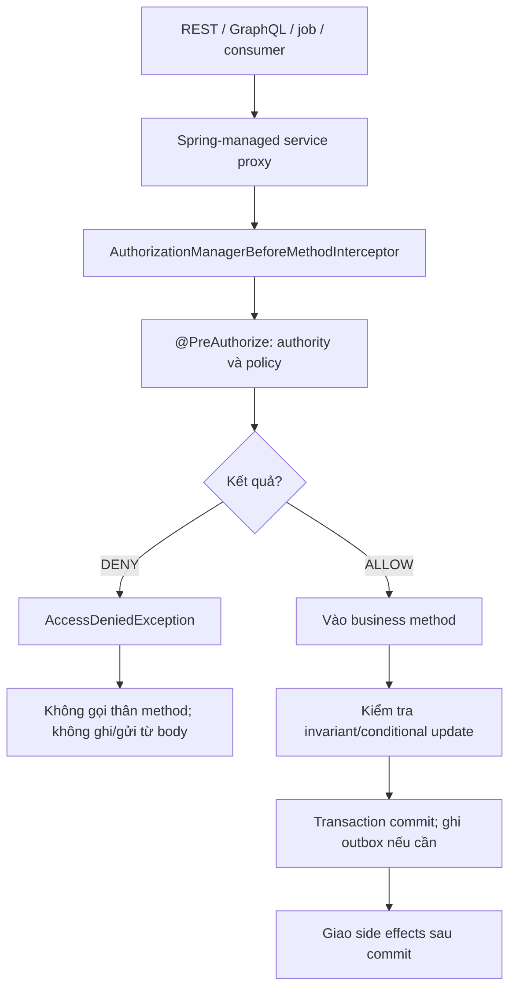

# Đặt kiểm tra trước các thao tác ghi dữ liệu và tác động bên ngoài

## Mục tiêu bài học

Một hệ thống có thể trả về HTTP 403 đúng lúc nhưng **vẫn ghi dữ liệu hoặc gửi thông báo trái phép**. Điều này xảy ra khi chương trình kiểm tra quyền **sau** thao tác nghiệp vụ, khi `@PreAuthorize` không hoạt động vì lời gọi bỏ qua Spring AOP proxy, hoặc khi các tác động bên ngoài được thực hiện trước khi dữ liệu commit thành công.

Bài Knowledge thuộc nhóm **Kiểm tra trước phương thức** trong **Spring Security - authorization** trình bày nguyên tắc:

**Kiểm tra quyền trước → xác minh tài nguyên/trạng thái → ghi atomically → phát tác động bên ngoài theo cơ chế có thể kiểm soát.**

Sau bài này, bạn sẽ:

1. Giải thích vì sao `@PreAuthorize` thích hợp cho method ghi/sửa/xóa và vì sao `@PostAuthorize` không phải hàng rào duy nhất cho side effects.
2. Đặt ranh giới kiểm tra ở Spring-managed service, kể cả khi service được gọi qua Controller, GraphQL, queue, scheduler hoặc bean khác.
3. Kết hợp `hasAuthority`, `#invoiceId`, `@P`, policy bean và kiểm tra owner/tenant/approval limit.
4. Phân biệt **quyền truy cập** với **bất biến trạng thái dữ liệu** và chống rủi ro TOCTOU bằng conditional update/transaction phù hợp.
5. Hiểu phạm vi thực tế của `@Transactional`, thứ tự AOP advice, sự khác biệt giữa rollback database và tác động không thể thu hồi như gửi email, webhook, thanh toán, message.
6. Biết khi nào cần `@TransactionalEventListener(AFTER_COMMIT)`, **transactional outbox**, retry/idempotency và monitoring.
7. Viết test xác minh caller bị DENY **không gọi repository ghi hoặc external gateway**, thay vì chỉ kiểm tra status HTTP.

Phạm vi: Spring Security 6.x/7.x trên Servlet stack, Java 17+, Spring-managed services. Code cấu hình Spring cần dependencies/framework; ví dụ `PrecheckSideEffectDemo.java` là Java thuần chạy được. Những đoạn minh họa domain có tên API tự thiết kế sẽ được ghi rõ là **snippet tích hợp**, không phải Java độc lập.

## 1. Thế nào là kiểm tra “trước tác động”?

Xét một service duyệt hóa đơn:

```text
approveInvoice(invoiceId)
  1. UPDATE invoice.status = APPROVED
  2. Trừ ngân sách hoặc gọi payment provider
  3. Gửi email thông báo
  4. Kiểm tra caller có invoice:approve?
```

Thứ tự này **không an toàn**. Khi bước 4 trả DENY, hệ thống có thể đã sửa database, gửi lệnh thanh toán hoặc email. Một ngoại lệ `AccessDeniedException` hay response 403 **không rút lại** dữ liệu/tin nhắn đã gửi.

Luồng đúng về nguyên tắc:

```text
approveInvoice(invoiceId)
  1. Xác minh caller/authority/identity
  2. Kiểm tra caller được duyệt đúng invoiceId này?
  3. Xác minh state, limit và invariant nghiệp vụ
  4. Ghi dữ liệu bằng transaction / conditional update
  5. Lưu ý định gửi event nếu cần (transactional outbox)
  6. Sau commit, giao side effects ra ngoài một cách đáng tin
```

**Từ chối trước method body** bảo vệ khỏi những tác động trong body khi caller thiếu quyền. Nó **không** thay thế transaction, kiểm tra state ngay lúc ghi, hoặc cơ chế chống gửi trùng ở hệ thống bên ngoài.

### Những gì được xem là side effect

| Tác động | Ví dụ | `@Transactional` của database rollback được không? |
| --- | --- | --- |
| Ghi database | INSERT, UPDATE, DELETE | Có thể, nếu cùng transaction chưa commit |
| Gọi API thanh toán | `paymentGateway.charge(...)` | **Không** một cách mặc định |
| Gửi email/SMS | `mailer.send(...)` | **Không** |
| Phát message | Kafka/RabbitMQ publish | **Không mặc nhiên** theo DB transaction |
| Ghi object storage/tệp | Upload/xóa file | **Không mặc nhiên** |
| Gửi webhook/push | HTTP POST tới hệ thống khác | **Không** |
| Xóa cache | `cache.evict(...)` | Không mặc nhiên |
| Lưu audit của DENY | Ghi “actor bị từ chối” | Có thể là tác động **có chủ đích** |
| Đọc dữ liệu cho policy | SELECT quyền, tenant, trạng thái | Không phải business write, nhưng vẫn cần hiệu năng và bảo mật |

Không hiểu “pre-check” là “không có I/O trước khi cho phép”: policy thường phải **đọc** nguồn dữ liệu đáng tin. Điều cần tránh là **business side effect chưa được ủy quyền**.

## 2. Luồng @PreAuthorize trước thân method



Đây là sơ đồ **logic**. Thứ tự giữa method-security advice và transaction advice có thể tùy cấu hình, nên không tuyên bố `@PreAuthorize` chắc chắn chạy **trước khi mở transaction**. Nhưng khi Spring Security method interceptor thực sự chạy và từ chối, **thân method được bảo vệ không được gọi**.

### Kích hoạt Method Security

```java
import org.springframework.context.annotation.Configuration;
import org.springframework.security.config.annotation.method.configuration.EnableMethodSecurity;

@Configuration
@EnableMethodSecurity
public class MethodSecurityConfig {
}
```

Spring Boot Starter Security **không tự bật** các annotation method security. `@EnableMethodSecurity` đăng ký interceptors; `@PreAuthorize` được xử lý bởi before-method authorization manager. Không phải chỉ cần có annotation trong source là đủ.

### Ví dụ quyền chức năng

```java
import org.springframework.security.access.prepost.PreAuthorize;
import org.springframework.stereotype.Service;

@Service
public class ApprovalService {

    @PreAuthorize("hasAuthority('invoice:approve')")
    public void approve(long invoiceId) {
        // Mã nghiệp vụ chỉ chạy nếu pre-authorization cho phép.
    }
}
```

Đây là snippet Spring, chưa có repo/database/controller. `hasAuthority` đòi đúng `GrantedAuthority` tương ứng. `ROLE_ADMIN` **không tự** tương đương `invoice:approve` khi project chưa có mapping/hierarchy rõ.

### Vì sao không thay bằng @PostAuthorize?

```java
// SAI: hậu kiểm quyền cho một method gây side effect.
@PostAuthorize("hasAuthority('invoice:approve')")
public void approve(long invoiceId) {
    repository.markApproved(invoiceId);
    emailClient.sendApproval(invoiceId);
}
```

`@PostAuthorize` đánh giá **sau khi method trả về**. Một DENY có thể phát sinh sau khi `markApproved` và `sendApproval` đã thực hiện. Spring Security chính thức không khuyến nghị `@PostAuthorize` cho các method ghi database do bất biến bảo mật được kiểm tra quá muộn.

```java
// ĐÚNG về thời điểm chặn body:
@PreAuthorize("hasAuthority('invoice:approve')")
public void approve(long invoiceId) {
    repository.markApproved(invoiceId);
    emailClient.sendApproval(invoiceId);
}
```

Ví dụ thứ hai chặn body khi thiếu quyền, nhưng vẫn chưa giải quyết **DB rollback trong khi email đã gửi**. Ta cần tách kiểm tra quyền, transaction và delivery side effects.

## 3. Đặt guard ở service ngoài Controller

Một quy tắc HTTP như:

```java
http.authorizeHttpRequests(auth -> auth
    .requestMatchers(HttpMethod.POST, "/api/invoices/*/approve")
        .hasAuthority("invoice:approve")
    .anyRequest().denyAll()
);
```

chỉ bảo vệ HTTP request qua `SecurityFilterChain` và matcher tương ứng. Cùng một `ApprovalService.approve` có thể được gọi từ:

- `POST /api/batch-approve` với HTTP rule khác.
- GraphQL resolver hoặc RPC adapter.
- Message listener, event handler hoặc workflow engine.
- `@Scheduled`/`@Async` job.
- Một Spring bean khác.
- Admin endpoint hoặc internal integration.

Nếu service không có guard, một entrypoint mới có thể quên quyền. Đặt `@PreAuthorize` lên **Spring-managed service method** giúp bảo vệ operation dùng chung, không phụ thuộc vào URL của Controller.

**Defense in depth:** vẫn nên kiểm soát URL/method, authentication, CSRF/CORS ở HTTP; bảo vệ service operation bằng method security; kiểm tra owner/tenant/ACL ở resource policy và điều kiện giao dịch tại database.

| Lớp | Câu hỏi | Ví dụ |
| --- | --- | --- |
| HTTP authorization | Endpoint được gọi với method nào? | POST approve yêu cầu `invoice:approve` |
| Method security | Caller có được dùng business operation không? | `ApprovalService.approve` |
| Object-level policy | Có quyền trên invoice cụ thể không? | Tenant, approver group, amount limit |
| Transaction/domain | State có cho phép chuyển không? | Chỉ PENDING → APPROVED |
| External delivery | Event/email/payment có được gửi đúng một lần logic? | Outbox, idempotency |

Một HTTP 403 có thể do CSRF hoặc HTTP rule nên **không chứng minh** service guard đã hoạt động; bài test trực tiếp service ở phần 12 sẽ giải quyết.

## 4. Quyền chức năng và quyền trên bản ghi

Người có `invoice:approve` không được mặc nhiên duyệt **mọi invoice**. Giả sử Alice thuộc tenant A, Bob thuộc tenant B; cả hai có authority duyệt, nhưng không được duyệt invoice của tenant còn lại.

Một chính sách đầy đủ có dạng:

```text
mayApprove =
    authentication đáng tin
    AND hasAuthority("invoice:approve")
    AND invoice.tenant thuộc phạm vi actor
    AND invoice.amount trong approval limit
    AND invoice.status == PENDING
    AND actor đáp ứng rule phân tách nhiệm vụ (nếu có)
```

Spring Security SpEL có thể gọi policy bean:

```java
import org.springframework.security.access.method.P;
import org.springframework.security.access.prepost.PreAuthorize;
import org.springframework.stereotype.Service;
import org.springframework.transaction.annotation.Transactional;

@Service
public class InvoiceService {

    private final InvoiceRepository invoices;
    private final OutboxRepository outbox;

    public InvoiceService(
            InvoiceRepository invoices,
            OutboxRepository outbox) {
        this.invoices = invoices;
        this.outbox = outbox;
    }

    @PreAuthorize(
        "hasAuthority('invoice:approve') and " +
        "@invoicePolicy.mayApprove(authentication, #invoiceId)"
    )
    @Transactional
    public void approve(@P("invoiceId") long invoiceId) {
        String actor =
            org.springframework.security.core.context
                .SecurityContextHolder.getContext()
                .getAuthentication()
                .getName();

        // Domain API phải hiện thực cập nhật có điều kiện
        // theo invoice, tenant, approver và state thực.
        int changed = invoices.approveIfPendingAndVisible(
            invoiceId, actor
        );

        if (changed != 1) {
            throw new ApprovalConflictException(invoiceId);
        }

        // Lưu vào cùng transaction DB với invoice.
        outbox.saveInvoiceApproved(invoiceId, actor);
    }
}
```

**Đây là snippet tích hợp, chưa phải chương trình độc lập.** `InvoiceRepository`, `OutboxRepository`, `ApprovalConflictException` và nghiệp vụ approval phải được project hiện thực. `approveIfPendingAndVisible` phải xác nhận caller, scope và state thật trong truy vấn hoặc transaction; tên method không tự đảm bảo an toàn.

Bean policy minh họa:

```java
import org.springframework.security.core.Authentication;
import org.springframework.stereotype.Component;

@Component("invoicePolicy")
public class InvoicePolicy {

    private final InvoiceRepository invoices;

    public InvoicePolicy(InvoiceRepository invoices) {
        this.invoices = invoices;
    }

    public boolean mayApprove(
            Authentication authentication,
            long invoiceId) {
        if (authentication == null
                || !authentication.isAuthenticated()) {
            return false;
        }
        return invoices.isApprovalAllowed(
            invoiceId, authentication.getName()
        );
    }
}
```

`isApprovalAllowed` là business query phải kiểm tra tenant, limit, approver role, state từ dữ liệu server-side. `Authentication.isAuthenticated()` một mình không chắc phân biệt mọi anonymous token trong mọi setup; `hasAuthority` ở biểu thức trước đó và policy identity phù hợp là các lớp bổ sung. Không tin `tenantId`/`ownerId` do client tự gửi.

`@P("invoiceId")` giúp SpEL bind `#invoiceId` mà không phụ thuộc Java parameter metadata `-parameters`. Dùng `#p0` cũng được về mặt index, nhưng có thể sai khi thêm tham số mới vào đầu signature.

## 5. TOCTOU: kiểm tra trước nhưng quyền/trạng thái đã đổi

Ngay cả khi `@invoicePolicy.mayApprove` trả true, state có thể đổi trước khi method ghi:

```text
T1: Policy đọc invoice PENDING và cho phép approve.
T2: Request khác CANCEL invoice / thu hồi quyền.
T3: Method gọi UPDATE invoice không có điều kiện state.
T4: Invoice bị APPROVED dù không còn hợp lệ.
```

Đây là **Time-of-Check to Time-of-Use (TOCTOU)**. `@PreAuthorize` là ranh giới cần thiết nhưng **không khóa** toàn bộ dữ liệu sau khi check. Giải pháp thường gồm:

1. **Conditional UPDATE** kèm state, tenant, owner/approver scope, version.
2. **Optimistic locking** với `version` khi nhiều người cùng sửa.
3. **Pessimistic lock/transaction** trong trường hợp nghiệp vụ cần serialization.
4. Kiểm tra **số hàng được cập nhật** và chỉ phát event khi thay đổi thành công.
5. Giữ những invariant quan trọng **gần điểm ghi**, không chỉ trong một check ở ngoài transaction.

Ví dụ SQL cấu trúc:

```sql
UPDATE invoices
SET status = 'APPROVED',
    approved_by = :trustedActor,
    approved_at = CURRENT_TIMESTAMP
WHERE id = :invoiceId
  AND tenant_id = :trustedTenant
  AND status = 'PENDING'
  AND approved_by IS NULL;
```

Nếu kết quả UPDATE là 0 hàng, không được gửi “approved” như một thành công. Các giá trị `:trustedTenant`/`:trustedActor` phải lấy từ identity và authorization server-side chứ không tin client tự điền. Tùy database và yêu cầu bảo mật, query phải bao gồm đúng logic cấp quyền; SQL chỉ là mẫu, không tự thay thế toàn bộ domain policy.

### Thứ tự @PreAuthorize và @Transactional

`@PreAuthorize` dùng method interceptor trước thân method. `@Transactional` là transaction advice của Spring AOP. Thứ tự các advisors có thể tùy cấu hình, nên không khẳng định transaction luôn chỉ được tạo **sau** pre-check.

- DENY trước body giúp ngăn mọi side effects **trong body** của protected method.
- Nếu policy hoặc một custom advisor có side effect riêng trước security advice thì vẫn có rủi ro.
- Một pre-check làm SELECT **ngoài transaction** không bảo đảm state không đổi trước UPDATE.
- Nếu muốn kiểm soát advisor ordering hoặc isolation, phải đọc documentation đúng version và có integration tests, thay vì dựa trên annotation order trong source.

**Bất biến tại điểm ghi** phải được bảo đảm độc lập với lúc pre-check đánh giá.

## 6. @Transactional không phải phép hoàn tác toàn bộ thế giới

Một transaction database có thể rollback những thay đổi thuộc **cùng transactional resource** nhưng thường không undo được:

- Email/SMS đã gửi.
- HTTP request đã tới payment gateway.
- Message đã publish lên broker không cùng một transaction coordination.
- Tệp/object storage đã xóa hay upload.
- Webhook hoặc push notification đã được phía nhận thực thi.

Ví dụ:

```java
@PreAuthorize("hasAuthority('invoice:approve')")
@Transactional
public void approve(long invoiceId) {
    invoices.markApproved(invoiceId);
    mailer.sendApproval(invoiceId);
    throw new IllegalStateException("database must roll back");
}
```

Đây là **snippet cảnh báo**, chưa định nghĩa dependencies. Với transaction Spring mặc định, unchecked exception có thể khiến DB rollback; email **đã gửi** không thể tự rollback. Nếu client retry, email có thể bị gửi nhiều lần.

### Hậu kiểm càng nguy hiểm với write

```java
// Không dùng như hàng rào quyền duy nhất.
@PostAuthorize("hasAuthority('invoice:approve')")
@Transactional
public void approve(long invoiceId) {
    invoices.markApproved(invoiceId);
}
```

`@PostAuthorize` chạy sau body. Việc DB commit xảy ra trước hay sau post-check tùy advisor ordering; không được dựa vào may mắn rollback để thay pre-authorization. Với thao tác đã gọi external API, hậu kiểm **chắc chắn không tạo được atomic rollback** cho provider bên ngoài.

Spring Security chính thức lưu ý `@PostAuthorize` **không được khuyến nghị cho method ghi database** vì kiểm tra các bất biến bảo mật sau khi thay đổi đã xảy ra. `@PostAuthorize` phù hợp hơn cho **read/result authorization**, ví dụ kiểm tra owner của đối tượng được trả về.

### Trước khi gọi external API

Trường hợp người dùng thiếu quyền, `@PreAuthorize` đúng và có hiệu lực phải từ chối **trước khi gọi** `paymentGateway.charge(...)` hoặc `mailer.send(...)`. Nhưng với người dùng có quyền, cần xử lý cả transaction/partial failures, retry, timeout, duplicate, compensation. Authorization là một trong các điều kiện an toàn, không thay thế orchestration.

## 7. Các mẫu phân phối side effects sau commit

### 7.1. Gọi trực tiếp trong transaction

```text
UPDATE invoice
SEND message/email
COMMIT database
```

Ưu điểm: dễ viết. Nhược: nếu COMMIT fail, message đã gửi; nếu network fail sau DB update, trạng thái có thể không nhất quán. Không phù hợp cho side effects có giá trị cao khi đòi hỏi giao đảm bảo.

### 7.2. @TransactionalEventListener(AFTER_COMMIT)

Spring Framework cho phép listener gắn vào phase transaction; `AFTER_COMMIT` chạy khi transaction đã commit thành công:

```java
import org.springframework.stereotype.Component;
import org.springframework.transaction.event.TransactionPhase;
import org.springframework.transaction.event.TransactionalEventListener;

@Component
public class InvoiceApprovedListener {

    private final MailClient mailClient;

    public InvoiceApprovedListener(MailClient mailClient) {
        this.mailClient = mailClient;
    }

    @TransactionalEventListener(
        phase = TransactionPhase.AFTER_COMMIT
    )
    public void onApproved(InvoiceApprovedEvent event) {
        mailClient.sendApproved(event.invoiceId());
    }
}
```

Và trong service sau khi đã được ủy quyền:

```java
// Snippet bên trong method @Transactional.
repository.markApproved(invoiceId);
events.publishEvent(new InvoiceApprovedEvent(invoiceId));
```

`events` là `ApplicationEventPublisher`; `InvoiceApprovedEvent`, `MailClient` là types của project. Listener ví dụ cần được Spring quản lý; event được publish trong transaction phù hợp.

**Hạn chế:** event listener sau commit không tự là một hàng đợi bền vững, không đảm bảo sẽ được gọi nếu process crash đúng lúc, không tự retry tới khi email đến nơi. Nó cũng không thay thế idempotency với downstream.

### 7.3. Transactional outbox

Khi sự kiện/lệnh bên ngoài cần **được giao đáng tin cậy**, lưu **outbox record trong cùng database transaction** với state update:

```text
Transaction:
  CONDITIONAL UPDATE invoice IF approvable
  INSERT outbox(event_id, aggregate_id, type, payload, status)
  COMMIT

Dispatcher độc lập:
  LOAD pending outbox entries
  SEND external message / webhook
  ON success: mark delivered
  ON failure: retry with backoff
```

Nếu transaction rollback, cả update và outbox row đều không được commit. Nếu dispatcher crash **sau gửi nhưng trước mark delivered**, việc gửi có thể lặp khi retry; downstream cần deduplicate theo `event_id`/idempotency key hoặc support at-least-once delivery semantics.

Outbox giải quyết **durability của ý định gửi sau khi DB commit**, không hứa exactly-once effect hay hoàn tác API provider. Với payment, kết hợp idempotency key do provider hỗ trợ, reconcile và compensating action theo nghiệp vụ.

### So sánh nhanh

| Mẫu | Độ phức tạp | Thời điểm gửi | Rủi ro chính |
| --- | --- | --- | --- |
| Gửi trực tiếp trong body | Thấp | Trước/giữa commit | DB rollback nhưng side effect vẫn xảy ra |
| TransactionalEventListener AFTER_COMMIT | Trung bình | Sau commit | Crash/lỗi listener có thể mất delivery |
| Outbox + dispatcher | Cao hơn | Sau khi outbox commit | At-least-once, cần retry/dedup/monitoring |

Không ép mọi email ít quan trọng phải dùng outbox, nhưng **không chọn mẫu nhẹ** khi yêu cầu nghiệp vụ cần giao chắc chắn.

## 8. Idempotency, retry và thời điểm ủy quyền

Một HTTP request có thể bị retry vì timeout. Message broker có thể redeliver event. Nếu hai lần gọi cùng approval mà không chống lặp, ứng dụng có thể:

- Trừ ngân sách hai lần.
- Gửi hai lệnh thanh toán.
- Gửi hai email nhầm thành hai lần phê duyệt.
- Tạo hai outbox events cho cùng một transition.

Một operation an toàn nên xem xét:

```text
CanApply(request) =
    caller được xác thực
    AND caller được phân quyền trên tài nguyên
    AND state hiện tại cho phép
    AND cùng idempotency key chưa gây business effect tương đương
    AND update/emit được bảo đảm nhất quán
```

**Idempotency key không phải authorization credential**. Không trả dữ liệu cached response của người khác chỉ vì biết trùng key; cần scope key theo tenant/principal/action hoặc recheck policy khi tiết lộ kết quả.

### Các tình huống thử nghiệm

1. User thiếu `invoice:approve` → không gọi write repository, không enqueue outbox.
2. User có quyền chung nhưng sai tenant → không ghi, không gửi.
3. Invoice đã APPROVED → conditional update trả 0 và không ghi event duyệt lần hai.
4. Request hợp lệ → một transition thành công và một business outbox record logic.
5. Transaction rollback → không commit invoice update hoặc outbox.
6. Dispatcher gửi thành công rồi crash → retry không gây double charge nhờ idempotency downstream.
7. Permission thay đổi giữa request và lúc dispatch → định nghĩa rõ worker đang thực hiện ý định đã được ủy quyền lúc request hay cần reauthorization; không tự suy một trong hai cho mọi nghiệp vụ.

### Fail closed khi policy backend lỗi

Nếu `invoicePolicy.mayApprove` gọi service hoặc DB bị timeout, **không trả true mặc định**. Có thể phân biệt “không xác minh được vì hệ thống lỗi” với “thiếu quyền” để trả response/metrics phù hợp, nhưng không tiếp tục business write khi thiếu bằng chứng quyền.

## 9. Bẫy Spring AOP khiến pre-check không thực thi

`@PreAuthorize` dựa vào interceptors trên **Spring-managed proxy**. Các trường hợp nguy hiểm:

- Tạo service bằng `new` ngoài container Spring.
- Gọi `this.approve(...)` từ method khác cùng class (**self-invocation**).
- Dùng private/static/final method theo cách proxy không intercept được.
- Test chính service bằng Mockito mock thay vì bean thực.
- Adapter đi thẳng tới repository/payment gateway, bỏ qua protected service.
- Custom AOP advice có side effect chạy trước security advisor.

Ví dụ self-invocation:

```java
@Service
public class ApprovalService {

    public void batchApprove(long id) {
        // Với proxy-based AOP mặc định, this.approve()
        // không đi lại qua @PreAuthorize ở approve.
        this.approve(id);
    }

    @PreAuthorize("hasAuthority('invoice:approve')")
    public void approve(long id) {
        repository.markApproved(id);
    }
}
```

Đây là snippet minh họa, `repository` cần được inject. **Cách sửa:** bảo vệ `batchApprove` như một business entrypoint, hoặc tách `approve` thành service bean khác rồi gọi qua injected Spring proxy. Không tự proxy thủ công hoặc tự inject self chỉ để “lách” thiết kế mà thiếu kiểm thử; hãy giữ trust boundary rõ ràng.

### Background jobs và message consumers

Một `@Scheduled` job/message handler **không tự có** HTTP SecurityContext của user. Nó phải dùng **system identity** có quyền tối thiểu hoặc một thiết kế service operation nội bộ được bảo vệ riêng, được audit. User-triggered async work cần identity propagation phù hợp và chính sách về quyền có thể bị thu hồi.

Không tin `ROLE_ADMIN`/`userId` trong message body là chứng cứ quyền nếu nguồn message không được xác thực. `AccessDeniedException` ngoài HTTP không tự thành HTTP 403; caller phải xử lý lỗi và không chạy side effects sau khi nhận DENY.

## 10. Kiểm tra nguyên tắc phân tách nhiệm vụ, approval limit, tenant

Một vài nghiệp vụ không thể bảo vệ chỉ bằng `hasAuthority`:

- Người tạo hóa đơn không được tự duyệt hóa đơn của mình.
- Người duyệt phải thuộc cùng tenant hoặc được ủy quyền liên tổ chức.
- Phải có approval level đủ lớn so với amount.
- Trạng thái tài nguyên phải `PENDING`, không phải `CANCELLED`.
- Một số thao tác cần MFA/re-authentication hoặc hai chữ ký.
- Chính sách có thời hạn và có thể bị thu hồi.

Những điều này nên ở domain policy Java rõ ràng như `invoicePolicy.mayApprove(authentication,invoiceId)`, hoặc custom `AuthorizationManager<MethodInvocation>` nếu phức tạp. SpEL giữ phần dễ đọc, policy bean giữ kiểm tra dữ liệu.

**Không xây policy bằng cách thử thực hiện thao tác rồi rollback nếu không được phép.** “Ghi thử” có thể kích hoạt trigger, queue, audit, external API và tạo race, không phải bước kiểm tra an toàn.

### Service authorization và validation không phải cùng một việc

Validation kiểm tra input `invoiceId > 0` hoặc format; authorization kiểm tra ai được phép tác động lên **ID đó**; domain validation kiểm tra invoice còn duyệt được không. Một method chỉ có `@Valid` vẫn có thể cho user hợp lệ về cú pháp nhưng thiếu quyền tạo tác động.

### Tự bảo vệ logic ở tầng DB

Query scoping (tenant-aware repository) và conditional update có thể giảm rủi ro một method bypass policy; nhưng không phải cái cớ để bỏ phương thức security. Giữ invariant tại write boundary để giảm TOCTOU, đồng thời giữ annotation/policy tại service entrypoint để chặn unauthorized work sớm.

## 11. Một lỗi khác: @PostAuthorize trên thao tác ghi

Ví dụ:

```java
@PostAuthorize("hasAuthority('invoice:approve')")
@Transactional
public void approve(long id) {
    repository.markApproved(id);
    externalClient.notifyApproved(id);
}
```

Người có authority `invoice:read` nhưng **không có** `invoice:approve`:

1. Body method có thể gọi `markApproved`.
2. External service có thể đã nhận message.
3. `@PostAuthorize` phát hiện thiếu quyền **sau khi method chạy**.
4. Spring Security ném `AccessDeniedException`; HTTP layer có thể trả 403.
5. Nhưng remote side effect không tự mất đi.

Đây là ví dụ **không nên triển khai**. Dù một transaction có thể rollback DB trong một thứ tự advisors cụ thể, bạn không thể dựa vào điều đó cho toàn bộ side effects.

### Hậu kiểm hợp lý hơn trên thao tác đọc

```java
@PreAuthorize("hasAuthority('invoice:read')")
@PostAuthorize(
    "returnObject.owner() == authentication.name"
)
public InvoiceView read(long invoiceId) {
    return repository.findViewById(invoiceId).orElseThrow();
}
```

Với result đọc, hậu kiểm có thể chặn trả dữ liệu khi owner khác principal. Tuy nhiên method đã chạy, nên query trước theo tenant/owner vẫn thường an toàn và hiệu quả hơn; không dùng post-check làm bảo vệ duy nhất cho một lệnh xuất/đẩy dữ liệu ra bên ngoài.

## 12. Java 17 độc lập: so sánh kiểm tra trước và kiểm tra quá muộn

Ví dụ dưới dùng hai **bộ đếm mô phỏng** việc ghi DB và gửi message; nó **không thực hiện** database/email thật. Lưu đúng tên file **`PrecheckSideEffectDemo.java`**:

```java
import java.util.Set;

public class PrecheckSideEffectDemo {

    record Actor(String name, Set<String> authorities) {
        boolean canApprove() {
            return authorities.contains("invoice:approve");
        }
    }

    static class Effects {
        int writes;
        int messages;

        void persistApproval() {
            writes++;
        }

        void notifySupplier() {
            messages++;
        }
    }

    static void requirePermission(Actor actor) {
        if (!actor.canApprove()) {
            throw new SecurityException("approval forbidden");
        }
    }

    static void unsafeLateCheck(Actor actor, Effects effects) {
        effects.persistApproval();
        effects.notifySupplier();
        requirePermission(actor);
    }

    static void safeEarlyCheck(Actor actor, Effects effects) {
        requirePermission(actor);
        effects.persistApproval();
        effects.notifySupplier();
    }

    public static void main(String[] args) {
        Actor reader = new Actor(
            "alice", Set.of("invoice:read")
        );
        Actor approver = new Actor(
            "bob", Set.of("invoice:approve")
        );

        Effects late = new Effects();
        try {
            unsafeLateCheck(reader, late);
        } catch (SecurityException exception) {
            System.out.println(
                "late check: DENIED, writes=" + late.writes
                    + ", messages=" + late.messages
            );
        }

        Effects early = new Effects();
        try {
            safeEarlyCheck(reader, early);
        } catch (SecurityException exception) {
            System.out.println(
                "early check: DENIED, writes=" + early.writes
                    + ", messages=" + early.messages
            );
        }

        Effects authorized = new Effects();
        safeEarlyCheck(approver, authorized);
        System.out.println(
            "authorized: OK, writes=" + authorized.writes
                + ", messages=" + authorized.messages
        );
    }
}
```

Lệnh chạy với JDK 17+:

```bash
javac PrecheckSideEffectDemo.java
java PrecheckSideEffectDemo
```

**Stdout chính xác:**

```text
late check: DENIED, writes=1, messages=1
early check: DENIED, writes=0, messages=0
authorized: OK, writes=1, messages=1
```

**Giải thích:** Ở late check, actor bị từ chối nhưng counters side effects đã tăng. Ở early check, actor bị từ chối trước khi body tạo tác động. Authorized actor thực hiện đúng một lần trong ví dụ. Đây là **mô hình logic**, không phải mã thay thế cho Spring Security AOP, transaction hay hệ thống gửi email thực.

## 13. Spring JUnit test: DENY phải không ghi hoặc gửi

**Không chỉ kiểm tra HTTP 403**. Nếu dùng MockMvc, một request có thể bị chặn bởi HTTP Security hoặc CSRF trước service, nên HTTP 403 chưa chứng minh `@PreAuthorize` trên service hoạt động.

Hãy lấy **service thật** từ Spring Test ApplicationContext, bật `@EnableMethodSecurity` và tạo principal bằng `@WithMockUser`. Ví dụ sau dùng một fake-effects bean với counters.

### Test fixture Spring Security 6.x/7.x

Mã cần dependencies `spring-context`, `spring-security-config`, `spring-security-test`, `spring-test` và JUnit 5 tương thích. Không chạy độc lập với `javac` thuần.

```java
import org.junit.jupiter.api.BeforeEach;
import org.junit.jupiter.api.Test;
import org.springframework.beans.factory.annotation.Autowired;
import org.springframework.context.annotation.Bean;
import org.springframework.context.annotation.Configuration;
import org.springframework.security.access.AccessDeniedException;
import org.springframework.security.access.method.P;
import org.springframework.security.access.prepost.PreAuthorize;
import org.springframework.security.config.annotation.method.configuration.EnableMethodSecurity;
import org.springframework.security.test.context.support.WithMockUser;
import org.springframework.test.context.junit.jupiter.SpringJUnitConfig;

import static org.junit.jupiter.api.Assertions.assertEquals;
import static org.junit.jupiter.api.Assertions.assertThrows;

@SpringJUnitConfig(PrecheckServiceTest.Config.class)
class PrecheckServiceTest {

    @Autowired
    GuardedApprovalService service;

    @Autowired
    FakeEffects effects;

    @BeforeEach
    void resetEffects() {
        effects.reset();
    }

    @Test
    @WithMockUser(
        username = "alice", authorities = "invoice:approve"
    )
    void authorizedCallerCanWrite() {
        assertEquals(
            "approved:42", service.approve("alice", 42L)
        );
        assertEquals(1, effects.writes);
        assertEquals(1, effects.messages);
    }

    @Test
    @WithMockUser(
        username = "alice", authorities = "invoice:read"
    )
    void wrongAuthorityProducesNoEffects() {
        assertThrows(
            AccessDeniedException.class,
            () -> service.approve("alice", 42L)
        );
        assertEquals(0, effects.writes);
        assertEquals(0, effects.messages);
    }

    @Test
    @WithMockUser(
        username = "alice", authorities = "invoice:approve"
    )
    void wrongOwnerProducesNoEffects() {
        assertThrows(
            AccessDeniedException.class,
            () -> service.approve("bob", 42L)
        );
        assertEquals(0, effects.writes);
        assertEquals(0, effects.messages);
    }

    @Configuration
    @EnableMethodSecurity
    static class Config {
        @Bean
        FakeEffects fakeEffects() {
            return new FakeEffects();
        }

        @Bean
        GuardedApprovalService guardedApprovalService(
                FakeEffects effects) {
            return new GuardedApprovalService(effects);
        }
    }

    public static class FakeEffects {
        int writes;
        int messages;

        void reset() {
            writes = 0;
            messages = 0;
        }

        void write() {
            writes++;
        }

        void send() {
            messages++;
        }
    }

    public static class GuardedApprovalService {

        private final FakeEffects effects;

        public GuardedApprovalService(FakeEffects effects) {
            this.effects = effects;
        }

        @PreAuthorize(
            "hasAuthority('invoice:approve') and " +
            "#owner == authentication.name"
        )
        public String approve(
                @P("owner") String owner, long invoiceId) {
            effects.write();
            effects.send();
            return "approved:" + invoiceId;
        }
    }
}
```

**Điểm cần kiểm chứng:**

- Dùng Spring-managed `GuardedApprovalService` thật (không Mockito mock chính service).
- Có `@EnableMethodSecurity` và interceptor.
- `@P("owner")` làm `#owner` được bind ổn định, không phụ thuộc compile flag.
- Các test DENY vừa assert exception vừa assert **writes = 0** và **messages = 0**.
- Test ALLOW chứng minh body đã chạy khi đúng quyền và đúng owner input.

Fixture chỉ dùng counters; ở production, **owner input** cần được đối chiếu với owner/tenant dữ liệu server, không coi giá trị `owner` client tự cung cấp là bằng chứng quyền. `@WithMockUser` cung cấp identity giả lập, không kiểm tra real login hoặc JWT signatures.

### Test với repository và payment gateway

Trong Spring Boot integration tests có thể mock **dependencies** như `ApprovalRepository`/`PaymentGateway`, nhưng không thay chính service cần được security intercept. Sau lệnh gọi bị DENY:

```java
// Snippet trong JUnit/Mockito test đã inject service thật.
assertThrows(AccessDeniedException.class,
    () -> approvalService.approve(invoiceId));

verifyNoInteractions(writeRepository, paymentGateway);
```

`approvalService` và mocks cần được setup trong test fixture đúng phiên bản; đây không phải file Java độc lập. Với domain policy, lưu ý policy **có thể gọi read repository** để xác minh quyền, nên `verifyNoInteractions(repository)` trên một mock gộp cả read/write có thể sai; phân biệt **write operations** và read-only policy lookups.

### Kiểm thử tích hợp database, outbox và rollback

Bên cạnh fake counter tests, chạy integration tests có database:

1. DENY theo authority → invoice status không đổi, outbox không tăng.
2. DENY theo tenant → invoice không đổi, không gọi external provider.
3. ALLOW hợp lệ → một conditional transition và một outbox row commit.
4. Approval đã hoàn tất → updateCount = 0, không có outbox mới.
5. Transaction fail → không có cả DB update lẫn outbox row commit.
6. Dispatcher retry cùng event → không tạo double business effect.

Một HTTP endpoint test vẫn cần kiểm tra `SecurityFilterChain`, CSRF, authentication entry point và response status, **ngoài** direct service tests.

## 14. 401/403 và câu hỏi “tầng nào đã chặn?”

| Nguồn từ chối | Thời điểm | Có đủ chứng minh service không tạo side effect không? |
| --- | --- | --- |
| HTTP `authorizeHttpRequests` | Trước Controller | Chặn route đó, nhưng không chứng minh caller khác |
| `CsrfFilter` | Trước Controller với yêu cầu token | Không chứng minh method security |
| `@PreAuthorize` đúng và proxied | Trước body | Chặn side effects **trong body** |
| Policy check giữa body | Tùy vị trí | Nguy hiểm nếu đã ghi/gửi trước check |
| `@PostAuthorize` | **Sau body** | Không; side effects có thể đã xảy ra |
| DB constraint/rollback | Lúc write/commit | Không tự rollback remote calls |
| Provider timeout | Sau khi gửi request | Có thể đã thực hiện ở provider, cần reconcile |

Một full authenticated user thiếu quyền thường nhận HTTP 403 thông qua exception handling, anonymous có thể nhận 401 hoặc redirect login. Với scheduler/consumer, `AccessDeniedException` **không tự tạo HTTP status**; caller ngoài HTTP phải xử lý và không tiếp tục nghiệp vụ.

Nếu nhận 403 sau một method gây tác động, cần điều tra **pre-check hay post-check**, security AOP proxy có hoạt động không, transaction commit khi nào, external request đã rời tiến trình chưa. Không sửa bằng `permitAll` để làm test xanh.

## 15. Lỗi phổ biến và cách phòng tránh

1. **Đặt `@PostAuthorize` làm hàng rào duy nhất trước DB write:** method đã chạy trước khi hậu kiểm.
2. **Cho rằng HTTP 403 không có tác động:** kiểm tra database/outbox/gateway riêng.
3. **Chỉ bảo vệ Controller:** entrypoints khác có thể gọi cùng service.
4. **Quên `@EnableMethodSecurity`:** annotation không được intercept.
5. **Dùng `new`/mock chính service:** bypass Spring AOP proxy.
6. **Self-invocation `this.approve()`:** method interceptor có thể bị bypass.
7. **Custom advisor chạy trước security và gọi external:** pre-check không ngăn tác động của advisor trước nó.
8. **Trộn kiểm tra role với owner/tenant:** có quyền chung không đồng nghĩa quyền trên mọi bản ghi.
9. **Tin tenant ID do client gửi:** phải kiểm tra server-side membership/ACL.
10. **Chỉ check trạng thái trước rồi UPDATE không điều kiện:** TOCTOU tạo race.
11. **Quên kiểm tra số hàng UPDATE:** có thể phát event dù không có transition.
12. **Tin `@Transactional` rollback email/webhook/payment:** remote effects không tự rollback.
13. **Gửi message trước commit:** consumer có thể nhận event dù DB rollback.
14. **Tin `@TransactionalEventListener` luôn durable:** crash có thể gây mất delivery.
15. **Outbox không có dedup/idempotency:** retry có thể tạo duplicate external effect.
16. **Lấy idempotency key làm permission:** key không chứng minh danh tính/quyền.
17. **Cho worker quyền admin toàn hệ thống:** vi phạm least privilege, khó audit.
18. **Gặp policy timeout thì cho qua:** tạo fail-open.
19. **Chỉ test người có quyền:** không phát hiện unauthorized writes.
20. **Chỉ assert 403 khi test Spring service:** phải assert không gọi write/gateway.
21. **Giả định method-security advice luôn mở trước transaction:** test ordering nếu hệ thống phụ thuộc.
22. **Không có fallback rule cho route mới:** có thể khiến adapter mới gọi side effects mà không được review.

## 16. Checklist trước khi merge

- [ ] Business operation nhạy cảm đã được liệt kê: database, payment, email, webhook, message, file, state transition.
- [ ] `@PreAuthorize` hoặc pre-invocation authorization manager được đặt trên service entrypoint có side effect.
- [ ] `@EnableMethodSecurity` đã bật và test thật qua Spring-managed proxy.
- [ ] HTTP rules vẫn bảo vệ URL/method, không coi method security là thay thế toàn bộ HTTP.
- [ ] Permission, owner/tenant, approval limit, state được kiểm tra từ nguồn đáng tin.
- [ ] Không ghi/gửi trước khi biết caller được phép.
- [ ] Không dùng `@PostAuthorize` làm chốt quyền duy nhất cho method ghi.
- [ ] Đã kiểm tra self-invocation, custom AOP advice và các adapter không qua Controller.
- [ ] TOCTOU được xử lý tại write boundary (conditional UPDATE, version, locking/transaction).
- [ ] Dữ liệu được commit nhất quán; outbox row trong cùng transaction nếu cần.
- [ ] External effects gửi sau commit hoặc qua outbox/dispatcher tùy yêu cầu reliability.
- [ ] Retry, idempotency và audit được thiết kế cho tác vụ không hoàn tác được.
- [ ] System jobs và consumers có identity/phân quyền rõ, không tự chia sẻ HTTP user context.
- [ ] Denial test xác minh không ghi database, không enqueue business event, không call provider.
- [ ] Happy path test xác minh thao tác hợp lệ thực hiện đúng một lần logic.
- [ ] Không log credentials, tokens hoặc dữ liệu nhạy cảm; audit DENY riêng với business event.
- [ ] CI bao gồm direct service tests và integration tests theo Spring versions đang dùng.

### Câu hỏi tự kiểm tra

**Câu 1.** Vì sao `@PostAuthorize("hasAuthority('invoice:approve')")` không đủ để bảo vệ method gửi HTTP payment?

**Đáp án:** Vì hậu kiểm chạy sau body; provider có thể đã nhận thanh toán. Cần pre-authorization và idempotency/reconcile bên ngoài.

**Câu 2.** `@PreAuthorize` có chắc chạy trước khi transaction bắt đầu?

**Đáp án:** Không nhất thiết; phụ thuộc advisor ordering. Nó chặn **trước body** nếu interceptor hoạt động, không cam kết thứ tự mở transaction.

**Câu 3.** Pre-check đã ALLOW nhưng invoice đổi sang CANCELLED trước UPDATE. Nên làm gì?

**Đáp án:** Dùng update có điều kiện state/tenant/owner hoặc locking phù hợp và kiểm tra số hàng cập nhật. Pre-check không tự loại TOCTOU.

**Câu 4.** DB rollback sau khi email đã gửi thì email có được rollback không?

**Đáp án:** Không. Có thể dùng after-commit listener cho tác động nhẹ hoặc transactional outbox cho yêu cầu giao đáng tin; cần retry/idempotency.

**Câu 5.** MockMvc nhận 403 có đủ chứng minh service không gửi message khi thiếu authority không?

**Đáp án:** Không. Test service bean trực tiếp với principal giả lập và assert repository write/external gateway không được gọi.

**Câu 6.** Vì sao outbox worker có thể gửi trùng event dù DB update chỉ xảy ra một lần?

**Đáp án:** Worker có thể gửi thành công rồi crash trước khi đánh dấu delivered. Retry cùng event ID phải được downstream xử lý idempotently.

## Tài liệu tham khảo chính thức

- Spring Security, *Method Security*: https://docs.spring.io/spring-security/reference/servlet/authorization/method-security.html
- Spring Security, *Authorization Architecture*: https://docs.spring.io/spring-security/reference/servlet/authorization/architecture.html
- Spring Security, *Authorize HttpServletRequests*: https://docs.spring.io/spring-security/reference/servlet/authorization/authorize-http-requests.html
- Spring Security, *Testing Method Security*: https://docs.spring.io/spring-security/reference/servlet/test/method.html
- Spring Framework, *Using @Transactional*: https://docs.spring.io/spring-framework/reference/data-access/transaction/declarative/annotations.html
- Spring Framework, *Transaction-bound Events*: https://docs.spring.io/spring-framework/reference/data-access/transaction/event.html
- Spring Framework, *AOP Proxying and Self Invocation*: https://docs.spring.io/spring-framework/reference/core/aop/proxying.html
