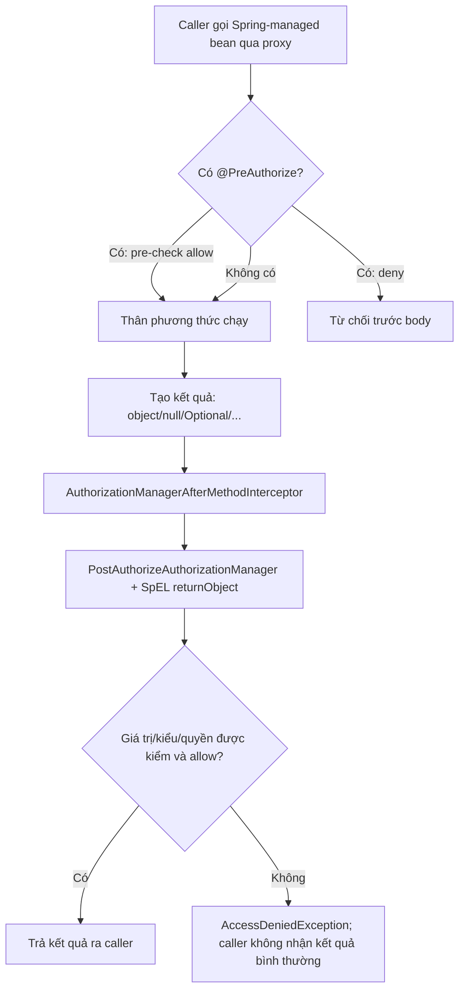

# Kết quả null, Optional và kiểu trả về cần kiểm chứng

Trong **Spring Security method security**, `@PostAuthorize` cho phép kiểm quyền **dựa vào kết quả mà một phương thức vừa trả về**, thay vì chỉ dựa vào tham số trước khi phương thức chạy. Đây là cơ chế hữu ích khi chính đối tượng truy xuất từ database mới cho biết **owner, tenant, trạng thái, nhãn bảo mật hoặc ACL**.

Nhưng kết quả không phải lúc nào cũng là một object hợp lệ. Phương thức có thể trả:

- `null`;
- `Optional.empty()`;
- `Optional<Document>` có giá trị;
- `List<Document>`, tập rỗng hoặc tập chứa nhiều tài nguyên;
- DTO khác với kiểu được biểu thức mong đợi;
- `CompletableFuture<Document>`, `Mono<Document>`, `Flux<Document>` hoặc wrapper lazy/asynchronous;
- `void` hoặc kiểu primitive mà chính sách truy cập thuộc tính object không có ý nghĩa.

Bài toán của bài học này là **kiểm chứng kiểu, tính hiện diện và quyền trên dữ liệu đã trả về**, rồi **từ chối rõ ràng khi không đủ điều kiện**, thay vì dựa vào một biểu thức dễ ném lỗi hoặc vô tình cho phép nội dung không phù hợp.

Ví dụ cơ bản, dành cho service trả về `Document`:

```java
@PostAuthorize(
    "returnObject != null and " +
    "returnObject.ownerId() == authentication.name"
)
public Document readDocument(String id) {
    return repository.findById(id).orElse(null);
}
```

Nếu `returnObject == null`, điều kiện đầu tiên trả false và `and` short-circuit, nên biểu thức không cần đọc `ownerId()`. Nếu có object nhưng owner không khớp, kết quả cũng false. **Dù bị deny, repository và body đã chạy**: `@PostAuthorize` ngăn **trả giá trị cho caller**, không thể hoàn tác một side effect đã xảy ra.

Với kiểu `Optional<Document>`, **không nên sao chép nguyên** `returnObject.ownerId()` vì biến `returnObject` có thể chính là **Optional wrapper**, không phải `Document`. Không gọi `get()` khi chưa kiểm `isPresent()`. Một cách rõ ràng và dễ test là đưa việc kiểm kiểu/unwrap sang **bean Java**:

```java
@PostAuthorize(
    "@resultPolicy.canReturn(authentication, returnObject)"
)
public Optional<Document> findDocument(String id) {
    return repository.findById(id);
}
```

Bean `resultPolicy` phải được ứng dụng triển khai sao cho `null`, `Optional.empty()`, kiểu không mong đợi và dữ liệu trái quyền đều **không được phép** theo chính sách cụ thể. Trong ví dụ học tập bên dưới, tất cả các trạng thái đó trả `false`.

**Ngữ cảnh:** Java 17+, Spring Boot 3.x / Spring Security **6.5.x**, Spring Framework 6.2.x, ứng dụng Servlet hoặc ứng dụng imperative dùng Spring-managed beans. Có lưu ý riêng khi nâng lên Spring Framework 7 và khi dùng reactive method security; không đánh đồng hành vi giữa các phiên bản.

## 1. @PostAuthorize nằm ở đâu trong vòng đời phương thức?

Bật method security:

```java
import org.springframework.context.annotation.Configuration;
import org.springframework.security.config.annotation.method.configuration.EnableMethodSecurity;

@Configuration
@EnableMethodSecurity
public class MethodSecurityConfig {
}
```

`@EnableMethodSecurity` bật `@PostAuthorize` theo mặc định, cùng `@PreAuthorize`, `@PreFilter` và `@PostFilter`. Chỉ thêm `spring-boot-starter-security` **không tự kích hoạt** method security.

Luồng thực hiện của method được intercept:



Đây là mô hình **Spring Security 6.5 imperative method security**. `AuthorizationManagerAfterMethodInterceptor` xử lý `@PostAuthorize` qua `PostAuthorizeAuthorizationManager`. `MethodSecurityExpressionHandler` đặt đối tượng được trả về vào ngữ cảnh SpEL, nơi có thể tham chiếu bằng `returnObject`.

Những điểm phải nắm:

1. **Phương thức đã được thực thi** trước khi `@PostAuthorize` kiểm quyền.
2. `returnObject` mô tả **giá trị phương thức thực sự trả**; type của nó ảnh hưởng cách viết biểu thức.
3. Nếu biểu thức trả false, luồng thông thường bị từ chối, thường bằng `AccessDeniedException`.
4. Nếu biểu thức gây lỗi như `NullPointerException` hoặc SpEL property access error, đó là **lỗi đánh giá**, không nên coi như deny chuẩn được chủ động thiết kế.
5. Các cơ chế tùy biến denial/return masking (nếu được cấu hình) có thể thay hành vi mặc định; không giả định tất cả project luôn ném cùng exception.
6. Vì method body đã chạy, `@PostAuthorize` **không nên là cổng duy nhất** cho thao tác ghi/xóa/chuyển tiền/gửi email.

### Sự khác biệt với @PreAuthorize

| Khía cạnh | `@PreAuthorize` | `@PostAuthorize` |
| --- | --- | --- |
| Thời điểm | Trước body | Sau body |
| Có tham số method | Có | Có |
| Có `returnObject` của method chưa chạy | Không | Có |
| Phù hợp role/permission tổng quát | Có | Có, nhưng thường trễ hơn cần thiết |
| Phù hợp kiểm owner trên object lấy từ DB | Có, nếu policy đọc object trước | Có, kiểm sau khi method trả object |
| Ngăn side effect của body khi bị deny | Có, theo đường interception | **Không** |
| Có thể tạo lỗi nếu truy cập thuộc tính trên null | Có, với tham số nullable | Có, với return value nullable |
| Dùng cho List nhiều tài nguyên | Policy riêng / truy vấn có scope | Cần quyết định toàn-list hay lọc từng phần tử |

**Thiết kế thường dùng:** `@PreAuthorize` kiểm user đã đăng nhập và có authority cấp chức năng **trước body**; `@PostAuthorize` kiểm đối tượng được trả về có thật sự được phép tiết lộ **sau body**.

## 2. Phân biệt null, Optional.empty và Optional có giá trị

Trong Java:

```java
Document missing = null;
Optional<Document> absent = Optional.empty();
Optional<Document> present = Optional.of(document);
```

Đó là **ba trạng thái khác nhau**:

- `null` là không có reference `Document`. Truy cập `returnObject.ownerId()` trực tiếp có thể gây lỗi.
- `Optional.empty()` là **một đối tượng Optional tồn tại**, nhưng không chứa `Document`. Gọi `get()` trên Optional rỗng ném `NoSuchElementException`.
- `Optional.of(document)` chứa `Document`, có thể unwrap một cách có kiểm soát rồi đánh giá owner/tenant.
- `Optional.ofNullable(null)` cho kết quả `Optional.empty()`, **không** phải `Optional` chứa null.
- Phương thức khai báo trả `Optional<Document>` mà **thực sự trả `null`** vi phạm quy ước dùng Optional tốt, nhưng Java không cấm ở runtime; policy vẫn nên fail closed.

Ví dụ minh họa:

```java
Optional<Document> x = repository.findById("D-42");

if (x.isEmpty()) {
    // Chưa có tài liệu; quyết định API: 404/Optional.empty/deny...
} else {
    Document document = x.get();
    // Còn phải kiểm owner/tenant/permission trước khi trả.
}
```

Không dùng `x.get()` một cách mù quáng. Tốt hơn, biểu diễn xử lý trong Java:

```java
boolean allowed = x != null
        && x.filter(document -> isAllowed(user, document)).isPresent();
```

`isAllowed(...)` phải là policy rõ ràng: principal đã được xác thực, authority phù hợp, tenant/owner và resource metadata đáng tin. Với danh sách hoặc cấu trúc lồng nhau, chính sách còn phải quyết định **từng phần tử** hay **toàn bộ tập**.

### Không mặc định “empty là allow” hoặc “empty là deny” cho mọi API

Hai chính sách đều có thể hợp lệ **nếu được định nghĩa có chủ đích**:

**Chính sách A — Không có tài nguyên thì không phát hành dữ liệu:** `null` hoặc `Optional.empty()` → deny từ method security hoặc lỗi ứng dụng riêng. Đây là chính sách **ví dụ chạy được** của bài.

**Chính sách B — Cho phép báo “không tìm thấy” an toàn:** Sau khi đã xác thực và kiểm được quyền tra cứu theo phạm vi, một `Optional.empty()` có thể được phép trả về để caller tạo 404. Nếu muốn dùng B, hãy tách điều kiện “có quyền tra cứu tài nguyên trong scope này” ở **pre-check** và bảo đảm absence không tiết lộ sự tồn tại của record ở tenant khác.

**Không có một quy tắc mặc định của `@PostAuthorize` nói rằng Optional.empty luôn an toàn hoặc luôn bị từ chối.** Đó là quyết định của biểu thức/policy do ứng dụng viết.

## 3. returnObject trong SpEL là đối tượng nào?

Tài liệu Spring Security mô tả `returnObject` là kết quả phương thức; ví dụ:

```java
@PostAuthorize("returnObject.owner == authentication.name")
public Account readAccount(Long accountId) {
    return repository.get(accountId);
}
```

Nếu method trả `Account` có property `owner`, biểu thức kiểm chính đối tượng Account.

Nhưng nếu chữ ký thay thành:

```java
@PostAuthorize("returnObject.owner == authentication.name")
public Optional<Account> readAccount(Long accountId) {
    return repository.findById(accountId);
}
```

thì biểu thức **không được giả định** `returnObject` là Account. Với wrapper Optional, cần kiểm chính cấu trúc trả về. Ví dụ minh họa ý tưởng với Optional:

```java
@PostAuthorize(
    "returnObject != null and " +
    "returnObject.isPresent() and " +
    "returnObject.get().owner == authentication.name"
)
public Optional<Account> readAccount(Long accountId) {
    return repository.findById(accountId);
}
```

Trên Spring Security/Framework 6.5/6.2, ví dụ này chỉ nên dùng khi đã **kiểm thử SpEL đúng version, getter/property access và return type runtime**. Với `Optional.empty()`, `isPresent()` false khiến `and` không đi tới `get()`. Với wrapper `null`, guard đầu ngăn cả hai phép gọi. **Đối với logic phức tạp hoặc kiểu trả về thay đổi, dùng policy bean Java dễ kiểm soát hơn**.

### Vì sao không nên đặt nhiều `get()` trong expression?

Một expression như:

```java
@PostAuthorize(
    "returnObject.get().ownerId() == authentication.name"
)
```

có thể gây lỗi khi:

- Trả `Optional.empty()`;
- Trả `null` thay vì Optional;
- Kiểu thực tế không phải `Optional` do return type bị refactor;
- Một nested field owner null nhưng logic lại giả định có dữ liệu;
- Có thay đổi getter/property accessor trong DTO.

Nếu yêu cầu là **deny có giải thích và dễ test**, viết helper nhận `Object`/`Optional<?>`, kiểm kiểu và trả boolean rõ ràng.

### Không đồng nhất returnObject với HTTP response

`returnObject` của method service không phải lúc nào cũng là JSON cuối cùng. Controller còn có thể:

- Ánh xạ `Document` sang DTO khác;
- Gói vào `ResponseEntity<?>`;
- Serialize theo Jackson view hoặc converter khác;
- Chuyển `Optional.empty()` thành 404;
- Ghép kết quả với metadata từ service khác;
- Tạo file/stream.

Nếu annotation bảo vệ **service trả Document**, nhưng controller lại bổ sung dữ liệu nhạy cảm từ nguồn khác, policy này không tự bảo vệ phần bổ sung. Và nếu method trả `ResponseEntity<Document>`, `returnObject` có thể là **ResponseEntity wrapper**, không phải body Document; phải kiểm/unwrap đúng kiểu.

## 4. Safe navigation ?. và sự thay đổi đáng chú ý giữa Spring 6 và Spring 7

Trong Spring Expression Language, toán tử **`?.`** hỗ trợ truy cập null-safe:

```java
@PostAuthorize(
    "returnObject?.ownerId() == authentication.name"
)
public Document read(String id) {
    return repository.findOrNull(id);
}
```

Nếu `returnObject` bằng null, `returnObject?.ownerId()` trả null thay vì gọi method; so sánh với username thường cho false. Tuy nhiên biểu thức này **chưa kiểm ownerId hợp lệ, tenant và authority**; nên dùng guard/policy rõ hơn khi dữ liệu nhạy cảm.

**Quan trọng với Optional:** Tài liệu Spring Framework cho biết khả năng `?.` **tự unwrap `Optional` một cách trong suốt** được bổ sung **từ Spring Framework 7.0**. Trong nhiều dự án Spring Framework **6.2.x**, không nên viết:

```java
@PostAuthorize(
    "returnObject?.ownerId() == authentication.name"
)
public Optional<Document> read(String id) {
    return repository.findById(id);
}
```

rồi tin `?.` sẽ luôn bỏ wrapper `Optional` và truy cập field của Document. **Hãy kiểm phiên bản cụ thể**. Với Spring 6, tốt hơn dùng `returnObject.isPresent()`/`get()` có guard hoặc bean policy như bài này.

### Compound expressions cũng có thể còn null dereference

Sai hoặc thiếu guard:

```java
@PostAuthorize("returnObject?.owner.ownerId == authentication.name")
```

Nếu `returnObject` null hoặc `owner` null, chuỗi phía sau vẫn có thể gặp lỗi. Dùng safe navigation ở từng bước cần thiết:

```java
@PostAuthorize(
    "returnObject?.owner?.ownerId == authentication.name"
)
```

Đoạn trên là **mẫu SpEL tham khảo** giả định DTO có properties `owner` và `ownerId`. Cách tốt nhất cho policy quan trọng là viết predicate boolean rõ, đồng thời có validation Java bảo vệ object shape.

### Safe navigation không tự biến nullable result thành security policy

Một giá trị null-safe có thể trả `null`, String hoặc object khác, trong khi `@PostAuthorize` cần một quyết định authorization rõ ràng. Không coi:

```java
@PostAuthorize("returnObject?.ownerId()")
```

là một thiết kế chính sách đúng. Hãy viết:

```java
@PostAuthorize(
    "returnObject != null " +
    "and returnObject.ownerId() != null " +
    "and returnObject.ownerId() == authentication.name"
)
```

hoặc dùng bean `@resultPolicy.canReturn(authentication, returnObject)`.

## 5. Chọn kiểu trả về là một phần của thiết kế bảo mật

| Return type | `returnObject` nhìn ở tầng method | Rủi ro | Cách kiểm nên thiết kế |
| --- | --- | --- | --- |
| `Document` | Một object Document hoặc null | Dereference null, owner sai | Guard != null, kiểm type/scope |
| `Optional<Document>` | Optional wrapper hoặc null nếu method sai contract | `get()` trên empty, hiểu nhầm unwrap | `isPresent()`/`get()` có guard hoặc Java policy |
| `List<Document>` | Toàn bộ List | Một item trái tenant vẫn lọt qua nếu chỉ nhìn item đầu | Policy all-or-nothing hoặc lọc từng item |
| `Set<Document>` | Tập kết quả | Định nghĩa quyền khi empty, null element | Kiểm rõ null/empty/every item |
| `Map<String, Document>` | Map, không phải Document | Chỉ kiểm key, bỏ value | Kiểm value và quan hệ key-resource |
| `Page<Document>` | Wrapper Page với metadata | Page items, total count có thể leak | Query có scope từ DB, kiểm content/metadata |
| `ResponseEntity<Document>` | ResponseEntity wrapper | Kiểm nhầm HTTP status với quyền truy cập body | Guard/unwrap body hoặc kiểm trong service |
| `String` | String hoặc null | Không có owner/tenant property | Policy cho đúng scalar; không dùng expression object |
| `long/int/boolean` | Boxed value trong SpEL hoặc giá trị nguyên thủy | Không có owner; boolean true không tự là allow | Tránh `@PostAuthorize` object-owner cho primitive |
| `void` / `Void` | Không có giá trị hữu ích, thường null | Kiểm returnObject vô nghĩa | `@PreAuthorize` kiểm trước side effect |
| `CompletableFuture<Document>` | Handle công việc, không chắc Document đã hoàn tất | Kiểm nhầm Future với value cuối | Thiết kế async-aware authorization, test completion |
| `Mono<Document>` / `Flux<Document>` | Publisher/lazy stream | Giá trị phát về sau, context khác | Dùng reactive method security đúng stack |
| `Object` / generic erased | Runtime type không bảo đảm từ chữ ký | ClassCast/reflection/SpEL lỗi | Type-check tường minh, hạn chế API quá tổng quát |

Bảng là **phân tích ở mức API design**, không phải cam kết mọi wrapper được Spring xử lý giống nhau trên mọi phiên bản. Trong mỗi trường hợp, hãy test **giá trị thật được đặt vào `returnObject`** và dữ liệu thực sự đi ra response.

### 5.1. Optional không thay đổi quyết định cấp quyền

`Optional` chỉ biểu diễn có hoặc không có giá trị. Nó không nói rằng user:

- Có quyền tra cứu tài nguyên;
- Có quyền xem record thực tế;
- Có quyền xem tất cả field;
- Được phép biết một ID tồn tại hay không;
- Có quyền xuất dữ liệu của tenant khác.

Một `Optional<Document>` có giá trị phải được **unwrap có kiểm soát và kiểm owner/tenant/permission**. Một `Optional.empty()` phải có chính sách riêng về absence: deny hoặc trả empty an toàn sau pre-check, không lẫn lộn.

### 5.2. @PostFilter không giống @PostAuthorize

`@PostAuthorize` thường quyết định **cho phép hay từ chối toàn bộ kết quả của một lần gọi method**. Nếu method trả `List<Document>` chứa cả dữ liệu hợp lệ và trái quyền, một boolean “có ít nhất một phần tử user được xem” **không bảo vệ cả danh sách**.

`@PostFilter` lọc phần tử kết quả theo expression `filterObject`, nhưng post-filter sau khi tải data có thể gây kém hiệu quả và làm sai total count/pagination. Với dữ liệu đa tenant, **truy vấn database phải có điều kiện scope ngay từ đầu** thay vì đọc nhiều rồi mới lọc ở response.

Ví dụ ý tưởng:

```java
@PostFilter(
    "hasAuthority('documents.read') " +
    "and filterObject.tenantId == @tenantScope.currentTenant(authentication)"
)
public List<Document> findDocuments() {
    return repository.findCandidateDocuments();
}
```

Đây là **mảnh Spring code**, không phải chương trình độc lập; cần policy bean, thuộc tính DTO hợp lệ và test khớp tenant. Đừng dùng `@PostAuthorize("returnObject.size() > 0")` để kết luận mọi phần tử trong danh sách được phép.

## 6. Chính sách fail-closed khi return type không đúng dự kiến

Một bean Java có thể đưa tất cả kiểm tra về một nơi:

```java
@Component("resultPolicy")
public final class ResultPolicy {

    public boolean canReturn(Authentication authentication, Object returned) {
        if (authentication == null || !authentication.isAuthenticated()) {
            return false;
        }

        Object candidate = returned;

        if (candidate instanceof Optional<?> optional) {
            if (optional.isEmpty()) {
                return false;
            }
            candidate = optional.get();
        }

        if (!(candidate instanceof Document document)) {
            return false;
        }

        return "T-1".equals(document.tenantId())
                && authentication.getName().equals(document.ownerId());
    }
}
```

Đây là **mảnh bean Spring** giả định `Document` có getter/record accessor `tenantId()`, `ownerId()`, và các import liên quan. Ví dụ đầy đủ có kiểm anonymous và authority xuất hiện ở mục 10.

Những thuộc tính có ích:

1. `null` → không phải Document, từ chối.
2. `Optional.empty()` → từ chối theo chính sách minh họa.
3. `Optional<Document>` có giá trị → lấy Document rồi kiểm.
4. Một kiểu khác, ví dụ `String` hoặc `ResponseEntity<Document>` chưa được hỗ trợ → **từ chối** thay vì ép kiểu tùy tiện.
5. Nếu Document thiếu tenant/owner, các phép so sánh theo chiều giá trị tin cậy trả false.
6. Hàm trả primitive `boolean`, không để `Boolean null` đi vào biểu thức authorization.

**Không nên** viết `catch(Exception e) { return true; }` khi quyền không xác định. Với lỗi backend permission, có thể ném exception vận hành và bảo đảm không phát hành dữ liệu; nếu trả false để fail closed, cần log/metric phân biệt outage với denied policy.

### 6.1. Không chấp nhận kiểu chỉ vì toString() giống nhau

Ví dụ:

```java
String returned = "{\"ownerId\":\"alice\"}";
```

String này **không phải Document đã xác minh**. Một policy không nên serialize rồi parse lại một cách tùy tiện chỉ để khớp field. Hãy có DTO typed, mapping rõ từ repository/server data và validation.

### 6.2. Tránh cấp quyền khi hai thuộc tính đều null

Không dùng:

```java
Objects.equals(authenticationTenant, documentTenant)
```

làm điều kiện duy nhất nếu cả hai có thể null; `Objects.equals(null, null)` là true. Hãy kiểm cả hai khác null và hợp lệ trước khi so sánh. Khi tenant/owner là một phần security boundary, không được coi “cùng thiếu” là cùng quyền.

### 6.3. Có nên cho admin bỏ qua owner?

Nếu chính sách quy định admin toàn cục được xem mọi Document trong scope, hãy viết **ngoại lệ có chủ đích** và vẫn kiểm resource shape/tenant. Đừng viết:

```java
@PostAuthorize("hasRole('ADMIN') or returnObject.ownerId() == authentication.name")
```

và quên `returnObject` có thể null, hoặc role admin vẫn cần tenant restriction. Một form rõ:

```java
@PostAuthorize(
    "returnObject != null " +
    "and @resultPolicy.canReturn(authentication, returnObject)"
)
```

Policy Java là nơi review ngoại lệ admin/tenant. Khi điều kiện bảo mật khó mô tả bằng một biểu thức ngắn, đưa logic vào Java giúp kiểm thử âm tính tốt hơn.

## 7. Java 17 độc lập: kiểm null, Optional và kiểu không mong đợi

Trước khi dùng Spring, hãy kiểm ý nghĩa của chính sách bằng **Java 17 thuần**, không cần Maven.

Tạo file **`PostResultPolicyDemo.java`**:

```java
import java.util.Optional;
import java.util.Set;

public class PostResultPolicyDemo {

    record User(String name, Set<String> authorities) {}

    record Document(
            String id,
            String tenantId,
            String ownerId
    ) {}

    static boolean allowed(User user, Object returned) {
        if (user == null || user.name() == null
                || user.authorities() == null
                || !user.authorities().contains("documents.read")) {
            return false;
        }

        Object value = returned;
        if (value instanceof Optional<?> optional) {
            if (optional.isEmpty()) {
                return false;
            }
            value = optional.get();
        }

        if (!(value instanceof Document document)) {
            return false;
        }

        return document.id() != null
                && "T-1".equals(document.tenantId())
                && user.name().equals(document.ownerId());
    }

    static void check(String label, User user, Object value) {
        System.out.println(label + ": "
                + (allowed(user, value) ? "ALLOW" : "DENY"));
    }

    public static void main(String[] args) {
        User alice = new User(
                "alice", Set.of("documents.read"));
        User bob = new User(
                "bob", Set.of("documents.read"));
        User writer = new User(
                "alice", Set.of("documents.write"));

        Document own = new Document("D-1", "T-1", "alice");
        Document otherTenant =
                new Document("D-2", "T-2", "alice");

        check("null object", alice, null);
        check("empty optional", alice, Optional.empty());
        check("optional own", alice, Optional.of(own));
        check("direct own", alice, own);
        check("foreign owner", bob, own);
        check("wrong tenant", alice, otherTenant);
        check("missing authority", writer, own);
        check("unexpected type", alice, "D-1");
        check("bad shape", alice,
                new Document(null, "T-1", "alice"));
    }
}
```

Biên dịch và chạy bằng JDK 17+:

```bash
javac PostResultPolicyDemo.java
java PostResultPolicyDemo
```

Kết quả stdout:

```text
null object: DENY
empty optional: DENY
optional own: ALLOW
direct own: ALLOW
foreign owner: DENY
wrong tenant: DENY
missing authority: DENY
unexpected type: DENY
bad shape: DENY
```

Giải thích:

- `null` và `Optional.empty()` thiếu Document → false.
- `Optional.of(own)` được unwrap bằng `get()` **chỉ sau khi kiểm không rỗng**.
- `own` trực tiếp vẫn có thể kiểm bằng cùng policy.
- Bob có permission tổng quát nhưng không phải owner nên bị từ chối.
- Alice là owner của tài liệu thuộc `T-2`, nhưng policy chỉ cho scope `T-1` → deny.
- Người chỉ có `documents.write` không tự có `documents.read`.
- Một String chứa ID không phải một đối tượng Document hợp lệ.
- Document thiếu ID bị từ chối.

**Đây là mô hình logic, không phải Spring Security interceptor.** Ví dụ tiếp theo trình bày cách kết hợp với `@PostAuthorize` thật.

## 8. Khi nào một kết quả rỗng nên trả 404 thay vì AccessDenied?

Một API tìm kiếm có thể thiết kế:

```text
GET /documents/D-1
  -> owner được xem: 200 + nội dung
  -> không tìm thấy: 404
  -> tìm thấy nhưng trái tenant: 404 hoặc 403 theo policy chống enumeration
```

Đây là **quyết định về API contract và information disclosure**, không phải một ngữ nghĩa cứng của `Optional`.

Một mẫu hữu ích:

1. **`@PreAuthorize` kiểm quyền tra cứu chức năng và scope** trước khi truy vấn.
2. Query được **scope bởi tenant/user đáng tin** từ đầu.
3. Khi record không nằm trong scope đó, repository có thể trả empty mà không tiết lộ nó có tồn tại ở tenant khác.
4. Sau đó, application/controller chuyển empty thành 404 theo contract, hoặc sử dụng `@PostAuthorize` kiểm object khi có giá trị.
5. Nếu bật postauthorize cùng policy yêu cầu Document hiện hữu, **empty sẽ bị deny trước khi controller nhận nó**; do đó không thể kỳ vọng controller tự biến nó thành 404.

**Không đặt `@PostAuthorize` trả false cho empty nếu hợp đồng API bắt buộc controller nhìn thấy `Optional.empty()`.** Hãy quyết định upfront chính sách bảo mật và cách biểu diễn absence, rồi test cả 404 và 403 theo thiết kế.

### Không tiết lộ qua khác biệt response

Nếu trái tenant luôn 403 nhưng ID không tồn tại luôn 404, kẻ tấn công có thể dùng hai response đó để suy ra ID nào tồn tại. Một sản phẩm có thể chọn 404 cho cả hai trạng thái ở API nhất định. Khi làm vậy, đừng ghi thông tin thật trong error body/headers và tránh chênh lệch lớn về timing do query khác nhau.

## 9. Kết quả null và kiểu dữ liệu: nên kiểm trực tiếp hay tách policy bean?

### 9.1. Trực tiếp trong @PostAuthorize

Phù hợp với DTO đơn giản và không nullable theo contract:

```java
@PostAuthorize(
    "returnObject != null and " +
    "returnObject.ownerId() == authentication.name"
)
public Document findOne(String id) {
    return repository.findOneOrNull(id);
}
```

Biểu thức này có nhược điểm nếu sau đó method được refactor sang `Optional<Document>` hoặc `ResponseEntity<Document>` mà annotation không cập nhật.

### 9.2. Đưa vào một bean Spring có type-check

Thích hợp khi:

- Cần hỗ trợ `Document` và `Optional<Document>` với cùng logic.
- Cần validate shape, tenant, status, ACL và subject.
- Muốn logging/audit denial reason mà không lộ cho client.
- Policy được reuse ở nhiều method hoặc nhiều API adapters.
- Muốn test toàn bộ các nhánh null/empty/wrong type bằng JUnit.

```java
@PostAuthorize(
    "@resultPolicy.canReturn(authentication, returnObject)"
)
public Optional<Document> findOne(String id) {
    return repository.findById(id);
}
```

### 9.3. API design có thể làm bài toán dễ hơn

Nếu `null` là một trạng thái lỗi nghiệp vụ, cân nhắc trả:

```java
Document getRequired(String id);      // Ném not-found exception phù hợp.
Optional<Document> find(String id);   // Hợp đồng absence rõ ràng.
```

Không dùng `null` trong method khai báo `Optional<Document>`. Nếu một method có thể trả nhiều kiểu khác nhau dựa vào runtime, hạn chế `Object` hoặc `ResponseEntity<?>` ở tầng service; trả DTO hoặc sealed type có contract rõ ràng sẽ dễ viết policy và dễ test hơn.

**Lưu ý:** Java `Optional` không phù hợp trong mọi nơi (như entity fields, request DTO, serialization). Quyết định type nên dựa trên API contract; không dùng Optional như một cách tự động sửa mọi vấn đề null/authorization.

## 10. Spring Boot 3.5.16 + Java 17: ví dụ thật về @PostAuthorize

Ví dụ **Spring Boot CLI** (không cần HTTP server) kiểm chứng:

- `@PreAuthorize` chặn người thiếu authority **trước body**.
- `@PostAuthorize` kiểm `Document` hoặc `Optional<Document>` **sau body**.
- Result policy từ chối null, Optional.empty, owner khác, tenant khác.
- Khi bị từ chối ở postauthorize, **body counter vẫn tăng**, minh họa khác biệt quan trọng với preauthorize.
- Return type không phù hợp không được tự chuyển thành allow.

**Môi trường:** Java 17+, Maven tương thích, Spring Boot **3.5.16** (parent quản lý Spring Security dòng 6.5.x). Đây là bản cố định để học hành vi 6.5; production nên kiểm lịch hỗ trợ và dùng patch/major release đang được bảo trì.

Cấu trúc:

```text
postauthorize-result-demo/
├── pom.xml
└── src/main/
    ├── java/demo/
    │   ├── AfterMethodApp.java
    │   ├── Document.java
    │   ├── DocumentService.java
    │   └── ResultPolicy.java
    └── resources/
        └── application.properties
```

### 10.1. pom.xml

```xml
<project xmlns="http://maven.apache.org/POM/4.0.0"
         xmlns:xsi="http://www.w3.org/2001/XMLSchema-instance"
         xsi:schemaLocation="http://maven.apache.org/POM/4.0.0
             https://maven.apache.org/xsd/maven-4.0.0.xsd">
    <modelVersion>4.0.0</modelVersion>

    <parent>
        <groupId>org.springframework.boot</groupId>
        <artifactId>spring-boot-starter-parent</artifactId>
        <version>3.5.16</version>
        <relativePath/>
    </parent>

    <groupId>demo</groupId>
    <artifactId>postauthorize-result-demo</artifactId>
    <version>1.0.0</version>

    <properties>
        <java.version>17</java.version>
    </properties>

    <dependencies>
        <dependency>
            <groupId>org.springframework.boot</groupId>
            <artifactId>spring-boot-starter</artifactId>
        </dependency>
        <dependency>
            <groupId>org.springframework.boot</groupId>
            <artifactId>spring-boot-starter-security</artifactId>
        </dependency>
    </dependencies>

    <build>
        <plugins>
            <plugin>
                <groupId>org.springframework.boot</groupId>
                <artifactId>spring-boot-maven-plugin</artifactId>
            </plugin>
        </plugins>
    </build>
</project>
```

Không có `spring-boot-starter-web` vì đây là kiểm thử method-security bằng CLI. Authentication được dựng có chủ đích trong chương trình để minh họa; không dùng cách này để tin role do client tự khai ở production.

### 10.2. src/main/java/demo/Document.java

```java
package demo;

public record Document(
        String id,
        String tenantId,
        String ownerId
) {}
```

Đây là **record Java 17** với các accessor `id()`, `tenantId()` và `ownerId()`. Trong hệ thống thật, dữ liệu phải do repository đã giới hạn tenant/scope và validation cung cấp, không từ client tùy ý đặt owner.

### 10.3. src/main/java/demo/ResultPolicy.java

```java
package demo;

import java.util.Optional;
import java.util.concurrent.atomic.AtomicInteger;

import org.springframework.security.authentication.AnonymousAuthenticationToken;
import org.springframework.security.core.Authentication;
import org.springframework.stereotype.Component;

@Component("resultPolicy")
public class ResultPolicy {

    private final AtomicInteger checks = new AtomicInteger();

    public boolean canReturn(
            Authentication auth, Object returned) {

        checks.incrementAndGet();

        if (auth == null || !auth.isAuthenticated()
                || auth instanceof AnonymousAuthenticationToken) {
            return false;
        }

        Object candidate = returned;

        if (candidate instanceof Optional<?> optional) {
            if (optional.isEmpty()) {
                return false;
            }
            candidate = optional.get();
        }

        if (!(candidate instanceof Document doc)) {
            return false;
        }

        return doc.id() != null
                && "T-1".equals(doc.tenantId())
                && auth.getName() != null
                && auth.getName().equals(doc.ownerId());
    }

    public int checks() {
        return checks.get();
    }
}
```

**Quan trọng:** `canReturn` nhận `Object` một cách có chủ đích để **chỉ chấp nhận Document hoặc Optional có Document**. Bất kỳ kiểu lạ như String, Map, ResponseEntity, hoặc Optional chứa kiểu khác đều trả false. Nó không cho phép Optional.empty theo policy minh họa và không dùng kiểu ép tùy tiện.

`checks` đếm số lần policy sau phương thức được gọi, giúp nhận biết `@PostAuthorize` được thực thi. Nếu method bị `@PreAuthorize` chặn, policy này không được gọi.

### 10.4. src/main/java/demo/DocumentService.java

```java
package demo;

import java.util.Optional;
import java.util.concurrent.atomic.AtomicInteger;

import org.springframework.security.access.prepost.PostAuthorize;
import org.springframework.security.access.prepost.PreAuthorize;
import org.springframework.stereotype.Service;

@Service
public class DocumentService {

    private final AtomicInteger reads = new AtomicInteger();
    private final AtomicInteger finds = new AtomicInteger();

    @PreAuthorize("hasAuthority('documents.read')")
    @PostAuthorize("@resultPolicy.canReturn(authentication, returnObject)")
    public Document read(String id) {
        reads.incrementAndGet();
        return lookup(id);
    }

    @PreAuthorize("hasAuthority('documents.read')")
    @PostAuthorize("@resultPolicy.canReturn(authentication, returnObject)")
    public Optional<Document> find(String id) {
        finds.incrementAndGet();
        return Optional.ofNullable(lookup(id));
    }

    private Document lookup(String id) {
        if ("D-1".equals(id)) {
            return new Document("D-1", "T-1", "alice");
        }
        if ("D-2".equals(id)) {
            return new Document("D-2", "T-1", "bob");
        }
        if ("D-3".equals(id)) {
            return new Document("D-3", "T-2", "alice");
        }
        return null;
    }

    public String bodyCalls() {
        return "read=" + reads.get() + ",find=" + finds.get();
    }
}
```

`lookup` chỉ là dữ liệu mô phỏng để chạy không cần database. `DocumentService` là Spring-managed bean, nên caller lấy bean qua Dependency Injection sẽ đi qua AOP proxy và hai interceptor khi được cấu hình.

Một lời gọi thiếu `documents.read` bị chặn **trước** khi `read`/`find` tăng counter. Người có authority nhưng không được xem Document cụ thể bị chặn **sau** khi body tăng counter.

### 10.5. src/main/java/demo/AfterMethodApp.java

```java
package demo;

import java.util.List;
import java.util.function.Supplier;

import org.springframework.boot.CommandLineRunner;
import org.springframework.boot.SpringApplication;
import org.springframework.boot.autoconfigure.SpringBootApplication;
import org.springframework.context.annotation.Bean;
import org.springframework.security.access.AccessDeniedException;
import org.springframework.security.authentication.UsernamePasswordAuthenticationToken;
import org.springframework.security.config.annotation.method.configuration.EnableMethodSecurity;
import org.springframework.security.core.authority.SimpleGrantedAuthority;
import org.springframework.security.core.context.SecurityContext;
import org.springframework.security.core.context.SecurityContextHolder;

@SpringBootApplication
@EnableMethodSecurity
public class AfterMethodApp {

    public static void main(String[] args) {
        SpringApplication.run(AfterMethodApp.class, args);
    }

    @Bean
    CommandLineRunner run(DocumentService service, ResultPolicy policy) {
        return args -> {
            invoke("read own", "alice", "documents.read",
                    () -> "ALLOW:" + service.read("D-1").id());

            invoke("read foreign", "bob", "documents.read",
                    () -> "ALLOW:" + service.read("D-1").id());

            invoke("read null", "alice", "documents.read",
                    () -> {
                        Document result = service.read("missing");
                        return result == null ? "NULL" : result.id();
                    });

            invoke("optional own", "alice", "documents.read",
                    () -> "ALLOW:" + service.find("D-1")
                            .map(Document::id).orElse("EMPTY"));

            invoke("optional foreign", "bob", "documents.read",
                    () -> "ALLOW:" + service.find("D-1")
                            .map(Document::id).orElse("EMPTY"));

            invoke("optional empty", "alice", "documents.read",
                    () -> "ALLOW:" + service.find("missing")
                            .map(Document::id).orElse("EMPTY"));

            invoke("read wrong tenant", "alice", "documents.read",
                    () -> "ALLOW:" + service.read("D-3").id());

            invoke("read other owner", "alice", "documents.read",
                    () -> "ALLOW:" + service.read("D-2").id());

            invoke("missing authority", "alice", "documents.export",
                    () -> "ALLOW:" + service.read("D-1").id());

            System.out.println("bodyCalls: " + service.bodyCalls());
            System.out.println("policyChecks: " + policy.checks());
        };
    }

    private static void invoke(
            String label,
            String username,
            String authority,
            Supplier<String> action) {

        SecurityContext ctx = SecurityContextHolder.createEmptyContext();
        ctx.setAuthentication(
                new UsernamePasswordAuthenticationToken(
                    username,
                    "demo-only",
                    List.of(new SimpleGrantedAuthority(authority))
                )
        );
        SecurityContextHolder.setContext(ctx);

        try {
            System.out.println(label + ": " + action.get());
        } catch (AccessDeniedException denied) {
            System.out.println(label + ": DENY");
        } finally {
            SecurityContextHolder.clearContext();
        }
    }
}
```

Chương trình dùng `UsernamePasswordAuthenticationToken` constructor ba tham số để tạo Authentication giả lập **đã xác thực**, có một authority. Chỉ dùng cách này trong môi trường học tập/test; web app thật phải dùng authentication provider/JWT validation đáng tin, không tạo trusted user từ field role do client gửi.

### 10.6. application.properties và lệnh chạy

Tạo `src/main/resources/application.properties`:

```properties
spring.main.web-application-type=none
spring.main.banner-mode=off
logging.level.root=OFF
```

Trong thư mục `postauthorize-result-demo`:

```bash
mvn -q spring-boot:run
```

Các dòng **do chính chương trình in** (không tính log Maven/JVM nếu có):

```text
read own: ALLOW:D-1
read foreign: DENY
read null: DENY
optional own: ALLOW:D-1
optional foreign: DENY
optional empty: DENY
read wrong tenant: DENY
read other owner: DENY
missing authority: DENY
bodyCalls: read=5,find=3
policyChecks: 8
```

### 10.7. Phân tích bộ đếm

`read` có **5 lần body thực thi**: read own, foreign, null, wrong tenant, other owner. `find` có **3 lần body thực thi**: optional own, foreign, empty. Tổng cộng 8 body calls vì các ca đó đều có authority `documents.read` tại `@PreAuthorize`.

`ResultPolicy#canReturn` được gọi **8 lần**, kể cả những lần trả null/empty hoặc owner/tenant sai. Nó từ chối kết quả **sau body**; vì vậy caller nhận DENY chứ không nhận Document/Optional trái quyền.

Lời gọi **missing authority** bị `@PreAuthorize` chặn **trước body**: không tăng `reads` và không tăng `policyChecks`. Đây là bằng chứng thực nghiệm về khác biệt giữa pre và post authorization.

**Giới hạn ví dụ:** project chứa mã đầy đủ cùng kết quả đã suy luận theo logic; khi sử dụng thực tế nên biên dịch/chạy và viết integration test với dependency/version cụ thể. Nó không có HTTP server, data store hay side effect ngoài tăng counter, nên không thay thế review production.

## 11. Vì sao @PostAuthorize không dùng làm kiểm duy nhất cho write/delete?

Xét:

```java
@PostAuthorize(
    "returnObject.ownerId() == authentication.name"
)
@Transactional
public Receipt transferFunds(TransferCommand command) {
    paymentGateway.transfer(command);
    return new Receipt(...);
}
```

Dù `@PostAuthorize` về cuối từ chối, lệnh `paymentGateway.transfer(...)` có thể **đã được gọi**. Transaction database có thể rollback trong một số cấu hình, nhưng side effect ngoài DB (thanh toán, email, message broker, file upload) không nhất thiết được hoàn tác. Thứ tự advisor transaction/method security cũng ảnh hưởng ranh giới transaction.

**Không coi denied result là một cơ chế rollback nghiệp vụ đáng tin.**

Thay vào đó:

```java
@PreAuthorize(
    "hasAuthority('payments.execute') " +
    "and @paymentPolicy.canExecute(authentication, #command)"
)
public Receipt transferFunds(TransferCommand command) {
    // Thực hiện write sau khi kiểm quyền trước.
}
```

Đây là mảnh code yêu cầu bean `paymentPolicy`, transaction và xác thực phù hợp. Với hoạt động nhạy cảm, cần kiểm lại những điều kiện có thể thay đổi tại điểm commit/write, xử lý TOCTOU, idempotency và xác nhận dữ liệu đầu vào từ nguồn đáng tin.

### Quy tắc thiết kế ngắn

- **Read-only data access:** `@PostAuthorize` có ích khi cần kiểm owner của object vừa lấy.
- **Write/delete/payments:** `@PreAuthorize` và transaction/DB constraints phải là lớp chính; không đợi tới sau khi side effect xảy ra.
- **Streaming response:** nội dung có thể đã được phát trước khi policy nhìn thấy hết; cần kiểm quyền trước khi stream.
- **Lazy/publisher:** quyền trên wrapper không chắc kiểm được phần tử phát ra sau; cần mô hình phù hợp thời điểm subscription/realization.

## 12. @AuthorizeReturnObject không phải @PostAuthorize

Spring Security 6.5 còn hỗ trợ annotation **`@AuthorizeReturnObject`**. Nó có mục đích khác `@PostAuthorize`:

- `@PostAuthorize`: quyết định **cho phép hay từ chối lời gọi method sau khi method trả kết quả**, thường dựa vào `returnObject`.
- `@AuthorizeReturnObject`: **proxy/wrap đối tượng trả về** để các method trên object đó có thể chịu sự bảo vệ của method security riêng. Nó có thể hoạt động với `Optional<User>`, collections và các container types theo hạ tầng proxy của Spring Security.

Ví dụ tài liệu Spring:

```java
class User {
    @PreAuthorize("hasAuthority('user:read')")
    public String getEmail() {
        return email;
    }
}

@AuthorizeReturnObject
public Optional<User> findByName(String name) {
    return repository.findByName(name);
}
```

Khi gọi `getEmail()` trên `User` được proxy, Spring Security có thể kiểm authority cho **getter đó**, thay vì deny toàn bộ `Optional` ngay tại lần gọi `findByName`.

Đây là **mảnh minh họa** cần import, bean, metadata và proxy đúng stack. Không mặc định `@AuthorizeReturnObject` đồng nghĩa với kiểm owner/tenant cho mọi object. Nó cũng có tác động AOT, generic erasure và lựa chọn kiểu nào nên proxy (ví dụ không nên proxy tùy tiện `String`, `Integer`).

**Không áp dụng hiểu biết về việc `@AuthorizeReturnObject` hỗ trợ Optional để suy rằng `@PostAuthorize` tự unwrap Optional theo cùng cơ chế.** Hai annotation có trách nhiệm khác nhau.

## 13. Kiểm thử ở hai tầng: policy Java và interception thật

### 13.1. Test ma trận cho các kiểu kết quả

Với policy minh họa `ResultPolicy`:

| Principal / authority | Returned value | Kỳ vọng |
| --- | --- | --- |
| Alice / documents.read | `Document("D-1","T-1","alice")` | ALLOW |
| Alice / documents.read | `Optional.of(D-1)` | ALLOW |
| Bob / documents.read | `Document("D-1","T-1","alice")` | DENY |
| Alice / documents.read | `Document("D-3","T-2","alice")` | DENY |
| Alice / documents.read | `null` | DENY |
| Alice / documents.read | `Optional.empty()` | DENY theo policy ví dụ |
| Alice / documents.read | `Optional<String>` | DENY: kiểu không mong đợi |
| Alice / documents.read | `"D-1"` String | DENY: kiểu không mong đợi |
| Alice / documents.export | `Document("D-1","T-1","alice")` | DENY ở pre-check nếu được áp dụng |
| Anonymous | Document hợp lệ | DENY |
| Authentication thiếu | Document hợp lệ | DENY |
| Document thiếu `ownerId`/`tenantId` | Document không đầy đủ | DENY |
| `List<Document>` truyền vào policy chỉ hỗ trợ Document | List bất kỳ | DENY thay vì cast sai |

### 13.2. Unit test policy

JUnit 5 snippet (không nằm sẵn trong project CLI nếu thiếu test dependencies):

```java
@Test
void nullAndEmptyReturnNeverGrant() {
    ResultPolicy policy = new ResultPolicy();
    Authentication alice = new UsernamePasswordAuthenticationToken(
        "alice", "test",
        List.of(new SimpleGrantedAuthority("documents.read"))
    );

    assertFalse(policy.canReturn(alice, null));
    assertFalse(policy.canReturn(alice, Optional.empty()));
    assertFalse(policy.canReturn(alice, "D-1"));
}
```

Cần JUnit, Spring Security dependencies và imports tương ứng. Đây là **unit test của predicate Java**, không đủ chứng minh `@PostAuthorize` đang được Spring AOP thực thi.

### 13.3. Integration test qua Spring bean

Bổ sung `spring-boot-starter-test` và `spring-security-test` test scope. Trong `@SpringBootTest` context, inject `DocumentService` từ Spring, không tự `new`:

```java
@Test
@WithMockUser(username = "alice", authorities = "documents.read")
void ownDocumentIsReturned() {
    assertEquals("D-1", documentService.read("D-1").id());
}

@Test
@WithMockUser(username = "bob", authorities = "documents.read")
void foreignDocumentIsDeniedAfterBody() {
    assertThrows(AccessDeniedException.class,
            () -> documentService.read("D-1"));
}

@Test
@WithMockUser(username = "alice", authorities = "documents.read")
void emptyOptionalIsDeniedByChosenPolicy() {
    assertThrows(AccessDeniedException.class,
            () -> documentService.find("missing"));
}

@Test
@WithMockUser(username = "alice", authorities = "documents.export")
void wrongAuthorityIsDeniedBeforeBody() {
    assertThrows(AccessDeniedException.class,
            () -> documentService.read("D-1"));
}
```

Mảnh code cần test class, imports JUnit `@Test`, `assertEquals`, `assertThrows`, Spring `@Autowired` và `@WithMockUser`. **Để chứng minh thứ tự**, có thể snapshot bộ đếm trước/sau mỗi test hoặc dùng mock repository/gateway và `verify(...)`; runner demo có thể chạy khi tạo `@SpringBootTest` context, nên tách runner khỏi test profile để counters độc lập.

### 13.4. Test theo kiểu trả về

Tối thiểu phải có:

1. Method trả Document không null, owner/tenant đúng.
2. Method trả Document owner khác.
3. Method trả null.
4. Method khai báo `Optional<Document>` và trả `Optional.empty()`.
5. Method trả `Optional.of(Document)` với owner/tenant đúng.
6. Method trả `Optional.of(Document)` trái quyền.
7. Method trả object sai kiểu khi có interface/generic/DTO refactor.
8. Method trả collection nhiều phần tử, trong đó một phần tử không được xem.
9. Method trả void hoặc primitive nhưng annotation cố kiểm owner property.
10. Lời gọi thiếu authority trước method, để thấy `@PreAuthorize` bảo vệ sớm.
11. Gọi method qua Spring-managed proxy và trường hợp self-invocation.
12. Kết quả controller/HTTP theo policy được định nghĩa: 200, 403, 404, 401.

**Đừng chỉ test HTTP 403**: status này có thể đến từ CSRF hoặc URL authorization trước khi service chạy. Test bean/proxy trực tiếp mới chứng minh `@PostAuthorize` nhận đúng return object và hoạt động.

## 14. SpEL, boxed/primitive và JSON không giống nhau

Một method trả:

```java
public long countDocuments();
```

có kết quả kiểu số, không có owner ID. Một method trả:

```java
public boolean isShared();
```

có true/false, nhưng boolean này **không tự là quyết định** mà `@PostAuthorize` nên tin; cần ngữ cảnh người gọi/tenant và định nghĩa ý nghĩa rõ.

Tránh những expression thiếu type guarantee:

```java
@PostAuthorize("returnObject.ownerId == authentication.name")
public Object loadAny(String key) {
    // Có thể trả String, Document hoặc Map.
}
```

Policy bảo mật càng phụ thuộc shape của object thì API nên dùng **DTO typed rõ ràng**, thay vì `Object`/`Map<String,Object>` hay phản chiếu thuộc tính có thể không tồn tại. Nếu vẫn phải nhận nhiều kiểu, bean `instanceof` với một danh sách kiểu được phép là giải pháp fail-closed dễ audit hơn.

### Page và metadata có thể lộ thông tin

Ví dụ `Page<Document>` trả page rỗng nhưng `totalElements=10_000`: thông tin tổng số tài liệu có thể tiết lộ dữ liệu tenant khác dù content page đã lọc. Do đó chỉ kiểm `Page.getContent()` sau query không đủ; repository query cần scope đúng từ đầu và metadata phải tính trong cùng scope.

### ResponseEntity và status không thay việc kiểm body

`ResponseEntity.status(200).body(document)` chứa Document trong wrapper; `returnObject.ownerId` không phải property của ResponseEntity. Nếu security boundary ở service, nên trả Document/DTO từ service và dựng ResponseEntity tại controller sau khi service đã được phép. Nếu thật sự bảo vệ method trả ResponseEntity, kiểm body và status theo contract rõ, không chỉ dựa vào 200/404.

## 15. Async, CompletableFuture và reactive publisher: giá trị đến khi nào?

`@PostAuthorize` truyền thống trên method imperative đánh giá sau khi **lời gọi method trả về**. Nhưng một `CompletableFuture<Document>` có thể chỉ là handle đại diện cho kết quả sẽ xuất hiện sau đó. Kiểm owner trên **Future** không đồng nghĩa kiểm owner trên **Document hoàn tất**.

Tương tự, `Mono<Document>` và `Flux<Document>` phát dữ liệu khi được subscribe; thời điểm giá trị xuất hiện có thể khác thời điểm method Java trả publisher. Spring Security có cơ chế **reactive method security** cho `Publisher`, dựa vào `ReactiveSecurityContextHolder` và các authorization interceptors tương ứng.

**Không dùng kết luận “@PostAuthorize kiểm xong là đủ cho mọi dữ liệu phát ra sau này”** nếu return type lazy/async. Cần:

- Kiểm Spring Security stack có bật `@EnableReactiveMethodSecurity` khi thích hợp.
- Xác định policy chạy tại lúc gọi method, lúc subscribe hay lúc có phần tử.
- Test `Mono.empty()`/`Flux.empty()`, errors, cancellation, context propagation và nhiều phần tử trái quyền.
- Không chuyển bất cẩn từ imperative `SecurityContextHolder` (ThreadLocal) sang Reactor context.
- Với `CompletableFuture`, cân nhắc kiểm quyền **trước khi submit job** và kiểm lại đúng tài nguyên trước khi trả/publish dữ liệu.

Nếu chưa có integration tests trên stack reactive/async, **không suy rộng** ví dụ Optional/Document của chương trình imperative thành một hợp đồng của publisher.

## 16. SecurityContext, role snapshot và quyền thu hồi

Một người đã xác thực bằng JWT/session có thể giữ authority snapshot từ lúc login/issue token. `@PostAuthorize` đọc `Authentication` hiện tại tại thời điểm interception; nó **không tự query DB** để biết role vừa được thu hồi.

Cũng vậy, object trả về có thể đã được truy vấn trước khi owner/tenant thay đổi. Khi security requirement đòi quyền luôn mới:

- Kiểm token/session freshness hoặc revocation phù hợp.
- Đọc policy từ nguồn tin cậy tại ranh giới nghiệp vụ quan trọng.
- Dùng transaction, optimistic versioning hoặc conditional query để tránh TOCTOU.
- Không cache kết quả `canReturn` quá lâu nếu owner/share thay đổi liên tục.
- Không cho phép role ADMIN mặc nhiên bỏ qua mọi tenant restriction.
- Có audit về principal, resource ID, quyết định và phiên bản policy nhưng không lộ nội dung nhạy cảm.

`@PostAuthorize` hữu ích cho **chống tiết lộ một kết quả đọc trái quyền**, nhưng không phải cơ chế đồng bộ mọi thay đổi ACL trên hệ thống phân tán.

## 17. Xử lý lỗi và mã phản hồi HTTP

Trong ứng dụng Servlet, denial ở method security có thể đi ngược qua security filter/exception translation và trở thành:

| Tình huống | Kết quả thường thấy | Không nên suy ra |
| --- | --- | --- |
| User chưa xác thực | 401 hoặc redirect login theo entry point | Mọi denial đều 403 |
| User đã xác thực, post-check trả false | Thường 403 | Body chưa chạy |
| Repository trả null, expression cố gọi getter | SpEL/evaluation exception | Đây là 403 policy đúng |
| Optional.empty và policy chủ động deny | Thường 403 | Resource chắc chắn tồn tại |
| Repository/logic phát NotFound exception trước khi trả | Có thể 404 qua handler | @PostAuthorize đã đánh giá returnObject |
| Query lỗi/timeout | 5xx hoặc lỗi vận hành | Nên cho phép vì không kiểm được |
| Controller chủ động chuyển empty sang 404 sau một pre-check an toàn | 404 | Chỉ empty mới có thể tạo 404 |

Nếu muốn che sự tồn tại tài nguyên khác tenant, thiết kế nhất quán giữa 403 và 404, tránh khác biệt response tiết lộ record có tồn tại. **Không dùng exception do null dereference làm một policy chống enumeration**.

Khi method được gọi từ job/CLI/message consumer, **không có HTTP status tự động**. Caller phải xử lý `AccessDeniedException`, retries, DLQ hoặc fail-safe theo hệ thống.

## 18. Các ngộ nhận phổ biến và cách sửa

| Ngộ nhận/lỗi | Vì sao sai | Hướng xử lý |
| --- | --- | --- |
| `@PostAuthorize` ngăn body thực thi | Nó kiểm **sau body** | Dùng `@PreAuthorize` cho side effects |
| `returnObject` luôn là Document | Có thể là null/Optional/Page/ResponseEntity/... | Kiểm return type và object shape |
| `Optional.empty()` chính là null | Optional là object tồn tại | Guard `isPresent()`/`isEmpty()` và policy absence |
| `Optional.get()` luôn hợp lệ | Empty sẽ ném NoSuchElementException | Guard trước hoặc dùng `filter/map` |
| Spring Framework 6 có `?.` tự unwrap Optional như 7 | Tính năng transparent unwrapping được ghi nhận từ 7.0 | Không dựa vào semantics 7 khi dùng 6.2 |
| `returnObject?.owner.id` tự an toàn toàn chuỗi | Safe navigation không tự lan sang mọi bước | Dùng `?.` ở từng dereference hoặc policy Java |
| Empty result nên tự allow vì không có dữ liệu | Còn phụ thuộc quyền tra cứu/metadata/contract | Xây policy rõ cho absence |
| Empty result nên luôn 403 | Nhiều API hợp lệ cần 404 | Thiết kế pre-check/query scope và return contract |
| Kiểm được owner của phần tử đầu là bảo vệ cả List | Các phần tử khác vẫn có thể trái quyền | Kiểm toàn bộ hoặc scope query |
| `Page.empty` không tiết lộ gì | Metadata total count có thể leak | Scope content và metadata cùng truy vấn |
| Gọi được method nghĩa là result đã được trả cho caller | Post-check có thể deny sau khi body chạy | Test exception và body counter |
| Test chỉ nhìn HTTP 403 đủ chứng minh postauthorize | Có thể bị HTTP/CSRF chặn từ trước | Test trực tiếp Spring bean qua proxy |
| Tự `new DocumentService()` vẫn chạy @PostAuthorize | Không có Spring AOP proxy | Inject bean từ context |
| Self-invocation `this.read()` luôn bị intercept | Có thể bypass proxy | Gọi qua bean khác hoặc thiết kế security boundary |
| `@AuthorizeReturnObject` và `@PostAuthorize` như nhau | Một bên proxy object, một bên kiểm method result | Dùng đúng cơ chế |
| Owner và tenant cùng null thì xem là cùng scope | Null-null equality có thể cho true | Nonnull + nguồn ID đáng tin |
| `void` method có thể kiểm returnObject.owner | Không có object return hữu ích | Preauthorize/transaction policy |
| Future/Mono có result ngay tại method return | Có thể chưa tính xong/subscribe | Async/reactive-aware authorization |
| Permission backend fail thì nên default allow | Lộ dữ liệu nếu không kiểm được | Fail safely, metric và lỗi vận hành |
| Xóa quyền DB là JWT/session tự mất authority | Snapshot có thể cũ | Revoke/refresh/live checks |
| Role cao luôn bypass tenant/owner | Không phải chính sách mặc định an toàn | Ngoại lệ rõ và test tiêu cực |

## 19. Checklist trước khi đưa code vào sản phẩm

- [ ] `@EnableMethodSecurity` được bật đúng Spring ApplicationContext.
- [ ] Service là Spring-managed bean và lời gọi đi qua AOP proxy.
- [ ] `@PreAuthorize` dùng cho authority chức năng cần kiểm trước body.
- [ ] `@PostAuthorize` dùng khi thật sự cần thông tin từ object đã đọc.
- [ ] Return type là DTO/Optional/collection được định nghĩa rõ, tránh `Object` không kiểm soát.
- [ ] `null`, `Optional.empty()`, nested-null và wrong-type đều có policy rõ.
- [ ] Không gọi Optional.get() khi chưa xác minh không rỗng.
- [ ] Đã kiểm behavior SpEL đúng Spring Framework version, đặc biệt `?.` với Optional.
- [ ] Role/authority string đúng converter, prefix và authentication provider.
- [ ] Owner, tenant, share và ACL được kiểm từ dữ liệu tin cậy.
- [ ] Nếu dùng List/Page, content và metadata đều không rò dữ liệu ngoài scope.
- [ ] Không dùng `@PostAuthorize` làm lớp duy nhất cho write/delete/payments.
- [ ] Khi cần 404, logic empty/not-found phù hợp với pre-check và anti-enumeration policy.
- [ ] Có unit tests cho policy và integration tests qua Spring AOP proxy.
- [ ] Có denied tests chứng minh body có thể chạy trước post-deny và side effect phải được quản lý.
- [ ] Hệ thống async/reactive có tests đúng thời điểm tạo kết quả.
- [ ] Session/JWT/permission cache có cơ chế cập nhật quyền phù hợp.
- [ ] Không log token, secret hoặc dữ liệu resource trái quyền vào response/audit công khai.

## 20. Câu hỏi tự kiểm tra

**1. @PostAuthorize kiểm trước hay sau body?**  
Sau khi method body trả kết quả. Deny sau đó không hoàn tác side effects đã xảy ra.

**2. `returnObject == null` và `Optional.empty()` có giống nhau không?**  
Không. Một cái là null reference; cái kia là Optional object không chứa giá trị.

**3. Có thể gọi `returnObject.get().ownerId()` với Optional.empty không?**  
Không. `get()` sẽ ném `NoSuchElementException`; cần guard hoặc Java policy.

**4. `?.` trong Spring Framework 6.2 có tự unwrap Optional giống Spring 7.0 không?**  
Không nên dựa vào điều đó. Tài liệu nêu transparent unwrapping của Optional trong null-safe operations từ Framework 7.0.

**5. Spring Security có tự quyết định Optional.empty phải deny không?**  
Không. Đây là policy ứng dụng; phải làm rõ muốn 403 hay cho phép empty để controller tạo 404.

**6. @PostAuthorize có thể bảo vệ toàn bộ List nếu chỉ kiểm phần tử đầu?**  
Không. Cần policy cho toàn bộ data hoặc query có scope; `@PostFilter` có ý nghĩa khác.

**7. Một method trả `ResponseEntity<Document>`, returnObject là gì?**  
Là đối tượng kết quả của method (ResponseEntity wrapper), không tự bảo đảm SpEL owner property truy cập Document bên trong.

**8. Vì sao không dùng @PostAuthorize để chặn chuyển tiền?**  
Vì lệnh chuyển tiền có thể đã chạy trước khi hậu kiểm tra từ chối.

**9. Nếu method trả null nhưng biểu thức `returnObject.owner` gây exception, đó có phải deny chuẩn không?**  
Không. Cần guard/policy rõ để trả false thay vì dựa vào lỗi đánh giá.

**10. @AuthorizeReturnObject khác @PostAuthorize ở đâu?**  
`@AuthorizeReturnObject` proxy đối tượng trả về để bảo vệ những method của object; `@PostAuthorize` đánh giá kết quả của chính lời gọi method sau body.

**11. Vì sao một test HTTP 403 chưa chứng minh postauthorize hoạt động?**  
HTTP filter hoặc CSRF có thể chặn trước khi controller/service chạy; cần integration test trực tiếp service bean.

**12. Nếu user không có authority đọc, body có chạy khi method có cả @PreAuthorize và @PostAuthorize không?**  
Theo đường interception đúng: pre-check deny nên body không chạy và post-check không đến lượt.

## Kết luận

Khi kiểm tra **sau phương thức**, hãy coi **kiểu và giá trị kết quả trả về là một phần của security contract**:

1. `@PostAuthorize` đánh giá **sau khi body đã chạy**, thông qua `returnObject`.
2. `null`, `Optional.empty()` và `Optional.of(Document)` là **ba trạng thái khác nhau**; kiểm đúng từng trường hợp.
3. SpEL `?.` giúp null-safe nhưng không tự giải quyết authorization hoặc tự unwrap Optional giống nhau trên Spring Framework 6 và 7.
4. Với nhiều kiểu kết quả, bean Java trả primitive `boolean`, có `instanceof`/`Optional` guard, dễ audit và test hơn một SpEL string phức tạp.
5. Chủ động chọn **deny** hay **trả empty để tạo 404** theo business/API contract; không suy ra một mặc định an toàn cho mọi ứng dụng.
6. Dùng `@PreAuthorize` để chặn chức năng và side effects từ sớm; `@PostAuthorize` bổ sung hậu kiểm tra với dữ liệu đã đọc.
7. Test cả owner/tenant sai, null/empty/wrong type, body counters và proxy interception.
8. Với collection, Page, ResponseEntity, Future và Publisher, kiểm **đúng object được bảo vệ và thời điểm dữ liệu thực sự phát ra**.

**Ghi nhớ:** *Không lấy được một kết quả hợp lệ, hoặc không chứng minh được quyền trên kết quả đó, thì không được lặng lẽ phát hành dữ liệu*. Nhưng một quyết định **không phát hành** cần được mô tả bằng policy rõ ràng, không phải một ngoại lệ phát sinh ngẫu nhiên từ `null` hoặc `Optional.get()`.

## Tài liệu tham khảo

- [Spring Security 6.5 – Method Security: Authorizing Method Results with @PostAuthorize](https://docs.spring.io/spring-security/reference/6.5/servlet/authorization/method-security.html)
- [Spring Security 6.5 – PostAuthorizeAuthorizationManager Javadoc](https://docs.spring.io/spring-security/reference/6.5/api/java/org/springframework/security/authorization/method/PostAuthorizeAuthorizationManager.html)
- [Spring Security 6.5 – DefaultMethodSecurityExpressionHandler Javadoc](https://docs.spring.io/spring-security/reference/6.5/api/java/org/springframework/security/access/expression/method/DefaultMethodSecurityExpressionHandler.html)
- [Spring Security 6.5 – AuthorizeReturnObject và proxying kết quả](https://docs.spring.io/spring-security/reference/6.5/servlet/authorization/method-security.html#_authorizing_arbitrary_objects)
- [Spring Framework – Safe Navigation Operator, Optional support từ 7.0](https://docs.spring.io/spring-framework/reference/core/expressions/language-ref/operator-safe-navigation.html)
- [Java 17 – Optional API](https://docs.oracle.com/en/java/javase/17/docs/api/java.base/java/util/Optional.html)
