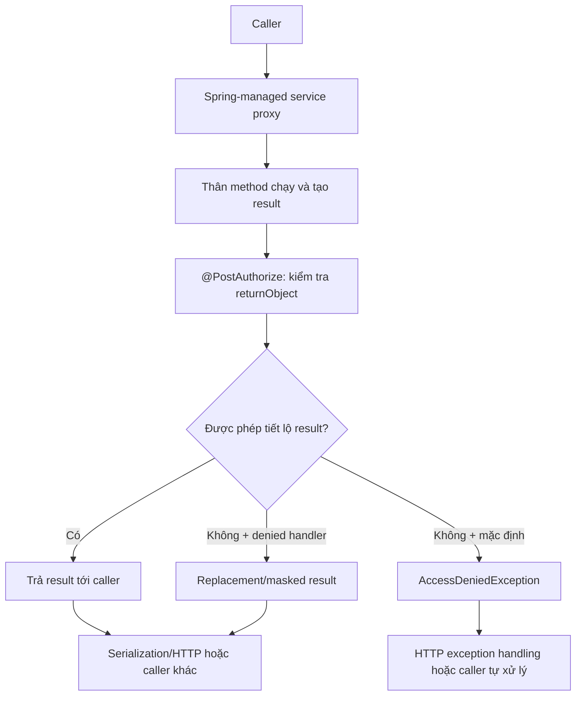

# Che dữ liệu khi bị từ chối và giới hạn không tiết lộ thông tin

## Mục tiêu bài học

Khi người gọi không có quyền đọc một tài liệu, thông tin khách hàng hoặc trường dữ liệu nhạy cảm, ứng dụng phải quyết định **từ chối toàn bộ** hay **trả về một phiên bản đã được che**. Trong Spring Security, `@PostAuthorize` có thể kiểm tra giá trị được service trả về **sau khi thân method chạy**. Mặc định, nếu hậu kiểm thất bại, Spring Security từ chối đưa kết quả đó tới caller bằng ngoại lệ phân quyền. Với các phiên bản hỗ trợ `@HandleAuthorizationDenied`, ứng dụng còn có thể trả **giá trị thay thế hoặc đã che** theo chính sách.

Tuy nhiên, “người dùng không nhìn thấy trường `secret` trong HTTP JSON” **không đồng nghĩa** “dữ liệu chưa từng bị truy vấn, xử lý, ghi log, cache, gửi email hoặc chuyển tới hệ thống khác”. Bài này đặt việc che dữ liệu vào đúng bối cảnh **Kiểm tra sau phương thức** của **Spring Security authorization**, đồng thời giải thích giới hạn không tiết lộ thông tin.

Bạn sẽ học cách:

1. Phân biệt **DENY toàn bộ**, **ẩn sự tồn tại tài nguyên**, **lọc tập kết quả** và **che trường dữ liệu**.
2. Hiểu cơ chế `@PostAuthorize`/`returnObject` và khác biệt với `@PreAuthorize`.
3. Dùng `@HandleAuthorizationDenied` cùng `MethodAuthorizationDeniedHandler` cho các fallback/masked results khi được phép về nghiệp vụ.
4. Nhận biết `@AuthorizeReturnObject` khi bảo vệ getter của đối tượng được trả về, cùng rủi ro proxy/serialization.
5. Chọn `@PostFilter`, DTO/projection và truy vấn có giới hạn tenant/owner đúng mục đích.
6. Thiết kế phản hồi 401/403/404/200 có che dữ liệu mà không vô tình lộ sự tồn tại, ID, metadata hoặc nội dung từ kênh phụ.
7. Test **trực tiếp service bean** lẫn HTTP response để xác minh cả kết quả được che và giới hạn của hậu kiểm.

**Phạm vi:** Java 17+, Spring Security Servlet Method Security 6.x/7.x. `@HandleAuthorizationDenied` và `MethodAuthorizationDeniedHandler` có từ Spring Security **6.3**; hãy dùng BOM và Javadoc đúng phiên bản triển khai. Các đoạn Spring cần dependencies/context. Ví dụ Java 17 ở phần 13 chạy độc lập và chỉ mô phỏng nguyên tắc.

## 1. Tình huống: đã truy vấn dữ liệu nhưng không được tiết lộ

Giả sử service trả một báo cáo:

```java
public record ReportView(
    long id,
    String tenantId,
    String ownerUsername,
    String title,
    String confidentialNote
) {}
```

Yêu cầu sản phẩm:

- User có `report:read` và được phân quyền trên đúng tenant/owner: đọc báo cáo.
- User có thể xem tiêu đề công khai nhưng **không** có quyền `report:note:read`: trường ghi chú phải bị che.
- User không được biết báo cáo thuộc tenant khác có tồn tại hay không: không được tiết lộ metadata.
- Không phát sinh email, file export hoặc audit log chứa `confidentialNote` khi quyền bị từ chối.

Một thiết kế sơ sài trả tất cả dữ liệu rồi để client ẩn trường:

```javascript
// SAI: dữ liệu đã tới browser dù UI chỉ hiển thị title.
const response = await fetch("/api/reports/42").then(r => r.json());
document.querySelector("#title").textContent = response.title;
// Không render response.confidentialNote không làm nó bí mật.
```

Người gọi vẫn có thể đọc JSON trong Network tab, browser storage hoặc từ mã JavaScript. **Che dữ liệu phải diễn ra trước khi dữ liệu rời trust boundary của server**, không chỉ ở giao diện.

Nhưng che ở Controller serialization cũng chưa đủ nếu service đã gửi raw note sang cache dùng chung, logs hoặc một external provider. Vì vậy cần phân biệt **nơi quyết định quyền**, **nơi tạo bản dữ liệu được phép trả** và **nơi xuất dữ liệu ra ngoài**.

## 2. Bốn kiểu kết quả khi người dùng thiếu quyền

Không có một cách xử lý đúng cho mọi tài nguyên. Hãy quyết định theo yêu cầu bảo mật:

| Chiến lược | Kết quả cho caller | Khi nào phù hợp | Rủi ro cần kiểm tra |
| --- | --- | --- | --- |
| **DENY toàn bộ** | Ném `AccessDeniedException`; HTTP thường 403 với user đã xác thực | Không được xem nội dung đối tượng | Status/message có thể tiết lộ resource tồn tại |
| **Ẩn sự tồn tại** | 404 hoặc response đồng nhất cho “không tồn tại/ngoài scope” | Multi-tenant, IDOR, dữ liệu bí mật về sự tồn tại | 404 đơn thuần không giải quyết timing/cache/error differences |
| **Che một trường** | Trả DTO với `email=null` hoặc `"[REDACTED]"` | Có quyền xem hồ sơ chung nhưng không xem email | Key, null, độ dài, domain có thể vẫn lộ thông tin |
| **Lọc danh sách** | Chỉ trả các record trong scope | List/search/export có nhiều record | Lọc sau khi đọc tất cả làm tốn tài nguyên, sai pagination/count |
| **Giá trị thay thế mặc định** | String cố định, empty result hoặc response giới hạn | Một method chỉ trả giá trị tùy chọn, được phép ẩn | Caller có thể tưởng tác vụ thành công; phải xác định contract |

**Không đồng nhất “mask” với “deny”.** Nếu client cần biết thao tác bị từ chối, trả 403 thích hợp hơn trả dữ liệu giả. Nếu được phép biết user profile tồn tại nhưng không được biết email, che trường có thể phù hợp. Với dữ liệu nhạy cảm về sự tồn tại, trả một object có `email="[REDACTED]"` có thể đã tiết lộ quá nhiều.

### Ví dụ API contract theo trường

```json
{
  "displayName": "Alice",
  "email": "[REDACTED]"
}
```

Kết quả trên thể hiện rằng hồ sơ **được phép xem** nhưng email không. Nó **không** phải hợp đồng dành cho người dùng bị cấm biết hồ sơ đó tồn tại. Trong trường hợp sau, cần xử lý ở query scope và lỗi “không tìm thấy/không được biết” theo chính sách.

## 3. @PostAuthorize kiểm tra điều gì và khi nào?

Với Method Security bật trên Spring-managed bean, `@PostAuthorize` được xử lý bởi after-method authorization interceptor. Luồng điển hình:



Ví dụ:

```java
import org.springframework.security.access.prepost.PostAuthorize;
import org.springframework.stereotype.Service;

@Service
public class ReportService {

    private final ReportRepository reports;

    public ReportService(ReportRepository reports) {
        this.reports = reports;
    }

    @PostAuthorize(
        "returnObject != null and " +
        "returnObject.ownerUsername().equals(authentication.name)"
    )
    public ReportView load(long id) {
        return reports.findViewById(id).orElse(null);
    }
}
```

**Đây là snippet tích hợp:** `ReportRepository` là interface do dự án định nghĩa. `ReportView` ở phần 1 là record. Với owner phù hợp, method trả result; với owner khác, kết quả bị từ chối. Vì biểu thức trên không cho `null` qua, trường hợp không có result cũng bị deny, nên **không tự đạt mục tiêu 404 khi không có tài nguyên**. Một hợp đồng rõ ràng thường phân biệt `NotFound` và `Forbidden` ở service/API.

### Các giới hạn bắt buộc phải nhớ

1. **Thân method đã chạy.** Repository có thể đã đọc raw data, tạo object, cache hoặc log.
2. **Default DENY ngăn result được trả qua proxy**, nhưng không tự xóa bản sao trong memory/log/cache.
3. Khi không có HTTP request, `AccessDeniedException` **không tự biến thành 403**; caller xử lý.
4. `@PostAuthorize` phù hợp hơn với **read/result checks**; không dùng làm hàng rào duy nhất cho method ghi, chuyển tiền, phát message.
5. Dữ liệu đi ra từ một method **không được gọi qua Spring AOP proxy** có thể không qua hậu kiểm.
6. Một object khác trong service đã được gửi ra ngoài trước khi method return không bị `@PostAuthorize` “thu hồi”.

### Bật method security

```java
import org.springframework.context.annotation.Configuration;
import org.springframework.security.config.annotation.method.configuration.EnableMethodSecurity;

@Configuration
@EnableMethodSecurity
public class MethodSecurityConfig {}
```

Spring Boot Starter Security không tự bật method security. `@EnableMethodSecurity` kích hoạt các pre/post interceptors mặc định. Với bean được tạo bằng `new` hoặc self-invocation `this.load(...)`, interception có thể bị bỏ qua; cần gọi qua bean proxy thật và test.

## 4. Kết hợp @PreAuthorize và @PostAuthorize theo đúng mục đích

`@PreAuthorize` bảo vệ **quyền gọi thao tác** trước body; `@PostAuthorize` bảo vệ **kết quả được trả** sau body.

```java
@PreAuthorize("hasAuthority('report:read')")
@PostAuthorize(
    "returnObject != null and " +
    "returnObject.ownerUsername().equals(authentication.name)"
)
public ReportView load(long id) {
    return reports.findViewById(id).orElse(null);
}
```

Ý nghĩa:

- Không có `report:read` → body **không chạy** nhờ pre-check.
- Có `report:read` nhưng không phải owner → body đã chạy, post-check **DENY**.
- Có quyền chung và đúng owner → qua cả hai kiểm tra.
- Return `null` → biểu thức này DENY, không đại diện đúng 404; quyết định how-to-handle not found phải được định nghĩa riêng.

**Đây không phải OR.** Hai loại annotation được thực thi bằng các advisors độc lập, nên invocation phải vượt tất cả các kiểm tra đang áp dụng. Không lặp hai `@PostAuthorize` rồi hy vọng chúng tự cộng thành một biểu thức; cần hợp nhất chính sách hoặc policy bean.

### Tại sao object policy không nên chỉ nằm ở hậu kiểm?

Giả sử client thử 100.000 ID khác nhau; mỗi lần `load(id)` query DB rồi `@PostAuthorize` mới kiểm tra owner. Dù raw data không được trả, hệ thống có thể:

- Tốn I/O nhiều và tạo load lớn.
- Có khác biệt thời gian phản hồi giữa ID tồn tại và không tồn tại.
- Phát audit/cache events chứa thông tin dữ liệu đã truy vấn.
- Tiết lộ có/không thông qua error status nếu xử lý null khác object.

Đối với **multi-tenant data**, ưu tiên query đã giới hạn tenant/owner **trước khi materialize result**, ví dụ `findByIdAndTenant(...)`. Dùng post-check như lớp bổ sung, không phải lý do để bỏ scoped query.

## 5. @HandleAuthorizationDenied: che hoặc thay kết quả khi DENY

Từ **Spring Security 6.3**, `@HandleAuthorizationDenied` cho phép chỉ định một `MethodAuthorizationDeniedHandler` xử lý denial của `@PreAuthorize` hoặc `@PostAuthorize`, và các denial exceptions liên quan được hỗ trợ. Thay vì luôn ném `AuthorizationDeniedException`/`AccessDeniedException`, handler có thể **trả giá trị thay thế**.

### Handler cố định che hoàn toàn giá trị

Một cách dễ kiểm soát thông tin lộ là **không dựa vào nội dung raw result**:

```java
import org.aopalliance.intercept.MethodInvocation;
import org.springframework.security.authorization.AuthorizationResult;
import org.springframework.security.authorization.method.MethodAuthorizationDeniedHandler;

public class FixedRedactionHandler
        implements MethodAuthorizationDeniedHandler {

    @Override
    public Object handleDeniedInvocation(
            MethodInvocation invocation,
            AuthorizationResult decision) {
        return "[REDACTED]";
    }
}
```

Đoạn này là **mã Spring**, cần `spring-security-core`/AOP dependencies theo BOM. `handleDeniedInvocation` được dùng khi cần xử lý denied invocation bằng một replacement result; mặc định, `handleDeniedInvocationResult` (với `@PostAuthorize`) có thể ủy nhiệm lại phương thức này nếu handler không override.

Đăng ký handler như Spring bean và bật method security:

```java
import org.springframework.context.annotation.Bean;
import org.springframework.context.annotation.Configuration;
import org.springframework.security.config.annotation.method.configuration.EnableMethodSecurity;

@Configuration
@EnableMethodSecurity
public class SecurityConfig {

    @Bean
    FixedRedactionHandler fixedRedactionHandler() {
        return new FixedRedactionHandler();
    }
}
```

Sử dụng trên method trả `String`:

```java
import org.springframework.security.access.prepost.PostAuthorize;
import org.springframework.security.authorization.method.HandleAuthorizationDenied;
import org.springframework.stereotype.Service;

@Service
public class ContactService {

    @PostAuthorize("hasAuthority('contact:email:read')")
    @HandleAuthorizationDenied(
        handlerClass = FixedRedactionHandler.class
    )
    public String getEmail() {
        return "alice@example.test";
    }
}
```

Nếu caller đủ `contact:email:read` → trả email thật; nếu không đủ → trả `"[REDACTED]"` theo handler, **thay vì exception mặc định**. Không dùng mẫu này cho một tài nguyên mà caller **không được biết là tồn tại**: chính chuỗi `"[REDACTED]"` có thể xác nhận sự tồn tại.

**Quan trọng về contract:** handler trả một object phải **tương thích với return type** của method. Trả một `String` cho method khai `long`/`List<Report>` là sai. Trả `null` cho return type nguyên thủy có thể gây lỗi. Hãy thiết kế fallback dành riêng từng kiểu dữ liệu và test serialization.

### Handler cho @PreAuthorize và @PostAuthorize không có cùng thời điểm

```java
@PreAuthorize("hasAuthority('contact:email:read')")
@HandleAuthorizationDenied(
    handlerClass = FixedRedactionHandler.class
)
public String getEmail() {
    return readEmailFromDatabase();
}
```

Trong trường hợp DENY **ở pre-check**, body `readEmailFromDatabase()` **không chạy**, handler trả chuỗi thay thế.

```java
@PostAuthorize("hasAuthority('contact:email:read')")
@HandleAuthorizationDenied(
    handlerClass = FixedRedactionHandler.class
)
public String getEmail() {
    return readEmailFromDatabase();
}
```

Trong trường hợp DENY **ở post-check**, body **đã đọc email**, rồi handler thay result. Đối với một trường cần trả masked theo kết quả raw, post-check có thể có lý do, nhưng đây **không phải “không truy cập dữ liệu”**.

## 6. Che có điều kiện theo kết quả đã bị từ chối

`MethodAuthorizationDeniedHandler` có method `handleDeniedInvocationResult(MethodInvocationResult, AuthorizationResult)` để tiếp cận **kết quả đã được method tạo ra** khi `@PostAuthorize` DENY. Điều này cho phép mask một phần, ví dụ email:

```java
import org.aopalliance.intercept.MethodInvocation;
import org.springframework.security.authorization.AuthorizationResult;
import org.springframework.security.authorization.method.MethodAuthorizationDeniedHandler;
import org.springframework.security.authorization.method.MethodInvocationResult;

public class EmailMaskHandler implements MethodAuthorizationDeniedHandler {

    @Override
    public Object handleDeniedInvocation(
            MethodInvocation invocation,
            AuthorizationResult decision) {
        return "[REDACTED]";
    }

    @Override
    public Object handleDeniedInvocationResult(
            MethodInvocationResult result,
            AuthorizationResult decision) {
        Object raw = result.getResult();

        if (!(raw instanceof String email)) {
            return "[REDACTED]";
        }

        int at = email.indexOf('@');
        if (at < 1) {
            return "[REDACTED]";
        }

        return email.substring(0, 1) + "***"
            + email.substring(at);
    }
}
```

Đăng ký bean `EmailMaskHandler` rồi đặt:

```java
@PostAuthorize("hasAuthority('contact:email:read')")
@HandleAuthorizationDenied(handlerClass = EmailMaskHandler.class)
public String getEmail() {
    return "alice@example.test";
}
```

Khi DENY, handler minh họa trả `"a***@example.test"`. **Đây chỉ là che một phần, không phải ẩn hoàn toàn email.** Nó vẫn tiết lộ chữ cái đầu, domain, dạng email và sự tồn tại. Nếu policy không cho phép lộ domain, dùng `"[REDACTED]"` cố định hoặc `null`/bỏ field theo contract.

### Rủi ro của result-aware mask

- Handler có **quyền truy cập raw result** trong memory; đừng log `raw` hay exception kèm raw.
- Không phản hồi nguyên bản khi định dạng bất thường; lựa chọn fallback **fail closed**.
- Email mask có thể tiết lộ domain riêng, độ dài tài khoản, dấu câu; phải có policy riêng.
- Một regex mask đơn giản không giải quyết Unicode/IDN, email alias, dữ liệu không đúng chuẩn.
- Nếu method trả object có nested secret, trả object cũ rồi chỉ sửa field bằng setter có thể khiến raw reference còn nằm ở cache hoặc caller khác. Dùng DTO/projection mới và kiểm tra **mọi nested field**.
- Handler có thể chạy do `@PreAuthorize` bị DENY; khi đó không có raw result để mask. `handleDeniedInvocation` phải trả fallback an toàn **không đọc dữ liệu trái quyền**.
- Một custom handler trả fallback có thể làm API trả HTTP 200 thay vì 403. Đây phải là **quyết định contract có chủ đích**, không tự coi mọi denial là “thành công”.

## 7. @AuthorizeReturnObject: bảo vệ getter của kết quả

Spring Security hỗ trợ bảo vệ các methods trên **return objects** thông qua `@AuthorizeReturnObject`. Trường hợp hữu ích: hồ sơ chung được xem nhưng getter của trường nhạy cảm chỉ trả dữ liệu nếu quyền tương ứng.

Ví dụ cấu trúc:

```java
public class Contact {

    private final String displayName;
    private final String email;

    public Contact(String displayName, String email) {
        this.displayName = displayName;
        this.email = email;
    }

    public String getDisplayName() {
        return displayName;
    }

    @PreAuthorize("hasAuthority('contact:email:read')")
    @HandleAuthorizationDenied(
        handlerClass = NullEmailHandler.class
    )
    public String getEmail() {
        return email;
    }
}
```

`NullEmailHandler` là implementation tương tự `FixedRedactionHandler` nhưng trả `null`; nó phải là bean trong context. Khi một repository/service method được chú thích `@AuthorizeReturnObject` và trả `Contact`, Spring Security có thể **proxy kết quả** để các phương thức như `getEmail()` được method security kiểm soát.

```java
@AuthorizeReturnObject
public Contact findContact(long id) {
    return contactRepository.findById(id).orElseThrow();
}
```

**Đây là các đoạn minh họa tích hợp, không phải project độc lập.** Phải dùng Spring-managed intercepted method, các types phù hợp và kiểm thử proxying, serialization/AOT của version thực tế.

### Khi dùng return-object proxy, cần cảnh giác

1. **Không phải mọi object đều proxy được theo cách bạn dự đoán** (final/value types, records, generic erasure, proxy strategy).
2. Đặt `@AuthorizeReturnObject` ở class level có thể khiến Spring thử proxy các kiểu giá trị như `String`/`Integer` nếu không có cấu hình skip phù hợp; đọc tài liệu API về `TargetVisitor`.
3. Với JSON serialization, hãy **test response JSON thật**, vì serializer có thể truy cập field/getter theo cơ chế khác nhau. Không suy rằng tất cả các serializers đều đi qua getter proxy.
4. Getter có thể bị gọi nhiều lần, hoặc ngoài SecurityContext; không coi proxy là một sanitizer độc lập với context.
5. Object raw vẫn có mặt trong memory; lưu vào shared cache/log trước khi proxying có thể làm lộ dữ liệu.
6. Khi dùng Spring AOT/native image, cần runtime hints/proxy generation phù hợp, nhất là khi generic types che mất lớp kết quả.

**Khuyến nghị thực tế:** khi dữ liệu thật sự nhạy cảm, một **DTO được xây dựng từ các field đã được policy cho phép** thường dễ audit hơn việc dựa hoàn toàn vào lazy proxy của entity trả ra JSON.

## 8. @PostFilter: lọc kết quả chứ không che trường

`@PostFilter` áp biểu thức cho từng phần tử của collection/stream/map/array được framework hỗ trợ, sử dụng biến `filterObject` để giữ/lược bỏ các phần tử sau khi service tạo kết quả.

Ví dụ chỉ trả những báo cáo thuộc owner hiện tại:

```java
import java.util.ArrayList;
import java.util.List;
import org.springframework.security.access.prepost.PostFilter;

@PostFilter("filterObject.ownerUsername().equals(authentication.name)")
public List<ReportView> listReports() {
    return new ArrayList<>(reports.findAllViews());
}
```

Ví dụ cần `ReportView`, `ReportRepository` và Spring method security context. Dùng list mutable trong demo để tránh giả định mọi immutable `List.of(...)` đều có thể lọc bằng cùng cách. `@PostFilter` giúp **loại những ReportView không hợp lệ khỏi result trả về** nhưng:

- Method đã **đọc tất cả** records.
- Nếu dữ liệu quá lớn, có thể gây N+1, tốn memory và CPU.
- Pagination/count có thể sai: query lấy 20 records rồi filter còn 3, không đại diện trang 20 records hợp lệ.
- Nếu service đã log/cache/emit raw list trước khi return, post-filter không thu hồi.
- `@PostFilter` lọc **phần tử**, không tự làm `confidentialNote` thành `"[REDACTED]"`.

### Ưu tiên query scoping

Thay vì `findAllViews()`, nên có query chỉ lấy những record caller được phép:

```java
public List<ReportSummary> listForCurrentUser(
        String trustedTenant, String trustedUsername) {
    return reports.findSummariesByTenantAndOwner(
        trustedTenant, trustedUsername);
}
```

`trustedTenant` và `trustedUsername` phải được lấy từ identity/tenant membership đã xác minh, không phải client tự khai rồi được tin vô điều kiện. DTO `ReportSummary` nên chỉ chứa field được phép hiển thị. Query scoping giúp bảo vệ data **trước khi nó được materialize trong Java**, đồng thời hỗ trợ pagination/search/count chính xác.

`@PostFilter` vẫn có thể là lớp bổ sung cho tập dữ liệu nhỏ trong memory hoặc logic policy khó biểu diễn ở query, nhưng **không phải mặc định hiệu quả** cho dữ liệu đa tenant lớn.

## 9. DTO/projection là lớp che dữ liệu dễ kiểm soát

Đừng trả nguyên JPA entity chứa hash, token, notes hoặc thuộc tính chỉ nội bộ khi API chỉ cần vài field.

Một thiết kế rõ ràng:

```java
public record PublicContactDto(
    String displayName,
    String email
) {}

public PublicContactDto toDto(
        ContactEntity source,
        boolean mayReadEmail) {
    String email = mayReadEmail
        ? source.getEmail()
        : null;
    return new PublicContactDto(
        source.getDisplayName(),
        email
    );
}
```

**Đây là snippet Java DTO**, `ContactEntity` phải được project định nghĩa. Quan trọng:

- `mayReadEmail` **phải được tính từ server-side authorization policy**, không tin boolean do client gửi.
- Nếu không được phép thấy email, có thể trả `null` hoặc bỏ hẳn field; JSON serializer/config quyết định một field `null` có xuất hiện hay không.
- Không copy toàn bộ entity vào DTO rồi chỉ ẩn ở UI.
- Nếu việc **lấy email** từ DB đã là hành động không được phép theo threat model, hãy query **projection chỉ gồm các field được phép** ngay từ repository thay vì materialize raw entity rồi che.
- Với nested objects, kiểm tra transitive serialization; secret có thể xuất hiện trong child object, metadata, `toString()`, logs hoặc exception.

### @JsonIgnore, @JsonView và serializer filters

Các công cụ Jackson như `@JsonIgnore` hoặc `@JsonView` có thể kiểm soát **hình dạng JSON**, nhưng chúng **không phải cơ chế phân quyền thay thế** cho Spring Security. Một field bị loại ở REST serializer vẫn có thể bị lộ qua GraphQL, logs, method khác, file export hoặc một serializer khác.

Khi cần field-level security, kết hợp policy ở service/query và DTO mỏng; thêm tests cho **mọi adapter được phép xuất dữ liệu**. Một attribute được che trong response không được để lộ qua error detail, HTTP header hoặc cache.

### Không tạo response dựa trên raw result khi bị từ chối toàn bộ

Nếu policy quy định không được biết một bản ghi tồn tại, **không** trả `PublicContactDto(displayName, null)`. Việc tiết lộ `displayName` và cả “có một record” đã vi phạm. Hãy dùng scoped lookup và response phù hợp với chính sách non-disclosure.

## 10. 401, 403, 404 hay 200 có dữ liệu che?

Chọn status theo **business/security contract**, không phải “cứ DENY thì 403” hoặc “cứ muốn ẩn thì 404”.

| Tình huống | Cách thường dùng | Điều cần kiểm tra |
| --- | --- | --- |
| Chưa xác thực | 401/WWW-Authenticate hoặc redirect login tùy mechanism | Không lộ thông tin tài nguyên trước authentication |
| Đã xác thực nhưng thiếu quyền trên endpoint | 403 | Message không kể ID tồn tại, không chứa owner/tenant/secret |
| Không được biết tài nguyên tồn tại | 404 đồng nhất với absent trong scope | Timing/body/header/cache behavior không cho phép enumeration dễ dàng |
| Có quyền xem hồ sơ, thiếu quyền email | 200 với `email=null`/mask nếu policy cho phép | Mask không lộ thêm domain, độ dài, field keys ngoài intent |
| List có nhiều records ngoài scope | 200 chỉ với records được phép | Count/pagination và sort không dựa trên raw all-tenant data |
| Policy service không hoạt động | 5xx có kiểm soát hoặc error nội bộ phù hợp | **Fail closed**: không tự trả raw data |

**Kết quả cụ thể không cố định bởi `@PostAuthorize` một mình.** Mặc định denial gây exception; Spring Security filter/exception handler trong HTTP context thường chuyển thành 403 với fully authenticated user, nhưng anonymous có thể nhận 401/redirect. Với `@HandleAuthorizationDenied` trả replacement result, caller có thể nhận 200. Với custom advice/error mapping, status có thể khác.

### Che sự tồn tại: scoped lookup tốt hơn map 403 → 404 bừa bãi

Giả sử user tenant A truy vấn `/api/reports/42` trong tenant B. Một phương pháp:

```java
public ReportSummary loadForTenant(
        long id, String trustedTenant) {
    return reports.findSummaryByIdAndTenantId(id, trustedTenant)
        .orElseThrow(ReportNotFoundException::new);
}
```

`trustedTenant` cần được xác định từ principal đã xác thực và membership phù hợp. Với scoped query, cả ID không tồn tại và ID ngoài scope trả cùng một class lỗi `ReportNotFoundException` theo contract. Không cần load raw report của tenant khác trước.

**Đừng chuyển mọi `AccessDeniedException` thành 404 toàn cục**: có các denial thật ở quyền chức năng, CSRF hoặc các endpoints khác mà 403 mới đúng; một mapper toàn cục có thể che bug và làm logging/audit sai. Chỉ áp chiến lược “conceal existence” cho tài nguyên và threat model đã xác định.

### Không lộ thông tin qua lỗi

Tránh response:

```json
{
  "error": "access_denied",
  "message": "Report 42 belongs to tenant NORTH-WEST",
  "ownerEmail": "alice@example.test"
}
```

Một response ngắn, thống nhất, có correlation ID không tiết lộ owner/tenant sẽ tốt hơn. Backend vẫn có thể ghi sự kiện an ninh ở kênh audit **được phân quyền**, với dữ liệu tối thiểu và retention chính sách.

## 11. Những kênh tiết lộ ngoài return value

Một hậu kiểm DENY **chỉ ngăn dữ liệu được trả qua đúng proxy invocation** (hoặc thay thế nó bằng fallback). Nó không bảo đảm không có dữ liệu ở những kênh sau:

| Kênh | Ví dụ nguy cơ | Biện pháp |
| --- | --- | --- |
| Application log | `log.info("Loaded {}", entity)` gọi `toString()` chứa PII | Không log entity/DTO raw; redaction và logger policy |
| Error detail/stacktrace | Exception chứa secret, tenant/owner, SQL parameters | Lỗi public chung, log nội bộ giảm tối đa PII |
| Shared cache | Cache key không gồm tenant hoặc cache raw object trước kiểm tra | Tenant-aware keys, cache scope, protect cache value |
| Metrics/tracing | URL label chứa report ID/email; span attribute chứa payload | Low-cardinality labels, mask sensitive attributes |
| Email/SMS/webhook | Gửi secret bên trong method trước khi bị `@PostAuthorize` từ chối | Không đặt external side effect trong read hậu kiểm |
| File export | CSV/PDF chứa raw columns rồi response mới DENY | Query/projection + check trước khi generate/export |
| Pagination/count | Trả total count toàn tenant dù list đã lọc | Count/filter theo cùng authorized scope |
| HTTP headers | `ETag`/`Content-Length`/`Last-Modified` phản ánh raw resource | Chỉ dùng metadata phù hợp với authorized representation |
| Timing | Existing ID query chậm hơn absent ID | Query scoping, rate limiting, consistent error path |
| Exception status | 403 cho ID tồn tại, 404 cho ID không tồn tại | Threat model tồn tại, scoped lookup/concealment |
| Nested DTO | Parent che trường nhưng child vẫn giữ secret | Test toàn bộ JSON tree, recursive DTO mapping |
| Alternate endpoint | REST ẩn nhưng GraphQL/export trả raw | Một policy chung trong service và các adapters |

**Không hứa “constant-time” cho mọi database lookup**: điều này thường không thực tế. Thay vào đó dùng query scope, thống nhất error policy, rate limiting, audit, không tiết lộ dữ liệu trong responses/headers, và đánh giá nguy cơ enumeration theo hệ thống.

### Cache-Control khi dữ liệu cá nhân có thể xuất hiện

Một response chứa PII không nên bị shared proxy cache vô tình phát cho user khác. Kiểm tra `Cache-Control`, `Vary`/authentication-aware caching và các cache keys. Khi có response “masked” cho user A nhưng raw cho user B, **không** được dùng cùng public cache entry mà không phân biệt quyền; tốt nhất tránh shared caching cho personal data nhạy cảm.

## 12. Phối hợp method security và dữ liệu đa tenant

Ở ứng dụng multi-tenant, chính sách thường có ba mức:

1. **Functional permission:** `hasAuthority("report:read")`.
2. **Tenant/owner visibility:** report được phép truy vấn trong tenant của principal.
3. **Field permission:** được xem `confidentialNote` hay chỉ tiêu đề/metadata?

Ví dụ cấu trúc application service:

```java
@PreAuthorize("hasAuthority('report:read')")
public ReportResponse load(
        long id, Authentication authentication) {

    String trustedTenant = tenantResolver.resolve(authentication);
    ReportSummary summary = reports
        .findVisibleSummaryByIdAndTenant(id, trustedTenant)
        .orElseThrow(ReportNotFoundException::new);

    boolean maySeeNote = reportPolicy.canReadConfidentialNote(
        authentication, id
    );

    String safeNote = maySeeNote
        ? reports.findNoteForVisibleReport(id, trustedTenant)
        : null;

    return new ReportResponse(
        summary.id(), summary.title(), safeNote
    );
}
```

**Snippet tích hợp, không độc lập**: `TenantResolver`, repository methods, `ReportResponse`, `ReportPolicy` phải được project hiện thực. `Authentication` thường nên lấy từ trusted security context hoặc đưa vào internal service từ adapter đã xác thực, không tạo từ input client. Nếu người dùng được chọn tenant thì phải xác minh membership; không tin raw `tenantId`.

Ý nghĩa thiết kế:

- Query summary **chỉ trong scope**, không đọc raw note nếu không cần.
- Field permission được kiểm tra **trước** khi query note.
- DTO không giữ hidden raw note khi DENY.
- Nếu cần `@PostAuthorize`/`@HandleAuthorizationDenied` vì một module có return-object policy, nó là **lớp phụ trợ**, không thay thế scoped queries.

### Tránh TOCTOU và cross-tenant caching

Một policy maySeeNote được kiểm tra theo phiên bản report, nhưng ACL có thể đổi trước lần read note. Với dữ liệu cực nhạy cảm, có thể cần query có điều kiện ACL/tenant tại cùng truy vấn, transaction isolation hoặc recheck theo version. Cache key phải phản ánh tenant/identity/permission context hoặc chỉ cache dữ liệu công khai.

## 13. Java 17 độc lập: hậu kiểm, che result và scoped lookup

Ví dụ này không dùng Spring. Nó mô phỏng ba hướng:

- **Post-check:** service đã tải raw record, rồi quyết định DENY.
- **Mask:** đã tải raw record nhưng chỉ trả chuỗi thay thế.
- **Scoped lookup:** chỉ materialize record khi ID và owner đều khớp; đối tượng ngoài scope được xử lý giống absent.

Chương trình in số lần raw record được đưa vào mô phỏng service, **không phải số SQL queries**. Lưu file đúng tên **`PostAuthorizationDisclosureDemo.java`**:

```java
import java.util.Map;

public class PostAuthorizationDisclosureDemo {

    record Report(
        String id,
        String owner,
        String title,
        String secret
    ) {}

    static final Map<String, Report> STORE = Map.of(
        "42", new Report(
            "42", "alice", "Quarterly report", "internal-note"
        )
    );

    static int rawLoads;

    static Report loadUnscoped(String id) {
        Report report = STORE.get(id);
        if (report != null) {
            rawLoads++;
        }
        return report;
    }

    static String postCheck(String caller, String id) {
        Report report = loadUnscoped(id);
        if (report == null) {
            return "NOT_FOUND";
        }
        if (!report.owner().equals(caller)) {
            return "DENIED";
        }
        return report.secret();
    }

    static String maskPost(String caller, String id) {
        Report report = loadUnscoped(id);
        if (report == null) {
            return "NOT_FOUND";
        }
        return report.owner().equals(caller)
            ? report.secret()
            : "[REDACTED]";
    }

    static String scopedLookup(String caller, String id) {
        Report report = STORE.get(id);
        if (report == null || !report.owner().equals(caller)) {
            return "NOT_FOUND";
        }
        rawLoads++;
        return report.secret();
    }

    public static void main(String[] args) {
        rawLoads = 0;

        System.out.println(
            "post unauthorized: " + postCheck("bob", "42")
                + ", rawLoads=" + rawLoads
        );

        System.out.println(
            "mask unauthorized: " + maskPost("bob", "42")
                + ", rawLoads=" + rawLoads
        );

        System.out.println(
            "scoped unauthorized: "
                + scopedLookup("bob", "42")
                + ", rawLoads=" + rawLoads
        );

        System.out.println(
            "scoped owner: " + scopedLookup("alice", "42")
                + ", rawLoads=" + rawLoads
        );
    }
}
```

Biên dịch/chạy với **JDK 17 trở lên**:

```bash
javac PostAuthorizationDisclosureDemo.java
java PostAuthorizationDisclosureDemo
```

**Stdout chính xác:**

```text
post unauthorized: DENIED, rawLoads=1
mask unauthorized: [REDACTED], rawLoads=2
scoped unauthorized: NOT_FOUND, rawLoads=2
scoped owner: internal-note, rawLoads=3
```

Bài học:

- **Post-check** từ chối kết quả cho Bob nhưng raw object đã được tải vào service.
- **Mask** che chuỗi trả ra cho Bob nhưng raw object vẫn đã được tải.
- **Scoped lookup** trả NOT_FOUND và trong mô phỏng không đưa raw object ngoài scope tới business layer.
- Alice được phép nhìn thấy raw note trong ví dụ vì là owner.

**Giới hạn:** Map lookup là mô hình; một database query vẫn có thể đọc index/page, truy vấn ID trong scope cũng phải được tối ưu. Chương trình không mô phỏng Spring AOP, `@PostAuthorize`, JDBC, logs hay side-channel timing. Không dùng `caller` String từ client làm bằng chứng identity production: lấy principal đã xác thực và tenant/ACL thật.

## 14. Spring JUnit: test hậu kiểm và handler che dữ liệu

Để kiểm chứng framework, cần **Spring-managed bean thật**, `@EnableMethodSecurity`, `@WithMockUser`, direct method invocation và kiểm tra giá trị thực sự trả ra. Test còn phải chứng minh body **đã chạy** trước `@PostAuthorize` DENY.

Ví dụ JUnit 5 sau dùng Spring Security 6.3+; cần `spring-test`, `spring-security-test`, `spring-security-config`, Spring AOP và JUnit Jupiter phiên bản tương thích.

```java
import org.aopalliance.intercept.MethodInvocation;
import org.junit.jupiter.api.BeforeEach;
import org.junit.jupiter.api.Test;
import org.springframework.beans.factory.annotation.Autowired;
import org.springframework.context.annotation.Bean;
import org.springframework.context.annotation.Configuration;
import org.springframework.security.access.AccessDeniedException;
import org.springframework.security.access.prepost.PostAuthorize;
import org.springframework.security.access.prepost.PreAuthorize;
import org.springframework.security.authorization.AuthorizationResult;
import org.springframework.security.authorization.method.HandleAuthorizationDenied;
import org.springframework.security.authorization.method.MethodAuthorizationDeniedHandler;
import org.springframework.security.config.annotation.method.configuration.EnableMethodSecurity;
import org.springframework.security.test.context.support.WithMockUser;
import org.springframework.test.context.junit.jupiter.SpringJUnitConfig;

import static org.junit.jupiter.api.Assertions.assertEquals;
import static org.junit.jupiter.api.Assertions.assertThrows;

@SpringJUnitConfig(RedactionMethodTest.Config.class)
class RedactionMethodTest {

    @Autowired
    SensitiveService service;

    @Autowired
    Counter counter;

    @BeforeEach
    void reset() {
        counter.emailReads = 0;
        counter.summaryReads = 0;
    }

    @Test
    @WithMockUser(authorities = "contact:email:read")
    void authorizedGetsRealEmail() {
        assertEquals("alice@example.test", service.email());
        assertEquals(1, counter.emailReads);
    }

    @Test
    @WithMockUser(authorities = "contact:basic:read")
    void postDeniedReturnsFixedMaskButMethodRan() {
        assertEquals("[REDACTED]", service.email());
        assertEquals(1, counter.emailReads);
    }

    @Test
    @WithMockUser(authorities = "contact:email:read")
    void preDeniedReturnsFixedMaskWithoutRunningMethod() {
        assertEquals("[REDACTED]", service.summary());
        assertEquals(0, counter.summaryReads);
    }

    @Test
    @WithMockUser(username = "bob", authorities = "contact:basic:read")
    void ordinaryPostAuthorizationDeniesOtherOwner() {
        assertThrows(AccessDeniedException.class, service::ownerOnly);
    }

    @Configuration
    @EnableMethodSecurity
    static class Config {
        @Bean
        Counter counter() {
            return new Counter();
        }

        @Bean
        FixedMaskHandler fixedMaskHandler() {
            return new FixedMaskHandler();
        }

        @Bean
        SensitiveService sensitiveService(Counter counter) {
            return new SensitiveService(counter);
        }
    }

    public static class Counter {
        int emailReads;
        int summaryReads;
    }

    public static class FixedMaskHandler
            implements MethodAuthorizationDeniedHandler {

        @Override
        public Object handleDeniedInvocation(
                MethodInvocation invocation,
                AuthorizationResult decision) {
            return "[REDACTED]";
        }
    }

    public static class SensitiveService {

        private final Counter counter;

        public SensitiveService(Counter counter) {
            this.counter = counter;
        }

        @PostAuthorize("hasAuthority('contact:email:read')")
        @HandleAuthorizationDenied(
            handlerClass = FixedMaskHandler.class
        )
        public String email() {
            counter.emailReads++;
            return "alice@example.test";
        }

        @PreAuthorize("hasAuthority('contact:basic:read')")
        @HandleAuthorizationDenied(
            handlerClass = FixedMaskHandler.class
        )
        public String summary() {
            counter.summaryReads++;
            return "Private summary";
        }

        @PostAuthorize(
            "returnObject.owner().equals(authentication.name)"
        )
        public ContactView ownerOnly() {
            return new ContactView("alice");
        }
    }

    public record ContactView(String owner) {}
}
```

**Ý nghĩa các test:**

- Với authority đúng, `email()` trả raw email.
- Với authority thiếu, `@PostAuthorize` bị DENY nhưng handler trả `"[REDACTED]"`. `emailReads == 1` chứng minh **body đã chạy**, dù caller không nhận email thật.
- Với pre-authorization DENY trên `summary()`, handler trả mask **trước khi gọi body**; `summaryReads == 0`.
- `ownerOnly()` không có handler tùy biến: default denial ném `AccessDeniedException`, không trả một masked value.
- Test gọi bean thực qua proxy; không dùng `new SensitiveService(...)` trong test để kết luận security intercept hoạt động.

**Giới hạn:** Test này dùng data in-memory, không chứng minh JSON serialization, HTTP status, cache scope, DB query scoping hoặc không có logs chứa raw email. Phải có HTTP/integration tests bổ sung.

## 15. Kiểm tra kết quả che trên HTTP response và JSON

Trong Spring Boot MVC, có thể test lớp Controller trả DTO hoặc gọi `ContactService` qua proxy. Những assertions cần thiết:

1. User đủ quyền email: JSON có email thật **nếu policy cho phép**.
2. User chỉ có quyền basic: JSON không chứa email thật, có mask/null theo contract.
3. Anonymous hoặc user không được biết profile tồn tại: response không chứa `displayName`/ID/metadata nhạy cảm.
4. `AuthorizationDeniedException` mặc định dẫn tới response đã thống nhất; custom handler không vô tình làm lộ raw exception.
5. Response `Cache-Control`/cache behavior không phát masked response của Alice cho Bob hoặc raw response của Bob cho Alice.
6. Nested objects, arrays, pagination metadata, file downloads, GraphQL và export adapters không lộ thông tin.
7. Access logs, application traces và error responses không ghi raw note/email/token.

### Một kiểm thử response đơn giản

```java
// Snippet trong @SpringBootTest + @AutoConfigureMockMvc.
// Cần Controller/route và import test utilities phù hợp.
mockMvc.perform(get("/api/contacts/42")
        .with(user("viewer").authorities(
            new SimpleGrantedAuthority("contact:basic:read"))))
    .andExpect(status().isOk())
    .andExpect(jsonPath("$.email").value("[REDACTED]"));
```

**Đây chỉ là snippet tích hợp**, không đứng độc lập: phải có controller trả DTO, serialization config, Spring Security filter setup, imports `get/user/jsonPath/status` và authorization policy thật. Nếu contract bỏ field email hoàn toàn, assert `jsonPath("$.email").doesNotExist()` thay vì assert mask. Nếu policy yêu cầu không tiết lộ profile, test response 404 đồng nhất và không dùng test 200 như trên.

### Không xác nhận an toàn chỉ bằng HTTP 200

Một endpoint 200 với masked field có thể vẫn rò rỉ raw email trong response headers, JSON khác, logs hoặc trace. Với `@HandleAuthorizationDenied`, việc trả masked value là một **business contract**, không là bằng chứng tự động rằng toàn hệ thống bảo vệ tốt.

## 16. Phân quyền, logging và side effects của hậu kiểm

Vì `@PostAuthorize` đánh giá sau body, có thể có rủi ro nếu method thực hiện:

```java
@PostAuthorize(
    "returnObject.owner().equals(authentication.name)"
)
public ReportView load(long id) {
    ReportView report = reports.findViewById(id).orElseThrow();
    log.info("Loaded report: {}", report);
    return report;
}
```

**Đoạn này không an toàn để dùng làm mẫu production** nếu `ReportView.toString()` in `confidentialNote`. Khi user không phải owner, hậu kiểm DENY nhưng log đã chứa raw data. Cách sửa:

- Tránh log toàn bộ entity/DTO; log event ID, category, actor ID đã chuẩn hóa và correlation ID theo retention policy.
- Nếu policy yêu cầu không load raw data ngoài scope, dùng `findByIdAndTenant(...)`/scoped query trước.
- Đặt business side effects **sau** các kiểm tra trước method; không dựa vào post-check cho write/email/file export.
- Bảo vệ secret trong logs, tracing, audit và metrics; test rằng việc DENY không rò raw values.
- Cẩn thận `@Cacheable`: cache advice order, key scope và dữ liệu raw có thể tương tác với security advisors. Không chia sẻ cache entry của resource theo ID **mà không xét tenant/quyền**.

### Post-check trên thao tác ghi là anti-pattern

```java
// SAI: side effect có thể đã xảy ra trước authorization.
@PostAuthorize("hasAuthority('payment:execute')")
public void executePayment(PaymentRequest request) {
    gateway.charge(request);
}
```

Thay bằng `@PreAuthorize` hoặc một pre-invocation policy phù hợp, cộng domain validation, transaction/outbox/idempotency khi liên quan. Một 403 hậu kiểm không có khả năng thu hồi thanh toán từ provider.

## 17. Troubleshooting: vì sao che dữ liệu chưa hoạt động?

### Trường hợp A: @PostAuthorize không chạy

Kiểm tra:

- Có `@EnableMethodSecurity` chưa?
- Service có được Spring quản lý, caller đi qua Spring proxy không?
- Có self-invocation `this.method()`, private/final/static methods hoặc proxy strategy không hỗ trợ?
- Test có thay chính service bằng Mockito mock không?
- Annotation ở interface/class bị override hoặc có xung đột không?
- Request có bị HTTP filter/CSRF từ chối trước khi service được gọi không?

### Trường hợp B: handler không trả masked result

Kiểm tra:

- Spring Security version có hỗ trợ `@HandleAuthorizationDenied`/`MethodAuthorizationDeniedHandler` (từ 6.3) không?
- Handler class đã được đăng ký Spring bean và `handlerClass` đúng chưa?
- Method có return type tương thích replacement không?
- Caller thật sự đi qua `@PostAuthorize`/`@PreAuthorize` pointcut không?
- Denial xuất phát từ method interceptor liên quan hay từ HTTP filter, business exception khác?
- Test có đang kỳ vọng 403 trong khi handler được cấu hình trả mask → response 200 theo contract không?

### Trường hợp C: HTTP response đã che nhưng log vẫn lộ

Kiểm tra:

- Có `toString()`/JSON serializer/logging aspect in raw object?
- Cache có lưu raw entity dùng chung giữa tenants?
- Traces/metrics/exception messages có chứa PII?
- Thân method có gửi webhook/message trước khi hậu kiểm không?
- Có alternate adapter/route export raw không?
- Query có đọc vượt scope cần thiết không?

### Trường hợp D: list bị lọc sai

Kiểm tra:

- `@PostFilter` dùng đúng `filterObject` và collection type không?
- Dùng immutable list hoặc stream không phù hợp với filtering implementation?
- Repository đã phân trang trước khi post-filter nên page còn ít record/sai total?
- Owner/tenant policy có nhận trusted principal không?
- Có field-level information leak trong từng record còn lại không?

**Không sửa bằng `permitAll`, tắt method security hoặc trả raw result khi filter gặp lỗi.** Hãy sửa policy, handler, query hoặc serialization ở đúng lớp.

## 18. Ma trận kiểm thử hồi quy

| Test | Kỳ vọng |
| --- | --- |
| Caller đủ quyền, đúng owner/tenant | Trả dữ liệu được phép |
| Caller thiếu role, default `@PostAuthorize` | Ném `AccessDeniedException`, không trả raw |
| Caller thiếu quyền, có `@HandleAuthorizationDenied` | Trả mask/fallback đúng contract |
| `@PreAuthorize` DENY + handler | Body không chạy, không query raw nếu check không cần |
| `@PostAuthorize` DENY + handler | Body đã chạy; result được thay; xác minh không log/cache/emit raw |
| Field-level permission khác nhau | Field nhạy cảm mask, field công khai vẫn đúng |
| Không được biết resource tồn tại | 404/response đồng nhất, không metadata có ích cho enumeration |
| ID không tồn tại | Cùng contract với ID ngoài scope khi yêu cầu concealment |
| List nhiều tenants | Chỉ records trong scope, count/page chính xác |
| Query snapshot/ACL thay đổi | Không lộ ngoài scope; kiểm tra query scoping/transaction khi cần |
| Cache chung | Không lẫn masked và unmasked giữa users/tenants |
| Export/GraphQL/REST | Mọi adapter áp cùng policy, không raw data bypass |
| Nested serialization | Không có secret trong JSON tree/headers/stream |
| Error path | Không leak owner/tenant/PII qua message, stacktrace |
| HTTP 401/403/404/200 | Status theo contract, không do mask thay đổi bất ngờ |
| AOP proxy và self-invocation | Hậu kiểm thực chạy qua bean proxied |
| Java 17/Spring version upgrade | Cơ chế handler/test behavior ổn định theo BOM |

## 19. Checklist triển khai

- [ ] Xác định người gọi **được biết tài nguyên tồn tại hay không** trước khi chọn 403, 404 hoặc mask.
- [ ] Chỉ dùng `@PostAuthorize` khi kiểm tra result **sau thân method** là đúng rủi ro cho phép.
- [ ] Bật `@EnableMethodSecurity` và test lời gọi qua Spring-managed proxy.
- [ ] Kết hợp `@PreAuthorize` để chặn sớm quyền chức năng; đừng dựa vào hậu kiểm cho method ghi.
- [ ] Với Spring Security 6.3+, chọn `@HandleAuthorizationDenied` khi nghiệp vụ thật cần masked/fallback result.
- [ ] Handler có return type tương thích; fallback cố định khi cần ẩn hoàn toàn, không đọc raw trái quyền.
- [ ] Nếu mask một phần, review dữ liệu vẫn lộ: chữ đầu, domain, độ dài, cấu trúc và existence.
- [ ] Khi dùng `@AuthorizeReturnObject`, test proxying, getter interception, JSON serializer và AOT hints nếu cần.
- [ ] Không coi `@PostFilter` là phép tối ưu query; dùng tenant/owner-scoped queries.
- [ ] Trả DTO/projection chỉ chứa fields cần thiết, tránh raw JPA entity ra client.
- [ ] Test serialization JSON/GraphQL/export/files để xác nhận nested secrets không lọt.
- [ ] Error responses không có owner/email/tenant ID hay stacktrace nhạy cảm.
- [ ] Chính sách 404 concealment được áp đúng phạm vi, không map mọi AccessDeniedException thành 404.
- [ ] Cache keys/header policies phân biệt tenant/principal/quyền hoặc vô hiệu hóa shared cache nhạy cảm.
- [ ] Không đưa raw data vào logs, metrics, tracing hoặc external side effects trước post-check.
- [ ] Có direct service tests cho ALLOW, DENY, handler masking, body invocation timing.
- [ ] Có integration tests cho response status, content, count/pagination, cache và API adapters.
- [ ] Xem xét độ tin cậy/TOCTOU của ACL, query scoping, và dữ liệu giữa lúc kiểm tra với lúc trả.
- [ ] Dùng 401/403/404/200 theo contract đã thống nhất, không dựa vào mặc định ngẫu nhiên của handler.

### Tự kiểm tra

**Câu 1.** `@PostAuthorize` từ chối một báo cáo. Dữ liệu chắc chắn chưa từng được query từ DB?

**Đáp án:** **Không.** Thân method đã chạy và có thể đọc raw data. Hậu kiểm mặc định chỉ ngăn result được trả qua invocation khi DENY.

**Câu 2.** Khi nào `@HandleAuthorizationDenied` phù hợp hơn việc luôn trả 403?

**Đáp án:** Khi business contract cho phép xem một đối tượng/giá trị **ở dạng đã che**, chẳng hạn email null/mask trong profile được xem hợp lệ. Nếu caller không được biết tài nguyên tồn tại, có thể phải DENY/404 thay vì mask.

**Câu 3.** Vì sao trả `"a***@example.test"` vẫn có thể vi phạm yêu cầu bảo mật?

**Đáp án:** Vì lộ chữ đầu, domain và xác nhận có email; chính sách có thể yêu cầu ẩn toàn bộ hoặc không trả field.

**Câu 4.** `@PostFilter` cho List 10.000 records rồi trả 20 records có đảm bảo page/count chính xác không?

**Đáp án:** **Không.** Filtering xảy ra sau query/materialization. Muốn pagination đúng cần giới hạn owner/tenant tại query.

**Câu 5.** Test Method Security handler trả `"[REDACTED]"` có chứng minh raw email không xuất hiện trong log/cache không?

**Đáp án:** **Không.** Cần kiểm tra các kênh đó riêng; với post-check, raw result đã được tạo.

**Câu 6.** Nếu API muốn trả 404 cả khi ID ngoài scope và không tồn tại, cách nào tốt hơn việc query raw object rồi chuyển 403 thành 404?

**Đáp án:** **Scoped query** theo tenant/owner/ACL, trả cùng NotFound contract khi không có record thuộc phạm vi caller.

## Nguồn tài liệu chính thức

- Spring Security, *Method Security / post authorization*: https://docs.spring.io/spring-security/reference/servlet/authorization/method-security.html
- Spring Security, *Providing Fallback Values When Authorization is Denied*: https://docs.spring.io/spring-security/reference/servlet/authorization/method-security.html#_providing_fallback_values_when_authorization_is_denied
- Spring Security, *HandleAuthorizationDenied API* (since 6.3): https://docs.spring.io/spring-security/reference/api/java/org/springframework/security/authorization/method/HandleAuthorizationDenied.html
- Spring Security, *MethodAuthorizationDeniedHandler API*: https://docs.spring.io/spring-security/reference/api/java/org/springframework/security/authorization/method/MethodAuthorizationDeniedHandler.html
- Spring Security, *Authorize HttpServletRequests*: https://docs.spring.io/spring-security/reference/servlet/authorization/authorize-http-requests.html
- Spring Security, *Testing Method Security*: https://docs.spring.io/spring-security/reference/servlet/test/method.html
- Spring Framework, *Spring AOP proxying and self-invocation*: https://docs.spring.io/spring-framework/reference/core/aop/proxying.html
