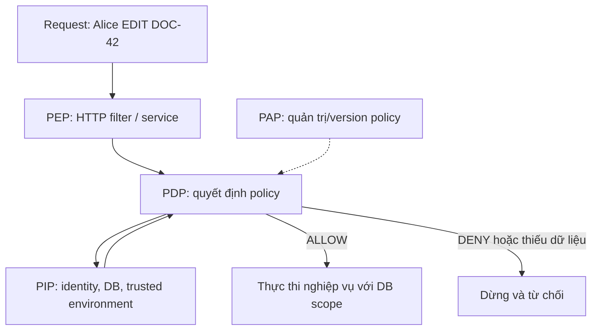

# ABAC: Quyết định theo thuộc tính chủ thể, tài nguyên và môi trường

## Mục tiêu học tập

Sau bài này, bạn có thể giải thích ABAC (Attribute-Based Access Control), xác định thuộc tính chủ thể/tài nguyên/hành động/môi trường, xây dựng một chính sách có điều kiện rõ ràng, phân biệt ABAC với RBAC, đọc luồng PEP–PDP–PIP–PAP, kiểm tra quyết định bằng Java 17 và đặt chính sách đúng nơi trong Spring Security. Trọng tâm là **quyết định trên tài nguyên cụ thể trong bối cảnh cụ thể**, thay vì chỉ kiểm tra người dùng có một vai trò chung.

## 1. ABAC là gì?

**Attribute-Based Access Control (ABAC)** là mô hình kiểm soát truy cập dựa trên việc đánh giá **thuộc tính (attributes)** liên quan tới chủ thể, đối tượng/tài nguyên, thao tác cần thực hiện và điều kiện môi trường theo **chính sách (policy)**. Định nghĩa này được trình bày trong NIST SP 800-162.

Giả sử ứng dụng lưu tài liệu `DOC-42`. Alice đã đăng nhập và có quyền `document:edit`. Ứng dụng vẫn có thể chỉ cho Alice sửa khi:

- Alice và tài liệu thuộc **cùng tenant**.
- Alice chính là **owner** của tài liệu.
- Tài liệu đang ở trạng thái `DRAFT`, chưa bị khóa.
- Yêu cầu xảy ra trong khoảng **09:00–18:00** theo múi giờ của tổ chức.
- Nếu tài liệu mang nhãn `CONFIDENTIAL`, môi trường truy cập phải được **xác nhận tin cậy**.

Đây là **chính sách ví dụ**, không phải mặc định của Spring Security. Người dùng có `ROLE_EDITOR` hoặc `document:edit` chưa đương nhiên được sửa tài liệu của người khác hay bỏ qua hạn chế về giờ/môi trường.

Một quyết định ABAC được mô tả như sau:

```text
Decision = Evaluate(Policy, Subject, Action, Resource, Environment)

ALLOW_EDIT =
    subject.authenticated
    AND subject.active
    AND "document:edit" in subject.permissions
    AND subject.tenantId = resource.tenantId
    AND subject.userId = resource.ownerId
    AND resource.status = DRAFT
    AND environment.time in [09:00, 18:00)
    AND (
        resource.classification != CONFIDENTIAL
        OR environment.trustedNetwork
    )
```

Với phép `AND`, **mọi điều kiện bắt buộc đều phải đúng**. Phép `OR` chỉ thể hiện ngoại lệ đã được chính sách định nghĩa. Thiếu một thuộc tính quan trọng, không xác minh được giá trị, lỗi tải chính sách hoặc không có quy tắc cho phép thì cách xử lý an toàn là **từ chối** (*default deny / fail closed*). Không được hiểu “không thấy quy tắc cấm” thành “được phép”.

## 2. Bốn loại dữ liệu tạo nên quyết định

| Nhóm | Thuộc tính ví dụ | Nguồn tin cậy | Điều cần tránh |
| --- | --- | --- | --- |
| **Subject (chủ thể)** | `userId`, `tenantId`, `department`, `active`, `clearance`, `permissions` | Identity provider đã xác thực, hồ sơ quyền nội bộ | Tin `userId` hoặc `admin=true` trong request body |
| **Resource/Object (tài nguyên)** | `id`, `ownerId`, `tenantId`, `classification`, `status`, danh sách chia sẻ | Cơ sở dữ liệu và metadata của tài nguyên | Chỉ dùng `documentId` trong URL mà không truy xuất tài nguyên thật |
| **Action (hành động)** | `READ`, `EDIT`, `APPROVE`, `EXPORT`, `DELETE` | Nghiệp vụ mà server sắp thực hiện | Giả định mọi `GET`/`POST` có cùng một ý nghĩa nghiệp vụ |
| **Environment (môi trường)** | Thời gian server, mức tin cậy thiết bị/mạng, mức rủi ro phiên, trạng thái MFA | Server clock, gateway/identity/risk service đáng tin | Tin giờ hệ thống hoặc header mạng do client tự gửi |

**Ví dụ về chính sách:** “Nhân viên phòng tài chính được đọc báo cáo nội bộ của chính tenant mình sau khi MFA và chỉ khi tài liệu chưa bị thu hồi.” `department=FINANCE` là thuộc tính; `classification=INTERNAL` là thuộc tính; `MFA verified` là thuộc tính/bối cảnh; phép kết hợp chúng để cho phép đọc là **chính sách**.

ABAC không đòi mọi quyết định phải dùng đủ mọi trường thuộc tính. Với một tài nguyên công khai, thời gian có thể không liên quan. Với phê duyệt thanh toán, số tiền, vai trò phê duyệt, trạng thái chứng từ và tách biệt người lập/người duyệt có thể là những điều kiện chính.

### Chất lượng của thuộc tính quan trọng như chính sách

Một thuộc tính cần có **ý nghĩa chuẩn hóa**, **nguồn phát hành**, **độ mới**, **kiểu dữ liệu**, **phạm vi tenant**, **quy tắc cập nhật/thu hồi**. JWT có chữ ký hợp lệ vẫn có thể chứa role hoặc nhóm đã cũ nếu người dùng bị thu hồi quyền trước khi token hết hạn; tài liệu trong DB có thể vừa đổi owner hay trạng thái. Với chính sách nhạy cảm cần tra cứu trạng thái hiện thời hoặc dùng chiến lược invalidation phù hợp.

Không xây quyền dựa trên email/tên hiển thị khi chúng có thể thay đổi; ưu tiên subject ID ổn định. Với đa tenant, định danh cần rõ phạm vi: cùng `userId` ở hai tenant không có nghĩa truy cập lẫn nhau.

## 3. Phân biệt RBAC, ACL và ABAC

| Mô hình | Quyết định dựa chủ yếu vào | Trả lời tốt câu hỏi | Giới hạn |
| --- | --- | --- | --- |
| **RBAC** | Vai trò như `ROLE_EDITOR`, `ROLE_REVIEWER` | “Ai có thể vào chức năng sửa?” | Không tự biết người này có quyền với tài liệu `DOC-42` |
| **ACL / ownership** | Chủ sở hữu, thành viên, share list của tài nguyên | “Ai được phép đọc bản ghi này?” | Không mặc nhiên xét thời gian, thiết bị, classification |
| **ABAC** | Chính sách trên subject + action + resource + environment | “Người này có được sửa bản ghi này lúc này trong môi trường này?” | Phức tạp hơn; phụ thuộc quản lý thuộc tính và policy đáng tin |

RBAC có thể là **một phần** của ABAC: kiểm tra quyền chức năng ở HTTP, sau đó kiểm tra owner/tenant/trạng thái/môi trường tại service và DB. Việc dùng vai trò như một subject attribute không có nghĩa policy chỉ kiểm tra vai trò đã giải quyết được yêu cầu truy cập động.

Ví dụ, Alice và Bob đều là `EDITOR`. Alice sở hữu tài liệu 42, Bob chỉ được chia sẻ quyền đọc. Cả hai có thể vượt qua kiểm tra “có quyền dùng chức năng tài liệu”, nhưng chỉ Alice đủ điều kiện sửa theo ABAC.

## 4. Viết chính sách chính xác: điều kiện toàn cục và ngoại lệ

Cho phép đọc tài liệu `D` khi:

```text
ALLOW_READ =
    authenticated
    AND subject.active
    AND subject.tenantId = D.tenantId
    AND "document:read" in permissions
    AND (subject.userId = D.ownerId OR subject.userId in D.sharedReaders)
    AND (D.classification != CONFIDENTIAL OR trustedNetwork)
```

Cho phép sửa khi:

```text
ALLOW_EDIT =
    authenticated
    AND subject.active
    AND subject.tenantId = D.tenantId
    AND "document:edit" in permissions
    AND subject.userId = D.ownerId
    AND D.status = DRAFT
    AND NOT D.locked
    AND officeHours
    AND (D.classification != CONFIDENTIAL OR trustedNetwork)
```

**Ràng buộc tenant nằm ngoài nhóm `OR`**, vì cả owner lẫn sharedReader đều phải cùng tenant. Sai lầm phổ biến:

```text
# SAI: ai là owner thì bỏ qua tenant, quyền và môi trường
ALLOW = isOwner OR (sameTenant AND hasPermission AND trustedNetwork)

# ĐÚNG theo chính sách đã nêu
ALLOW = sameTenant AND hasPermission AND trustedNetwork
        AND (isOwner OR isSharedReader)
```

Khi nhiều chính sách áp dụng đồng thời (ví dụ: “được chia sẻ đọc” nhưng “cấm đọc tài liệu mật qua môi trường không tin cậy”), phải định nghĩa **cách kết hợp** nhất quán. Một hệ thống policy engine có thể phân biệt `PERMIT`, `DENY`, `NOT_APPLICABLE`, `INDETERMINATE`; lựa chọn kiểu “deny overrides” hoặc luật ưu tiên khác cần được ghi rõ và kiểm thử. Thiếu kết quả hoặc đánh giá lỗi không tự động biến thành `PERMIT`.

## 5. Các vai trò PEP, PDP, PIP, PAP

Đây là các **vai trò logic trong kiến trúc ABAC**; dự án nhỏ có thể triển khai cả bốn trong một ứng dụng Spring Boot, không bắt buộc phải chia thành microservice:

- **PEP — Policy Enforcement Point:** nhận yêu cầu, hỏi quyết định và **thực thi** quyết định. Ví dụ: filter/interceptor của Spring Security hoặc service boundary. Nếu PDP trả `DENY` thì PEP phải dừng thao tác.
- **PDP — Policy Decision Point:** đánh giá rule với thuộc tính đã kiểm chứng và trả `ALLOW`/`DENY` hoặc dạng kết quả tương đương; có thể là Java policy bean hoặc policy engine.
- **PIP — Policy Information Point:** cung cấp subject/resource/environment attributes: principal từ SecurityContext, owner/tenant/status từ DB, thời gian từ server clock, thông tin thiết bị từ gateway đáng tin.
- **PAP — Policy Administration Point:** nơi quản lý, phê duyệt, phiên bản hóa và triển khai chính sách; trong mã nguồn có thể là module chứa policy được review.



**Luồng:** PEP chặn thao tác; PDP lấy các thuộc tính cần thiết qua PIP và áp policy; PEP chỉ tiếp tục khi được cho phép. PDP có thể được đặt ngay trong service, không bắt buộc là HTTP call. Khi dữ liệu/policy không đọc được hoặc timeout, phải có quy tắc xử lý lỗi đã định; mặc định an toàn là chặn.

## 6. Chương trình Java 17 độc lập: quyết định trên tài liệu

Chương trình dưới đây minh họa policy trên bốn loại đầu vào, không cần Spring hay thư viện ngoài. Tài liệu có `tenant`, `owner`, `readers`, mức mật và trạng thái khóa. Người dùng có `tenant`, quyền cơ sở và trạng thái active; môi trường do server giả lập có `Instant` và `trustedNetwork`. Policy cho sửa thêm điều kiện **09:00 đến trước 18:00**, tính theo múi giờ `Asia/Ho_Chi_Minh`.

Lưu thành **`AbacDemo.java`**:

```java
import java.time.Instant;
import java.time.LocalTime;
import java.time.ZoneId;
import java.util.Set;

public class AbacDemo {
    enum Action { READ, EDIT }
    enum Classification { INTERNAL, CONFIDENTIAL }

    record Subject(
        String userId, String tenantId,
        Set<String> permissions, boolean active
    ) {}

    record Document(
        String id, String tenantId, String ownerId,
        Set<String> readers, Classification classification,
        boolean locked
    ) {}

    record Environment(Instant now, boolean trustedNetwork) {}

    static boolean allowed(
        Subject actor, Action action,
        Document doc, Environment env
    ) {
        if (actor == null || action == null ||
            doc == null || env == null) {
            return false;
        }
        if (!actor.active() ||
            !actor.tenantId().equals(doc.tenantId())) {
            return false;
        }
        if (doc.classification() == Classification.CONFIDENTIAL &&
            !env.trustedNetwork()) {
            return false;
        }

        boolean owner = actor.userId().equals(doc.ownerId());
        boolean shared = doc.readers().contains(actor.userId());

        if (action == Action.READ) {
            return actor.permissions().contains("document:read")
                && (owner || shared);
        }
        if (action == Action.EDIT) {
            LocalTime time = env.now()
                .atZone(ZoneId.of("Asia/Ho_Chi_Minh"))
                .toLocalTime();
            boolean officeHours = !time.isBefore(LocalTime.of(9, 0))
                && time.isBefore(LocalTime.of(18, 0));

            return actor.permissions().contains("document:edit")
                && owner && !doc.locked() && officeHours;
        }
        return false;
    }

    public static void main(String[] args) {
        Subject alice = new Subject(
            "alice", "tenant-a",
            Set.of("document:read", "document:edit"), true
        );
        Subject bob = new Subject(
            "bob", "tenant-a",
            Set.of("document:read", "document:edit"), true
        );
        Subject aliceInTenantB = new Subject(
            "alice", "tenant-b",
            Set.of("document:read", "document:edit"), true
        );
        Subject aliceReadOnly = new Subject(
            "alice", "tenant-a", Set.of("document:read"), true
        );

        Document doc = new Document(
            "DOC-42", "tenant-a", "alice",
            Set.of("bob"), Classification.CONFIDENTIAL, false
        );
        // 03:00 UTC = 10:00 giờ Việt Nam.
        Environment office = new Environment(
            Instant.parse("2026-11-05T03:00:00Z"), true
        );
        // 12:00 UTC = 19:00 giờ Việt Nam.
        Environment evening = new Environment(
            Instant.parse("2026-11-05T12:00:00Z"), true
        );
        Environment untrusted = new Environment(office.now(), false);
        Document locked = new Document(
            doc.id(), doc.tenantId(), doc.ownerId(),
            doc.readers(), doc.classification(), true
        );

        System.out.println("Alice edit at 10:00: "
            + allowed(alice, Action.EDIT, doc, office));
        System.out.println("Bob read shared: "
            + allowed(bob, Action.READ, doc, office));
        System.out.println("Bob edit without ownership: "
            + allowed(bob, Action.EDIT, doc, office));
        System.out.println("Alice read untrusted network: "
            + allowed(alice, Action.READ, doc, untrusted));
        System.out.println("Alice edit at 19:00: "
            + allowed(alice, Action.EDIT, doc, evening));
        System.out.println("Cross-tenant read: "
            + allowed(aliceInTenantB, Action.READ, doc, office));
        System.out.println("Locked document edit: "
            + allowed(alice, Action.EDIT, locked, office));
        System.out.println("Missing edit authority: "
            + allowed(aliceReadOnly, Action.EDIT, doc, office));
    }
}
```

Biên dịch và chạy với **JDK 17+**:

```bash
javac AbacDemo.java
java AbacDemo
```

**Stdout chính xác:**

```text
Alice edit at 10:00: true
Bob read shared: true
Bob edit without ownership: false
Alice read untrusted network: false
Alice edit at 19:00: false
Cross-tenant read: false
Locked document edit: false
Missing edit authority: false
```

Phân tích kết quả:

1. Alice được sửa lúc 10:00 vì cùng tenant, là owner, có permission, tài liệu chưa khóa và mạng tin cậy. 19:00 vượt giờ cho phép, nên bị từ chối.
2. Bob có `document:edit` nhưng không phải owner: **được đọc** tài liệu được chia sẻ, **không được sửa**.
3. `aliceInTenantB` có cùng tên và permissions với Alice, nhưng không được xem tài liệu tenant A.
4. `CONFIDENTIAL` cần môi trường tin cậy, kể cả owner cũng bị từ chối nếu yêu cầu đến từ môi trường không tin cậy.
5. Policy dùng `Instant` và múi giờ IANA, không phụ thuộc đồng hồ/múi giờ máy đang chạy. **09:00 được tính**, **18:00 bị loại**.
6. Policy áp dụng **mặc định từ chối** nếu thiếu subject/action/document/environment hoặc hành động chưa khai báo. Hệ thống thật còn phải từ chối khi giá trị các trường bắt buộc sai định dạng hoặc chưa được xác minh.

**Phạm vi của mẫu:** Dữ liệu tạo trong bộ nhớ, `trustedNetwork` chỉ là giá trị giả lập để học, chưa có nguồn xác thực hay DB. Trong API thực, **không nhận `trustedNetwork=true` từ client để cấp quyền**, và không để client tự lựa chọn `tenantId`/`ownerId` dùng làm sự thật. Nên tách policy thành hàm dễ kiểm thử với `Clock` inject được và thuộc tính lấy từ nguồn đáng tin.

## 7. Dùng ABAC trong Spring Security

Spring Security cung cấp `Authentication`, `GrantedAuthority`, `authorizeHttpRequests`, `@PreAuthorize` và `AuthorizationManager` để thực thi quyết định. Spring **không tự biết** owner, classification hay giờ làm việc của tài liệu: đó là chính sách ứng dụng.

### 7.1. Lớp HTTP: quyền chức năng

Với ứng dụng Servlet (Spring MVC), ví dụ cấu hình khung:

```java
// Đặt trong lớp @Configuration; cần import tương ứng.
// Ví dụ tập trung vào authorization. Cấu hình authentication,
// CSRF và session/token riêng theo ứng dụng thực tế.
@Bean
SecurityFilterChain securityFilterChain(HttpSecurity http) throws Exception {
    http.authorizeHttpRequests(authorize -> authorize
        .requestMatchers(HttpMethod.GET, "/api/documents/**")
            .hasAuthority("document:read")
        .requestMatchers(HttpMethod.PATCH, "/api/documents/**")
            .hasAuthority("document:edit")
        .anyRequest().denyAll()
    );
    return http.build();
}
```

`document:read` hoặc `document:edit` kiểm tra **quyền cơ sở**. Chúng không kiểm tra người dùng có quyền với **DOC-42** hay không. Một người có đủ authority để qua tầng HTTP vẫn có thể bị từ chối tại service bởi rule owner, tenant, classification hoặc bối cảnh. Luật `requestMatchers` được xét theo thứ tự; nên đặt rule cụ thể trước, fallback từ chối. Một 403 cũng có thể đến từ CSRF nếu ứng dụng dùng cơ chế yêu cầu CSRF token.

### 7.2. Lớp phương thức: ABAC trước thao tác có side effect

Bật method security và ủy quyền đánh giá đối tượng cho một bean policy:

```java
// Snippet tích hợp vào dự án Spring Boot.
// Document, DocumentRepository là kiểu domain của ứng dụng.
@Configuration
@EnableMethodSecurity
class MethodSecurityConfig {}

@Service
class DocumentService {
    private final DocumentRepository documents;

    DocumentService(DocumentRepository documents) {
        this.documents = documents;
    }

    @PreAuthorize(
        "hasAuthority('document:edit') and " +
        "@documentAbacPolicy.canEdit(authentication, #id)"
    )
    @Transactional
    public void rename(@P("id") long id, String title) {
        Document doc = documents.findById(id).orElseThrow();
        doc.setTitle(title);
    }
}
```

Đây là **mã minh họa phụ thuộc ứng dụng**, không phải chương trình chạy độc lập: lớp `Document`, `DocumentRepository`, bean `documentAbacPolicy` và source authentication phải được cung cấp. Các annotation/API cần import tương ứng từ Spring (`Configuration`, `EnableMethodSecurity`, `Service`, `PreAuthorize`, `P`, `Transactional`, v.v.).

Bean `documentAbacPolicy` cần cung cấp `boolean canEdit(Authentication actor, long id)` và thực hiện chính sách: kiểm tra authentication; lấy document từ repository; lấy user ID/tenant thực của actor; so khớp owner/tenant/trạng thái; lấy thời gian và độ tin cậy môi trường từ server; trả `false` nếu không đạt hoặc không tìm thấy dữ liệu. `@P("id")` giúp biểu thức SpEL `#id` tham chiếu đúng tham số, không phụ thuộc việc compiler giữ tên tham số.

Những giới hạn triển khai quan trọng:

- `@EnableMethodSecurity` phải được bật; chỉ thêm Spring Security starter chưa tự bật `@PreAuthorize`.
- Method security dùng Spring AOP: gọi method **qua Spring proxy** mới đi qua interceptor. `this.rename(...)` trong cùng bean thường bỏ qua proxy; object tạo thủ công ngoài container cũng vậy.
- `@PreAuthorize` kiểm tra **trước** khi ghi. `@PostAuthorize` kiểm tra **sau** khi method trả về, không phù hợp làm lớp bảo vệ duy nhất cho thao tác có side effect.
- `Authentication.getName()` không phải lúc nào cũng là user ID được lưu trong DB. Với JWT/OIDC, phải định nghĩa mapping stable subject/tenant/authorities rõ ràng; mọi thuộc tính được dùng trong policy phải đến từ nguồn đã kiểm chứng.
- Việc policy đọc document ở một thời điểm và method ghi ở thời điểm sau có thể tạo **TOCTOU race**. Nếu owner/tenant/status có thể thay đổi đồng thời, cân nhắc transaction và locking hoặc **câu lệnh update có điều kiện** để kiểm tra lại ngay khi ghi.

Khi có nhiều rule/phương thức dùng chung, đặt policy trong lớp/component chuyên trách hoặc tạo custom `AuthorizationManager` cho loại đối tượng tương ứng. Tổ chức lại policy không thay đổi yêu cầu phải kiểm tra dữ liệu thật và quyền hiện hành.

### 7.3. Phân quyền ngay trong query để bảo vệ danh sách

Nếu Alice chỉ được xem 7 trong 1000 tài liệu, không nên tải 1000 tài liệu rồi lọc sau khi phân trang. Cách đó dễ sai `totalCount`, sai số trang, tốn bộ nhớ và có thể lộ metadata.

Đẩy scope owner/share/tenant vào **query**, ví dụ:

```sql
-- SQL minh họa: điều chỉnh tên bảng/cột theo schema thật.
SELECT d.*
FROM documents d
WHERE d.tenant_id = :trustedTenantId
  AND (
       d.owner_id = :authenticatedUserId
       OR EXISTS (
           SELECT 1
           FROM document_readers dr
           WHERE dr.document_id = d.id
             AND dr.user_id = :authenticatedUserId
       )
  )
  AND (
       d.classification <> 'CONFIDENTIAL'
       OR :trustedNetwork = TRUE
  )
ORDER BY d.id
LIMIT :limit OFFSET :offset;
```

Các tham số `trustedTenantId`, `authenticatedUserId` và `trustedNetwork` phải do hệ thống xác định từ danh tính/bối cảnh đã kiểm chứng; bind tham số thay vì nối trực tiếp chuỗi SQL. Khi policy phụ thuộc thời gian hoặc trạng thái động, phải áp đúng các điều kiện ấy tại lớp truy vấn tương ứng. **Count, export, search, batch read** cần cùng chính sách với read-by-ID. Với ghi dữ liệu, cân nhắc điều kiện `WHERE id = ? AND tenant_id = ? AND owner_id = ? AND status = 'DRAFT'` để tránh cập nhật sai sau khi quyền thay đổi.

## 8. Ma trận quyết định mẫu

Giả sử DOC-42 thuộc tenant A, owner Alice, được chia sẻ đọc cho Bob, classification `CONFIDENTIAL`, chưa khóa. Alice và Bob đều có `document:read` và `document:edit`.

| Chủ thể/bối cảnh | Thao tác | Kết quả | Vì sao |
| --- | --- | --- | --- |
| Alice, tenant A, mạng tin cậy, 10:00 | EDIT | **ALLOW** | Đủ quyền, owner, đúng tenant, thời gian/mạng hợp lệ |
| Bob, tenant A, mạng tin cậy, 10:00 | READ | **ALLOW** | Đủ quyền và nằm trong danh sách được chia sẻ đọc |
| Bob, tenant A, mạng tin cậy, 10:00 | EDIT | **DENY** | Không phải owner |
| Alice, tenant A, mạng không tin cậy, 10:00 | READ | **DENY** | Tài liệu mật đòi mạng tin cậy |
| Alice, tenant A, mạng tin cậy, 19:00 | EDIT | **DENY** | Ngoài khoảng giờ cho phép sửa |
| Alice của tenant B | READ | **DENY** | Không cùng tenant |
| Alice với DOC-42 đã khóa | EDIT | **DENY** | Trạng thái tài nguyên không cho phép |
| Alice thiếu `document:edit` | EDIT | **DENY** | Thiếu quyền cơ sở |

Ma trận này giúp người viết policy và người kiểm thử thống nhất ý nghĩa của từng điều kiện. Nó cũng chỉ ra vì sao **role riêng lẻ không đủ** để bảo vệ từng đối tượng.

## 9. Độ tin cậy, vòng đời và hiệu năng

### 9.1. Attribute provenance và security context

- **Identity:** subject ID và tenant phải được ràng buộc với tài khoản đã xác thực; không nhận `X-User-Id` hay `X-Tenant-ID` trực tiếp làm bằng chứng. Nếu giao thức cho client chọn tenant đang làm việc, phải xác minh membership của subject với tenant được chọn.
- **Resource:** owner/status/classification từ DB, không tin trường `ownerId` client gửi. Kể cả ID đoán được, tài nguyên ngoài scope phải bị từ chối.
- **Environment:** giờ từ server `Clock`; mạng/thiết bị chỉ đáng tin nếu được đánh giá bởi gateway/proxy/attestation đã cấu hình. `X-Forwarded-For` có thể bị giả nếu application nhận trực tiếp header từ client mà không giới hạn trusted proxies.
- **Claim freshness:** JWT ký hợp lệ có thể giữ role cũ cho đến hết hiệu lực; chính sách thu hồi tức thì cần cách tra cứu/thông báo revocation phù hợp, nhất là với quyền nhạy cảm.

### 9.2. Cache kết quả phân quyền

Cache `ALLOW` phải tính đến **subject, tenant, action, resource, policy version và các thuộc tính biến động liên quan**. Không dùng lại kết quả “Alice được sửa DOC-42 lúc 10:00” cho 19:00 hoặc sau khi tài liệu bị khóa. Thiết kế TTL/invalidation theo rủi ro, thay đổi owner/share/classification, thay đổi nhóm/permission, hết hạn môi trường tin cậy. Với thuộc tính không thể xác thực hoặc cache đã quá hạn, ưu tiên từ chối cho đến khi làm mới.

### 9.3. Audit và quản trị policy

Nên ghi một mã lý do chuẩn hóa (ví dụ `TENANT_MISMATCH`, `NOT_OWNER`, `AFTER_HOURS`), policy id/version, thời gian và các ID cần thiết theo chính sách bảo mật. Không trả toàn bộ lý do chi tiết cho client nếu nó tiết lộ owner, classification hoặc sự tồn tại tài liệu người khác. Nhiều API chọn `403` cho quyền bị từ chối; `404` cho tài nguyên không tồn tại hoặc để tránh xác nhận sự tồn tại có thể là lựa chọn sản phẩm nhất quán.

Policy cần chủ sở hữu nghiệp vụ, review, phiên bản hóa, bộ test và khả năng rollback. Khi nhiều rule xung đột, chỉ dùng thuật toán kết hợp đã định nghĩa, không lẫn lộn giữa “không có quyết định” và “được phép”.

## 10. Kiểm thử ABAC đúng phạm vi

Kiểm thử đủ **tổ hợp thuộc tính**, không chỉ trường hợp cho phép:

| Loại test | Các tình huống cần có |
| --- | --- |
| Subject | Không đăng nhập, tài khoản inactive, thiếu permission, subject/tenant không hợp lệ, role bị thu hồi |
| Resource | Owner khác, tenant khác, tài liệu đã khóa, xóa mất, classification đổi, tài liệu không được chia sẻ |
| Action | READ được nhưng EDIT không; EXPORT/APPROVE có quy tắc riêng |
| Environment | 08:59, 09:00, 17:59, 18:00; mạng tin cậy/không tin cậy; múi giờ khác |
| Chính sách | Thiếu thuộc tính, lỗi PIP/DB, hai rule xung đột, policy không áp dụng |
| Điểm thực thi | HTTP, service qua Spring proxy, gọi nội bộ, batch job, danh sách/search/export |
| Trạng thái dữ liệu | Bị từ chối không ghi được; quyền/trạng thái đổi đồng thời vẫn không cho ghi sai |

Với pure Java, test `allowed(...)` bằng bộ dữ liệu bảng và thời gian cố định để kết quả ổn định. Với Spring Security, dùng test trên **Spring-managed bean** để xác minh `@PreAuthorize`; `MockMvc` và `spring-security-test` (như `@WithMockUser` và `csrf()` khi cần) cho HTTP. Nếu mock cả service trong HTTP test, interceptor của service thật có thể không chạy, nên cần test method security riêng.

Với query phân trang, kiểm tra **danh sách, totalCount và export** đồng nhất; không chỉ kiểm tra một `GET /documents/{id}`. Với lệnh cập nhật, xác minh dữ liệu DB giữ nguyên sau khi yêu cầu bị từ chối. Thử các tình huống “biết ID người khác”, “cùng username nhưng tenant khác”, “permission bị thu hồi” và “tài liệu đổi owner giữa lúc xử lý”.

## 11. Những lỗi triển khai thường gặp

1. **Chỉ có RBAC ở HTTP:** người có authority có thể đọc/sửa bản ghi ngoài quyền. Thêm ràng buộc owner/tenant và policy môi trường ở service/query.
2. **Tin thuộc tính từ request:** client có thể tự khai `trustedNetwork=true` hoặc `ownerId=alice`. Lấy từ security context, DB và trusted gateway.
3. **Viết `OR` sai:** `isOwner OR sameTenant` tạo đường bỏ qua tenant. Giữ điều kiện bắt buộc trong `AND`.
4. **Không có deny-default:** thiếu thuộc tính hoặc lỗi kết nối PDP lại trả allow. Luôn định nghĩa hành vi fail closed.
5. **Quên proxy của method security:** `@PreAuthorize` không tự hoạt động khi self-invocation. Test lời gọi từ Spring context.
6. **Kiểm tra quyền sau khi ghi:** `@PostAuthorize` đến sau side effect. Bảo vệ trước và dùng điều kiện ghi ở persistence.
7. **Chỉ lọc sau phân trang:** có thể lộ dữ liệu và sai `count`. Đẩy filter vào truy vấn.
8. **Cache/claim cũ:** vai trò, share list, trạng thái thiết bị và tài liệu đổi nhưng vẫn dùng allow trước đó. Thiết kế invalidation/TTL.
9. **Giờ không có timezone/biên:** “giờ làm việc” mơ hồ dẫn đến cấp quyền sai. Dùng múi giờ rõ, kiểm tra tại 09:00 và 18:00.
10. **Policy phân tán không đồng nhất:** sửa qua service bị chặn nhưng export hoặc batch lại không. Dùng chính sách và nguồn thuộc tính chung, kiểm tra mọi entry point.

## 12. Checklist xây dựng một policy ABAC

1. Nêu rõ **chủ thể – hành động – đối tượng – môi trường** cho từng nghiệp vụ; xác định mặc định từ chối.
2. Liệt kê các thuộc tính bắt buộc và nguồn tin cậy; định nghĩa kiểu, tenant scope, độ mới, xử lý thiếu dữ liệu.
3. Viết biểu thức policy có **AND/OR/ngoại lệ** rõ; định nghĩa cách kết hợp nhiều chính sách và mã lý do.
4. Gắn PEP tại HTTP/service phù hợp, đặt PDP trong component có thể test, lấy dữ liệu qua PIP; quản lý policy bằng PAP/quy trình review.
5. Áp chính sách vào **đọc một bản ghi, danh sách, search, count, export và ghi có điều kiện**, tránh bypass qua đường gọi khác.
6. Test ma trận allow/deny, race condition, thu hồi, lỗi policy engine, thời gian biên, caching; version hóa và audit an toàn.

**Tự kiểm tra:** Bob có authority `document:edit` nhưng chỉ được chia sẻ quyền đọc DOC-42; Alice là owner nhưng đang ở ngoài mạng tin cậy lúc 19:00. Ai được sửa DOC-42 theo chính sách ví dụ? **Không ai**: Bob không phải owner; Alice không đáp ứng điều kiện môi trường và giờ làm việc. Quyền cơ sở chỉ là một đầu vào của ABAC.

## Tài liệu tham khảo

- NIST SP 800-162, *Guide to Attribute Based Access Control (ABAC) Definition and Considerations*: https://csrc.nist.gov/pubs/sp/800/162/upd2/final
- Spring Security, *Authorization Architecture*: https://docs.spring.io/spring-security/reference/servlet/authorization/architecture.html
- Spring Security, *Method Security*: https://docs.spring.io/spring-security/reference/servlet/authorization/method-security.html
- Spring Security, *Authorize HttpServletRequests*: https://docs.spring.io/spring-security/reference/servlet/authorization/authorize-http-requests.html
