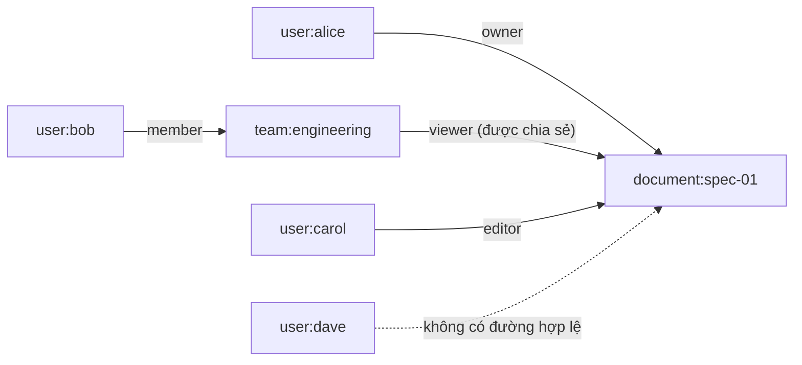
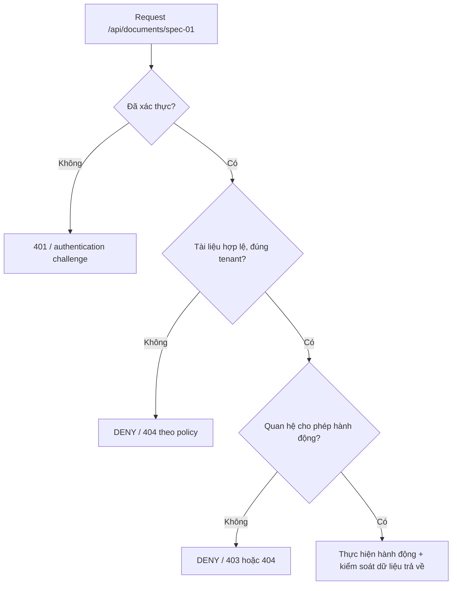

# ReBAC: quyết định theo quan hệ sở hữu, thành viên và chia sẻ

**Relationship-Based Access Control (ReBAC)** là mô hình kiểm soát truy cập mà quyết định **cho phép hay từ chối** phụ thuộc vào **mối quan hệ giữa chủ thể và tài nguyên**. Câu hỏi không chỉ là “người này có role gì?”, mà là: **“người này có quan hệ nào, trực tiếp hoặc gián tiếp, với đúng tài nguyên đang được truy cập?”**

Ví dụ trong ứng dụng quản lý tài liệu:

- Alice là **chủ sở hữu** tài liệu `spec-01` nên có thể đọc, sửa và chia sẻ theo chính sách.
- Bob là **thành viên nhóm** `engineering`; tài liệu `spec-01` được chia sẻ quyền xem cho nhóm đó, nên Bob có thể đọc dù không sở hữu tài liệu.
- Carol được **chia sẻ trực tiếp** quyền sửa tài liệu, nên có thể đọc và sửa.
- Dave không có quan hệ hợp lệ với tài liệu; dù đã đăng nhập, Dave vẫn bị từ chối.
- Nếu Bob rời `engineering`, quyền truy cập suy ra từ tư cách thành viên phải biến mất sau khi thay đổi quan hệ có hiệu lực.

Bài học này tập trung vào cách **mô hình hóa, suy diễn, thực thi và kiểm thử** ReBAC cho ownership, membership và sharing trong ứng dụng Java/Spring Security.

## 1. ReBAC nằm ở đâu trong kiểm soát truy cập?

### 1.1. So sánh RBAC, ABAC và ReBAC

| Mô hình | Câu hỏi quyết định chính | Ví dụ |
| --- | --- | --- |
| **RBAC** – Role-Based Access Control | Chủ thể có role được phép thực hiện hành động không? | `ROLE_EDITOR` được sửa bài viết |
| **ABAC** – Attribute-Based Access Control | Các thuộc tính của người, tài nguyên và ngữ cảnh có thỏa policy không? | Chỉ nhân viên trong giờ làm mới được duyệt giao dịch dưới ngưỡng |
| **ReBAC** – Relationship-Based Access Control | Chủ thể có quan hệ cho phép với **chính đối tượng** này không? | Chỉ owner, editor được chia sẻ, hoặc thành viên nhóm có quyền mới xem được tài liệu |

Các mô hình có thể **kết hợp**. Chẳng hạn, hệ thống yêu cầu người dùng có authority `documents.read` **và** có quan hệ `viewer` với `document:spec-01` **và** đang truy cập đúng tenant. RBAC/coarse-grained permission không thay thế kiểm tra quan hệ trên từng bản ghi; ReBAC cũng không tự thay thế mọi điều kiện ABAC như trạng thái tài liệu hoặc thời hạn chia sẻ.

### 1.2. Đồ thị quan hệ

Hình dung ReBAC là đồ thị có:

- **Subject:** `user:alice`, `user:bob`, hoặc một tập người dùng như `team:engineering#member`.
- **Object:** `document:spec-01`, `folder:project-x`, `team:engineering`, `organization:acme`.
- **Relation:** `owner`, `editor`, `viewer`, `member`, `parent`, `shared_with`.
- **Permission:** `can_read`, `can_edit`, `can_share` – **được tính từ các quan hệ** theo quy tắc cụ thể.

Một cạnh thường được biểu diễn bằng bộ ba **(object, relation, subject)**. Cú pháp minh họa theo kiểu relationship tuple:

```text
document:spec-01#owner@user:alice
team:engineering#member@user:bob
document:spec-01#viewer@team:engineering#member
document:spec-01#editor@user:carol
```

Diễn giải:

1. `document:spec-01` có owner là Alice.
2. Bob là thành viên nhóm engineering.
3. **Toàn bộ tập thành viên** nhóm engineering được chỉ định là viewer của tài liệu.
4. Carol được cấp quyền editor trực tiếp.

Đây là cách biểu diễn mô hình, **không phải cú pháp bắt buộc của Spring Security**. Mỗi authorization engine có định dạng và quy tắc riêng; Spring Security mặc định không tự tạo hay tự truy vấn relationship tuples từ cơ sở dữ liệu.

### 1.3. Quyết định truy cập là phép truy vấn đồ thị



Một quan hệ trực tiếp cho phép suy diễn nhanh; quan hệ gián tiếp cần **đường đi phù hợp với policy**. Không phải cứ đồ thị có đường nối bất kỳ là có quyền: tên cạnh, hướng cạnh, độ sâu và loại đối tượng đều quan trọng.

## 2. Ba nguồn quan hệ quan trọng: ownership, membership, sharing

### 2.1. Ownership – quan hệ sở hữu

Quan hệ ví dụ: `document:spec-01#owner@user:alice`.

Owner thường có quyền đọc, sửa hoặc chia sẻ, **nhưng điều đó phải được định nghĩa trong policy**. “Owner” không phải primitive tự động trao mọi quyền: ứng dụng có thể cấm owner xóa tài liệu đã chốt sổ, yêu cầu hai người duyệt việc chuyển ownership, hoặc hạn chế share ra ngoài tổ chức.

Cần quyết định rõ:

- **Một hay nhiều owner?** Có cho phép đồng sở hữu, chuyển quyền, owner tổ chức thay vì cá nhân không?
- **Ai được thay đổi owner?** Không thể tin `ownerId` do client tự truyền rồi cấp quyền ngay.
- **Nguồn owner đáng tin cậy là gì?** Quan hệ phải được đọc từ nguồn dữ liệu do server quản lý và cập nhật bằng giao dịch hợp lệ.
- **Owner có vượt qua tenant boundary không?** Thông thường không, trừ khi có chính sách cross-tenant được chủ động thiết kế.

### 2.2. Membership – quan hệ thành viên

Quan hệ ví dụ: `team:engineering#member@user:bob`.

Membership thường **không trực tiếp cấp quyền cho mọi tài liệu**. Bob trở thành viewer của `spec-01` vì có **hai quan hệ kết hợp**:

1. Bob là `member` của `engineering`.
2. `spec-01` được share quyền `viewer` cho **tập thành viên** của `engineering`.

Nếu nhóm chưa được share tài liệu, Bob không được đọc chỉ vì là thành viên nhóm. Nếu Bob rời nhóm, đường suy diễn bị cắt và quyền truy cập tương ứng mất đi. Với nhóm lồng nhau như `team:backend` thuộc `team:engineering`, phải **định nghĩa rõ** có kế thừa thành viên hay không, giới hạn loại cạnh nào được đi theo và chống chu trình.

**Organization membership** cũng vậy: “thuộc công ty Acme” không có nghĩa “được xem tất cả tài liệu của Acme”. Nó có thể là **điều kiện cần**, trong khi quyền đọc vẫn cần relation với đối tượng cụ thể.

### 2.3. Sharing – quan hệ chia sẻ

Một thao tác “Share” thường ghi thêm hoặc cập nhật một quan hệ:

| Thao tác người dùng | Thay đổi quan hệ | Hiệu quả theo policy ví dụ |
| --- | --- | --- |
| Alice share view cho Bob | Thêm `document:spec-01#viewer@user:bob` | Bob được đọc, chưa được sửa |
| Alice share edit cho Carol | Thêm `document:spec-01#editor@user:carol` | Carol được đọc và sửa |
| Alice share view cho nhóm engineering | Thêm `document:spec-01#viewer@team:engineering#member` | Thành viên hợp lệ của nhóm được đọc |
| Alice thu hồi share của Carol | Xóa cạnh `editor` tương ứng | Carol mất quyền editor, trừ khi còn một đường cấp quyền khác |
| Bob rời engineering | Xóa quan hệ `team:engineering#member@user:bob` | Bob mất quyền từ share nhóm, **nhưng vẫn có thể có direct share khác** |

Một thao tác thu hồi **một cạnh** không đồng nghĩa chắc chắn xóa **mọi đường quyền**. Ví dụ Bob rời engineering nhưng đã được Alice share viewer trực tiếp; Bob vẫn đọc được theo direct share. Việc thu hồi toàn bộ truy cập phải kiểm tra các quan hệ còn lại.

**Chia sẻ bằng đường liên kết** là trường hợp khác: link bí mật có thể đóng vai trò *capability* kèm thời hạn, hành động và điều kiện sử dụng. Không nên mặc định coi “có URL” là thành viên của một nhóm, hoặc biến một link có thể đoán được thành `viewer` công khai. Cần quản lý token link đủ mạnh, giới hạn quyền, khả năng thu hồi, audit và tránh rò qua log/referrer.

## 3. Định nghĩa policy trước khi viết code

Với tài liệu `D` và user `U`, giả sử nghiệp vụ quy định:

- **Read:** owner **hoặc** editor **hoặc** viewer trực tiếp **hoặc** thành viên một nhóm được share viewer/editor.
- **Edit:** owner **hoặc** editor trực tiếp **hoặc** thành viên nhóm được share editor.
- **Share:** chỉ owner (có thể mở rộng cho role quản trị bằng policy riêng).
- **Ranh giới tenant:** user và tài liệu phải thuộc cùng tenant hợp lệ trong ví dụ này.
- **Mặc định:** không tìm thấy đường quan hệ hợp lệ thì **DENY**.

Có thể viết điều kiện:

```text
can_read(U, D) =
    same_tenant(U, D)
    AND (
         owner(U, D)
      OR editor(U, D)
      OR viewer(U, D)
      OR exists team T:
            member(U, T)
        AND shared_as_viewer_or_editor(D, T)
    )

can_edit(U, D) =
    same_tenant(U, D)
    AND (
         owner(U, D)
      OR editor(U, D)
      OR exists team T:
            member(U, T)
        AND shared_as_editor(D, T)
    )

can_share(U, D) =
    same_tenant(U, D)
    AND owner(U, D)
```

**Chú ý:** Ở đây `viewer(U, D)` và `editor(U, D)` là quan hệ direct; các đường qua team được tính riêng. Một engine có thể diễn đạt chúng bằng phép hợp userset, nhưng ý nghĩa cấp quyền phải thống nhất.

| Chủ thể | Quan hệ với `spec-01` | Read | Edit | Share |
| --- | --- | --- | --- | --- |
| Alice | Owner | Có | Có | Có |
| Bob | Member của engineering; engineering được share viewer | Có | Không | Không |
| Carol | Được share editor trực tiếp | Có | Có | Không |
| Dave | Không có cạnh hợp lệ | Không | Không | Không |
| Bob sau khi rời engineering | Không còn đường quyền nào khác | Không | Không | Không |

Nếu hệ thống có **explicit deny**, phải xác định thứ tự ưu tiên: deny luôn thắng grant hay có ngoại lệ? Không phải mọi engine ReBAC đều tự hỗ trợ “deny overrides”; **đừng tự suy diễn** có chức năng này từ tên relation.

### Kế thừa quyền theo thư mục cũng phải khai báo

Ví dụ tài liệu nằm trong folder `project-x`, folder được share cho team. Nếu muốn tài liệu **kế thừa quyền xem của folder**, cần policy như:

```text
document.can_read = document.local_read OR document.parent_folder.can_read
```

Đây là **quy tắc thiết kế riêng**, không tự xuất hiện chỉ vì document và folder có quan hệ `parent`. Cần xem xét khả năng chặn kế thừa, chuyển folder, thư mục lồng nhau, chu trình và cấp quyền quá rộng khi di chuyển tài liệu.

## 4. Luồng xử lý một request ReBAC

Ví dụ Bob gọi `GET /api/documents/spec-01`:

1. **Authentication:** Spring Security xác thực session hoặc Bearer token. Xác định **subject ID ổn định** của Bob từ principal/claim đã được kiểm chứng. Không lấy user ID tùy ý từ request body để giả mạo chủ thể.
2. **Load resource metadata:** truy vấn `spec-01` từ kho tin cậy, lấy tenant ID, trạng thái, quan hệ cấp cao. Nếu không tồn tại thì trả 404 theo quy ước API.
3. **Check boundary:** xác nhận Bob đang hoạt động trong tenant được phép, đã đáp ứng chính sách authentication/coarse-grained permission cần thiết.
4. **Check relationships:** hỏi service quan hệ xem Bob có owner/editor/viewer trực tiếp không; nếu chưa, tài liệu có share cho team mà Bob là member không; nếu policy cho phép, kiểm tra quan hệ kế thừa khác.
5. **Decision:** trả allow/deny. Có thể trả **403** cho đã đăng nhập nhưng không đủ quyền, hoặc **404** nếu policy che giấu sự tồn tại của tài nguyên; áp dụng nhất quán để tránh lộ ID.
6. **Enforcement:** nếu allow, service mới đọc/trả dữ liệu hoặc thực hiện mutation. Ghi audit nếu cần, đặc biệt với share/revoke/transfer.



Đây là **authorization theo tài nguyên**. Một rule như `hasRole('USER')` hoặc `hasAuthority('SCOPE_documents.read')` ở HTTP layer có thể là lớp bảo vệ ban đầu, nhưng **không chứng minh** user có quyền trên `spec-01`.

## 5. Ví dụ Java 17 chạy độc lập: owner, team membership, share và revoke

Ví dụ sau sử dụng một `Set<Edge>` trong bộ nhớ để mô phỏng relationship tuples. Nó minh họa:

- Owner có quyền read/edit/share.
- Viewer đến từ direct share hoặc team membership.
- Editor cũng đọc được.
- Cùng tenant là điều kiện bắt buộc trong policy minh họa.
- Rời nhóm làm mất quyền có nguồn gốc từ nhóm.
- Không tự cho quyền khi không tìm được quan hệ phù hợp.

Đây là **mô phỏng authorization**, không phải ứng dụng Spring Boot hoặc hệ lưu trữ production.

Tạo tệp **`RebacDemo.java`**:

```java
import java.util.HashSet;
import java.util.Set;

public class RebacDemo {

    record User(String id, String tenantId) {}
    record Document(String id, String tenantId) {}

    record Edge(
            String objectType,
            String objectId,
            String relation,
            String subjectType,
            String subjectId
    ) {}

    private static final Set<Edge> EDGES = new HashSet<>();

    private static Edge edge(
            String objectType,
            String objectId,
            String relation,
            String subjectType,
            String subjectId
    ) {
        return new Edge(objectType, objectId, relation, subjectType, subjectId);
    }

    private static boolean hasRelation(User user, Document document, String relation) {
        Edge direct = edge("document", document.id(), relation, "user", user.id());
        if (EDGES.contains(direct)) {
            return true;
        }

        for (Edge share : EDGES) {
            if (share.objectType().equals("document")
                    && share.objectId().equals(document.id())
                    && share.relation().equals(relation)
                    && share.subjectType().equals("team")) {

                Edge membership = edge(
                        "team", share.subjectId(), "member", "user", user.id()
                );
                if (EDGES.contains(membership)) {
                    return true;
                }
            }
        }
        return false;
    }

    private static boolean sameTenant(User user, Document document) {
        return user.tenantId().equals(document.tenantId());
    }

    static boolean canRead(User user, Document document) {
        return sameTenant(user, document)
                && (hasRelation(user, document, "owner")
                    || hasRelation(user, document, "editor")
                    || hasRelation(user, document, "viewer"));
    }

    static boolean canEdit(User user, Document document) {
        return sameTenant(user, document)
                && (hasRelation(user, document, "owner")
                    || hasRelation(user, document, "editor"));
    }

    static boolean canShare(User user, Document document) {
        return sameTenant(user, document)
                && hasRelation(user, document, "owner");
    }

    public static void main(String[] args) {
        User alice = new User("alice", "acme");
        User bob = new User("bob", "acme");
        User carol = new User("carol", "acme");

        Document spec = new Document("spec-01", "acme");
        Document privateDoc = new Document("private-02", "acme");
        Document otherTenantDoc = new Document("partner-03", "other");

        EDGES.add(edge("document", "spec-01", "owner", "user", "alice"));
        EDGES.add(edge("document", "private-02", "owner", "user", "alice"));
        EDGES.add(edge("document", "spec-01", "viewer", "team", "engineering"));
        EDGES.add(edge("document", "spec-01", "editor", "user", "carol"));
        EDGES.add(edge("document", "partner-03", "viewer", "user", "bob"));

        Edge bobMembership = edge(
                "team", "engineering", "member", "user", "bob"
        );
        EDGES.add(bobMembership);

        System.out.println("Alice shares spec: " + canShare(alice, spec));
        System.out.println("Bob reads spec: " + canRead(bob, spec));
        System.out.println("Bob edits spec: " + canEdit(bob, spec));
        System.out.println("Carol edits spec: " + canEdit(carol, spec));
        System.out.println("Bob reads private: " + canRead(bob, privateDoc));
        System.out.println("Bob reads other tenant: " + canRead(bob, otherTenantDoc));

        EDGES.remove(bobMembership);
        System.out.println("Bob reads after revoke: " + canRead(bob, spec));
    }
}
```

Biên dịch và chạy bằng **JDK 17 trở lên**:

```bash
javac RebacDemo.java
java RebacDemo
```

Kết quả stdout chính xác:

```text
Alice shares spec: true
Bob reads spec: true
Bob edits spec: false
Carol edits spec: true
Bob reads private: false
Bob reads other tenant: false
Bob reads after revoke: false
```

**Giải thích hai điểm khó:**

- `document:spec-01#viewer@team:engineering` là cạnh share đến **nhóm**. Hàm `hasRelation` chỉ mở rộng được một mức: từ document → team → user qua `member`. Đây là **quy tắc mô phỏng cố định**; nó không hỗ trợ team lồng nhau, folder inheritance, deny rules, thời hạn hay phân quyền ghi share.
- `partner-03` có một cạnh viewer trực tiếp cho Bob, nhưng Bob thuộc tenant `acme` còn tài liệu thuộc `other`. `sameTenant` ngăn truy cập xuyên tenant. Trong hệ thống thật, tenant của user/tài liệu phải lấy từ nguồn đáng tin và phải xử lý cả trường hợp user có nhiều membership tenant.

Không dùng tập quan hệ toàn cục trong bộ nhớ này để thay cơ sở dữ liệu thực. Việc kiểm tra theo vòng lặp trên toàn bộ tập cạnh cũng chỉ phù hợp ví dụ; hệ thống lớn cần chỉ mục, truy vấn giới hạn theo object/relation hoặc authorization engine chuyên dụng.

## 6. Đưa policy ReBAC vào Spring Security

Trong ứng dụng Spring Boot 3.x, Spring Security 6.x (hoặc phiên bản tương thích), triển khai ReBAC thường là **kết hợp Spring Security với một service phân quyền nghiệp vụ**:

- **Authentication:** lấy principal đã xác thực; xác minh JWT/session do Spring Security xử lý.
- **HTTP authorization:** chặn truy cập chưa xác thực, yêu cầu authority khái quát như `documents.read`.
- **Method/resource authorization:** dùng `@PreAuthorize` hoặc custom `AuthorizationManager` gọi service kiểm tra quan hệ trên **document ID thật**.
- **Enforcement ở tầng dữ liệu:** lọc bản ghi được phép hoặc kiểm tra trước khi đọc/cập nhật, giảm nguy cơ bỏ sót qua endpoint khác.

### 6.1. Cấu hình Method Security

Trong ứng dụng có Spring Security starter, bật method security:

```java
import org.springframework.context.annotation.Configuration;
import org.springframework.security.config.annotation.method.configuration.EnableMethodSecurity;

@Configuration
@EnableMethodSecurity
public class MethodSecurityConfig {
}
```

Lớp này là **một thành phần trong ứng dụng Spring**, không phải chương trình Java độc lập để chạy bằng `java MethodSecurityConfig`.

Khi một Spring-managed service có method được bảo vệ, có thể khai báo biểu thức:

```java
@PreAuthorize("@documentPolicy.canRead(authentication, #documentId)")
```

Biểu thức gọi bean `documentPolicy` do ứng dụng định nghĩa và truyền `Authentication` đã xác thực cùng **ID tài liệu của lời gọi**. Phương thức `canRead` phải tự tải metadata/tập quan hệ từ nguồn được phép tin, kiểm tenant, kiểm policy rồi trả boolean. Tên tham số `documentId` phải được Spring nhận diện (chẳng hạn biên dịch với `-parameters` hoặc dùng annotation `@P`). Đoạn annotation trên là **minh họa tích hợp**, cần đặt lên method phù hợp; không tự tạo bean hoặc repository khi copy đơn lẻ.

Quan trọng: Spring Method Security dựa trên cơ chế interception/proxy trong cấu hình thông thường; lời gọi **nội bộ trực tiếp trong cùng bean** có thể không đi qua proxy. Đặt kiểm tra ở ranh giới service/entrypoint rõ ràng, bảo vệ mọi đường truy cập quan trọng, và tránh dựa duy nhất vào annotation ở một controller.

### 6.2. Mô hình lưu trữ quan hệ

Có hai hướng thường gặp:

**Cơ sở dữ liệu ứng dụng:** lưu `document_owner`, `team_member`, `document_share`; query theo document ID, user ID và tenant ID. Thích hợp khi policy còn đơn giản và cần transaction gắn chặt với dữ liệu. Ví dụ thiết kế logical:

```text
documents(id, tenant_id, owner_user_id, ...)
team_members(tenant_id, team_id, user_id, active)
document_shares(tenant_id, document_id, grantee_type, grantee_id, permission)
```

Ở đây `grantee_type` chỉ cho phép các giá trị đã kiểm soát như `USER`, `TEAM`; `permission` biểu diễn `VIEWER` hoặc `EDITOR`. Cần constraint/index thích hợp (tenant + document, tenant + team + user, tenant + grantee) và quy tắc xóa/chuyển sở hữu. Mô hình trên là **thiết kế dữ liệu minh họa**, chưa phải câu lệnh DDL để triển khai trực tiếp.

**Authorization service chuyên dụng:** lưu relationship tuples và khai báo mô hình quyền ở hệ thống hỗ trợ ReBAC như OpenFGA/SpiceDB. API gọi thao tác kiểm tra user–relation–object, có thể dùng cùng mô hình từ nhiều service. Điều này giúp tách policy khỏi logic endpoint, nhưng phải giải quyết **đồng bộ dữ liệu, độ trễ, lỗi mạng, thứ tự revoke/update và consistency**; không tự mặc định engine sẽ bảo đảm mọi mức nhất quán mong muốn.

### 6.3. Quy tắc CRUD nhất quán

Không chỉ check ở `GET /documents/{id}`:

- **Read one:** kiểm đúng `documentId` của đối tượng sẽ trả.
- **List/search:** trả **chỉ những tài liệu được phép**, dùng query/filter theo quan hệ hoặc API liệt kê object được phép. Không trả danh sách trước rồi chỉ ẩn nút trên giao diện.
- **Update/delete:** xác định quyền `can_edit`/`can_delete` cụ thể; không suy từ quyền read.
- **Create child/share:** kiểm `can_create_in_folder` hoặc `can_share` trên parent/document, kiểm người nhận có hợp lệ, rồi ghi cạnh mới.
- **Export/download/thumbnail/preview:** áp dụng cùng policy trên các đường dữ liệu phụ; URL tải trực tiếp hoặc cache/CDN có thể trở thành đường vòng.
- **Background job/message handler:** cần principal hệ thống và chính sách phù hợp, vì không phải mọi truy cập đi qua HTTP controller.

Khi phân trang, lọc quyền phải được tính trong chính truy vấn/liệt kê hoặc theo chiến lược có kiểm soát. Lọc sau khi đã phân trang có thể tạo trang trống, trả total count sai hoặc làm lộ metadata; `@PostFilter` không phải giải pháp mặc định cho tập dữ liệu lớn.

## 7. Lưu ý về chia sẻ, thu hồi và tính nhất quán

### 7.1. Ai được tạo/xóa một quan hệ?

**Điều kiện được phép sửa ACL phải được kiểm tra độc lập.** Không chấp nhận yêu cầu:

```json
{
  "documentId": "spec-01",
  "relation": "owner",
  "userId": "attacker"
}
```

rồi ghi quan hệ chỉ vì JSON có trường `relation`. Server phải kiểm caller có `can_share` hay `can_transfer_owner`, xác minh quan hệ/đối tượng/tenant hợp lệ, giới hạn các relation được phép và ghi audit. **Quyền cấp quyền cho người khác** thường nhạy cảm hơn quyền xem nội dung.

### 7.2. Thu hồi có thể chưa hiện ngay nếu cache/stale read

Quan hệ được xóa khỏi cơ sở dữ liệu không bảo đảm mọi nơi thấy kết quả đồng thời nếu hệ thống có cache hoặc replica trễ. Cần xác định:

- Thời gian mục tiêu để revoke có hiệu lực; những thao tác nhạy cảm có thể cần strong/at-least-as-fresh read.
- Cách làm mới/invalidate cache khi đổi owner, share, member hoặc folder parent.
- Tính nhất quán giữa **ACL và nội dung**: tránh người vừa bị revoke đọc phiên bản dữ liệu mới trong cửa sổ không nhất quán.
- Chiến lược khi authorization service lỗi/timeout: đối với truy cập được bảo vệ, **fail closed** theo chính sách, không cho phép chỉ vì không kết nối được.
- Khi người dùng còn quyền bằng **một đường khác**, phải mô hình hóa revoke all-access thay vì chỉ xóa cạnh vừa biết.

Access token hoặc JWT mang role/scope cũ **không phản ánh tức thời** mọi thay đổi quan hệ. Nếu hệ thống quyết định ReBAC dựa trên quan hệ động, cần đánh giá chúng tại thời điểm truy cập hoặc dùng freshness/TTL phù hợp; không đóng băng mọi share dài hạn trong token rồi mặc định sẽ thu hồi ngay.

### 7.3. Chu trình và quyền suy diễn ngoài dự kiến

Với nested teams/folders, sơ đồ `team-a → team-b → team-a` có thể tạo chu trình. Bộ giải quyết quan hệ phải có kiểm soát visited set, recursion depth, quy tắc kế thừa rõ và kiểm thử đường dẫn. Hệ thống không được cho quyền chỉ vì **có bất kỳ đường nào** giữa user với tài liệu: chỉ các relation được khai báo trong policy mới có hiệu lực.

Các thay đổi quan hệ lớn (chuyển folder, xóa nhóm, thay owner, chuyển tenant) cần kiểm lại tập quyền suy diễn để tránh **privilege escalation**.

## 8. Những lỗi thiết kế thường gặp

| Lỗi | Hệ quả | Cách tránh |
| --- | --- | --- |
| Chỉ kiểm `hasRole('USER')` trước khi đọc tài liệu | Mọi user cùng role có thể xem dữ liệu người khác | Kiểm `can_read(user, documentId)` trên chính bản ghi |
| Coi thành viên tenant/team mặc nhiên được xem toàn bộ nội dung | Mở rộng quyền quá mức | Yêu cầu quan hệ share/owner theo policy |
| Kiểm owner ID do client gửi | Có thể giả mạo chủ thể/tài nguyên | Lấy principal và ownership từ server |
| Thu hồi một direct share rồi tuyên bố đã revoke hoàn toàn | Vẫn có đường qua team/owner | Tính mọi đường quyền hợp lệ |
| Không kiểm tenant trên từng cạnh hoặc resource | Lộ dữ liệu chéo tenant | Định danh relation bao gồm ranh giới tenant và xác minh từ DB |
| Mọi thành viên share viewer đều được sửa | Sai phân biệt quyền | Tách `can_read`, `can_edit`, `can_share` |
| Tự giả định folder share sẽ tự động kế thừa | Kết quả không dự đoán được | Định nghĩa relation và quy tắc parent rõ ràng |
| Chỉ kiểm chi tiết ở UI | API/export/job vẫn lộ dữ liệu | Enforce server-side ở mọi đường đọc/ghi |
| Cache kết quả allow quá lâu | Thu hồi trễ; quyền lỗi thời | Cache key/version/TTL và invalidation phù hợp |
| Biến “anyone with link” thành user công khai vô hạn | Khó kiểm soát/thu hồi link | Capability có giới hạn, token an toàn, audit, expiry |

## 9. Kiểm thử ReBAC theo ma trận quan hệ

Ít nhất cần kiểm thử các tình huống sau, cả ở unit test policy lẫn integration test endpoint/repository quan trọng:

1. **Owner:** đọc/sửa/share thành công đúng tenant; transfer owner không cấp quyền bất hợp pháp.
2. **Direct share:** viewer chỉ được đọc, editor được đọc/sửa; revoke trực tiếp loại bỏ quyền nếu không có đường khác.
3. **Group share:** chỉ member nhóm được share mới đọc; nhóm không được share không mở quyền.
4. **Membership change:** join mới cấp quyền theo policy; leave phải làm mất quyền; kiểm cả khi có direct share khác.
5. **Multiple paths:** một quan hệ bị xóa nhưng quan hệ còn lại vẫn cho phép thì kết quả đúng với policy.
6. **Tenant isolation:** cùng ID/tên nhóm ở tenant khác không được gộp; cross-tenant edge bất hợp lệ không mở quyền.
7. **Nested team/folder:** kiểm kế thừa khi được cấu hình, chu trình, độ sâu và thay đổi parent.
8. **List vs detail:** tập object trả trong list không vượt tập được phép đọc trực tiếp; pagination/total count không tiết lộ tài liệu không có quyền.
9. **Mutation:** user không có `can_share` không tự cấp owner/editor; race khi share/revoke/update; fail closed khi service quan hệ không hoạt động.
10. **Anonymous/expired authentication:** không được xem tài nguyên bảo vệ; kiểm trả 401/403/404 theo policy mà không lộ thông tin nhạy cảm.

Tình huống đặc biệt quan trọng: sau khi Bob rời engineering, **đọc lại quan hệ mới** và kiểm `GET /documents/spec-01` phải bị từ chối, trừ khi Bob còn direct share hoặc đường cấp quyền hợp lệ khác.

## 10. Tổng hợp cách suy nghĩ đúng

Với yêu cầu “Alice sở hữu tài liệu; Bob là thành viên nhóm được chia sẻ; Carol được chia sẻ trực tiếp”, hãy đi theo thứ tự:

1. **Định danh** chủ thể và tài nguyên bằng ID ổn định, xác minh tenant từ nguồn tin cậy.
2. **Biểu diễn quan hệ** owner/member/viewer/editor; biết chính xác relation nào được cấp bởi ai.
3. **Khai báo policy**: hành động read/edit/share tính từ những đường quan hệ nào; trường hợp nào mặc định deny.
4. **Tính quyết định tại backend** với đúng object/action, kết hợp authentication và các điều kiện business khác.
5. **Đồng nhất enforcement** ở detail, list, export, update và share; làm rõ consistency/revocation.

**Điểm cốt lõi:** ReBAC ra quyết định từ **các quan hệ hợp lệ trong đồ thị** chứ không suy quyền từ role chung hoặc chỉ từ việc đăng nhập. Ownership, membership và sharing là các nguồn quan hệ khác nhau; quyền hiệu lực là kết quả **áp dụng policy lên toàn bộ đường quan hệ cho phép**, cùng điều kiện bảo mật như tenant và trạng thái tài nguyên. Spring Security có thể thực thi quyết định đó qua method/resource authorization, còn mô hình và dữ liệu quan hệ phải được ứng dụng hoặc authorization service cung cấp.

## Tài liệu tham khảo

- [Spring Security – Method Security](https://docs.spring.io/spring-security/reference/servlet/authorization/method-security.html)
- [Spring Security – Authorize HTTP Requests](https://docs.spring.io/spring-security/reference/servlet/authorization/authorize-http-requests.html)
- [OpenFGA – Modeling Your Authorization](https://openfga.dev/docs/modeling)
- [OpenFGA – Relationship Tuples](https://openfga.dev/docs/concepts)
- [Zanzibar: Google’s Consistent, Global Authorization System (USENIX ATC 2019)](https://www.usenix.org/conference/atc19/presentation/pang)
