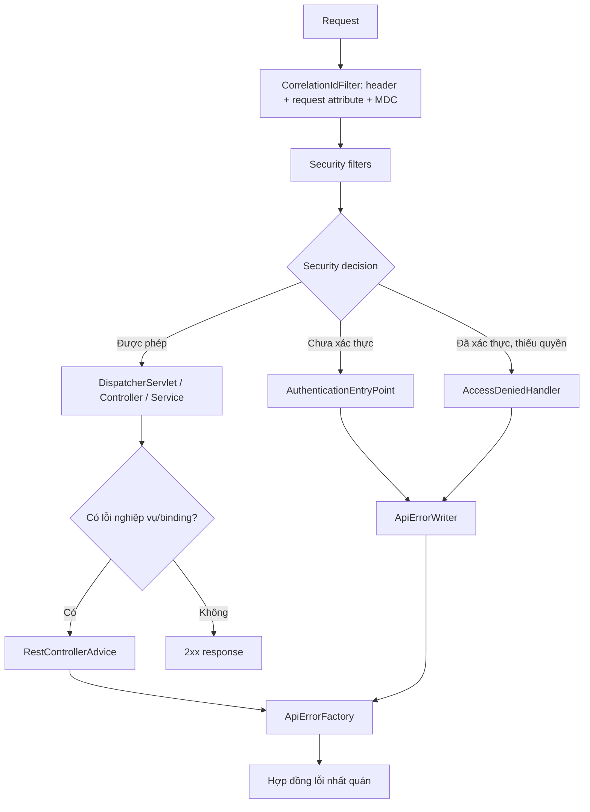

# Thống nhất mã lỗi, thông điệp và correlation ID giữa các lớp

Trong một REST API dùng Spring Security, request có thể thất bại trước khi vào controller (chưa xác thực hoặc thiếu quyền), ở MVC khi nhận dữ liệu sai, trong service khi vi phạm nghiệp vụ, hoặc tại gateway/downstream. Nếu các lớp tự trả lỗi tùy ý, client khó xử lý nhất quán, còn đội vận hành khó lần theo request. Giải pháp là **một hợp đồng lỗi HTTP chung** và **một correlation ID xuyên suốt request**.

Bài thuộc **Spring Security – authorization → Xử lý từ chối**, nên trọng tâm là bảo đảm phản hồi của `AuthenticationEntryPoint` (thường 401) và `AccessDeniedHandler` (thường 403) thống nhất với `@RestControllerAdvice` và service. Ví dụ bên dưới dành cho **Java 17+, Spring Boot 3.x, Spring Security 6.x, Servlet/MVC**; WebFlux dùng các API khác như `ServerAuthenticationEntryPoint` và `ServerAccessDeniedHandler`.

## 1. Hợp đồng lỗi chung

Ví dụ khi một request chưa xác thực gọi `/api/data`:

```http
HTTP/1.1 401 Unauthorized
Content-Type: application/json;charset=UTF-8
WWW-Authenticate: Basic realm="learning-api"
X-Correlation-ID: req-20261105-0001
```

```json
{
  "code": "AUTHENTICATION_REQUIRED",
  "message": "Bạn cần xác thực để truy cập tài nguyên.",
  "correlationId": "req-20261105-0001",
  "path": "/api/data",
  "timestamp": "2026-11-05T11:00:00Z"
}
```

Đây là **minh họa cấu trúc**; `timestamp` thực tế được sinh vào thời điểm phản hồi. Đừng bỏ HTTP status và các header quan trọng khi chỉ kiểm tra JSON.

| Thành phần | Vai trò | Quy tắc |
| --- | --- | --- |
| HTTP status | Phân biệt loại kết quả ở mức giao thức | Giữ đúng 400/401/403/404/500; không biến lỗi thành HTTP 200. |
| `code` | Mã ổn định để ứng dụng client rẽ nhánh | Định danh bằng chữ in hoa như `AUTHENTICATION_REQUIRED`; có chính sách versioning. |
| `message` | Lời giải thích có thể công bố cho client | Ngắn, không tiết lộ role nội bộ, stack trace, credential hoặc chi tiết SQL. |
| `correlationId` | Tìm cùng request trong header, body, log và hệ thống liên quan | Phải nhất quán và được kiểm tra đầu vào. |
| `path` | Endpoint lỗi | Tránh đưa nguyên query string chứa token/dữ liệu nhạy cảm. |
| `timestamp` | Thời điểm tạo lỗi | Dùng `Instant`/UTC hoặc định dạng có timezone rõ ràng. |

**HTTP status** và **`code`** phục vụ hai mục đích khác nhau. Client nên dựa vào status và mã ổn định; nó không nên so khớp nguyên văn `message`, vì thông điệp có thể được dịch hoặc chỉnh cho dễ hiểu.

| Tình huống | Status thường dùng | `code` gợi ý | Nơi xử lý |
| --- | --- | --- | --- |
| Chưa xác thực, credential hoặc token không hợp lệ | 401 | `AUTHENTICATION_REQUIRED` | `AuthenticationEntryPoint`/authentication filter |
| Đã xác thực nhưng thiếu quyền | 403 | `ACCESS_DENIED` | `AccessDeniedHandler` |
| Input hoặc ràng buộc nghiệp vụ sai | 400 | `INVALID_INPUT` | MVC advice |
| Tài nguyên không tồn tại | 404 | `RESOURCE_NOT_FOUND` | MVC/gateway tùy nguồn lỗi |
| Lỗi máy chủ không dự kiến | 500 | `INTERNAL_ERROR` | Global error handling |
| Upstream lỗi tại gateway | 502/503/504 tùy trường hợp | `UPSTREAM_ERROR` | Gateway/integration layer |

**401 và 403 không đơn thuần tương ứng một đối một với tên exception Java.** Khi `ExceptionTranslationFilter` gặp `AccessDeniedException`, Spring Security xét trạng thái authentication: chủ thể anonymous có thể được dẫn tới entry point thay vì trả 403. Khi chủ thể đã xác thực mà thiếu role, `AccessDeniedHandler` thường trả 403. Lỗi CSRF cũng có thể làm request bị 403, nên cần chẩn đoán theo nguyên nhân thực tế.

## 2. Lỗi đi qua các lớp như thế nào?



- `AuthenticationEntryPoint` bắt đầu xác thực hoặc trả lời yêu cầu xác thực; trong API Basic thường trả 401 với `WWW-Authenticate`. Trong ứng dụng form login nó có thể trả redirect 302.
- `AccessDeniedHandler` xử lý trường hợp được coi là đã xác thực nhưng thiếu quyền, thường trả 403.
- `@RestControllerAdvice` xử lý exception từ Spring MVC/controller/service; nó **không tự thay thế** hai handler security do filter có thể từ chối request trước khi controller chạy.
- Service ném một exception nghiệp vụ có ý nghĩa, ví dụ `InvalidInputException`, và để lớp giao diện HTTP quyết định status/body.
- Một số authentication filter (ví dụ HTTP Basic) có thể gọi entry point trực tiếp khi credential sai. Muốn phản hồi cùng JSON ở cả trường hợp không có credential và credential sai thì cần cấu hình entry point ở **`exceptionHandling` lẫn `httpBasic`**.

Nếu ứng dụng dùng OAuth2 Resource Server, giữ giao thức **Bearer challenge** (`WWW-Authenticate: Bearer ...`) khi tùy biến body. Không sao chép header Basic cho JWT/Bearer; `BearerTokenAuthenticationEntryPoint` và `BearerTokenAccessDeniedHandler` có vai trò chuyên biệt.

## 3. Thiết kế correlation ID có thể tin cậy

Tên header ví dụ là `X-Correlation-ID`. Một filter chạy trước điểm có thể từ chối request sẽ:

1. Đọc ID từ request nếu có. Chấp nhận theo chính sách trust boundary và cú pháp, độ dài cụ thể; nếu không, tạo UUID.
2. Ghi cùng ID vào **request attribute**, **response header**, và **MDC** (`org.slf4j.MDC`) để controller, security handler và logging cùng sử dụng.
3. Khôi phục/loại bỏ giá trị MDC trong `finally` để thread pool không rò ID từ request cũ.
4. Không tự sinh ID mới trong `AuthenticationEntryPoint`, `AccessDeniedHandler`, hoặc mỗi exception handler.
5. Chỉ chuyển tiếp ID tới downstream khi được phép. MDC không tự truyền qua `@Async`, thread khác, queue hoặc scheduled job; dùng context propagation/task decorator có chủ đích.
6. Phân biệt `correlationId` với `traceId` và `spanId` của Micrometer/OpenTelemetry. Có thể log cả ba; chúng không mặc nhiên tương đương.

Trong ví dụ, ID hợp lệ gồm 8–64 ký tự ASCII `[A-Za-z0-9._-]`; chuỗi chứa ký tự điều khiển, newline hoặc quá dài sẽ được thay. Gateway thực tế còn cần quy định header do client gửi có được tin hay chỉ header do ingress cấp. Nếu nhiều header cùng tên xuất hiện, nên chuẩn hóa/loại bỏ tại ingress.

## 4. Ví dụ chạy được với Spring Boot 3.x

Tạo Spring Boot project, package `com.example.demo`. Dùng Java 17+, Spring Web, Spring Security, và `spring-boot-starter-test`/`spring-security-test` cho phần kiểm thử. Ví dụ `build.gradle`:

```groovy
plugins {
    id 'java'
    id 'org.springframework.boot' version '3.3.5'
    id 'io.spring.dependency-management' version '1.1.6'
}

group = 'com.example'
version = '0.0.1-SNAPSHOT'

java {
    toolchain {
        languageVersion = JavaLanguageVersion.of(17)
    }
}
repositories { mavenCentral() }
dependencies {
    implementation 'org.springframework.boot:spring-boot-starter-web'
    implementation 'org.springframework.boot:spring-boot-starter-security'
    testImplementation 'org.springframework.boot:spring-boot-starter-test'
    testImplementation 'org.springframework.security:spring-security-test'
}
tasks.named('test') { useJUnitPlatform() }
```

Mỗi đoạn Java dưới đây đặt trong một tệp mang đúng tên public class/record/enum, dưới `src/main/java/com/example/demo/`.

### 4.1. Entry point ứng dụng, error code và body

**DemoApplication.java**

```java
package com.example.demo;

import org.springframework.boot.SpringApplication;
import org.springframework.boot.autoconfigure.SpringBootApplication;

@SpringBootApplication
public class DemoApplication {
    public static void main(String[] args) {
        SpringApplication.run(DemoApplication.class, args);
    }
}
```

**ErrorCode.java**

```java
package com.example.demo;

import org.springframework.http.HttpStatus;

public enum ErrorCode {
    AUTHENTICATION_REQUIRED(HttpStatus.UNAUTHORIZED,
            "Bạn cần xác thực để truy cập tài nguyên."),
    ACCESS_DENIED(HttpStatus.FORBIDDEN,
            "Bạn không có quyền truy cập tài nguyên này."),
    INVALID_INPUT(HttpStatus.BAD_REQUEST,
            "Dữ liệu yêu cầu không hợp lệ."),
    RESOURCE_NOT_FOUND(HttpStatus.NOT_FOUND,
            "Không tìm thấy tài nguyên."),
    INTERNAL_ERROR(HttpStatus.INTERNAL_SERVER_ERROR,
            "Có lỗi hệ thống. Vui lòng thử lại sau.");

    private final HttpStatus status;
    private final String publicMessage;

    ErrorCode(HttpStatus status, String publicMessage) {
        this.status = status;
        this.publicMessage = publicMessage;
    }

    public HttpStatus status() {
        return status;
    }

    public String publicMessage() {
        return publicMessage;
    }
}
```

**ApiError.java**

```java
package com.example.demo;

import java.time.Instant;

public record ApiError(
        String code,
        String message,
        String correlationId,
        String path,
        Instant timestamp) {
}
```

**ApiErrorFactory.java**

```java
package com.example.demo;

import java.time.Instant;
import jakarta.servlet.http.HttpServletRequest;
import org.springframework.stereotype.Component;

@Component
public class ApiErrorFactory {
    public ApiError create(ErrorCode code, HttpServletRequest request) {
        return new ApiError(
                code.name(),
                code.publicMessage(),
                CorrelationIdFilter.requireId(request),
                request.getRequestURI(),
                Instant.now());
    }
}
```

Danh mục `ErrorCode` là nơi duy nhất quyết định `code`/status/public message. Đừng đưa nguyên `exception.getMessage()` vào `ApiError.message` vì nó có thể chứa chi tiết bảo mật hoặc hạ tầng. `ApiErrorFactory` lấy correlation ID đã có trong request thay vì tạo ID mới.

### 4.2. Filter cấp correlation ID

**CorrelationIdFilter.java**

```java
package com.example.demo;

import java.io.IOException;
import java.util.UUID;
import java.util.regex.Pattern;

import jakarta.servlet.FilterChain;
import jakarta.servlet.ServletException;
import jakarta.servlet.http.HttpServletRequest;
import jakarta.servlet.http.HttpServletResponse;
import org.slf4j.MDC;
import org.springframework.web.filter.OncePerRequestFilter;

public final class CorrelationIdFilter extends OncePerRequestFilter {
    public static final String HEADER = "X-Correlation-ID";
    private static final String ATTRIBUTE =
            CorrelationIdFilter.class.getName() + ".id";
    private static final String MDC_KEY = "correlationId";
    private static final Pattern VALID_ID =
            Pattern.compile("[A-Za-z0-9][A-Za-z0-9._-]{7,63}");

    @Override
    protected void doFilterInternal(HttpServletRequest request,
                                    HttpServletResponse response,
                                    FilterChain chain)
            throws ServletException, IOException {

        String supplied = request.getHeader(HEADER);
        String correlationId =
                supplied != null && VALID_ID.matcher(supplied).matches()
                ? supplied
                : UUID.randomUUID().toString();

        request.setAttribute(ATTRIBUTE, correlationId);
        response.setHeader(HEADER, correlationId);

        String previous = MDC.get(MDC_KEY);
        MDC.put(MDC_KEY, correlationId);
        try {
            chain.doFilter(request, response);
        } finally {
            if (previous == null) {
                MDC.remove(MDC_KEY);
            } else {
                MDC.put(MDC_KEY, previous);
            }
        }
    }

    public static String requireId(HttpServletRequest request) {
        Object value = request.getAttribute(ATTRIBUTE);
        if (value instanceof String id) {
            return id;
        }
        throw new IllegalStateException(
                "CorrelationIdFilter must execute before error handling");
    }
}
```

`requireId` cố ý báo lỗi cấu hình nếu không có ID, tránh trả hai ID khác nhau trong header và body. Tất cả request qua Security chain cần đi qua filter này trước các handler. Code dùng `request.getHeader()` (giá trị đầu tiên); ở hệ thống thật cần chính sách xử lý header trùng lặp hoặc xung đột tại ingress.

`MDC.put` chỉ đặt dữ liệu; muốn log thực sự hiện ID, cấu hình pattern/JSON encoder của Logback. Ví dụ `src/main/resources/application.properties`:

```properties
logging.pattern.level=%5p [correlationId:%X{correlationId:-none}]
```

Một log ứng dụng có thể có dạng minh họa:

```text
WARN [correlationId:req-20261105-0001] Access denied for /api/admin
```

Đó là ví dụ định dạng, **không** phải một log tự động được Security sinh ra. Hạn chế log thông tin nhạy cảm như token, password, cookie hoặc raw query.

### 4.3. Dùng chung JSON writer cho hai Security handlers

**ApiErrorWriter.java**

```java
package com.example.demo;

import java.io.IOException;
import java.nio.charset.StandardCharsets;
import com.fasterxml.jackson.databind.ObjectMapper;
import jakarta.servlet.http.HttpServletRequest;
import jakarta.servlet.http.HttpServletResponse;
import org.springframework.http.MediaType;
import org.springframework.stereotype.Component;

@Component
public class ApiErrorWriter {
    private final ObjectMapper mapper;
    private final ApiErrorFactory factory;

    public ApiErrorWriter(ObjectMapper mapper, ApiErrorFactory factory) {
        this.mapper = mapper;
        this.factory = factory;
    }

    public void write(HttpServletRequest request,
                      HttpServletResponse response,
                      ErrorCode code) throws IOException {
        response.setStatus(code.status().value());
        response.setCharacterEncoding(StandardCharsets.UTF_8.name());
        response.setContentType(MediaType.APPLICATION_JSON_VALUE);
        mapper.writeValue(response.getOutputStream(),
                factory.create(code, request));
    }
}
```

**SecurityConfig.java**

```java
package com.example.demo;

import org.springframework.boot.web.servlet.FilterRegistrationBean;
import org.springframework.context.annotation.Bean;
import org.springframework.context.annotation.Configuration;
import org.springframework.http.HttpHeaders;
import org.springframework.security.config.annotation.web.builders.HttpSecurity;
import org.springframework.security.core.userdetails.User;
import org.springframework.security.core.userdetails.UserDetailsService;
import org.springframework.security.crypto.bcrypt.BCryptPasswordEncoder;
import org.springframework.security.crypto.password.PasswordEncoder;
import org.springframework.security.provisioning.InMemoryUserDetailsManager;
import org.springframework.security.web.AuthenticationEntryPoint;
import org.springframework.security.web.SecurityFilterChain;
import org.springframework.security.web.access.AccessDeniedHandler;
import org.springframework.security.web.context.SecurityContextHolderFilter;

@Configuration
public class SecurityConfig {
    @Bean
    CorrelationIdFilter correlationIdFilter() {
        return new CorrelationIdFilter();
    }

    @Bean
    FilterRegistrationBean<CorrelationIdFilter> correlationRegistration(
            CorrelationIdFilter filter) {
        FilterRegistrationBean<CorrelationIdFilter> registration =
                new FilterRegistrationBean<>(filter);
        registration.setEnabled(false);
        return registration;
    }

    @Bean
    SecurityFilterChain securityFilterChain(
            HttpSecurity http,
            CorrelationIdFilter filter,
            ApiErrorWriter writer) throws Exception {

        AuthenticationEntryPoint unauthorized =
                (request, response, exception) -> {
                    response.setHeader(HttpHeaders.WWW_AUTHENTICATE,
                            "Basic realm=\"learning-api\"");
                    writer.write(request, response,
                            ErrorCode.AUTHENTICATION_REQUIRED);
                };

        AccessDeniedHandler forbidden =
                (request, response, exception) ->
                        writer.write(request, response,
                                ErrorCode.ACCESS_DENIED);

        http
            .authorizeHttpRequests(authorize -> authorize
                .requestMatchers("/api/public").permitAll()
                .requestMatchers("/api/admin").hasRole("ADMIN")
                .requestMatchers("/api/**").authenticated()
                .anyRequest().permitAll())
            .exceptionHandling(exceptions -> exceptions
                .authenticationEntryPoint(unauthorized)
                .accessDeniedHandler(forbidden))
            .httpBasic(basic -> basic
                .authenticationEntryPoint(unauthorized))
            .addFilterBefore(filter, SecurityContextHolderFilter.class);

        return http.build();
    }

    @Bean
    PasswordEncoder passwordEncoder() {
        return new BCryptPasswordEncoder();
    }

    @Bean
    UserDetailsService users(PasswordEncoder encoder) {
        return new InMemoryUserDetailsManager(
                User.withUsername("reader")
                    .password(encoder.encode("demo-pass"))
                    .roles("READER")
                    .build());
    }
}
```

**Điểm quan trọng trong cấu hình:**

- `addFilterBefore(..., SecurityContextHolderFilter.class)` bảo đảm correlation ID đã tồn tại trước xác thực/phân quyền. Cấu hình `FilterRegistrationBean#setEnabled(false)` ngăn Spring Boot đăng ký cùng filter thêm một lần ở servlet container.
- `exceptionHandling.authenticationEntryPoint(...)` điều khiển tình huống chưa xác thực khi kiểm tra quyền. `httpBasic.authenticationEntryPoint(...)` xử lý cả trường hợp Basic credential sai. Cả hai dùng `AUTHENTICATION_REQUIRED`.
- `accessDeniedHandler` dùng chung writer nhưng map sang `ACCESS_DENIED` và HTTP 403.
- HTTP 401 Basic vẫn có `WWW-Authenticate` đúng giao thức; header này được đặt **trước** khi writer ghi response.
- Matcher `/api/admin` đứng trước `/api/**` để role `ADMIN` không bị matcher chung che mất.
- Các endpoint ví dụ đều là GET, nên không cần tắt CSRF. Với các phương thức thay đổi trạng thái cần thiết kế CSRF dựa trên cơ chế xác thực cụ thể, không tắt chỉ vì thấy 403.
- In-memory user và mật khẩu `demo-pass` chỉ dành cho học tập, không phải cấu hình production.

### 4.4. Service ném lỗi nghiệp vụ; MVC advice định hình response

**InvalidInputException.java**

```java
package com.example.demo;

public final class InvalidInputException extends RuntimeException {
    public InvalidInputException(String reason) {
        super(reason);
    }
}
```

**ReportService.java**

```java
package com.example.demo;

import org.springframework.stereotype.Service;

@Service
public class ReportService {
    public String calculate(int count) {
        if (count < 0) {
            throw new InvalidInputException("count must be non-negative");
        }
        return "total=" + count;
    }
}
```

**ApiController.java**

```java
package com.example.demo;

import java.util.Map;
import org.springframework.web.bind.annotation.GetMapping;
import org.springframework.web.bind.annotation.RequestParam;
import org.springframework.web.bind.annotation.RestController;

@RestController
public class ApiController {
    private final ReportService service;

    public ApiController(ReportService service) {
        this.service = service;
    }

    @GetMapping("/api/public")
    public Map<String, String> publicApi() {
        return Map.of("result", "public");
    }

    @GetMapping("/api/data")
    public Map<String, String> protectedData() {
        return Map.of("result", "data");
    }

    @GetMapping("/api/admin")
    public Map<String, String> admin() {
        return Map.of("result", "admin");
    }

    @GetMapping("/api/calculate")
    public Map<String, String> calculate(@RequestParam int count) {
        return Map.of("result", service.calculate(count));
    }
}
```

**ApiExceptionAdvice.java**

```java
package com.example.demo;

import jakarta.servlet.http.HttpServletRequest;
import org.springframework.http.ResponseEntity;
import org.springframework.http.converter.HttpMessageNotReadableException;
import org.springframework.web.bind.MethodArgumentNotValidException;
import org.springframework.web.bind.MissingServletRequestParameterException;
import org.springframework.web.bind.annotation.ExceptionHandler;
import org.springframework.web.bind.annotation.RestControllerAdvice;
import org.springframework.web.method.annotation.MethodArgumentTypeMismatchException;

@RestControllerAdvice
public class ApiExceptionAdvice {
    private final ApiErrorFactory factory;

    public ApiExceptionAdvice(ApiErrorFactory factory) {
        this.factory = factory;
    }

    @ExceptionHandler({
        InvalidInputException.class,
        MissingServletRequestParameterException.class,
        MethodArgumentTypeMismatchException.class,
        MethodArgumentNotValidException.class,
        HttpMessageNotReadableException.class
    })
    public ResponseEntity<ApiError> invalidInput(
            HttpServletRequest request) {
        ErrorCode code = ErrorCode.INVALID_INPUT;
        return ResponseEntity.status(code.status())
                .body(factory.create(code, request));
    }
}
```

Khi service thấy `count < 0`, nó ném `InvalidInputException`; advice trả **400 + `INVALID_INPUT` + chính correlation ID** đã có trong request. Khi `/api/calculate` thiếu tham số `count`, Spring MVC ném `MissingServletRequestParameterException`; advice cũng trả cùng cấu trúc. Khả năng bắt `MethodArgumentTypeMismatchException` bao phủ lỗi chuỗi không chuyển được sang số. Trong production, bổ sung exception mapping cho các loại lỗi thực tế mà ứng dụng hỗ trợ.

**Không dùng một `@ExceptionHandler(Exception.class)` tùy tiện** để nuốt mọi lỗi, đặc biệt các lỗi security, rồi biến 401/403 thành 500. Hợp đồng 500/404 hoặc lỗi từ gateway cần được cấu hình riêng theo nguồn phát sinh và error dispatch thực tế. Ví dụ ở đây trình diễn ba nhánh chủ đạo 401/403/400; danh mục `INTERNAL_ERROR` và `RESOURCE_NOT_FOUND` dành cho mapping mở rộng.

## 5. Chạy thử và kiểm tra các kết quả

Chạy trên dự án có Gradle wrapper:

```bash
./gradlew bootRun
```

Trên Windows thay bằng `gradlew.bat bootRun`. Với cổng HTTP mặc định 8080, thử:

```bash
curl -i -H "X-Correlation-ID: req-20261105-0001" \
  http://localhost:8080/api/data

curl -i -u reader:demo-pass \
  -H "X-Correlation-ID: req-20261105-0002" \
  http://localhost:8080/api/admin

curl -i -u reader:demo-pass \
  -H "X-Correlation-ID: req-20261105-0003" \
  "http://localhost:8080/api/calculate?count=-1"

curl -i -u reader:demo-pass \
  -H "X-Correlation-ID: req-20261105-0004" \
  http://localhost:8080/api/calculate
```

Các kết quả cần quan sát:

| Request | Status | `code` | Correlation ID |
| --- | --- | --- | --- |
| `/api/data`, chưa có credential | 401 và Basic challenge | `AUTHENTICATION_REQUIRED` | `req-20261105-0001` |
| `/api/admin`, user `reader` đã xác thực nhưng thiếu role | 403 | `ACCESS_DENIED` | `req-20261105-0002` |
| `/api/calculate?count=-1`, service từ chối | 400 | `INVALID_INPUT` | `req-20261105-0003` |
| `/api/calculate` thiếu `count`, lỗi MVC binding | 400 | `INVALID_INPUT` | `req-20261105-0004` |
| `/api/data`, user `reader` hợp lệ | 200 | Không có error body | ID vẫn có trong response header |

Ví dụ body 403 (timestamp minh họa):

```json
{
  "code": "ACCESS_DENIED",
  "message": "Bạn không có quyền truy cập tài nguyên này.",
  "correlationId": "req-20261105-0002",
  "path": "/api/admin",
  "timestamp": "2026-11-05T11:00:01Z"
}
```

Khi gửi `X-Correlation-ID: bad!`, filter loại ID không hợp lệ và tạo một UUID mới. Header và body phải cùng ID này. Nếu dùng form login, đừng ép HTML redirect thành JSON 401 khi UX cần trang đăng nhập; chọn entry point phù hợp từng nhóm URL/client.

## 6. Kiểm thử tích hợp các tầng

Đặt `src/test/java/com/example/demo/ErrorContractTest.java`:

```java
package com.example.demo;

import org.junit.jupiter.api.Test;
import org.springframework.beans.factory.annotation.Autowired;
import org.springframework.boot.test.autoconfigure.web.servlet.AutoConfigureMockMvc;
import org.springframework.boot.test.context.SpringBootTest;
import org.springframework.http.HttpHeaders;
import org.springframework.test.web.servlet.MockMvc;

import static org.hamcrest.Matchers.matchesPattern;
import static org.springframework.security.test.web.servlet.request.SecurityMockMvcRequestPostProcessors.httpBasic;
import static org.springframework.test.web.servlet.request.MockMvcRequestBuilders.get;
import static org.springframework.test.web.servlet.result.MockMvcResultMatchers.header;
import static org.springframework.test.web.servlet.result.MockMvcResultMatchers.jsonPath;
import static org.springframework.test.web.servlet.result.MockMvcResultMatchers.status;

@SpringBootTest
@AutoConfigureMockMvc
class ErrorContractTest {

    @Autowired
    MockMvc mvc;

    @Test
    void unauthenticatedRequestUsesCommonBody() throws Exception {
        String id = "req-test-0001";
        mvc.perform(get("/api/data")
                .header(CorrelationIdFilter.HEADER, id))
            .andExpect(status().isUnauthorized())
            .andExpect(header().string(
                    HttpHeaders.WWW_AUTHENTICATE,
                    "Basic realm=\"learning-api\""))
            .andExpect(header().string(CorrelationIdFilter.HEADER, id))
            .andExpect(jsonPath("$.code")
                    .value("AUTHENTICATION_REQUIRED"))
            .andExpect(jsonPath("$.correlationId").value(id))
            .andExpect(jsonPath("$.path").value("/api/data"))
            .andExpect(jsonPath("$.timestamp").exists());
    }

    @Test
    void authenticatedWithoutRoleUses403() throws Exception {
        String id = "req-test-0002";
        mvc.perform(get("/api/admin")
                .with(httpBasic("reader", "demo-pass"))
                .header(CorrelationIdFilter.HEADER, id))
            .andExpect(status().isForbidden())
            .andExpect(header().string(CorrelationIdFilter.HEADER, id))
            .andExpect(jsonPath("$.code").value("ACCESS_DENIED"))
            .andExpect(jsonPath("$.correlationId").value(id));
    }

    @Test
    void serviceExceptionUses400AndSameId() throws Exception {
        String id = "req-test-0003";
        mvc.perform(get("/api/calculate")
                .param("count", "-1")
                .with(httpBasic("reader", "demo-pass"))
                .header(CorrelationIdFilter.HEADER, id))
            .andExpect(status().isBadRequest())
            .andExpect(header().string(CorrelationIdFilter.HEADER, id))
            .andExpect(jsonPath("$.code").value("INVALID_INPUT"))
            .andExpect(jsonPath("$.correlationId").value(id));
    }

    @Test
    void mvcBindingExceptionUsesSameSchema() throws Exception {
        mvc.perform(get("/api/calculate")
                .with(httpBasic("reader", "demo-pass"))
                .header(CorrelationIdFilter.HEADER, "req-test-0004"))
            .andExpect(status().isBadRequest())
            .andExpect(jsonPath("$.code").value("INVALID_INPUT"))
            .andExpect(jsonPath("$.correlationId")
                    .value("req-test-0004"));
    }

    @Test
    void invalidHeaderTriggersServerGeneratedId() throws Exception {
        mvc.perform(get("/api/data")
                .header(CorrelationIdFilter.HEADER, "bad!"))
            .andExpect(status().isUnauthorized())
            .andExpect(header().string(CorrelationIdFilter.HEADER,
                    matchesPattern("[0-9a-fA-F-]{36}")))
            .andExpect(jsonPath("$.correlationId")
                    .value(matchesPattern("[0-9a-fA-F-]{36}")));
    }

    @Test
    void validUserCanReadProtectedEndpoint() throws Exception {
        mvc.perform(get("/api/data")
                .with(httpBasic("reader", "demo-pass")))
            .andExpect(status().isOk());
    }
}
```

Chạy:

```bash
./gradlew test
```

Test xác nhận mỗi tầng trả status và mã đúng, đồng thời header/body khớp với **ID client hợp lệ**. Với UUID server tự tạo, hai assertion định dạng riêng lẻ chưa chứng minh **hai chuỗi bằng nhau**. Nếu yêu cầu bắt buộc, lấy `MvcResult`, đọc `response.getHeader("X-Correlation-ID")`, parse JSON và đối chiếu `correlationId` chính xác trong cùng một assertion.

Kiểm thử production cần mở rộng cho credential sai, Bearer challenge, CSRF, 404/500, lỗi gateway, header trùng lặp, async, response đã committed và việc giữ ID trong log.

## 7. Mang correlation ID sang dịch vụ khác

Với REST client chạy cùng thread, có thể truyền ID qua interceptor:

```java
@Bean
RestClient downstreamClient(RestClient.Builder builder) {
    return builder.requestInterceptor((request, body, execution) -> {
        String id = MDC.get("correlationId");
        if (id != null) {
            request.getHeaders().set("X-Correlation-ID", id);
        }
        return execution.execute(request, body);
    }).build();
}
```

Đây chỉ là **phương thức minh họa bên trong một `@Configuration`**, cần import `org.springframework.context.annotation.Bean`, `org.springframework.web.client.RestClient`, `org.slf4j.MDC`; demo ở mục 4 không gọi downstream. Nếu bạn dùng `@Async`, scheduler hoặc queue, MDC của thread hiện tại có thể không tồn tại ở thread xử lý tiếp. Hãy dùng task decorator/context propagation và bảo đảm cleanup. Đừng nhầm correlation ID tùy biến với `traceId` do tracing tạo; log cả hai khi có tracing.

## 8. Sai lầm thường gặp

- **Mỗi lớp viết JSON riêng:** security trả `{"error":"Unauthorized"}`, controller trả HTML/ProblemDetail, service tự trả `200` chứa lỗi. Chọn hợp đồng và nơi ánh xạ rõ ràng.
- **Phân nhánh bằng `message`:** đổi ngôn ngữ hoặc sửa câu chữ sẽ phá client. Sử dụng `code` và status.
- **Mất header challenge khi tùy biến 401:** Basic/Bearer cần `WWW-Authenticate` phù hợp. Không để JSON chung làm sai giao thức.
- **Sai 401/403:** anonymous cần yêu cầu xác thực; người đã xác thực thiếu role thường bị 403. Xét riêng CSRF, remember-me, anonymous.
- **Tin rằng advice bắt được tất cả lỗi:** security filter chạy trước controller; phải cấu hình entry point và access-denied handler.
- **Đăng ký filter hai lần:** vừa là Servlet filter tự đăng ký, vừa nằm trong Security chain. Kiểm soát registration, order và số lần thực thi.
- **Không dọn MDC:** thread pool tái sử dụng ID cũ, gây sai log; `finally` và propagation có kiểm soát là bắt buộc.
- **Tin toàn bộ ID từ header bên ngoài:** chuỗi có thể gây log injection hoặc giả mạo. Validate và đặt ranh giới tin cậy.
- **Sinh ID mới trong từng handler:** header, JSON, log sẽ không liên kết; lấy từ request attribute chung.
- **Lộ thông tin chi tiết:** không đưa stack trace, SQL, quyền nội bộ, access token, raw exception message hay query nhạy cảm vào response.
- **Chỉ test JSON:** quên status, `Content-Type`, `WWW-Authenticate`, `X-Correlation-ID` và các nhánh lỗi thực tế.
- **Tắt CSRF khi gặp 403:** 403 có thể là kết quả của CSRF protection; xác định nguyên nhân trước khi đổi chính sách.
- **Cho rằng mọi lỗi đi qua filter này:** lỗi ở ingress, container, network, error dispatch hoặc sau khi response committed có thể cần xử lý riêng.

## 9. Checklist thiết kế và vận hành

1. Định nghĩa schema cùng `code` ổn định, status, public message, correlation ID, timestamp và dữ liệu bổ sung có kiểm soát.
2. Map đúng 401/403 tại Spring Security; map validation/domain ở MVC; map 404/500 và lỗi gateway ở đúng tầng, tránh nuốt ngoại lệ bảo mật.
3. Tạo/kiểm tra correlation ID trước khi request có thể bị từ chối; dùng cùng ID trong header, body và log.
4. Giữ chuẩn `WWW-Authenticate`, `Content-Type` và các HTTP semantics của cơ chế xác thực.
5. Đặt MDC và cleanup đúng lifecycle; quy định context propagation qua async/queue/HTTP downstream.
6. Test đầy đủ trạng thái chưa xác thực, đã xác thực thiếu quyền, input sai, lỗi hệ thống và header không hợp lệ; đối chiếu giá trị ID thực tế.
7. Tránh tiết lộ dữ liệu nhạy cảm; giám sát lỗi bằng mã ổn định và correlation/trace ID.

**Cốt lõi:** chuẩn hóa lỗi không chỉ là làm body JSON giống nhau. Hệ thống cần giữ đúng **HTTP status và header giao thức**, xử lý **401/403 đúng trạng thái bảo mật**, và nối được **cùng một request** qua filter → controller → service → log.

## Tài liệu tham khảo chính thức

- [AuthenticationEntryPoint API](https://docs.spring.io/spring-security/reference/api/java/org/springframework/security/web/AuthenticationEntryPoint.html)
- [AccessDeniedHandler API](https://docs.spring.io/spring-security/reference/api/java/org/springframework/security/web/access/AccessDeniedHandler.html)
- [ExceptionTranslationFilter API](https://docs.spring.io/spring-security/reference/api/java/org/springframework/security/web/access/ExceptionTranslationFilter.html)
- [Servlet authorization architecture](https://docs.spring.io/spring-security/reference/servlet/authorization/architecture.html)
- [HTTP Basic authentication](https://docs.spring.io/spring-security/reference/servlet/authentication/passwords/basic.html)
- [Spring MVC exception handling](https://docs.spring.io/spring-framework/reference/web/webmvc/mvc-controller/ann-exceptionhandler.html)
- [OncePerRequestFilter API](https://docs.spring.io/spring-framework/docs/current/javadoc-api/org/springframework/web/filter/OncePerRequestFilter.html)