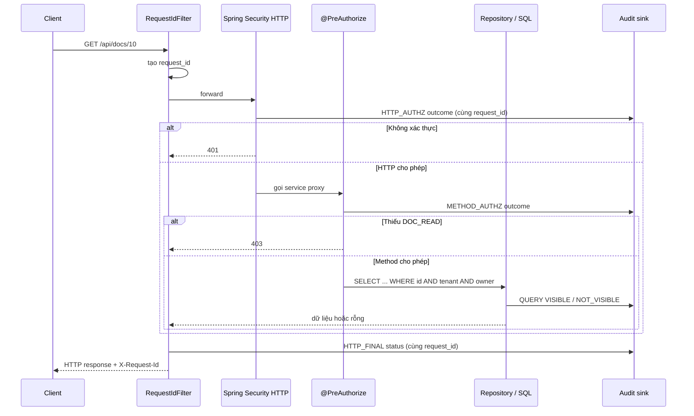

# Liên kết quyết định HTTP, phương thức và truy vấn trong cùng lượt xử lý

> **Chủ đề:** Spring Security – authorization. **Nhóm:** Sự kiện và audit. Bài học giải thích cách tạo **một chuỗi bằng chứng có thể truy vết** cho ba lớp bảo vệ: kiểm tra HTTP request, kiểm tra quyền trên phương thức và lọc phạm vi dữ liệu ngay trong truy vấn. Ví dụ dùng Java 17, Spring Boot 3.3.x, Spring Security 6.3.x, Servlet và H2/JDBC để thấy được cả quyết định lẫn truy vấn thực tế.

## 1. Bài toán: một request đi qua nhiều ranh giới quyền

Giả sử một hệ thống có API `GET /api/docs/{id}`:

- Alice đã đăng nhập và có authority `DOC_READ`.
- Alice thuộc tenant `t1`, được đọc tài liệu thuộc tenant `t1` **và** owner `alice`.
- Bob cũng có `DOC_READ` nhưng chỉ thấy tài liệu của Bob.
- User `viewer` đã đăng nhập nhưng **không** có `DOC_READ`.

Một request có thể vượt qua lớp HTTP `authenticated()` nhưng thất bại ở `@PreAuthorize`. Hoặc nó có thể vượt qua cả hai lớp trên và vẫn **không tìm thấy bản ghi nào trong phạm vi được phép** do query có điều kiện tenant/owner.

```text
GET /api/docs/10
  │
  ├─ HTTP authorization: authenticated()?   GRANTED
  │
  ├─ Method authorization: DOC_READ?         GRANTED
  │
  ├─ Data visibility: WHERE id, tenant, owner
  │     └─ found within allowed scope?      YES / NO
  │
  └─ HTTP response:                         200 / 404

Một request khác:
  HTTP GRANTED → Method DENIED → 403
  (truy vấn SQL tuyệt đối không được chạy)

Người chưa xác thực:
  HTTP DENIED → 401 theo HTTP Basic
  (method và truy vấn chưa được chạy)
```

**Mục tiêu của audit:** khi điều tra một yêu cầu, nối được các bằng chứng `HTTP_AUTHZ`, `METHOD_AUTHZ`, `QUERY_VISIBILITY` và `HTTP_FINAL` bằng **cùng một correlation ID**, trong khi vẫn phân biệt rõ ý nghĩa từng kết quả.

### 1.1. Đừng gộp bốn khái niệm thành một

| Lớp | Câu hỏi nó trả lời | Điều nó không chứng minh |
|---|---|---|
| HTTP authorization | URL/method/dispatcher request có vượt qua policy ở `SecurityFilterChain` không? | Người gọi được xem bản ghi ID cụ thể |
| Method authorization | Có đủ authority/biểu thức `@PreAuthorize` hoặc quy tắc method khác không? | Truy vấn DB đã chạy hoặc trả đúng dữ liệu |
| Query visibility | Dữ liệu được trả trong phạm vi tenant/owner/ACL của principal không? | Request HTTP hoàn tất thành công, giao dịch commit |
| HTTP final | Kết quả gửi về client là gì (401, 403, 404, 200, 500…)? | Nguyên nhân đầy đủ phía sau status; đã có đúng một lần kiểm tra quyền |

Ví dụ status 404 có thể xuất hiện khi ID chưa tồn tại hoặc khi ID có thật nhưng không nằm trong **phạm vi mà người gọi được biết**. Audit nội bộ chỉ nên nói `NOT_VISIBLE` khi dùng cùng một scoped query, không phơi bày “tài liệu thuộc Bob” cho người gọi trái quyền.

## 2. Liên kết theo cùng lượt xử lý: causal chain

Để truy vết, hãy tách ba loại ID:

1. **`request_id`:** ID mới do server tạo cho một HTTP request. Nó nối log do các thành phần thuộc cùng request tạo ra. Không dùng raw ID do client cung cấp làm khóa tin cậy.
2. **`trace_id / span_id`:** hệ thống distributed tracing (Micrometer/OpenTelemetry) nối các hop qua HTTP service, message broker, JDBC instrumentation… Một trace có thể chứa nhiều request và span; không đồng nhất trace với request ID.
3. **`decision_id` hoặc `event_id` (khi cần):** phân biệt nhiều lần evaluation **trong cùng request**, ví dụ một lần `@PreAuthorize` trên mỗi method gọi. Không sử dụng một `request_id` để giả định “chỉ một sự kiện”.

Khi xây event có thể phân tích, các trường tối thiểu nên có:

| Trường | Ví dụ | Lý do |
|---|---|---|
| `timestamp` | ISO-8601 UTC | Sắp thứ tự và điều tra |
| `request_id` | UUID server-generated | Join các bước của request |
| `trace_id` / `span_id` | ID từ tracing backend, nếu có | Join xuyên service |
| `phase` | `HTTP_AUTHZ` / `METHOD_AUTHZ` / `QUERY` / `HTTP_FINAL` | Biết lớp nào tạo bằng chứng |
| `outcome` | `GRANTED` / `DENIED` / `VISIBLE` / `NOT_VISIBLE` / `200`… | Không ép tất cả thành cùng một enum |
| `policy_id` | `docs.read.http` / `docs.read.method` | Biết rule nào được đánh giá |
| `resource_type` | `document` | Phân tích theo loại đối tượng |
| `principal_ref` | ID giả danh / mã nội bộ đã kiểm soát | Phân tích quyền theo danh tính được phép xem |
| `tenant_ref` | tenant được xác thực, có chính sách truy cập | Nhận diện lỗi cô lập tenant |
| `duration_ms`, `error_class` | Mức tổng hợp phù hợp | Phân biệt deny thực sự với lỗi hạ tầng |

**Không đưa** access token, cookie, mật khẩu, full `Authentication`, SQL param nhạy cảm, request body hoặc nội dung tài liệu vào audit. Metric label cũng không nên chứa user ID, document ID, raw URL hay request ID vì cardinality tăng rất lớn.

### 2.1. Event nào thật sự được Spring Security phát?

Spring Security Servlet có thể dùng `AuthorizationEventPublisher` để công bố kết quả authorization qua Spring events. `SpringAuthorizationEventPublisher` **mặc định công bố denied, không công bố mọi granted** vì sự kiện thành công thường quá nhiều.

- `AuthorizationDeniedEvent` có thể dùng để theo dõi lần đánh giá quyền bị từ chối; **không phải mọi HTTP 401/403 đều tương ứng đúng một event**.
- `AuthorizationGrantedEvent` chỉ có khi publisher được thiết kế để phát các grant đó.
- `@PreAuthorize` được áp dụng bởi AOP interceptor khi bật `@EnableMethodSecurity` và gọi phương thức **qua Spring proxy**.
- **Query-level visibility** như `WHERE tenant_id=:tenant AND owner_id=:owner` thuộc code truy vấn của ứng dụng; Spring Security **không tự phát “query allowed” event** cho mọi lệnh SQL.

Do đó, để nối cả ba tầng phải kết hợp event/cơ chế authorization với **evidence do repository/service ghi có chủ đích**, rồi liên kết bằng ID. Listener chỉ nhận event đã được phát; việc cấu hình `@EventListener` không tạo thêm những grant bị bỏ qua bởi publisher.

## 3. Ma trận kết quả của cùng endpoint

Giả sử DB có:

| id | tenant_id | owner_id | title |
|---:|---|---|---|
| 10 | t1 | alice | Alice note |
| 11 | t1 | bob | Bob note |
| 20 | t2 | carol | Carol note |

Và nhóm tài khoản demo:

- `alice`, `bob`, `carol`: đã xác thực, có `DOC_READ`.
- `viewer`: đã xác thực nhưng thiếu `DOC_READ`.

| Request | HTTP policy | Method policy | Query visibility | HTTP cuối |
|---|---|---|---|---|
| Alice đọc ID 10 | Granted | Granted | Visible | 200 |
| Alice đọc ID 11 của Bob | Granted | Granted | Not visible | 404 |
| Alice đọc ID 20 của tenant khác | Granted | Granted | Not visible | 404 |
| Alice đọc ID 999 không tồn tại | Granted | Granted | Not visible | 404 |
| Viewer đọc ID 10 | Granted | **Denied** | Không chạy | 403 |
| Anonymous đọc ID 10 | **Denied** | Không chạy | Không chạy | 401 (HTTP Basic) |

Điểm đáng chú ý là **HTTP và method đều GRANTED nhưng query vẫn NOT_VISIBLE**. Điều này không có nghĩa Spring Security “cho sai quyền”: hai lớp đầu trả lời hai câu hỏi rộng hơn, còn đối tượng cụ thể được kiểm tra qua SQL. Nếu business yêu cầu một đối tượng ngoài phạm vi bị che giấu, cùng response 404 cho “không tồn tại” và “không hiển thị” là chính sách hợp lý.

### 3.1. Trình tự mong đợi



Sơ đồ thể hiện một đường xử lý **đồng bộ** để học. Với async dispatch, queue hoặc xử lý khác thread, `MDC`/request context không tự lan truyền; cần truyền trace context có kiểm soát hoặc copy metadata an toàn. Tránh suy luận thứ tự dựa duy nhất vào timestamp ở hệ thống nhiều node nếu clock chưa được đồng bộ.

## 4. Ví dụ Spring Boot: tạo một chuỗi bằng chứng thực sự

Đây là project chạy độc lập với H2; query trong ví dụ **thực sự có điều kiện SQL**. Mỗi request dùng một `request_id` do filter tạo. Publisher ghi nhận kết quả authorization ở HTTP và method (chỉ log schema nhỏ), còn repository ghi lại kết quả **trong phạm vi được phép** của scoped query.

Bản demo dùng HTTP Basic và mật khẩu `{noop}` **chỉ để học**. Ứng dụng thật cần password encoder an toàn, HTTPS, identity/tenant từ thông tin đã được xác thực, policy và audit sink theo yêu cầu sản phẩm.

### 4.1. Cấu trúc

```text
settings.gradle
build.gradle
src/main/java/demo/AuditDemoApplication.java
src/main/java/demo/SecurityConfiguration.java
src/main/java/demo/RequestIdFilter.java
src/main/java/demo/AuditSink.java
src/main/java/demo/DecisionAuditPublisher.java
src/main/java/demo/IdentityScopes.java
src/main/java/demo/DocumentDto.java
src/main/java/demo/DocumentRepository.java
src/main/java/demo/DocumentService.java
src/main/java/demo/DocumentController.java
src/main/resources/schema.sql
src/main/resources/data.sql
src/test/java/demo/DecisionCorrelationTests.java
```

`settings.gradle`:

```groovy
rootProject.name = 'authorization-audit-correlation'
```

`build.gradle`:

```groovy
plugins {
    id 'java'
    id 'org.springframework.boot' version '3.3.5'
    id 'io.spring.dependency-management' version '1.1.6'
}

group = 'demo'
version = '0.0.1-SNAPSHOT'

java {
    toolchain {
        languageVersion = JavaLanguageVersion.of(17)
    }
}

repositories {
    mavenCentral()
}

dependencies {
    implementation 'org.springframework.boot:spring-boot-starter-web'
    implementation 'org.springframework.boot:spring-boot-starter-security'
    implementation 'org.springframework.boot:spring-boot-starter-jdbc'
    runtimeOnly 'com.h2database:h2'

    testImplementation 'org.springframework.boot:spring-boot-starter-test'
    testImplementation 'org.springframework.security:spring-security-test'
}

tasks.named('test') {
    useJUnitPlatform()
}
```

Ví dụ khóa phiên bản để trình bày nhất quán API Spring Security 6.3. Khi làm dự án thực, hãy dùng bản vá còn được hỗ trợ và đối chiếu chính xác phương thức của `AuthorizationEventPublisher` ở phiên bản đang triển khai.

`src/main/java/demo/AuditDemoApplication.java`:

```java
package demo;

import org.springframework.boot.SpringApplication;
import org.springframework.boot.autoconfigure.SpringBootApplication;

@SpringBootApplication
public class AuditDemoApplication {
    public static void main(String[] args) {
        SpringApplication.run(AuditDemoApplication.class, args);
    }
}
```

### 4.2. Tạo request ID trước Spring Security và dọn MDC

`src/main/java/demo/RequestIdFilter.java`:

```java
package demo;

import java.io.IOException;
import java.util.UUID;

import jakarta.servlet.FilterChain;
import jakarta.servlet.ServletException;
import jakarta.servlet.http.HttpServletRequest;
import jakarta.servlet.http.HttpServletResponse;

import org.slf4j.MDC;
import org.springframework.core.Ordered;
import org.springframework.core.annotation.Order;
import org.springframework.stereotype.Component;
import org.springframework.web.filter.OncePerRequestFilter;

@Component
@Order(Ordered.HIGHEST_PRECEDENCE)
public class RequestIdFilter extends OncePerRequestFilter {

    private final AuditSink audit;

    public RequestIdFilter(AuditSink audit) {
        this.audit = audit;
    }

    @Override
    protected void doFilterInternal(
            HttpServletRequest request,
            HttpServletResponse response,
            FilterChain chain) throws ServletException, IOException {

        // ID do server tạo: không lấy raw X-Request-Id từ client làm khóa tin cậy.
        String requestId = UUID.randomUUID().toString();
        request.setAttribute("audit.request_id", requestId);
        response.setHeader("X-Request-Id", requestId);
        MDC.put("request_id", requestId);

        try {
            chain.doFilter(request, response);
        } finally {
            // HTTP_FINAL là status quan sát cuối filter, KHÔNG phải
            // kết quả duy nhất của mọi lần kiểm tra authorization.
            audit.record("HTTP_FINAL",
                Integer.toString(response.getStatus()),
                "route=docs.read");

            // Bắt buộc dọn sau request để tránh trộn log giữa request
            // dùng lại servlet thread từ thread pool.
            MDC.remove("request_id");
        }
    }
}
```

`@Order(Ordered.HIGHEST_PRECEDENCE)` đặt filter demo trước chuỗi Security filter tiêu chuẩn của Spring Boot. `OncePerRequestFilter` đảm bảo một lần trong mỗi dispatch theo cấu hình mặc định; **không đồng nghĩa luôn một lần cho toàn bộ mọi async/error dispatch**. Trong sản phẩm thực, quyết định rõ cách giữ/reuse `request_id` khi có redispatch, async và reverse proxy.

`src/main/java/demo/AuditSink.java`:

```java
package demo;

import org.slf4j.Logger;
import org.slf4j.LoggerFactory;
import org.slf4j.MDC;
import org.springframework.stereotype.Component;

@Component
public class AuditSink {

    private static final Logger log =
        LoggerFactory.getLogger(AuditSink.class);

    public void record(String phase, String outcome, String detail) {
        String requestId = MDC.get("request_id");
        if (requestId == null) {
            requestId = "non-http"; // Có thể được gọi từ job/background.
        }

        // Chỉ log tập trường hữu hạn và chuỗi detail kiểm soát nội bộ.
        log.info("request_id={} phase={} outcome={} detail={}",
            requestId, phase, outcome, detail);
    }
}
```

Để đơn giản, demo log đồng bộ qua SLF4J; không dùng log như một audit store bất biến hoặc giao dịch. `detail` trong demo chỉ nhận nhãn policy/query cố định, không nhận tham số request. Hệ thống thật nên dùng event schema chuẩn, giới hạn cardinality và bộ ghi audit có retention/quyền truy cập phù hợp.

### 4.3. HTTP policy và method security

`src/main/java/demo/SecurityConfiguration.java`:

```java
package demo;

import org.springframework.context.ApplicationEventPublisher;
import org.springframework.context.annotation.Bean;
import org.springframework.context.annotation.Configuration;
import org.springframework.http.HttpMethod;
import org.springframework.security.authorization.AuthorizationEventPublisher;
import org.springframework.security.authorization.SpringAuthorizationEventPublisher;
import org.springframework.security.config.Customizer;
import org.springframework.security.config.annotation.method.configuration.EnableMethodSecurity;
import org.springframework.security.config.annotation.web.builders.HttpSecurity;
import org.springframework.security.core.userdetails.User;
import org.springframework.security.core.userdetails.UserDetailsService;
import org.springframework.security.provisioning.InMemoryUserDetailsManager;
import org.springframework.security.web.SecurityFilterChain;

@Configuration
@EnableMethodSecurity
public class SecurityConfiguration {

    @Bean
    SecurityFilterChain securityFilterChain(HttpSecurity http)
            throws Exception {
        return http
            .authorizeHttpRequests(auth -> auth
                .requestMatchers(HttpMethod.GET, "/api/docs/**")
                    .authenticated()
                .anyRequest().denyAll()
            )
            .httpBasic(Customizer.withDefaults())
            .build();
    }

    @Bean
    AuthorizationEventPublisher authorizationEventPublisher(
            ApplicationEventPublisher springEvents, AuditSink audit) {
        return new DecisionAuditPublisher(
            audit, new SpringAuthorizationEventPublisher(springEvents));
    }

    @Bean
    UserDetailsService userDetailsService() {
        return new InMemoryUserDetailsManager(
            User.withUsername("alice")
                .password("{noop}pw")
                .authorities("DOC_READ")
                .build(),
            User.withUsername("bob")
                .password("{noop}pw")
                .authorities("DOC_READ")
                .build(),
            User.withUsername("carol")
                .password("{noop}pw")
                .authorities("DOC_READ")
                .build(),
            User.withUsername("viewer")
                .password("{noop}pw")
                .authorities("VIEWER")
                .build()
        );
    }
}
```

Ở HTTP layer, `authenticated()` cho phép mọi tài khoản đã xác thực đi tiếp tới controller. Kỹ thuật này cho phép nhìn riêng quyết định ở method layer; nó **không** có nghĩa mọi tài khoản đều được đọc tài liệu.

Ở method layer, `@PreAuthorize("hasAuthority('DOC_READ')")` sẽ kiểm tra quyền chi tiết. Vì bật `@EnableMethodSecurity`, lời gọi tới service bean qua Spring proxy được intercept. Tự gọi method bảo vệ từ **chính class đó** (`this.readVisible(...)`) có thể bỏ qua proxy, nên không dùng self-invocation làm bằng chứng đã kiểm tra quyền.

### 4.4. Quan sát hai quyết định qua cùng publisher

`src/main/java/demo/DecisionAuditPublisher.java`:

```java
package demo;

import java.util.function.Supplier;

import jakarta.servlet.http.HttpServletRequest;
import org.aopalliance.intercept.MethodInvocation;

import org.springframework.security.authorization.AuthorizationDecision;
import org.springframework.security.authorization.AuthorizationEventPublisher;
import org.springframework.security.core.Authentication;

public final class DecisionAuditPublisher
        implements AuthorizationEventPublisher {

    private final AuditSink audit;
    private final AuthorizationEventPublisher defaultDeniedPublisher;

    public DecisionAuditPublisher(
            AuditSink audit,
            AuthorizationEventPublisher defaultDeniedPublisher) {
        this.audit = audit;
        this.defaultDeniedPublisher = defaultDeniedPublisher;
    }

    @Override
    public <T> void publishAuthorizationEvent(
            Supplier<Authentication> authentication,
            T securedObject,
            AuthorizationDecision decision) {

        if (decision == null) {
            return; // Không gán GRANTED khi không có quyết định.
        }

        String outcome = decision.isGranted() ? "GRANTED" : "DENIED";

        if (securedObject instanceof HttpServletRequest request) {
            // Nhãn policy cố định, không ghi URI/raw query string.
            String policy = request.getServletPath()
                    .startsWith("/api/docs/")
                ? "docs.read.http" : "other.http";
            audit.record("HTTP_AUTHZ", outcome, "policy=" + policy);
        } else if (securedObject instanceof MethodInvocation invocation) {
            // Chỉ ghi tên method đã được định danh, không ghi arguments.
            String policy = invocation.getMethod().getName()
                    .equals("readVisible")
                ? "docs.read.method" : "other.method";
            audit.record("METHOD_AUTHZ", outcome, "policy=" + policy);
        }

        // Bảo toàn hành vi công bố sự kiện DENIED của Spring Security.
        // GRANTED ở đây chỉ ghi log có chọn lọc, không phát mọi
        // AuthorizationGrantedEvent vào hệ thống sự kiện.
        if (!decision.isGranted()) {
            defaultDeniedPublisher.publishAuthorizationEvent(
                authentication, securedObject, decision);
        }
    }
}
```

**Đọc đúng semantics của ví dụ:**

- Publisher nhận **một callback đánh giá authorization** và ghi lại outcome với request ID đang nằm trong MDC. Callback không tự thực hiện authorization.
- HTTP secured object thường là `HttpServletRequest` khi dùng `authorizeHttpRequests`; method secured object là `MethodInvocation` ở `@PreAuthorize`. Nếu ứng dụng thêm interceptor khác, target có thể là kiểu khác; code phải xử lý rõ.
- Việc gọi lại `SpringAuthorizationEventPublisher` ở nhánh denied giữ `AuthorizationDeniedEvent` cho listener khác; grant không bị đẩy vào luồng event thành công toàn cục chỉ để phục vụ bài audit.
- Không ghi `authentication.get()` hoặc `securedObject.toString()`: chúng có thể chứa principal, credential, method arguments hoặc request info nhạy cảm.
- Cấu hình bean publisher được Spring Security dùng ở nơi cơ chế authorization hỗ trợ event publisher. Khi nâng phiên bản hoặc thay advisor/security chain, phải **chạy test xác thực lớp nào phát callback**, không suy ra mọi cơ chế tùy chỉnh đều dùng bean này.

## 5. Kiểm soát truy vấn: điều kiện tenant và owner nằm trong SQL

HTTP policy và method policy là **hai hàng rào độc lập**; chúng không thay thế ràng buộc row-level. Dữ liệu trong DB phải được truy vấn qua điều kiện lấy từ **principal được xác thực**.

`src/main/java/demo/IdentityScopes.java`:

```java
package demo;

import org.springframework.security.access.AccessDeniedException;
import org.springframework.security.core.Authentication;
import org.springframework.stereotype.Component;

@Component
public class IdentityScopes {

    // Bản demo ánh xạ cố định. Hệ thống thực dùng identity/tenant
    // từ nguồn tin cậy đã được xác thực, không tin header do client tự gửi.
    public Scope resolve(Authentication authentication) {
        return switch (authentication.getName()) {
            case "alice" -> new Scope("t1", "alice");
            case "bob" -> new Scope("t1", "bob");
            case "carol" -> new Scope("t2", "carol");
            case "viewer" -> new Scope("t1", "viewer");
            default -> throw new AccessDeniedException(
                "No verified identity scope");
        };
    }

    public record Scope(String tenantId, String ownerId) {}
}
```

`src/main/java/demo/DocumentDto.java`:

```java
package demo;

public record DocumentDto(long id, String title) {}
```

`src/main/java/demo/DocumentRepository.java`:

```java
package demo;

import java.util.Optional;

import org.springframework.jdbc.core.namedparam.MapSqlParameterSource;
import org.springframework.jdbc.core.namedparam.NamedParameterJdbcTemplate;
import org.springframework.stereotype.Repository;

@Repository
public class DocumentRepository {

    private final NamedParameterJdbcTemplate jdbc;

    public DocumentRepository(NamedParameterJdbcTemplate jdbc) {
        this.jdbc = jdbc;
    }

    public Optional<DocumentDto> findVisible(
            long id, String tenantId, String ownerId) {

        String sql = """
            SELECT id, title
              FROM documents
             WHERE id = :id
               AND tenant_id = :tenantId
               AND owner_id = :ownerId
            """;

        var params = new MapSqlParameterSource()
            .addValue("id", id)
            .addValue("tenantId", tenantId)
            .addValue("ownerId", ownerId);

        return jdbc.query(sql, params, rs ->
            rs.next()
                ? Optional.of(new DocumentDto(
                    rs.getLong("id"), rs.getString("title")))
                : Optional.empty());
    }
}
```

Đây là **một câu SQL có ba predicate ngay tại DB**, không lấy tất cả bản ghi rồi lọc ở Java/UI. `NamedParameterJdbcTemplate` bind tham số, không nối chuỗi từ input. Vì trả về `Optional.empty()` cho cả ID không tồn tại và ID ngoài phạm vi, API có thể cùng trả 404 mà không tiết lộ sự tồn tại của tài liệu.

Trong ứng dụng thực tế, visibility có thể bao gồm ACL, nhóm, dự án, delegated access hoặc quyền giữa các tenant. Khi đó cần ánh xạ policy thành predicate chính xác (SQL/JPA Specification/RLS), không mặc định chỉ `ownerId` là đủ. Tất cả list, count, export, search, download, batch lookup phải giữ phạm vi tương ứng.

`src/main/java/demo/DocumentService.java`:

```java
package demo;

import java.util.Optional;

import org.springframework.security.access.prepost.PreAuthorize;
import org.springframework.security.core.Authentication;
import org.springframework.stereotype.Service;

@Service
public class DocumentService {

    private final IdentityScopes scopes;
    private final DocumentRepository repository;
    private final AuditSink audit;

    public DocumentService(
            IdentityScopes scopes,
            DocumentRepository repository,
            AuditSink audit) {
        this.scopes = scopes;
        this.repository = repository;
        this.audit = audit;
    }

    @PreAuthorize("hasAuthority('DOC_READ')")
    public Optional<DocumentDto> readVisible(
            long id, Authentication authentication) {

        IdentityScopes.Scope scope = scopes.resolve(authentication);

        // Query event này do ỨNG DỤNG ghi, Spring không tự tạo.
        audit.record("QUERY", "START", "query=docs.visible.v1");

        Optional<DocumentDto> document = repository.findVisible(
            id, scope.tenantId(), scope.ownerId());

        audit.record("QUERY",
            document.isPresent() ? "VISIBLE" : "NOT_VISIBLE",
            "query=docs.visible.v1");

        return document;
    }
}
```

Nếu `@PreAuthorize` từ chối, body `readVisible` không chạy nên **không có QUERY event**. Nếu SQL trả rỗng, `NOT_VISIBLE` là mô tả kết quả **của scoped query** chứ không khẳng định DB hoàn toàn không có bản ghi. Điều này giúp tránh log rò rỉ sự tồn tại.

`src/main/java/demo/DocumentController.java`:

```java
package demo;

import org.springframework.http.ResponseEntity;
import org.springframework.security.core.Authentication;
import org.springframework.web.bind.annotation.GetMapping;
import org.springframework.web.bind.annotation.PathVariable;
import org.springframework.web.bind.annotation.RequestMapping;
import org.springframework.web.bind.annotation.RestController;

@RestController
@RequestMapping("/api/docs")
public class DocumentController {

    private final DocumentService service;

    public DocumentController(DocumentService service) {
        this.service = service;
    }

    @GetMapping("/{id}")
    public ResponseEntity<DocumentDto> read(
            @PathVariable long id, Authentication authentication) {
        return service.readVisible(id, authentication)
            .map(ResponseEntity::ok)
            .orElseGet(() -> ResponseEntity.notFound().build());
    }
}
```

Controller không cần truy vấn “bản ghi này có tồn tại ở tenant khác không?”; trả 404 thống nhất cho phần không hiển thị. Với API public, không gửi audit detail nội bộ ra body hoặc `X-Request-Id` ngoài request UUID; response này chỉ chứa ID liên kết và mã HTTP.

### 5.1. Dữ liệu H2

`src/main/resources/schema.sql`:

```sql
CREATE TABLE documents (
    id BIGINT PRIMARY KEY,
    tenant_id VARCHAR(40) NOT NULL,
    owner_id VARCHAR(40) NOT NULL,
    title VARCHAR(200) NOT NULL
);

CREATE INDEX idx_documents_visibility
    ON documents (tenant_id, owner_id, id);
```

`src/main/resources/data.sql`:

```sql
INSERT INTO documents (id, tenant_id, owner_id, title) VALUES
    (10, 't1', 'alice', 'Alice note'),
    (11, 't1', 'bob',   'Bob note'),
    (20, 't2', 'carol', 'Carol note');
```

Spring Boot khởi tạo các file `schema.sql` / `data.sql` khi H2 embedded DB được auto-configure. Với DB production, migration và index phải phù hợp mô hình truy cập thực; không sao chép init script thử nghiệm sang hệ thống thật.

## 6. Quan sát bằng curl và chuỗi log

Trong project có Gradle wrapper dùng `./gradlew bootRun`; trên Windows dùng `gradlew.bat bootRun`. Có thể kiểm tra riêng status:

```bash
curl -s -o /dev/null -w '%{http_code}\n' \
  -u alice:pw http://localhost:8080/api/docs/10

curl -s -o /dev/null -w '%{http_code}\n' \
  -u alice:pw http://localhost:8080/api/docs/11

curl -s -o /dev/null -w '%{http_code}\n' \
  -u viewer:pw http://localhost:8080/api/docs/10

curl -s -o /dev/null -w '%{http_code}\n' \
  http://localhost:8080/api/docs/10
```

Theo thứ tự, **status mong đợi** là `200`, `404`, `403`, `401`. Các lệnh này là hướng dẫn kiểm tra, không khẳng định đã chạy trong máy người đọc.

Với request đầu tiên, giả sử server tạo UUID `00000000-0000-4000-8000-000000000001`, các **dòng nội dung log minh họa** có dạng:

```text
request_id=00000000-0000-4000-8000-000000000001 phase=HTTP_AUTHZ outcome=GRANTED detail=policy=docs.read.http
request_id=00000000-0000-4000-8000-000000000001 phase=METHOD_AUTHZ outcome=GRANTED detail=policy=docs.read.method
request_id=00000000-0000-4000-8000-000000000001 phase=QUERY outcome=START detail=query=docs.visible.v1
request_id=00000000-0000-4000-8000-000000000001 phase=QUERY outcome=VISIBLE detail=query=docs.visible.v1
request_id=00000000-0000-4000-8000-000000000001 phase=HTTP_FINAL outcome=200 detail=route=docs.read
```

Trong log console thực tế, SLF4J/Logback còn thêm timestamp, thread name, logger và mức log. Ví dụ chỉ hiển thị **message**. UUID là giả định cho minh họa, không phải output được đo hoặc UUID bắt buộc.

### 6.1. Khi bị chặn ở method

```text
HTTP_AUTHZ  GRANTED        docs.read.http
METHOD_AUTHZ DENIED        docs.read.method
QUERY        (không có)
HTTP_FINAL   403
```

Không có QUERY vì body của `DocumentService.readVisible` không được gọi qua proxy. Đây là một **invariant bảo mật rất hữu ích** để test: nếu user thiếu `DOC_READ` mà vẫn có truy vấn dữ liệu, cần xem lại proxy/interceptor, self-invocation hoặc đường bypass.

### 6.2. Khi query trả rỗng

```text
HTTP_AUTHZ   GRANTED       docs.read.http
METHOD_AUTHZ GRANTED       docs.read.method
QUERY        START         docs.visible.v1
QUERY        NOT_VISIBLE   docs.visible.v1
HTTP_FINAL   404
```

Cặp “Alice tìm ID 11 của Bob” và “Alice tìm ID 999” có cùng chuỗi ở cấp phase/outcome và cùng response 404. Nếu audit sink lưu ID cụ thể để điều tra, áp quyền xem dữ liệu rất chặt; log công khai không chứa tenant, owner hoặc bản ghi không thuộc quyền.

### 6.3. Khi chưa xác thực

```text
HTTP_AUTHZ   DENIED        docs.read.http
METHOD_AUTHZ (không có)
QUERY        (không có)
HTTP_FINAL   401
```

Trong HTTP Basic, 401 thường có `WWW-Authenticate: Basic ...`. Hệ thống dùng form login có thể redirect 302; Bearer Resource Server dùng challenge Bearer. Đừng suy ra tất cả denied event đều phải trả HTTP 403 hoặc tất cả 401 đều là lỗi của `AuthorizationFilter`.

## 7. Kiểm thử tự động: bảo đảm cùng request_id và đúng thứ tự chặn

Cần kiểm tra **hành vi** và **bằng chứng**; chỉ test response code chưa chứng minh log thuộc cùng request hoặc query bị chặn.

`src/test/java/demo/DecisionCorrelationTests.java`:

```java
package demo;

import org.junit.jupiter.api.Test;
import org.junit.jupiter.api.extension.ExtendWith;
import org.springframework.beans.factory.annotation.Autowired;
import org.springframework.boot.test.autoconfigure.web.servlet.AutoConfigureMockMvc;
import org.springframework.boot.test.context.SpringBootTest;
import org.springframework.boot.test.system.CapturedOutput;
import org.springframework.boot.test.system.OutputCaptureExtension;
import org.springframework.test.web.servlet.MockMvc;
import org.springframework.test.web.servlet.MvcResult;

import static org.assertj.core.api.Assertions.assertThat;
import static org.springframework.security.test.web.servlet.request.SecurityMockMvcRequestPostProcessors.httpBasic;
import static org.springframework.test.web.servlet.request.MockMvcRequestBuilders.get;
import static org.springframework.test.web.servlet.result.MockMvcResultMatchers.jsonPath;
import static org.springframework.test.web.servlet.result.MockMvcResultMatchers.status;

@SpringBootTest
@AutoConfigureMockMvc
@ExtendWith(OutputCaptureExtension.class)
class DecisionCorrelationTests {

    @Autowired
    MockMvc mvc;

    @Test
    void allowedRequestLinksAllStages(CapturedOutput output)
            throws Exception {
        MvcResult result = mvc.perform(
                get("/api/docs/10").with(httpBasic("alice", "pw")))
            .andExpect(status().isOk())
            .andExpect(jsonPath("$.title").value("Alice note"))
            .andReturn();

        String id = result.getResponse().getHeader("X-Request-Id");
        assertThat(id).isNotBlank();

        String logs = output.toString();
        assertThat(logs)
            .contains("request_id=" + id
                + " phase=HTTP_AUTHZ outcome=GRANTED")
            .contains("request_id=" + id
                + " phase=METHOD_AUTHZ outcome=GRANTED")
            .contains("request_id=" + id
                + " phase=QUERY outcome=VISIBLE")
            .contains("request_id=" + id
                + " phase=HTTP_FINAL outcome=200");
    }

    @Test
    void methodDenyPreventsDatabaseQuery(CapturedOutput output)
            throws Exception {
        MvcResult result = mvc.perform(
                get("/api/docs/10").with(httpBasic("viewer", "pw")))
            .andExpect(status().isForbidden())
            .andReturn();

        String id = result.getResponse().getHeader("X-Request-Id");
        assertThat(id).isNotBlank();

        String logs = output.toString();
        assertThat(logs)
            .contains("request_id=" + id
                + " phase=HTTP_AUTHZ outcome=GRANTED")
            .contains("request_id=" + id
                + " phase=METHOD_AUTHZ outcome=DENIED")
            .contains("request_id=" + id
                + " phase=HTTP_FINAL outcome=403")
            .doesNotContain("request_id=" + id + " phase=QUERY");
    }

    @Test
    void hiddenAndMissingDocumentsReturnSamePublicBody()
            throws Exception {
        MvcResult hidden = mvc.perform(
                get("/api/docs/11").with(httpBasic("alice", "pw")))
            .andExpect(status().isNotFound())
            .andReturn();

        MvcResult missing = mvc.perform(
                get("/api/docs/999").with(httpBasic("alice", "pw")))
            .andExpect(status().isNotFound())
            .andReturn();

        assertThat(hidden.getResponse().getContentAsString())
            .isEqualTo(missing.getResponse().getContentAsString());
    }

    @Test
    void anonymousNeverReachesMethodOrQuery(CapturedOutput output)
            throws Exception {
        MvcResult result = mvc.perform(get("/api/docs/10"))
            .andExpect(status().isUnauthorized())
            .andReturn();

        String id = result.getResponse().getHeader("X-Request-Id");
        assertThat(id).isNotBlank();

        String logs = output.toString();
        assertThat(logs)
            .contains("request_id=" + id
                + " phase=HTTP_FINAL outcome=401")
            .doesNotContain("request_id=" + id + " phase=QUERY")
            .doesNotContain("request_id=" + id + " phase=METHOD_AUTHZ");
    }
}
```

Chạy `./gradlew test`. Bộ test yêu cầu filter HTTP và method security publisher đã được nối đúng trong môi trường Spring Security được ghim. Khi thay custom `AuthorizationManager`, AOP advisor, filter chain hoặc phiên bản, hãy kiểm tra lại event publisher có thực sự được gọi; test này giúp phát hiện sai lệch cấu hình.

**Giới hạn của kiểm thử qua log:** `CapturedOutput` thích hợp cho bài học, nhưng không thay thế probe instrumented, DB query counter hoặc trace collector trong production. Với test chạy song song, nhiều request, async logger, định dạng log tùy biến, nên dùng audit sink có test adapter và event DTO thay vì phụ thuộc chuỗi console.

## 8. Điểm dễ làm sai khi nối các lớp

### 8.1. Một request có nhiều authorization evaluation

Đừng giả định “một HTTP request = một `HTTP_AUTHZ` + một `METHOD_AUTHZ`”. Có thể có:

- Nhiều `@PreAuthorize` / `@PostAuthorize` gọi nối tiếp.
- Một method bảo vệ được gọi trong loop hoặc batch.
- Servlet `FORWARD` / `ERROR` / `ASYNC` dispatch với filter chain được áp ở nhiều dispatcher type.
- Controller gọi một service khác; request qua gateway rồi tới nhiều microservices.
- Một authorization manager trả null/no-decision trong ngữ cảnh nhất định hoặc rule khác cùng áp.

Với audit có nhiều evaluation, bổ sung `decision_id` (UUID hoặc sequence scoped theo request), `parent_decision_id` khi cần quan hệ cha-con, `surface` (HTTP/METHOD), và `policy_id` ổn định. Với tracing, dùng span hierarchy để biểu đạt quan hệ nhân quả thay vì chỉ dựa vào thời gian.

### 8.2. AuthorizationGrant không phải “HTTP 200”

Một GRANTED ở HTTP chỉ cho phép request đi tiếp. Sau đó method security có thể DENIED, query có thể NOT_VISIBLE, DB có thể timeout, transaction có thể rollback. Đừng tạo business audit `document_read_success` trong callback HTTP grant.

Ngay cả `QUERY VISIBLE` cũng chỉ khẳng định một truy vấn scoped đã tìm thấy dữ liệu; serialization, network hay xử lý hậu kỳ vẫn có thể thất bại. Nếu cần chứng minh nghiệp vụ đã hoàn tất, phát audit tại ranh giới nghiệp vụ thích hợp (ví dụ sau commit hoặc qua transactional outbox).

### 8.3. Không kết luận từ “không thấy event”

Không có `METHOD_AUTHZ` có thể do HTTP đã chặn, method không được gọi, proxy bị bypass, publisher không được cấu hình, logging lỗi hoặc dữ liệu bị sampling. Cần kết hợp status, trace, coverage của đường thực thi và health của audit pipeline trước khi kết luận nguyên nhân.

### 8.4. Không đọc đối tượng ngoài quyền chỉ để xác định lý do 404

Đây là anti-pattern phổ biến:

```java
// Mã minh họa cần tránh, không phải một chương trình độc lập.
var doc = repository.findById(id); // DB đọc cả dữ liệu của tenant khác.
if (doc.isPresent() && !belongsToCaller(doc.get())) {
    audit.log("exists_but_forbidden=" + id); // Có nguy cơ lộ thông tin.
}
return ResponseEntity.notFound().build();
```

Ngay cả khi HTTP trả 404, log hoặc timing có thể hé lộ sự tồn tại. Mẫu trong bài dùng query có phạm vi ngay từ DB và ghi `VISIBLE`/`NOT_VISIBLE`. Nếu hệ thống cần lý do chi tiết cho sự kiện bảo mật, phải có ranh giới audit nội bộ và quyền truy cập riêng, không chia sẻ vào analytics/tracing thông thường.

### 8.5. Đừng dùng ThreadLocal/MDC như bus dữ liệu bất đồng bộ

Trong Servlet request đồng bộ, `MDC` gắn với thread hiện tại rất thuận tiện. Nhưng `@Async`, executor, CompletableFuture, Reactor hoặc message queue có thể chạy ở thread khác. Khi chuyển hop, truyền context đã chọn lọc qua cơ chế framework hỗ trợ; đảm bảo cleanup trong `finally`. Đừng tự gửi `HttpServletRequest`, `SecurityContext` hoặc toàn bộ `Authentication` vào queue để “giữ thông tin”.

### 8.6. Không lạm dụng log raw SQL

SQL logging ở mức DEBUG có thể in tham số, giá trị ID hoặc dữ liệu nhạy cảm tùy driver/pipeline. Trong audit bảo mật nên ghi **query identifier, policy version, predicate class, row count/visibility outcome**. Query text và bind parameters chỉ bật trong môi trường kiểm soát, đã được làm sạch và có giới hạn retention.

## 9. Liên hệ Micrometer Tracing / OpenTelemetry

`request_id` trong demo giải quyết **correlation trong một HTTP request**. Nếu ứng dụng có nhiều service, nên dùng trace context theo chuẩn W3C `traceparent` kết hợp Micrometer Tracing/OpenTelemetry:

- HTTP server span bao bọc request; security framework có thể bổ sung observations cho filter/authorization khi observability được cấu hình đúng.
- Service hoặc repository có thể có span con; DB instrumentation ghi timing và lỗi, nhưng **không tự chứng minh query đã áp đúng predicate bảo mật**.
- Đặt `policy_id`, `surface` và outcome ở trace **nếu backend cho phép**, tránh high-cardinality tag trên metrics.
- Audit evidence có thể lưu `request_id` và `trace_id` để điều tra; traces bị sample không được dùng làm kho audit bắt buộc.
- Duy trì propagation qua gateway và outbound clients; với cross-tenant boundary không tin trace header do client truyền như chứng cứ quyền.

Ví dụ trace lý tưởng:

```text
trace=ab... / request_id=R-100
  HTTP GET /api/docs/{id}                   span HTTP
    HTTP_AUTHZ docs.read.http granted       event
    DocumentService.readVisible             span method
      METHOD_AUTHZ docs.read.method granted event
      SQL docs.visible.v1                   span query
        QUERY visibility=not_visible        event
    HTTP_FINAL 404                          response
```

Bảng audit riêng có thể được lưu đầy đủ hơn trace được sample. Tùy loại dữ liệu, cần kiểm soát ai được xem request ID, trace ID, principal reference và kết quả query.

## 10. Thiết kế schema và lỗi vận hành

Một bản ghi audit có cấu trúc nên mô tả rõ **schema version** và **policy version**, ví dụ:

```json
{
  "schema_version": 1,
  "timestamp": "2026-11-05T11:00:00Z",
  "request_id": "00000000-0000-4000-8000-000000000001",
  "trace_id": null,
  "phase": "METHOD_AUTHZ",
  "policy_id": "docs.read.method",
  "policy_version": "v1",
  "outcome": "GRANTED",
  "resource_type": "document",
  "principal_ref": "opaque-user-ref",
  "tenant_ref": "opaque-tenant-ref"
}
```

JSON trên là **mẫu schema**, không phải payload Spring Security tự tạo. Đây là ví dụ không chứa document ID. Trong thực tế, chỉ lưu ID đối tượng khi có nhu cầu cụ thể và biện pháp truy cập/mã hóa tương ứng.

### 10.1. Delivery semantics

- **Telemetry/metrics:** có thể sampling, aggregation hoặc drop theo quota khi quá tải, nhưng cần đếm `event_dropped` để không đánh giá sai.
- **Security audit bắt buộc:** không sampling tùy tiện; cần thiết kế durability, retry, dedup, retention, dữ liệu sau commit hoặc outbox nếu gắn với thay đổi nghiệp vụ.
- **Listener đồng bộ:** `ApplicationEventPublisher` / `@EventListener` mặc định thường chạy inline; không nên blocking request bằng thao tác xuất hàng loạt log hoặc gọi network tới SIEM.
- **Idempotency:** khi retry hoặc chuyển qua message broker, cùng một nghiệp vụ có thể tạo bản ghi lặp. `event_id`, `operation_id` và strategy dedup cần được thiết kế tách biệt với `request_id`.

### 10.2. Những bất biến đáng test định kỳ

| Invariant | Kiểm thử |
|---|---|
| Anonymous không tới DB | 401, không có query span/query counter |
| User thiếu `DOC_READ` không tới DB | 403; method denied; query absent |
| Cross-tenant ID và nonexistent ID đều 404 | status/body/header công khai thống nhất theo policy |
| Query luôn scoped | Kiểm tra SQL/repository và integration test nhiều tenant |
| Bằng chứng trong cùng request có chung ID | Extract `X-Request-Id`, so log/event cùng ID |
| Hai request không trộn context | ID khác nhau, MDC được xóa sau request |
| Có nhiều method check không bị đếm thành một | Mỗi evaluation có `decision_id` hoặc policy attribution |
| Pipeline audit bị nghẽn | Có alert drop/latency, chính sách ứng xử đã xác định |
| Có sự kiện sau commit | Business audit đặt đúng transaction boundary |
| Không lộ bí mật | Không serialize auth/token/request/raw SQL parameters |

## 11. Những lỗi suy luận phổ biến

1. **“HTTP authenticated là đủ để đọc tài liệu.”** Sai: còn method authority, tenant/owner/ACL ở dữ liệu.
2. **“HTTP 200 nghĩa là cả ba lớp đã được audit.”** Sai: status là kết quả cuối, không chứng minh event được thu đầy đủ.
3. **“AuthorizationGrantedEvent xuất hiện cho mọi grant.”** Sai: publisher tiêu chuẩn thường không phát grant mặc định.
4. **“Không có method event nghĩa là method không cần quyền.”** Có thể method không được gọi, AOP proxy bị bypass hoặc publisher chưa cấu hình.
5. **“404 đồng nghĩa ID không tồn tại trong DB.”** Với chính sách ẩn sự tồn tại, 404 cũng là “không hiển thị với principal”.
6. **“Query của service đã lọc theo owner thì mọi API khác cũng an toàn.”** List/count/search/export/batch vẫn cần cùng predicate và tests.
7. **“Cứ log toàn bộ SQL và user là điều tra dễ hơn.”** Có thể làm lộ PII, token và dữ liệu tenant khác; cardinality và retention cũng tăng.
8. **“Một request ID là một authorization decision.”** Một request có thể chứa nhiều lần đánh giá và nhiều query.
9. **“MDC tự truyền vào @Async và downstream service.”** Không đúng; cần propagation với boundary cụ thể.
10. **“Grant ở method nghĩa là nghiệp vụ thành công.”** Method vẫn có thể ném exception, query rỗng, transaction rollback hoặc response lỗi.

## 12. Checklist thực hành

- [ ] Có policy cụ thể cho HTTP, method, visibility của dữ liệu; các lớp không được lẫn trách nhiệm.
- [ ] Request ID được tạo/chuẩn hóa ở boundary tin cậy; log và header dùng cùng ID.
- [ ] Có phân loại phase/outcome; ghi nhận riêng `AUTHZ`, `QUERY`, `HTTP_FINAL`.
- [ ] Có `@EnableMethodSecurity` và kiểm thử lời gọi qua Spring proxy.
- [ ] SQL có điều kiện tenant/owner từ principal được xác thực; không tin input tenant do client gửi.
- [ ] Query không chạy khi HTTP hoặc method security từ chối.
- [ ] 404 cho “không có” và “không hiển thị” được kiểm thử thống nhất.
- [ ] Không dùng raw URI, document ID hoặc user ID làm metric label.
- [ ] Không truyền raw `Authentication`/request chứa bí mật sang audit queue.
- [ ] Sự kiện grant và denied được cấu hình có chủ đích; đếm volume và loss.
- [ ] Phân biệt telemetry được sample với audit bắt buộc và event business sau commit.
- [ ] Kiểm thử lại correlation khi đổi Spring Security version, filter dispatch, proxy, async và tracing.

## 13. Tài liệu đối chiếu

- [Spring Security – Authorize HttpServletRequests](https://docs.spring.io/spring-security/reference/servlet/authorization/authorize-http-requests.html): filter HTTP và `AuthorizationManager`.
- [Spring Security – Method Security](https://docs.spring.io/spring-security/reference/servlet/authorization/method-security.html): `@EnableMethodSecurity`, `@PreAuthorize`, AOP proxy và denied.
- [Spring Security – Authorization Events](https://docs.spring.io/spring-security/reference/servlet/authorization/events.html): publisher, denied và vì sao granted không phát mặc định.
- [Spring Security 6.3 – AuthorizationEventPublisher Javadoc](https://docs.spring.io/spring-security/site/docs/6.3.5/api/org/springframework/security/authorization/AuthorizationEventPublisher.html): signature nhận `AuthorizationDecision` trong demo.
- [Spring Security – Observability](https://docs.spring.io/spring-security/reference/servlet/integrations/observability.html): observations và span của security filter chain.
- [Spring Framework – Observability Support](https://docs.spring.io/spring-framework/reference/integration/observability.html): Micrometer Observation, trace và low/high-cardinality attributes.
- [Spring Framework – JDBC Named Parameters](https://docs.spring.io/spring-framework/reference/data-access/jdbc/parameter-handling.html): bind SQL parameters an toàn.