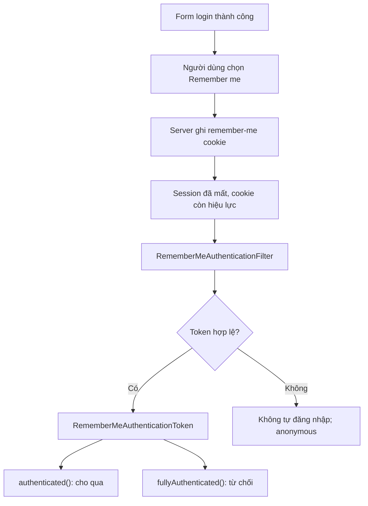

# Anonymous, authenticated, remember-me và fully authenticated trong Spring Security

## Mục tiêu bài học

Bài học giúp bạn phân biệt bốn ngữ cảnh mà Spring Security dùng để **quyết định quyền truy cập** trên Servlet stack: **anonymous**, **authenticated**, **remember-me** và **fully authenticated**. Bạn sẽ biết khi nào dùng các DSL `anonymous()`, `authenticated()`, `rememberMe()`, `fullyAuthenticated()` trong `authorizeHttpRequests`; hiểu các biểu thức `isAnonymous()`, `isAuthenticated()`, `isRememberMe()`, `isFullyAuthenticated()` ở method security; đọc đúng mức tin cậy của `Authentication` và áp dụng chúng vào trường hợp cần đăng nhập lại.

Trọng tâm: **mức xác thực** là một trục riêng với **role/authority**. Người có `ROLE_ADMIN` vẫn có thể bị từ chối khi đang dùng remember-me, còn người fully authenticated vẫn có thể thiếu quyền thực hiện một nghiệp vụ.

## 1. Nền tảng: Authentication không chỉ có “đã đăng nhập” và “chưa đăng nhập”

Spring Security lưu thông tin người gọi trong `SecurityContextHolder`, thường dưới dạng một đối tượng `Authentication`:

- **Principal:** danh tính của người gọi, ví dụ `alice`.
- **Authorities:** các `GrantedAuthority` như `ROLE_USER`, `account:edit`.
- **Authentication mechanism/token:** cách danh tính được tạo ra, chẳng hạn `AnonymousAuthenticationToken`, `RememberMeAuthenticationToken` hoặc token do một cơ chế đăng nhập thông thường cung cấp.
- **Mức độ tin cậy được bộ phân quyền nhận diện:** anonymous, remember-me hoặc xác thực đầy đủ (*fully authenticated*).

Ví dụ, một khách chưa đăng nhập vẫn có thể có `Authentication` trong security context nhờ `AnonymousAuthenticationFilter`. Một người dùng thật có thể được khôi phục danh tính qua cookie remember-me. Cả hai khác với trạng thái đã đăng nhập đầy đủ.

Cần phân biệt các câu hỏi:

| Câu hỏi | Loại kiểm tra |
| --- | --- |
| Có phải khách anonymous không? | `anonymous()` hoặc `isAnonymous()` |
| Có danh tính xác thực, không phải anonymous? | `authenticated()` hoặc `isAuthenticated()` |
| Danh tính hiện tại được khôi phục bằng remember-me? | `rememberMe()` hoặc `isRememberMe()` |
| Đã xác thực, không phải anonymous và không phải remember-me? | `fullyAuthenticated()` hoặc `isFullyAuthenticated()` |
| Người dùng có authority/role phù hợp? | `hasAuthority(...)`, `hasRole(...)` |
| Người dùng có quyền với bản ghi cụ thể? | Chính sách nghiệp vụ owner/tenant/ACL trong service hoặc query |

Một hệ thống bảo mật thường kết hợp **nhiều điều kiện**, ví dụ `fullyAuthenticated AND account:edit AND ownsAccount`.

## 2. Bảng trạng thái và ý nghĩa chính xác

Giả định ứng dụng có anonymous authentication như cấu hình thông thường, và remember-me đã được thiết lập khi cần:

| Authentication hiện tại | `anonymous()` | `authenticated()` | `rememberMe()` | `fullyAuthenticated()` |
| --- | :---: | :---: | :---: | :---: |
| `AnonymousAuthenticationToken` | ✅ | ❌ | ❌ | ❌ |
| `RememberMeAuthenticationToken` | ❌ | ✅ | ✅ | ❌ |
| Đăng nhập đầy đủ bằng form/session, Basic, hoặc Bearer token hợp lệ không thuộc loại trên | ❌ | ✅ | ❌ | ✅ |

Các rule ở bảng sử dụng cách Spring Security nhận diện thông qua `AuthenticationTrustResolver` mặc định. Nếu ứng dụng dùng token tự định nghĩa hoặc custom trust resolver, cần kiểm tra cách hệ thống nhận diện chúng.

**Điểm cốt lõi:** `authenticated()` **bao gồm** cả remember-me. `fullyAuthenticated()` **loại** remember-me. `rememberMe()` kiểm tra **trạng thái remember-me hiện tại**, không có nghĩa “remember-me hoặc đăng nhập thông thường”.

### So với permitAll và denyAll

| Rule | Điều kiện qua kiểm tra phân quyền | Trường hợp điển hình |
| --- | --- | --- |
| `permitAll()` | Mọi người, gồm anonymous và người đã login | Trang công khai, tài nguyên tĩnh |
| `anonymous()` | Chỉ khách đang được nhận diện anonymous | Trang hướng dẫn dành riêng cho khách |
| `authenticated()` | Remember-me **hoặc** fully authenticated | Trang hồ sơ cơ bản |
| `rememberMe()` | Chỉ authentication loại remember-me | Trang trạng thái “đăng nhập ghi nhớ” |
| `fullyAuthenticated()` | Có xác thực không qua remember-me | Thay đổi cài đặt nhạy cảm, nếu chính sách yêu cầu |
| `denyAll()` | Không ai | Endpoint bị khóa hoặc chưa có policy |

`permitAll()` và `anonymous()` **không đồng nghĩa**. Đặt `/login` là `anonymous()` có thể chặn người đã login mở lại trang này; một trang công khai bình thường nên dùng `permitAll()`.

Đây là **kiểm tra authorization**, không tự bảo đảm có controller, trả HTTP 200, không bị CSRF hay thiếu dữ liệu.

## 3. Anonymous: có token trong context nhưng vẫn là khách

### 3.1. AnonymousAuthenticationFilter làm gì?

Trong một Servlet security filter chain điển hình, nếu chưa có `Authentication` hợp lệ trong context sau các cơ chế xác thực, `AnonymousAuthenticationFilter` có thể đặt một `AnonymousAuthenticationToken`. Mặc định token thường có principal `anonymousUser` và authority `ROLE_ANONYMOUS`.

Đây là **đại diện kỹ thuật** cho người chưa đăng nhập, giúp cơ chế authorization và audit vận hành nhất quán. Token này không biến khách thành một tài khoản thật, cũng không mang quyền nghiệp vụ của tài khoản đăng nhập.

Chi tiết dễ nhầm: với một `AnonymousAuthenticationToken`, lời gọi `Authentication.isAuthenticated()` có thể trả về **true**. Nếu viết:

```java
Authentication auth =
    SecurityContextHolder.getContext().getAuthentication();

boolean loggedIn = auth != null && auth.isAuthenticated();
```

thì `loggedIn` **không phải kiểm tra an toàn** để kết luận “đã đăng nhập bằng tài khoản thực”. Spring Security sử dụng `AuthenticationTrustResolver` để nhận diện anonymous và remember-me, không chỉ dựa vào raw flag.

### 3.2. Sử dụng AuthenticationTrustResolver

Đoạn Java sau **yêu cầu Spring Security dependencies** và là snippet tích hợp vào một ứng dụng có security context:

```java
import org.springframework.security.authentication.AuthenticationTrustResolver;
import org.springframework.security.authentication.AuthenticationTrustResolverImpl;
import org.springframework.security.core.Authentication;
import org.springframework.security.core.context.SecurityContextHolder;

public class AuthenticationStateInspector {
    private final AuthenticationTrustResolver resolver =
        new AuthenticationTrustResolverImpl();

    public void inspect() {
        Authentication auth =
            SecurityContextHolder.getContext().getAuthentication();

        boolean anonymous = resolver.isAnonymous(auth);
        boolean authenticated = resolver.isAuthenticated(auth);
        boolean remembered = resolver.isRememberMe(auth);
        boolean fullyAuthenticated =
            resolver.isFullyAuthenticated(auth);

        // Kiểm tra theo nhu cầu nghiệp vụ.
    }
}
```

`AuthenticationTrustResolver.isAuthenticated(auth)` yêu cầu token hợp lệ và **không phải anonymous**; `isFullyAuthenticated(auth)` yêu cầu thêm **không phải remember-me**. Khi `auth == null` thì không được xem là authenticated/fully authenticated. Các rule `authenticated()`, `fullyAuthenticated()` đã xử lý những phân biệt này; không cần tự viết lại các bộ lọc tương đương trong từng controller.

### 3.3. Khác biệt với Servlet Principal trong Spring MVC

Spring MVC có thể resolve tham số `Principal`/`Authentication` của controller thông qua `HttpServletRequest#getPrincipal()`. Với anonymous request, Servlet principal có thể là **null**, dù `SecurityContextHolder` vẫn chứa `AnonymousAuthenticationToken`. Nếu thật sự cần đọc token anonymous trong controller, dùng `@CurrentSecurityContext`:

```java
@GetMapping("/who-am-i")
public String whoAmI(@CurrentSecurityContext SecurityContext context) {
    Authentication auth = context.getAuthentication();
    AuthenticationTrustResolver trust = new AuthenticationTrustResolverImpl();
    return trust.isAnonymous(auth) ? "anonymous" : "signed-in";
}
```

Snippet này cần các import Spring MVC/Spring Security tương ứng và controller bean. Endpoint chỉ nhằm giảng giải; không nên hiển thị token, danh sách quyền hoặc chi tiết bảo mật nội bộ ra ngoài.

## 4. Authenticated: không phải anonymous, vẫn có thể là remember-me

Với rule `authenticated()`, một người đã đăng nhập lại tự động qua remember-me **được xem là authenticated**. Còn `fullyAuthenticated()` yêu cầu mức khác.

Ví dụ:

1. Alice đăng nhập bằng form tại 08:00, có `ROLE_USER`, tích chọn “Remember me”.
2. Server tạo session đăng nhập và gửi cookie remember-me hợp lệ theo chính sách.
3. Alice đóng trình duyệt, session không còn, nhưng cookie remember-me còn thời hạn.
4. Khi Alice quay lại, Spring Security có thể dùng cookie để tự đăng nhập và tạo `RememberMeAuthenticationToken`.
5. Alice vẫn có thể có `ROLE_USER`, `profile:read` nhưng **mức xác thực hiện tại là remember-me**.

Do đó:

```text
Alice (RememberMeAuthenticationToken):
    anonymous()          = false
    authenticated()      = true
    rememberMe()         = true
    fullyAuthenticated() = false
```

Đừng dựa vào role để nâng remember-me lên full; role và mức xác thực là hai điều kiện khác nhau. Nếu endpoint chỉ dùng `authenticated()`, remembered user có thể truy cập. Nếu endpoint yêu cầu `fullyAuthenticated()`, người này cần một luồng xác thực bổ sung phù hợp.

## 5. Remember-me: tự khôi phục danh tính giữa các phiên

### 5.1. Cơ chế phổ biến

Remember-me thường dựa trên cookie tồn tại lâu hơn session:



`RememberMeServices` là giao diện hỗ trợ tạo cookie sau login, hủy sau logout và tự đăng nhập khi cần. Spring Security cung cấp cách dùng token có chữ ký và phương án persistent token được lưu phía server. Các cách này có khác nhau về lưu trữ, khả năng thu hồi và xử lý token; cần lựa chọn theo rủi ro ứng dụng. Chúng cần `UserDetailsService` phù hợp.

**Bật remember-me không tự tạo user store hay một form có checkbox.** Với form tùy biến, ứng dụng cần gửi tham số yêu cầu remember-me (mặc định `remember-me`, có thể cấu hình khác); cũng phải cung cấp nguồn người dùng và secret/key/token repository hợp lệ.

### 5.2. Vì sao không xem remember-me ngang với full login?

Một cookie remember-me có thể tồn tại trên thiết bị dài hơn phiên đăng nhập và có thể bị lộ. Khi ứng dụng chỉ kiểm tra remember-me cookie, người dùng không nhất thiết vừa nhập lại mật khẩu/OTP gần đây. Vì thế một chính sách có thể chọn:

- **Được làm khi authenticated (kể cả remember-me):** xem trang chủ cá nhân, đọc dữ liệu ít nhạy cảm, xem thông báo.
- **Cần fully authenticated:** thay đổi email/mật khẩu, đổi thiết lập bảo mật, thực hiện một số thao tác tài khoản.
- **Cần bước bảo mật bổ sung:** chuyển tiền, vô hiệu hóa MFA, cấp quyền quản trị, xóa dữ liệu quan trọng; ở đây có thể cần re-auth gần đây, MFA, xác nhận thiết bị và quyền nghiệp vụ.

Ví dụ là **gợi ý chính sách**, không có nghĩa Spring Security tự xếp từng URL vào mức nhạy cảm. `fullyAuthenticated()` chỉ phân biệt loại xác thực; nó **không tự xác nhận MFA, auth_time mới, hay việc nhập mật khẩu lại gần đây**.

### 5.3. Cookie và cấu hình an toàn

Khi áp dụng remember-me thật, cần kiểm soát:

- Cookie trên TLS; `Secure`/`HttpOnly` và `SameSite` phù hợp với cơ chế login và threat model.
- Thời hạn cookie/token, logout, vô hiệu hóa token khi cần, xử lý thay đổi mật khẩu hoặc tài khoản bị khóa.
- Secret/key đủ mạnh và nhất quán giữa các instance nếu cơ chế sử dụng key, không hardcode bí mật trong source.
- Persistent token lưu phía server và rotation/invalidation nếu cần khả năng thu hồi tốt hơn.
- Không log hoặc hiển thị nội dung cookie; kiểm tra CSRF với các request thay đổi trạng thái theo kiến trúc web.

API stateless chỉ dùng Bearer JWT thường không tự động có cơ chế remember-me cookie này. Không đồng nhất JWT sống lâu với `RememberMeAuthenticationToken`: với trust resolver mặc định, một JWT được xác thực thành công thường được xem là full nếu không được biểu diễn như remember-me.

## 6. Cấu hình HTTP cho cả bốn trạng thái

Trên Spring Security 6.x Servlet stack, các rule có thể khai báo trong `SecurityFilterChain`. Ví dụ sau thể hiện đầy đủ cấu trúc Java/Spring, nhưng để chạy thành hệ thống phải có user store, controller và môi trường Spring Boot/Spring Security:

```java
import org.springframework.context.annotation.Bean;
import org.springframework.context.annotation.Configuration;
import org.springframework.security.config.Customizer;
import org.springframework.security.config.annotation.method.configuration.EnableMethodSecurity;
import org.springframework.security.config.annotation.web.builders.HttpSecurity;
import org.springframework.security.web.SecurityFilterChain;

@Configuration
@EnableMethodSecurity
public class SecurityConfig {

    @Bean
    SecurityFilterChain securityFilterChain(HttpSecurity http) throws Exception {
        http
            .authorizeHttpRequests(auth -> auth
                .requestMatchers("/", "/login", "/assets/**").permitAll()
                .requestMatchers("/guest/welcome").anonymous()
                .requestMatchers("/profile").authenticated()
                .requestMatchers("/remembered/status").rememberMe()
                .requestMatchers("/account/security").fullyAuthenticated()
                .anyRequest().denyAll()
            )
            .formLogin(Customizer.withDefaults())
            .rememberMe(Customizer.withDefaults());

        return http.build();
    }
}
```

`formLogin` cho phép login tương tác theo cấu hình, còn `rememberMe` bật cơ chế ghi nhớ với các yêu cầu kèm theo như `UserDetailsService`. Trong production, cấu hình key/token store và cookie phù hợp, đừng chỉ dùng cấu hình mặc định rồi cho rằng đã đáp ứng mọi yêu cầu vận hành. Cấu hình trên **không định nghĩa** controller `/profile`, `/account/security` hoặc dữ liệu người dùng.

### Kết quả của từng URL

| URL | Điều kiện | Anonymous | Remembered | Full |
| --- | --- | :---: | :---: | :---: |
| `GET /` | `permitAll` | ✅ | ✅ | ✅ |
| `GET /guest/welcome` | `anonymous` | ✅ | ❌ | ❌ |
| `GET /profile` | `authenticated` | ❌ | ✅ | ✅ |
| `GET /remembered/status` | `rememberMe` | ❌ | ✅ | ❌ |
| `GET /account/security` | `fullyAuthenticated` | ❌ | ❌ | ✅ |
| `GET /other` | `denyAll` | ❌ | ❌ | ❌ |

Dấu ✅ là **qua rule authorization**, không tự bảo đảm HTTP 200. HTTP response còn tùy filter khác, controller, dữ liệu và cách xử lý exception.

Các matcher được xét **theo thứ tự**, dùng rule khớp đầu tiên. Nếu đặt `requestMatchers("/**").authenticated()` trước `/account/security`, rule full phía sau không bao giờ được áp dụng. Hãy đặt rule cụ thể trước rule bao quát; dùng `anyRequest().denyAll()` nếu muốn chặn endpoint chưa xác định policy.

### Kết hợp role/authority

Người fully authenticated nhưng không có quyền nghiệp vụ vẫn cần bị từ chối:

```text
CHANGE_ACCOUNT_SECURITY =
    fullyAuthenticated
    AND hasAuthority("account:edit")
    AND currentUserOwnsTargetAccount
```

Tương tự, một `RememberMeAuthenticationToken` có `ROLE_ADMIN` vẫn bị từ chối nếu rule cần full; `ROLE_ADMIN` không tự nâng mức authentication. Với dữ liệu đa tenant, thêm điều kiện tenant/owner trong service hoặc query để tránh truy cập chéo tài nguyên.

## 7. Ví dụ Java 17 độc lập: mô phỏng bảng phân quyền

Chương trình không dùng Spring, chỉ **mô phỏng** semantics mặc định theo ba trạng thái đã biết. Nó giúp đối chiếu bảng chân trị nhưng không thay thế Spring Security integration tests.

Lưu thành **`AuthenticationLevelDemo.java`**:

```java
public class AuthenticationLevelDemo {

    enum State { ANONYMOUS, REMEMBER_ME, FULL }
    enum Rule {
        PERMIT_ALL, ANONYMOUS, AUTHENTICATED,
        REMEMBER_ME, FULLY_AUTHENTICATED
    }

    static boolean allow(State state, Rule rule) {
        return switch (rule) {
            case PERMIT_ALL -> true;
            case ANONYMOUS -> state == State.ANONYMOUS;
            case AUTHENTICATED -> state != State.ANONYMOUS;
            case REMEMBER_ME -> state == State.REMEMBER_ME;
            case FULLY_AUTHENTICATED -> state == State.FULL;
        };
    }

    public static void main(String[] args) {
        for (State state : State.values()) {
            System.out.printf(
                "%s: anonymous=%s, authenticated=%s, "
                + "rememberMe=%s, fullyAuthenticated=%s%n",
                state,
                allow(state, Rule.ANONYMOUS),
                allow(state, Rule.AUTHENTICATED),
                allow(state, Rule.REMEMBER_ME),
                allow(state, Rule.FULLY_AUTHENTICATED)
            );
        }
    }
}
```

Biên dịch/chạy bằng JDK 17+:

```bash
javac AuthenticationLevelDemo.java
java AuthenticationLevelDemo
```

Stdout chính xác:

```text
ANONYMOUS: anonymous=true, authenticated=false, rememberMe=false, fullyAuthenticated=false
REMEMBER_ME: anonymous=false, authenticated=true, rememberMe=true, fullyAuthenticated=false
FULL: anonymous=false, authenticated=true, rememberMe=false, fullyAuthenticated=true
```

Đọc kết quả: `REMEMBER_ME` không phải anonymous và cũng không phải full; vì vậy `authenticated()` cho phép, nhưng `fullyAuthenticated()` từ chối. `FULL` không thỏa rule chỉ dành cho remember-me. Nếu muốn cho **cả remembered và full**, dùng `authenticated()`.

## 8. Method security: isAnonymous, isAuthenticated, isRememberMe, isFullyAuthenticated

Trong `@PreAuthorize` dùng **tên biểu thức có tiền tố `is`**:

| HTTP DSL | Method Security SpEL |
| --- | --- |
| `.anonymous()` | `isAnonymous()` |
| `.authenticated()` | `isAuthenticated()` |
| `.rememberMe()` | `isRememberMe()` |
| `.fullyAuthenticated()` | `isFullyAuthenticated()` |

Ví dụ service Spring cần `@EnableMethodSecurity`:

```java
import org.springframework.security.access.prepost.PreAuthorize;
import org.springframework.stereotype.Service;

@Service
public class AccountService {

    @PreAuthorize(
        "isAuthenticated() and hasAuthority('profile:read')"
    )
    public String profileSummary() {
        return "Profile summary";
    }

    @PreAuthorize(
        "isFullyAuthenticated() and hasAuthority('account:edit')"
    )
    public String requestEmailChange(String newEmail) {
        // Minh họa, hệ thống thật cần validate và kiểm tra tài khoản.
        return "Email change requested";
    }
}
```

`profileSummary()` cho phép remembered user **nếu có `profile:read`**. `requestEmailChange()` yêu cầu vừa full vừa có `account:edit`. Hai điều kiện trong `@PreAuthorize` được nối bằng `and`, nên thiếu bất kỳ điều kiện nào đều bị từ chối.

Cần hiểu các giới hạn:

1. `@EnableMethodSecurity` phải bật tường minh trong cấu hình. Thêm Spring Security starter không tự bật biểu thức `@PreAuthorize`.
2. Method security dùng Spring AOP proxy: lời gọi `this.requestEmailChange(...)` trong **cùng bean** có thể bỏ qua interceptor; tạo service bằng `new` ngoài container cũng không tự được bảo vệ.
3. `@PreAuthorize` đánh giá trước method. `@PostAuthorize` đánh giá sau method trả về, không dùng một mình cho các thao tác đã tạo side effect.
4. `fullyAuthenticated()` không tự kiểm tra người gọi có quyền trên tài nguyên cụ thể; ứng dụng vẫn phải kiểm tra owner/ACL/tenant và các ràng buộc nghiệp vụ.
5. Một method chạy từ job nền không tự có authentication hợp lệ trong `SecurityContextHolder`; danh tính thực thi phải được thiết kế và test rõ ràng.

## 9. Một luồng “đăng nhập lại” cho tác vụ nhạy cảm

Giả sử Alice được khôi phục qua remember-me rồi mở `/account/security`:

1. Remember-me cookie hợp lệ tạo `RememberMeAuthenticationToken`; Alice là `authenticated` nhưng chưa `fullyAuthenticated`.
2. Rule `fullyAuthenticated()` chặn tác vụ. Ứng dụng có thể điều hướng đến trang login/re-auth theo cơ chế exception handling và entry point.
3. Alice hoàn tất một luồng xác thực tương tác; security context có authentication không thuộc remember-me.
4. Sau đó kiểm tra full có thể đạt, nhưng quyền `account:edit` và owner/tenant vẫn phải được kiểm tra riêng.
5. Nếu sản phẩm đòi xác thực **gần đây** (ví dụ 5 phút) hoặc MFA, phải có **bằng chứng xác thực mới** và kiểm tra thời điểm/phương thức. `fullyAuthenticated` không tự cung cấp hai bảo đảm này.

Đừng tự nâng trạng thái một `RememberMeAuthenticationToken` bằng cách thay `setAuthenticated(true)`; cờ đó không thay đổi loại token và không thay thế xác thực thực tế.

## 10. Kiểm thử với spring-security-test

### Test anonymous và full

`@WithAnonymousUser` cung cấp ngữ cảnh khách; `@WithMockUser` tạo authentication mock đã xác thực thông thường, không phải remember-me:

```java
// Đây là các annotation để đặt trên NHỮNG test method khác nhau.
@WithAnonymousUser
// test gọi /guest/welcome hoặc /profile

@WithMockUser(username = "alice", roles = "USER")
// test anonymous() bị từ chối, authenticated() được phép

@WithMockUser(username = "alice", authorities = "account:edit")
// test hasAuthority() khi người dùng full
```

Không dùng `@WithMockUser` để “test remember-me”: mặc định nó tạo kiểu authentication full. Với remember-me, chủ động tạo token hoặc kiểm thử cookie end-to-end.

### Test remember-me trực tiếp bằng MockMvc

```java
// Snippet bên trong test method; MockMvc mvc đã cấu hình Spring Security.
// Cần import get, status và authentication(...) của spring-security-test.
RememberMeAuthenticationToken remembered =
    new RememberMeAuthenticationToken(
        "test-key",
        "alice",
        AuthorityUtils.createAuthorityList("ROLE_USER", "profile:read")
    );

mvc.perform(get("/profile").with(authentication(remembered)))
    .andExpect(status().isOk());

mvc.perform(get("/account/security")
        .with(authentication(remembered)))
    .andExpect(status().isForbidden());
```

Đây là đoạn mã thử trong **một Spring/JUnit test**, không phải chương trình Java độc lập. Cần `MockMvc`, `spring-security-test`, static imports `get`/`status`/`authentication` và các endpoint/controller mẫu; `test-key` chỉ là giá trị giả lập. Cách này kiểm tra **authorization với remembered token**. Nó **không chứng minh** cookie được phát, tồn tại, hết hạn hoặc bị thu hồi đúng. Muốn test tích hợp remember-me thực, hãy đăng nhập thành công với remember-me, lưu cookie, loại bỏ session rồi gửi cookie trên request kế tiếp.

### Ma trận test nên có

| Ca test | Kỳ vọng |
| --- | --- |
| Anonymous vào trang public | Qua `permitAll` |
| Full vào trang public | Qua `permitAll` |
| Anonymous vào trang guest-only | Qua `anonymous` |
| Full vào trang guest-only | Không qua `anonymous` |
| Anonymous vào `/profile` | Không qua `authenticated` |
| Remembered user vào `/profile` | Qua `authenticated` |
| Full vào `/profile` | Qua `authenticated` |
| Remembered user vào `/remembered/status` | Qua `rememberMe` |
| Full vào `/remembered/status` | Không qua `rememberMe` |
| Remembered user vào `/account/security` | Không qua `fullyAuthenticated` |
| Full vào `/account/security` | Qua `fullyAuthenticated` |
| Full nhưng thiếu `account:edit` gọi method tương ứng | Vẫn bị method security từ chối |
| Cookie remember-me không hợp lệ hoặc đã hết hạn | Không được khôi phục remember-me authentication |

Tùy cơ chế xác thực và exception handling, anonymous bị từ chối có thể nhận **401** ở API hoặc **redirect** ở form login; remembered user bị chặn khi yêu cầu full có thể bị từ chối hay dẫn tới quy trình xác thực lại. `403` cũng có thể do CSRF hoặc quyền bản ghi, nên không suy ra nguyên nhân chỉ từ status. Hãy kiểm tra HTTP response thực tế của security filter chain đang dùng.

## 11. Lỗi phổ biến và cách tránh

1. **So `authentication.isAuthenticated()` trực tiếp rồi tin anonymous là đã login:** anonymous token có thể có raw flag true. Dùng `AuthenticationTrustResolver` hoặc các rule/built-in expressions.
2. **Nhầm `authenticated()` với `fullyAuthenticated()`:** remember-me qua được authenticated nhưng không qua full.
3. **Nhầm `rememberMe()` với “cho mọi người có bật Remember me”:** nó kiểm tra kiểu authentication **hiện tại**. Người full có thể đã tích checkbox lúc login nhưng hiện không phải remember-me token.
4. **Dùng `anonymous()` cho nội dung public:** người đã login bị chặn. Dùng `permitAll()` khi mọi người đều được phép.
5. **Coi full là có MFA hoặc re-auth gần đây:** cần cơ chế step-up, auth_time và verification riêng nếu chính sách yêu cầu.
6. **Bỏ qua role/authority và owner:** full không đồng nghĩa `ROLE_ADMIN` hay được quyền xem mọi tài liệu.
7. **Bật matcher rememberMe nhưng không bật dịch vụ nhớ đăng nhập:** `.rememberMe()` trong authorization không tự tạo cookie; phải cấu hình remember-me authentication.
8. **Không kiểm thử vòng đời session/cookie:** sau session expiration, nhớ đăng nhập có thể tạo một authentication khác. Test quá trình chuyển trạng thái.
9. **Giả định JWT tự là remember-me:** Bearer auth thông thường là cơ chế khác; trust resolver mặc định không tự suy mức nhớ đăng nhập từ tuổi của token.
10. **Đặt matcher rộng trước matcher nhạy cảm:** `/**` có thể nuốt `/account/security`, khiến policy full không còn hiệu lực.
11. **Test với `@WithMockUser` rồi kết luận remember-me hoạt động:** cần `RememberMeAuthenticationToken` hoặc end-to-end cookie test.
12. **Làm lộ cookie/secret:** sử dụng TLS, cookie flags, expiry/invalidation hợp lý và không log token.

## 12. Checklist áp dụng

1. Phân loại endpoint: **public**, **guest-only**, **authenticated (có thể remember-me)**, **remember-me-only**, hay **full**.
2. Bổ sung authority/role và điều kiện nghiệp vụ như owner, tenant, trạng thái tài nguyên ở service/query.
3. Chọn cơ chế login và có thực sự cần remember-me không; nếu có, thiết kế cookie, token store, key, thời hạn và thu hồi.
4. Đặt matcher cụ thể trước matcher rộng; xác định fallback từ chối.
5. Bật method security nếu có `@PreAuthorize` và đảm bảo lời gọi qua Spring proxy.
6. Kiểm thử đủ anonymous, remembered, full, thiếu quyền và quyền với bản ghi khác; test chuyển từ remember-me sang xác thực đầy đủ nếu sản phẩm hỗ trợ.
7. Với hành động nguy cơ cao, áp dụng re-auth mới/MFA theo chính sách rõ ràng; không suy ra từ tên `fullyAuthenticated`.

**Tự kiểm tra:**

- Alice có `ROLE_ADMIN` nhưng hiện đang dùng `RememberMeAuthenticationToken`. `authenticated()` đúng không? **Đúng.** `fullyAuthenticated()` đúng không? **Sai.** Role không nâng mức xác thực.
- Bob đăng nhập bằng form và đang full. Bob có vào URL chỉ đặt `rememberMe()` không? **Không**, vì rule này chỉ cho authentication remembered. Nếu muốn cả hai loại, dùng `authenticated()`.
- Vì sao không dùng raw `Authentication.isAuthenticated()` để kết luận khách đã login? Vì anonymous token có thể trả raw true; phải xét **loại và mức tin cậy** bằng Spring Security.

## Tài liệu tham khảo

- Spring Security, *Anonymous Authentication*: https://docs.spring.io/spring-security/reference/6.3/servlet/authentication/anonymous.html
- Spring Security, *Remember-Me Authentication*: https://docs.spring.io/spring-security/reference/6.3/servlet/authentication/rememberme.html
- Spring Security, *Authorize HttpServletRequests*: https://docs.spring.io/spring-security/reference/6.3/servlet/authorization/authorize-http-requests.html
- Spring Security, *Method Security*: https://docs.spring.io/spring-security/reference/6.3/servlet/authorization/method-security.html
- Spring Security 6.3 API, *AuthenticationTrustResolver*: https://docs.spring.io/spring-security/site/docs/6.3.10/api/org/springframework/security/authentication/AuthenticationTrustResolver.html
