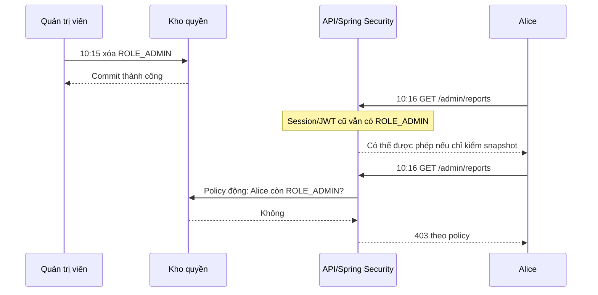

# Quyền đã lưu trong session hoặc token và thời điểm thay đổi có hiệu lực

Trong hệ thống Spring Security, một quản trị viên có thể **thu hồi quyền** của Alice trong cơ sở dữ liệu lúc 10:15, nhưng request tiếp theo của Alice lúc 10:16 vẫn được phép truy cập chức năng quản trị. Điều này không nhất thiết là lỗi của `hasRole` hay `hasAuthority`: **quyền mà ứng dụng đang kiểm tra có thể là bản đã được lấy và lưu từ trước**.

Bài học giải thích nơi lưu quyền, vòng đời của `Authentication`, sự khác nhau giữa **session và token**, vì sao thay đổi quyền có thể đến chậm, cùng các thiết kế giúp đặt ra và đáp ứng thời điểm thu hồi/cấp mới có hiệu lực.

**Ý chính:** Thời điểm cập nhật quyền trong nơi lưu trữ gốc **không tự động trùng** với thời điểm mọi request bắt đầu dùng quyền mới. Cần xác định **nguồn quyền mà từng request thực sự đọc**, cơ chế làm mới hoặc thu hồi, bộ nhớ đệm và mức độ nhất quán mà hệ thống yêu cầu.

## 1. Trước hết: quyền trong dữ liệu gốc và quyền của request là hai thứ khác nhau

Giả sử hệ thống cấp cho Alice các quyền:

```text
10:00  Database: alice -> ROLE_ADMIN, invoices.read
10:00  Alice đăng nhập.
       Authentication#getAuthorities() -> ROLE_ADMIN, invoices.read

10:15  Quản trị viên xóa ROLE_ADMIN khỏi database.
       Database: alice -> invoices.read

10:16  Alice gọi GET /admin/reports.
       Kết quả phụ thuộc request đang lấy authority từ đâu.
```

Hai kiểu kiểm tra phổ biến:

- **Kiểm tra authority đã đưa vào `Authentication`:** ví dụ `hasRole("ADMIN")` kiểm chuỗi `ROLE_ADMIN` trong các `GrantedAuthority` của `Authentication` hiện tại. Nếu `Authentication` vẫn là bản cũ, rule vẫn thấy `ROLE_ADMIN`.
- **Kiểm tra chính sách động:** ví dụ service đọc quyền mới nhất từ repository đáng tin khi Alice yêu cầu xuất báo cáo. Nếu repository đã phản ánh việc thu hồi và không có cache cũ, rule có thể từ chối ngay ở request tiếp theo.

Có thể phối hợp cả hai: authority khái quát cho lớp HTTP, policy động cho thao tác nhạy cảm. Nhưng khi dùng điều kiện **AND**, một authority cũ vẫn có thể chặn quyền **vừa được cấp**; muốn cấp mới có hiệu lực sớm, cần tính cả đường làm mới authority hoặc cấu trúc policy phù hợp.

### Câu hỏi phải trả lời trước khi chọn giải pháp

1. **Quyền nằm ở đâu?** Database ứng dụng, IAM/IdP, authorization service, claims của access token hay danh sách quyền trong session?
2. **Request đọc gì?** `SecurityContext` trong `HttpSession`, JWT đã xác minh, opaque-token introspection, query DB hay cache?
3. **Quyền được chụp vào lúc nào?** Lúc login, lúc cấp token, lúc refresh token, hay mỗi request?
4. **Đường thu hồi là gì?** Hủy session, cập nhật authentication, hủy token, denylist, giảm TTL hoặc kiểm quyền động?
5. **Thời hạn thay đổi có hiệu lực là bao nhiêu?** Ngay request sau, vài giây, sau khi token hết hạn, hay lần đăng nhập tiếp theo?

Không có một câu trả lời mặc định đúng cho mọi ứng dụng. Yêu cầu “thu hồi vai trò quản trị trong 5 giây” khác với “đổi tên hiển thị trong lần đăng nhập sau”.

## 2. Session: SecurityContext có thể giữ authority từ lúc đăng nhập

### 2.1. Authentication được tạo khi xác thực

Trong ứng dụng Servlet sử dụng login qua session, sau khi xác thực thành công, Spring Security có một `Authentication` chứa thông tin principal, trạng thái xác thực và danh sách `GrantedAuthority`. Ví dụ:

```text
Authentication
  principal      = alice
  authenticated  = true
  authorities    = [ROLE_ADMIN, invoices.read]
```

Đối với cơ chế lưu trạng thái bằng HTTP session, `SecurityContext` chứa `Authentication` có thể được lưu qua `SecurityContextRepository`, phổ biến là `HttpSessionSecurityContextRepository`. Ở request sau, security context được khôi phục để authorization sử dụng.

**Session cookie không phải danh sách role.** Trình duyệt thường gửi cookie chứa **session ID**; thông tin `SecurityContext` nằm phía máy chủ hoặc trong session store phân tán. Chặn sửa cookie không giải quyết vấn đề authority bị cũ trong server-side session.

### 2.2. Điều gì xảy ra khi xóa role trong database?

Giả sử lúc đăng nhập, `UserDetailsService` lấy `ROLE_ADMIN` và tạo `Authentication`. Lúc 10:15, quản trị viên xóa role trong DB:

- Dòng DB có thể đã thay đổi thành công.
- **`Authentication` trong session hiện hữu thường không tự cập nhật** chỉ vì bản ghi role trong DB đổi.
- Request tiếp theo khôi phục cùng security context hoặc dữ liệu tương đương, rồi `hasRole("ADMIN")` vẫn có thể thấy `ROLE_ADMIN`.
- Nếu Alice **đăng nhập lại**, luồng authentication thông thường có thể đọc role mới, *với điều kiện* nguồn xác thực thực sự tra dữ liệu cập nhật, không dùng cache cũ.

Không được hiểu “mỗi request Spring Security có filter chạy lại” thành “mỗi request Spring Security mặc định query lại toàn bộ role trong DB”. Khôi phục `SecurityContext` và làm mới quyền người dùng là hai việc khác nhau.

### 2.3. Spring Security 6 và việc lưu SecurityContext

Trong Spring Security 6, `SecurityContextHolderFilter` đọc context từ repository; luồng **xác thực tùy biến** tạo hoặc thay `Authentication` cần **lưu context rõ ràng** qua `SecurityContextRepository#saveContext` nếu muốn duy trì qua request tiếp theo. Các bộ lọc/cơ chế login tích hợp có xử lý persistence theo luồng của chúng.

Điểm này quan trọng khi triển khai chức năng “refresh quyền cho session”: chỉ làm `SecurityContextHolder.setContext(newContext)` trong một request **không bảo đảm** các request sau tiếp tục dùng context mới. Phải chọn đúng repository và lưu theo contract của ứng dụng. Mặt khác, cập nhật context của **một session** không tự làm mới mọi session ở thiết bị khác.

Đoạn minh họa ở tầng ứng dụng đã xác thực lại quyền và tạo `Authentication` hợp lệ:

```java
SecurityContext newContext = SecurityContextHolder.createEmptyContext();
newContext.setAuthentication(updatedAuthentication);
SecurityContextHolder.setContext(newContext);
securityContextRepository.saveContext(newContext, request, response);
```

Đây là **mảnh code tích hợp**, không phải chương trình Java độc lập. `updatedAuthentication` phải do logic đáng tin tạo (không lấy role từ request body); `securityContextRepository`, `request`, `response` do tầng HTTP/configuration cung cấp. Không dùng cách này để “thăng quyền” chỉ dựa trên dữ liệu client.

### 2.4. Khi nào session sẽ dùng quyền mới?

| Sự kiện | Tác động đến quyền trong session |
| --- | --- |
| Update bảng role/permission trong DB | **Không tự động** thay authority của mọi `Authentication` đã lưu |
| User đăng nhập lại | Thường lấy quyền mới nếu authentication provider đọc nguồn cập nhật |
| User logout/invalidate đúng session | Session cũ không còn được dùng; lần đăng nhập tiếp theo có thể lấy quyền mới |
| Server chủ động invalidate **mọi session liên quan** | Các request tiếp theo phải xác thực lại, tùy session registry/store và tính nhất quán |
| Server xây lại và lưu `SecurityContext` | Session được cập nhật **theo cơ chế đã triển khai**; những session khác không mặc nhiên thay đổi |
| API kiểm quyền động trong DB ở mỗi thao tác | Quyết định động có thể phản ánh cập nhật dù authority snapshot trong session vẫn cũ |
| Session timeout | Session cũ hết hiệu lực, nhưng không bảo đảm thu hồi tức thì tại thời điểm DB đổi |

**Session timeout do không hoạt động (idle timeout)** có thể được gia hạn khi người dùng tiếp tục hoạt động. Vì vậy không nên giả định “quyền sẽ tự hết sau N phút” nếu session vẫn sống lâu nhờ request liên tục. Nếu cần giới hạn tuyệt đối, phải có chính sách absolute lifetime/reauthentication phù hợp.

## 3. Access token dạng JWT: claims đã phát hành không tự đổi

Trong ứng dụng OAuth2 Resource Server, client thường gửi:

```http
GET /api/reports HTTP/1.1
Authorization: Bearer eyJ...<token>...
```

Một JWT minh họa chứa claim:

```json
{
  "iss": "https://idp.example.test",
  "sub": "alice",
  "aud": "reports-api",
  "scope": "reports.read",
  "roles": ["ADMIN"],
  "iat": 1790000000,
  "exp": 1790000300
}
```

Đây là **payload minh họa**, không phải token ký hợp lệ. Việc có claim `roles` **không đồng nghĩa** Spring Security tự ánh xạ nó thành `ROLE_ADMIN`: mặc định thông dụng của JWT Resource Server là ánh xạ `scope`/`scp` thành authority có tiền tố `SCOPE_`; muốn dùng `roles` phải cấu hình converter phù hợp và chỉ tin issuer đã xác minh.

### 3.1. Một token đã ký là ảnh chụp tại thời điểm phát hành

Giả sử token được cấp lúc 10:00 với claim `roles=["ADMIN"]`. Đến 10:15:

- Quản trị viên xóa role ADMIN của Alice trong IAM/DB.
- JWT đã phát hành vẫn chứa cùng bytes và claim `roles=["ADMIN"]`; nó **không thay đổi chỉ vì dữ liệu gốc đổi**.
- Nếu API chỉ xác minh chữ ký, issuer, audience theo cấu hình, thời hạn và mapping role từ JWT, token **có thể tiếp tục mang quyền cũ** đến khi bị từ chối theo một quy tắc bổ sung hoặc hết hiệu lực.
- Thay đổi quyền trong IAM **không mặc nhiên** đồng nghĩa Resource Server độc lập đã cập nhật `Authentication` của mọi request JWT trước đó.

Khi token có `exp`, nó bị coi là hết hạn theo quy tắc validator và độ lệch đồng hồ (`clock skew`) cho phép. **Thời gian sống của token là giới hạn dự kiến của snapshot khi không có thu hồi bổ sung**; thời điểm từ chối thực tế còn phụ thuộc validation, cache, cấu hình và cách API thực thi policy.

### 3.2. Resource Server xác minh lại token, nhưng không nhất thiết hỏi DB quyền

Cấu hình Java/Spring Boot thông dụng:

```yaml
spring:
  security:
    oauth2:
      resourceserver:
        jwt:
          issuer-uri: https://idp.example.test
```

Với JWT Resource Server, Spring Security xác minh chữ ký và các claim thời gian/issuer theo cấu hình; policy nghiệp vụ có thể cần bổ sung validator kiểm `aud` đúng API. Việc tạo `Authentication` từ JWT ở **mỗi request** không làm claim được “tải lại từ IAM”. Token cũ tạo ra authority cũ nếu converter vẫn đọc cùng claim.

JWT được lưu ở local storage, cookie hay bộ nhớ client đều có thể có ngữ nghĩa snapshot như nhau; **nơi lưu/đường truyền** không quyết định khả năng cập nhật claims bên trong token.

### 3.3. Refresh token không làm access token cũ biến mất

Refresh token được dùng để yêu cầu cấp **access token mới**, không sửa trực tiếp access token đã phát hành. Nếu thu hồi refresh token lúc 10:15:

- Client có thể không lấy được access token mới bằng refresh token đó.
- **Access token cũ** vẫn có thể dùng đến `exp` nếu Resource Server chỉ xác minh chữ ký và không có kênh thu hồi tức thời.
- Khi cấp access token mới, Authorization Server phải định rõ có đọc lại role/permission hiện tại hay không. Không nên mặc định rằng một lần refresh luôn cập nhật mọi claim nếu chính sách cấp token vẫn lấy dữ liệu cũ.

OAuth2 có cơ chế **token revocation** theo RFC 7009; phạm vi hiệu lực với access token, token liên quan và khả năng API biết việc thu hồi phụ thuộc triển khai và loại token. Chỉ gọi “revoke” ở Authorization Server **không chứng minh** mọi Resource Server đang xác minh JWT offline sẽ từ chối ngay.

## 4. Opaque token: có thể kiểm trạng thái tập trung, nhưng vẫn cần chính sách freshness

Opaque access token thường là một chuỗi không chứa payload JWT mà Resource Server đọc trực tiếp. Với Spring Security OAuth2 Resource Server cấu hình introspection, khi nhận token, API có thể hỏi Authorization Server/introspection endpoint:

```text
Resource Server
    -- token --> Introspection endpoint
    <-- active, scope, subject, metadata --
    -> tạo Authentication/authorities -> authorization
```

Nếu introspection trả `active=false` sau revoke và API thực hiện introspection cho request tiếp theo, việc thu hồi có thể có hiệu lực nhanh hơn JWT offline. Tuy nhiên:

- Introspection thường trả trạng thái token và metadata; **role/scope được trả có thể vẫn là snapshot ban đầu**, tùy cách Authorization Server triển khai.
- Nếu cache kết quả introspection, quyền và trạng thái `active` có thể **trễ** đến khi cache hết hạn hoặc bị invalidation.
- Nếu Authorization Server hoặc mạng lỗi, cần định nghĩa chính sách từ chối/khả năng phục hồi; không tự chuyển sang allow khi không xác minh được token.
- Mỗi request có introspection làm tăng số lần gọi, độ trễ và mức phụ thuộc vào dịch vụ trung tâm. Giải pháp là cân bằng tính mới, mức độ quan trọng và năng lực hệ thống.

Điểm phân biệt: **JWT offline** thường không hỏi AS cho mỗi request; **opaque token introspection** có cơ chế hỏi trạng thái từ AS, nhưng không tự bảo đảm mọi permission nghiệp vụ sẽ được tính lại từ DB hiện tại.

## 5. Bảng thời điểm thay đổi quyền có hiệu lực

Giả sử quyền `ROLE_ADMIN` hoặc `reports.read` bị **thu hồi** tại `t_change`. Bảng dưới đây mô tả trường hợp thường gặp, không phải một SLA cứng của Spring Security.

| Cơ chế kiểm quyền | Request sau khi DB thay đổi thấy gì? | Khi nào mới hết quyền cũ? |
| --- | --- | --- |
| Session chứa `Authentication` với authorities chụp khi login | Vẫn có thể thấy quyền cũ | Sau khi refresh đúng session, invalidate session hoặc xác thực lại |
| JWT ký sẵn, API chỉ kiểm token offline + claims | Có thể tiếp tục dùng claim cũ | Khi JWT hết hiệu lực hoặc bị chặn bằng revoke/denylist/live check khác |
| Opaque token + introspection không cache | Có thể thấy token bị revoke sớm nếu AS báo inactive | Khi AS phản ánh revoke và API nhận phản hồi cập nhật |
| Opaque introspection có cache | Có thể thấy active/claim cũ | Sau cache invalidation/TTL hoặc cơ chế nhất quán mạnh hơn |
| API gọi permission repository trong mỗi request | Quyền mới có thể thấy ở request tiếp theo | Khi transaction quyền đã commit và read không bị stale |
| API dùng cache quyền trong 60 giây | Có thể còn quyền cũ | Theo TTL hoặc khi evict/version update |
| Phân quyền động bằng object policy | Phản ánh trạng thái quan hệ mới nếu dữ liệu mới | Theo consistency của policy engine/repository/cache |
| Logout trên một trình duyệt | Hủy phiên của trình duyệt đó theo cấu hình | Không mặc nhiên hủy mọi session hoặc access token của user |

**Quyền được cấp thêm cũng gặp độ trễ tương tự.** Nếu Bob vừa được cấp `ROLE_MANAGER` nhưng session đang giữ authority cũ, `hasRole("MANAGER")` vẫn từ chối cho đến khi làm mới dữ liệu. Đối với nghiệp vụ đòi quyền vừa cấp có hiệu lực nhanh, refresh hoặc truy vấn policy động phải được thiết kế từ đầu.

### Một timeline làm rõ “ngay lập tức” nghĩa là gì



Từ “ngay lập tức” thường nên được diễn đạt thành **hợp đồng** như “mọi request mới sau khi thao tác thu hồi được commit phải bị từ chối trong vòng 5 giây”, kèm ngoại lệ rõ ràng cho request đang chạy, replica, mạng, cache và đồng hồ.

## 6. Ví dụ Java 17 chạy độc lập: snapshot so với dữ liệu quyền mới

Chương trình dưới đây **không sử dụng Spring Security và không cấp JWT thật**. Nó mô phỏng chính xác một hiện tượng: hai “snapshot” authority được tạo ở `t0`; sau khi kho quyền thay đổi ở `t1`, snapshot vẫn giữ chuỗi cũ trong khi truy vấn nguồn quyền hiện tại phản ánh cập nhật.

Lưu thành **`AuthorityFreshnessDemo.java`**:

```java
import java.util.HashMap;
import java.util.HashSet;
import java.util.Map;
import java.util.Set;

public class AuthorityFreshnessDemo {

    record AuthoritySnapshot(String subject, Set<String> authorities) {
        boolean has(String authority) {
            return authorities.contains(authority);
        }
    }

    static final class AuthorityStore {
        private final Map<String, Set<String>> assigned = new HashMap<>();

        void grant(String subject, String authority) {
            assigned.computeIfAbsent(subject, ignored -> new HashSet<>())
                    .add(authority);
        }

        void revoke(String subject, String authority) {
            Set<String> permissions = assigned.get(subject);
            if (permissions != null) {
                permissions.remove(authority);
            }
        }

        AuthoritySnapshot issueSnapshot(String subject) {
            Set<String> current = assigned.getOrDefault(subject, Set.of());
            return new AuthoritySnapshot(subject, Set.copyOf(current));
        }

        boolean hasNow(String subject, String authority) {
            return assigned.getOrDefault(subject, Set.of()).contains(authority);
        }
    }

    public static void main(String[] args) {
        AuthorityStore store = new AuthorityStore();
        store.grant("alice", "ROLE_ADMIN");

        AuthoritySnapshot sessionAtLogin = store.issueSnapshot("alice");
        AuthoritySnapshot tokenAtIssue = store.issueSnapshot("alice");

        System.out.println("Session at login: "
                + sessionAtLogin.has("ROLE_ADMIN"));

        store.revoke("alice", "ROLE_ADMIN");

        System.out.println("DB after revoke: "
                + store.hasNow("alice", "ROLE_ADMIN"));
        System.out.println("Old session after revoke: "
                + sessionAtLogin.has("ROLE_ADMIN"));
        System.out.println("Old token claims after revoke: "
                + tokenAtIssue.has("ROLE_ADMIN"));
        System.out.println("Live policy after revoke: "
                + store.hasNow("alice", "ROLE_ADMIN"));
        System.out.println("Fresh login after revoke: "
                + store.issueSnapshot("alice").has("ROLE_ADMIN"));

        store.grant("alice", "documents.read");

        System.out.println("New grant in old session: "
                + sessionAtLogin.has("documents.read"));
        System.out.println("New grant in live store: "
                + store.hasNow("alice", "documents.read"));
    }
}
```

Với **JDK 17+**:

```bash
javac AuthorityFreshnessDemo.java
java AuthorityFreshnessDemo
```

Stdout:

```text
Session at login: true
DB after revoke: false
Old session after revoke: true
Old token claims after revoke: true
Live policy after revoke: false
Fresh login after revoke: false
New grant in old session: false
New grant in live store: true
```

Giải thích:

1. `Set.copyOf(current)` tạo tập quyền **bất biến tại thời điểm snapshot**. Việc xóa khỏi `AuthorityStore` không thay đổi tập quyền đã chụp.
2. `sessionAtLogin` mô phỏng authority trong session; `tokenAtIssue` mô phỏng claim authority lúc phát hành token. Đây là hai cơ chế lưu trữ thật khác nhau nhưng cùng thể hiện vấn đề **snapshot cũ**.
3. `hasNow` mô phỏng policy lấy trực tiếp quyền hiện tại. Sau revoke, nó trả `false`, còn các snapshot cũ vẫn trả `true`.
4. Khi cấp `documents.read`, dữ liệu gốc trả `true` nhưng session cũ vẫn thiếu quyền mới. **Cấp quyền cũng có thời điểm hiệu lực**, không chỉ thu hồi.
5. Chương trình chỉ minh họa tính mới của dữ liệu. Trong hệ thống thực, `Authentication`, JWT signature, issuer, expiry, session repository, race và cache đều phải được xử lý bằng thư viện/cấu hình tương ứng.

## 7. Thực thi với Spring Security: quy tắc dùng snapshot và quy tắc động

### 7.1. Chỉ kiểm authority trong Authentication

Ví dụ cấu hình Servlet HTTP authorization:

```java
@Bean
SecurityFilterChain securityFilterChain(HttpSecurity http) throws Exception {
    http.authorizeHttpRequests(authorize -> authorize
        .requestMatchers("/admin/**").hasRole("ADMIN")
        .requestMatchers("/reports/**").hasAuthority("reports.read")
        .anyRequest().authenticated()
    );
    return http.build();
}
```

Đây là **mảnh cấu hình Spring Boot/Spring Security**, yêu cầu import và bean/configuration phù hợp; không phải class Java thuần chạy với `javac`. `hasRole("ADMIN")` mặc định tìm `ROLE_ADMIN` trong authority của `Authentication`. Nếu authentication chứa snapshot cũ, rule này không tự đọc lại database.

**Đối với JWT Resource Server**, nếu role từ claim riêng thì phải có ánh xạ tin cậy sang `ROLE_ADMIN`; scope mặc định thành `SCOPE_...`, không tự thành `ROLE_...`.

### 7.2. Policy động dùng dữ liệu hiện tại

Với thao tác có tác động lớn, như **duyệt chứng từ**, có thể kiểm quyền tại service, gắn với resource ID và nguồn dữ liệu quyền đáng tin. Ví dụ minh họa:

```java
@Service("approvalPolicy")
public class ApprovalPolicy {
    private final ApprovalPermissionRepository repository;

    public ApprovalPolicy(ApprovalPermissionRepository repository) {
        this.repository = repository;
    }

    public boolean canApprove(String userId, String invoiceId) {
        return repository.canApproveNow(userId, invoiceId);
    }
}
```

`ApprovalPermissionRepository` là **interface do ứng dụng định nghĩa**; `canApproveNow` phải truy vấn permission hiện hành, ownership/tenant, trạng thái chứng từ và áp dụng chính sách khi cần. Không có sẵn implementation này trong Spring Security.

Tại Spring-managed service đã bật `@EnableMethodSecurity`:

```java
@PreAuthorize(
    "isAuthenticated() and @approvalPolicy.canApprove(authentication.name, #invoiceId)"
)
public void approveInvoice(@P("invoiceId") String invoiceId) {
    // Thực hiện nghiệp vụ duyệt chứng từ.
}
```

`@P` ở đây là `org.springframework.security.access.method.P`, giúp SpEL nhận diện tham số không phụ thuộc việc build có bật `-parameters`. Những đoạn mã trên là **mảnh tích hợp**, cần đặt trong class/service và cung cấp bean repository phù hợp mới chạy trong ứng dụng thật.

Nếu policy đọc quyền hiện tại ở mỗi request, việc xóa quyền có thể ảnh hưởng **request tiếp theo** sau commit. Nhưng nếu database replica chậm, permission cache chưa bị xóa, hoặc policy được tính ở transaction trước khi đổi quyền, quyết định vẫn có thể trễ. “Dynamic check” không bảo đảm mạnh hơn consistency thực tế của nguồn đọc.

### 7.3. Đừng chỉ kiểm permission động ở một endpoint

Áp dụng cùng policy cho **GET chi tiết, list, export, download, batch, update, background job** và mọi đường vào dữ liệu. Nếu `GET /invoices/{id}` có kiểm quyền động nhưng `GET /invoices/export` chỉ dùng authority trong JWT, người vừa bị thu hồi vẫn có thể xuất dữ liệu qua endpoint khác.

Đối với truy vấn danh sách, lọc quyền tại tầng truy vấn hoặc cơ chế liệt kê object được phép thay vì tải toàn bộ dữ liệu rồi lọc ở UI; tránh lộ số lượng, metadata hoặc phân trang sai.

## 8. Các chiến lược để thay đổi quyền có hiệu lực đúng thời hạn

Không nhất thiết dùng một chiến lược cho mọi quyền. Có thể phân loại theo mức tác động, độ trễ cho phép, khả năng vận hành và yêu cầu bảo mật.

| Chiến lược | Phù hợp | Điều kiện/rủi ro |
| --- | --- | --- |
| **Đăng nhập lại / tạo session mới** | Quyền thay đổi ít, không yêu cầu cập nhật tức thời | Session cũ vẫn có quyền đến khi bị hủy/hết hạn |
| **Invalidate các session đang hoạt động của user** | Thu hồi user hoặc role nhạy cảm trong app session | Phải truy được đủ session qua các node/thiết bị và nhất quán với session store |
| **Làm mới Authentication của session** | Cập nhật quyền mà không bắt buộc user đăng nhập lại | Cần tạo từ nguồn tin cậy, persist context đúng chỗ; làm mới tất cả session liên quan nếu cần |
| **JWT access token ngắn hạn** | API xác minh JWT offline, chấp nhận cửa sổ thu hồi hữu hạn | JWT cũ còn hợp lệ trong TTL + skew/policy; refresh token cần được bảo vệ |
| **Refresh token rotation + chính sách cấp mới** | Giảm rủi ro token tồn tại lâu và cập nhật claim khi cấp lại | Không sửa access token cũ; rotation/reuse detection cần triển khai rõ |
| **Denylist theo `jti`/token ID hoặc user auth-version** | Cần từ chối token cũ sớm | API phải tra trạng thái live/cache mỗi request; thiết kế TTL, consistency và bảo vệ lưu trữ |
| **Opaque token introspection** | Muốn hỏi trạng thái active tập trung | Độ trễ/availability của AS, cache và claims vẫn có thể trễ |
| **Kiểm tra permission động tại API** | Quyền theo object, thao tác nhạy cảm, thu hồi nhanh | Tăng chi phí query, cần bảo đảm consistency và bảo vệ mọi đường truy cập |
| **Event-driven cache invalidation** | Nhiều instance và cache quyền | Event có thể trễ/lỗi; cần cơ chế phục hồi, version và kiểm thử |
| **Policy engine tập trung** | Nhiều dịch vụ dùng chung quan hệ/quy tắc | Cần xác định consistency, timeout, fail-closed và nguồn dữ liệu đồng bộ |

### 8.1. Gợi ý triển khai khi cần thu hồi role quản trị nhanh

Giả sử yêu cầu: **ngừng quyền quản trị của user trong 10 giây sau khi thao tác thu hồi được xác nhận**. Thiết kế có thể gồm:

1. Ghi thay đổi role/permission vào nguồn quyền gốc bằng transaction; chỉ báo thành công sau commit.
2. Phát sự kiện `UserAuthorizationChanged(userId, version)` hoặc cơ chế tương đương có retry/reconciliation; xóa cache quyền có liên quan.
3. Với ứng dụng session: thu hồi các session đang hoạt động của user hoặc buộc reauthentication/refresh authentication trong những request tiếp theo.
4. Với JWT: sử dụng TTL đủ ngắn **hoặc** kiểm auth-version/denylist/live policy ở API để đóng cửa sổ mà JWT offline không đáp ứng.
5. Áp dụng policy động cho các hành động đặc biệt, thống nhất giữa UI/API/job.
6. Đo **thời gian từ commit đến lần từ chối đầu tiên** ở từng API/node, bao gồm cache, replica và request song song. Kiểm thử khi node không nhận event, cache không đồng bộ, mạng bị chia cắt và token đã phát hành trước khi revoke.

**Không đủ:** chỉ đổi role trong DB rồi tin rằng Spring Security sẽ tự cập nhật mọi `Authentication` hoặc mọi JWT. Cũng không đủ khi chỉ làm mới session của browser đang thực hiện thao tác thu hồi.

### 8.2. Cấp thêm quyền: tránh chặn dai dẳng và cấp nhầm

Cấp quyền mới thường có độ khẩn cấp thấp hơn thu hồi quyền, nhưng vẫn cần UX rõ:

- Sau khi cấp `invoices.approve`, thông báo user cần đăng nhập lại nếu hệ thống chủ động chọn snapshot tới lần login sau.
- Nếu cần cập nhật trong phiên hiện tại, refresh Authentication hoặc có lớp policy động đáng tin. Không tự tin dữ liệu quyền mà trình duyệt gửi lên để “đồng bộ nhanh”.
- Giới hạn nguồn cấp quyền; không phải user nào sở hữu `roles` claim cũng được yêu cầu một role tương ứng.
- Nếu đang phối hợp cả authority snapshot và policy động bằng điều kiện AND, quyền mới có thể vẫn bị chặn bởi snapshot cũ. Thiết kế kiểm tra phải phản ánh hợp đồng hiệu lực mong muốn.

## 9. Logout, khóa tài khoản và thay mật khẩu: những ngộ nhận thường gặp

### “Logout rồi thì mọi token đều bị vô hiệu?”

**Không mặc nhiên.** Logout của một ứng dụng session thường xóa authentication và invalidate session liên quan theo cấu hình. Nếu client còn **access token đã cấp**, Resource Server khác có thể tiếp tục chấp nhận cho đến khi token hết hạn hoặc bị chặn bằng chính sách thu hồi phù hợp. Logout khỏi một ứng dụng cũng không tự đồng nghĩa toàn bộ SSO session ở IdP và các thiết bị khác đã kết thúc.

### “Khóa tài khoản trong database là đủ?”

Nếu request dựa hoàn toàn vào session authority hoặc JWT claims cũ, kiểm tra `enabled/locked` tại thời điểm login **không tự được thực hiện lại**. Với yêu cầu khóa tài khoản ngay, API cần cơ chế **kiểm trạng thái live**, auth-version, denylist hoặc invalidate các credentials/session liên quan.

### “Đổi mật khẩu sẽ xóa mọi phiên cũ?”

Phụ thuộc cấu hình. Không tự suy ra điều đó. Nếu chính sách yêu cầu “đổi mật khẩu ⇒ đăng xuất toàn bộ thiết bị”, phải chủ động revoke/invalidate session, refresh token và/hoặc access token theo kiến trúc. Đổi hash mật khẩu trong DB không khiến JWT đang hợp lệ tự đổi.

### “Cookie session và JWT giống nhau vì cùng nằm trong browser?”

Không. Cookie chỉ là một **phương tiện truyền dữ liệu**. Session ID thường trỏ tới trạng thái server-side có thể xóa; JWT là token có claims đã ký, thường có thể được xác minh offline. JWT cũng có thể được gửi trong cookie, còn session ID cũng có thể được gửi bằng header: **vị trí truyền** và **mô hình persistence/revocation** là hai câu hỏi khác nhau.

## 10. Cache, đa node và race condition quyết định cửa sổ thực tế

### 10.1. Quyền có thể được cache ở nhiều tầng

Kiểm tra lần lượt:

- `UserDetails` hoặc user/role cache trong authentication provider.
- `SecurityContext` trong HTTP session hoặc session store như Redis.
- Claims trong JWT hoặc metadata của opaque token.
- Cache introspection `active` và scope.
- Cache permission/relationship ở service hoặc authorization engine.
- Read replica với replication lag.
- Client cache thông tin hiển thị quyền (chỉ phục vụ UX, không thay server-side enforcement).

Một thay đổi ở database có thể cần lan qua nhiều tầng. Từ “cache đã xóa” cần chỉ rõ **cache nào**, **node nào**, và **có còn dữ liệu cũ ở tầng khác không**.

### 10.2. Hai request song song

Nếu Request A đọc quyền trước khi quản trị viên commit revoke, sau đó tiếp tục xử lý trong lúc Request B/administration commit revoke, Request A có thể hoàn tất dù sau commit quyền đã bị thu hồi. Định nghĩa SLA phải rõ **request mới** sau thời điểm commit hay **mọi thao tác**, kể cả in-flight, và các thao tác ghi có cần kiểm lại quyền sát thời điểm commit không.

Đối với chuyển tiền, xóa dữ liệu hoặc phê duyệt quan trọng, kiểm quyền tại ranh giới transaction hoặc thiết kế precondition/version phù hợp; không tuyên bố “thu hồi tức thời tuyệt đối” nếu hệ thống chỉ kiểm quyền một lần ở đầu request.

### 10.3. Fail closed và khả năng phục hồi

Khi live policy service hoặc introspection endpoint timeout, cách xử lý an toàn cho thao tác có bảo vệ thường là **từ chối hoặc báo lỗi theo chính sách**, không tự cho phép vì không đọc được quyền mới. Cần cân nhắc retry có giới hạn, circuit breaker, observability, SLO và cache có kiểm soát, nhưng không được biến một lỗi mạng thành mở quyền.

### 10.4. Đồng hồ và tính nhất quán

JWT có `exp`, `nbf` và có thể có độ lệch đồng hồ được chấp nhận. Mốc “token hết hạn đúng 10:15:00” có thể không trùng thời điểm mọi validator từ chối nếu cấu hình clock skew khác nhau. Với cache hoặc replica, độ trễ có thể lớn hơn cả lệch đồng hồ. Hãy **đo end-to-end** thay vì chỉ đọc cấu hình TTL của một thành phần.

## 11. Ma trận kiểm thử thời điểm có hiệu lực

| Tình huống | Phải kiểm chứng |
| --- | --- |
| Thu hồi role, session hiện hữu | Quyết định trên request sau theo chính sách refresh/invalidation; không dựa vào giả định session tự cập nhật |
| Cấp role, session hiện hữu | Quyền mới có hiệu lực đúng thời hạn mong muốn; không bị snapshot cũ chặn ngoài dự kiến |
| Thu hồi role, JWT còn hạn | Resource Server có từ chối theo TTL/denylist/live check như thiết kế không |
| Access token hết hạn | API từ chối token hết hạn; độ lệch đồng hồ đúng cấu hình |
| Refresh token bị revoke | Không thể lấy token mới theo grant bị thu hồi; kiểm riêng access token cũ |
| Opaque token bị revoke | Introspection phản hồi inactive và mọi cache liên quan hết hiệu lực trong SLA |
| Logout một thiết bị | Session thiết bị đó không còn được dùng; kiểm độc lập các thiết bị khác |
| Admin disable user | API nhạy cảm từ chối đúng thời hạn dù credential cũ vẫn tồn tại |
| Nhiều node sau sự kiện đổi quyền | Mọi node quyết định nhất quán trong thời hạn quy định |
| Tài nguyên đã đổi ownership/tenant | Policy theo object trả quyết định mới và không lộ dữ liệu qua list/export |
| Request bắt đầu trước revoke | Hành vi hoàn tất có phù hợp quy tắc đối với in-flight request không |
| Policy store lỗi | Fail-closed/error handling và log/audit không lộ token hoặc thông tin nhạy cảm |

Đối với mỗi kiểm thử, ghi **thời điểm commit thay đổi (`t_change`)**, **request đầu tiên bị từ chối hoặc được phép (`t_effective`)**, đường request, node, loại credential và cache đang bật. Độ trễ hiệu lực có thể mô tả bằng **`t_effective - t_change`**, nhưng giá trị phải được đo từ hệ thống triển khai thật, không suy ra trực tiếp từ thư viện.

## 12. Các lỗi giải thích và triển khai thường gặp

| Nhận định hoặc cách làm sai | Vì sao sai | Hướng xử lý |
| --- | --- | --- |
| “Đổi role trong DB thì `hasRole` lập tức nhìn thấy” | `Authentication` trong session/JWT có thể là snapshot | Xác định nguồn authority và cơ chế refresh/revoke |
| “Spring Security xác thực mỗi request nên query role mỗi lần” | Khôi phục session hoặc validate JWT không tương đương reload quyền DB | Kiểm authentication pipeline thực tế |
| “JWT đã ký thì không thể thu hồi sớm” | Có thể kết hợp denylist, auth-version, introspection hoặc policy động | Chọn cơ chế theo SLA |
| “Revoke refresh token làm access token cũ đổi ngay” | Access token cũ là credential độc lập cho đến khi validator/policy từ chối | Thiết kế xử lý riêng access token còn hạn |
| “Logout session hủy hết JWT trên mọi API” | Session và bearer token có thể có lifecycle khác nhau | Tách logout/session invalidation/token revocation |
| “Đã xóa cache quyền ở API A thì API B cũng cập nhật” | Cache/replica có thể phân tán | Event, version, TTL, consistency và kiểm thử đa node |
| “Quyền mới vừa cấp nên `hasAuthority` chắc chắn cho phép” | Session/token cũ có thể chưa mang authority mới | Làm mới auth hoặc đọc quyền động |
| “Chỉ cần kiểm scope `reports.read`” | Scope khái quát chưa quyết định owner/tenant/status tài nguyên | Bổ sung resource-level policy |
| “Invalidate một session là đã logout mọi thiết bị” | Có thể có nhiều session và nhiều loại credential | Định danh toàn bộ phiên/token liên quan |
| “`SecurityContextHolder.setContext` luôn lưu tới session” | Spring Security 6 yêu cầu persistence phù hợp đối với flow tùy biến | Dùng `SecurityContextRepository#saveContext` đúng contract |
| “Cache hit thì không cần biết lần cuối dữ liệu đổi” | Cache có thể phục vụ quyền cũ sau khi revoke | Theo dõi version/freshness và chính sách evict |
| “Từ chối mọi request sau revoke tuyệt đối không có race” | Request đang chạy có thể đã qua authorization trước commit | Định nghĩa atomicity và mốc hiệu lực rõ ràng |

## 13. Câu hỏi tự kiểm tra

1. **Alice login lúc 10:00 có `ROLE_ADMIN`. Lúc 10:15 admin xóa role trong DB. `hasRole("ADMIN")` ở 10:16 phải trả false?**  
   **Không mặc định.** Nếu `Authentication` lấy từ session vẫn còn `ROLE_ADMIN`, rule có thể tiếp tục cho phép.

2. **Tại sao JWT được validate chữ ký mỗi request vẫn có thể chứa role cũ?**  
   Vì validator kiểm token đã phát hành và các claim/điều kiện tin cậy; nó không mặc định truy vấn lại bảng role hiện hành.

3. **Revoke refresh token có đồng nghĩa revoke mọi access token đã cấp?**  
   Không luôn luôn. Phụ thuộc chính sách/triển khai AS và khả năng Resource Server nhận biết revoke.

4. **Opaque token introspection có bảo đảm mọi quyền theo document luôn mới?**  
   Không. Nó có thể kiểm trạng thái token; object permission và freshness của metadata phải được định nghĩa riêng.

5. **Cấp `ROLE_MANAGER` ở DB nhưng session vẫn thiếu authority; làm sao cho có hiệu lực?**  
   Làm mới `Authentication` từ nguồn đáng tin, yêu cầu reauthentication, hoặc thiết kế policy động đúng với rule.

6. **Muốn quyền quản trị bị thu hồi trong 5 giây, chỉ đặt JWT TTL 1 giờ có đáp ứng?**  
   Không nếu API chỉ dùng JWT offline. Cần cơ chế thu hồi/kiểm trạng thái đủ nhanh hoặc TTL phù hợp yêu cầu.

7. **Với Spring Security 6, custom login thay `SecurityContextHolder` có tự bảo đảm request sau dùng Authentication mới?**  
   Không. Cần persistence phù hợp, thường là `SecurityContextRepository#saveContext` khi dùng cơ chế lưu session.

## 14. Kết luận áp dụng

**Lần đăng nhập, lúc phát hành token và thời điểm mỗi request kiểm quyền có thể là ba mốc khác nhau.**

- **Session:** authority thường là dữ liệu gắn với `Authentication` đã lưu; thay đổi role tại DB không tự làm mới mọi phiên.
- **JWT access token:** claims thường giữ nguyên đến khi token bị từ chối theo thời gian hoặc chính sách bổ sung; việc đổi role ở IdP không tự sửa token.
- **Opaque token/introspection:** có thể kiểm trạng thái tập trung, nhưng freshness phụ thuộc cả AS, cache và quyết định quyền nghiệp vụ.
- **Policy động:** có thể đọc quyền mới ở request sau, nhưng vẫn chịu ảnh hưởng của transaction, replica, cache và race.
- **Thiết kế tốt:** định nghĩa rõ **SLA cấp/thu hồi quyền**, nguồn quyền, cơ chế làm mới/thu hồi, đường thực thi ở mọi API và cách kiểm chứng.

Với bất kỳ yêu cầu “sửa quyền của người dùng”, đừng dừng ở câu hỏi “database cập nhật chưa?”. Hãy hỏi thêm: **“Mỗi request lấy authority từ đâu và cơ chế nào khiến quyền mới bắt đầu được thực thi?”**

## Tài liệu tham khảo

- [Spring Security 6.5 – Authentication Persistence and Session Management](https://docs.spring.io/spring-security/reference/6.5/servlet/authentication/session-management.html)
- [Spring Security 6.5 – OAuth2 Resource Server JWT](https://docs.spring.io/spring-security/reference/6.5/servlet/oauth2/resource-server/jwt.html)
- [Spring Security – OAuth2 Resource Server Opaque Token](https://docs.spring.io/spring-security/reference/servlet/oauth2/resource-server/opaque-token.html)
- [Spring Security – Method Security](https://docs.spring.io/spring-security/reference/servlet/authorization/method-security.html)
- [RFC 7009 – OAuth 2.0 Token Revocation](https://www.rfc-editor.org/rfc/rfc7009)
