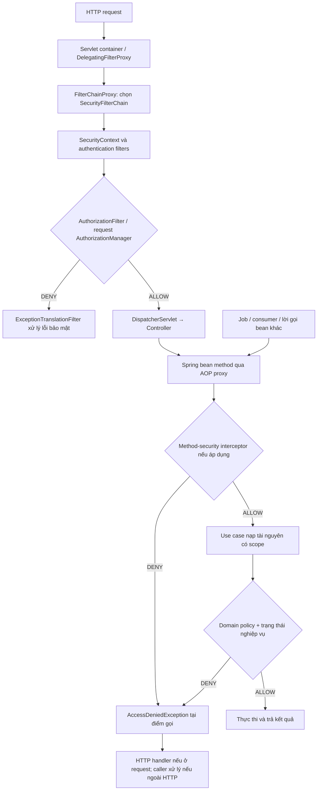

# Từ HTTP request hoặc lời gọi phương thức đến quyết định cấp quyền

> **Module:** Spring Security - authorization  
> **Nhóm:** Luồng quyết định  
> **Mục tiêu:** Theo dấu một yêu cầu từ thời điểm đi vào hệ thống tới khi được cho phép hoặc từ chối; hiểu vai trò của `SecurityFilterChain`, `AuthorizationFilter`, `AuthorizationManager`, `Authentication`, interceptor bảo vệ phương thức và chính sách nghiệp vụ. Sau bài này, bạn có thể giải thích **điểm kiểm tra nào đã ra quyết định**, vì sao nó ra quyết định đó và làm thế nào kiểm chứng các đường gọi khác nhau đều được bảo vệ.

## 1. Một yêu cầu có thể đi qua nhiều quyết định

Giả sử ứng dụng có endpoint:

```http
PATCH /api/documents/42
Authorization: Bearer <access-token>
Content-Type: application/json

{"title":"Bản sửa đổi"}
```

Người gọi Alice đã đăng nhập, có authority `document:edit`. Điều này **chưa chứng minh** Alice được sửa tài liệu 42: tài liệu còn có owner, tenant, trạng thái và quy tắc chia sẻ riêng. Một yêu cầu thường trải qua các chặng sau:

1. **Chọn chuỗi bảo mật:** request có đi qua một `SecurityFilterChain` phù hợp không?
2. **Lấy danh tính tin cậy:** filter xác thực đọc session hoặc bearer token, tạo `Authentication` và gắn vào `SecurityContext` theo cơ chế ứng dụng.
3. **Phân quyền ở request:** `AuthorizationFilter` nhờ `AuthorizationManager` kiểm tra URL, HTTP method, role/authority hoặc luật tùy biến.
4. **Định tuyến đến ứng dụng:** request được gửi tới MVC controller sau khi vượt những bước kiểm tra có liên quan.
5. **Phân quyền ở phương thức:** nếu bật method security và method được gọi qua proxy/interceptor phù hợp, các annotation như `@PreAuthorize` tiếp tục được đánh giá.
6. **Phân quyền trên tài nguyên:** application/domain policy xét actor, hành động, object thật, tenant, owner, trạng thái và các điều kiện kinh doanh.
7. **Thực thi:** chỉ khi các kiểm tra liên quan cho phép, lệnh sửa dữ liệu mới được thực hiện và phản hồi được tạo ra.

Ba nhận định cần giữ:

- **ALLOW ở một chặng không đồng nghĩa ALLOW toàn bộ yêu cầu.** Chặng sau vẫn có thể từ chối.
- **DENY ở chặng bảo vệ trước** sẽ chặn phần xử lý tiếp theo; endpoint, phương thức hay thao tác dữ liệu có thể không được gọi.
- **Không phải mọi lời gọi đều xuất phát từ HTTP.** Scheduler, message listener, batch job và lời gọi service trực tiếp có thể bỏ qua hoàn toàn filter HTTP, nên thiết kế cần các chốt bảo vệ phù hợp ở use case.

## 2. Sơ đồ tổng thể: hai điểm vào cùng cần kiểm soát



Sơ đồ là **luồng khái niệm**, không phải danh sách mọi filter hay thứ tự chính xác của mọi advisor: các module Spring Security, filter custom, thứ tự AOP, CSRF và cấu hình transaction có thể ảnh hưởng thứ tự chi tiết. Ở phía HTTP, `ExceptionTranslationFilter` là filter bọc lời gọi tiếp theo và dịch một số exception bảo mật được phát ra bên dưới. Ở phía method, interceptor chỉ hoạt động nếu lời gọi đi qua cơ chế bảo vệ thực sự được thiết lập.

Một endpoint có thể có request authorization mà không có method annotation, có method annotation mà URL guard chỉ yêu cầu `authenticated()`, hoặc cả hai. Thiết kế cần chủ đích lựa chọn và kiểm thử; không có quy tắc “đã bật Spring Security là mọi method tự động an toàn”.

## 3. Bước 1 — Servlet chọn SecurityFilterChain nào?

Với ứng dụng Servlet, request đi qua `DelegatingFilterProxy` để tới bean `FilterChainProxy` của Spring Security. `FilterChainProxy` có thể quản lý **nhiều `SecurityFilterChain`**, mỗi chain gắn một `RequestMatcher` xác định request nào thuộc phạm vi của chain đó.

Ví dụ có thể có:
- Chuỗi cho `/api/**` dùng bearer token.
- Chuỗi cho website dùng session/form login.
- Một chuỗi dự phòng cho request còn lại.

**Thứ tự các chain quan trọng:** `FilterChainProxy` chọn **chain đầu tiên khớp**, không cộng dồn tất cả các chain rồi chọn luật chặt nhất. Các bean chain thường được sắp bằng `@Order`. Nếu không chain nào khớp, request không được bảo vệ bởi các filter Spring Security của những chain đó; cần đặc biệt thận trọng khi dùng `securityMatcher(...)` giới hạn phạm vi.

Phân biệt:

| Cơ chế | Câu hỏi nó trả lời |
| --- | --- |
| `http.securityMatcher("/api/**")` | Request có **đi vào SecurityFilterChain này** không? |
| `authorizeHttpRequests(...requestMatchers(...))` | **Khi đã ở trong chain**, rule authorization nào áp dụng? |
| `requestMatchers(...).permitAll()` | Một request đi qua chain này được phép tại bước authorization đã cấu hình, nhưng vẫn đi qua những filter bảo mật liên quan |
| `web.ignoring()` | Bỏ qua Spring Security cho request khớp; không nên dùng tùy tiện với endpoint ứng dụng |
| `anyRequest().denyAll()` | Trong phạm vi chain và bộ luật này, request không khớp rule trước đó sẽ bị từ chối |

Lỗi phổ biến là cấu hình hai chain cùng khớp `/api/**` và tưởng chain sau sẽ tiếp tục kiểm tra khi chain đầu đã cho phép. Điều này không đúng: phải kiểm tra **chain được chọn** trước khi chẩn đoán authority hoặc `@PreAuthorize`.

## 4. Bước 2 — Authentication và SecurityContext được thiết lập thế nào?

Authentication (xác thực) trả lời “người gọi là ai?”. Authorization (phân quyền) trả lời “người này được thực hiện thao tác này không?”. Trong Spring Security, kết quả xác thực thường là một `Authentication`:

```text
Authentication
  principal       = chủ thể đã được nhận dạng
  authorities     = tập GrantedAuthority được cấp
  credentials     = thông tin xác thực; thường đã xóa hoặc ẩn sau xác thực
  details         = metadata tùy cơ chế
  authenticated   = trạng thái do cơ chế authentication quản lý
```

Đối với request qua session, context có thể được tải từ `SecurityContextRepository`; với bearer token, filter có thể xác thực token trên mỗi request rồi thiết lập authentication cho xử lý hiện tại. `SecurityContextHolder` là điểm truy cập context trong phần code Servlet cùng luồng, sử dụng chiến lược `ThreadLocal` theo mặc định.

Phân biệt bốn tình huống:

| Trạng thái | Điều cần hiểu |
| --- | --- |
| Không có credential với endpoint yêu cầu đăng nhập | Bước phân quyền cần danh tính sẽ từ chối và có thể kích hoạt authentication entry point |
| Credential sai/hết hạn | Bộ lọc/provider xác thực xử lý lỗi, request không được coi là người dùng hợp lệ |
| Credential hợp lệ nhưng thiếu authority | Xác thực thành công, **authorization vẫn có thể DENY** |
| Có authority nhưng tài nguyên không thuộc phạm vi | Request guard có thể ALLOW; resource policy sau đó DENY |

Đừng dựa vào client gửi `role=ADMIN` trong body/header để tạo authority. Chủ thể, group/role, scope phải được xác minh và ánh xạ bởi hạ tầng xác thực/ủy quyền đáng tin. Cũng đừng tự viết `authentication != null && authentication.isAuthenticated()` rồi kết luận luôn là user đăng nhập thật: `AnonymousAuthenticationToken` có thể được đánh dấu authenticated theo kỹ thuật; hãy dùng matcher/DSL `authenticated()` hoặc trust resolver của Spring Security.

**Điểm tinh tế:** trong `authorizeHttpRequests`, `AuthorizationManager` nhận `Supplier<Authentication>`, tức là có thể **trì hoãn lấy danh tính** đến khi rule thực sự cần. Những rule như `permitAll` hoặc `denyAll` không nhất thiết phải truy cập Authentication để quyết định. Không nên tự khẳng định mọi request đều tải người dùng từ database vì riêng bước authorization.

## 5. Bước 3 — AuthorizationFilter quyết định quyền của request

Trong cấu hình Servlet hiện đại dùng `authorizeHttpRequests`, `AuthorizationFilter` là thành phần kiểm tra quyền request. Có thể diễn giải luồng chính:

1. `AuthorizationFilter` tạo một `Supplier<Authentication>` có thể lấy danh tính từ security context.
2. Nó chuyển supplier và `HttpServletRequest` tới một `AuthorizationManager`.
3. Manager xác định rule áp dụng cho request, ví dụ dựa trên method, path và authority.
4. Nếu **DENY**, Spring Security phát sự kiện từ chối khi được hỗ trợ/cấu hình và ném `AccessDeniedException` hoặc ngoại lệ chuyên biệt tương ứng.
5. Nếu **ALLOW**, filter gọi tiếp filter chain để tới ứng dụng.

Đối với cấu hình nhiều `requestMatchers`, Spring Security thường sử dụng `RequestMatcherDelegatingAuthorizationManager` để chọn authorization manager tương ứng với matcher. **Rule khớp đầu tiên trong bộ luật là rule được chọn**; không phải mọi matcher đều lần lượt được kiểm tra như một biểu thức AND.

Ví dụ cấu hình **một phần** cho Spring Boot 3 / Spring Security 6.x (Servlet):

```java
import org.springframework.context.annotation.Bean;
import org.springframework.context.annotation.Configuration;
import org.springframework.http.HttpMethod;
import org.springframework.security.config.annotation.method.configuration.EnableMethodSecurity;
import org.springframework.security.config.annotation.web.builders.HttpSecurity;
import org.springframework.security.web.SecurityFilterChain;

@Configuration
@EnableMethodSecurity
class SecurityConfiguration {

    @Bean
    SecurityFilterChain apiSecurity(HttpSecurity http) throws Exception {
        http.authorizeHttpRequests(auth -> auth
            .requestMatchers(HttpMethod.GET, "/api/public/**")
                .permitAll()
            .requestMatchers(HttpMethod.GET, "/api/documents/**")
                .hasAuthority("document:read")
            .requestMatchers(HttpMethod.PATCH, "/api/documents/**")
                .hasAuthority("document:edit")
            .requestMatchers("/api/admin/**")
                .hasRole("ADMIN")
            .anyRequest().denyAll()
        );
        return http.build();
    }
}
```

Đây là snippet integration, không phải ứng dụng hoàn chỉnh: bạn còn phải cấu hình authentication (session, OAuth2 Resource Server, HTTP Basic...), CSRF, controller và chính sách dữ liệu theo hệ thống. Các điểm cần hiểu:

- `GET /api/public/help` có thể đi tiếp ở bước authorization request mà không cần danh tính.
- `GET /api/documents/42` cần authority `document:read`.
- `PATCH /api/documents/42` cần authority `document:edit`; **vẫn chưa chứng minh quyền trên Document 42**.
- `hasRole("ADMIN")` theo tiền tố mặc định kiểm tra `ROLE_ADMIN`; `hasAuthority("document:edit")` so khớp chuỗi chính xác.
- `anyRequest().denyAll()` tránh tự động cho phép tuyến chưa được liệt kê.
- Nếu một matcher rộng như `/api/**.permitAll()` đặt đầu tiên thì các matcher cụ thể sau có thể không được chọn. **Chính thứ tự cấu hình làm thay đổi kết quả**.

`AuthorizationFilter` thường ở cuối Spring Security filter chain theo mặc định, nên các filter xác thực và nhiều bảo vệ khác đã có cơ hội hoạt động trước khi request vào ứng dụng. Không diễn giải điều này thành “tất cả custom filters ở mọi vị trí đều được authorization bảo vệ”; vị trí custom filter cần được xem xét.

## 6. AuthorizationManager: đầu vào, đầu ra và ý nghĩa một quyết định

`AuthorizationManager<T>` là giao diện trung tâm cho authorization hiện đại. Ở các bản Spring Security 6.x mới, API đánh giá trả `AuthorizationResult` thông qua `authorize(Supplier<Authentication>, T)`; trong bản cũ có các API `check`/`AuthorizationDecision`. Loại `T` tùy điểm cần bảo vệ:

| Loại invocation được bảo vệ | Ví dụ dữ liệu đầu vào |
| --- | --- |
| HTTP request | `HttpServletRequest` và request context |
| Method invocation trước khi chạy | `MethodInvocation`, arguments và target |
| Method invocation sau khi chạy | Giá trị trả về và ngữ cảnh invocation, qua kiểu phù hợp |
| Tích hợp tùy biến | Đối tượng bảo mật do ứng dụng định nghĩa |

Manager có thể ra quyết định từ authority đơn giản (`AuthorityAuthorizationManager`), trạng thái authenticated, matcher, thời gian, hoặc gọi policy service để xét resource. Tùy API và manager, cũng có khái niệm không đưa ra quyết định/abstain; ứng dụng không nên tự xử lý một kết quả không rõ ràng như ALLOW mặc định.

Một quyết định quyền đúng phải phân biệt:
- **Chứng cứ đáng tin**: Authentication/actor đã xác thực, claims được verify, dữ liệu tài nguyên được tải từ server.
- **Hành động**: READ, EDIT, DELETE, APPROVE... với nghĩa nghiệp vụ.
- **Đối tượng**: resource cụ thể, loại/ID và tenant của nó.
- **Ngữ cảnh**: workflow, owner, nhóm, quyền ủy nhiệm, thời điểm hoặc điều kiện khác.

Có thể mô hình hóa:

```text
decision = authorize(actor, action, resource, context)
decision ∈ {allow, deny} theo hợp đồng policy

ALLOW chỉ đúng khi mọi điều kiện bắt buộc đều đạt.
Thiếu dữ kiện bắt buộc => không được suy đoán quyền.
```

Tư duy này áp dụng cho cả request manager, method manager và domain policy; khác nhau chủ yếu ở **khi nào** và **dữ kiện nào đã sẵn có** tại từng chặng.

## 7. Bước 4 — Controller chỉ chạy khi request vượt qua các chốt phía trước

Sau filter chain, request được servlet MVC xử lý (thường qua `DispatcherServlet`) và ánh xạ tới controller. Nếu rule HTTP đã DENY, method controller thông thường không được gọi.

Controller có thể:
- Bind `@PathVariable`, `@RequestBody`.
- Validate cấu trúc/định dạng dữ liệu đầu vào.
- Lấy identity theo adapter tin cậy.
- Gọi application service chứa use case.

Controller **không nên tự coi một `documentId` trên URL là bằng chứng được phép truy cập**. Nó chỉ là định danh do client yêu cầu. Các giá trị `userId`, `tenantId`, `ownerId` trong body/header vẫn cần được đối chiếu với nguồn tin cậy trước khi dùng trong policy.

Tại một controller:

```java
// Snippet minh họa; DocumentService và RenameDocumentRequest do app định nghĩa.
@PatchMapping("/api/documents/{id}")
public ResponseEntity<Void> rename(
        @PathVariable long id,
        @RequestBody RenameDocumentRequest request) {
    documentService.rename(id, request.title());
    return ResponseEntity.noContent().build();
}
```

Nếu HTTP guard yêu cầu `document:edit`, người có quyền tổng quát này sẽ tới controller. Tuy vậy, service phải còn xác minh actor có quyền sửa **chính** document ID trên URL và tài liệu có thể đổi tên ở trạng thái hiện tại hay không.

## 8. Bước 5 — Phân quyền tại lời gọi phương thức (method security)

Method security bổ sung điểm kiểm soát khi code gọi method của Spring-managed bean. Nó **không tự động bật** chỉ vì đã thêm starter Spring Security; thường bật bằng `@EnableMethodSecurity`.

Một luồng điển hình khi `@PreAuthorize` được áp dụng:

1. Caller gọi một method **thông qua Spring AOP proxy**.
2. `AuthorizationManagerBeforeMethodInterceptor` khớp với pointcut của `@PreAuthorize`.
3. `PreAuthorizeAuthorizationManager` tạo ngữ cảnh đánh giá biểu thức từ `Authentication` và `MethodInvocation`.
4. Biểu thức kiểm tra quyền, ví dụ `hasAuthority('document:edit')` hoặc policy bean.
5. **ALLOW:** interceptor cho phép gọi method thật.
6. **DENY:** interceptor ném `AccessDeniedException`; thân method không chạy.

Ví dụ:

```java
import org.springframework.security.access.prepost.PreAuthorize;
import org.springframework.stereotype.Service;

@Service
public class DocumentReadService {

    @PreAuthorize("hasAuthority('document:read')")
    public String readSummary(long documentId) {
        // Phải tiếp tục kiểm tra tài nguyên và scope trước khi trả dữ liệu thật.
        return "Summary of document " + documentId;
    }
}
```

Class minh họa trên **không tự định nghĩa chính sách dữ liệu** và không phải ứng dụng Spring Boot đầy đủ; chuỗi trả về chỉ giúp hình dung thời điểm body được gọi. Nếu caller không có `document:read`, body sẽ không chạy khi interceptor hoạt động.

**Vì sao cần chốt ở method?** Cùng một service có thể được gọi từ REST controller A, GraphQL resolver B, batch job hoặc service khác. Nếu chỉ chặn ở URL A thì một đường khác có thể bỏ qua logic phân quyền. Method security là một lớp bảo vệ tái sử dụng, nhưng phải đặt trên đúng use case và kiểm tra mọi lối gọi thực tế.

### @PostAuthorize, @PreFilter và @PostFilter trong luồng

- `@PreAuthorize`: trước khi thân method chạy, có thể dùng tham số.
- `@PostAuthorize`: sau khi method trả kết quả, có thể xét `returnObject`.
- `@PreFilter`: lọc các phần tử của đối số collection được hỗ trợ trước invocation.
- `@PostFilter`: lọc collection trả về sau invocation.

Nếu có nhiều loại annotation trên cùng invocation, các interceptor phù hợp có thể được áp dụng nối tiếp; cần vượt qua tất cả kiểm tra liên quan. Không lặp hai `@PreAuthorize` trên cùng một method để biểu diễn hai luật; kết hợp biểu thức hoặc tách policy.

**Cảnh báo quan trọng với `@PostAuthorize`:** thân method **đã chạy** trước khi kiểm tra sau. Nếu method đã gửi email, chuyển tiền, ghi DB hoặc phát sự kiện, từ chối sau khi thực thi không tự đảo ngược mọi side effect. Dùng pre-authorization hoặc guard domain trước khi thay đổi trạng thái cho hành động có hiệu ứng.

`@PostFilter` cũng không phải phương án mặc định để bảo vệ danh sách khổng lồ: dữ liệu có thể đã bị tải, phân trang sai hoặc có side effect trước khi lọc. Cần giới hạn truy vấn theo tenant/visibility tại nguồn dữ liệu.

### Proxy, self-invocation và modifier

Spring AOP proxy thường chỉ thấy lời gọi **đi qua proxy**. Nếu method A của cùng bean gọi `this.securedMethod()`, lời gọi nội bộ có thể **bỏ qua interception** trên method B. Tùy loại proxy (JDK/CGLIB), visibility, final method, tổ chức class và cấu hình AspectJ có thêm giới hạn.

Không coi mọi method có annotation là tự động được chặn trong mọi tình huống. Kiểm thử thực tế:
- Caller lấy bean từ Spring context và gọi qua proxy.
- Một bean khác gọi method được bảo vệ.
- Method nội bộ gọi method khác có annotation.
- Job hoặc listener gọi cùng use case.
- Method bị final/private hoặc cấu hình proxy không tương thích (nếu có).

Nếu cần bảo vệ **bất biến domain** bất kể AOP có chạy hay không, đặt check bắt buộc trong use case/domain service cũng là lựa chọn vững chắc.

## 9. Ghép request guard, method guard và domain policy

Một mô hình điển hình:

```text
PATCH /api/documents/42
   |
   | HTTP: có authority "document:edit"?
   v
DocumentController.rename(...)
   |
   | method: có authority "document:edit"?
   v
DocumentService.rename(42, "...")
   |
   | repository: nạp Document 42 trong tenant của actor
   | domain policy: actor có thể sửa tài liệu 42 hiện tại?
   | invariant: title hợp lệ, trạng thái cho phép?
   v
Thay đổi Document 42
```

Việc lặp quyền tổng quát tại HTTP và method có thể chấp nhận được nếu chúng bảo vệ **hai biên gọi khác nhau**. Nhưng không nên duy trì **hai bản sao của một luật nghiệp vụ phức tạp** ở controller và service: chúng dễ lệch nhau. Đặt nội dung policy theo object vào một thành phần nhất quán, gọi ở nơi có resource/context đáng tin.

Ví dụ cấu trúc một service (snippet tích hợp; entity, repository, `ActorResolver` và `DocumentPolicy` thuộc ứng dụng):

```java
import org.springframework.security.access.AccessDeniedException;
import org.springframework.security.access.prepost.PreAuthorize;
import org.springframework.stereotype.Service;
import org.springframework.transaction.annotation.Transactional;

@Service
class DocumentService {
    private final DocumentRepository repository;
    private final ActorResolver actorResolver;
    private final DocumentPolicy policy;

    DocumentService(DocumentRepository repository,
                    ActorResolver actorResolver,
                    DocumentPolicy policy) {
        this.repository = repository;
        this.actorResolver = actorResolver;
        this.policy = policy;
    }

    @Transactional
    @PreAuthorize("hasAuthority('document:edit')")
    public void rename(long documentId, String newTitle) {
        Actor actor = actorResolver.requireAuthenticatedActor();
        Document document = repository
            .findByIdAndTenantId(documentId, actor.tenantId())
            .orElseThrow(DocumentNotFoundException::new);

        if (!policy.mayRename(actor, document)) {
            throw new AccessDeniedException("Rename denied");
        }

        document.rename(newTitle);
    }
}
```

Giải thích từng điểm:

1. `@PreAuthorize` chặn thiếu quyền tổng quát **trước thân method**, nếu proxy áp dụng.
2. `ActorResolver` ánh xạ danh tính server đã xác thực sang actor miền; client không tự điền quyền vào `Actor`.
3. Query `findByIdAndTenantId` giới hạn scope theo tenant và giảm nguy cơ lộ thông tin thuộc tenant khác.
4. `DocumentPolicy` xét owner, collaboration grant, tenant và trạng thái.
5. `document.rename` áp dụng invariant của entity như tiêu đề hợp lệ và trạng thái được sửa.
6. `@Transactional` quản lý transaction cho phần use case, nhưng **không tự giải quyết mọi race**; cần optimistic versioning hoặc locking nếu quyền/trạng thái có thể thay đổi đồng thời.

Các type chưa khai báo ở snippet là dependency của dự án; đây **không phải file Java standalone**. Nếu dùng `@PreAuthorize` trên method và `@Transactional`, thứ tự advisor giữa method security/transaction cần được hiểu khi logic truy vấn quyền đòi hỏi một transaction duy nhất. Đừng mặc định annotation ở trên sẽ khiến mọi truy vấn diễn ra trong transaction theo đúng thứ tự ta hình dung; để giữ nhất quán dữ liệu, có thể đặt check object **bên trong** thân use case như ví dụ.

## 10. Quyết định khác nhau tùy chặng: ví dụ Java 17 chạy độc lập

Đoạn sau mô phỏng ba điểm chặn theo đúng thứ tự: request authorization (nếu gọi qua HTTP), method authorization và resource/domain policy. Nó **không phải cách Spring Security cài đặt các filter**, không thực hiện xác thực mật mã; purpose là cho thấy cùng dữ liệu danh tính/quyền nhưng đường gọi và đối tượng thay đổi kết quả.

Lưu thành `DecisionFlowDemo.java`:

```java
import java.util.Set;

public class DecisionFlowDemo {

    record Actor(String id, String tenantId, Set<String> authorities) {}
    record Document(String ownerId, String tenantId, boolean locked) {}
    record Decision(boolean allowed, String checkpoint) {
        @Override
        public String toString() {
            return (allowed ? "ALLOW" : "DENY") + " @" + checkpoint;
        }
    }

    static Decision deny(String checkpoint) {
        return new Decision(false, checkpoint);
    }

    static Decision throughHttp(Actor actor, Document document) {
        if (actor == null) {
            return deny("HTTP_AUTHENTICATION");
        }
        if (!actor.authorities().contains("document:edit")) {
            return deny("HTTP_AUTHORIZATION");
        }
        return throughMethod(actor, document);
    }

    static Decision throughMethod(Actor actor, Document document) {
        if (actor == null
                || !actor.authorities().contains("document:edit")) {
            return deny("METHOD_AUTHORIZATION");
        }
        if (!actor.tenantId().equals(document.tenantId())
                || !actor.id().equals(document.ownerId())) {
            return deny("DOMAIN_POLICY");
        }
        if (document.locked()) {
            return deny("DOMAIN_STATE");
        }
        return new Decision(true, "EXECUTION");
    }

    public static void main(String[] args) {
        Actor alice = new Actor(
            "alice", "tenant-a", Set.of("document:edit"));
        Actor bob = new Actor(
            "bob", "tenant-a", Set.of("document:edit"));
        Actor reader = new Actor(
            "reader", "tenant-a", Set.of("document:read"));

        Document aliceDraft =
            new Document("alice", "tenant-a", false);
        Document aliceLocked =
            new Document("alice", "tenant-a", true);
        Document otherTenant =
            new Document("alice", "tenant-b", false);

        System.out.println("Anonymous HTTP: "
            + throughHttp(null, aliceDraft));
        System.out.println("Reader HTTP: "
            + throughHttp(reader, aliceDraft));
        System.out.println("Bob HTTP: "
            + throughHttp(bob, aliceDraft));
        System.out.println("Alice HTTP: "
            + throughHttp(alice, aliceDraft));
        System.out.println("Alice locked HTTP: "
            + throughHttp(alice, aliceLocked));
        System.out.println("Alice cross-tenant HTTP: "
            + throughHttp(alice, otherTenant));
        System.out.println("Reader direct method: "
            + throughMethod(reader, aliceDraft));
        System.out.println("Bob direct method: "
            + throughMethod(bob, aliceDraft));
    }
}
```

Lệnh chạy bằng JDK 17+:

```bash
javac DecisionFlowDemo.java
java DecisionFlowDemo
```

Kết quả chuẩn:

```text
Anonymous HTTP: DENY @HTTP_AUTHENTICATION
Reader HTTP: DENY @HTTP_AUTHORIZATION
Bob HTTP: DENY @DOMAIN_POLICY
Alice HTTP: ALLOW @EXECUTION
Alice locked HTTP: DENY @DOMAIN_STATE
Alice cross-tenant HTTP: DENY @DOMAIN_POLICY
Reader direct method: DENY @METHOD_AUTHORIZATION
Bob direct method: DENY @DOMAIN_POLICY
```

Phân tích:

- Anonymous không vượt bước xác thực của luồng HTTP.
- Reader có `document:read` nhưng thiếu `document:edit`, bị chặn ở request guard.
- Bob có authority edit nên qua HTTP và method guard, nhưng không phải owner nên bị domain policy từ chối.
- Alice sửa bản nháp thuộc đúng tenant được phép.
- Alice không sửa tài liệu đã khóa hoặc ở tenant khác, dù authority không đổi.
- Đường gọi method trực tiếp **không đi qua HTTP guard**; method guard và domain policy vẫn kiểm tra.

Trong hệ thống thật, `DENY @HTTP_AUTHENTICATION` không phải chuỗi phản hồi HTTP; framework dùng `AuthenticationEntryPoint`/`AccessDeniedHandler` để phát status và body theo cấu hình. Tương tự, business invariant có thể chuyển thành mã lỗi domain thích hợp, thay vì luôn là HTTP 403.

## 11. Các nhánh lỗi: vì sao có 401, 403, 404 hoặc lỗi nghiệp vụ?

Trên đường request HTTP, `ExceptionTranslationFilter` đóng vai trò dịch các exception bảo mật như `AuthenticationException` và `AccessDeniedException` thành hành vi HTTP theo cấu hình:

- **Authentication chưa đủ:** gọi `AuthenticationEntryPoint` để bắt đầu yêu cầu xác thực hoặc báo lỗi. API bearer thường trả `401`; website form login có thể redirect.
- **Đã xác thực nhưng bị từ chối quyền:** `AccessDeniedHandler` thường trả `403 Forbidden`.
- **Anonymous hoặc remember-me chưa đủ mức tin cậy:** một từ chối có thể được điều hướng tới entry point thay vì xử lý như user đăng nhập đầy đủ.
- **Không có resource hoặc cần che giấu sự tồn tại:** ứng dụng có thể trả `404` theo contract và chính sách tránh lộ thông tin.
- **Có quyền nhưng không đáp ứng invariant nghiệp vụ:** ứng dụng trả lỗi miền, ví dụ `409 Conflict` khi trạng thái không cho thao tác.

Tình huống điển hình:

| Chặng phát sinh | Nguyên nhân | Kết quả mong đợi |
| --- | --- | --- |
| Authentication filter | Token thiếu, sai, hết hạn | Không được nhận diện là user hợp lệ; HTTP theo entry point |
| AuthorizationFilter | Thiếu `document:edit` | Không vào controller; deny ở tầng request |
| @PreAuthorize interceptor | Service được gọi trực tiếp nhưng thiếu `document:edit` | Không thực thi thân method; deny ở tầng method |
| Domain policy | Có authority nhưng không phải owner/cùng tenant | Không sửa dữ liệu; deny theo policy |
| Domain invariant | Có quyền nhưng tài liệu đã khóa | Chặn thao tác; lỗi nghiệp vụ tương ứng |
| @PostAuthorize | Body đã chạy, trả dữ liệu/đối tượng không đủ điều kiện | Từ chối phản hồi; cần thận trọng với side effect |

**Khi ngoài request HTTP**, ví dụ job trực tiếp gọi method có `@PreAuthorize`, không có `ExceptionTranslationFilter` của servlet đứng ngoài để chuyển `AccessDeniedException` sang response. Chính caller phải bắt/xử lý exception theo nghĩa vụ của job.

Trong MVC, `@ControllerAdvice` hoặc exception resolver của ứng dụng có thể xử lý exception trước khi chúng đi ngược qua filter. Cần xác định một nơi chịu trách nhiệm chuẩn hóa lỗi HTTP; không viết handler tùy tiện biến mọi lỗi thành 200 hoặc tiết lộ thông tin nhạy cảm.

## 12. Một lần request không nhất thiết bằng một lần authorization

Nhiều luồng có thể khiến bạn thấy một request bị kiểm tra nhiều lần:

1. **HTTP guard rồi method guard:** hai chốt độc lập áp dụng cùng request.
2. **FORWARD hoặc ERROR dispatch:** servlet container có thể dispatch thêm khi render view hoặc xử lý lỗi.
3. **ASYNC dispatch:** tác vụ bất đồng bộ có thể tương tác với security context/dispatch khác, tùy cấu hình.
4. **Nhiều method có annotation:** method này gọi method khác qua proxy, mỗi invocation tương ứng có kiểm tra riêng.
5. **Nhiều resource:** một use case xử lý nhiều document cần quyết định cho từng object hoặc một policy batch được chứng minh tương đương.

Ví dụ Spring MVC controller ném exception, container có thể dispatch tới `/error`. Nếu authorization trên dispatch ERROR bị từ chối, người dùng có thể nhìn thấy 403 thay vì lỗi gốc, gây khó chẩn đoán. Spring Security cho phép cấu hình dispatcher type phù hợp, ví dụ cân nhắc `dispatcherTypeMatchers(DispatcherType.ERROR, DispatcherType.FORWARD).permitAll()` theo kiến trúc. **Chỉ cho phép dispatch phù hợp chủ đích**, không mở rộng vô điều kiện endpoint nhạy cảm.

Một lỗi khác là bọc request bằng custom filter tự kiểm tra security ở vị trí không chuẩn rồi tưởng nó chạy trước authentication. Hãy kiểm tra vị trí filter thực tế và không chèn custom filter dựa trên phỏng đoán.

## 13. SecurityMatcher, requestMatchers và nhiều SecurityFilterChain

Dưới đây là **minh họa cấu hình cấu trúc** hai chain API và web. Cần bổ sung authentication và cấu hình tương ứng; ví dụ tập trung vào sự khác biệt giữa chọn chain và chọn rule:

```java
@Configuration
@EnableMethodSecurity
class TwoChainSecurityConfiguration {

    @Bean
    @Order(1)
    SecurityFilterChain api(HttpSecurity http) throws Exception {
        http.securityMatcher("/api/**")
            .authorizeHttpRequests(auth -> auth
                .requestMatchers(HttpMethod.GET, "/api/public/**")
                    .permitAll()
                .anyRequest().authenticated()
            );
        return http.build();
    }

    @Bean
    @Order(2)
    SecurityFilterChain web(HttpSecurity http) throws Exception {
        http.authorizeHttpRequests(auth -> auth
            .requestMatchers("/", "/login").permitAll()
            .anyRequest().authenticated()
        );
        return http.build();
    }
}
```

Đoạn minh họa có thêm các import từ Spring như `@Configuration`, `@Bean`, `@Order`, `HttpMethod`, `HttpSecurity`, `SecurityFilterChain` và `@EnableMethodSecurity`. Nó không cấu hình cơ chế login/token/CSRF; khi ứng dụng thật cần web form login và API bearer, mỗi chain phải được cấu hình cơ chế phù hợp.

Luồng `GET /api/documents/42`:

1. Chain thứ nhất có `securityMatcher("/api/**")` khớp và được chọn.
2. Bộ `authorizeHttpRequests` của chain thứ nhất xét: không khớp public GET → rơi vào `anyRequest().authenticated()`.
3. Request chỉ cần có danh tính xác thực ở bước này, **không tự yêu cầu `document:read`**.
4. Chain thứ hai **không được thử tiếp**.
5. Bảo vệ cụ thể phải được khai báo thêm ở chain API hoặc tại service/method.

Đây là minh chứng cho một nguyên tắc quan trọng: **có `anyRequest().authenticated()` không bằng có đủ luật quyền trên từng chức năng và đối tượng**. Nếu API yêu cầu `document:read`, phải đặt nó trong chain thực sự được chọn hoặc policy ở tầng thấp hơn có bảo đảm.

## 14. Ranh giới với CSRF, CORS, authentication và transaction

Không phải lỗi 403 nào cũng do `AuthorizationManager`.

- **CSRF:** với ứng dụng browser gửi credential tự động như cookie/session, một request thay đổi trạng thái có thể bị `CsrfFilter` chặn trước khi vào controller. Kiểm tra authority đúng nhưng thiếu CSRF token vẫn có thể bị từ chối.
- **CORS:** preflight `OPTIONS` có thể diễn ra trước request thật; cấu hình CORS sai có thể khiến trình duyệt không gửi request hoặc chặn response. Phân biệt lỗi browser/CORS với quyết định role.
- **Authentication:** lỗi JWT, credential, session không hợp lệ xảy ra trước hoặc ngoài request authorization, phụ thuộc filter chain.
- **Transaction:** quyền kiểm tra trên một trạng thái database có thể trở nên lỗi thời trước khi update nếu concurrent transaction thay đổi owner/status. Cần version/locking hoặc điều kiện update phù hợp.
- **Validation:** `@Valid`/Bean Validation và invariant domain trả lỗi khác authorization, dù client có thể nhìn thấy cùng một nhóm status 4xx.

Khi chẩn đoán, hãy hỏi “**thành phần nào đã từ chối trước tiên?**” thay vì kết luận ngay rằng `hasAuthority` sai.

## 15. Method security khi không có HTTP: scheduler và message consumer

Giả sử một message listener nhận nhiệm vụ sửa tài liệu:

```text
Kafka message / scheduled job
    |
    v
Listener / Job
    |
    v
DocumentService.rename(...)
    |
    v
Method interceptor nếu lời gọi qua proxy
    |
    v
Domain policy / transaction / update
```

Luồng này không có `AuthorizationFilter` và không có `ExceptionTranslationFilter` của HTTP request. Nếu use case yêu cầu danh tính người dùng cụ thể, job phải có mô hình actor đáng tin và phép ủy quyền được xác minh. Đừng giả định `SecurityContextHolder` chứa principal đúng ở bất kỳ background thread nào.

Nếu job chạy dưới service account:
- Cần xác định service account được phép làm gì, ở tenant/resource nào, với audit nào.
- Có thể dùng policy xử lý service actor hoặc service-specific use case.
- Không gán quyền quản trị toàn hệ thống mặc định chỉ vì job không có phiên đăng nhập tương tác.
- Nếu job mang request thay mặt người dùng, cần quản lý bằng chứng ủy nhiệm, thời hạn, phạm vi và thu hồi.

Với code bất đồng bộ trong Servlet, `SecurityContextHolder` thường dựa vào `ThreadLocal`; sang executor/thread khác cần cơ chế context propagation có kiểm soát như các wrapper `DelegatingSecurityContext...` khi phù hợp. Đối với WebFlux, security context nằm trong Reactor context qua `ReactiveSecurityContextHolder`; không áp dụng nguyên mẫu Servlet ThreadLocal cho chuỗi reactive.

## 16. Test cần chứng minh từng chặng, không chỉ status cuối

Một ma trận kiểm thử cho API PATCH sửa tài liệu:

| Kịch bản | HTTP authorization | Method authorization | Domain policy | Kết quả |
| --- | --- | --- | --- | --- |
| Anonymous | Không đủ danh tính | Không tới | Không tới | 401/redirect theo entry point |
| Alice chỉ có `document:read` | DENY | Không tới | Không tới | Thường 403 |
| Alice có `document:edit`, là owner, cùng tenant, DRAFT | ALLOW | ALLOW | ALLOW | Cho phép sửa |
| Bob có `document:edit`, không phải owner | ALLOW | ALLOW | DENY | Không sửa |
| Alice có edit, nhưng tenant khác | ALLOW | ALLOW | DENY | Không rò dữ liệu ngoài tenant |
| Alice có edit, document LOCKED | ALLOW | ALLOW | DENY hoặc lỗi invariant | Không sửa |
| Job gọi service, thiếu edit | Không chạy | DENY nếu interceptor áp dụng | Không tới | Throw/handle denial |
| Job gọi service, edit hợp lệ, không quyền resource | Không chạy | ALLOW | DENY | Không sửa |
| Method nội bộ tự gọi method annotation | Không đủ chứng cứ proxy đã chạy | Có nguy cơ bypass | Guard trong use case vẫn cần bảo vệ | Kiểm thử riêng |
| HTTP bị CSRF filter từ chối | Chưa tới bước authorization mong đợi | Không tới | Không tới | 403 do CSRF, không chứng minh authority rule |

Một test hợp lệ cần chỉ rõ **điểm chặn dự kiến**. Chỉ assert 403 có thể là dương tính giả nếu 403 phát sinh từ CSRF, handler exception khác hoặc endpoint không match.

### Ví dụ test HTTP với MockMvc

```java
// Snippet JUnit/Spring Security Test; cần context thực và MockMvc.
import static org.springframework.security.test.web.servlet.request
    .SecurityMockMvcRequestPostProcessors.csrf;
import static org.springframework.test.web.servlet.request
    .MockMvcRequestBuilders.patch;
import static org.springframework.test.web.servlet.result
    .MockMvcResultMatchers.status;

@Test
@WithMockUser(username = "reader",
              authorities = {"document:read"})
void patchRequiresEditAuthority() throws Exception {
    mvc.perform(patch("/api/documents/42")
            .with(csrf())
            .contentType(MediaType.APPLICATION_JSON)
            .content("{\"title\":\"New title\"}"))
        .andExpect(status().isForbidden());
}
```

Đây là **snippet integration**, không phải file độc lập. Cần `@WithMockUser`, `MediaType`, `MockMvc`, cấu hình controller/security phù hợp và một dependency test như `spring-security-test`. Nếu mã lỗi 403 đến từ domain policy hoặc lý do khác, test cũng có thể pass; vì vậy nên bổ sung test đối chứng: đổi mock principal thành người có `document:edit` với resource được cho phép và kỳ vọng request thành công, đồng thời verify service không chạy khi thiếu authority.

### Kiểm thử method và object policy

Với method security, dùng một Spring-managed bean thực sự qua proxy và mock authentication thích hợp; một test gọi method có `@PreAuthorize` trên object mới tạo bằng `new` có thể bỏ qua hoàn toàn AOP, không chứng minh gì về Spring.

Trong policy test, cố định principal và authority, chỉ thay owner/tenant/status để chứng minh quyết định dựa trên tài nguyên. Khi kiểm tra hành động có side effect, assert **dữ liệu không thay đổi** sau deny.

Nếu test `@PostAuthorize`, hãy biết thân method có thể đã thực thi; đối với write, test audit/side effects và thay đổi thiết kế nếu việc từ chối quá muộn.

### Đo và quan sát trong lúc debug

Bật log mức phù hợp trong môi trường phát triển (tránh log token/credential) và quan sát:
- Chain nào được chọn cho request?
- Filter nào chặn trước?
- Authentication hiện hành có những authority nào?
- Matcher/rule nào áp dụng và theo thứ tự gì?
- Method invocation có đi qua proxy không?
- Policy object trả deny vì tenant, owner hay trạng thái?
- Exception nào được ném, resolver/filter nào đã xử lý?

Có thể bổ sung `AuthorizationDeniedEvent` và audit nghiệp vụ khi cần, nhưng phải có chính sách không ghi dữ liệu nhạy cảm, không phơi bày lý do deny chi tiết tới người ngoài và hạn chế log verbosity trong production.

## 17. Những lỗi hiểu sai luồng quyết định

| Nhận định sai | Điều thực sự xảy ra | Hướng xử lý |
| --- | --- | --- |
| “Request đi qua security nghĩa là mọi service đều được bảo vệ” | HTTP filter không tự bảo vệ job hay method gọi ngoài HTTP | Đặt guard ở use case/method phù hợp |
| “Có `document:edit` là sửa được mọi document” | Authority chỉ là quyền chung | Kiểm tra ACL/owner/tenant/status trên object |
| “Mọi SecurityFilterChain đều lần lượt chạy” | First matching chain được chọn | Kiểm tra `securityMatcher` và `@Order` |
| “Mọi requestMatchers khớp đều được AND” | Thường rule khớp đầu tiên được áp dụng | Đặt matcher đúng thứ tự; dùng composite manager nếu cần |
| “`permitAll` tắt Spring Security” | Chỉ cho phép tại bước authorization tương ứng | Phân biệt `permitAll` và bỏ qua filter chain |
| “`@EnableMethodSecurity` bảo vệ mọi method” | Chỉ interceptor/advisor áp dụng mới chặn | Thêm annotation/policy vào đúng điểm, test qua proxy |
| “`this.securedMethod()` chắc chắn kích hoạt `@PreAuthorize`” | Self-invocation có thể bypass proxy | Điều chỉnh bean boundary hoặc guard trong use case |
| “`@PostAuthorize` chặn trước khi ghi” | Method đã chạy trước post-check | Dùng pre-guard cho thay đổi trạng thái |
| “Mọi 403 đều do authority” | Có thể do CSRF, rule khác hoặc resource policy | Tìm chặng deny thực sự bằng test/log |
| “`isAuthenticated()` của mọi Authentication nghĩa là user login” | Anonymous token có thể báo authenticated theo kỹ thuật | Dùng matcher/trust resolver phù hợp |
| “Đã cho phép `GET /api/documents` thì download/export cũng an toàn” | Các entry point khác cần quyền riêng | Kiểm soát list/detail/export/download đồng bộ |
| “Transaction luôn ngăn race đổi trạng thái” | Transaction đơn thuần không giải quyết mọi time-of-check/time-of-use | Version/locking/conditional update theo nghiệp vụ |
| “Khi bị deny, cứ trả 404 cho tất cả” | Che lỗi authentication, lỗi hệ thống và lỗi state | Thiết kế contract 401/403/404/409 rõ ràng |

Một cách chẩn đoán có hệ thống là đi theo **đường đi thật của request** rồi ghi lại điểm đầu tiên dừng. Đừng sửa `@PreAuthorize` trước khi biết request có đi tới method không; đừng sửa JWT converter trước khi biết chain nào xử lý token.

## 18. Checklist thiết kế một endpoint hoặc use case an toàn

1. **Xác định entry point:** HTTP, message consumer, scheduler hay phương thức từ bean khác?
2. **Vạch danh tính:** actor được xác thực và chuẩn hóa ở đâu, session/JWT có thời điểm thu hồi thế nào?
3. **Chọn chain:** `securityMatcher`, `@Order` và fallback có bảo đảm request đi qua bảo vệ đúng không?
4. **Khai báo luật HTTP:** method/path có rõ, matcher có đúng thứ tự, default deny có phù hợp không?
5. **Bảo vệ method:** `@EnableMethodSecurity` có bật, annotation thực sự đi qua proxy, lối gọi phụ có được bảo vệ không?
6. **Nạp resource tin cậy:** ID client đưa vào được query trong tenant/visibility phù hợp chưa?
7. **Áp dụng domain policy:** actor, hành động, resource và context có đủ dữ kiện cần thiết không?
8. **Kiểm tra invariant và concurrency:** trạng thái, version và transaction bảo vệ khỏi thay đổi đồng thời ra sao?
9. **Lỗi và audit:** authentication failure, access denied, not found và business conflict có hợp đồng rõ ràng không?
10. **Kiểm thử âm tính:** thiếu authority, sai owner, khác tenant, URL/method khác, direct method, job, CSRF, FORWARD/ERROR và self-invocation được kiểm tra chưa?

**Câu hỏi tự kiểm tra:**

- Một GET được `permitAll` trong chain đã chọn. Spring Security có tự bỏ mọi authentication filter không? → **Không**. `permitAll` quyết định bước request authorization; các filter khác vẫn có thể tham gia theo cấu hình.
- Một PATCH đã vượt `hasAuthority('document:edit')` nhưng service `@PreAuthorize` deny. Có gọi thân method không? → **Không**, nếu interceptor thực sự áp dụng; HTTP ALLOW không bãi bỏ chặn method.
- Một job gọi thẳng service có `@PreAuthorize`. `AuthorizationFilter` có chạy không? → **Không**, job không tạo HTTP request; cần bảo vệ method/use case phù hợp và xử lý denial ngoài HTTP.
- Alice có `document:edit` nhưng sửa tài liệu tenant khác. Kết quả đúng? → **DENY** bởi resource/domain policy; authority tổng quát không thay thế tenant scope.
- Request PATCH trả 403 trong test và không có CSRF token. Test có chứng minh authority rule hoạt động chưa? → **Chưa**; 403 có thể do CSRF, cần test kiểm soát nguyên nhân.

**Tư duy cốt lõi:** Spring Security cung cấp nhiều điểm **enforcement**: chọn filter chain, xác thực, xét luật request qua `AuthorizationFilter` và xét lời gọi method qua interceptor. Quyền nghiệp vụ trên object cụ thể cần policy có thể giải thích và kiểm thử. Muốn biết vì sao một yêu cầu được phép hay từ chối, hãy theo dõi **đúng chặng ra quyết định** cùng dữ kiện và cấu hình thật của chặng đó.

## Tài liệu tham khảo

- [Spring Security — Servlet Architecture](https://docs.spring.io/spring-security/reference/6.5/servlet/architecture.html)
- [Spring Security — Authorize HTTP Requests](https://docs.spring.io/spring-security/reference/6.5/servlet/authorization/authorize-http-requests.html)
- [Spring Security — Authorization Architecture](https://docs.spring.io/spring-security/reference/6.5/servlet/authorization/architecture.html)
- [Spring Security — Method Security](https://docs.spring.io/spring-security/reference/6.5/servlet/authorization/method-security.html)
- [Spring Security — Authentication Architecture](https://docs.spring.io/spring-security/reference/6.5/servlet/authentication/architecture.html)
- [Spring Security — CSRF](https://docs.spring.io/spring-security/reference/6.5/servlet/exploits/csrf.html)
