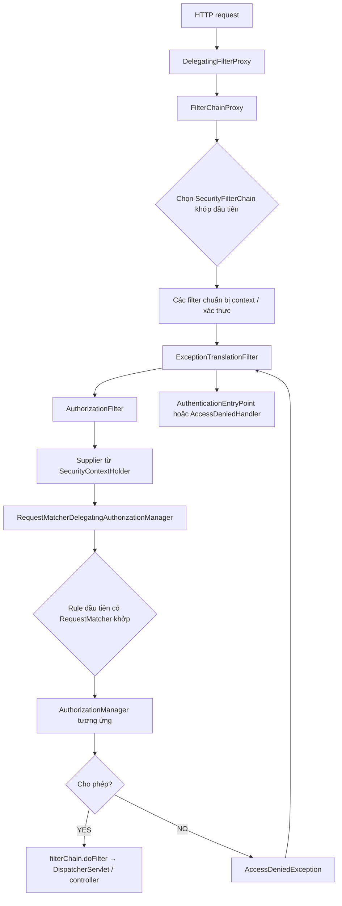

# AuthorizationFilter và RequestMatcherDelegatingAuthorizationManager

Trong Spring Security **Servlet**, cấu hình `authorizeHttpRequests` chuyển những quy tắc như “`GET /api/orders/**` cần quyền `orders.read`” thành một quá trình kiểm soát truy cập tại HTTP layer. Hai thành phần then chốt là:

- **`AuthorizationFilter`**: filter đứng trong `SecurityFilterChain`, kiểm tra request có được tiếp tục đi vào ứng dụng hay không. Nó lấy một `AuthorizationManager<HttpServletRequest>` để thực hiện quyết định.
- **`RequestMatcherDelegatingAuthorizationManager`**: một implementation của `AuthorizationManager<HttpServletRequest>`, giữ các cặp **`RequestMatcher → AuthorizationManager`** theo thứ tự, tìm **cặp khớp đầu tiên** rồi giao quyết định quyền truy cập cho manager của cặp đó.

Nói ngắn gọn về trách nhiệm: **filter thực thi cổng kiểm soát request; delegating manager chọn quy tắc; authorization manager được chọn đánh giá quyền của chủ thể**. Những khái niệm này thuộc luồng quyết định truy cập trong ứng dụng, không phải chức năng phát hành token OAuth2.

Bài viết lấy **Spring Security 6.5.x + Spring Boot 3.x/Java 17+** làm ngữ cảnh API Java. Cần kiểm lại tài liệu đúng phiên bản khi chuyển sang major release khác.

## 1. Ba lớp khác nhau trong một HTTP request

Một request có thể qua ba bước lựa chọn mà người mới thường gộp làm một:

1. **`FilterChainProxy` lựa chọn `SecurityFilterChain`**: khi ứng dụng có nhiều chain, chain khớp đầu tiên (theo `securityMatcher`/thứ tự chain) được chọn. Mỗi chain có một tập filter và cấu hình bảo mật riêng.
2. **`AuthorizationFilter` của chain đã chọn yêu cầu quyết định**: sau khi các filter xác thực/chống khai thác phù hợp chạy, filter ủy quyền dùng `AuthorizationManager` để quyết định request được đi tiếp không.
3. **`RequestMatcherDelegatingAuthorizationManager` lựa chọn rule trong chain**: dùng `RequestMatcher` khớp đầu tiên, rồi gọi `AuthorizationManager` tương ứng như `permitAll`, `authenticated`, `hasAuthority`, `hasRole` hoặc manager tùy biến.

Hai kiểu matcher cùng xét request nhưng **không cùng cấp độ**:

| Thành phần | Được dùng ở đâu? | Kết quả |
| --- | --- | --- |
| `securityMatcher("/api/**")` | `FilterChainProxy`, chọn một `SecurityFilterChain` | Quyết định **chain nào** bảo vệ request |
| `requestMatchers(HttpMethod.GET, "/api/orders/**")` | Trong `authorizeHttpRequests` của chain đã chọn | Chọn **rule authorization nào** |
| `AuthorizationManager` của rule | Sau khi một `RequestMatcher` khớp | Trả quyết định cho phép/từ chối |
| `AuthorizationFilter` | Trong chain đã chọn | Thực thi quyết định: đi tiếp hoặc ném lỗi truy cập |

Không có chuyện mỗi `RequestMatcher` tạo ra một filter riêng hay ứng dụng chạy đồng thời tất cả `SecurityFilterChain` rồi cộng kết quả. Phải phân biệt **chọn chain** với **chọn rule bên trong chain**.

## 2. Luồng xử lý request từ đầu đến cuối

Mô hình logic cho ứng dụng servlet có cấu hình `authorizeHttpRequests`:



Sơ đồ diễn đạt **vai trò logic**, không liệt kê mọi filter có thể có. Một request thực tế còn phụ thuộc cách xác thực (session, HTTP Basic, Bearer JWT...), CSRF, CORS, error handling, cấu hình nhiều chain và loại dispatcher.

### 2.1. `AuthorizationFilter` nhận gì?

Khi xử lý `HttpServletRequest`, filter dùng `SecurityContextHolder` để tạo **`Supplier<Authentication>`**, rồi đưa supplier cùng request cho `AuthorizationManager`. Việc dùng supplier giúp **trì hoãn đọc `Authentication`** đến khi rule thực sự cần nó.

Ví dụ:

- `permitAll()`: về bản chất không cần truy danh tính để ra kết quả allow.
- `denyAll()`: về bản chất không cần truy danh tính để ra kết quả deny.
- `hasAuthority("orders.read")`: cần authority của `Authentication`, nên phải lấy chủ thể.
- Rule tùy biến có thể đọc cả thông tin request, authentication và dữ liệu ứng dụng.

Trì hoãn không có nghĩa “request luôn tránh được mọi truy cập session”: filter khác, authentication mechanism hoặc chính ứng dụng vẫn có thể truy cập session. Nó chỉ tối ưu **bước truy xuất authentication phục vụ quyết định authorization**.

### 2.2. `AuthorizationManager` trả gì?

Trong Spring Security 6.5, API tổng quát là `AuthorizationManager<T>`; với URL filter, `T` là `HttpServletRequest`. Method hiện đại là:

```java
AuthorizationResult authorize(
    Supplier<Authentication> authentication,
    HttpServletRequest request
);
```

Đây là **chữ ký rút gọn để giải thích**, vì `AuthorizationManager<T>` dùng generic type và method mặc định; không phải toàn bộ interface để copy đè thư viện. `AuthorizationResult#isGranted()` biểu thị kết quả được phép hay không. API cũ `check(Supplier, T)` trả `AuthorizationDecision` đã được **đánh dấu deprecated ở 6.5**; khi đọc ví dụ cũ, hãy biết hai cách biểu diễn cùng một cơ chế ra quyết định.

`RequestMatcherDelegatingAuthorizationManager` có thể không đưa ra quyết định nếu **không có matcher nào khớp**; bản Javadoc 6.5 mô tả `null` trong trường hợp đó. Đừng dựa vào ý nghĩa của “không có quyết định” làm cơ chế chặn mặc định. Cách cấu hình dễ kiểm toán nhất là **bao phủ rõ các đường đi và kết thúc bằng `anyRequest().denyAll()`**.

### 2.3. Khi bị từ chối

Khi kết quả là deny, `AuthorizationFilter` ném `AccessDeniedException` (hoặc loại chuyên biệt tương thích). `ExceptionTranslationFilter` chuyển lỗi bảo mật thành hành vi HTTP dựa trên trạng thái người dùng và cấu hình:

- **Chưa xác thực/không có credential hợp lệ**: thường khởi động authentication qua `AuthenticationEntryPoint`, ví dụ phản hồi `401 Unauthorized` với HTTP Basic/Bearer hoặc chuyển hướng tới trang login.
- **Đã xác thực nhưng thiếu quyền**: thường gọi `AccessDeniedHandler`, dẫn tới `403 Forbidden`.
- Chi tiết phản hồi phụ thuộc `AuthenticationEntryPoint`, `AccessDeniedHandler`, kiểu ứng dụng và quy tắc cấu hình. Không nên khẳng định mọi deny đều là 403.

Có thể phát sự kiện `AuthorizationDeniedEvent`/`AuthorizationGrantedEvent` thông qua `AuthorizationEventPublisher` nếu được cấu hình. Các implementation có thể không phát đầy đủ event thành công để tránh lượng sự kiện quá lớn. Không nên biến listener log event thành thành phần trực tiếp cấp phép truy cập.

### 2.4. Khi được cho phép

Filter gọi `FilterChain#doFilter(...)` để request được xử lý tiếp. **ALLOW ở HTTP authorization không có nghĩa controller chắc chắn trả 200**: controller có thể trả 404, lỗi validation 400, lỗi nghiệp vụ 409 hoặc từ chối ở method security/resource policy sâu hơn.

## 3. `RequestMatcherDelegatingAuthorizationManager` thực sự “delegate” như thế nào?

Có thể tưởng tượng bảng rule như sau:

| Thứ tự | RequestMatcher | AuthorizationManager |
| ---: | --- | --- |
| 1 | `/public/**` | `permitAll` |
| 2 | `GET /api/orders/**` | `hasAuthority("orders.read")` |
| 3 | `POST /api/orders/**` | `hasAuthority("orders.write")` |
| 4 | `/admin/**` | `hasRole("ADMIN")` |
| 5 | `anyRequest` | `denyAll` |

Khi có request `GET /api/orders/42`:

1. Kiểm matcher 1 → không khớp.
2. Kiểm matcher 2 → khớp method GET và path.
3. Gọi **duy nhất manager của rule 2** với supplier authentication và request.
4. Nếu principal có authority `orders.read` thì cho phép; nếu không thì từ chối.
5. **Không kiểm tiếp rule 3, 4, 5**, kể cả khi kết quả rule 2 là deny.

Quy tắc **first match wins** nghĩa là **“đầu tiên khớp”**, không phải “rule đầu tiên cho phép”. Không có việc thử rule tiếp theo cho đến khi tìm được một rule dễ thỏa hơn; đây là khác biệt bảo mật quan trọng.

### Bảng dự đoán kết quả

Giả sử Alice có `orders.read`; Bob có `orders.write`; Carol có `ROLE_ADMIN`. Với thứ tự 5 rule trên:

| Request | Alice | Bob | Carol |
| --- | --- | --- | --- |
| `GET /public/help` | ALLOW | ALLOW | ALLOW |
| `GET /api/orders/42` | ALLOW | DENY | DENY |
| `POST /api/orders` | DENY | ALLOW | DENY |
| `GET /admin/audit` | DENY | DENY | ALLOW |
| `GET /other` | DENY | DENY | DENY |

Bảng minh họa **đúng các chuỗi authority được giả định**: có `ROLE_ADMIN` không tự sinh `orders.read`, trừ khi ứng dụng đã cấu hình role hierarchy/mapping khác. Với `hasRole("ADMIN")`, mặc định Spring Security kiểm authority `ROLE_ADMIN`.

### 3.1. Order là một phần của chính sách bảo mật

Sai lầm phổ biến:

```java
.authorizeHttpRequests(auth -> auth
    .requestMatchers("/api/**").permitAll()
    .requestMatchers(HttpMethod.DELETE, "/api/orders/**").hasRole("ADMIN")
    .anyRequest().denyAll()
)
```

Request `DELETE /api/orders/42` đã khớp `/api/**` và **được phép ở HTTP layer**. Rule DELETE đặt sau **không có cơ hội chạy**. Việc “quy tắc phía dưới chặt hơn” không khắc phục cấu hình phía trên quá rộng.

Sửa bằng cách **xếp rule cụ thể trước rule tổng quát** hoặc loại bỏ rule rộng không cần thiết:

```java
.authorizeHttpRequests(auth -> auth
    .requestMatchers(HttpMethod.DELETE, "/api/orders/**").hasRole("ADMIN")
    .requestMatchers(HttpMethod.GET, "/api/orders/**").hasAuthority("orders.read")
    .anyRequest().denyAll()
)
```

Tránh đặt `anyRequest()` trước các rule chi tiết. Khi thiết kế policy, kiểm cả method GET/POST/PUT/PATCH/DELETE, đường dẫn có/không có dấu gạch cuối, endpoint public và các dispatcher cần thiết.

### 3.2. Tên method có vai trò

`requestMatchers("/api/orders/**")` không nêu method, nên có thể khớp nhiều HTTP method. Ngược lại `requestMatchers(HttpMethod.GET, "/api/orders/**")` chỉ khớp GET; nó **không tự cấp quyền POST**. Kết hợp method và path giúp tránh cấp “read” cho mutation.

Đối với controller có nhiều hành động khác nhau trên cùng URL, ưu tiên policy có method, path và resource-specific check đủ rõ ràng.

### 3.3. RequestMatcher không nhất thiết là phép so chuỗi thô

`RequestMatcher` có nhiều implementation: matcher nhận biết Spring MVC, path, regex, method hoặc matcher tùy biến. Thư viện có thể lựa chọn implementation dựa trên classpath/môi trường. Không nên coi mọi chuỗi `"/api/**"` là cùng một thuật toán so khớp bất chấp phiên bản, servlet mapping và cấu hình MVC.

Khi cần quy tắc chi tiết, dùng `RequestMatcher` tường minh và test bằng request thật với `MockMvc`/integration test. **Query parameter** không mặc nhiên nằm trong pattern path; muốn quyết định dựa vào query parameter, header hoặc host phải dùng policy/matcher phù hợp và kiểm dữ liệu nào đáng tin.

## 4. Ví dụ Spring Boot: các rule được nối vào filter thế nào?

Đây là một cấu hình **Spring Boot 3.x/Spring Security 6.x Servlet**; yêu cầu starter Spring Web và Spring Security, và một cơ chế authentication (đã có session, HTTP Basic hoặc Resource Server). Ví dụ dùng HTTP Basic để minh họa đường auth, còn chi tiết cung cấp user/password do ứng dụng quyết định.

Tạo `SecurityConfig.java` trong package ứng dụng:

```java
package com.example.demo;

import jakarta.servlet.DispatcherType;
import org.springframework.context.annotation.Bean;
import org.springframework.context.annotation.Configuration;
import org.springframework.http.HttpMethod;
import org.springframework.security.config.Customizer;
import org.springframework.security.config.annotation.web.builders.HttpSecurity;
import org.springframework.security.web.SecurityFilterChain;

@Configuration
public class SecurityConfig {

    @Bean
    SecurityFilterChain securityFilterChain(HttpSecurity http) throws Exception {
        http
            .authorizeHttpRequests(auth -> auth
                .dispatcherTypeMatchers(
                    DispatcherType.FORWARD,
                    DispatcherType.ERROR
                ).permitAll()
                .requestMatchers("/public/**").permitAll()
                .requestMatchers(HttpMethod.GET, "/api/orders/**")
                    .hasAuthority("orders.read")
                .requestMatchers(HttpMethod.POST, "/api/orders/**")
                    .hasAuthority("orders.write")
                .requestMatchers("/admin/**")
                    .hasRole("ADMIN")
                .anyRequest().denyAll()
            )
            .httpBasic(Customizer.withDefaults());

        return http.build();
    }
}
```

**Giải thích đúng phạm vi ví dụ:**

- `authorizeHttpRequests` làm Spring Security thiết lập request authorization với `AuthorizationFilter` và manager tương ứng. Không cần tự khởi tạo `AuthorizationFilter` trong hầu hết ứng dụng.
- Thứ tự matcher đúng như thứ tự khai báo; `/public/**` đi qua mà không cần auth lookup tại bước này; HTTP Basic filter có thể hoạt động độc lập theo request.
- Các request `GET /api/orders/**` cần authority đúng **`orders.read`**; `POST` cần **`orders.write`**. Nếu nhận scope OAuth2 qua JWT converter mặc định, authority có thể là **`SCOPE_orders.read`** thay vì `orders.read`; khi đó phải thống nhất rule/mapping.
- `/admin/**` cần `ROLE_ADMIN` khi dùng prefix role mặc định. Role quản trị **không tự sở hữu** quyền orders ở các matcher trước.
- `anyRequest().denyAll()` dùng nguyên tắc mặc định từ chối với đường đi chưa thiết kế.
- `dispatcherTypeMatchers(FORWARD, ERROR).permitAll()` cho phép những dispatch nội bộ này ở **lớp HTTP authorization** để ứng dụng render view/trang lỗi. Quyết định cho phép như vậy cần phù hợp kiến trúc; tránh dùng nếu forward sang endpoint nhạy cảm có thể gây bỏ qua chính sách.
- Cấu hình chưa có controller, user store và nghiệp vụ. Nó là **lớp Spring tích hợp**, không phải chương trình độc lập chạy bằng `javac SecurityConfig.java`.

**Lưu ý CSRF:** HTTP Basic với client trình duyệt/cookie vẫn cần xem xét nguy cơ CSRF. Vì Spring Security mặc định có bảo vệ CSRF trong cấu hình servlet phù hợp, một POST bằng `curl` có thể bị 403 do thiếu CSRF token **ngay cả khi user có `orders.write`**. Đừng kết luận authorization manager sai chỉ từ 403 của POST; xác định filter nào đã từ chối. Với stateless Bearer-token API, lựa chọn CSRF phải dựa vào mô hình credential và kiến trúc cụ thể, không vô điều kiện tắt.

## 5. Java 17 chạy độc lập để quan sát first-match-wins

Trước khi chạy toàn bộ Spring, có thể mô phỏng cách một delegating manager duyệt danh sách cặp matcher/rule. Ví dụ sau **không dùng class của Spring Security**; nó mô phỏng đúng **ý tưởng dispatch theo thứ tự**, không đại diện toàn bộ xử lý `Supplier<Authentication>`, CSRF, dispatcher, servlet path hay exception handling trong framework.

Lưu tệp **`AuthorizationRoutingDemo.java`**:

```java
import java.util.List;
import java.util.Set;
import java.util.function.BiPredicate;
import java.util.function.Predicate;

public class AuthorizationRoutingDemo {

    record Request(String method, String path) {}

    record Identity(boolean authenticated, Set<String> authorities) {
        boolean has(String authority) {
            return authenticated && authorities.contains(authority);
        }
    }

    record Rule(
            String name,
            Predicate<Request> matcher,
            BiPredicate<Identity, Request> access
    ) {}

    record Decision(String selectedRule, boolean allowed) {
        @Override
        public String toString() {
            return (allowed ? "ALLOW" : "DENY") + " [" + selectedRule + "]";
        }
    }

    private static final List<Rule> RULES = List.of(
            new Rule(
                    "public",
                    request -> request.path().startsWith("/public/"),
                    (user, request) -> true
            ),
            new Rule(
                    "GET orders",
                    request -> request.method().equals("GET")
                            && request.path().startsWith("/api/orders/"),
                    (user, request) -> user.has("orders.read")
            ),
            new Rule(
                    "POST orders",
                    request -> request.method().equals("POST")
                            && request.path().startsWith("/api/orders/"),
                    (user, request) -> user.has("orders.write")
            ),
            new Rule(
                    "admin",
                    request -> request.path().startsWith("/admin/"),
                    (user, request) -> user.has("ROLE_ADMIN")
            ),
            new Rule(
                    "fallback",
                    request -> true,
                    (user, request) -> false
            )
    );

    static Decision decide(Identity user, Request request) {
        for (Rule rule : RULES) {
            if (rule.matcher().test(request)) {
                return new Decision(
                        rule.name(),
                        rule.access().test(user, request)
                );
            }
        }
        throw new IllegalStateException("Missing fallback");
    }

    public static void main(String[] args) {
        Identity anonymous = new Identity(false, Set.of());
        Identity reader = new Identity(true, Set.of("orders.read"));
        Identity admin = new Identity(true, Set.of("ROLE_ADMIN"));

        System.out.println("public/anonymous: " + decide(
                anonymous, new Request("GET", "/public/help")));

        System.out.println("GET/reader: " + decide(
                reader, new Request("GET", "/api/orders/42")));

        System.out.println("POST/reader: " + decide(
                reader, new Request("POST", "/api/orders/42")));

        System.out.println("GET/admin only: " + decide(
                admin, new Request("GET", "/api/orders/42")));

        System.out.println("admin/admin: " + decide(
                admin, new Request("GET", "/admin/audit")));

        System.out.println("unknown/admin: " + decide(
                admin, new Request("GET", "/other")));
    }
}
```

Chạy với JDK 17 trở lên:

```bash
javac AuthorizationRoutingDemo.java
java AuthorizationRoutingDemo
```

Stdout chính xác:

```text
public/anonymous: ALLOW [public]
GET/reader: ALLOW [GET orders]
POST/reader: DENY [POST orders]
GET/admin only: DENY [GET orders]
admin/admin: ALLOW [admin]
unknown/admin: DENY [fallback]
```

Nhận xét quan trọng:

1. Người đọc có `orders.read` được vào GET nhưng POST bị từ chối, dù cùng tiền tố URL.
2. Người có `ROLE_ADMIN` **không tự vượt qua** rule GET orders: manager đã chọn `GET orders` và rule đó đòi `orders.read`; không thử tiếp `admin`.
3. Đường `/other` rơi vào fallback `denyAll`, không tự được phép chỉ vì principal đã xác thực.
4. Nếu thay thứ tự bằng rule quá rộng như `/api/**` → `permitAll` ở trước `GET orders`, các rule phía dưới có thể bị che khuất.
5. Ví dụ dùng `startsWith` để dễ nhìn; request matcher thực tế phải được chọn theo đặc tả path/method/servlet mapping của Spring Security. Không copy cách so khớp chuỗi này để thay cho matcher production.

## 6. Cẩn thận với hai cấp “first match”: nhiều SecurityFilterChain

Giả sử ứng dụng có hai `SecurityFilterChain`:

```java
@Bean
@Order(1)
SecurityFilterChain apiChain(HttpSecurity http) throws Exception {
    http
        .securityMatcher("/api/**")
        .authorizeHttpRequests(auth -> auth
            .requestMatchers(HttpMethod.GET, "/api/public/**").permitAll()
            .anyRequest().authenticated()
        )
        .httpBasic(Customizer.withDefaults());
    return http.build();
}

@Bean
@Order(2)
SecurityFilterChain siteChain(HttpSecurity http) throws Exception {
    http
        .authorizeHttpRequests(auth -> auth
            .requestMatchers("/public/**").permitAll()
            .anyRequest().denyAll()
        )
        .formLogin(Customizer.withDefaults());
    return http.build();
}
```

Ví dụ này là **hai bean/method cấu hình Spring** (cần import annotation và cấu hình application tương ứng), chưa có user/controller. Đọc đúng là:

- Request `GET /api/orders/42` khớp `securityMatcher("/api/**")` của chain ưu tiên 1; **chỉ apiChain** được chọn, rồi matcher authorization **bên trong apiChain** ra quyết định.
- Request `GET /public/help` không khớp apiChain, nên siteChain (fallback không có `securityMatcher` hẹp hơn) xử lý và áp `permitAll`.
- Rule `requestMatchers("/public/**")` trong siteChain **không tác động** tới `/api/**` khi apiChain đã được chọn.
- Nếu chain đầu dùng matcher quá rộng, chain sau có thể không được chọn; nếu không có chain khớp một request, request đó có thể nằm **ngoài sự bảo vệ của Spring Security** trong cấu hình tương ứng. Vì vậy nên có fallback chain phù hợp.

`@Order` ở đây quyết định ưu tiên **các chain**, còn thứ tự gọi các matcher trong `authorizeHttpRequests` quyết định ưu tiên **các rule**. Hai loại thứ tự độc lập. Chọn chain khác cũng có thể thay đổi CSRF, cách authentication, exception handling và filter order.

## 7. Chính xác filter nằm ở đâu trong SecurityFilterChain?

Luồng điển hình có thể bao gồm:

```text
Servlet container
  -> DelegatingFilterProxy
    -> FilterChainProxy
      -> [selected SecurityFilterChain]
           SecurityContextHolderFilter / context repository
           HeaderWriterFilter, CsrfFilter và các filter khác
           Filter xác thực (HTTP Basic / Bearer / form login...)
           AnonymousAuthenticationFilter
           ExceptionTranslationFilter
           AuthorizationFilter
        -> DispatcherServlet / controller
```

Danh sách chỉ mang tính **định hướng**; thứ tự/thành phần thực tế có thể khác tùy phiên bản và cấu hình. `AuthorizationFilter` thường là **filter cuối cùng trong Spring Security chain**. Vì vậy:

- Filter thêm bằng `addFilterBefore(custom, AuthorizationFilter.class)` **chạy trước kiểm tra URL authorization**; nếu nó thực hiện thao tác nhạy cảm hoặc ghi dữ liệu, cần tự bảo đảm policy phù hợp.
- Filter thêm sau `AuthorizationFilter` chỉ được thực hiện khi request đã đi qua bước URL authorization của chain đó.
- Filter **do servlet container đăng ký riêng** có thể chạy ở vị trí khác ngoài Spring Security chain. Không đánh đồng “filter nằm trước/ sau trong container” với “filter nằm trước/ sau trong SecurityFilterChain”.
- Tự thêm `AuthorizationFilter` thứ hai mà không hiểu đường xử lý có thể gây double authorization và bất nhất kết quả. Thông thường nên khai báo rule bằng DSL.

### 7.1. Vì sao `ExceptionTranslationFilter` ở trước mà vẫn bắt lỗi ở sau?

`ExceptionTranslationFilter` gọi `filterChain.doFilter` để thực thi các filter phía sau nó trong khối try/catch. Nếu `AuthorizationFilter` ném `AccessDeniedException`, exception đi ngược call stack đến `ExceptionTranslationFilter` và được chuyển thành authentication challenge hoặc access-denied response. Điều này giải thích vì sao error handler của security có thể xử lý lỗi mà authorization filter ném ra dù `ExceptionTranslationFilter` xuất hiện **trước** trong danh sách.

### 7.2. Tên gần giống nhưng cơ chế khác: `FilterSecurityInterceptor`

Các cấu hình kiểu cũ `authorizeRequests` dùng đường đi dựa trên `FilterSecurityInterceptor` và cơ chế metadata/voters truyền thống. Cấu hình hiện đại `authorizeHttpRequests` dùng `AuthorizationFilter` cùng `AuthorizationManager`. Khi đọc source code hay debug project cũ, **đừng mặc định filter và manager của hai kiểu cấu hình là cùng một lớp**.

## 8. Servlet dispatcher: REQUEST, FORWARD, ERROR và ASYNC

Một HTTP request có thể được dispatch nhiều lần trong servlet container. `AuthorizationFilter` trong Spring Security 6.5 có khả năng chạy cho nhiều dispatcher; không nên nghĩ một request mạng luôn đồng nghĩa một lần quyết định URL authorization.

Những ví dụ thường gặp:

- **REQUEST:** lần đầu đi vào controller.
- **FORWARD:** controller chuyển tiếp tới view hoặc một tài nguyên servlet khác.
- **ERROR:** container chuyển xử lý lỗi tới trang/endpoint lỗi (ví dụ Spring Boot `/error`).
- **INCLUDE:** servlet/JSP chèn tài nguyên khác vào response.
- **ASYNC:** xử lý bất đồng bộ có thể dispatch lại, tùy servlet và cấu hình.

Nếu `FORWARD`/`ERROR` bị áp các rule path quá chặt, có thể thấy lỗi 403 trong lúc render view hoặc trang lỗi, dù request ban đầu đã được phép. Một cách xử lý **khi được thiết kế an toàn**:

```java
.authorizeHttpRequests(auth -> auth
    .dispatcherTypeMatchers(
        DispatcherType.FORWARD, DispatcherType.ERROR
    ).permitAll()
    .requestMatchers("/public/**").permitAll()
    .anyRequest().authenticated()
)
```

Cần kiểm app có dùng forward để tới endpoint nhạy cảm không trước khi cho phép toàn bộ loại dispatch. Một lựa chọn khác là cấp phép chính xác endpoint/error path cần thiết. Không dùng `web.ignoring()` chỉ để xử lý 403 trang lỗi, vì bỏ qua Spring Security filter chain có thể bỏ qua cả các biện pháp bảo vệ khác.

## 9. `permitAll`, `authenticated`, `denyAll` và các manager chuyên biệt

Trong `authorizeHttpRequests`, mỗi rule có thể dùng một `AuthorizationManager` thích hợp:

| Rule | Ý nghĩa đối với request khớp | Có cần danh tính để kiểm tra? |
| --- | --- | --- |
| `permitAll()` | Cho qua bước HTTP authorization | Không cần lấy `Authentication` cho quyết định này |
| `denyAll()` | Từ chối ở bước HTTP authorization | Không cần lấy `Authentication` cho quyết định này |
| `authenticated()` | Yêu cầu đã xác thực | Có |
| `hasAuthority("orders.read")` | Yêu cầu authority chuỗi chính xác | Có |
| `hasRole("ADMIN")` | Mặc định yêu cầu `ROLE_ADMIN` | Có |
| `hasAnyAuthority(...)` | Chỉ cần một trong các authority khai báo | Có |
| `access(customManager)` | Áp chính sách do ứng dụng tự viết | Tùy manager |

Mọi rule này đều là **quyết định ở lớp request**. Chúng không thay thế:

- **Authentication:** xác thực danh tính, password/session/token và thiết lập `SecurityContext`.
- **CSRF/CORS và các filter khác:** có thể từ chối trước hoặc sau bước liên quan.
- **Method security:** `@PreAuthorize`/custom method authorization cho thao tác nghiệp vụ.
- **Resource authorization:** quyền theo owner/tenant/record state, chẳng hạn Alice có được đọc riêng đơn hàng 42 không.
- **Controller và dữ liệu:** controller có thể xử lý lỗi, validate, 404 hoặc 409.

Một request `permitAll` vẫn đi qua các filter khác của chain đã chọn. **`permitAll` khác với bỏ toàn bộ request ra ngoài Spring Security**.

## 10. AuthorizationManager tùy biến và kiểm quyền theo tài nguyên

Khi rule theo method/path không đủ, có thể nối một `AuthorizationManager<RequestAuthorizationContext>` bằng `access(...)`. Ví dụ ý tưởng cho endpoint `GET /api/orders/{orderId}`:

```java
@Bean
AuthorizationManager<RequestAuthorizationContext> orderReadManager(
        OrderPolicy orderPolicy) {
    return (authentication, context) -> {
        Authentication current = authentication.get();
        String id = context.getVariables().get("orderId");
        boolean allowed = orderPolicy.canRead(current, id);
        return new AuthorizationDecision(allowed);
    };
}
```

Và nối vào rule:

```java
.requestMatchers(HttpMethod.GET, "/api/orders/{orderId}")
    .access(orderReadManager)
```

Đây là **mảnh tích hợp Spring Security 6.x** để giải thích extension point, không phải ví dụ chạy độc lập. `OrderPolicy` do ứng dụng định nghĩa, `orderReadManager` cần được inject đúng chỗ, và variable `orderId` cần được matcher tương ứng trích xuất đúng. Trong code thực, nên xử lý `authentication`/ID null hoặc chưa xác thực theo policy, xác minh tenant/owner từ repository tin cậy, và bảo vệ đủ endpoint list/export/update.

**Không lấy `X-User-Role` hoặc `X-Owner` do client tùy ý gửi rồi quyết định cho phép.** Khi kiểm record, phải dựa trên principal đã xác thực và metadata đáng tin. Nếu method security đã kiểm sâu, vẫn nên biết các endpoint HTTP nào có thể đi tới service; một rule HTTP allow không thay thế enforcement ở lớp nghiệp vụ.

### Lưu ý API `AuthorizationManager` theo phiên bản

Trong 6.5, signature `AuthorizationManager#check(...)` là API cũ đã được đánh dấu deprecated, ưu tiên `authorize(...)` cho nơi cần gọi trực tiếp. Lambda manager tùy biến trong code phụ thuộc loại abstract method của interface phiên bản đang dùng; nếu nâng sang 7.x, rà lại javadoc và migration guide. Đối với lập trình ứng dụng bình thường, dùng DSL `authorizeHttpRequests` thường giúp hạn chế phụ thuộc vào chi tiết nội bộ.

## 11. Khi hai rule đều có vẻ đúng, hệ thống sẽ chọn gì?

### Trường hợp A: cụ thể ở sau rule rộng

```java
.requestMatchers("/api/**").authenticated()
.requestMatchers("/api/admin/**").hasRole("ADMIN")
```

Request `GET /api/admin/audit` khớp rule đầu tiên: chỉ cần authenticated. Rule `hasRole("ADMIN")` **không chạy**. Đây là lỗi mở quyền nếu không còn kiểm soát ở tầng khác.

Cách sửa:

```java
.requestMatchers("/api/admin/**").hasRole("ADMIN")
.requestMatchers("/api/**").authenticated()
```

### Trường hợp B: matcher đúng nhưng người dùng không đủ quyền

```java
.requestMatchers(HttpMethod.GET, "/api/reports/**").hasAuthority("reports.read")
.requestMatchers("/api/**").permitAll()
```

`GET /api/reports/2026` khớp rule đầu tiên; nếu thiếu `reports.read`, kết quả **DENY**. Nó **không rơi xuống** rule `/api/**` để được phép.

### Trường hợp C: chain đầu khớp nhưng rule của chain sau chặt hơn

Hai `SecurityFilterChain` có `securityMatcher` lần lượt `"/api/**"` và `"/api/admin/**"`, chain đầu được ưu tiên cao hơn. `/api/admin/audit` vào chain đầu và chain sau không chạy; muốn chain admin xử lý phải để matcher admin cụ thể ở chain có ưu tiên cao hơn hoặc gộp policy phù hợp vào một chain.

### Trường hợp D: rule dựa vào scope nhưng Authentication chứa role

JWT Resource Server thường chuyển claim `scope="orders.read"` thành authority `SCOPE_orders.read`. Rule `hasAuthority("orders.read")` không khớp, dù authentication hợp lệ. Đây là lỗi **mapping/định danh authority**, không phải bug của request matcher nếu URL đã được chọn đúng.

### Trường hợp E: có rule allow, vẫn nhận 403

Có thể do CSRF filter, request bị chặn ở method security, access denied trong service hoặc dispatcher `ERROR` đi qua policy khác. Cần xác định **bộ phận thực sự từ chối** trước khi đổi rule.

## 12. Kiểm thử và debug để xác nhận rule nào chạy

### 12.1. Ma trận test nên có

| Test case | Kỳ vọng |
| --- | --- |
| Anonymous GET `/public/help` | Qua HTTP authorization nếu endpoint public |
| Anonymous GET `/api/orders/42` | Bị challenge/deny theo authentication entry point |
| User có `orders.read` gọi GET `/api/orders/42` | Qua HTTP authorization |
| Cùng user gọi POST `/api/orders/42` | Bị từ chối ở quyền write, khi request đã qua các filter bảo vệ khác |
| User có `ROLE_ADMIN` nhưng không có `orders.read` gọi GET orders | Không tự vượt rule cần read |
| Admin gọi `/admin/audit` | Qua HTTP authorization |
| User thường gọi `/admin/audit` | Bị từ chối |
| Authenticated user gọi `/unmapped` | Bị `anyRequest().denyAll()` từ chối |
| `ERROR`/`FORWARD` dispatch có policy riêng | Hành vi đúng chính sách, không mở quyền ngoài dự kiến |
| API tách nhiều `SecurityFilterChain` | Chain và rule được chọn đúng thứ tự |
| Người dùng có đúng authority nhưng không sở hữu order 42 | Resource-level policy vẫn từ chối nếu nghiệp vụ yêu cầu |

Các ví dụ dùng `@WithMockUser` hoặc `SecurityMockMvcRequestPostProcessors.user(...)` từ `spring-security-test` để tạo authentication kiểm thử. Cần chú ý **mock authentication không tự bật/tắt CSRF**.

Ví dụ một số assertion (đặt trong lớp `MockMvc` integration test đã được cấu hình bằng JUnit và Spring Security test):

```java
mvc.perform(get("/api/orders/42")
        .with(user("alice").authorities(
                new SimpleGrantedAuthority("orders.read"))))
    .andExpect(status().isOk());

mvc.perform(get("/api/orders/42")
        .with(user("bob").authorities(
                new SimpleGrantedAuthority("orders.write"))))
    .andExpect(status().isForbidden());
```

Đây là **mảnh test**, yêu cầu controller `GET /api/orders/42` thực sự tồn tại, trả 200 khi thành công, và security context/controller setup phù hợp. Nếu controller không tồn tại, request được phép có thể trả 404. Không dùng 200 như bằng chứng duy nhất rằng authorization cho phép nếu test fixture chưa định nghĩa endpoint rõ ràng.

### 12.2. Khi debug 401/403, kiểm theo đúng thứ tự

1. **Chain nào được chọn?** Xem cấu hình `@Order`/`securityMatcher`. Một chain khác có thể đã nhận request.
2. **Các filter trong chain là gì?** Bật DEBUG khi cần cho `org.springframework.security.web.FilterChainProxy` hoặc xem log khởi động `DefaultSecurityFilterChain`.
3. **RequestMatcher nào khớp đầu tiên?** Soi HTTP method, path, dispatcher type, context/servlet mapping.
4. **AuthorizationManager nào được gọi?** Rule là `permitAll`, `authenticated`, `hasAuthority` hay policy tùy biến?
5. **Authentication thực tế chứa gì?** Kiểm danh tính đã xác minh và `getAuthorities()`; đừng ghi Bearer token/password vào log.
6. **Ai từ chối?** `CsrfFilter`, `AuthorizationFilter`, `ExceptionTranslationFilter`, method interceptor hoặc controller?
7. **Rule tương ứng đã được test cả phủ định chưa?** Test người có authority khác, ẩn danh, URL gần giống, method khác và dispatcher khác.

Có thể theo dõi `AuthorizationDeniedEvent`/observation/trace nếu cấu hình hỗ trợ; event thành công không nhất thiết được phát mọi lần. Khi kiểm production, chỉ log metadata cần thiết, không phát tán token hoặc dữ liệu khách hàng.

## 13. Những ngộ nhận cần tránh

| Ngộ nhận | Hiểu đúng |
| --- | --- |
| “`AuthorizationFilter` tự kiểm tra bảng role” | Nó gọi `AuthorizationManager`; manager có thể chỉ kiểm authority đã nằm trong Authentication |
| “Mỗi `requestMatchers` là một filter riêng” | Một manager chọn rule đầu tiên khớp trong chain |
| “Rule đầu tiên deny thì sẽ xét rule thứ hai” | Không; **first matching rule** đã quyết định |
| “`anyRequest().authenticated()` mặc định an toàn cho mọi API” | Có thể mở endpoint nhạy cảm cho mọi user đã đăng nhập; cân nhắc `denyAll` theo mục tiêu |
| “`securityMatcher` và `requestMatchers` giống nhau” | Một cái chọn chain, một cái chọn rule |
| “`permitAll` bỏ qua tất cả Spring Security” | Vẫn ở chain đã chọn; các filter khác có thể chạy |
| “Role ADMIN tự vượt qua mọi permission” | Chỉ khi policy/hierarchy cho phép; tên role không tự mang quyền |
| “Đã qua `AuthorizationFilter` thì chắc chắn 200” | Có thể 404, 409 hoặc deny tại tầng khác |
| “403 luôn do AuthorizationFilter” | CSRF, method security và thành phần khác cũng có thể tạo deny |
| “Auth filter phải đứng sau AuthorizationFilter” | Thông thường authentication diễn ra **trước** authorization |
| “FORWARD/ERROR là request khác không cần quan tâm” | Dispatcher có thể bị kiểm lại; thiết kế policy cho đúng |
| “Không có matcher nghĩa là tự động deny” | Không nên dựa vào trường hợp không có decision; khai báo fallback rõ `denyAll` |
| “`authorizeRequests` và `authorizeHttpRequests` dùng cùng filter nội bộ” | Legacy đường `FilterSecurityInterceptor` khác `AuthorizationFilter` hiện đại |

## 14. Câu hỏi tự kiểm tra

1. **`AuthorizationFilter` có chức năng gì?**  
   Kiểm soát đường đi của request bằng cách yêu cầu `AuthorizationManager` quyết định; cho phép thì gọi chain tiếp, từ chối thì ném lỗi được security error handling xử lý.

2. **`RequestMatcherDelegatingAuthorizationManager` có làm gì khi hai matcher cùng khớp?**  
   Chọn **matcher đầu tiên theo thứ tự**. Manager của matcher đó ra quyết định; không cộng hay thử tiếp các manager còn lại.

3. **Vì sao `anyRequest().denyAll()` nên ở cuối?**  
   Nó là fallback từ chối mọi request chưa khớp rule trước. Đặt trước thì che các rule cần thiết phía sau.

4. **`securityMatcher("/api/**")` có thay thế `requestMatchers("/api/**")` không?**  
   Không. Cái đầu xác định chain; cái sau xác định rule bên trong chain.

5. **Vì sao `permitAll` có thể xử lý nhanh mà không đọc Authentication?**  
   `AuthorizationFilter` chuyển `Supplier<Authentication>`, và manager luôn allow có thể ra quyết định mà không gọi supplier.

6. **Có `ROLE_ADMIN` thì `GET /api/orders/42` chắc chắn được phép?**  
   Không. Nếu rule đầu tiên khớp GET orders yêu cầu `orders.read`, admin cần chính quyền đó hoặc mapping/hierarchy được khai báo.

7. **Bật `authorizeHttpRequests` nhưng POST vẫn 403 dù authority đúng là vì sao?**  
   Có thể `CsrfFilter` từ chối vì thiếu CSRF token hoặc một lớp policy khác từ chối. Xem filter/exception trace.

8. **Controller đã chạy sau AuthorizationFilter thì có còn bị từ chối không?**  
   Có. Method security và kiểm quyền ở service/resource vẫn có thể từ chối, hoặc controller có thể trả lỗi nghiệp vụ.

9. **`AuthorizationManager#check` trong 6.5 có còn là API khuyến nghị không?**  
   Không. Javadoc 6.5 đánh dấu deprecated và hướng tới `authorize(Supplier, object)`.

10. **Với nhiều SecurityFilterChain, hai thứ tự cần kiểm là gì?**  
    Thứ tự lựa chọn **chain** trong `FilterChainProxy` và thứ tự lựa chọn **rule** trong delegating manager của chain.

## Kết luận

Để đọc chính xác một cấu hình `authorizeHttpRequests`, hãy tách ba câu hỏi:

1. **Request đi qua `SecurityFilterChain` nào?** → `FilterChainProxy` và `securityMatcher`.
2. **Request khớp rule nào trong chain?** → `RequestMatcherDelegatingAuthorizationManager` và thứ tự `requestMatchers`.
3. **Rule ấy có cho phép quyền truy cập không?** → `AuthorizationManager` được chọn, rồi `AuthorizationFilter` thực thi allow/deny.

**`AuthorizationFilter` là nơi enforce ở lớp HTTP; `RequestMatcherDelegatingAuthorizationManager` là nơi chọn rule.** Thứ tự matcher là một phần của chính sách bảo mật, authority phải khớp đúng và mọi đường vào dữ liệu còn cần kiểm soát tài nguyên/nghiệp vụ nếu yêu cầu.

## Tài liệu tham khảo

- [Spring Security 6.5 — Authorize HttpServletRequests](https://docs.spring.io/spring-security/reference/6.5/servlet/authorization/authorize-http-requests.html)
- [Spring Security 6.5 — Servlet Architecture](https://docs.spring.io/spring-security/reference/6.5/servlet/architecture.html)
- [Spring Security 6.5 — AuthorizationFilter Javadoc](https://docs.spring.io/spring-security/reference/6.5/api/java/org/springframework/security/web/access/intercept/AuthorizationFilter.html)
- [Spring Security 6.5 — RequestMatcherDelegatingAuthorizationManager Javadoc](https://docs.spring.io/spring-security/reference/6.5/api/java/org/springframework/security/web/access/intercept/RequestMatcherDelegatingAuthorizationManager.html)
- [Spring Security 6.5 — AuthorizationManager Javadoc](https://docs.spring.io/spring-security/reference/6.5/api/java/org/springframework/security/authorization/AuthorizationManager.html)
