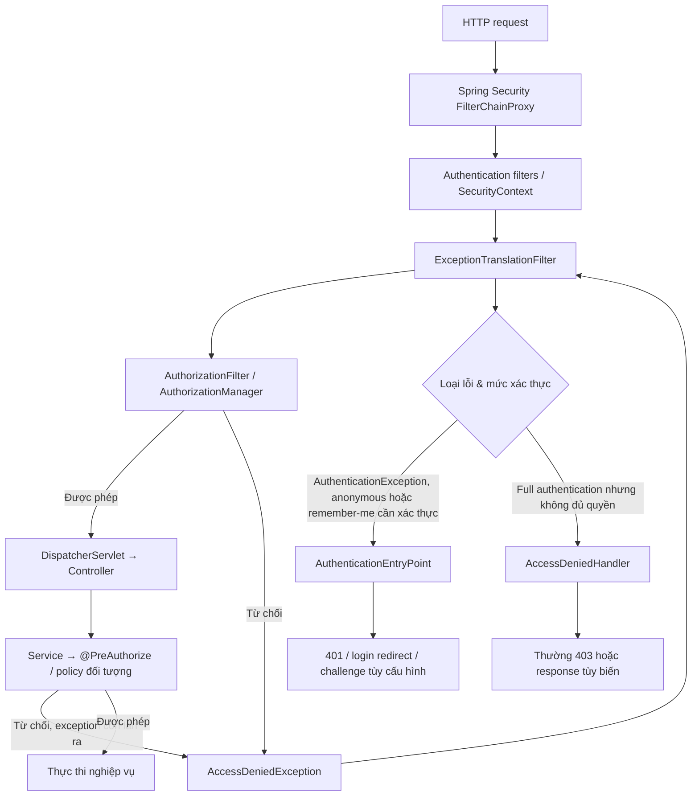

# AccessDeniedException và đường đi của lỗi phân quyền trong Spring Security

## Mục tiêu học tập

Sau bài này, bạn sẽ giải thích được ý nghĩa của `AccessDeniedException`, phân biệt lỗi **chưa/không xác thực** với lỗi **đã xác thực nhưng thiếu quyền**, lần theo đường đi từ `AuthorizationManager`/`AuthorizationFilter` hoặc `@PreAuthorize` đến `ExceptionTranslationFilter`, và hiểu vì sao cùng một lần bị từ chối có thể dẫn đến **401, 403 hoặc chuyển hướng tới trang đăng nhập**. Bạn cũng sẽ biết cách cấu hình `AccessDeniedHandler`, đọc nguyên nhân 403 khi kiểm thử, và xử lý lỗi phân quyền khi service được gọi ngoài một HTTP request.

Bài học áp dụng cho **Spring Security trên Servlet stack** (Spring MVC/Spring Boot, API của Spring Security 6.x). Các tên `SecurityFilterChain`, `AuthorizationFilter` và `ExceptionTranslationFilter` dưới đây không phải tên các filter tương đương trong WebFlux. Nội dung chú trọng luồng **quyết định → exception → phản hồi**, không đánh đồng việc trả HTTP 403 với toàn bộ cơ chế phân quyền.

## 1. AccessDeniedException là gì?

`org.springframework.security.access.AccessDeniedException` là một **RuntimeException của Spring Security** báo rằng thao tác đang được yêu cầu **không được cấp quyền**. Nó có thể xuất hiện khi:

- Rule HTTP trong `authorizeHttpRequests` không cho phép request.
- Method security như `@PreAuthorize` hoặc `@PostAuthorize` từ chối lời gọi.
- Ứng dụng tự thực thi chính sách quyền trên từng tài nguyên/tenant và ném exception này.
- Một cơ chế bảo vệ khác sử dụng loại exception tương ứng để báo quyền không đủ.

Đừng nhầm `AccessDeniedException` với việc mất kết nối, bug NullPointerException, dữ liệu không tồn tại, hoặc thông tin đăng nhập không hợp lệ. Đây là **tín hiệu từ chối phân quyền**; cách biến nó thành response thuộc **ngữ cảnh xử lý exception**.

Từ các phiên bản Spring Security hiện đại, nhiều thành phần authorization có thể ném `AuthorizationDeniedException`, một loại **kế thừa từ `AccessDeniedException`** và mang thêm kết quả quyết định phân quyền. Vì vậy bắt `AccessDeniedException` vẫn xử lý được các subclass tương ứng; khi log/đánh giá không nên giả định mọi exception đều chính xác là class gốc.

### Không có quyền khác với chưa đăng nhập

| Tình trạng | Loại tín hiệu thường gặp | Ý nghĩa |
| --- | --- | --- |
| Request không có đăng nhập hợp lệ, nhưng endpoint yêu cầu xác thực | `AuthenticationException`, hoặc `AccessDeniedException` khi đánh giá request anonymous | Cần bắt đầu/tiếp tục xác thực |
| Người đã xác thực đầy đủ, nhưng thiếu `document:read` | `AccessDeniedException` | Đã biết danh tính; không cấp quyền |
| Remember-me user gọi chức năng yêu cầu full login | `AccessDeniedException` hoặc tín hiệu không đủ mức xác thực | Có danh tính nhưng cần xác thực lại theo policy |
| Principal có `document:read` nhưng đọc tài liệu khác tenant | `AccessDeniedException` do policy đối tượng | Quyền chức năng chưa đủ để xem bản ghi cụ thể |
| Query với ID không tồn tại | Thường `NoSuchElementException`/domain exception hoặc 404 ở API | Không phải tự động là lỗi phân quyền |

**Một request được chấp nhận ở tầng HTTP vẫn có thể bị từ chối ở tầng method hoặc dữ liệu.** Ví dụ `GET /api/documents/42` vượt qua `hasAuthority("document:read")`, nhưng policy ở `DocumentService.read(42)` phát hiện tài liệu thuộc tenant khác và ném `AccessDeniedException`.

## 2. Ba thành phần chịu trách nhiệm trong luồng

### AuthorizationFilter: quyết định ở mức HTTP

Khi dùng `authorizeHttpRequests`, `AuthorizationFilter` đọc request, lấy `Authentication` khi cần và nhờ `AuthorizationManager` đánh giá chính sách tương ứng. Nếu quyết định không cho phép, nó ném một `AccessDeniedException` (thường là subclass thích hợp trong phiên bản đang dùng). Nếu được phép, request tiếp tục vào controller và ứng dụng.

### ExceptionTranslationFilter: cầu nối từ exception tới HTTP

`ExceptionTranslationFilter` **không tự kiểm tra quyền**. Nó gọi phần filter chain/application ở phía sau và chặn các `AuthenticationException` hoặc `AccessDeniedException` **truyền ngược ra tới nó**. Dựa vào loại lỗi và mức xác thực, nó chọn cách xử lý HTTP thích hợp.

Với `AccessDeniedException`, bộ lọc dựa vào `AuthenticationTrustResolver` để phân biệt người gọi **anonymous/remember-me** với người dùng được xác thực đầy đủ. Nếu chưa đủ mức xác thực theo xử lý của filter, nó dùng `AuthenticationEntryPoint`. Nếu người dùng đã xác thực đầy đủ nhưng thiếu quyền, nó gọi `AccessDeniedHandler`.

### AuthenticationEntryPoint và AccessDeniedHandler: tạo kết quả cho client

- **`AuthenticationEntryPoint`**: khởi động cơ chế xác thực. Ví dụ HTTP Basic có thể trả **401** cùng header `WWW-Authenticate`; form login thường trả **redirect** tới màn hình đăng nhập; OAuth2 Bearer có cơ chế challenge tương ứng.
- **`AccessDeniedHandler`**: xử lý từ chối đối với người đã xác thực nhưng không được cấp quyền. Handler mặc định thường trả **403 Forbidden**; có thể tùy biến response JSON, trang lỗi hoặc mã sự kiện audit nếu thiết kế yêu cầu.

Chính **entry point/handler và cơ chế xác thực đang cấu hình** quyết định response cuối cùng. Không nên viết quy tắc cứng “mọi AccessDeniedException = 403” hay “mọi người chưa đăng nhập = 401”.

## 3. Luồng xử lý một request Servlet



Sơ đồ trình bày **đường đi phổ biến** của lỗi phân quyền. Trong `FilterChainProxy`, `ExceptionTranslationFilter` nằm **trước `AuthorizationFilter`** theo thứ tự mà request đi vào, nên có thể bắt exception ném từ `AuthorizationFilter` khi request đi sâu hơn. Nó cũng có thể bắt lỗi method security xuất hiện ở ứng dụng **nếu exception tiếp tục lan ra qua filter chain**.

**Không phải mọi lỗi 403 đều đi qua `ExceptionTranslationFilter`.** Ví dụ, `CsrfFilter` thực hiện bảo vệ CSRF sớm hơn `AuthorizationFilter` và có đường xử lý `AccessDeniedHandler` của chính nó. Một authentication filter cũng có thể tự xử lý lỗi đăng nhập. Nếu response đã bị commit, hoặc exception đã được lớp khác xử lý, filter chuyển đổi không còn cơ hội tạo HTTP response như bình thường.

### Mô tả tương đương bằng mã giả

```text
try:
    tiếp tục filter chain và ứng dụng
catch AuthenticationException:
    bắt đầu xác thực bằng AuthenticationEntryPoint
catch AccessDeniedException:
    if caller anonymous hoặc remembered và được xem là chưa đủ xác thực:
        bắt đầu/tiếp tục xác thực bằng AuthenticationEntryPoint
    else:
        dùng AccessDeniedHandler để từ chối
```

Đây là **mã giả mô tả thuật toán**, không phải source code chính xác từng dòng. `AuthenticationTrustResolver` quyết định trạng thái, cấu hình của `ExceptionTranslationFilter` và loại token quyết định nhánh thực tế. Trước khi gọi entry point, bộ lọc thường làm sạch security context và có thể lưu request để khôi phục sau khi login, tùy `RequestCache`/cấu hình.

## 4. Vì sao AccessDeniedException đôi khi thành 401 hoặc redirect?

Xét API `GET /api/reports` yêu cầu `report:read`:

| Người gọi | Kết quả đánh giá authorization | Cách xử lý HTTP thường gặp |
| --- | --- | --- |
| Không có credentials; request được xem là anonymous | Không có quyền | `AuthenticationEntryPoint`: HTTP Basic/Bearer thường 401 hoặc form login redirect |
| Có credentials nhưng password/Bearer token không hợp lệ | Xác thực thất bại | Authentication filter hoặc entry point: thường 401/challenge |
| Đã login đầy đủ, nhưng chỉ có `ROLE_USER` | Không có `report:read` | `AccessDeniedHandler`: thường 403 |
| Đã login đầy đủ và có `report:read` | Qua rule | Đi tiếp vào controller; chưa chắc HTTP 200 |
| Remember-me user có `report:read` nhưng service yêu cầu full | Bị từ chối ở mức xác thực | Có thể được hướng tới login lại qua entry point |
| Đã login có `report:read` nhưng không có quyền trên report 42 | Service/policy từ chối | Thường 403 hoặc chính sách trả 404 có chủ đích |

Với Spring Security, một số triển khai `ExceptionTranslationFilter` xem **anonymous và remember-me** là không đủ mức xác thực khi xử lý `AccessDeniedException`, nên sẽ gọi entry point thay vì access-denied handler. Điều này giúp luồng yêu cầu **đăng nhập lại** khi remembered user gặp một policy không chấp nhận trạng thái hiện tại. **Hành vi HTTP chính xác** còn phụ thuộc entry point: redirect, 401 hay response khác.

### 401 và 403 không phải chỉ là tên exception

- **401 Unauthorized**: client cần cung cấp/xác minh credentials để tiếp tục; với HTTP authentication, thường có thông tin challenge.
- **403 Forbidden**: server đã hiểu yêu cầu và không cấp phép thao tác. Với người đã xác thực đầy đủ thiếu quyền, đây là kết quả phổ biến.
- **302/303 tới login**: một web app dùng form login có thể chọn chuyển hướng thay vì trả JSON 401.
- **404 Not Found**: ứng dụng có thể chọn không xác nhận sự tồn tại của tài nguyên ngoài quyền truy cập (anti-enumeration), nhưng phải là chính sách API rõ ràng và nhất quán.

Không chỉ kiểm tra HTTP status rồi kết luận nguyên nhân: **403 có thể do CSRF, HTTP rule, method security hoặc policy owner/tenant**. Muốn chẩn đoán, cần biết request đã đi tới bước nào.

## 5. Ba điểm ném lỗi: request, method và policy nghiệp vụ

### 5.1. Tầng HTTP: authorizeHttpRequests

Ví dụ cấu hình tối giản cho API Servlet, có handler 403 trả JSON an toàn. Đây là snippet Java Spring có đầy đủ import của lớp cấu hình; cần dependency Spring Security, nguồn tài khoản/xác thực và controller của ứng dụng để chạy thành hệ thống.

```java
import jakarta.servlet.http.HttpServletResponse;

import org.springframework.context.annotation.Bean;
import org.springframework.context.annotation.Configuration;
import org.springframework.http.HttpMethod;
import org.springframework.security.config.Customizer;
import org.springframework.security.config.annotation.method.configuration.EnableMethodSecurity;
import org.springframework.security.config.annotation.web.builders.HttpSecurity;
import org.springframework.security.web.SecurityFilterChain;

@Configuration
@EnableMethodSecurity
public class SecurityConfig {

    @Bean
    SecurityFilterChain securityFilterChain(HttpSecurity http) throws Exception {
        http
            .securityMatcher("/api/**")
            .authorizeHttpRequests(auth -> auth
                .requestMatchers(HttpMethod.GET, "/api/public/**")
                    .permitAll()
                .requestMatchers(HttpMethod.GET, "/api/documents/**")
                    .hasAuthority("document:read")
                .requestMatchers(HttpMethod.PATCH, "/api/documents/**")
                    .hasAuthority("document:edit")
                .anyRequest().denyAll()
            )
            .httpBasic(Customizer.withDefaults())
            .exceptionHandling(errors -> errors
                .accessDeniedHandler((request, response, ex) -> {
                    if (!response.isCommitted()) {
                        response.setStatus(HttpServletResponse.SC_FORBIDDEN);
                        response.setCharacterEncoding("UTF-8");
                        response.setContentType("application/problem+json");
                        response.getWriter().write(
                            "{\"title\":\"Forbidden\",\"status\":403}"
                        );
                    }
                })
            );

        return http.build();
    }
}
```

**Ý nghĩa:** request `GET /api/documents/42` thiếu `document:read` sẽ bị `AuthorizationFilter` từ chối; khi người gọi là fully authenticated, `ExceptionTranslationFilter` chuyển tới `AccessDeniedHandler` đã cấu hình để trả **403 + body JSON**. Với anonymous không có credentials, cơ chế HTTP Basic thông thường bắt đầu **401 challenge** thông qua entry point.

Lưu ý về cấu hình:

1. `securityMatcher("/api/**")` giới hạn phạm vi **filter chain này**. Nếu ứng dụng có trang ngoài `/api/**`, cần cấu hình chain thích hợp khác và hiểu thứ tự nhiều `SecurityFilterChain`.
2. `httpBasic` chỉ là cơ chế xác thực minh họa; không tự tạo user store của ứng dụng. OAuth2 Resource Server, session, form login sử dụng entry point/handler phù hợp của chúng.
3. `PATCH` hoặc các request thay đổi trạng thái có thể bị chặn bởi **CSRF** khi CSRF protection áp dụng. CSRF failure không chứng minh thiếu `document:edit`; phải xác nhận nguyên nhân.
4. JSON body nên dùng thông tin tổng quát, không tiết lộ account/tenant/owner/policy nội bộ. Với hệ thống thực, có thể dùng `ProblemDetail`/chuẩn RFC 9457 nếu muốn response có hợp đồng thống nhất.
5. `AccessDeniedHandler` không làm thay đổi logic quyết định quyền. Nếu handler trả HTTP 200 cho một denied request, client có thể hiểu sai kết quả; không dùng “bắt lỗi để cho qua”.

### 5.2. Tầng method security: @PreAuthorize

Khi bật `@EnableMethodSecurity`, Spring tạo method interceptor cho các bean được quản lý. Nếu `@PreAuthorize` không thỏa, interceptor ném `AccessDeniedException` hoặc subclass tương ứng **trước khi thực thi thân method**.

```java
import org.springframework.security.access.prepost.PreAuthorize;
import org.springframework.stereotype.Service;

@Service
public class DocumentService {

    @PreAuthorize("hasAuthority('document:read')")
    public String readSummary(long id) {
        return "Document " + id;
    }

    @PreAuthorize("hasAuthority('document:edit')")
    public String rename(long id, String newTitle) {
        return "Renamed " + id;
    }
}
```

Khi controller gọi `documentService.readSummary(42)` **qua Spring proxy**, người thiếu `document:read` bị chặn trước khi nhận kết quả. Nếu exception lan ra ngoài `DispatcherServlet` rồi đi qua `ExceptionTranslationFilter`, Spring Security có thể chuyển nó thành HTTP response tương ứng. Nếu gọi trực tiếp `documentService.readSummary(42)` trong một job không có HTTP request, sẽ **không có `ExceptionTranslationFilter` để trả 403**; code gọi cần xử lý exception theo luồng công việc.

Lưu ý: `@PreAuthorize` không chạy chỉ vì annotation tồn tại; cần `@EnableMethodSecurity` và lời gọi qua proxy. Self-invocation như `this.rename(...)` trong cùng bean thường không qua interceptor. `@PostAuthorize` xảy ra **sau** khi method đã trả về, nên không dùng làm hàng rào duy nhất cho thao tác có side effect.

### 5.3. Tầng đối tượng: chính sách nghiệp vụ phát hiện ID ngoài quyền

```java
// Snippet trong service ứng dụng, không phải Java độc lập.
// repository và Document là các kiểu do dự án định nghĩa.
public Document requireReadableDocument(long id, Authentication actor) {
    Document doc = repository.findById(id)
        .orElseThrow(() -> new NoSuchElementException("Document not found"));

    if (!doc.getTenantId().equals(tenantOf(actor))
            || !policy.canRead(actor, doc)) {
        throw new AccessDeniedException("Document access denied");
    }

    return doc;
}
```

`tenantOf` và `policy` phải lấy danh tính/quyền từ nguồn đã xác thực và dữ liệu server; không tin client tự khai `ownerId` hoặc `tenantId`. Dù người gọi có `document:read`, truy cập bản ghi ngoài tenant vẫn phải bị từ chối. Đối với nhiều API, có thể lựa chọn **404** cho tài nguyên ngoài scope để không lộ sự tồn tại, nhưng phải thống nhất với chiến lược truy vấn/list/count/export; không để response tiết lộ dữ liệu bí mật.

## 6. Lần theo exception qua tầng HTTP và ứng dụng

### Trường hợp A: thiếu quyền ngay ở AuthorizationFilter

```text
GET /api/documents/42
Authentication: alice, authorities = [ROLE_USER]
Rule: hasAuthority("document:read")

SecurityContext đã có alice
    ↓
AuthorizationFilter / AuthorizationManager
    ↓ DENY
AccessDeniedException
    ↑
ExceptionTranslationFilter
    ↓ full authentication
AccessDeniedHandler
    ↓
HTTP 403 Forbidden
```

Controller **không chạy**, vì request bị chặn trước khi vào ứng dụng. Nếu log chỉ thấy 403, kiểm tra rule URL/method/authorities và thứ tự matcher trước khi xem service.

### Trường hợp B: HTTP cho qua nhưng service từ chối

```text
GET /api/documents/42
Authentication: bob, authorities = [document:read]
Rule HTTP: hasAuthority("document:read")  → ALLOW
    ↓
DispatcherServlet → DocumentController.read(42)
    ↓
DocumentService / @PreAuthorize / ownership policy
    ↓ DENY: tài liệu thuộc tenant khác
AccessDeniedException
    ↑ (nếu không bị xử lý ở MVC/service)
ExceptionTranslationFilter
    ↓
AccessDeniedHandler (người dùng full) → HTTP 403
```

Đây là lý do **HTTP authorization không thay thế quyền trên từng bản ghi**. Nếu service đang được gọi bên trong transaction, phải bảo đảm thao tác bị từ chối **không để lại thay đổi dữ liệu**. Kiểm tra quyền trước side effect; với thao tác ghi nhạy cảm, cân nhắc query cập nhật có điều kiện để chống race.

### Trường hợp C: anonymous hoặc remember-me cần xác thực

```text
GET /api/documents/42
anonymous + thiếu quyền (hoặc remembered user không đạt policy)
    ↓
AccessDeniedException
    ↑
ExceptionTranslationFilter + AuthenticationTrustResolver
    ↓
AuthenticationEntryPoint
    ├─ HTTP Basic API: 401 + WWW-Authenticate
    └─ Form login web: redirect tới /login
```

Trong nhánh bắt đầu xác thực, filter có thể **clear SecurityContext** và lưu request qua `RequestCache` để hỗ trợ quay lại URL sau login; hành vi lưu cụ thể phụ thuộc cấu hình. Không tự giả định mọi POST sẽ được phát lại an toàn sau login.

### Trường hợp D: exception nằm ngoài phạm vi filter

Nếu task chạy nền gọi service có `@PreAuthorize`, không tồn tại HTTP response hay `ExceptionTranslationFilter` trên đường đi. Hãy bắt `AccessDeniedException` tại biên worker/consumer, ghi audit theo chính sách và từ chối/quarantine/retry theo ý nghĩa nghiệp vụ. Không cố “trả status 403” cho một công việc không có HTTP; cũng không coi lỗi thiếu quyền là lỗi tạm thời nên tự động retry mãi.

## 7. Những gì ExceptionTranslationFilter không tự giải quyết

### 7.1. Không tự xử lý mọi loại exception

`ExceptionTranslationFilter` nhắm tới `AuthenticationException` và `AccessDeniedException`. Nó không tự biến `NullPointerException`, `IllegalArgumentException`, lỗi SQL hay lỗi mạng thành 403. Đừng dùng `catch (Exception) { throw new AccessDeniedException(...); }` cho mọi lỗi; cách đó che bug và làm việc vận hành khó chẩn đoán.

### 7.2. Không bắt lỗi đã được Spring MVC xử lý trước

Nếu `@ControllerAdvice` hoặc `HandlerExceptionResolver` xử lý `AccessDeniedException` **ngay trong DispatcherServlet** và trả response, exception có thể không truyền tới filter. Điều này có thể hữu ích khi bạn chủ động thiết kế hợp đồng lỗi, nhưng rất dễ tạo hai đường xử lý 403 khác nhau giữa **HTTP filter denial** và **service denial**. Nên thống nhất với `exceptionHandling(...)`, đồng thời kiểm thử cả hai nguồn lỗi.

`@ControllerAdvice` không xử lý trực tiếp exception được ném từ `AuthorizationFilter` **trước khi controller được gọi**. Muốn tùy biến lỗi HTTP ở tầng security, dùng `AuthenticationEntryPoint` / `AccessDeniedHandler` phù hợp thay vì mặc nhiên trông chờ vào MVC advice.

### 7.3. Không bảo đảm response có thể được sửa khi đã commit

Nếu ứng dụng đã gửi headers/body rồi mới ném `AccessDeniedException`, filter có thể không còn đổi status hoặc redirect được. Do đó hãy thực hiện policy **trước khi stream kết quả hoặc ghi dữ liệu**, nhất là tải tệp/export lớn, streaming response và side effect. Với bảo vệ dựa trên `@PostAuthorize`, quyết định có thể đến sau khi method chạy; phải hiểu ranh giới này.

### 7.4. Không bỏ qua các filter bảo mật khác

Một request có thể trả 403 vì:

- CSRF token thiếu/không hợp lệ;
- Rule của `AuthorizationFilter` thiếu authority;
- `@PreAuthorize`/chính sách owner/tenant từ chối;
- Cấu hình CORS, firewall, session hoặc cơ chế bảo vệ khác xử lý request;
- Application/controller chủ động trả 403, thậm chí không ném `AccessDeniedException`.

Vì thế **HTTP 403 là quan sát**, còn **nguyên nhân phải truy vết**. Bài học nói về AccessDeniedException, nhưng hệ thống thực tế không nên quy mọi 403 cho exception này.

## 8. Cấu hình phản hồi lỗi: EntryPoint và DeniedHandler

### 8.1. AccessDeniedHandler cho API JSON

Đoạn cấu hình ở phần 5 sử dụng lambda `AccessDeniedHandler` để trả response đơn giản. Bạn có thể đưa handler thành bean riêng nếu nhiều filter chain dùng chung:

```java
@Bean
AccessDeniedHandler apiAccessDeniedHandler() {
    return (request, response, denied) -> {
        response.setStatus(HttpServletResponse.SC_FORBIDDEN);
        response.setCharacterEncoding("UTF-8");
        response.setContentType("application/json");
        response.getWriter().write(
            "{\"error\":\"access_denied\",\"message\":\"Forbidden\"}"
        );
    };
}
```

Đây là snippet thuộc lớp `@Configuration`, cần import `AccessDeniedHandler` và `HttpServletResponse`. Đừng trả exception message thô cho client, vì nó có thể lộ tên tài nguyên, principal, tenant, biểu thức policy hoặc logic nội bộ.

### 8.2. AuthenticationEntryPoint cho yêu cầu chưa xác thực

Trong API trả JSON, có thể chọn entry point gửi 401:

```java
// Snippet cấu hình nếu ứng dụng muốn 401 đơn giản:
// cần import org.springframework.security.web.authentication.HttpStatusEntryPoint
// và org.springframework.http.HttpStatus
.exceptionHandling(errors -> errors
    .authenticationEntryPoint(
        new HttpStatusEntryPoint(HttpStatus.UNAUTHORIZED)
    )
)
```

Đây **chỉ là ví dụ một đoạn DSL**, không nối trực tiếp vào mọi cơ chế đã có. HTTP Basic, OAuth2 Bearer và form login có entry point/challenge cần giữ đúng giao thức; tùy chỉnh tùy tiện có thể làm mất header cần thiết hoặc phá luồng đăng nhập. Với ứng dụng có nhiều cơ chế auth, hãy lựa chọn entry point **theo request matcher** khi cần.

### 8.3. Hợp đồng response và audit

Một API có thể trả JSON tối giản:

```json
{
  "type": "about:blank",
  "title": "Forbidden",
  "status": 403
}
```

Khi xây API thật, cân nhắc `ProblemDetail`/RFC 9457, correlation ID và mã lỗi ổn định nếu client cần xử lý theo loại lỗi. Không để response công khai tiết lộ “tài liệu 42 thuộc Alice” khi Bob không có quyền biết. Audit ở server có thể ghi thời gian, principal ID, action, resource ID, policy version, decision code; tránh log token/password hoặc toàn bộ dữ liệu nhạy cảm.

### 8.4. Không dùng Handler để thay thế policy

`AccessDeniedHandler` chỉ quyết định **phản hồi** sau khi đã bị từ chối. Nó không cho phép sửa luật từ `hasAuthority` thành role khác. Đừng viết handler “nếu là ADMIN thì đổi status thành 200”, vì thao tác ứng dụng đã bị chặn trước đó và response sẽ sai ý nghĩa. Nếu admin được phép là ngoại lệ, hãy khai báo ngoại lệ trong **AuthorizationManager/policy** và kiểm thử.

## 9. Ví dụ Java 17 chạy độc lập: mô phỏng đường đi

Chương trình này mô phỏng **cách chọn handler**, không dùng Spring dependencies và không tạo HTTP response thật. Nó cố ý tách **identity trust level** khỏi **exception type**, để người học thấy vì sao không thể suy status từ tên `AccessDeniedException`.

Lưu đúng tên file **`AccessDeniedFlowDemo.java`**:

```java
public class AccessDeniedFlowDemo {

    enum Identity { ANONYMOUS, REMEMBER_ME, FULL }
    enum Failure { AUTHENTICATION_ERROR, ACCESS_DENIED }
    enum Route { START_AUTHENTICATION, HANDLE_FORBIDDEN }

    static Route route(Identity identity, Failure failure) {
        if (failure == Failure.AUTHENTICATION_ERROR) {
            return Route.START_AUTHENTICATION;
        }
        return switch (identity) {
            case ANONYMOUS, REMEMBER_ME -> Route.START_AUTHENTICATION;
            case FULL -> Route.HANDLE_FORBIDDEN;
        };
    }

    static void explain(Identity who, Failure failure) {
        System.out.println(
            who + " + " + failure + " -> " + route(who, failure)
        );
    }

    public static void main(String[] args) {
        explain(Identity.ANONYMOUS, Failure.ACCESS_DENIED);
        explain(Identity.REMEMBER_ME, Failure.ACCESS_DENIED);
        explain(Identity.FULL, Failure.ACCESS_DENIED);
        explain(Identity.FULL, Failure.AUTHENTICATION_ERROR);
    }
}
```

Chạy với **JDK 17 trở lên**:

```bash
javac AccessDeniedFlowDemo.java
java AccessDeniedFlowDemo
```

Stdout chính xác:

```text
ANONYMOUS + ACCESS_DENIED -> START_AUTHENTICATION
REMEMBER_ME + ACCESS_DENIED -> START_AUTHENTICATION
FULL + ACCESS_DENIED -> HANDLE_FORBIDDEN
FULL + AUTHENTICATION_ERROR -> START_AUTHENTICATION
```

Cần giải thích kết quả:

- Anonymous bị từ chối → phải **bắt đầu xác thực**; với HTTP Basic có thể trả 401.
- Remember-me bị từ chối và không đủ mức tin cậy → có thể được yêu cầu **đăng nhập lại**; trong Spring Security servlet, xử lý của `ExceptionTranslationFilter` có nhánh này.
- Full authentication bị từ chối vì thiếu quyền → **access-denied handler**, thường là 403.
- `AuthenticationException` → khởi động xác thực ngay cả khi trước đó có một authentication được nhận diện; không biến nó thành quyền truy cập hợp lệ.

Các enum cố định không thể biểu diễn custom trust resolver, nhiều filter chain, response đã commit, user store, CSRF hoặc việc exception đã được MVC xử lý. Hãy dùng chúng để **học logic**, rồi kiểm thử bằng Spring Security thực.

## 10. Kiểm thử 401/403 và đường truyền exception

### 10.1. Kiểm thử HTTP với MockMvc

Trong ứng dụng có `spring-security-test`, `MockMvc` và endpoint `GET /api/documents/42` được bảo vệ bởi `hasAuthority("document:read")`:

```java
// Snippet bên trong các test JUnit; mvc được inject từ Spring context.
// Cần import get, status, user từ spring-security-test / MockMvc.

@Test
void anonymousCannotReadDocument() throws Exception {
    mvc.perform(get("/api/documents/42"))
       .andExpect(status().isUnauthorized());
}

@Test
void loggedInWithoutAuthorityIsForbidden() throws Exception {
    mvc.perform(get("/api/documents/42")
           .with(user("bob").roles("USER")))
       .andExpect(status().isForbidden());
}
```

**Giới hạn:** kết quả 401 cho anonymous dựa trên cấu hình **HTTP Basic entry point** của ví dụ. Nếu ứng dụng dùng form login, test có thể cần kỳ vọng redirect. Nếu controller hoặc method security có policy khác, request có đủ HTTP authority vẫn có thể bị 403/404. Thêm `.with(csrf())` khi kiểm thử POST/PATCH/DELETE trên cấu hình yêu cầu CSRF để tránh nhầm nguyên nhân.

Để kiểm tra handler JSON, assert cả `status`, `Content-Type` và trường `status` trong body; không chỉ assert 403. Nếu dùng Bearer OAuth2, cần test challenge/headers theo cấu hình tương ứng.

### 10.2. Kiểm thử method security trực tiếp

```java
// Snippet trong Spring/JUnit test có @Autowired DocumentService service.
// @EnableMethodSecurity đã bật; đây là bean thật qua proxy.

@Test
@WithMockUser(authorities = "ROLE_USER")
void methodDeniesMissingDocumentReadAuthority() {
    assertThrows(
        AccessDeniedException.class,
        () -> service.readSummary(42L)
    );
}

@Test
@WithMockUser(authorities = "document:read")
void methodAllowsReadAuthority() {
    assertEquals("Document 42", service.readSummary(42L));
}
```

Đây là đoạn test tích hợp vào lớp JUnit, không phải một file Java độc lập. Cần import `org.junit.jupiter.api.Test`, `Assertions`, `org.springframework.security.test.context.support.WithMockUser` và `AccessDeniedException`, cùng service bean thực. Nếu gọi service do `new` tự tạo hoặc mock toàn bộ service, interceptor có thể không chạy và bài test **không kiểm chứng được `@PreAuthorize`**.

### 10.3. Ma trận test nên có

| Kịch bản | Điểm từ chối | Kết quả cần kiểm tra |
| --- | --- | --- |
| Anonymous gọi GET cần `document:read` | HTTP authorization | Entry point, thường 401 Basic hoặc redirect form |
| Full user thiếu `document:read` | `AuthorizationFilter` | Handler 403 |
| Full user có `document:read` nhưng doc khác tenant | Method/policy | 403/404 theo chính sách; không lộ dữ liệu |
| Full user có quyền với đúng document | Không từ chối | Controller xử lý bình thường |
| Remember-me không đạt `fullyAuthenticated` | Method/authorization | Luồng yêu cầu xác thực lại phù hợp |
| Full user gửi PATCH thiếu CSRF token khi CSRF bật | `CsrfFilter` | 403 do CSRF, không nhầm với role |
| Service gọi từ background job mà không có quyền | Method security | Exception được consumer xử lý, không có HTTP 403 |
| ControllerAdvice bắt `AccessDeniedException` | MVC exception resolver | Đường xử lý khác với AccessDeniedHandler; kiểm tra nhất quán |
| Response streaming đã bắt đầu mới gặp deny | Quá muộn | Ngăn lộ dữ liệu; chuyển kiểm tra quyền trước khi stream |
| Endpoint mới không có matcher rõ ràng, fallback deny | HTTP authorization | Bị từ chối theo `anyRequest().denyAll()` |

Thêm test khẳng định **dữ liệu không bị ghi** khi bị từ chối; status 403 không chứng minh transaction đã rollback nếu nghiệp vụ có side effect xảy ra trước đó.

## 11. Cách chẩn đoán một 403 trong thực tế

1. **Xác nhận filter chain:** request có thực sự đi qua `SecurityFilterChain` mong muốn không? Nếu nhiều chain, kiểm tra `securityMatcher` và thứ tự.
2. **Xác nhận authentication:** người dùng có principal hợp lệ và authorities nào? Anonymous, remember-me hay full? Không dùng raw `Authentication.isAuthenticated()` làm bằng chứng duy nhất cho anonymous.
3. **Kiểm tra luật HTTP:** HTTP method và URL khớp matcher nào? Quy tắc có dùng `hasRole("ADMIN")` với `ROLE_ADMIN` hay `hasAuthority("document:read")` chính xác không?
4. **Kiểm tra CSRF và filter sớm:** nếu POST/PATCH bị 403 ngay cả khi có quyền, xác minh CSRF token trước khi sửa quyền.
5. **Xác định lỗi phát ở đâu:** `AuthorizationFilter`, `@PreAuthorize`, policy dữ liệu, controller return status, hay một filter khác? Không nhìn status để đoán.
6. **Theo dấu exception:** có bị `@ControllerAdvice`, `HandlerExceptionResolver`, filter ứng dụng hay `catch` riêng xử lý trước khi tới `ExceptionTranslationFilter` không?
7. **Kiểm tra handler/entry point:** response cuối có đúng mã, header, body và không lộ dữ liệu nhạy cảm không?
8. **Kiểm thử lại:** tạo ca anonymous, full thiếu quyền, full đủ quyền, remember-me, data ngoài tenant và lỗi CSRF riêng biệt.

Trong môi trường phát triển có thể bật log Spring Security ở mức `DEBUG` để quan sát rule/chain; mức `TRACE` có thể sinh thêm chi tiết nhạy cảm, nên giới hạn trong môi trường kiểm soát và không log token, cookie hay credential. Khi dùng `AuthorizationDeniedException`, thông tin quyết định có thể hỗ trợ điều tra nhưng không đưa biểu thức policy hoặc thuộc tính nhạy cảm vào body public.

## 12. Các lỗi thiết kế thường gặp

1. **Cho rằng mọi `AccessDeniedException` đều phải 403:** anonymous/remember-me có thể đi tới entry point để xác thực lại.
2. **Nhầm `AuthenticationException` với `AccessDeniedException`:** invalid token/password cần luồng xác thực, còn đủ login nhưng thiếu authority cần luồng từ chối.
3. **Dùng `@ControllerAdvice` để xử lý toàn bộ security:** lỗi HTTP phát từ `AuthorizationFilter` có thể xảy ra trước DispatcherServlet, không tới controller advice.
4. **Bắt `AccessDeniedException` rồi trả 200:** API trả thành công dù thao tác đã bị chặn, gây sai audit và logic client.
5. **Dùng `catch(Exception)` rồi biến mọi bug thành 403:** che lỗi hệ thống, che bug và gây khó giám sát.
6. **Không kiểm tra CSRF:** 403 từ `CsrfFilter` có thể xảy ra trước khi HTTP authorization; không chữa bằng cách cấp thêm role.
7. **Cho rằng `@PreAuthorize` hoạt động trong mọi lời gọi:** self-invocation và object ngoài Spring proxy có thể bỏ qua interceptor.
8. **Trả exception message thô:** dễ lộ ID tài nguyên, tenant, policy và danh tính người khác.
9. **Chỉ check URL, bỏ quyền đối tượng:** có `document:read` chưa chắc có quyền với document 42 của tenant khác.
10. **Kiểm tra sau khi đã stream/ghi:** khi AccessDeniedException được ném, response hoặc DB có thể đã có side effect; phải kiểm tra sớm và dùng điều kiện ghi.
11. **Không hiểu nhiều filter chain:** một URL không đi qua chain tưởng định có thể có entry point, CSRF, handler khác.
12. **Không kiểm thử worker/async:** method security ngoài web không tự tạo response HTTP; cần quy trình xử lý từ chối riêng.

## 13. Checklist trước khi triển khai

- **Quy tắc quyền:** HTTP matcher và method/object policy đã được đặt đúng điểm; fallback không mở nhầm endpoint.
- **Kết quả phân quyền:** xác định `DENY` phát từ đâu; lỗi do authentication và lỗi do authorization được phân biệt.
- **Luồng response:** entry point cho khách/remembered user và access-denied handler cho full user được thiết kế theo giao thức API/web.
- **Tính nhất quán:** security filter, controller advice, service exception và consumer không trả những phản hồi mâu thuẫn.
- **Dữ liệu:** không có side effect khi bị từ chối, không rò rỉ owner/tenant, đủ kiểm tra ID/row scope.
- **Kiểm thử:** anonymous, remember-me, full thiếu quyền, full đủ quyền, lỗi CSRF, exception ngoài HTTP, response đã commit.
- **Vận hành:** log và audit an toàn, có correlation ID, không ẩn lỗi lập trình dưới nhãn “Forbidden”.

### Câu hỏi tự kiểm tra

**1.** Bob đã đăng nhập đầy đủ, có `ROLE_USER` nhưng không có `document:read`. `AuthorizationFilter` từ chối `GET /api/documents/42`. Ai thường tạo HTTP 403?

**Đáp án:** `AccessDeniedException` được xử lý bởi `ExceptionTranslationFilter`, sau đó filter gọi `AccessDeniedHandler`; handler mặc định thường trả 403.

**2.** Cùng request đó được gửi bởi khách anonymous, API dùng HTTP Basic. Vì sao có thể là 401 thay vì 403?

**Đáp án:** `ExceptionTranslationFilter` nhận diện chưa có mức xác thực phù hợp và gọi `AuthenticationEntryPoint`, thường tạo Basic challenge 401.

**3.** `@PreAuthorize` trong service bị từ chối khi chạy từ scheduler, có tự tạo HTTP 403 không?

**Đáp án:** Không. Không có HTTP filter chain bao quanh lời gọi ấy; scheduler/consumer phải xử lý `AccessDeniedException` theo luồng của mình.

**4.** Tại sao một PATCH thiếu CSRF token có thể trả 403 dù có `ROLE_ADMIN`?

**Đáp án:** `CsrfFilter` có thể chặn request theo chính sách CSRF riêng trước khi tới authorization rule; cấp role không thay thế CSRF token.

## Tài liệu tham khảo chính thức

- Spring Security, *Servlet Architecture — Handling Security Exceptions*: https://docs.spring.io/spring-security/reference/6.5/servlet/architecture.html
- Spring Security, *Authorize HttpServletRequests*: https://docs.spring.io/spring-security/reference/6.5/servlet/authorization/authorize-http-requests.html
- Spring Security, *Method Security*: https://docs.spring.io/spring-security/reference/6.5/servlet/authorization/method-security.html
- Spring Security, *ExceptionTranslationFilter API*: https://docs.spring.io/spring-security/reference/6.5/api/java/org/springframework/security/web/access/ExceptionTranslationFilter.html
- Spring Security, *AuthenticationEntryPoint API*: https://docs.spring.io/spring-security/reference/6.5/api/java/org/springframework/security/web/AuthenticationEntryPoint.html
- Spring Security, *AccessDeniedHandler API*: https://docs.spring.io/spring-security/reference/6.5/api/java/org/springframework/security/web/access/AccessDeniedHandler.html
- Spring Security, *CSRF*: https://docs.spring.io/spring-security/reference/6.5/servlet/exploits/csrf.html
