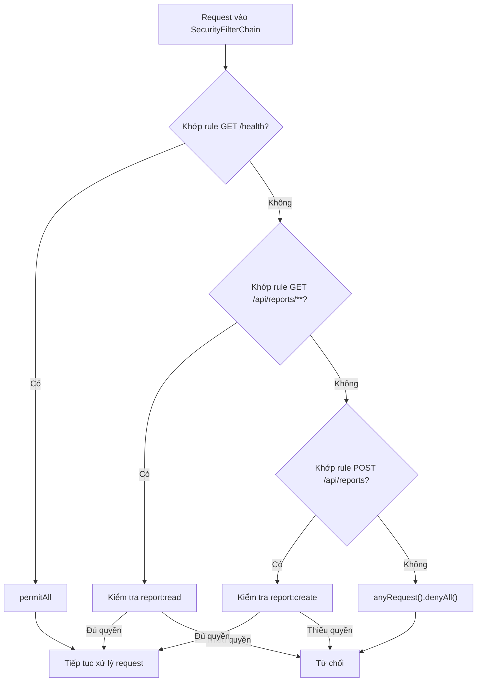

# anyRequest làm chính sách kết thúc và lựa chọn mặc định từ chối

## Mục tiêu học tập

Sau bài học này, bạn có thể: hiểu `anyRequest()` trong `authorizeHttpRequests` của Spring Security; giải thích vì sao nó được đặt **cuối danh sách rule**; phân biệt `anyRequest().denyAll()`, `anyRequest().authenticated()` và `anyRequest().permitAll()`; kiểm chứng cơ chế **khớp rule đầu tiên**; nhận ra phạm vi của `anyRequest` khi có nhiều `SecurityFilterChain`; và thiết kế bộ kiểm thử nhằm bảo đảm endpoint mới, HTTP method mới hoặc tuyến chưa công bố **không được cấp quyền vô tình**.

Bối cảnh: **Phân quyền HTTP** trên Servlet stack (Spring MVC/Spring Boot, Spring Security 6.x và API tương ứng). Các ví dụ dùng `SecurityFilterChain`, `HttpSecurity`, `authorizeHttpRequests`, `AuthorizationFilter`. Chúng không phải cấu hình WebFlux. Chủ đề chính là **chính sách kết thúc (terminal catch-all) và mặc định từ chối (default deny / fail closed)**, không phải hướng dẫn toàn bộ các mô hình xác thực.

## 1. Ba câu hỏi phải trả lời khi cấu hình phân quyền HTTP

Với một HTTP request đến máy chủ, Spring Security cần xác định:

1. **Request có nằm trong một Spring Security filter chain không?** `FilterChainProxy` chọn `SecurityFilterChain` đầu tiên có matcher phù hợp. Một ứng dụng có thể có một hoặc nhiều filter chain.
2. **Trong chain được chọn, rule authorization nào khớp đầu tiên?** `authorizeHttpRequests` xử lý các cặp `RequestMatcher → AuthorizationManager` theo **thứ tự khai báo**. Chỉ rule khớp đầu tiên được dùng để ra quyết định.
3. **Nếu request không khớp một rule cụ thể nào thì sao?** Đây là vai trò của `anyRequest()`: bắt **tất cả các request còn lại trong phạm vi chain này**, sau khi các rule phía trước đã được xem xét.

Một chính sách dễ kiểm chứng:

```text
GET /health               → permitAll
GET /api/reports/**       → cần authority "report:read"
POST /api/reports          → cần authority "report:create"
mọi request còn lại       → denyAll
```

Khi chưa có rule cho `PATCH /api/reports/7` hoặc `GET /api/new-feature`, yêu cầu bị **từ chối mặc định**, dù principal đã đăng nhập và có `ROLE_ADMIN`. Đó là điều mong muốn khi endpoint mới cần được review trước khi mở quyền.

### Sơ đồ quyết định



**Điểm then chốt:** sau khi request đã khớp `GET /api/reports/**`, việc kiểm tra `report:read` thất bại sẽ dẫn tới **DENY**. Spring **không** thử rule `POST` hay `anyRequest` như một phương án thứ hai. Matcher chọn **một** chính sách, không phải danh sách các chính sách được thử cho tới khi thấy `ALLOW`.

## 2. anyRequest() là gì?

Trong DSL:

```java
http.authorizeHttpRequests(authorize -> authorize
    .requestMatchers("/health").permitAll()
    .anyRequest().denyAll()
);
```

- `requestMatchers("/health")` mô tả một **tập con** các request theo matcher.
- `anyRequest()` là matcher **bao trùm tất cả request còn lại** trong chính `HttpSecurity`/`SecurityFilterChain` đó.
- `denyAll()` là **quyết định phân quyền** gắn với matcher; nó không xác thực, không so role và không tự trả response HTTP 403 trong mọi trường hợp.

**Không đồng nhất hai khái niệm:** `anyRequest()` chỉ cho biết **request nào** được chọn; `denyAll()` cho biết **quyết định gì** khi request ấy được chọn.

Ví dụ, bạn hoàn toàn có thể viết `anyRequest().authenticated()`; khi đó request còn lại **được phép** nếu người gọi đã xác thực. Nhưng đó **không phải** chiến lược mặc định từ chối. Một API mới vô tình được triển khai mà chưa có rule riêng có thể mở cho mọi người đã đăng nhập.

### anyRequest thường phải đứng cuối

Trong cấu hình `authorizeHttpRequests`, `anyRequest()` là **terminal matcher**. Sau khi đã khai báo nó, bạn không thể tiếp tục thêm `requestMatchers(...)` như thể đang tạo rule kế tiếp; Spring Security có cơ chế kiểm tra việc cấu hình matcher sau catch-all và có thể báo lỗi cấu hình ở lúc xây dựng filter chain.

```java
// Cách đặt thứ tự ĐÚNG:
.authorizeHttpRequests(auth -> auth
    .requestMatchers("/public/**").permitAll()
    .requestMatchers("/admin/**").hasRole("ADMIN")
    .anyRequest().denyAll()
)
```

```java
// SAI: thêm rule cụ thể sau catch-all.
.authorizeHttpRequests(auth -> auth
    .anyRequest().denyAll()
    .requestMatchers("/admin/**").hasRole("ADMIN")
)
```

Không nên nghĩ rule `/admin/**` phía sau có thể “ghi đè” `anyRequest`. Cách tổ chức đúng là **đặc thù trước, catch-all cuối**, không dựa vào cơ chế override.

## 3. Vì sao chọn denyAll làm chính sách kết thúc?

Nguyên tắc **default deny / fail closed**: chỉ cấp quyền cho những hành động đã được nêu rõ và được review; phần còn lại bị từ chối. Trong ứng dụng web, điều này đặc biệt hữu ích vì endpoint, HTTP method, servlet mapping và API version thường thay đổi theo thời gian.

Giả sử bạn đã có:

```text
GET  /api/invoices/**      → invoice:read
POST /api/invoices         → invoice:create
anyRequest                 → denyAll
```

Sau đó lập trình viên thêm `DELETE /api/invoices/42` nhưng quên cập nhật Security configuration. Với `denyAll`, hành động DELETE bị chặn và buộc nhóm phát triển quyết định chính sách chính thức. Với `authenticated()`, người dùng đăng nhập thông thường có thể tới controller DELETE dù chưa có kiểm tra chức năng tương ứng ở tầng HTTP.

**Deny mặc định không có nghĩa “khóa toàn bộ ứng dụng”.** Bạn có thể `permitAll` cho trang public, `hasAuthority`/`hasRole` cho API, `authenticated` cho tính năng cá nhân, rồi `denyAll` cho những đường còn lại.

### So sánh ba cách viết terminal

| Terminal rule | Ý nghĩa với request chưa khớp rule trước | Rủi ro/ứng dụng |
| --- | --- | --- |
| `anyRequest().denyAll()` | Không request còn lại nào được phép | **An toàn mặc định** khi muốn whitelist rõ ràng |
| `anyRequest().authenticated()` | Mọi request còn lại được phép nếu đã xác thực, kể cả remember-me khi phù hợp | Thuận tiện nhưng có thể mở endpoint mới cho mọi người đã login |
| `anyRequest().permitAll()` | Mọi request còn lại được phép ngay ở tầng authorization | Rủi ro với app chứa endpoint nhạy cảm; chỉ phù hợp khi đã chủ đích mở toàn bộ phần còn lại |

Điều kiện trên chỉ áp dụng **trong chain đang xét**; không đưa ra kết luận về endpoint bị chặn bởi CSRF, method security, role/authority ở tầng khác hoặc controller thiếu.

### denyAll không phụ thuộc principal

Với `denyAll`, Spring Security có thể kết luận từ chối mà **không cần lấy `Authentication` từ session**, tương tự `permitAll` có thể cho phép mà không cần lấy principal cho quyết định đó. Đây là đặc điểm của rule cho phép/từ chối tuyệt đối; không có nghĩa authentication filters bị vô hiệu hay request không chạy các filter trước đó.

**Cẩn thận với HTTP status:** một request bị `denyAll` có thể dẫn đến `AccessDeniedException`; `ExceptionTranslationFilter` quyết định gọi `AuthenticationEntryPoint` hay `AccessDeniedHandler` dựa trên trạng thái xác thực. Với API Basic, khách anonymous thường nhận **401**, người đăng nhập đầy đủ thường nhận **403**. Với form login, khách có thể bị redirect tới trang đăng nhập. Vì vậy “mặc định từ chối” là quyết định bảo mật, **không phải cam kết luôn trả HTTP 403**.

## 4. Cấu hình Spring Security đầy đủ cho một API

Ví dụ cấu hình dưới đây khai báo các rule HTTP theo thứ tự và kết thúc bằng `denyAll`. Đây là **đoạn cấu hình dành cho dự án Spring Boot/Spring Security**, không phải một file Java độc lập chạy chỉ bằng `javac`; dự án phải cung cấp authentication source và controller tương ứng.

```java
import org.springframework.context.annotation.Bean;
import org.springframework.context.annotation.Configuration;
import org.springframework.http.HttpMethod;
import org.springframework.security.config.Customizer;
import org.springframework.security.config.annotation.web.builders.HttpSecurity;
import org.springframework.security.web.SecurityFilterChain;

@Configuration
public class SecurityConfig {

    @Bean
    SecurityFilterChain securityFilterChain(HttpSecurity http) throws Exception {
        http
            .authorizeHttpRequests(auth -> auth
                // Health check thật sự công khai.
                .requestMatchers(HttpMethod.GET, "/health")
                    .permitAll()

                // Cả đường dẫn collection và resource.
                .requestMatchers(
                    HttpMethod.GET, "/api/reports", "/api/reports/**"
                ).hasAuthority("report:read")

                // Chỉ quyền tạo mới được gọi POST collection.
                .requestMatchers(HttpMethod.POST, "/api/reports")
                    .hasAuthority("report:create")

                // Endpoint/method chưa được khai báo → DENY.
                .anyRequest()
                    .denyAll()
            )
            .httpBasic(Customizer.withDefaults());

        return http.build();
    }
}
```

Giải thích từng chi tiết:

1. `@Bean SecurityFilterChain` là cách khai báo cấu hình Servlet Security hiện đại; không phải `WebSecurityConfigurerAdapter` cũ.
2. `requestMatchers(HttpMethod.GET, ...)` chỉ chọn HTTP GET; `POST`/`PATCH`/`DELETE` không tự thừa hưởng rule đọc.
3. `"/api/reports"` và `"/api/reports/**"` được nêu riêng nhằm làm rõ đường collection và đường tài nguyên con; không dựa vào việc pattern một dạng có chắc chắn bao luôn đường còn lại trên mọi cách cấu hình matcher.
4. `hasAuthority("report:read")` so khớp **chuỗi `GrantedAuthority` chính xác**; nó không tự suy ra từ `ROLE_USER` hay `ROLE_ADMIN`.
5. `anyRequest().denyAll()` đứng cuối, bảo vệ những đường/method chưa được đưa vào whitelist.
6. `httpBasic` chỉ minh họa một cơ chế đăng nhập; cần khai báo nguồn users/credentials hoặc tích hợp hệ xác thực thật. Trong production, cấu hình TLS, session/CSRF/OAuth2 phù hợp.
7. `anyRequest` chỉ kiểm tra **quyền HTTP**. Với `GET /api/reports/42`, service vẫn cần kiểm tra tài liệu/báo cáo thuộc tenant nào, ai được đọc, trạng thái dữ liệu ra sao.

### Bảng request đối chiếu

Giả sử có một authentication đầy đủ với những authorities được ghi trong bảng:

| Request | Authority của người gọi | Rule khớp đầu tiên | Quyết định ở tầng HTTP |
| --- | --- | --- | --- |
| `GET /health` | Không cần | `GET /health` | **ALLOW** |
| `GET /api/reports/7` | `report:read` | `GET /api/reports/**` | **ALLOW** |
| `GET /api/reports/7` | Chỉ `report:create` | `GET /api/reports/**` | **DENY** |
| `POST /api/reports` | `report:create` | `POST /api/reports` | **ALLOW** |
| `POST /api/reports` | Chỉ `report:read` | `POST /api/reports` | **DENY** |
| `PATCH /api/reports/7` | `report:read`, `report:create` | `anyRequest` | **DENY** |
| `GET /admin/panel` | `ROLE_ADMIN` | `anyRequest` | **DENY** |
| `GET /api/new-feature` | Đã login với `ROLE_USER` | `anyRequest` | **DENY** |
| `POST /health` | Bất kỳ | `anyRequest` | **DENY** |

**ALLOW** chỉ là “qua HTTP authorization của chain này”; controller, database, CSRF, các filter khác và method-level security vẫn có thể từ chối hoặc trả 404. **DENY** nghĩa là không được tiếp tục qua rule quyền HTTP đang áp dụng.

## 5. Request matcher theo thứ tự: luật đầu tiên thắng

Spring Security đánh giá các `requestMatchers(...)` trong `authorizeHttpRequests` theo thứ tự đã khai báo. Nếu nhiều matcher cùng khớp, **matcher đứng trước quyết định**. Không có khái niệm “tự chọn rule cụ thể nhất” hay “thử tiếp rule sau khi rule trước trả DENY”.

### Ví dụ lỗi: rule rộng che rule hẹp

```java
// SAI nếu /api/admin/** phải bắt buộc ROLE_ADMIN.
.authorizeHttpRequests(auth -> auth
    .requestMatchers("/api/**").authenticated()
    .requestMatchers("/api/admin/**").hasRole("ADMIN")
    .anyRequest().denyAll()
)
```

Với `GET /api/admin/users`, `/api/**` đã khớp và chỉ yêu cầu authenticated. Rule `/api/admin/**` bên dưới **không được xét**, dù rõ ràng nó đặc thù hơn.

**Sửa đúng theo nguyên tắc “cụ thể trước, tổng quát sau”:**

```java
.authorizeHttpRequests(auth -> auth
    .requestMatchers("/api/admin/**").hasRole("ADMIN")
    .requestMatchers("/api/public/**").permitAll()
    .requestMatchers("/api/**").authenticated()
    .anyRequest().denyAll()
)
```

Tuy nhiên, cấu hình đã sửa **vẫn cho phép tất cả API mới dưới `/api/**` khi đã login** vì rule tổng quát `authenticated` được chọn. Nếu yêu cầu là **không mở endpoint chưa được duyệt**, thay `.requestMatchers("/api/**").authenticated()` bằng các matcher có danh sách chức năng cụ thể, để `anyRequest().denyAll()` bắt toàn bộ đường còn lại.

### Ví dụ lỗi: hai matcher trùng nhau không tạo OR

```java
// SAI: không có nghĩa (report:read OR report:export).
.requestMatchers(HttpMethod.GET, "/api/reports/**")
    .hasAuthority("report:read")
.requestMatchers(HttpMethod.GET, "/api/reports/**")
    .hasAuthority("report:export")
```

Rule thứ nhất đã chọn request, nên rule thứ hai không cho người thiếu `report:read` một cơ hội khác. Nếu nghiệp vụ chấp nhận **một trong hai authority**, hãy khai báo **một** rule:

```java
.requestMatchers(HttpMethod.GET, "/api/reports/**")
    .hasAnyAuthority("report:read", "report:export")
```

Và kết thúc danh sách bằng `anyRequest().denyAll()`. Không dùng các matcher lặp để cố biểu diễn OR/AND của quyền.

## 6. “anyRequest bắt tất cả” chỉ đúng trong SecurityFilterChain được chọn

Đây là ranh giới bảo mật quan trọng nhất sau việc đặt `anyRequest` ở cuối.

`FilterChainProxy` chọn **SecurityFilterChain đầu tiên có matcher phù hợp**; sau đó mới đánh giá các `requestMatchers` của chain ấy. Nếu chain được giới hạn bằng:

```java
http.securityMatcher("/api/**")
    .authorizeHttpRequests(auth -> auth
        .requestMatchers("/api/public/**").permitAll()
        .anyRequest().denyAll()
    );
```

thì `anyRequest().denyAll()` chỉ bắt các request còn lại **trong phạm vi `/api/**`**. Nó **không tự bảo vệ `/admin`, `/actuator` hoặc `/secret` nằm ngoài chain này**. Nếu không có filter chain khác khớp các URL ấy, chúng có thể nằm ngoài sự bảo vệ của Spring Security filter chain.

### Nhiều SecurityFilterChain: bảo vệ theo phạm vi và có fallback

Ví dụ có một chain riêng cho `/api/**` và một chain dự phòng không giới hạn `securityMatcher`:

```java
import org.springframework.context.annotation.Bean;
import org.springframework.context.annotation.Configuration;
import org.springframework.core.annotation.Order;
import org.springframework.http.HttpMethod;
import org.springframework.security.config.Customizer;
import org.springframework.security.config.annotation.web.builders.HttpSecurity;
import org.springframework.security.web.SecurityFilterChain;

@Configuration
public class MultipleChainsConfig {

    @Bean
    @Order(1)
    SecurityFilterChain apiChain(HttpSecurity http) throws Exception {
        http
            .securityMatcher("/api/**")
            .authorizeHttpRequests(auth -> auth
                .requestMatchers(HttpMethod.GET, "/api/public/**")
                    .permitAll()
                .requestMatchers(HttpMethod.GET, "/api/reports/**")
                    .hasAuthority("report:read")
                .anyRequest()
                    .denyAll()
            )
            .httpBasic(Customizer.withDefaults());
        return http.build();
    }

    @Bean
    @Order(2)
    SecurityFilterChain fallbackChain(HttpSecurity http) throws Exception {
        http
            .authorizeHttpRequests(auth -> auth
                .requestMatchers(HttpMethod.GET, "/health")
                    .permitAll()
                .anyRequest()
                    .denyAll()
            )
            .httpBasic(Customizer.withDefaults());
        return http.build();
    }
}
```

Mẫu trên nhấn mạnh **cách chia phạm vi**, không tạo user store, controller hay toàn bộ hành vi sản phẩm. Với request `GET /api/reports/7`, chain `apiChain` được chọn và `fallbackChain` **không được xét tiếp** nếu rule trong chain đầu trả DENY. Với `GET /admin`, chain API không khớp nên chain dự phòng xử lý bằng `denyAll`. **Đừng hiểu nhiều chain như các policy được cộng dồn**: tại mỗi request, `FilterChainProxy` sử dụng chain khớp đầu tiên.

| Request | Chain chọn | Quy tắc kết thúc áp dụng |
| --- | --- | --- |
| `GET /api/reports/7` | `apiChain` | `anyRequest` của `apiChain`, nếu không khớp rule report |
| `DELETE /api/reports/7` | `apiChain` | `denyAll` của `apiChain` |
| `GET /health` | `fallbackChain` | Rule health công khai |
| `GET /admin` | `fallbackChain` | `denyAll` của `fallbackChain` |

**Phạm vi của fallback chain** không phụ thuộc pattern của API chain. Nếu bạn tùy chỉnh `securityMatcher` cho **tất cả** chain nhưng bỏ sót một đường, `anyRequest().denyAll()` bên trong những chain đó **không thể bảo vệ URL bị bỏ sót**. Vì vậy cần một chain catch-all phù hợp hoặc có biện pháp tương đương, được kiểm thử.

## 7. anyRequest khác gì requestMatchers("/**")?

Cả hai đều có thể trông như matcher rộng, nhưng **không nên coi là một API hoàn toàn đồng nhất**:

- `anyRequest()` là catch-all **được DSL đánh dấu là cuối cùng** cho các rule của chain hiện tại. Nó cho biết không có rule riêng nào được khai báo phía sau.
- `requestMatchers("/**")` tạo một rule dựa trên **path matcher**, theo cơ chế pattern matching của cấu hình. Nó vẫn là matcher của một URL pattern, chịu các chi tiết về servlet path, matcher implementation và thứ tự.
- `anyRequest` có ý nghĩa “mọi request còn lại của chain”, không cần giả định pattern đường dẫn `/**` sẽ tương ứng trên mọi servlet/dispatcher setup.
- `anyRequest` không mở rộng phạm vi của `http.securityMatcher`. Nếu chain không được chọn, cả `anyRequest` lẫn `requestMatchers("/**")` nằm trong đó đều không chạy.

Với mục đích thiết kế **terminal default deny**, `anyRequest().denyAll()` là biểu thức dễ hiểu và ít phụ thuộc chi tiết URL pattern hơn.

### Đừng dùng web.ignoring thay cho permitAll một cách vô thức

Với static resources như CSS/JS, `permitAll` giúp tài nguyên có thể truy cập công khai **mà vẫn đi qua Spring Security filter chain**, nơi có thể áp các security headers và bảo vệ liên quan. Nếu dùng `WebSecurityCustomizer#ignoring`, request bỏ qua toàn bộ Spring Security filter chain cho matcher đó. Chỉ dùng bypass khi đã hiểu mục đích và hệ quả; trong phần lớn ứng dụng có thể ưu tiên `requestMatchers("/assets/**").permitAll()` rồi `anyRequest().denyAll()`.

## 8. Dispatcher type: vì sao denyAll có thể chặn FORWARD/ERROR?

Trên Servlet, request có các `DispatcherType` như `REQUEST`, `FORWARD`, `ERROR` và `INCLUDE`. Tùy cấu hình và cách xử lý, `AuthorizationFilter` có thể đánh giá cả **lần dispatch tiếp theo**, không chỉ request đầu tiên.

Một HTTP request đã được cấp quyền có thể dẫn tới:

- `FORWARD` tới view bên trong ứng dụng;
- `ERROR` dispatch để render trang lỗi;
- một đường xử lý MVC/servlet khác nằm ngoài các URL đã whitelist.

Nếu mỗi dispatch được kiểm tra lại và không có rule cho đường được forward/error, `anyRequest().denyAll()` có thể từ chối dispatch đó. Khi debug, bạn có thể thấy **403 trong lúc render lỗi**, làm che nguyên nhân HTTP 404 hoặc exception ban đầu.

Một lựa chọn khi **phù hợp với threat model** là cho phép dispatcher type dùng để render:

```java
import jakarta.servlet.DispatcherType;

http.authorizeHttpRequests(auth -> auth
    // Chỉ khi muốn tin cậy FORWARD/ERROR nội bộ trong thiết kế này.
    .dispatcherTypeMatchers(
        DispatcherType.FORWARD, DispatcherType.ERROR
    ).permitAll()
    .requestMatchers("/public/**").permitAll()
    .requestMatchers("/admin/**").hasRole("ADMIN")
    .anyRequest().denyAll()
);
```

**Không áp dụng máy móc:** một rule `dispatcherTypeMatchers(FORWARD).permitAll()` rất rộng đối với mọi internal forward và có thể ảnh hưởng tới bảo vệ đường nội bộ trong kiến trúc có nhiều servlet. Hãy xem những dispatch nào cần được phép, cân nhắc matcher hẹp, và kiểm thử trực tiếp/gián tiếp để không tạo lối bypass. Khi không cần cho phép toàn bộ FORWARD/ERROR, giữ chính sách chặt và giải quyết đúng dispatcher/path gây lỗi.

## 9. Vì sao denyAll ở HTTP chưa đủ để bảo vệ dữ liệu?

`anyRequest().denyAll()` giải quyết **đường vào HTTP chưa khai báo**, nhưng những endpoint đã được phép vẫn có thể chứa tài nguyên nhiều người/tenant. Ví dụ:

```java
.requestMatchers(HttpMethod.GET, "/api/documents/**")
    .hasAuthority("document:read")
.anyRequest().denyAll()
```

Nếu Bob có `document:read`, Bob được **vào chức năng đọc tài liệu**. Tuy nhiên, `GET /api/documents/42` vẫn cần kiểm tra:

- tài liệu 42 có tồn tại không;
- tài liệu thuộc tenant nào;
- Bob có phải owner hoặc nằm trong ACL không;
- tài liệu có bị khóa/chuyển trạng thái không;
- có ràng buộc môi trường/thời gian bổ sung không.

Có thể kết hợp HTTP authorization với `@PreAuthorize` và policy riêng tại service:

```java
// Mã minh họa trong service của ứng dụng có @EnableMethodSecurity.
// documentPolicy là bean do ứng dụng cung cấp.
@PreAuthorize(
    "hasAuthority('document:read') and " +
    "@documentPolicy.canRead(authentication, #documentId)"
)
public Document read(@P("documentId") long documentId) {
    return repository.findById(documentId).orElseThrow();
}
```

Đoạn này **không phải file Java độc lập**: `Document`, `repository` và `documentPolicy` cần được hiện thực; `@P` thuộc `org.springframework.security.access.method.P`. Chính sách nên lấy owner/tenant từ DB, subject từ authentication đã được xác thực, và chặn truy cập chéo tenant. `@EnableMethodSecurity` cần bật tường minh; `@PreAuthorize` phải được gọi qua Spring-managed proxy.

**Tóm lại:** mặc định deny bảo vệ request **chưa có route rule**, còn bảo vệ object-level phải được quyết định theo **bản ghi thực**. Không để việc có một authority chung đồng nghĩa xem được tất cả ID.

## 10. Java 17 độc lập: mô phỏng quy tắc khớp đầu tiên và fallback

Đoạn Java sau có thể **biên dịch/chạy bằng JDK 17+ mà không cần Spring**. Nó mô phỏng cách duyệt danh sách matcher theo thứ tự và tạo rule `anyRequest` trả DENY ở cuối. Mục đích là làm rõ **ý tưởng quyết định**, không phải một bản sao bộ matcher/path canonicalization thực tế của Spring Security.

Lưu tệp **`AnyRequestDenyDemo.java`**:

```java
import java.util.List;
import java.util.Set;
import java.util.function.Predicate;

public class AnyRequestDenyDemo {

    record Request(
        String method,
        String path,
        boolean authenticated,
        Set<String> authorities
    ) {}

    record Rule(
        String name,
        Predicate<Request> matches,
        Predicate<Request> allows
    ) {}

    static String decide(Request request, List<Rule> policy) {
        for (Rule rule : policy) {
            if (rule.matches().test(request)) {
                return rule.name() + " -> "
                    + (rule.allows().test(request) ? "ALLOW" : "DENY");
            }
        }
        return "NO_RULE -> DENY";
    }

    public static void main(String[] args) {
        List<Rule> policy = List.of(
            new Rule(
                "GET /health",
                r -> r.method().equals("GET")
                    && r.path().equals("/health"),
                r -> true
            ),
            new Rule(
                "GET /api/reports",
                r -> r.method().equals("GET")
                    && (r.path().equals("/api/reports")
                        || r.path().startsWith("/api/reports/")),
                r -> r.authenticated()
                    && r.authorities().contains("report:read")
            ),
            new Rule(
                "POST /api/reports",
                r -> r.method().equals("POST")
                    && r.path().equals("/api/reports"),
                r -> r.authenticated()
                    && r.authorities().contains("report:create")
            ),
            new Rule(
                "anyRequest",
                r -> true,
                r -> false
            )
        );

        System.out.println(decide(
            new Request("GET", "/health", false, Set.of()), policy
        ));
        System.out.println(decide(
            new Request("GET", "/api/reports/7", true,
                Set.of("report:read")), policy
        ));
        System.out.println(decide(
            new Request("GET", "/api/reports/7", true,
                Set.of("report:create")), policy
        ));
        System.out.println(decide(
            new Request("POST", "/api/reports", true,
                Set.of("report:create")), policy
        ));
        System.out.println(decide(
            new Request("PATCH", "/api/reports/7", true,
                Set.of("report:read", "report:create")), policy
        ));
        System.out.println(decide(
            new Request("GET", "/new-feature", true,
                Set.of("ROLE_ADMIN")), policy
        ));
    }
}
```

Chạy:

```bash
javac AnyRequestDenyDemo.java
java AnyRequestDenyDemo
```

**Stdout chính xác:**

```text
GET /health -> ALLOW
GET /api/reports -> ALLOW
GET /api/reports -> DENY
POST /api/reports -> ALLOW
anyRequest -> DENY
anyRequest -> DENY
```

Điều cần quan sát:

1. Request đầu tiên khớp `GET /health` và được phép dù không authenticated.
2. Request đọc báo cáo có `report:read` được phép; request khác **cùng URL** nhưng chỉ có `report:create` bị từ chối.
3. Sau khi matcher GET đã chọn request thiếu `report:read`, Spring-like evaluation **không tìm tới `anyRequest` để xem có kết quả khác**.
4. `PATCH` chưa có rule và `/new-feature` chưa được liệt kê đều bị **deny**, kể cả trường hợp principal có nhiều authority hoặc `ROLE_ADMIN`.
5. Nếu bỏ rule `anyRequest`, hàm minh họa còn có dòng bảo vệ `NO_RULE -> DENY` để tránh trả allow; **đó là safeguard của chương trình Java minh họa**, không phải mô tả rằng một cấu hình Spring thiếu `anyRequest` luôn tự có fallback `denyAll`.

**Giới hạn mô phỏng:** Java `String.equals/startsWith` không thay cho Spring MVC/PathPattern request matching, servlet path, dispatcher types, role hierarchy, CSRF hay chọn nhiều filter chain. Ví dụ chỉ xác nhận tính đúng đắn của **rule order + first match + terminal deny**.

## 11. HTTP response khi rơi vào denyAll

Từ chối bởi `anyRequest().denyAll()` là một **kết quả authorization**. Trên Servlet stack, `AuthorizationFilter`/`AuthorizationManager` có thể ném `AccessDeniedException` hoặc một subclass như `AuthorizationDeniedException`. Nếu exception đi tới `ExceptionTranslationFilter`, framework quyết định nhánh xử lý:

| Người gọi / cách xác thực | Luồng phổ biến | HTTP response điển hình |
| --- | --- | --- |
| Anonymous đến API bảo vệ bởi HTTP Basic | `AuthenticationEntryPoint` bắt đầu xác thực | 401 challenge |
| Anonymous đến web app form login | Entry point form login | Redirect tới login |
| Fully authenticated nhưng URL chưa được cấp rule | `AccessDeniedHandler` xử lý DENY | 403 |
| Remember-me user không đạt policy | Có thể được yêu cầu xác thực lại qua entry point | 401/redirect tùy cấu hình |
| Request thay đổi trạng thái thiếu CSRF token | Có thể bị `CsrfFilter` chặn **trước authorization** | 403 từ CSRF handling |

Không kết luận rằng mọi response 403 đều là do `anyRequest`: nó có thể đến từ **CSRF, authentication, method security, object policy, controller** hoặc một filter khác. Khi một request đã qua authorization mà controller không tồn tại, framework có thể trả **404**, không biến thành lỗi `denyAll`.

## 12. Kiểm thử default deny với Spring Security Test

Một chính sách fail closed cần test **cả endpoint được cấp phép lẫn endpoint chưa khai báo**. Nếu chỉ test đường đi “được phép”, bạn chưa chứng minh `anyRequest().denyAll()` có tác dụng.

### 12.1. Ma trận test quan trọng

| Tình huống | Kỳ vọng |
| --- | --- |
| Anonymous `GET /health` | Qua rule `permitAll` |
| User có `report:read` gọi `GET /api/reports/7` | Qua HTTP authorization |
| User chỉ có `report:create` gọi GET báo cáo | Bị từ chối bởi rule GET, **không** thử rule khác |
| User có `report:create` gọi `POST /api/reports` | Qua HTTP authorization; có thể còn CSRF |
| User đã login gọi `GET /new-feature` | Bị `anyRequest().denyAll()` chặn |
| Admin có `ROLE_ADMIN` gọi `GET /admin/panel` nhưng không có rule admin | Vẫn bị mặc định từ chối |
| User gọi `PATCH /api/reports/7` khi chỉ khai GET/POST | Bị mặc định từ chối |
| User gọi `POST /health` khi chỉ khai GET | Bị mặc định từ chối |
| Request nằm ngoài `securityMatcher("/api/**")` trong cấu hình nhiều chain | Phải được chain catch-all xử lý; không được bỏ qua Spring Security |
| Request dẫn tới ERROR/FORWARD dispatch | Xác minh policy dispatcher và response phù hợp |
| Endpoint đã qua HTTP rule nhưng truy cập data ngoài tenant | Method/object policy phải từ chối |

### 12.2. MockMvc với principal đủ quyền vẫn phải deny route lạ

Mẫu `spring-security-test` dưới đây là **snippet trong một Spring/JUnit test** (không phải file Java độc lập). Nó giả sử `MockMvc mvc` được inject, SecurityConfig ở phần 4 đã được nạp, và test sử dụng `@WithMockUser` hoặc `user(...)`:

```java
import org.junit.jupiter.api.Test;
import org.springframework.beans.factory.annotation.Autowired;
import org.springframework.boot.test.autoconfigure.web.servlet.AutoConfigureMockMvc;
import org.springframework.boot.test.context.SpringBootTest;
import org.springframework.test.web.servlet.MockMvc;

import static org.springframework.security.test.web.servlet.request
    .SecurityMockMvcRequestPostProcessors.user;
import static org.springframework.test.web.servlet.request
    .MockMvcRequestBuilders.get;
import static org.springframework.test.web.servlet.request
    .MockMvcRequestBuilders.patch;
import static org.springframework.test.web.servlet.result
    .MockMvcResultMatchers.status;

@SpringBootTest
@AutoConfigureMockMvc
class HttpAuthorizationTest {
    @Autowired
    MockMvc mvc;

    @Test
    void loggedInUserCannotAccessUnknownRoute() throws Exception {
        mvc.perform(get("/new-feature")
                .with(user("alice").roles("USER")))
            .andExpect(status().isForbidden());
    }

    @Test
    void adminCannotBypassTerminalDeny() throws Exception {
        mvc.perform(get("/admin/panel")
                .with(user("admin").roles("ADMIN")))
            .andExpect(status().isForbidden());
    }

    @Test
    void previouslyUnlistedPatchIsDenied() throws Exception {
        mvc.perform(patch("/api/reports/7")
                .with(user("alice")
                    .authorities(() -> "report:read")))
            .andExpect(status().isForbidden());
    }
}
```

Với cấu hình cụ thể của ứng dụng, `PATCH` có thể bị CSRF chặn trước khi đến `anyRequest`. Để test **đúng terminal authorization**, hãy cấp CSRF token nếu CSRF đang bật (ví dụ `.with(csrf())`) hoặc thiết kế filter chain phù hợp với mô hình API. Nếu không, việc nhận 403 **chưa chứng minh** `denyAll` là nơi từ chối. Trong test trên, `get("/new-feature")` và `get("/admin/panel")` là hai ví dụ rõ ràng hơn để xác nhận terminal rule với fully authenticated user.

Nếu ứng dụng chưa có controller cho một URL được `permitAll`, request có thể qua authorization nhưng trả **404**. Khi muốn assert 200 cho route được phép, phải tạo controller stub/handler tương ứng, hoặc kiểm tra nội dung authorization decision bằng phương án test phù hợp. Đừng dùng “404 vì controller thiếu” như bằng chứng đã chặn truy cập.

### 12.3. Test regression khi thêm endpoint

Mỗi khi thêm API route:

- Bổ sung rule cụ thể cho **đường dẫn + HTTP method** cần mở.
- Viết test quyền được cấp và **quyền bị từ chối**, bao gồm authority không liên quan.
- Thêm test method khác (GET/POST/PATCH/DELETE) **vẫn bị default deny** nếu không được mở.
- Kiểm tra path pattern, encoded URL, trailing slash, servlet path và matcher implementation theo ứng dụng thực tế.
- Với nhiều filter chain, test URL ngoài phạm vi chain chính để không có vùng **không được bảo vệ**.
- Chạy security tests trong CI để việc thay đổi controller không tự tạo quyền truy cập ngoài ý muốn.

**Không làm “xanh test” bằng cách đổi terminal `denyAll` thành `authenticated` hay `permitAll`:** điều đó thay đổi chính sách bảo mật cho toàn bộ các URL chưa công bố.

## 13. Lỗi thường gặp và cách sửa

1. **Đặt `anyRequest` trước rule riêng:** catch-all là terminal, không tiếp tục thêm `requestMatchers` phía sau. Đưa nó xuống cuối.
2. **Nghĩ matcher có độ cụ thể cao hơn tự thắng:** thứ tự khai báo quyết định rule khớp đầu; đặt matcher hẹp trước matcher rộng.
3. **Để `anyRequest().authenticated()` mà kỳ vọng fail closed:** endpoint mới có thể mở cho mọi principal đã login. Dùng `denyAll` khi chính sách yêu cầu whitelist.
4. **Dùng `anyRequest().permitAll()` làm fallback cho API chứa dữ liệu riêng tư:** vô tình công khai chức năng chưa có rule. Chỉ công khai các URL có chủ đích.
5. **Tin rằng `denyAll` của một chain bảo vệ cả ứng dụng:** `securityMatcher` giới hạn phạm vi chain. Thêm catch-all chain hoặc giải pháp bảo vệ phạm vi còn lại.
6. **Tạo nhiều filter chain nhưng không kiểm tra thứ tự:** chain ưu tiên đầu tiên khớp quyết định; chain sau không “cứu” request đã bị chain trước từ chối.
7. **Dùng hai `requestMatchers` trùng URL để biểu diễn OR:** matcher đầu đã chọn policy. Dùng `hasAnyAuthority` hoặc một `AuthorizationManager` kết hợp phù hợp.
8. **Bỏ quên HTTP method:** cho phép GET không tự cấp POST/PATCH/DELETE; test các method chưa được mở.
9. **Dùng `"/**"` rồi tin nó là terminal marker tương đương `anyRequest` trong mọi hoàn cảnh:** nên dùng `anyRequest` khi diễn đạt catch-all của DSL.
10. **Cấp `ROLE_ADMIN` rồi kỳ vọng vượt `denyAll`:** `denyAll` từ chối tất cả, không xét role. Nếu admin cần quyền, phải viết rule admin rõ ràng trước catch-all.
11. **Thấy 403 rồi kết luận do denyAll:** kiểm tra CSRF, authentication, method security, object policy, dispatcher và handler.
12. **Bỏ quên `ERROR`/`FORWARD` dispatch:** strict catch-all có thể chặn luồng render hợp lệ; chỉ thêm exception policy sau khi phân tích khả năng bypass.
13. **Bỏ qua phân quyền dữ liệu vì đã có HTTP rule:** `hasAuthority("document:read")` không thay thế owner/tenant/ACL của từng ID.
14. **Dùng `WebSecurityCustomizer#ignoring` để mở static resources mà không hiểu hệ quả:** khi chỉ cần public, ưu tiên `permitAll` để không bỏ qua filter chain.
15. **Không kiểm tra endpoint mới trong CI:** thay đổi controller có thể làm lộ chức năng khi fallback đang `authenticated`. Giữ regression tests cho các route chưa khai báo.

## 14. Checklist thiết kế HTTP authorization theo default deny

1. Liệt kê endpoint thực tế theo **HTTP method + URL pattern**; xác định rõ endpoint công khai, endpoint yêu cầu authenticated và endpoint yêu cầu role/authority.
2. Đưa matcher **cụ thể trước**, matcher tổng quát sau; tránh rule rộng nuốt rule hẹp.
3. Đặt **`anyRequest().denyAll()` cuối mỗi chain** khi muốn mặc định từ chối request chưa có policy.
4. Xác định **phạm vi `securityMatcher`** của mỗi `SecurityFilterChain` và thứ tự `@Order`; bảo đảm không bỏ lọt URL ngoài tất cả các chain.
5. Kiểm tra dispatcher types `REQUEST`, `ERROR`, `FORWARD` khi ứng dụng có forward/error rendering; không cấp phép rộng hơn cần thiết.
6. Với API thay đổi trạng thái, kiểm tra CSRF, authentication, transaction và quyền nghiệp vụ ngoài HTTP rule.
7. Test endpoint được cho phép, endpoint lạ, HTTP method lạ, authority thiếu, role admin không được miễn `denyAll`, và URL nằm ngoài chain chuyên biệt.
8. Duy trì policy/version trong code review và CI: **thêm endpoint phải đi cùng thêm rule và test**, thay vì nới fallback để hết lỗi.

### Tự kiểm tra

**Câu 1.** Trong chain duy nhất, bạn đặt `requestMatchers("/api/**").authenticated()` rồi `requestMatchers("/api/admin/**").hasRole("ADMIN")`, cuối cùng `anyRequest().denyAll()`. Người đã đăng nhập nhưng không có role admin có thể vượt rule HTTP cho `GET /api/admin/users` không?

**Đáp án:** Có thể **vượt rule HTTP** do matcher `/api/**` đứng trước đã khớp; rule admin phía sau không được đánh giá. Sửa bằng cách đặt matcher admin trước và hạn chế matcher rộng theo policy.

**Câu 2.** `GET /api/new` chưa có matcher nào nhưng người dùng có `ROLE_ADMIN`. Nếu terminal là `anyRequest().denyAll()` thì kết quả?

**Đáp án:** **DENY**, kể cả admin. `denyAll` không xét role.

**Câu 3.** Chain API có `securityMatcher("/api/**")` và `anyRequest().denyAll()`. URL `/internal/export` có chắc chắn bị chain đó chặn không?

**Đáp án:** **Không**. URL nằm ngoài phạm vi chain. Phải có chain khác bảo vệ hoặc một cấu hình bao phủ ứng dụng; nếu không, request có thể bỏ qua Spring Security.

**Câu 4.** User thiếu `report:read` nhưng có `report:create` gọi `GET /api/reports/7`. Spring có thử tiếp rule POST để cho phép không?

**Đáp án:** **Không**. Rule GET là matcher đầu tiên khớp; quyết định DENY ở đó được áp dụng. Không có thử lại policy để tìm ALLOW.

## Tài liệu tham khảo

- Spring Security, *Authorize HttpServletRequests*: https://docs.spring.io/spring-security/reference/servlet/authorization/authorize-http-requests.html
- Spring Security, *Java Configuration — Choosing securityMatcher or requestMatchers*: https://docs.spring.io/spring-security/reference/servlet/configuration/java.html
- Spring Security, *Servlet Architecture and Security Filters*: https://docs.spring.io/spring-security/reference/servlet/architecture.html
- Spring Security, *Testing Servlet Security*: https://docs.spring.io/spring-security/reference/servlet/test/index.html
