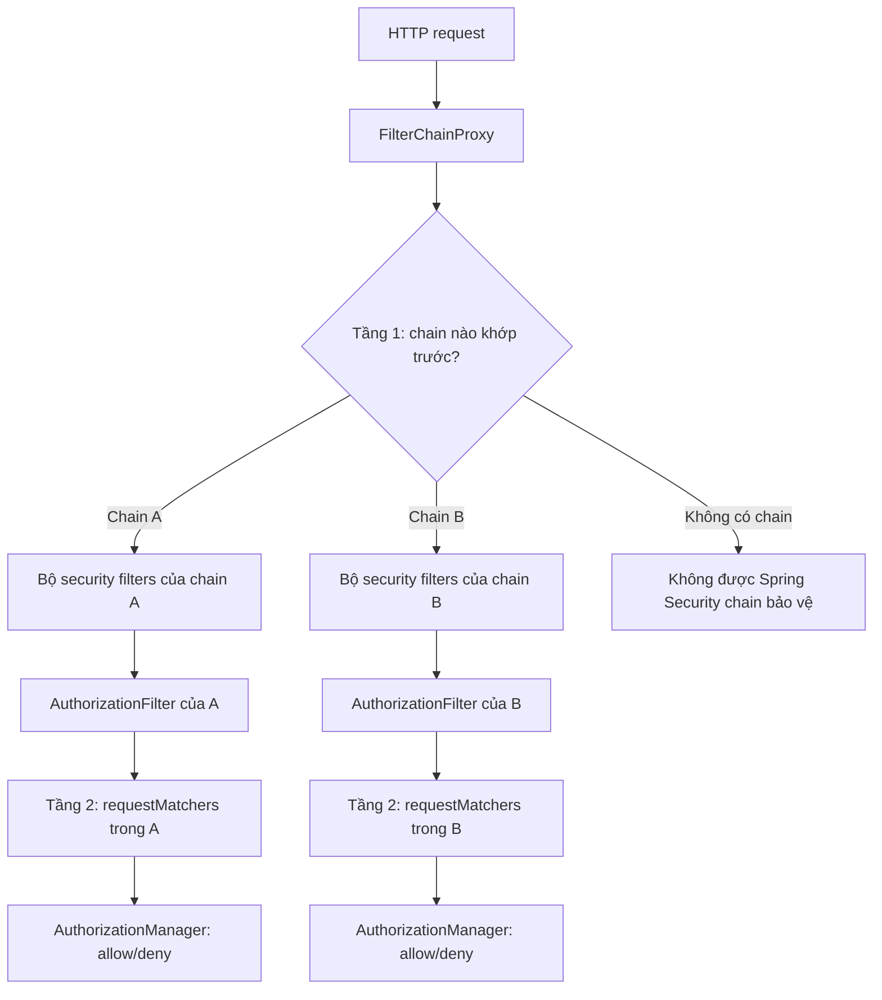

# Phân biệt securityMatcher chọn filter chain với requestMatchers chọn quy tắc

Khi cấu hình **phân quyền HTTP bằng Spring Security (Servlet)**, hai API có tên khá giống nhau nhưng trả lời **hai câu hỏi khác nhau**:

- **`http.securityMatcher(...)`:** Request này có thuộc **`SecurityFilterChain` đang định nghĩa** hay không?
- **`http.authorizeHttpRequests(auth -> auth.requestMatchers(...))`:** Nếu request **đã vào chain này**, nó khớp **quy tắc authorization nào** để cho phép hoặc từ chối?

Khác biệt này không chỉ là cú pháp. Sai thứ tự hoặc nhầm phạm vi có thể khiến request dùng **cách xác thực sai**, không chạy các filter bảo vệ mong muốn, hoặc tệ hơn là **không có Spring Security filter chain nào bảo vệ**.

**Quy tắc nhớ nhanh:**

> **`securityMatcher` chọn *chain*; `requestMatchers` chọn *rule bên trong chain*.** Cả hai sử dụng cơ chế `RequestMatcher`, nhưng chạy ở **hai tầng** và hai thời điểm khác nhau.

Bài học giải thích cơ chế, thứ tự match, ví dụ nhiều chain, ảnh hưởng đến endpoint login, lỗi thường gặp, cách kiểm thử và một chương trình Java 17 mô phỏng chạy độc lập.

## 1. Hai tầng lựa chọn trong một request

Trong ứng dụng Spring MVC chạy trên Servlet stack, Spring Security được kết nối với Servlet container qua `DelegatingFilterProxy` và `FilterChainProxy`. `FilterChainProxy` sở hữu danh sách `SecurityFilterChain` được sắp xếp theo độ ưu tiên.

**Tầng 1 – chọn chain:**

1. Request đi tới `FilterChainProxy`.
2. `FilterChainProxy` duyệt các `SecurityFilterChain` theo thứ tự.
3. Chọn **chain đầu tiên có chain-level RequestMatcher khớp**.
4. Chạy **các security filter thuộc chain được chọn**. Không cộng gộp filter của mọi chain đang khớp.

**Tầng 2 – chọn rule:**

1. Trong chain đã chọn, `AuthorizationFilter` thực hiện việc kiểm soát truy cập URL nếu cấu hình `authorizeHttpRequests`.
2. `AuthorizationManager` của chain, thường là `RequestMatcherDelegatingAuthorizationManager`, duyệt các **`requestMatchers` theo thứ tự**.
3. Lấy **rule đầu tiên có matcher khớp** và dùng manager của rule đó (`permitAll`, `authenticated`, `hasRole`, custom policy...).
4. Kết quả quyết định request được đi tiếp hay bị từ chối ở bước URL authorization.



**Không có bước “quy tắc đầu tiên từ chối thì chuyển sang chain khác”.** Khi `FilterChainProxy` đã chọn một chain, Spring Security **không thử chain thứ hai** chỉ vì user thiếu role hoặc rule của chain thứ nhất từ chối.

### Bảng so sánh

| Tiêu chí | `securityMatcher` | `requestMatchers` trong `authorizeHttpRequests` |
| --- | --- | --- |
| Cấp quyết định | Chọn **`SecurityFilterChain`** | Chọn **authorization rule** của chain đã chọn |
| Nơi cấu hình | Trên `HttpSecurity` của một bean `SecurityFilterChain` | Bên trong DSL `authorizeHttpRequests` |
| Bên thực thi chọn | `FilterChainProxy` | `RequestMatcherDelegatingAuthorizationManager` (thường dùng) |
| Đối tượng chọn | Toàn bộ bộ lọc và cơ chế bảo mật của chain | Một `AuthorizationManager` như `hasRole`, `permitAll` |
| Thứ tự | Ưu tiên giữa các chain: `@Order` / `Ordered` | Thứ tự khai báo các rule trong cùng chain |
| Matcher mặc định | `HttpSecurity` mặc định khớp **mọi request**, trừ khi thu hẹp | Cần khai báo các rule; nên có `anyRequest()` kết thúc |
| Khi không khớp | Thử **chain tiếp theo**, nếu có | Thử **rule tiếp theo trong cùng chain**, nếu có |
| Phạm vi của `anyRequest()` | Ở rule layer, **chỉ với request đã vào chain đó** | Bao phủ các request còn lại **của chain đang chọn** |
| Hệ quả bảo mật | Chain có thể không áp dụng, gây hở bảo vệ nếu không có fallback | Rule có thể sai/thiếu quyền; không tự làm request chuyển chain |

## 2. Một `HttpSecurity` tạo ra một `SecurityFilterChain`

Trong Java configuration:

```java
@Bean
SecurityFilterChain apiChain(HttpSecurity http) throws Exception {
    http
        .securityMatcher("/api/**")
        .authorizeHttpRequests(auth -> auth
            .requestMatchers(HttpMethod.GET, "/api/orders/**")
                .hasAuthority("orders.read")
            .anyRequest().authenticated()
        )
        .httpBasic(Customizer.withDefaults());
    return http.build();
}
```

Đây là **mảnh cấu hình Spring**, không phải class Java thuần để chạy độc lập. Cần import `@Bean`, `HttpSecurity`, `SecurityFilterChain`, `HttpMethod`, `Customizer`, có ứng dụng Spring Boot/Spring Security và authentication provider tương ứng.

Diễn giải chính xác:

1. Bean trả về **một `SecurityFilterChain`**.
2. `securityMatcher("/api/**")` giới hạn chain vào các URL phù hợp pattern `/api/**`.
3. Nếu request thuộc `/api/**`, chain này có thể chạy các filter của HTTP Basic, xử lý `SecurityContext`, CSRF, authorization và các filter khác theo cấu hình.
4. Bên trong chain, `GET /api/orders/42` khớp rule GET và cần authority `orders.read`.
5. Các request **khác nhưng vẫn thuộc `/api/**`** sẽ khớp `anyRequest().authenticated()`.
6. `GET /about` **không vào chain này**; rule `anyRequest()` bên trên **không được áp dụng** cho `/about`.

Kết luận số 6 thường bị hiểu sai nhất: **`anyRequest()` không biến một chain bị giới hạn bởi `securityMatcher` thành chain bảo vệ mọi URL của ứng dụng.**

### `requestMatchers` không làm nhỏ chain

Nếu bỏ hoàn toàn `securityMatcher`:

```java
@Bean
SecurityFilterChain oneChain(HttpSecurity http) throws Exception {
    http.authorizeHttpRequests(auth -> auth
        .requestMatchers("/api/**").authenticated()
        .anyRequest().permitAll()
    );
    return http.build();
}
```

Với một chain không bị thu hẹp, mặc định chain-level matcher **khớp mọi request**. Điều đó có nghĩa:

- `GET /api/orders/42` vào chain, được kiểm `authenticated()`.
- `GET /public/help` **cũng vào cùng chain**, nhưng được rule `anyRequest().permitAll()` cho phép ở bước HTTP authorization.
- Các filter bảo vệ khác của chain vẫn có thể chạy đối với request public (ví dụ security headers, CSRF trong trường hợp phù hợp).

Như vậy, **`requestMatchers("/api/**")` không đồng nghĩa chỉ tạo bảo mật cho `/api/**`**. Nó chỉ chọn rule được áp dụng trong một chain có phạm vi riêng.

## 3. Mỗi request được chọn chain đúng một lần trong `FilterChainProxy`

Với nhiều `SecurityFilterChain`, `FilterChainProxy` xét lần lượt theo priority và lấy **chain khớp đầu tiên**:

```text
Request GET /api/admin/audit
   |
   +--> Chain @Order(1): securityMatcher("/api/admin/**")   MATCH
   |      => chọn chain quản trị; không xét tiếp các chain
   |
   +--> Chain @Order(2): securityMatcher("/api/**")         không chạy
   |
   +--> Fallback chain: matcher mặc định anyRequest         không chạy
```

Đây là **first-match-wins ở cấp chain**. Nếu chain ưu tiên 1 có rule từ chối, request không tự rơi sang chain ưu tiên 2 để tìm rule dễ hơn.

### `@Order` là thứ tự của chain, không phải rule

`@Order(1)` ưu tiên cao hơn `@Order(2)`. Thứ tự này quyết định **chain nào được xét trước**. Trong mỗi chain, thứ tự `requestMatchers` do **thứ tự khai báo trong DSL** quyết định, không phải thứ tự của `@Order`.

Nếu hai chain cùng khớp một URL, chain ưu tiên hơn sẽ thắng. Khi có nhiều chain, cần đặt **matcher cụ thể hơn ở chain ưu tiên cao hơn**, hoặc thiết kế các matcher không chồng lấn.

## 4. Cấu hình ba chain có fallback: ví dụ Spring Security

Giả sử ứng dụng cần:

- `/api/admin/**`: API quản trị, yêu cầu `ROLE_ADMIN`.
- `/api/**` còn lại: HTTP Basic, GET đơn hàng yêu cầu `orders.read`, POST đơn hàng cần `orders.write`; endpoint API khác yêu cầu đăng nhập.
- `/public/**` và `/health`: công khai.
- Mọi URL không khai báo: từ chối.

Dùng **ba chain** (đoạn mã sau là **class cấu hình trong dự án Spring Boot Servlet**, không tự chạy bằng `javac`):

```java
package com.example.security;

import org.springframework.context.annotation.Bean;
import org.springframework.context.annotation.Configuration;
import org.springframework.core.annotation.Order;
import org.springframework.http.HttpMethod;
import org.springframework.security.config.Customizer;
import org.springframework.security.config.annotation.web.builders.HttpSecurity;
import org.springframework.security.web.SecurityFilterChain;

@Configuration
public class SecurityConfig {

    @Bean
    @Order(1)
    SecurityFilterChain adminChain(HttpSecurity http) throws Exception {
        http
            .securityMatcher("/api/admin/**")
            .authorizeHttpRequests(auth -> auth
                .anyRequest().hasRole("ADMIN")
            )
            .httpBasic(Customizer.withDefaults());

        return http.build();
    }

    @Bean
    @Order(2)
    SecurityFilterChain apiChain(HttpSecurity http) throws Exception {
        http
            .securityMatcher("/api/**")
            .authorizeHttpRequests(auth -> auth
                .requestMatchers(HttpMethod.GET, "/api/orders/**")
                    .hasAuthority("orders.read")
                .requestMatchers(HttpMethod.POST, "/api/orders/**")
                    .hasAuthority("orders.write")
                .anyRequest().authenticated()
            )
            .httpBasic(Customizer.withDefaults());

        return http.build();
    }

    @Bean
    SecurityFilterChain fallbackChain(HttpSecurity http) throws Exception {
        http
            .authorizeHttpRequests(auth -> auth
                .requestMatchers("/public/**", "/health").permitAll()
                .anyRequest().denyAll()
            );

        return http.build();
    }
}
```

### Đọc đúng từng chain

**adminChain – `@Order(1)`**

`securityMatcher("/api/admin/**")` nhận đường dẫn quản trị, kể cả khi nó cũng có thể khớp `/api/**`. Trong chain này, `anyRequest().hasRole("ADMIN")` kiểm **mọi request đã vào adminChain**, chứ không kiểm mọi request ứng dụng. Với role-prefix mặc định, `hasRole("ADMIN")` tìm `ROLE_ADMIN`.

**apiChain – `@Order(2)`**

Chỉ xét nếu chain ưu tiên 1 chưa khớp. Vì `/api/**` bao quát API thông thường, những request GET và POST tới `/api/orders/**` chọn hai rule riêng. Những request API khác đã vào chain được `anyRequest().authenticated()` xử lý. Nếu dự án cần chặn API chưa khai báo, nên đổi fallback **trong apiChain** sang `denyAll()` và cấp phép cụ thể.

**fallbackChain – mặc định được xét sau các bean có `@Order` ưu tiên hơn**

Không đặt `securityMatcher` hẹp nên chain-level matcher mặc định khớp mọi request còn lại. `requestMatchers("/public/**", "/health")` cho phép các route công khai; `anyRequest().denyAll()` chặn những URL chưa được khai báo.

**Quan trọng:** Cấu hình trên chỉ xác định rule và các filter cần dùng. Để chạy thành ứng dụng, cần thêm dependency, user/authentication provider, controller và cách xử lý HTTP request. HTTP Basic không tự cung cấp tài khoản sản xuất; với Spring Boot có thể có default generated user trong môi trường đơn giản, nhưng phải chủ động cấu hình khi triển khai thật. POST qua trình duyệt/cookie có thể cần CSRF token; 403 do `CsrfFilter` không chứng minh rule `orders.write` sai.

### Ma trận chọn chain và chọn rule

| Request | Chain được chọn | Rule được chọn trong chain | Điều kiện HTTP authorization |
| --- | --- | --- | --- |
| `GET /api/admin/audit` | `adminChain` | `anyRequest().hasRole("ADMIN")` | `ROLE_ADMIN` |
| `DELETE /api/admin/users/7` | `adminChain` | `anyRequest().hasRole("ADMIN")` | `ROLE_ADMIN` |
| `GET /api/orders/7` | `apiChain` | GET orders `hasAuthority` | `orders.read` |
| `POST /api/orders/7` | `apiChain` | POST orders `hasAuthority` | `orders.write` |
| `PATCH /api/orders/7` | `apiChain` | `anyRequest().authenticated()` | Đã xác thực; lưu ý mức quyền có thể **quá rộng** |
| `GET /api/profile` | `apiChain` | `anyRequest().authenticated()` | Đã xác thực |
| `GET /public/help` | `fallbackChain` | `permitAll()` | Không yêu cầu authentication ở HTTP authorization |
| `GET /health` | `fallbackChain` | `permitAll()` | Không yêu cầu authentication ở HTTP authorization |
| `GET /internal/debug` | `fallbackChain` | `denyAll()` | Bị từ chối |
| `GET /unknown` | `fallbackChain` | `denyAll()` | Bị từ chối |

Bảng trên mô tả **kết quả chọn chain và rule**, không hứa status HTTP chính xác hoặc controller tồn tại. Một request được cho qua authorization vẫn có thể trả 404/400/409; một POST có thể bị CSRF chặn trước khi tới `AuthorizationFilter`.

## 5. Rule có thứ tự riêng bên trong chain

`requestMatchers` theo nguyên tắc **first matching rule wins**. Ví dụ:

```java
.authorizeHttpRequests(auth -> auth
    .requestMatchers("/api/**").permitAll()
    .requestMatchers("/api/admin/**").hasRole("ADMIN")
    .anyRequest().denyAll()
)
```

Với một chain bao phủ `/api/**`, request `GET /api/admin/users` khớp **rule đầu tiên** `/api/**`, nên quy tắc admin đặt sau **không chạy**. Kết quả là endpoint quản trị có thể được cho phép ở HTTP authorization dù bạn đã viết `hasRole("ADMIN")` ở bên dưới.

Sửa bằng cách để rule cụ thể trước:

```java
.authorizeHttpRequests(auth -> auth
    .requestMatchers("/api/admin/**").hasRole("ADMIN")
    .requestMatchers("/api/**").authenticated()
    .anyRequest().denyAll()
)
```

Nhưng khi đã tách **adminChain** ưu tiên 1 như ví dụ trước, rule admin nằm trong chain riêng; `requestMatchers` ở apiChain không có cơ hội xử lý `/api/admin/**`. Hãy giữ **hai tầng thứ tự** rõ ràng:

- Thứ tự chain: ưu tiên bean `@Order` và chain-level `securityMatcher`.
- Thứ tự rule: thứ tự `requestMatchers` trong **chain được chọn**.

**Không có nguyên tắc “quy tắc sau nghiêm ngặt hơn nên luôn thắng”.** Thực tế chỉ matcher **đầu tiên khớp** của tầng tương ứng mới được chọn.

## 6. Bốn cấu hình dễ nhầm và hậu quả

### 6.1. Chỉ dùng `securityMatcher` nhưng quên fallback chain

```java
@Bean
SecurityFilterChain onlyApi(HttpSecurity http) throws Exception {
    http
        .securityMatcher("/api/**")
        .authorizeHttpRequests(auth -> auth
            .anyRequest().authenticated()
        );
    return http.build();
}
```

Nếu **đây là chain duy nhất**, request `/api/orders` được Spring Security chain bảo vệ, nhưng `/admin/secret` không khớp bất kỳ chain nào. Spring Security **không cung cấp lớp bảo vệ filter-chain** cho request ngoài `/api/**`; response cuối cùng vẫn do ứng dụng/container quyết định.

Điểm nguy hiểm là ứng dụng vẫn có thể triển khai controller `/admin/secret` trong khi bạn tưởng `anyRequest().authenticated()` sẽ bảo vệ nó. **`anyRequest` chỉ áp dụng cho request đã đi qua chain này.**

**Cách sửa:** thêm một `SecurityFilterChain` fallback không bị thu hẹp và có `anyRequest().denyAll()` hoặc policy rõ ràng; kiểm lại tất cả URL cần bảo vệ.

### 6.2. Dùng `requestMatchers` rồi tưởng đã tách các filter

```java
@Bean
SecurityFilterChain combined(HttpSecurity http) throws Exception {
    http
        .authorizeHttpRequests(auth -> auth
            .requestMatchers("/api/**").authenticated()
            .anyRequest().permitAll()
        )
        .httpBasic(Customizer.withDefaults());
    return http.build();
}
```

`requestMatchers("/api/**")` chỉ đặt một quy tắc authorization. Nó **không** tạo hai `SecurityFilterChain`; mọi URL vẫn đi qua **cùng bộ filter** của `combined`. Nếu muốn session/form login cho web và JWT/HTTP Basic cho API, cần bố trí **các chain riêng** bằng `securityMatcher` hoặc thiết kế một chain với các cơ chế hỗ trợ đúng mục tiêu.

### 6.3. Chain rộng che khuất chain cụ thể

```java
@Bean
@Order(1)
SecurityFilterChain broad(HttpSecurity http) throws Exception {
    http.securityMatcher("/api/**")
        .authorizeHttpRequests(auth -> auth.anyRequest().authenticated());
    return http.build();
}

@Bean
@Order(2)
SecurityFilterChain admin(HttpSecurity http) throws Exception {
    http.securityMatcher("/api/admin/**")
        .authorizeHttpRequests(auth -> auth.anyRequest().hasRole("ADMIN"));
    return http.build();
}
```

`/api/admin/audit` vào chain `broad` vì `/api/**` đã khớp trước. Chain `admin` **không được xét**, nên `hasRole("ADMIN")` ở chain đó vô tác dụng. Đây là lỗi **order giữa các chain**, không giải quyết được bằng cách đảo các rule trong `admin`.

**Cách sửa:** đảo thứ tự chain (admin trước, broad sau), hoặc thiết kế các chain-level matcher không chồng lấn, hoặc khai báo rule admin ngay trong một chain chung đúng thứ tự.

### 6.4. Rule trong chain có phạm vi không thể chạm tới

```java
http.securityMatcher("/api/**")
    .authorizeHttpRequests(auth -> auth
        .requestMatchers("/admin/**").hasRole("ADMIN")
        .anyRequest().authenticated()
    );
```

`/admin/**` **không thuộc `/api/**`**, nên rule `requestMatchers("/admin/**")` không được áp dụng cho request tương ứng: nó nằm ngoài chain. Khi nhìn code, **luôn hỏi “path này có qua `securityMatcher` của chain trước không?”** rồi mới đánh giá rule.

Một cách phát hiện lỗi là lập bảng giữa **chain-level match set** và **rule-level match set**. Nếu rule chỉ có thể khớp những URL ngoài tập request được chọn vào chain, nó đang không có tác dụng.

## 7. Java 17 chạy độc lập: mô phỏng hai cấp chọn khác nhau

Chương trình dưới đây mô phỏng:

1. Danh sách chain theo thứ tự ưu tiên.
2. Mỗi chain có một danh sách rule theo thứ tự riêng.
3. Chọn **chain khớp đầu tiên**, sau đó chọn **rule khớp đầu tiên của chính chain đó**.
4. Khi thiếu fallback chain, trả trạng thái chẩn đoán `NO_SECURITY_CHAIN`; **không coi đó là một quyết định allow an toàn**.

Chương trình dùng API **Java SE 17**, không phụ thuộc Spring. Mục đích là làm rõ thuật toán, **không mô phỏng chính xác mọi hành vi path matcher, filter, authentication, CSRF, servlet dispatch và exception handling của Spring Security**.

Tạo tệp **`ChainVsRuleDemo.java`**:

```java
import java.util.List;
import java.util.Set;
import java.util.function.BiPredicate;
import java.util.function.Predicate;

public class ChainVsRuleDemo {

    record Request(String method, String path) {}

    record Identity(boolean authenticated, Set<String> authorities) {
        boolean has(String authority) {
            return authenticated && authorities.contains(authority);
        }
    }

    record Rule(
            String name,
            Predicate<Request> matches,
            BiPredicate<Identity, Request> allows
    ) {}

    record Chain(
            String name,
            Predicate<Request> matches,
            List<Rule> rules
    ) {}

    static final Chain ADMIN = new Chain(
            "adminChain",
            request -> request.path().startsWith("/api/admin/"),
            List.of(new Rule(
                    "admin role",
                    request -> true,
                    (user, request) -> user.has("ROLE_ADMIN")
            ))
    );

    static final Chain API = new Chain(
            "apiChain",
            request -> request.path().startsWith("/api/"),
            List.of(
                    new Rule(
                            "read orders",
                            request -> request.method().equals("GET")
                                    && request.path().startsWith("/api/orders/"),
                            (user, request) -> user.has("orders.read")
                    ),
                    new Rule(
                            "write orders",
                            request -> request.method().equals("POST")
                                    && request.path().startsWith("/api/orders/"),
                            (user, request) -> user.has("orders.write")
                    ),
                    new Rule(
                            "other api",
                            request -> true,
                            (user, request) -> user.authenticated()
                    )
            )
    );

    static final Chain FALLBACK = new Chain(
            "fallbackChain",
            request -> true,
            List.of(
                    new Rule(
                            "public",
                            request -> request.path().startsWith("/public/")
                                    || request.path().equals("/health"),
                            (user, request) -> true
                    ),
                    new Rule(
                            "default deny",
                            request -> true,
                            (user, request) -> false
                    )
            )
    );

    static String evaluate(
            List<Chain> chains,
            Identity user,
            Request request
    ) {
        for (Chain chain : chains) {
            if (!chain.matches().test(request)) {
                continue;
            }

            for (Rule rule : chain.rules()) {
                if (rule.matches().test(request)) {
                    boolean granted = rule.allows().test(user, request);
                    return chain.name() + " -> " + rule.name()
                            + " -> " + (granted ? "ALLOW" : "DENY");
                }
            }

            // Một chain đã được chọn: KHÔNG quay lại thử chain khác.
            return chain.name() + " -> NO_RULE";
        }

        // Không phải một kết quả authorization "allow".
        return "NO_SECURITY_CHAIN";
    }

    public static void main(String[] args) {
        List<Chain> all = List.of(ADMIN, API, FALLBACK);
        List<Chain> noFallback = List.of(ADMIN, API);

        Identity anonymous = new Identity(false, Set.of());
        Identity reader = new Identity(true, Set.of("orders.read"));
        Identity writer = new Identity(true, Set.of("orders.write"));
        Identity admin = new Identity(true, Set.of("ROLE_ADMIN"));

        System.out.println("Admin path, admin: "
                + evaluate(all, admin,
                        new Request("GET", "/api/admin/audit")));

        System.out.println("Admin path, reader: "
                + evaluate(all, reader,
                        new Request("GET", "/api/admin/audit")));

        System.out.println("Read order, reader: "
                + evaluate(all, reader,
                        new Request("GET", "/api/orders/7")));

        System.out.println("Write order, reader: "
                + evaluate(all, reader,
                        new Request("POST", "/api/orders/7")));

        System.out.println("Write order, writer: "
                + evaluate(all, writer,
                        new Request("POST", "/api/orders/7")));

        System.out.println("Read order, admin only: "
                + evaluate(all, admin,
                        new Request("GET", "/api/orders/7")));

        System.out.println("Other api, reader: "
                + evaluate(all, reader,
                        new Request("GET", "/api/profile")));

        System.out.println("Health, anonymous: "
                + evaluate(all, anonymous,
                        new Request("GET", "/health")));

        System.out.println("Unknown path, admin: "
                + evaluate(all, admin,
                        new Request("GET", "/internal/debug")));

        System.out.println("Unknown without fallback: "
                + evaluate(noFallback, admin,
                        new Request("GET", "/internal/debug")));
    }
}
```

Dùng **JDK 17+** để biên dịch và chạy:

```bash
javac ChainVsRuleDemo.java
java ChainVsRuleDemo
```

Stdout dự kiến **chính xác**:

```text
Admin path, admin: adminChain -> admin role -> ALLOW
Admin path, reader: adminChain -> admin role -> DENY
Read order, reader: apiChain -> read orders -> ALLOW
Write order, reader: apiChain -> write orders -> DENY
Write order, writer: apiChain -> write orders -> ALLOW
Read order, admin only: apiChain -> read orders -> DENY
Other api, reader: apiChain -> other api -> ALLOW
Health, anonymous: fallbackChain -> public -> ALLOW
Unknown path, admin: fallbackChain -> default deny -> DENY
Unknown without fallback: NO_SECURITY_CHAIN
```

### Phân tích các dòng quan trọng

- `/api/admin/audit` khớp **cả** ý nghĩa `/api/admin/**` và `/api/**`; vì adminChain xuất hiện trước, **chỉ adminChain** được chọn.
- Reader thiếu `ROLE_ADMIN` bị **DENY bởi adminChain**; nó không được chuyển xuống apiChain với rule `other api → authenticated`.
- `GET /api/orders/7` đi vào apiChain; người chỉ có role `ROLE_ADMIN` không tự thỏa quyền `orders.read`. Role hierarchy/mapping chỉ tồn tại khi ứng dụng cấu hình.
- `/health` rơi vào fallbackChain và chọn rule `public`; không phụ thuộc việc người gọi đã đăng nhập.
- `/internal/debug` với fallback nhận quyết định deny. Bỏ fallback ra, mô phỏng trả `NO_SECURITY_CHAIN`, nghĩa là **thiếu lớp bảo vệ Spring Security ở phạm vi đó**, không phải thuật toán “deny by default”.

Trong mô phỏng, `startsWith("/api/")` chỉ là cách dễ nhìn để minh họa cấp độ. **Không dùng cách nối chuỗi đó thay cho `RequestMatcher` thật ở production**: trường hợp dấu slash, context path, servlet path, URL encoding và matcher Spring MVC phải được kiểm thử theo framework.

## 8. Vì sao dùng `securityMatcher` ảnh hưởng cả authentication và những endpoint do filter tạo?

Nhiều bạn chỉ nghĩ `securityMatcher` thay đổi phân quyền. Thực ra nó quyết định **toàn bộ filter chain được áp dụng**, trong đó có thể bao gồm:

- Filter khôi phục `SecurityContext`.
- Filter authentication như HTTP Basic, Bearer token, form login.
- Xử lý CSRF, headers, session management, request cache và exception handling theo cấu hình.
- `AuthorizationFilter` với các rule đã khai báo.
- Các custom filter mà ứng dụng thêm vào đúng chain.

Ví dụ dùng hai chain: `/api/**` cho Bearer token, phần còn lại cho form login. Request `GET /api/orders/7` vào apiChain và được xác thực bằng cơ chế tương ứng của chain đó. Request `GET /dashboard` vào webChain, có thể dùng session/form login. Chỉ thay đổi `requestMatchers` trong một chain **không tự biến HTTP Basic thành JWT hay đổi session thành stateless**.

### Endpoint login, logout có thể nằm ngoài chain

Một số filter Spring Security cung cấp endpoint trực tiếp, ví dụ `POST /login` do form-login filter xử lý. Nếu ứng dụng chỉ có một chain:

```java
http.securityMatcher("/secured/**")
    .formLogin(Customizer.withDefaults())
    .authorizeHttpRequests(auth -> auth.anyRequest().authenticated());
```

Với chỉ chain này, `/login` **không khớp `/secured/**`**. Filter hỗ trợ login nằm trong chain không nhận request `/login`; endpoint login mặc định có thể không tồn tại và trả 404. Đây **không phải** lỗi do `hasRole` hoặc `requestMatchers`.

Một hướng giải quyết là:

- Giữ một fallback web chain phù hợp cho `/login`; **hoặc**
- Đặt đường xử lý form login vào `/secured/login`, bảo đảm URL đó nằm trong chain, có page/controller phù hợp, và cấp phép endpoint login đúng chính sách.

Không mặc định gọi `formLogin()` là đủ để mọi request `/login` đi vào chain. Các URL được tạo bởi security filter phải nằm trong **chain-level matcher** nhận chúng.

### `securityMatcher` ảnh hưởng filter, `requestMatchers` ảnh hưởng quyết định

Tóm tắt tình huống:

| Thay đổi | Điều thực sự thay đổi |
| --- | --- |
| Thêm `securityMatcher("/api/**")` vào một chain | Thu hẹp **những request sử dụng bộ filter của chain** |
| Thêm `requestMatchers("/api/**").authenticated()` | Thêm **rule authorization cho request đã thuộc chain** |
| Thay `httpBasic` bằng `oauth2ResourceServer` trên apiChain | Thay **cách xác thực** ở chain đã được chọn |
| Đổi `anyRequest().authenticated()` thành `denyAll()` trong apiChain | Đổi cách xử lý **URL còn lại bên trong apiChain** |
| Thêm fallback chain không có `securityMatcher` hẹp | Bao phủ request còn lại bằng Spring Security filters |
| Đổi `@Order(1)`/`@Order(2)` giữa chain chồng lấn | Có thể đổi **toàn bộ bộ filter và rule** mà một request sử dụng |

## 9. Matcher dùng method, path và điều kiện tùy biến

`securityMatcher` và `requestMatchers` đều sử dụng khái niệm `RequestMatcher`. Ngoài mẫu path, có thể dùng matcher xét HTTP method hoặc request khác khi phù hợp.

Ví dụ cụ thể hóa yêu cầu chỉ cho phép GET đơn hàng:

```java
.authorizeHttpRequests(auth -> auth
    .requestMatchers(HttpMethod.GET, "/api/orders/**")
        .hasAuthority("orders.read")
    .requestMatchers(HttpMethod.POST, "/api/orders/**")
        .hasAuthority("orders.write")
    .anyRequest().denyAll()
)
```

`GET /api/orders/7` và `POST /api/orders/7` có thể **vào cùng một chain** nhưng chọn hai rule khác nhau. Ngược lại, nếu cần tách authentication filter của GET và POST thành hai chain (ít gặp), phải có **chain-level RequestMatcher** tương ứng và order, không thể chỉ dùng rule-level matcher.

**Chú ý cách matcher được dựng:** với Spring MVC trên classpath, Spring Security có thể dùng matcher nhận biết MVC hoặc cơ chế matcher khác tùy phiên bản/cấu hình. Không giả định pattern String là một regex hoặc phép `String.startsWith` thô. Khi ứng dụng có nhiều servlet, custom servlet mapping hoặc path context đặc biệt, cần xác nhận rule dùng implementation thích hợp (`MvcRequestMatcher` / `PathPatternRequestMatcher` / custom matcher theo bản Spring Security) và viết integration test.

### Có nhiều matcher trong một chain

`securityMatcher("/api/**")` nhận một pattern hoặc một `RequestMatcher` theo overload. Spring Security cũng có DSL **`securityMatchers(...)`** để cấu hình tập matcher theo phiên bản; không nhầm phần này với **`requestMatchers` của `authorizeHttpRequests`**. Khi nhiều đường vào cùng chain, có thể dùng matcher kết hợp, nhưng phải giữ rõ mục đích: **chọn chain**, không phải cấp quyền.

Ví dụ ý tưởng cho chain chỉ nhận /api/v1 và /api/v2:

```java
http.securityMatcher(
    new OrRequestMatcher(
        new AntPathRequestMatcher("/api/v1/**"),
        new AntPathRequestMatcher("/api/v2/**")
    )
);
```

**Đây là ví dụ diễn đạt lựa chọn matcher cho phiên bản 6.x**, cần import và kiểm các class còn được khuyến nghị/hỗ trợ trong phiên bản triển khai. Tránh gắn cố định vào một matcher API cũ khi chuyển major release. Quan trọng hơn tên lớp là cả hai path cùng được chọn vào **một chain** và rule bên trong vẫn độc lập.

## 10. Có fallback chain không đồng nghĩa tự chặn đúng mọi thứ

Nên có một `SecurityFilterChain` không thu hẹp bởi `securityMatcher` để tránh URL bị bỏ khỏi phạm vi Spring Security. Nhưng **cách cấp phép của fallback** vẫn là quyết định thiết kế:

```java
// Chặt cho API chưa khai báo:
.anyRequest().denyAll()

// Phần website yêu cầu đăng nhập:
.anyRequest().authenticated()

// Chỉ nên dùng khi thực sự muốn mọi URL còn lại công khai:
.anyRequest().permitAll()
```

`anyRequest().permitAll()` ở fallback không mở những request mà chain ưu tiên cao hơn đã chọn và từ chối. Ví dụ `/api/admin/audit` không rơi xuống fallback permitAll khi đã khớp adminChain. Ngược lại, URL mới `/internal/debug` không thuộc chain cụ thể nào **sẽ** tới fallback, và `permitAll` có thể mở ngoài ý muốn.

### `permitAll` không phải bỏ qua security filter chain

Trong fallback chain, `requestMatchers("/public/**").permitAll()` vẫn cho request đi qua các filter khác trong chain đã chọn. Điều này khác với cách bỏ request ra khỏi Spring Security chain bằng `web.ignoring()` hoặc không có chain nào khớp. Nếu cần URL công khai mà vẫn muốn security headers/CSRF theo thiết kế, thường nên để trong chain và dùng `permitAll`.

## 11. Trả về 401/403/404 và các lớp kiểm soát khác

Khi request bị từ chối bởi HTTP authorization trong chain được chọn:

- **Chưa xác thực:** tùy cấu hình, `ExceptionTranslationFilter` có thể kích hoạt `AuthenticationEntryPoint`: ví dụ HTTP Basic/Bearer trả challenge 401 hoặc form-login chuyển hướng.
- **Đã xác thực nhưng thiếu authority:** thông thường `AccessDeniedHandler` dẫn đến 403.
- **Không có chain khớp:** Spring Security filter chain không áp dụng; controller hoặc servlet container vẫn có thể trả 404, 200 hoặc response khác. **Không lấy 404 làm bằng chứng endpoint được bảo vệ**.
- **Được phép qua HTTP authorization:** controller, method security hoặc data layer vẫn có thể trả 404, 403, 409... Không coi allow ở tầng HTTP đồng nghĩa request chắc chắn 200.
- **CSRF:** một POST/PUT/DELETE có thể bị CSRF filter chặn trước bước authorization, tùy session/cookie/token và cấu hình. Cần phân biệt lỗi CSRF với rule sai.

**Phân quyền URL chưa đủ cho object-level authorization.** Rule `hasAuthority("orders.read")` không tự chứng minh user sở hữu đơn hàng 7 hoặc thuộc cùng tenant. Hãy kết hợp method/service policy như `canReadOrder(authentication, orderId)` trên nguồn dữ liệu đáng tin, và bảo vệ cả list/export/update.

### Trường hợp `FORWARD` và `ERROR`

Request Servlet có thể được dispatch thêm lần nữa khi render view hoặc trang lỗi. `AuthorizationFilter` có thể kiểm authorization trên những dispatch đó theo cấu hình. Cần đặt chính sách cho `DispatcherType.FORWARD`/`ERROR` khi thực sự cần, không vội mở toàn bộ hoặc dùng `web.ignoring()` vì muốn hết 403. Nhớ rằng chain-level matcher vẫn quyết định dispatch vào **chain nào** trước, rồi rule-level matcher xét đường đi/loại dispatch tương ứng.

## 12. Thiết kế chain: khi nào một chain, khi nào nhiều chain?

**Ưu tiên một chain** khi mọi URL có cùng mô hình authentication/session/CSRF và khác nhau chủ yếu ở permission. Khi đó khai báo các `requestMatchers` theo thứ tự cụ thể trước, fallback sau; không cần chia chain chỉ vì mỗi endpoint có role khác.

**Dùng nhiều chain** khi có khác biệt đáng kể về **cơ chế bảo mật** hoặc scope triển khai, ví dụ:

- `/api/**` dùng OAuth2 Resource Server với Bearer token, stateless.
- `/admin/**` dùng form-login session và điều kiện đặc biệt.
- `/actuator/**` có yêu cầu riêng cho operational endpoints.
- Một số URL thuộc chain với CSRF/session/security headers cấu hình khác theo thiết kế.

Khi dùng nhiều chain, kiểm song song:

1. **Matcher cấp chain:** request nào phải đi qua những filter nào?
2. **Priority:** request thuộc nhiều chain thì chain nào được chọn trước?
3. **Matcher cấp rule:** request trong chain cần role/permission nào?
4. **Fallback:** URL nào có thể không có chain, hoặc vào fallback với policy quá rộng?
5. **Endpoint do filter sinh ra:** login/logout/OAuth callbacks nằm đúng chain chưa?
6. **Consistency:** mọi đường vào nghiệp vụ quan trọng đều có policy server-side phù hợp.

Không phân chia quá nhiều chain nếu các chain giống hệt nhau; nó làm phức tạp thứ tự và tăng nguy cơ một URL bị matcher không mong muốn chọn.

## 13. Kiểm thử đúng cả hai cấp quyết định

Một bộ test tốt cần xác nhận **chain được chọn** và **rule được chọn**, thay vì chỉ thấy response “200/403” rồi kết luận.

### 13.1. Ma trận test với ba chain

| Request và principal | Chain mong đợi | Rule mong đợi | Kết quả HTTP authorization |
| --- | --- | --- | --- |
| Anonymous `GET /api/admin/audit` | adminChain | ADMIN role | Không cho phép; challenge theo cấu hình |
| `ROLE_ADMIN` `GET /api/admin/audit` | adminChain | ADMIN role | Cho phép qua URL authorization |
| `orders.read` `GET /api/admin/audit` | adminChain | ADMIN role | Từ chối, **không thử apiChain** |
| `orders.read` `GET /api/orders/7` | apiChain | GET read | Cho phép qua URL authorization |
| `orders.write` `GET /api/orders/7` | apiChain | GET read | Từ chối, **không thử fallback rule** |
| `orders.write` `POST /api/orders/7` có CSRF hợp lệ nếu cần | apiChain | POST write | Cho phép qua URL authorization |
| Anonymous `GET /health` | fallbackChain | public permitAll | Cho phép qua URL authorization |
| Admin `GET /internal/debug` | fallbackChain | denyAll | Từ chối |
| `GET /internal/debug` khi bỏ fallback | Không có chain | Không có rule | **Không được Spring Security bảo vệ** |

Nên kiểm thêm path sát ranh giới như `/api/adminx`, path encode, dấu slash cuối và method khác với GET/POST, cũng như các dispatcher nội bộ phù hợp. Không tự suy từ `startsWith` trong ví dụ Java rằng Spring path matcher xử lý y hệt.

### 13.2. Test Spring Security bằng MockMvc

Khi có controller và cấu hình chạy trong test context, có thể dùng `spring-security-test` để tạo danh tính và authority. Ví dụ đoạn **test minh họa**, đặt trong lớp JUnit có `MockMvc` được cấu hình:

```java
mvc.perform(get("/api/admin/audit")
        .with(user("bob").authorities(
            new SimpleGrantedAuthority("orders.read"))))
    .andExpect(status().isForbidden());

mvc.perform(get("/api/orders/7")
        .with(user("alice").authorities(
            new SimpleGrantedAuthority("orders.read"))))
    .andExpect(status().isOk());
```

Đây **không phải một tệp Java độc lập**. Assertion `isOk()` chỉ đúng nếu fixture có endpoint GET tương ứng trả 200; thiếu controller thì có thể trả 404 dù URL authorization cho phép. Cấu hình dự án cần import static methods `get`, `user`, `status` và bean `MockMvc`/`spring-security-test`. Đối với POST/PATCH/DELETE khi CSRF đang áp dụng, thêm `with(csrf())` để test **authority**, tránh nhầm 403 vì CSRF.

Kiểm thử nên gồm cả trường hợp thiếu role, thiếu token, scope sai tiền tố, endpoint không tồn tại và no-fallback. Test đáp ứng bảo mật có thể dùng 401/403 đúng với cấu hình entry point; không hard-code một status cho mọi kiểu xác thực.

### 13.3. Debug khi chain hoặc rule không giống dự kiến

1. Bật log DEBUG có chọn lọc cho `org.springframework.security.web.FilterChainProxy` và những class authorization phù hợp; quan sát chain/filter khi khởi động và khi request đi qua.
2. Xác minh order của các bean `SecurityFilterChain`, đặc biệt chain có matcher rộng.
3. Ghi method/path/dispatcher type thực tế sau khi container/matcher xử lý, không đoán từ URL của browser.
4. Xem `securityMatcher` của chain được chọn trước khi đọc các `requestMatchers`.
5. Xác minh rule đầu tiên khớp **trong chain đó**, không tìm quy tắc tương tự ở chain khác.
6. Kiểm `Authentication#getAuthorities()` từ principal đã xác thực; chú ý `ROLE_`, `SCOPE_` và tên permission chính xác.
7. Phân biệt lỗi từ `CsrfFilter`, authentication filter, `AuthorizationFilter`, method security và controller.
8. Kiểm request vào URL do filter cung cấp như `/login`/`/logout` có thực sự khớp chain đúng không.
9. Không log raw Bearer token, session ID hoặc thông tin bí mật chỉ để debug.

## 14. Những ngộ nhận cần loại bỏ

| Ngộ nhận | Cách hiểu đúng |
| --- | --- |
| “`securityMatcher` và `requestMatchers` chỉ khác tên” | Chúng chọn **hai cấp khác nhau**: chain rồi rule |
| “`requestMatchers("/api/**")` làm mọi URL khác bỏ qua filters” | Nó chỉ khai báo rule; phạm vi chain vẫn do `securityMatcher` quyết định |
| “`securityMatcher("/api/**")` và `anyRequest().authenticated()` bảo vệ cả site” | `anyRequest` chỉ thấy các request đã vào chain `/api/**` |
| “Chain đầu deny thì tự thử chain tiếp theo” | Không; đã chọn chain đầu tiên khớp là dừng chọn chain |
| “Rule đầu deny thì thử rule tiếp theo” | Không; rule đầu tiên khớp là rule được áp dụng |
| “`@Order` điều khiển thứ tự `requestMatchers`” | `@Order` ưu tiên chain; thứ tự rule phụ thuộc DSL |
| “Một URL khớp nhiều chain thì chạy tất cả filter của chúng” | `FilterChainProxy` chạy **một chain đầu tiên khớp** |
| “`anyRequest().denyAll()` ở apiChain bảo vệ webChain” | Không; fallback của apiChain chỉ áp dụng bên trong apiChain |
| “Thiếu fallback chain thì mặc định deny toàn bộ URL khác” | Nếu không chain nào khớp, Spring Security chain không bảo vệ request |
| “`permitAll` bỏ qua security filters” | Nó cho phép ở authorization layer nhưng request vẫn qua filter chain đã chọn |
| “Login 404 nghĩa là authentication provider sai” | URL login có thể nằm ngoài `securityMatcher` của chain cung cấp nó |
| “API trả 403 chắc chắn do `hasAuthority`” | CSRF, authentication, method security và policy khác cũng có thể từ chối |
| “Một authority là đủ để xem mọi record trong endpoint” | Quyền trên record còn phụ thuộc owner/tenant/policy động |
| “Thay matcher string không cần test” | Path syntax, servlet mapping, case và encoding có thể ảnh hưởng quyết định |

## 15. Câu hỏi tự kiểm tra

**1. Có hai chain `@Order(1) securityMatcher("/api/**")` và `@Order(2) securityMatcher("/api/admin/**")`. Request `/api/admin/audit` vào đâu?**  
Vào **chain 1**, vì `/api/**` khớp trước. Chain 2 không được xét, dù matcher cụ thể hơn.

**2. `securityMatcher("/api/**").authorizeHttpRequests(auth -> auth.anyRequest().denyAll())` có chặn `GET /public/help` không?**  
Không bằng chain đó, vì `/public/help` nằm ngoài `/api/**`. Nó có thể được chain khác hoặc app/container xử lý.

**3. Không có `securityMatcher` trong một bean `SecurityFilterChain` thì sao?**  
Chain-level matcher mặc định khớp mọi request, nên có thể dùng làm fallback. Nó vẫn chỉ được chọn nếu không có chain ưu tiên hơn khớp trước.

**4. Dùng một chain với `requestMatchers("/admin/**").hasRole("ADMIN")` có tạo một chain admin riêng không?**  
Không. Đây là **rule** bên trong chain hiện có.

**5. Có matcher `/api/** permitAll` trước `/api/admin/** hasRole ADMIN`, kết quả thế nào?**  
Rule đầu tiên khớp `/api/admin/**` trước, nên ở HTTP authorization có thể cho phép sai; cần đổi thứ tự hoặc dùng chain/rule cụ thể trước.

**6. Vì sao `anyRequest().denyAll()` nên là rule cuối?**  
Để làm fallback cho **request đã chọn vào chain** nhưng chưa khớp các rule cụ thể; đặt trước sẽ che các rule ở sau.

**7. Một request thiếu quyền trong adminChain có bị “rơi xuống” apiChain nếu apiChain có `authenticated()` không?**  
Không. Chain được chọn **không thay đổi** do quyết định deny của một rule trong chain.

**8. Hai chain dùng authentication khác nhau: API JWT, web form login. Cần dùng API nào để tách phạm vi?**  
Dùng `securityMatcher` ở từng `HttpSecurity`, kèm order và fallback thích hợp. `requestMatchers` bên trong để đặt rule riêng.

**9. `POST /api/orders/7` có `orders.write` mà vẫn 403; nên sửa `requestMatchers` ngay?**  
Chưa. Kiểm CSRF, entrypoint/authentication, chain đã chọn, authority thực tế và method/resource policy trước.

**10. Vì sao chỉ một chain `/secured/**` dùng form login có thể không phục vụ `/login` mặc định?**  
Vì endpoint `/login` không khớp matcher chain nên filter form login không nhận request đó. Cần bố trí đúng URL hoặc fallback chain.

## 16. Tổng kết thực hành

Khi nhìn một request bị 401/403 hoặc đi sai policy, hãy đi **từ ngoài vào trong**:

1. **`FilterChainProxy` chọn `SecurityFilterChain` nào?** Xem `@Order` và `securityMatcher`.
2. **Chain đó gồm những filter nào?** Xác nhận cơ chế authentication/CSRF/session phù hợp.
3. **`AuthorizationFilter` chọn rule nào?** Xem `requestMatchers` theo thứ tự trong chính chain đó.
4. **Rule yêu cầu quyền gì?** Kiểm `Authentication` và các authorities/roles/scopes.
5. **Có policy sâu hơn không?** Method security, tenant, ownership, business rules.
6. **Những URL còn lại được bảo vệ không?** Phải có fallback chain nếu không muốn URL nằm ngoài Spring Security.

**Ghi nhớ cuối:** `securityMatcher` quyết định **bộ filter nào chịu trách nhiệm**; `requestMatchers` quyết định **điều kiện truy cập nào bên trong bộ filter đó**. Tách rõ hai cấp sẽ tránh lỗi chain rộng nuốt chain hẹp, rule rộng nuốt rule hẹp, login URL nằm ngoài chain và endpoint không được bảo vệ.

## Tài liệu tham khảo

- [Spring Security – Java Configuration: Multiple HttpSecurity, securityMatcher vs requestMatchers](https://docs.spring.io/spring-security/reference/servlet/configuration/java.html)
- [Spring Security – Authorize HttpServletRequests](https://docs.spring.io/spring-security/reference/servlet/authorization/authorize-http-requests.html)
- [Spring Security – Servlet Architecture / FilterChainProxy](https://docs.spring.io/spring-security/reference/servlet/architecture.html)
- [Spring Security – Testing Spring Security with MockMvc](https://docs.spring.io/spring-security/reference/servlet/test/mockmvc/index.html)
