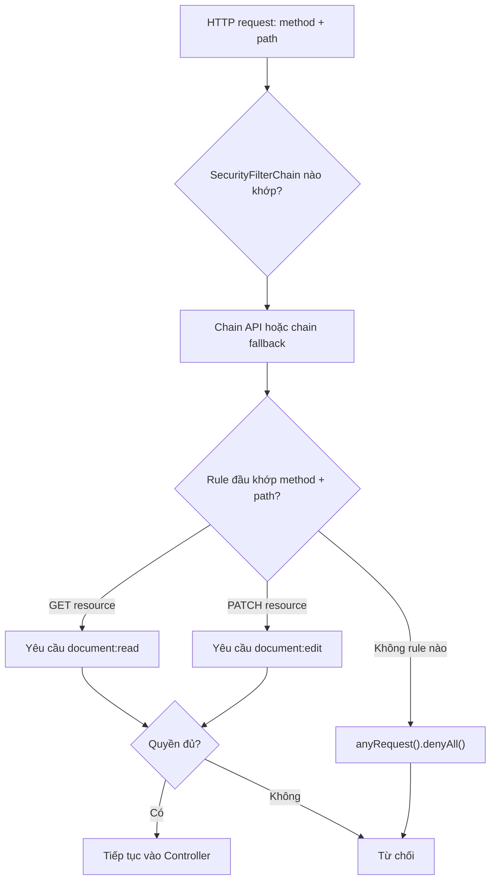

# So khớp đồng thời đường dẫn và HTTP method trong Spring Security

## Mục tiêu học tập

Bài học giúp bạn hiểu `RequestMatcher` trên Servlet stack, phân biệt việc **chọn request** với **quyết định quyền truy cập**, xây dựng rule có **cả HTTP method và path**, tránh trường hợp GET được phép rồi vô tình mở cả PATCH/DELETE, và kiểm thử đầy đủ những HTTP method chưa có chính sách. Bạn sẽ biết khi nào dùng `requestMatchers(HttpMethod.GET, "/api/...")`, cách thứ tự matcher ảnh hưởng kết quả, vai trò của `anyRequest().denyAll()`, sự khác nhau giữa `securityMatcher` và `requestMatchers`, cùng những lưu ý về CORS preflight, CSRF, servlet path và quyền theo đối tượng.

Phạm vi: Spring Security **Servlet/Spring MVC** với `SecurityFilterChain` và `authorizeHttpRequests`. Các snippet Spring là **mã tích hợp phụ thuộc framework**; phần Java 17 độc lập có lệnh `javac` và `java` để trực tiếp minh họa logic mà không cần thư viện khác.

## 1. Vì sao cùng một URL cần nhiều rule?

Một tài nguyên REST có thể hỗ trợ nhiều phương thức HTTP, và mỗi phương thức biểu thị một thao tác:

| Request | Nghiệp vụ giả định | Authority cần có |
| --- | --- | --- |
| `GET /api/documents` | Xem danh sách | `document:list` |
| `POST /api/documents` | Tạo tài liệu | `document:create` |
| `GET /api/documents/42` | Đọc tài liệu 42 | `document:read` |
| `PATCH /api/documents/42` | Sửa một phần | `document:edit` |
| `PUT /api/documents/42` | Thay thế nội dung | `document:edit` |
| `DELETE /api/documents/42` | Xóa tài liệu | `document:delete` |

Nếu chỉ viết:

```java
.requestMatchers("/api/documents/**").authenticated()
```

thì rule không đặt điều kiện HTTP method. Bất kỳ method nào có path khớp pattern cũng có thể vượt **lớp HTTP authorization** chỉ nhờ đã đăng nhập. Controller, CSRF hoặc service vẫn có thể chặn sau đó, nhưng security rule không thể hiện đúng quyền khác nhau theo hành động.

Điều cần diễn đạt là phép **AND**:

```text
Match(request) =
    (request.method = HTTP_METHOD_ĐƯỢC_CHỈ_ĐỊNH)
    AND (request.path khớp PATH_PATTERN)

Authorize(request) =
    Match(request)
    AND người dùng thỏa AUTHORITY/POLICY của rule đó
```

Nhóm đầu tiên quyết định **request chọn rule nào**; nhóm thứ hai quyết định **rule có cho phép hay không**. Không nhầm `RequestMatcher.matches` là một hàm tự xác nhận role/permission.

## 2. RequestMatcher và requestMatchers(HttpMethod, path)

`RequestMatcher` là interface của Spring Security dùng để đối chiếu `HttpServletRequest` với một điều kiện. Khi viết:

```java
.requestMatchers(HttpMethod.GET, "/api/documents/**")
    .hasAuthority("document:read")
```

Spring Security tạo/đăng ký matcher cho **method GET và path** tương ứng, rồi gắn một chính sách yêu cầu authority `document:read`. Với request `GET /api/documents/42`, matcher GET/path có thể khớp; với `PATCH /api/documents/42`, điều kiện method **không khớp** nên Spring tiếp tục xét các rule phía sau.

Bảng cú pháp:

| Cách viết | Điều kiện chọn request |
| --- | --- |
| `requestMatchers("/api/documents/**")` | Path khớp, **không giới hạn method** |
| `requestMatchers(HttpMethod.GET, "/api/documents/**")` | Path khớp **và** HTTP method GET |
| `requestMatchers(HttpMethod.POST, "/api/documents")` | Path collection khớp **và** POST |
| `requestMatchers(HttpMethod.PATCH, "/api/documents/**")` | Path tài nguyên khớp **và** PATCH |
| `requestMatchers(HttpMethod.GET, "/api/documents", "/api/documents/**")` | GET **và** một trong hai path được liệt kê |
| `requestMatchers(customMatcher)` | Theo logic của đối tượng `RequestMatcher` do ứng dụng cung cấp |

Ở dòng nhiều path, điều kiện chính là:

```text
method == GET
AND (pathMatches("/api/documents")
     OR pathMatches("/api/documents/**"))
```

Nhiều path trong một lời gọi là **OR giữa các path**; việc ghép path với method là **AND**. Mỗi path vẫn được đánh giá bằng matcher implementation phù hợp môi trường, không nhất thiết là so sánh chuỗi `equals`.

## 3. Cấu hình một SecurityFilterChain cho các hành động khác nhau

Ví dụ sau có đầy đủ imports cơ bản cho Java/Spring Security 6.x. Nó không tự tạo user store, controller, database hoặc token; ứng dụng phải cung cấp cơ chế xác thực phù hợp.

```java
import org.springframework.context.annotation.Bean;
import org.springframework.context.annotation.Configuration;
import org.springframework.http.HttpMethod;
import org.springframework.security.config.Customizer;
import org.springframework.security.config.annotation.web.builders.HttpSecurity;
import org.springframework.security.web.SecurityFilterChain;

@Configuration
public class SecurityConfig {

    @Bean
    SecurityFilterChain securityFilterChain(HttpSecurity http)
            throws Exception {
        http
            .authorizeHttpRequests(auth -> auth
                // Endpoint health chỉ công khai GET.
                .requestMatchers(HttpMethod.GET, "/health")
                    .permitAll()

                // Collection: list và create có quyền riêng.
                .requestMatchers(HttpMethod.GET, "/api/documents")
                    .hasAuthority("document:list")
                .requestMatchers(HttpMethod.POST, "/api/documents")
                    .hasAuthority("document:create")

                // Resource: method nào, quyền ấy.
                .requestMatchers(HttpMethod.GET, "/api/documents/**")
                    .hasAuthority("document:read")
                .requestMatchers(HttpMethod.PATCH, "/api/documents/**")
                    .hasAuthority("document:edit")
                .requestMatchers(HttpMethod.PUT, "/api/documents/**")
                    .hasAuthority("document:edit")
                .requestMatchers(HttpMethod.DELETE, "/api/documents/**")
                    .hasAuthority("document:delete")

                // Method/path chưa được khai báo không tự mở.
                .anyRequest()
                    .denyAll()
            )
            .httpBasic(Customizer.withDefaults());
        return http.build();
    }
}
```

**Giải thích:**

1. `HttpMethod.GET`, `POST`, `PATCH`, `PUT` và `DELETE` là phần method của matcher; Spring không tự lấy phương thức từ tên authority.
2. Path `/api/documents` là collection, `/api/documents/**` dùng cho resource. Ví dụ nêu tường minh cả hai vì ý nghĩa pattern đối với collection và trailing slash còn phụ thuộc loại matcher/cấu hình.
3. `hasAuthority("document:edit")` so đúng chuỗi được cấp trong `GrantedAuthority`. `ROLE_EDITOR` hoặc `ROLE_ADMIN` **không tự** có `document:edit` trừ khi được cấp/mapping rõ ràng.
4. `anyRequest().denyAll()` là chính sách kết thúc: URL hoặc method chưa có rule bị từ chối ở tầng HTTP.
5. `httpBasic` chỉ minh họa authentication. Với hệ thống dùng form login, session hoặc OAuth2 Bearer phải thay bằng cấu hình đúng; mỗi cơ chế dẫn đến cách trả 401/403/redirect phù hợp.
6. `authorizeHttpRequests` bảo vệ request khi đi qua chain này; quyền owner/tenant của bản ghi vẫn là trách nhiệm thêm của service/repository.

### Bảng quyết định cho từng request

Giả sử người dùng đã đăng nhập đầy đủ nhưng chỉ có authority `document:read`:

| Request | Rule đầu tiên khớp | Kết quả |
| --- | --- | --- |
| `GET /api/documents/42` | GET resource → cần `document:read` | **ALLOW** |
| `PATCH /api/documents/42` | PATCH resource → cần `document:edit` | **DENY** |
| `PUT /api/documents/42` | PUT resource → cần `document:edit` | **DENY** |
| `DELETE /api/documents/42` | DELETE resource → cần `document:delete` | **DENY** |
| `GET /api/documents` | GET collection → cần `document:list` | **DENY** |
| `POST /api/documents` | POST collection → cần `document:create` | **DENY** |
| `GET /health` | GET health → `permitAll` | **ALLOW** |
| `POST /health` | `anyRequest().denyAll()` | **DENY** |
| `GET /admin` | `anyRequest().denyAll()` | **DENY** |

**ALLOW** chỉ nghĩa là vượt qua **HTTP authorization rule** của chain, không bảo đảm 200. Controller có thể không tồn tại, method không hỗ trợ, hoặc service có object-level policy. **DENY** là quyết định phân quyền, chưa chắc mã HTTP cuối cùng luôn là 403: anonymous thường gặp entry point 401/chuyển hướng.

## 4. First match: tại sao thứ tự rule quan trọng?

Spring Security sử dụng **rule đầu tiên có matcher khớp** trong `authorizeHttpRequests`. Sau khi matcher khớp, nếu chính sách trả DENY, framework **không thử tiếp** rule sau để tìm quyền thay thế.

Ví dụ cấu hình **sai**:

```java
.authorizeHttpRequests(auth -> auth
    // Quá rộng: path match mọi method.
    .requestMatchers("/api/documents/**")
        .hasAuthority("document:read")
    .requestMatchers(HttpMethod.DELETE, "/api/documents/**")
        .hasAuthority("document:delete")
    .anyRequest().denyAll()
)
```

Một request `DELETE /api/documents/42` sẽ khớp rule path-only ở phía trước, nên tầng HTTP sẽ **kiểm tra quyền đọc**, không đến rule DELETE phía sau. Người chỉ có `document:read` có thể được cho qua lớp HTTP authorization của DELETE: lỗi phân quyền nghiêm trọng.

**Cách đúng** là chỉ rõ method tương ứng và không đặt matcher path-only quá rộng trước chúng:

```java
.authorizeHttpRequests(auth -> auth
    .requestMatchers(HttpMethod.GET, "/api/documents/**")
        .hasAuthority("document:read")
    .requestMatchers(HttpMethod.DELETE, "/api/documents/**")
        .hasAuthority("document:delete")
    .anyRequest().denyAll()
)
```

Nếu endpoint có rule đặc thù và rule tổng quát cùng method/path, đặt rule **đặc thù trước**. Spring không tự chọn pattern “cụ thể hơn” khi pattern trước đó đã khớp.

### Không dùng matcher trùng nhau để tạo phép OR

```java
// SAI nếu muốn report:read HOẶC report:export.
.requestMatchers(HttpMethod.GET, "/api/reports/**")
    .hasAuthority("report:read")
.requestMatchers(HttpMethod.GET, "/api/reports/**")
    .hasAuthority("report:export")
```

Nếu một request GET khớp cả hai, rule thứ hai không được xét. Viết thành:

```java
.requestMatchers(HttpMethod.GET, "/api/reports/**")
    .hasAnyAuthority("report:read", "report:export")
```

Điều này khác bài toán method+path: **một trong nhiều authority** là phép OR ở lớp quyền, còn “method và path” là phép AND ở lớp chọn request.

## 5. Nhiều path hoặc nhiều method có cùng chính sách

### 5.1. Một method, nhiều đường dẫn

Nếu API cho phép đọc cả collection và resource bằng cùng authority:

```java
.requestMatchers(
    HttpMethod.GET, "/api/documents", "/api/documents/**"
).hasAuthority("document:read")
```

Điều kiện là **GET AND (path A OR path B)**. Chỉ dùng chung khi hai endpoint **thực sự có cùng chính sách**; nếu đọc danh sách nhạy cảm hơn đọc một record, tách rule.

### 5.2. Hai method có cùng quyền

Nếu cả `PUT` và `PATCH` được mở bằng `document:edit`:

```java
.requestMatchers(HttpMethod.PUT, "/api/documents/**")
    .hasAuthority("document:edit")
.requestMatchers(HttpMethod.PATCH, "/api/documents/**")
    .hasAuthority("document:edit")
```

Lặp hai rule method-specific rõ hơn một rule path-only, vì rule path-only có thể mở vô ý GET/DELETE. Thứ tự giữa hai rule này không quan trọng đối với cùng path vì method khác nhau, nhưng vẫn nên nhóm theo tài nguyên để review.

### 5.3. Phương thức chưa định nghĩa

`HEAD`, `OPTIONS`, `TRACE` hoặc HTTP extension method là các giá trị method khác. Không mặc nhiên coi `HEAD` đã được phép vì Spring MVC có thể xử lý HEAD qua GET handler. Ở security matcher `HttpMethod.GET`, method thật của request vẫn là điều kiện cần kiểm tra. Nếu muốn HEAD để lấy header metadata, xác định và khai rule `HttpMethod.HEAD` rõ ràng, test chính sách của header và dữ liệu.

Với endpoint không hỗ trợ DELETE/PUT, dùng `anyRequest().denyAll()` để chặn sớm thay vì chỉ trông chờ MVC trả `405 Method Not Allowed`.

## 6. RequestMatcher khác RequestMapping ở controller

Trong Spring MVC, `@GetMapping` và `@PostMapping` chọn controller method. Trong Spring Security, `RequestMatcher` chọn **authorization rule**.

```java
@GetMapping("/api/documents/{id}")
public DocumentDto getDocument(@PathVariable long id) {
    return documentService.read(id);
}

@DeleteMapping("/api/documents/{id}")
public void deleteDocument(@PathVariable long id) {
    documentService.delete(id);
}
```

Đây là đoạn controller minh họa, không phải file độc lập: `DocumentDto`, `documentService` và imports phải được định nghĩa. Sự tồn tại của `@DeleteMapping` **không tự sinh** rule `hasAuthority("document:delete")`. Ngược lại, một rule security được phép không đảm bảo controller có endpoint; khi không có handler, request có thể qua security rồi trả 404/405.

### Khi method và path không trùng giữa MVC và Security

Một số yếu tố làm kiểm tra trở nên khó: servlet path khác root, context path, trailing slash, URL encoding, tham số dạng `;`, nhiều servlet, reverse proxy và loại `RequestMatcher` mà framework chọn theo dependencies. Do đó:

- Đừng tự xây matcher bằng `request.getRequestURI().startsWith("/api/docs")`: nó còn khớp cả `/api/docs-archive` nếu không kiểm tra segment.
- Ưu tiên `requestMatchers(HttpMethod, String...)` với path đã kiểm chứng.
- Với ứng dụng có nhiều servlet, servlet path tùy biến hoặc URL pattern phức tạp, dùng matcher/builder phù hợp đúng phiên bản framework và kiểm thử đường thật.
- Không dựa vào so khớp URL thủ công để xác nhận quyền trên đối tượng dữ liệu.

## 7. Hai cấp RequestMatcher: chọn chain và chọn authorization rule

`http.securityMatcher(...)` chọn **phạm vi của cả `SecurityFilterChain`**. `requestMatchers(...)` trong `authorizeHttpRequests` chọn **rule quyền bên trong chain đã được chọn**.



Khi có nhiều chain, `FilterChainProxy` chỉ dùng **chain đầu tiên khớp** theo thứ tự ưu tiên. Chain sau không được thử nếu chain đầu đã chọn request nhưng rule authorization bên trong từ chối.

Ví dụ:

```java
http
    .securityMatcher("/api/**")
    .authorizeHttpRequests(auth -> auth
        .requestMatchers(HttpMethod.GET, "/api/public/**")
            .permitAll()
        .requestMatchers(HttpMethod.POST, "/api/documents")
            .hasAuthority("document:create")
        .anyRequest().denyAll()
    );
```

Ở đây `anyRequest` chỉ bắt request còn lại **bên trong phạm vi `/api/**`**. Nó không tự bảo vệ `/admin` hay `/internal` nằm ngoài matcher của chain. Nếu **không có chain khác** khớp, URL đó có thể bỏ qua Spring Security. Trong hệ thống nhiều chain, hãy có fallback chain phù hợp hoặc bảo đảm một cơ chế tương đương bảo vệ những đường còn lại.

### Ví dụ nhiều chain có fallback

```java
import org.springframework.context.annotation.Bean;
import org.springframework.context.annotation.Configuration;
import org.springframework.core.annotation.Order;
import org.springframework.http.HttpMethod;
import org.springframework.security.config.Customizer;
import org.springframework.security.config.annotation.web.builders.HttpSecurity;
import org.springframework.security.web.SecurityFilterChain;

@Configuration
public class MultipleChainsConfig {

    @Bean
    @Order(1)
    SecurityFilterChain api(HttpSecurity http) throws Exception {
        http
            .securityMatcher("/api/**")
            .authorizeHttpRequests(auth -> auth
                .requestMatchers(HttpMethod.GET, "/api/status")
                    .permitAll()
                .requestMatchers(HttpMethod.GET, "/api/documents/**")
                    .hasAuthority("document:read")
                .requestMatchers(HttpMethod.POST, "/api/documents")
                    .hasAuthority("document:create")
                .anyRequest().denyAll()
            )
            .httpBasic(Customizer.withDefaults());
        return http.build();
    }

    @Bean
    @Order(2)
    SecurityFilterChain fallback(HttpSecurity http) throws Exception {
        http
            .authorizeHttpRequests(auth -> auth
                .requestMatchers(HttpMethod.GET, "/health").permitAll()
                .anyRequest().denyAll()
            )
            .httpBasic(Customizer.withDefaults());
        return http.build();
    }
}
```

Trong ví dụ, `GET /api/documents/42` đi vào chain API; `DELETE /api/documents/42` cũng vào chain API nhưng bị `denyAll`; `GET /health` đi vào fallback chain. **Không có cộng dồn quyền** giữa hai chain. Ví dụ không tạo users/controllers và không phải ứng dụng độc lập.

## 8. CORS preflight: OPTIONS không phải POST

Khi một browser frontend khác origin muốn gửi POST JSON, nó có thể gửi request preflight:

```http
OPTIONS /api/documents
Origin: https://client.example
Access-Control-Request-Method: POST
Access-Control-Request-Headers: Content-Type, Authorization
```

Method thực tế của request preflight là **OPTIONS**, mặc dù header `Access-Control-Request-Method` ghi POST. Do đó:

```java
.requestMatchers(HttpMethod.POST, "/api/documents")
    .hasAuthority("document:create")
```

**không khớp** OPTIONS. Điều này là đúng, không phải bug của `RequestMatcher`.

CORS cần được xử lý **trước khi các cơ chế authentication thông thường chặn preflight**, vì preflight thường không có session cookie. Spring Security hỗ trợ tích hợp `.cors(Customizer.withDefaults())` khi ứng dụng khai báo `CorsConfigurationSource`/cấu hình Spring MVC phù hợp:

```java
http
    .cors(Customizer.withDefaults())
    .authorizeHttpRequests(auth -> auth
        .requestMatchers(HttpMethod.POST, "/api/documents")
            .hasAuthority("document:create")
        .anyRequest().denyAll()
    );
```

**Đây là snippet cấu hình**, không tạo sẵn chính sách CORS: ứng dụng vẫn phải giới hạn allowed origins, allowed methods/headers, credentials. Không tự `permitAll` mọi `OPTIONS /**` cho mọi origin mà không hiểu hậu quả. CORS preflight được cho qua **không cấp quyền** cho POST thật; POST tiếp theo vẫn cần authentication, authorization và CSRF khi áp dụng.

### CSRF cũng có thể gây 403 trước authorization

Với request thay đổi trạng thái và CSRF protection đang bật, `POST`/`PATCH`/`DELETE` thiếu CSRF token có thể bị `CsrfFilter` chặn **trước khi method+path authorization diễn ra**. Khi thử rule PATCH, phải đưa token CSRF hợp lệ vào MockMvc bằng `.with(csrf())` nếu ứng dụng yêu cầu; nếu không, kết quả 403 chưa chứng minh `document:edit` đã được kiểm tra.

## 9. Phân quyền HTTP chưa thay thế quyền trên từng đối tượng

`GET /api/documents/42` khớp rule GET/path và người dùng có `document:read` chỉ chứng minh **quyền vào chức năng đọc**. Vẫn phải xác định họ có được xem **tài liệu 42** hay không:

- Tài liệu thuộc tenant nào?
- Người yêu cầu là owner hay được chia sẻ?
- Trạng thái tài liệu có cho phép đọc/sửa?
- Có ràng buộc classification, thời gian hoặc môi trường?

Vì vậy ngoài `RequestMatcher` và `hasAuthority` ở HTTP, cần kiểm tra ở service/repository bằng policy phù hợp. Có thể dùng `@PreAuthorize` trên Spring-managed service:

```java
// Snippet tích hợp; documentPolicy và repository là bean domain riêng.
@PreAuthorize(
    "hasAuthority('document:read') and " +
    "@documentPolicy.canRead(authentication, #id)"
)
public Document read(@P("id") long id) {
    return repository.findById(id).orElseThrow();
}
```

Cần bật `@EnableMethodSecurity`; `@P` thuộc `org.springframework.security.access.method.P`. `documentPolicy` phải lấy tenant/owner từ server và danh tính từ authentication đã kiểm chứng, không từ `ownerId` client tự gửi. Đối với lệnh ghi, ngoài kiểm tra trước side effect còn cân nhắc cập nhật có điều kiện/locking để tránh quyền bị đổi giữa lúc kiểm tra và lúc ghi.

## 10. Java 17 độc lập: minh họa method AND path

Ví dụ sau chỉ mô phỏng **logic chọn rule đầu tiên** và **mỗi method có quyền riêng**, không dùng Spring. Dùng `Set<String>` đại diện GrantedAuthority, `Predicate` đại diện matcher và policy. Nó không thay cho URL/path matching đã chuẩn hóa của Spring Security; tuyệt đối không sao chép `startsWith` đơn giản này vào security production.

Lưu đúng tên tệp **`MethodPathMatchDemo.java`**:

```java
import java.util.List;
import java.util.Set;
import java.util.function.Predicate;

public class MethodPathMatchDemo {

    record Request(String method, String path, Set<String> authorities) {}

    record Rule(
        String name,
        Predicate<Request> matcher,
        Predicate<Request> permission
    ) {}

    static String decide(Request request, List<Rule> rules) {
        for (Rule rule : rules) {
            if (rule.matcher().test(request)) {
                return rule.name() + " -> "
                    + (rule.permission().test(request) ? "ALLOW" : "DENY");
            }
        }
        return "NO_RULE -> DENY";
    }

    public static void main(String[] args) {
        List<Rule> rules = List.of(
            new Rule(
                "GET document",
                r -> r.method().equals("GET")
                    && r.path().startsWith("/api/documents/"),
                r -> r.authorities().contains("document:read")
            ),
            new Rule(
                "PATCH document",
                r -> r.method().equals("PATCH")
                    && r.path().startsWith("/api/documents/"),
                r -> r.authorities().contains("document:edit")
            ),
            new Rule(
                "DELETE document",
                r -> r.method().equals("DELETE")
                    && r.path().startsWith("/api/documents/"),
                r -> r.authorities().contains("document:delete")
            ),
            new Rule(
                "POST collection",
                r -> r.method().equals("POST")
                    && r.path().equals("/api/documents"),
                r -> r.authorities().contains("document:create")
            ),
            new Rule("anyRequest", r -> true, r -> false)
        );

        System.out.println(decide(
            new Request("GET", "/api/documents/42",
                Set.of("document:read")), rules));
        System.out.println(decide(
            new Request("PATCH", "/api/documents/42",
                Set.of("document:read")), rules));
        System.out.println(decide(
            new Request("PATCH", "/api/documents/42",
                Set.of("document:edit")), rules));
        System.out.println(decide(
            new Request("DELETE", "/api/documents/42",
                Set.of("document:read")), rules));
        System.out.println(decide(
            new Request("POST", "/api/documents",
                Set.of("document:create")), rules));
        System.out.println(decide(
            new Request("PUT", "/api/documents/42",
                Set.of("document:read", "document:edit")), rules));
    }
}
```

Biên dịch và chạy trên JDK 17+:

```bash
javac MethodPathMatchDemo.java
java MethodPathMatchDemo
```

**Stdout chính xác:**

```text
GET document -> ALLOW
PATCH document -> DENY
PATCH document -> ALLOW
DELETE document -> DENY
POST collection -> ALLOW
anyRequest -> DENY
```

Kết quả cho thấy `PATCH` chọn rule PATCH, không được dùng `document:read` của GET. `PUT` chưa được khai rule nên `anyRequest` từ chối dù có quyền edit. Chương trình giả lập **không biết Spring MVC route, servlet path, CSRF hay CORS**; nhiệm vụ của nó là làm rõ method+path+policy cùng với first-match.

## 11. Test bằng MockMvc và spring-security-test

Một test đúng cần chứng minh cả **same path, different method** và **same method, different path**. Đừng chỉ kiểm tra GET thành công rồi suy ra PATCH/DELETE đã được bảo vệ.

| Tình huống | Kết quả tầng HTTP cần có |
| --- | --- |
| `GET /api/documents/42`, có `document:read` | Qua rule GET |
| `GET /api/documents/42`, chỉ có `document:edit` | DENY |
| `PATCH /api/documents/42`, có `document:edit` | Qua rule PATCH |
| `PATCH /api/documents/42`, chỉ có `document:read` | DENY |
| `DELETE /api/documents/42`, chỉ có `document:read` | DENY |
| `DELETE /api/documents/42`, có `document:delete` | Qua rule DELETE |
| `GET /api/documents`, chỉ có `document:read` | DENY vì collection cần `document:list` |
| `POST /api/documents`, có `document:create` | Qua rule POST |
| `POST /api/documents`, chỉ có `document:read` | DENY |
| `PUT /api/documents/42`, có `document:edit` | Qua rule PUT nếu được khai; nếu chưa thì fallback DENY |
| `HEAD /api/documents/42` nếu chưa mở | Không tự hưởng GET |
| `POST /health`, đã đăng nhập | DENY do chỉ mở GET |
| `GET /api/new`, có `ROLE_ADMIN` nhưng chưa có rule | DENY nhờ `anyRequest` |
| `OPTIONS /api/documents` preflight | Xử lý CORS riêng, không xem là POST |

### Snippet test các trường hợp bị từ chối

Mẫu sau cần `spring-security-test`, JUnit 5 và Spring Boot test. Đây là đoạn test tích hợp, không phải Java độc lập. Dùng cấu hình ở phần 3 và một `MockMvc` đã cấu hình Spring Security:

```java
import org.junit.jupiter.api.Test;
import org.springframework.beans.factory.annotation.Autowired;
import org.springframework.boot.test.autoconfigure.web.servlet.AutoConfigureMockMvc;
import org.springframework.boot.test.context.SpringBootTest;
import org.springframework.test.web.servlet.MockMvc;
import org.springframework.security.core.authority.SimpleGrantedAuthority;

import static org.springframework.security.test.web.servlet.request
    .SecurityMockMvcRequestPostProcessors.user;
import static org.springframework.security.test.web.servlet.request
    .SecurityMockMvcRequestPostProcessors.csrf;
import static org.springframework.test.web.servlet.request
    .MockMvcRequestBuilders.*;
import static org.springframework.test.web.servlet.result
    .MockMvcResultMatchers.status;

@SpringBootTest
@AutoConfigureMockMvc
class MethodPathAuthorizationTest {
    @Autowired MockMvc mvc;

    @Test
    void readerCannotPatch() throws Exception {
        mvc.perform(patch("/api/documents/42")
                .with(user("alice").authorities(
                    new SimpleGrantedAuthority("document:read")))
                .with(csrf()))
            .andExpect(status().isForbidden());
    }

    @Test
    void readerCannotDelete() throws Exception {
        mvc.perform(delete("/api/documents/42")
                .with(user("alice").authorities(
                    new SimpleGrantedAuthority("document:read")))
                .with(csrf()))
            .andExpect(status().isForbidden());
    }

    @Test
    void readerCannotListWithoutListPermission() throws Exception {
        mvc.perform(get("/api/documents")
                .with(user("alice").authorities(
                    new SimpleGrantedAuthority("document:read"))))
            .andExpect(status().isForbidden());
    }

    @Test
    void unknownRouteDeniedEvenForAdmin() throws Exception {
        mvc.perform(get("/api/unknown")
                .with(user("admin").roles("ADMIN")))
            .andExpect(status().isForbidden());
    }
}
```

`.with(csrf())` làm giảm nguy cơ test PATCH/DELETE thất bại chỉ vì thiếu CSRF token; lúc đó mới xác minh quyền đúng. Nếu dùng OAuth2 stateless hoặc CSRF được cấu hình khác, hãy áp logic test phù hợp. Các trường hợp **qua rule HTTP** không tự bảo đảm 200 nếu controller không có hoặc service từ chối; khi test ALLOW, chuẩn bị controller/data hoặc assert decision tại lớp phù hợp.

### Khi xuất hiện 401, 403, 404, 405

- **401:** thông thường là anonymous/credentials không hợp lệ với cơ chế entry point Basic/Bearer.
- **403:** thường là user đã xác thực nhưng thiếu authority; cũng có thể do CSRF hoặc quyền object-level.
- **404:** không có controller/resource, hoặc API chủ động che sự tồn tại tài nguyên ngoài quyền.
- **405:** MVC biết path nhưng không có handler cho method; tuy nhiên Spring Security có thể từ chối trước, nên chưa chắc gặp 405.

Không đánh giá tính đúng đắn của matcher chỉ qua một status nếu chưa xác định tầng gây lỗi.

## 12. Các lỗi thường gặp

1. **Dùng path-only cho mọi method:** quyền đọc có thể mở PATCH/DELETE. Dùng `HttpMethod` trong rule.
2. **Đặt matcher rộng lên trước matcher hẹp:** first-match che rule method-specific ở phía sau.
3. **Cho rằng rule bị DENY sẽ chuyển sang rule kế tiếp:** Spring sử dụng rule đầu tiên khớp; không thử lại để tìm ALLOW.
4. **Dùng nhiều matcher trùng nhau để biểu diễn OR quyền:** dùng `hasAnyAuthority` trong một rule khi chính sách cho phép.
5. **Không phân biệt collection và resource:** `/api/documents` và `/api/documents/42` có thể cần quyền khác và khác nhau về pattern matching.
6. **Mặc định GET bao luôn HEAD ở Security:** method của request là dữ liệu độc lập; khai HEAD nếu cần.
7. **Mở OPTIONS bừa bãi:** xử lý CORS preflight với origin/method/header policy được review.
8. **Thấy 403 ở PATCH rồi cấp thêm quyền:** kiểm tra CSRF trước; 403 không đồng nghĩa matcher sai.
9. **Viết path matcher bằng `startsWith`:** có thể khớp nhầm path gần giống và không xét URL normalization.
10. **Nhầm `securityMatcher` với `requestMatchers`:** một cái chọn filter chain, một cái chọn rule authorization bên trong.
11. **Chỉ test method GET:** thêm test PATCH/PUT/DELETE, path khác và các method không hỗ trợ.
12. **Bỏ fallback `denyAll`:** endpoint/method mới có thể được cấp quyền ngoài ý muốn nếu rule quá rộng.
13. **Coi HTTP authority là toàn bộ quyền dữ liệu:** vẫn cần kiểm tra owner, tenant, ACL và trạng thái tài nguyên.
14. **Chỉ test status mà không test side effect:** thao tác bị từ chối phải không tạo cập nhật DB.
15. **Không kiểm tra security chain với URL ngoài scope:** có thể bỏ qua hoàn toàn filter chain khi không chain nào khớp.

## 13. Checklist triển khai

1. Liệt kê **HTTP method + path + hành động nghiệp vụ + authority** cho từng endpoint.
2. Dùng `requestMatchers(HttpMethod, path)` thay vì path-only khi quyền khác nhau theo method.
3. Khai rule collection và resource riêng nếu quyền hoặc semantics khác; kiểm thử actual matcher.
4. Đặt rule cụ thể trước rule rộng, dùng `anyRequest().denyAll()` làm lựa chọn mặc định từ chối.
5. Phân biệt `securityMatcher` của `SecurityFilterChain` với `requestMatchers` trong `authorizeHttpRequests`; bảo vệ cả URL ngoài chain chuyên biệt.
6. Kiểm tra GET, HEAD, OPTIONS, POST, PUT, PATCH, DELETE theo nhu cầu; không mặc nhiên kế thừa quyền giữa các method.
7. Tích hợp CORS preflight đúng cách; cấu hình CSRF theo cơ chế cookie/token và thử token trong test.
8. Bảo vệ bản ghi ở service/query bằng owner/tenant/ACL, không chỉ chặn URL.
9. Viết test ALLOW/DENY cho cùng path/method khác, path khác/method giống, fallback, anonymous và full; khẳng định bị từ chối không gây side effect.

### Tự kiểm tra

**Câu 1.** Alice chỉ có `document:read`. `GET /api/documents/42` và `DELETE /api/documents/42` có cùng path. Nếu rule GET cần `document:read` và DELETE cần `document:delete`, Alice có được DELETE không?

**Đáp án:** **Không.** Matcher DELETE chọn policy riêng, không thỏa quyền delete.

**Câu 2.** Nếu đưa `requestMatchers("/api/documents/**").hasAuthority("document:read")` lên trước rule DELETE thì chuyện gì xảy ra?

**Đáp án:** Path-only rule có thể khớp DELETE trước, khiến tầng HTTP kiểm tra quyền đọc thay cho quyền xóa. Đây là lỗi do matcher quá rộng và first-match.

**Câu 3.** Browser gửi `OPTIONS /api/documents` với `Access-Control-Request-Method: POST`; rule `requestMatchers(HttpMethod.POST, "/api/documents")` có khớp không?

**Đáp án:** **Không.** Method thực vẫn là OPTIONS. CORS preflight phải có cấu hình tương ứng.

**Câu 4.** Chain được giới hạn bằng `securityMatcher("/api/**")`. Rule `anyRequest().denyAll()` trong chain đó có chắc bảo vệ `/admin` không?

**Đáp án:** **Không.** `/admin` nằm ngoài chain; cần fallback chain hoặc giải pháp bảo vệ khác.

## Tài liệu tham khảo

- Spring Security, *Authorize HttpServletRequests*: https://docs.spring.io/spring-security/reference/servlet/authorization/authorize-http-requests.html
- Spring Security, *Java Configuration: securityMatcher vs requestMatchers*: https://docs.spring.io/spring-security/reference/servlet/configuration/java.html
- Spring Security, *Servlet CORS integration*: https://docs.spring.io/spring-security/reference/servlet/integrations/cors.html
- Spring Security, *Servlet CSRF*: https://docs.spring.io/spring-security/reference/servlet/exploits/csrf.html
- Spring Security, *Servlet Testing*: https://docs.spring.io/spring-security/reference/servlet/test/index.html
