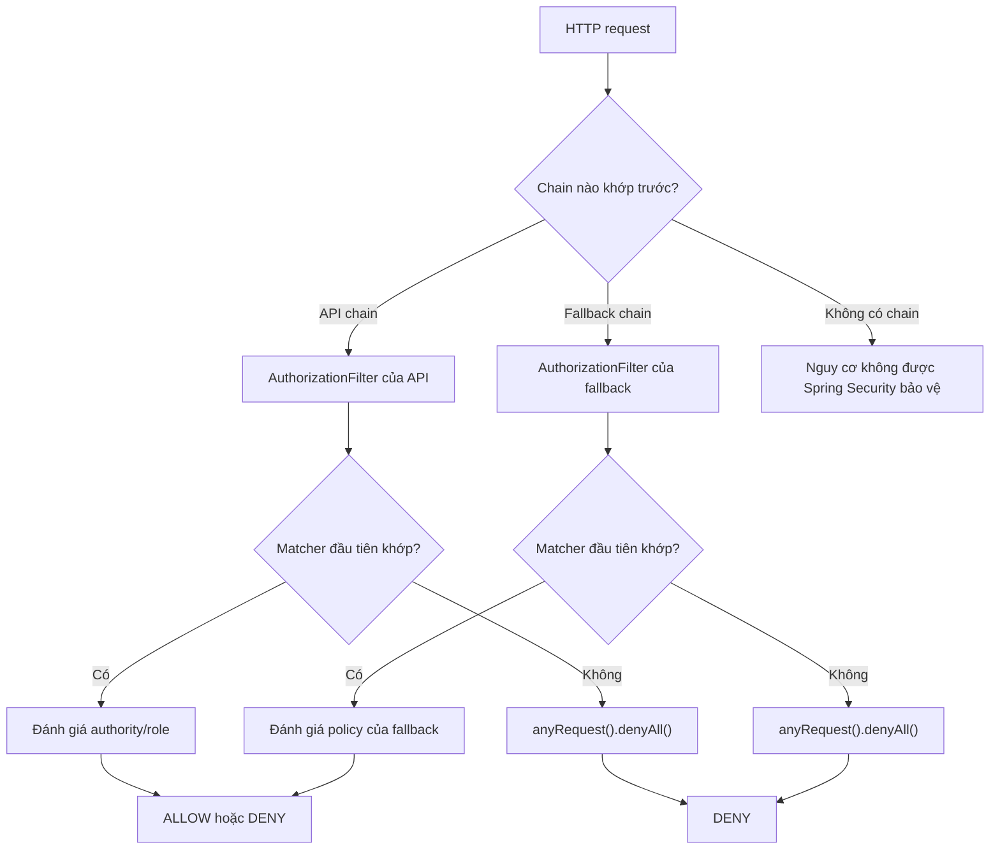

# Kiểm thử RequestMatcher khi thay đổi route hoặc nâng phiên bản Spring Security

## Mục tiêu bài học

Một thay đổi route, HTTP method, servlet path hoặc phiên bản Spring Security có thể làm URL **trước đây được bảo vệ** bị đánh giá bằng một matcher khác. Lỗi nguy hiểm nhất không chỉ là request hợp lệ bị từ chối, mà là request **phải từ chối lại được phép** khi matcher rộng, chọn nhầm `SecurityFilterChain` hoặc quy tắc path thay đổi.

Bài học này trình bày cách lập **hợp đồng kiểm thử RequestMatcher**, kiểm thử các request được phép và bị từ chối qua `MockMvc`, đánh giá matcher đơn lẻ, bảo vệ khi đổi route hoặc nâng từ Spring Security 6.x lên 7.x, và tổ chức kiểm thử hồi quy trong CI.

Bối cảnh: **Spring Security authorization trên Servlet stack**, sử dụng `SecurityFilterChain`, `authorizeHttpRequests`, `AuthorizationFilter`, `RequestMatcher` và `spring-security-test`. Code Spring là **mã tích hợp cần dependency/framework**; ví dụ Java 17 độc lập ở phần 13 chạy được bằng `javac`/`java` mà không cần Spring.

## 1. Lý do phải có regression tests cho matcher

Giả sử hệ thống có hợp đồng:

```text
GET   /health                 → public
GET   /api/reports            → report:list
GET   /api/reports/{id}       → report:read
POST  /api/reports            → report:create
PATCH /api/reports/{id}       → report:edit
mọi request còn lại           → denyAll
```

Các thay đổi tưởng như không đụng tới quyền vẫn có thể tạo hồi quy:

| Thay đổi | Nguy cơ bảo mật |
| --- | --- |
| Đổi `/api/reports/{id}` thành `/api/v2/reports/{id}` | Matcher cũ không bao route mới; có thể bị từ chối hoặc vô tình đi qua rule rộng |
| Đưa `requestMatchers("/api/**").authenticated()` lên trước rule quyền cụ thể | Người chỉ đăng nhập có thể qua rule rộng thay vì kiểm tra `report:edit` |
| Mở thêm `DELETE` tại một URL đã có GET | Matcher path-only có thể cho DELETE bằng quyền GET |
| Thay `AntPathRequestMatcher`/`MvcRequestMatcher` bằng `PathPatternRequestMatcher` | Cú pháp pattern, servlet path và ngữ nghĩa match có thể thay đổi |
| Dùng context path mới `/app` | Matcher được dựng sai đường dẫn cần kiểm tra |
| Thêm servlet prefix `/mvc` | URL trong application khác đường dẫn mà matcher được cấu hình |
| Thay reverse proxy rewrite/URL encoding | Security và controller có thể nhìn thấy những dạng path khác nhau |
| Thêm filter chain ưu tiên cao hơn | Một URL có thể vào chain khác hoặc nằm ngoài mọi chain |

Một test duy nhất “GET tài liệu 42 trả 200” không kiểm soát được những rủi ro này. Cần kiểm thử **tập request được phép lẫn tập request bị chặn**, bao gồm các path gần giống và method chưa khai báo.

## 2. Hai tầng matching cần quan sát

`FilterChainProxy` trước tiên dùng `securityMatcher` để chọn **`SecurityFilterChain` khớp đầu tiên** theo thứ tự. Bên trong chain được chọn, `AuthorizationFilter` sử dụng các `requestMatchers` khai báo trong `authorizeHttpRequests` và áp dụng **authorization rule khớp đầu tiên**.



Lưu ý:

- `RequestMatcher.matches(request)` chỉ trả lời **request có khớp điều kiện không**. Nó không tự đánh giá role/authority.
- Nếu một rule **đã khớp** mà kết quả authorization là DENY, Spring **không thử rule sau** để tìm ALLOW.
- `anyRequest().denyAll()` bên trong một chain **không bảo vệ URL ngoài `securityMatcher` của chain đó**.
- Được phép qua HTTP authorization vẫn có thể bị CSRF, method security, policy owner/tenant hoặc controller chặn.

### Mã đúng và lỗi phổ biến

```java
// ĐÚNG: method và path cụ thể trước; fallback deny.
http.authorizeHttpRequests(auth -> auth
    .requestMatchers(HttpMethod.GET, "/api/reports/{id}")
        .hasAuthority("report:read")
    .requestMatchers(HttpMethod.PATCH, "/api/reports/{id}")
        .hasAuthority("report:edit")
    .anyRequest().denyAll()
);
```

```java
// SAI: path-only matcher đứng trước rule PATCH.
http.authorizeHttpRequests(auth -> auth
    .requestMatchers("/api/reports/**")
        .hasAuthority("report:read")
    .requestMatchers(HttpMethod.PATCH, "/api/reports/{id}")
        .hasAuthority("report:edit")
    .anyRequest().denyAll()
);
```

Ở cấu hình sai, `PATCH /api/reports/42` có thể khớp rule path-only đầu tiên. Người chỉ có `report:read` có thể vượt qua **lớp HTTP authorization** thay vì cần `report:edit`. Kiểm thử matcher phải bắt được trường hợp này.

## 3. Chốt hợp đồng kiểm thử trước khi thay code

Mỗi dòng trong bộ test cần có: HTTP method, URL, authorities, trạng thái xác thực, **quyết định quyền dự kiến** và điều kiện đặc biệt về servlet/context path nếu có. Ví dụ:

| ID | Request | Authorities | Quyết định HTTP mong muốn |
| --- | --- | --- | --- |
| A01 | `GET /health` | Không có | ALLOW, public |
| A02 | `GET /api/reports` | `report:list` | ALLOW |
| D03 | `GET /api/reports` | Chỉ `report:read` | DENY |
| A04 | `GET /api/reports/42` | `report:read` | ALLOW |
| D05 | `GET /api/reports/42` | Chỉ `report:list` | DENY |
| A06 | `POST /api/reports` | `report:create` | ALLOW khi CSRF thỏa nếu áp dụng |
| D07 | `POST /api/reports` | Chỉ `report:read` | DENY |
| A08 | `PATCH /api/reports/42` | `report:edit` | ALLOW khi CSRF thỏa |
| D09 | `PATCH /api/reports/42` | Chỉ `report:read` | DENY |
| D10 | `DELETE /api/reports/42` | `ROLE_ADMIN` nhưng không có rule DELETE | DENY bởi fallback |
| D11 | `GET /api/reports/42/export` | `report:read` | DENY: thêm segment nhạy cảm |
| D12 | `GET /api/reports-old/42` | `report:read` | DENY: path gần giống |
| D13 | `GET /api/new-feature` | `ROLE_ADMIN` | DENY nếu chưa whitelist |
| D14 | `POST /health` | Đã đăng nhập | DENY |
| D15 | `GET /api/reports/42` | Anonymous | Không qua yêu cầu authority |
| V16 | `GET /app/api/reports/42`, context root `/app` | `report:read` | ALLOW sau khi bỏ context root đúng |
| V17 | `GET /api/reports/42/` | `report:read` | Chốt theo chính sách slash của ứng dụng |
| V18 | `HEAD /api/reports/42` | `report:read` | Không tự suy ra từ quyền GET |
| V19 | `OPTIONS /api/reports` preflight | Không có cookie | Kiểm tra theo CORS policy riêng |

Nhóm A phải được phép; nhóm D phải bị từ chối; nhóm V cần **quyết định rõ theo hợp đồng sản phẩm** trước khi nâng version. Không để framework mới tự quyết định liệu path có dấu slash cuối hoặc chữ hoa có thể được phép.

**Không đồng nhất quyết định ALLOW với HTTP 200:** controller không tồn tại có thể trả 404, method không hỗ trợ có thể trả 405. Ngược lại, HTTP 403 có thể do CSRF chứ không phải matcher. Test nên kết hợp response, controller output và bằng chứng service không được gọi khi DENY.

## 4. Cấu hình Spring Security dùng làm test fixture

Đây là cấu hình Java kiểu Spring Boot 3.x / Spring Security 6.x, sử dụng DSL cũng quen thuộc trên những phiên bản mới. Ví dụ cần `spring-security-config`, `spring-security-web`, Spring MVC, cùng application context; không biên dịch độc lập bằng JDK thuần.

```java
import org.springframework.context.annotation.Bean;
import org.springframework.context.annotation.Configuration;
import org.springframework.http.HttpMethod;
import org.springframework.security.config.Customizer;
import org.springframework.security.config.annotation.web.builders.HttpSecurity;
import org.springframework.security.web.SecurityFilterChain;

@Configuration
public class SecurityConfig {

    @Bean
    SecurityFilterChain securityFilterChain(HttpSecurity http)
            throws Exception {
        http
            .authorizeHttpRequests(auth -> auth
                .requestMatchers(HttpMethod.GET, "/health")
                    .permitAll()
                .requestMatchers(HttpMethod.GET, "/api/reports")
                    .hasAuthority("report:list")
                .requestMatchers(HttpMethod.GET, "/api/reports/{id}")
                    .hasAuthority("report:read")
                .requestMatchers(HttpMethod.POST, "/api/reports")
                    .hasAuthority("report:create")
                .requestMatchers(HttpMethod.PATCH, "/api/reports/{id}")
                    .hasAuthority("report:edit")
                .anyRequest().denyAll()
            )
            .httpBasic(Customizer.withDefaults());
        return http.build();
    }
}
```

Giải thích:

- `requestMatchers(HttpMethod.GET, "/api/reports/{id}")` yêu cầu **đồng thời method GET và path khớp pattern**.
- `hasAuthority` kiểm tra đúng chuỗi `GrantedAuthority`. `ROLE_ADMIN` không tự trở thành `report:edit` khi ứng dụng chưa mapping.
- `anyRequest().denyAll()` bắt mọi route/method còn lại **trong chain này**.
- `httpBasic` minh họa authentication entry point và có thể tạo 401 cho anonymous. `spring-security-test` có thể tạo mock authenticated principal mà không cần user/password thật.
- Với POST/PATCH/DELETE, CSRF có thể còn tác động. Không vô hiệu hóa CSRF máy móc chỉ để test qua.

### Controller giả lập để phân biệt “qua Security” và “có handler”

```java
import org.springframework.web.bind.annotation.GetMapping;
import org.springframework.web.bind.annotation.PatchMapping;
import org.springframework.web.bind.annotation.PathVariable;
import org.springframework.web.bind.annotation.PostMapping;
import org.springframework.web.bind.annotation.RestController;

@RestController
public class ReportController {

    @GetMapping("/health")
    public String health() {
        return "ok";
    }

    @GetMapping("/api/reports")
    public String list() {
        return "list";
    }

    @GetMapping("/api/reports/{id}")
    public String read(@PathVariable String id) {
        return "report:" + id;
    }

    @PostMapping("/api/reports")
    public String create() {
        return "created";
    }

    @PatchMapping("/api/reports/{id}")
    public String edit(@PathVariable String id) {
        return "edited:" + id;
    }
}
```

Fixture không dùng database và không mô phỏng chính sách owner/tenant. Giá trị string cho phép test xác nhận request **thực sự đã tới controller** khi được cấp quyền.

## 5. Kiểm thử tích hợp với MockMvc

Để test authorization thật, phải gắn `FilterChainProxy` với `MockMvc`. Trong Spring Boot 3.x, `@SpringBootTest` và `@AutoConfigureMockMvc` thường cấu hình chain. Nếu tự dựng bằng `MockMvcBuilders.webAppContextSetup(...)`, phải gọi `.apply(springSecurity())` để hỗ trợ filters và test security context.

Ví dụ test sau dựa vào `SecurityConfig` và `ReportController` ở trên. Phần import `@AutoConfigureMockMvc` có thể đổi package ở Spring Boot major version mới: khi nâng lên Boot 4/Spring Security 7, điều chỉnh theo BOM/test docs tương ứng, không sao chép imports của Boot 3 mà không kiểm chứng.

```java
import org.junit.jupiter.api.Test;
import org.springframework.beans.factory.annotation.Autowired;
import org.springframework.boot.test.autoconfigure.web.servlet.AutoConfigureMockMvc;
import org.springframework.boot.test.context.SpringBootTest;
import org.springframework.security.core.authority.SimpleGrantedAuthority;
import org.springframework.test.web.servlet.MockMvc;

import static org.springframework.security.test.web.servlet.request
    .SecurityMockMvcRequestPostProcessors.csrf;
import static org.springframework.security.test.web.servlet.request
    .SecurityMockMvcRequestPostProcessors.user;
import static org.springframework.test.web.servlet.request
    .MockMvcRequestBuilders.get;
import static org.springframework.test.web.servlet.request
    .MockMvcRequestBuilders.patch;
import static org.springframework.test.web.servlet.request
    .MockMvcRequestBuilders.post;
import static org.springframework.test.web.servlet.result
    .MockMvcResultMatchers.content;
import static org.springframework.test.web.servlet.result
    .MockMvcResultMatchers.status;

@SpringBootTest
@AutoConfigureMockMvc
class MatcherContractTest {

    @Autowired MockMvc mvc;

    @Test
    void healthIsPublic() throws Exception {
        mvc.perform(get("/health"))
            .andExpect(status().isOk())
            .andExpect(content().string("ok"));
    }

    @Test
    void readerCanReadOneReport() throws Exception {
        mvc.perform(get("/api/reports/42")
                .with(user("alice").authorities(
                    new SimpleGrantedAuthority("report:read"))))
            .andExpect(status().isOk())
            .andExpect(content().string("report:42"));
    }

    @Test
    void listAuthorityDoesNotGrantReadingOneReport() throws Exception {
        mvc.perform(get("/api/reports/42")
                .with(user("bob").authorities(
                    new SimpleGrantedAuthority("report:list"))))
            .andExpect(status().isForbidden());
    }

    @Test
    void readerCannotPatchSamePath() throws Exception {
        mvc.perform(patch("/api/reports/42")
                .with(user("alice").authorities(
                    new SimpleGrantedAuthority("report:read")))
                .with(csrf()))
            .andExpect(status().isForbidden());
    }

    @Test
    void editorCanPatchSamePath() throws Exception {
        mvc.perform(patch("/api/reports/42")
                .with(user("editor").authorities(
                    new SimpleGrantedAuthority("report:edit")))
                .with(csrf()))
            .andExpect(status().isOk())
            .andExpect(content().string("edited:42"));
    }

    @Test
    void creatorCanPostCollection() throws Exception {
        mvc.perform(post("/api/reports")
                .with(user("writer").authorities(
                    new SimpleGrantedAuthority("report:create")))
                .with(csrf()))
            .andExpect(status().isOk())
            .andExpect(content().string("created"));
    }

    @Test
    void unknownExtraSegmentIsDenied() throws Exception {
        mvc.perform(get("/api/reports/42/export")
                .with(user("reader").authorities(
                    new SimpleGrantedAuthority("report:read"))))
            .andExpect(status().isForbidden());
    }

    @Test
    void lookalikePathIsDenied() throws Exception {
        mvc.perform(get("/api/reports-old/42")
                .with(user("reader").authorities(
                    new SimpleGrantedAuthority("report:read"))))
            .andExpect(status().isForbidden());
    }

    @Test
    void unlistedRouteIsDeniedEvenForAdmin() throws Exception {
        mvc.perform(get("/api/new-feature")
                .with(user("admin").roles("ADMIN")))
            .andExpect(status().isForbidden());
    }
}
```

Các ca `PATCH`/`POST` có `.with(csrf())` để không nhầm CSRF failure với matcher denial. Mock user `.with(user(...))` đại diện authentication đã xác thực; nó không kiểm tra login thực, token JWT, issuer hoặc password encoder. Nếu ứng dụng có nhiều filter chain, test phải nạp đúng chain và các cấu hình thật.

### Tại sao test cần negative cases?

Test ALLOW chỉ cho thấy matcher cho phép **một URL dự kiến**. Test DENY phát hiện ranh giới bị rộng:

- `/api/reports/42/export` không phải một report ID đơn thuần.
- `/api/reports-old/42` không thuộc đường dẫn báo cáo.
- PATCH không được dùng authority đọc.
- User có `ROLE_ADMIN` vẫn phải bị `denyAll` ở endpoint không được whitelist.
- POST `/health` không được tự mở vì GET `/health` công khai.

Nếu route chưa có controller, response có thể là 404/405 **khi request đã qua authorization**. Ở các negative case phía trên, fully authenticated user thiếu policy giúp kỳ vọng 403 từ Security rõ ràng.

## 6. Unit test matcher khi cần tách lỗi path parser

`MockMvc` kiểm tra cả filter chain, nhưng đôi lúc cần khoanh vùng vì sao **pattern không khớp**. Với Spring Security **7.x**, có thể dựng trực tiếp `PathPatternRequestMatcher` và `MockHttpServletRequest`:

```java
import org.junit.jupiter.api.Test;
import org.springframework.http.HttpMethod;
import org.springframework.mock.web.MockHttpServletRequest;
import org.springframework.security.web.util.matcher.RequestMatcher;
import org.springframework.security.web.servlet.util.matcher.PathPatternRequestMatcher;

import static org.junit.jupiter.api.Assertions.assertFalse;
import static org.junit.jupiter.api.Assertions.assertTrue;

class PathPatternMatcherTest {

    private final RequestMatcher readOne =
        PathPatternRequestMatcher.withDefaults()
            .matcher(HttpMethod.GET, "/api/reports/{id}");

    @Test
    void oneSegmentMatches() {
        MockHttpServletRequest req =
            new MockHttpServletRequest("GET", "/api/reports/42");
        assertTrue(readOne.matches(req));
    }

    @Test
    void wrongMethodDoesNotMatch() {
        MockHttpServletRequest req =
            new MockHttpServletRequest("PATCH", "/api/reports/42");
        assertFalse(readOne.matches(req));
    }

    @Test
    void extraSegmentDoesNotMatch() {
        MockHttpServletRequest req =
            new MockHttpServletRequest("GET", "/api/reports/42/export");
        assertFalse(readOne.matches(req));
    }
}
```

Đây là JUnit test cần `spring-security-web`, `spring-test` và các dependency tương thích. Một mock request muốn đại diện chính xác cấu hình có `contextPath`/`servletPath` cần đặt cả URI và các thuộc tính Servlet liên quan; đừng chỉ thay chuỗi URI rồi kết luận ứng dụng thật sẽ match như thế.

Unit test chỉ chứng minh `matches(...)` với input đã dựng, **không** chứng minh `AuthorizationManager` cấp quyền đúng hoặc `FilterChainProxy` chọn đúng chain. Dùng nó bổ sung cho MockMvc, không thay thế MockMvc.

## 7. Điểm đổi quan trọng khi nâng Spring Security 6.x → 7.x

Theo tài liệu migration của Spring Security, bản 7 không còn hỗ trợ `AntPathRequestMatcher` và `MvcRequestMatcher` theo cách cũ; DSL chuyển sang `PathPatternRequestMatcher`. Các URI pattern ở Java DSL cần bắt đầu bằng **`/`**, không bao gồm context root. Đây là thay đổi có thể ảnh hưởng **kết quả phân quyền**, không chỉ là thay import class.

| Khía cạnh | Điều cần kiểm tra |
| --- | --- |
| Matcher implementation | Matcher Ant/MVC cũ và matcher PathPattern mới có khớp cùng hợp đồng không? |
| Pattern syntax | Cấu trúc `**`, dynamic segment `{id}`, trailing slash, wildcard ở cuối |
| Context path | URL public có `/app` nhưng matcher phải bỏ context root theo API PathPattern |
| Servlet path | Mappings kiểu `/mvc/*` cần prefix/basePath phù hợp |
| MVC path parser | Security matcher và handler mapping có parser phù hợp, không diễn giải khác nhau |
| Filter chains | `securityMatcher` đổi semantics có làm URL lọt khỏi chain trước đó không? |
| Legacy custom matcher | Nơi trực tiếp dựng Ant/MVC matcher phải được audit thay vì chỉ sửa DSL |
| Test imports | Spring Boot/Security test dependencies và packages phải cùng version/BOM |

### Cách dùng PathPatternRequestMatcher ở 7.x

```java
import org.springframework.http.HttpMethod;
import org.springframework.security.web.util.matcher.RequestMatcher;
import org.springframework.security.web.servlet.util.matcher.PathPatternRequestMatcher;

RequestMatcher read =
    PathPatternRequestMatcher.withDefaults()
        .matcher(HttpMethod.GET, "/api/reports/{id}");

RequestMatcher create =
    PathPatternRequestMatcher.withDefaults()
        .matcher(HttpMethod.POST, "/api/reports");
```

Đây là snippet Java tích hợp cần đặt trong cấu hình/component có dependencies. Có thể gắn vào `HttpSecurity`:

```java
http.authorizeHttpRequests(auth -> auth
    .requestMatchers(read).hasAuthority("report:read")
    .requestMatchers(create).hasAuthority("report:create")
    .anyRequest().denyAll()
);
```

Với nhiều ứng dụng, DSL `requestMatchers(HttpMethod.GET, "/...")` của version tương ứng vẫn đơn giản hơn. Chỉ tạo matcher tường minh nếu cần kiểm soát behavior/builder.

### Context path và servlet path

Giả sử URL bên ngoài:

```text
https://example.com/app/mvc/api/reports/42
contextPath = "/app"
servletPath = "/mvc"
resource path = "/api/reports/42"
```

Trong Spring Security 7, matcher dùng path **loại trừ context root** `/app`. Với servlet path `/mvc`, dùng builder `basePath` nếu cấu hình thực phù hợp:

```java
import org.springframework.http.HttpMethod;
import org.springframework.security.web.servlet.util.matcher.PathPatternRequestMatcher;

PathPatternRequestMatcher.Builder mvc =
    PathPatternRequestMatcher.withDefaults()
        .basePath("/mvc");

var matcher = mvc.matcher(HttpMethod.GET, "/api/reports/{id}");
```

Ý định là match request path tương ứng `/mvc/api/reports/{id}` bên dưới context root. Nếu server có reverse proxy rewrite, nhiều Servlet hoặc mapping đặc biệt, phải xác nhận Servlet request metadata thật; không lấy URL của browser làm đường dẫn matcher bằng cách đoán.

### Không đổi pattern chỉ để biên dịch

Một pattern Ant-style có `**` ở vị trí mà PathPattern không chấp nhận có thể buộc phải viết lại. Hãy quyết định **tập path cần match** trước, rồi chọn pattern hợp lệ. Chẳng hạn `/api/reports/{id}` bảo vệ một bản ghi, không được tự thay bằng `/api/reports/**` nếu nó làm lộ thêm route export hoặc admin.

Đặc biệt cần test `/api/reports`, `/api/reports/`, `/api/reports/42`, `/api/reports/42/export`, URL encoded và đường dẫn có context/servlet prefix. Spring MVC handler mapping và Spring Security matcher không nên bị giả định “giống hệt” trong mọi môi trường.

## 8. Quy trình migration với hợp đồng trước/sau

1. **Chốt phiên bản trước khi sửa:** Spring Boot, Spring Framework, Spring Security, JDK, Servlet container; dùng BOM để kiểm soát dependencies.
2. **Lập route inventory:** method + path + authority + chain + kết quả ALLOW/DENY, bao gồm URL cũ và URL mới.
3. **Chạy baseline trên nhánh cũ:** kết quả phải dựa trên policy được review, không chỉ snapshot HTTP status.
4. **Audit matcher code:** tìm chỗ tự dựng `AntPathRequestMatcher`/`MvcRequestMatcher`, matcher trong authentication filters, `securityMatcher`, custom request matcher và URL rewrite.
5. **Sửa code cho matcher mới:** giữ nguyên hợp đồng path/method; không nới `authenticated` hoặc `permitAll` để “sửa” 403.
6. **Chạy lại đúng các test cases:** so quyết định quyền, controller output, chain selection, method mismatch, URL lạ.
7. **Kiểm tra môi trường thực:** context path, servlet path, reverse proxy, CORS, CSRF và URL encoding.
8. **Review mọi DENY → ALLOW:** chỉ chấp thuận khi có yêu cầu nghiệp vụ rõ và test mới.
9. **Đưa test vào CI:** thêm route phải cập nhật cả security matcher và tests, không cho endpoint mới tự được mở.

### Ví dụ route đổi tên

Đổi từ `GET /api/reports/{id}` sang `GET /api/v2/reports/{id}`:

- Test quyền `report:read` ở **route mới** được phép.
- Test người thiếu `report:read` ở **route mới** bị từ chối.
- Test `PATCH` ở route mới vẫn cần quyền edit riêng.
- Route cũ phải có quyết định rõ: vẫn hỗ trợ theo policy cũ, redirect có chủ đích hoặc ngừng cung cấp. Redirect không thay thế authorization của URL đích.
- Test `GET /api/v2/reports/42/export` không tự được phép chỉ vì có rule đọc một report.
- Test URL không khớp mọi chain không được truy cập tự do.

## 9. Các ranh giới path dễ sai sau upgrade

### Slashes, segment, case và encoded URL

Hãy thử các đường đi theo chính sách:

```text
/api/reports/42
/api/reports/42/
/api/reports/42/export
/api/reports-old/42
/API/REPORTS/42
/api/reports/%34%32
/api/reports/42;v=1
/api/reports//42
```

Không mặc định mọi biến thể đều phải 403. Bạn cần quyết định canonical path, trailing slash, case sensitivity, encoded slash, matrix parameters và HTTP status phù hợp **trước khi** chạy test. Nếu security policy nhạy cảm, một biến thể chỉ được cho phép khi có chủ đích.

`PathPatternRequestMatcher` và Spring MVC có thể sử dụng parser/path representation khác các matcher legacy. Kiểm thử `RequestMatcher` riêng giúp xác định pattern semantics; kiểm thử qua embedded Servlet container/reverse proxy giúp xác định request được decode/rewrite như thế nào.

### Query parameters

URL `GET /api/reports/42?format=csv` có **path** giống `GET /api/reports/42`. Nếu `format=csv` là thao tác export cần `report:export`, không giả định path-only matcher tự phân biệt query. Dùng endpoint export rõ ràng hoặc custom request matcher/policy dựa trên query đã được chuẩn hóa và kiểm thử âm tính. Không tin request parameters để quyết định danh tính/tenant mà không kiểm tra server-side.

### Tránh tự dùng startsWith trong security production

`request.getRequestURI().startsWith("/api/reports")` có thể khớp cả `/api/reports-old`. Nó cũng không xử lý tốt context path, canonicalization và các biến thể encoded URL. Dùng các matcher Spring Security chính thức, và viết negative tests cho những path gần giống.

## 10. HTTP method, CORS, CSRF và dispatcher

### HTTP method

`requestMatchers(HttpMethod.GET, "/api/reports/{id}")` không tự match PATCH hoặc POST. Spring MVC đôi khi có hỗ trợ HEAD qua GET handler nhưng bạn không nên suy ra HTTP authorization cho HEAD bằng rule GET. Nếu HEAD được phép, hãy nêu rule riêng và kiểm tra metadata có thể bị lộ.

### CORS preflight

Browser có thể gửi:

```http
OPTIONS /api/reports
Origin: https://client.example
Access-Control-Request-Method: POST
Access-Control-Request-Headers: Authorization, Content-Type
```

HTTP method thực là **OPTIONS**, không phải POST; preflight không khớp rule POST chỉ vì header `Access-Control-Request-Method` nói POST. Cấu hình CORS với allowed origins/methods/headers phù hợp để xử lý preflight trước authentication thường lệ. Sau preflight, request POST thật vẫn phải vượt authorization và CSRF khi áp dụng.

### CSRF

Với cookie/session authentication và CSRF bật, POST/PATCH/DELETE có thể bị `CsrfFilter` từ chối **trước** `AuthorizationFilter`. Trong test kiểm tra authority cho PATCH, sử dụng `.with(csrf())` để tránh kết luận sai rằng matcher đã DENY. Cần có test CSRF riêng để bảo đảm request thiếu token vẫn bị chặn.

### ERROR và FORWARD dispatch

Spring Security có thể kiểm tra các dispatcher type như `ERROR` và `FORWARD`. Trang lỗi hoặc view được forward có thể bị rule fallback chặn, gây 403 che khuất lỗi ban đầu. Nếu cần cho một loại internal dispatch, cấu hình `dispatcherTypeMatchers(...)` phải dựa trên threat model, không mở rộng tất cả FORWARD/ERROR khi chưa kiểm thử khả năng bypass.

## 11. Nhiều SecurityFilterChain và vùng không được bảo vệ

`http.securityMatcher("/api/**")` chọn phạm vi của chain; `anyRequest().denyAll()` trong chain đó chỉ áp dụng **sau khi chain đã được chọn**. URL `/internal/metrics` ở ngoài `/api/**` cần chain khác hoặc cơ chế bảo vệ tương đương.

```java
// Snippet trong @Configuration; cần imports của Spring Security.
@Bean
@Order(1)
SecurityFilterChain apiChain(HttpSecurity http) throws Exception {
    http
        .securityMatcher("/api/**")
        .authorizeHttpRequests(auth -> auth
            .requestMatchers(HttpMethod.GET, "/api/status")
                .permitAll()
            .requestMatchers(HttpMethod.GET, "/api/reports/{id}")
                .hasAuthority("report:read")
            .anyRequest().denyAll()
        )
        .httpBasic(Customizer.withDefaults());
    return http.build();
}
```

Chain fallback `@Order(2)` có thể không giới hạn `securityMatcher` và kết thúc bằng `anyRequest().denyAll()`. Kiểm thử:

- `GET /api/reports/42` chọn API chain.
- `GET /api/new` bị deny trong API chain.
- `GET /internal/metrics` được fallback chain xử lý và bị deny.
- Khi API chain đã khớp nhưng trả DENY, không chuyển sang fallback như phương án thứ hai.

**Matcher unit tests không đủ xác nhận chain coverage**: cần test tích hợp Spring Security với cấu hình nhiều chain.

## 12. Java 17 độc lập: một bộ regression test thu nhỏ

Đoạn code này mô phỏng **điều kiện method + path**, **first-match** và **default deny**. Không dùng Spring và **không thay thế matcher thật**: regex ở ví dụ chỉ là một hợp đồng thu nhỏ, không xử lý Servlet metadata/URL encoding.

Lưu file **`MatcherRegressionDemo.java`**:

```java
import java.util.List;
import java.util.Set;
import java.util.function.Predicate;

public class MatcherRegressionDemo {

    record Request(String method, String path, Set<String> authorities) {}

    record Rule(
        String name,
        Predicate<Request> matches,
        Predicate<Request> allows
    ) {}

    static String decision(Request request, List<Rule> rules) {
        for (Rule rule : rules) {
            if (rule.matches().test(request)) {
                return rule.name() + " -> "
                    + (rule.allows().test(request) ? "ALLOW" : "DENY");
            }
        }
        return "UNMATCHED -> DENY";
    }

    static void check(
        String label, Request request, List<Rule> rules,
        String expected
    ) {
        String actual = decision(request, rules);
        if (!actual.equals(expected)) {
            throw new AssertionError(
                label + ": expected=" + expected + ", actual=" + actual
            );
        }
        System.out.println(label + ": " + actual);
    }

    public static void main(String[] args) {
        List<Rule> rules = List.of(
            new Rule(
                "health",
                r -> r.method().equals("GET")
                    && r.path().equals("/health"),
                r -> true
            ),
            new Rule(
                "list",
                r -> r.method().equals("GET")
                    && r.path().equals("/api/reports"),
                r -> r.authorities().contains("report:list")
            ),
            new Rule(
                "read-one",
                r -> r.method().equals("GET")
                    && r.path().matches("/api/reports/[0-9]+"),
                r -> r.authorities().contains("report:read")
            ),
            new Rule(
                "create",
                r -> r.method().equals("POST")
                    && r.path().equals("/api/reports"),
                r -> r.authorities().contains("report:create")
            ),
            new Rule("fallback", r -> true, r -> false)
        );

        check("public",
            new Request("GET", "/health", Set.of()),
            rules, "health -> ALLOW");

        check("read allowed",
            new Request("GET", "/api/reports/42",
                Set.of("report:read")),
            rules, "read-one -> ALLOW");

        check("read denied",
            new Request("GET", "/api/reports/42",
                Set.of("report:list")),
            rules, "read-one -> DENY");

        check("wrong method",
            new Request("PATCH", "/api/reports/42",
                Set.of("report:read")),
            rules, "fallback -> DENY");

        check("extra segment",
            new Request("GET", "/api/reports/42/export",
                Set.of("report:read")),
            rules, "fallback -> DENY");

        check("create allowed",
            new Request("POST", "/api/reports",
                Set.of("report:create")),
            rules, "create -> ALLOW");

        check("unknown path",
            new Request("GET", "/api/reports-old",
                Set.of("ROLE_ADMIN")),
            rules, "fallback -> DENY");
    }
}
```

Lệnh chạy bằng JDK 17 trở lên:

```bash
javac MatcherRegressionDemo.java
java MatcherRegressionDemo
```

**Stdout chính xác:**

```text
public: health -> ALLOW
read allowed: read-one -> ALLOW
read denied: read-one -> DENY
wrong method: fallback -> DENY
extra segment: fallback -> DENY
create allowed: create -> ALLOW
unknown path: fallback -> DENY
```

Hàm `check` ném `AssertionError` nếu một kết quả khác mong đợi. Nó minh họa cách **khóa hợp đồng** để route mới không tự được mở. Nhưng kiểm thử thực tế trên Spring Security phải chạy cùng ma trận với `MockMvc`/HTTP server, vì mô hình Java thuần không biết `PathPatternRequestMatcher`, Servlet container, context path, CSRF, CORS hay proxy rewrite.

## 13. Chẩn đoán test thất bại sau nâng version

### ALLOW cũ chuyển thành 403

Kiểm tra:

1. `MockMvc` đã áp dụng `springSecurity()` chưa, có dùng đúng filter chain không?
2. Request đi vào chain nào; `securityMatcher` có còn bao path sau nâng không?
3. Rule nào là **matcher đầu tiên khớp**? Rule rộng có che rule hẹp không?
4. Pattern có thay đổi cú pháp/semantics, servlet path hoặc context root không?
5. Principal có đúng `GrantedAuthority` không, hay role/JWT scope mapping đã đổi?
6. POST/PATCH có bị CSRF chặn trước HTTP authorization không?
7. Service `@PreAuthorize`, owner/tenant hoặc controller có tạo 403/404 sau khi qua rule không?

Đừng thay `denyAll` thành `permitAll` hay `authenticated` để test xanh. Trước hết phải biết quyền bị từ chối ở đâu.

### DENY cũ chuyển thành ALLOW

Đây là hồi quy cần ưu tiên: kiểm tra `/**` quá rộng, path-only matcher, rule public đặt trước rule admin, URL ngoài chain, disabled filter chain, chuyển từ `hasAuthority` sang `authenticated`, thay semantics của path parser. Mọi **DENY → ALLOW** cần được duyệt theo yêu cầu nghiệp vụ và có negative tests tương ứng.

### HTTP status đổi nhưng authorization không đổi

Anonymous thường có thể nhận 401 (HTTP Basic) hoặc redirect (form login). Full authenticated thiếu quyền thường 403. Sau khi request qua Security, controller thiếu handler có thể trả 404/405. 403 cũng có thể do CSRF. Vì thế hãy kiểm tra **response + controller output + service interactions + security diagnostics**, không suy từ một status đơn lẻ.

## 14. Checklist CI và code review

- [ ] Có ma trận **method + path + authority/role + ALLOW/DENY** cho các route bị tác động.
- [ ] Test quyền đúng được phép và thiếu quyền bị từ chối, kể cả `ROLE_ADMIN` ở route không whitelist.
- [ ] Test path gần giống, thêm segment, route mới, route cũ, trailing slash/case theo chính sách.
- [ ] Test same path khác HTTP method; không tự kế thừa GET sang PATCH/DELETE/HEAD.
- [ ] Không có matcher rộng đứng trước matcher nhạy cảm; dùng `anyRequest().denyAll()` khi cần default-deny.
- [ ] Test `securityMatcher`/filter-chain selection và URL nằm ngoài mọi chain chuyên biệt.
- [ ] Context path, servlet path và URL rewrite được kiểm tra trong môi trường sát production.
- [ ] Khi nâng Spring Security 7, đã audit Ant/MVC matchers cũ và đối chiếu PathPattern semantics.
- [ ] Test CSRF và CORS preflight **riêng** với authorization.
- [ ] Test các request bị từ chối không chạy service ghi/không tạo side effect.
- [ ] Chạy baseline trên version cũ và test cùng ma trận trên version mới; review mọi sai khác.
- [ ] Pin/quản lý dependency versions và giữ regression tests trong CI để PR thay route không bỏ qua security review.

### Tự kiểm tra

**Câu 1.** Sau upgrade, `GET /api/reports/42/export` bất ngờ được phép với `report:read`. Điều đó có thể chấp nhận vì chương trình vẫn trả 200 không?

**Đáp án:** **Không.** Cần xem rule path rộng/first-match hoặc parser mới; test âm tính để endpoint export không tự hưởng quyền đọc báo cáo.

**Câu 2.** PATCH trả 403 khi user chỉ có `report:read`. Vậy matcher PATCH chắc đã từ chối?

**Đáp án:** **Chưa chắc.** Nếu thiếu CSRF token, request có thể bị `CsrfFilter` chặn trước. Đưa `.with(csrf())` vào test kiểm tra authorization.

**Câu 3.** API chain chỉ có `securityMatcher("/api/**")` và `anyRequest().denyAll()`. Route `/internal/metrics` có chắc được bảo vệ không?

**Đáp án:** **Không.** Route ngoài phạm vi chain cần fallback chain hoặc biện pháp tương đương.

**Câu 4.** Vì sao `PathPatternRequestMatcher.matches` test đúng chưa đủ?

**Đáp án:** Nó không kiểm tra filter-chain selection, rule order, authority, CSRF, controller và proxy. Bổ sung MockMvc/HTTP integration tests.

## Nguồn tài liệu chính thức

- Spring Security, *Authorize HttpServletRequests*: https://docs.spring.io/spring-security/reference/servlet/authorization/authorize-http-requests.html
- Spring Security, *Java Configuration / Security Matchers*: https://docs.spring.io/spring-security/reference/servlet/configuration/java.html
- Spring Security, *MockMvc integration and setup*: https://docs.spring.io/spring-security/reference/servlet/test/mockmvc/
- Spring Security 6.5, *Preparing for Spring Security 7 Web Migrations*: https://docs.spring.io/spring-security/reference/6.5/migration-7/web.html
- Spring Security 7.0 API, *PathPatternRequestMatcher*: https://docs.spring.io/spring-security/reference/7.0/api/java/org/springframework/security/web/servlet/util/matcher/PathPatternRequestMatcher.html
- Spring Security 7.0 API, *PathPatternRequestMatcher.Builder*: https://docs.spring.io/spring-security/reference/7.0/api/java/org/springframework/security/web/servlet/util/matcher/PathPatternRequestMatcher.Builder.html
- Spring Security, *CORS*: https://docs.spring.io/spring-security/reference/servlet/integrations/cors.html
- Spring Security, *CSRF*: https://docs.spring.io/spring-security/reference/servlet/exploits/csrf.html
