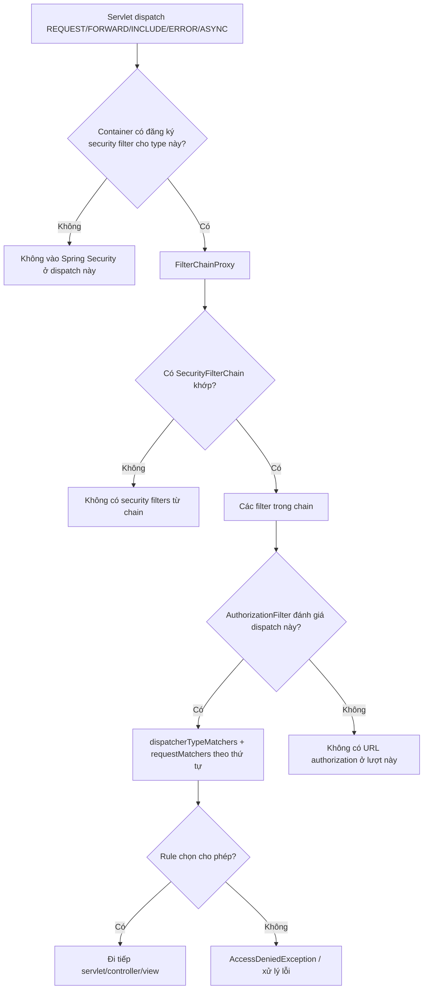

# Phân quyền theo DispatcherType REQUEST, FORWARD, INCLUDE, ERROR và ASYNC

Trong **Spring Security Servlet**, một HTTP request từ trình duyệt không nhất thiết chỉ đi qua ứng dụng một lần. Servlet container có thể **dispatch lại cùng request** để chuyển tiếp tới tài nguyên nội bộ, ghép nội dung, hiển thị trang lỗi hoặc hoàn tất xử lý bất đồng bộ. Mỗi lượt xử lý mang một giá trị thuộc enum **`jakarta.servlet.DispatcherType`**:

- **`REQUEST`** – lượt xử lý yêu cầu thông thường do client gửi.
- **`FORWARD`** – chuyển tiếp *server-side* đến một tài nguyên khác bằng `RequestDispatcher.forward(...)`.
- **`INCLUDE`** – nhúng đầu ra của một servlet/JSP/tài nguyên khác vào response đang tạo bằng `RequestDispatcher.include(...)`.
- **`ERROR`** – container dispatch đến trang/endpoint xử lý lỗi.
- **`ASYNC`** – xử lý một lần dispatch bất đồng bộ qua `AsyncContext.dispatch(...)` hoặc cơ chế MVC async liên quan.

Đây là **loại dispatch của Servlet**, không phải HTTP method GET/POST và cũng không phải “loại token” hay “role”. Một lần dispatch `FORWARD` có thể vẫn dùng method GET; một `ASYNC` dispatch có thể tiếp tục xử lý công việc bắt đầu từ POST. Khi quyết định truy cập, ứng dụng cần biết **cả dispatcher type, URL, danh tính và dữ liệu nghiệp vụ**.

**Thông điệp quan trọng nhất:** Chỉ viết `dispatcherTypeMatchers(FORWARD, ERROR).permitAll()` **không bảo đảm** Spring Security thực sự nhận mọi dispatch `FORWARD`/`ERROR`. Phải phân biệt **Servlet filter registration** với **quy tắc authorization**. Và cho phép toàn bộ `FORWARD`/`INCLUDE` một cách vô điều kiện có thể trở thành đường vòng đến tài nguyên nhạy cảm.

Ngữ cảnh kỹ thuật chính: **Java 17+, Jakarta Servlet 6, Spring Boot 3.x và Spring Security 6.5.x**. Với Spring Security 7 hoặc các bộ lọc tùy chỉnh, kiểm lại hành vi cụ thể theo phiên bản, container và cấu hình thực tế.

## 1. DispatcherType được xác định ở đâu?

`DispatcherType` là một enum do **Servlet container** xác định trên đối tượng request. Khi code đang thực thi trong một servlet, filter hay controller tương ứng, có thể hỏi:

```java
DispatcherType type = request.getDispatcherType();
```

Cần import `jakarta.servlet.DispatcherType` và dùng đối tượng `HttpServletRequest` hoặc `ServletRequest` đã có từ web layer. Không dùng `javax.servlet.DispatcherType` trong dự án Spring Boot 3/Jakarta Servlet vì namespace đã chuyển sang `jakarta.servlet`.

Một lượt gọi đầu tiên:

```text
Client
  GET /reports/42
    |
    v
Servlet container: DispatcherType.REQUEST
    |
    v
Filter registrations cho REQUEST (nếu được cấu hình)
    |
    v
Spring Security FilterChainProxy -> SecurityFilterChain -> AuthorizationFilter
    |
    v
DispatcherServlet -> Controller -> Service
```

Nếu controller/servlet kích hoạt một dispatch mới, container có thể tạo **một lượt đi qua các filter được đăng ký cho dispatcher type mới**, không phải một TCP connection mới hoặc một lần client gửi GET mới.

### 1.1. Có thể nhìn thấy cùng một request nhiều lần

Ví dụ:

```text
REQUEST  GET /reports/42           -> Controller chọn view
FORWARD  GET /WEB-INF/views/report -> JSP/view được render
```

Nếu Spring Security filter được đăng ký cho cả `REQUEST` và `FORWARD`, và `AuthorizationFilter` được cấu hình để đánh giá các dispatch đó, bước authorization có thể xuất hiện **hai lần**. Cả hai lần đều có thể cần chính sách riêng:

- `REQUEST /reports/42`: người gọi có được xem báo cáo 42 không?
- `FORWARD /WEB-INF/views/report.jsp`: view nội bộ này có được render từ lượt chuyển tiếp không?

Không mặc định “request HTTP từ client chỉ phải authorization một lần” là đúng trong mọi đường xử lý Servlet. Ngược lại, cũng **không được kết luận** mọi FORWARD đều chắc chắn chạy Spring Security vì còn phụ thuộc đăng ký filter ở container.

### 1.2. Bảng ý nghĩa của năm giá trị

| DispatcherType | Được tạo trong tình huống nào? | Ví dụ | Điểm cần xem khi phân quyền |
| --- | --- | --- | --- |
| `REQUEST` | Container bắt đầu xử lý request từ client | `GET /api/orders/42` | Bảo vệ tài nguyên/HTTP method, authentication và permission |
| `FORWARD` | Resource đang xử lý gọi `RequestDispatcher.forward` | Controller chuyển tới `/WEB-INF/views/detail.jsp` | Có kiểm lại URL đích không? Có mở toàn bộ FORWARD quá rộng không? |
| `INCLUDE` | Resource đang xử lý gọi `RequestDispatcher.include` | JSP include `/fragments/navigation.jsp` | Có bảo vệ nội dung fragment, dữ liệu user-specific và quy tắc include riêng không? |
| `ERROR` | Container dispatch sang error page sau lỗi/status theo cấu hình | `/error` trong ứng dụng Spring Boot | Tránh lỗi 403 chồng lên lỗi gốc, đồng thời không lộ dữ liệu trong trang lỗi |
| `ASYNC` | AsyncContext dispatch hoặc framework hoàn tất async | Request được xử lý lại sau kết quả `Callable`/`DeferredResult` | Authentication/context còn đúng? Quyền cần kiểm lại? In-flight/revocation thế nào? |

**`DispatcherType` khác với HTTP status:** `ERROR` không có nghĩa HTTP method “ERROR”; `REQUEST` vẫn có thể kết thúc bằng status 500; `ASYNC` không tự mang nghĩa “anonymous” hay “authenticated”.

## 2. Ba cổng phải phân biệt trước khi xét quyền

Khi nói “Spring Security có chạy cho FORWARD hay không?”, cần tách ba câu hỏi:

**Cổng A — Servlet filter registration.** `DelegatingFilterProxy`/`springSecurityFilterChain` có được **container đăng ký** cho `DispatcherType.FORWARD` không? Nếu không, container không gọi filter đó khi có lượt `FORWARD`; một rule của Spring Security dành cho FORWARD sẽ **không có cơ hội chạy** ở lượt đó.

**Cổng B — SecurityFilterChain selection.** Khi đã đi vào `FilterChainProxy`, request có khớp một `SecurityFilterChain` nào không? `securityMatcher` và thứ tự các chain quyết định điều này. Nếu không có chain phù hợp, không có các filter Spring Security của chain chạy cho request đó.

**Cổng C — AuthorizationFilter + authorization rule.** Trong chain đã chọn, `AuthorizationFilter` có được áp dụng cho dispatch này không; và `RequestMatcherDelegatingAuthorizationManager` chọn rule nào? `dispatcherTypeMatchers(...)` thuộc **cấp rule**, không phải registration hay chain selection.



Điểm bảo mật: **`permitAll` ở Cổng C không thể tự làm Cổng A mở ra**, và không thể thêm filter còn thiếu ở Cổng B. Ngược lại, **bỏ qua filter tại Cổng A hoặc B không tương đương an toàn với một rule deny ở Cổng C**.

## 3. Spring Security AuthorizationFilter xử lý nhiều dispatch như thế nào?

Với DSL hiện đại:

```java
http.authorizeHttpRequests(auth -> auth
    .requestMatchers("/admin/**").hasRole("ADMIN")
    .anyRequest().authenticated()
);
```

Spring Security sử dụng **`AuthorizationFilter`** và một `AuthorizationManager` để kiểm request. Trong mô hình Spring Security 6.5, filter này được thiết kế có thể thực thi authorization **trên nhiều lượt dispatch**, không chỉ request ban đầu. Javadoc của `AuthorizationFilter` 6.5 cho biết:

- `setObserveOncePerRequest(...)` có mặc định **`false`**: filter không cố định “mỗi request chỉ kiểm một lần” như cách nhiều người hình dung từ `OncePerRequestFilter`.
- Cấu hình lọc `ASYNC` và `ERROR` có mặc định bật trong 6.5.
- `setShouldFilterAllDispatcherTypes(...)` là API cũ, được đánh dấu deprecated; hướng thiết kế được khuyên dùng là **viết rule rõ ràng bằng `dispatcherTypeMatchers(...)`**.

Những chi tiết này mô tả **filter khi nó đã được gọi**. Chúng **không thay thế** việc đăng ký `springSecurityFilterChain` với dispatcher types ở Servlet container. Ngoài ra, mỗi filter khác trong chain có thể có quy tắc xử lý dispatcher riêng; không suy từ AuthorizationFilter sang toàn bộ chuỗi filter.

### 3.1. Thứ tự rule vẫn là first-match-wins

Ví dụ:

```java
http.authorizeHttpRequests(auth -> auth
    .dispatcherTypeMatchers(DispatcherType.ERROR).permitAll()
    .requestMatchers("/admin/**").hasRole("ADMIN")
    .anyRequest().denyAll()
);
```

Nếu dispatch `ERROR` thực sự đi qua security chain, **rule ERROR được xét trước** các URL rule còn lại. Nó cho phép lượt `ERROR` tiếp tục ở tầng HTTP authorization. Một dispatch `REQUEST` đến `/admin/report` **không** khớp rule ERROR, nên vẫn cần `ROLE_ADMIN`.

Nếu đặt `anyRequest().permitAll()` **trước** `dispatcherTypeMatchers(ERROR)`, rule sau sẽ bị che khuất vì mọi request đã khớp rule trước. Ngược lại, nếu đặt `dispatcherTypeMatchers(FORWARD).permitAll()` ở đầu, **mọi FORWARD** được filter xử lý có thể được cho phép ở HTTP authorization **dù URL đích là đường nhạy cảm**. Phải đánh giá việc cho phép theo **loại dispatch và phạm vi path**.

### 3.2. `dispatcherTypeMatchers` có thể kết hợp HTTP method

Spring Security 6.5 có overload cho dispatcher type và `HttpMethod`:

```java
http.authorizeHttpRequests(auth -> auth
    .dispatcherTypeMatchers(HttpMethod.GET, DispatcherType.ASYNC)
        .authenticated()
    .requestMatchers("/admin/**").hasRole("ADMIN")
    .anyRequest().denyAll()
);
```

Đây là **mảnh cấu hình** trong ứng dụng Spring, không phải chương trình Java độc lập. Rule đầu tiên chỉ áp dụng khi **đúng ASYNC và method GET**. Việc cho phép GET ASYNC trên mọi path chỉ vì đã authenticated có thể **quá rộng** đối với tài nguyên admin; nên thêm policy theo URL/resource khi cần.

Giải thích overload này giúp thấy có **hai trục điều kiện độc lập**: `getDispatcherType()` và `getMethod()`. Đổi dispatcher type không tự biến GET thành POST.

## 4. REQUEST: lượt đầu phải có chính sách bảo vệ rõ ràng

`REQUEST` thường là nơi xác thực và kiểm quyền cho request client đầu tiên. Ví dụ:

```text
REQUEST GET /reports/42
  -> bảo vệ bằng authority "reports.read"
  -> service kiểm tra owner/tenant nếu cần
  -> controller trả view hoặc response JSON
```

Ở HTTP layer có thể dùng:

```java
.requestMatchers(HttpMethod.GET, "/reports/**")
    .hasAuthority("reports.read")
```

Bước đó **chưa bảo đảm** người dùng được xem đúng báo cáo 42: kiểm owner, tenant, trạng thái báo cáo, chia sẻ hoặc permissions ở service vẫn quan trọng.

**Không áp dụng `dispatcherTypeMatchers(REQUEST).permitAll()` như một shortcut để “tránh kiểm hai lần”.** Làm thế có thể mở mọi request từ client ở HTTP authorization. Nếu muốn các dispatch nội bộ được render dễ dàng hơn, hãy định nghĩa policy phù hợp cho loại dispatch cần thiết chứ không bỏ kiểm tra `REQUEST`.

## 5. FORWARD: chuyển tiếp nội bộ không tự an toàn

### 5.1. FORWARD khác redirect của trình duyệt

Một controller trả về redirect:

```text
HTTP 302 Location: /login
Browser gửi request mới GET /login -> REQUEST mới
```

Trong khi `RequestDispatcher.forward` là **chuyển tiếp trong server**, không yêu cầu browser gửi HTTP request thứ hai:

```text
REQUEST GET /reports/42
  -> controller
  -> RequestDispatcher.forward("/WEB-INF/views/report.jsp")
  -> FORWARD /WEB-INF/views/report.jsp
  -> render view
```

Servlet API lưu URI ban đầu trong các attribute như `jakarta.servlet.forward.request_uri` để tài nguyên đích có thể biết nguồn chuyển tiếp; đường dẫn dùng bởi matcher ở lượt FORWARD có thể phản ánh **đích mới** tùy cơ chế servlet mapping.

### 5.2. Vì sao view đôi khi nhận 403?

Nếu rule chỉ khai báo:

```java
.authorizeHttpRequests(auth -> auth
    .requestMatchers("/reports/**").hasAuthority("reports.read")
    .anyRequest().denyAll()
)
```

Lượt `REQUEST /reports/42` có thể qua được, nhưng lượt `FORWARD /WEB-INF/views/report.jsp` **không khớp `/reports/**`** và gặp fallback deny. Khi Spring Security filter có đăng ký FORWARD, người dùng thấy lỗi 403 lúc render view dù request ban đầu có quyền.

Spring Security documentation minh họa một cách xử lý phổ biến:

```java
.dispatcherTypeMatchers(DispatcherType.FORWARD).permitAll()
```

Nhưng hãy xem **cảnh báo quan trọng**: chính sách đó cho phép **mọi FORWARD** ở tầng HTTP authorization. Nếu ứng dụng cho phép chuyển tiếp tới controller nhạy cảm hoặc có một lỗ hổng điều khiển đích FORWARD, nó có thể trở thành đường vòng qua rule URL. Cách dùng này thích hợp hơn khi toàn bộ FORWARD chỉ dành cho **view nội bộ tin cậy, không có thao tác nhạy cảm**, và nghiệp vụ đã được kiểm quyền đầy đủ trước khi forward.

### 5.3. Cho phép đúng đường view, không cho phép mọi FORWARD

Trong ứng dụng muốn chính sách chặt hơn, có thể kết hợp **dispatcher type** với **matcher path**:

```java
RequestMatcher forwardedView = new AndRequestMatcher(
    new DispatcherTypeRequestMatcher(DispatcherType.FORWARD),
    PathPatternRequestMatcher.withDefaults()
        .matcher("/WEB-INF/views/**")
);
```

Sau đó:

```java
.authorizeHttpRequests(auth -> auth
    .requestMatchers(forwardedView).permitAll()
    .requestMatchers("/admin/**").hasRole("ADMIN")
    .anyRequest().denyAll()
)
```

Đây là **hai mảnh cấu hình Spring Security 6.5**, không phải Java program độc lập. Chúng cần imports và được đặt trong cấu hình bean thực tế; matcher path phải được kiểm với servlet mapping/URL forward mà container thật cung cấp.

Ý nghĩa: chỉ `FORWARD` tới **đường view đã cho phép** mới khớp rule đầu; `FORWARD /admin/delete` không được mở bằng rule đó và vẫn phải qua các policy còn lại. Không mặc định những URL bắt đầu `/WEB-INF/views/` chắc chắn không chứa xử lý nhạy cảm: cần kiểm view/servlet architecture và test.

## 6. INCLUDE: nhúng fragment có ngữ nghĩa đặc biệt

`INCLUDE` xảy ra khi một servlet/JSP gọi:

```java
RequestDispatcher dispatcher =
    request.getRequestDispatcher("/fragments/menu.jsp");
dispatcher.include(request, response);
```

**Mảnh code trên** giả định đang có `request`/`response` trong web handler. Mục đích là ghép nội dung fragment vào response đang tạo; không phải HTTP redirect hay request client mới.

Theo Jakarta Servlet specification:

- Resource được include có thể đóng góp **body** vào response đang viết.
- Include không được tự thay đổi HTTP status code hoặc headers của response gốc; thay đổi như vậy thường bị bỏ qua.
- `request.getDispatcherType()` trên lượt include là `DispatcherType.INCLUDE`.
- Servlet API cung cấp những attribute như `jakarta.servlet.include.request_uri`, `jakarta.servlet.include.servlet_path`, `jakarta.servlet.include.path_info` để biết **đích được include**.

### 6.1. Tại sao INCLUDE khác FORWARD khi match URL?

Trong lượt `INCLUDE`, nhiều phương thức đọc URI/path trên đối tượng request giữ **ngữ cảnh đường dẫn của caller**, còn đường dẫn đích include được cung cấp trong **các include attributes**. Không nên mặc định `request.getServletPath()` ở INCLUDE có cùng ý nghĩa với servlet path của fragment. Nếu viết matcher theo đường dẫn để bảo vệ include, phải xác nhận nó kiểm **caller path** hay **include target** trong container và request wrapper thực tế.

Ví dụ:

```text
REQUEST /dashboard
  -> INCLUDE /fragments/account.jsp
     (included target nằm trong jakarta.servlet.include.*)
```

Nếu bảo vệ `/fragments/account.jsp` bằng một URL path matcher thông thường nhưng matcher nhìn thấy `/dashboard`, policy có thể **không áp dụng theo cách bạn tưởng**. Đặc biệt, một fragment hiển thị dữ liệu của user hoặc tenant không nên chỉ dựa vào quy tắc URL ở lượt INCLUDE. Hãy kiểm quyền trong **service tạo dữ liệu fragment** và bảo vệ mọi endpoint khác có thể gọi đến dữ liệu đó.

### 6.2. Không cho phép tất cả INCLUDE theo thói quen

Có thể cấu hình:

```java
.dispatcherTypeMatchers(DispatcherType.INCLUDE).permitAll()
```

Nhưng đó là **quyết định bảo mật rộng**, không phải yêu cầu kỹ thuật bắt buộc. Nếu các fragment luôn là menu/tài nguyên công khai, chính sách đó có thể chấp nhận được **sau khi kiểm kiến trúc**. Nếu fragment chứa thông tin tài khoản, báo cáo hoặc dữ liệu phân quyền, phải áp chính sách đúng đối tượng.

**Lưu ý vận hành:** nếu một INCLUDE bị từ chối khi response đã gửi một phần body, cơ chế exception handler có thể **không sửa được status/header** như khi response chưa commit. Do đó, authorization cho dữ liệu nhạy cảm cần xảy ra **trước khi phát ra nội dung** và không dựa vào việc đổi status sau khi include thất bại.

## 7. ERROR: tránh che lỗi gốc, nhưng không mở endpoint nhạy cảm

`DispatcherType.ERROR` thường xuất hiện khi servlet container dispatch tới một error page sau một exception hoặc lỗi được container xử lý.

Ví dụ Spring Boot có endpoint error handling:

```text
REQUEST /reports/42
  -> controller ném exception hoặc gửi trạng thái lỗi
  -> container dispatch ERROR /error
  -> render trang lỗi
```

Nếu request gốc đã được phép, nhưng `ERROR /error` không khớp rule cho phép và gặp `denyAll`, ứng dụng có thể tạo một lỗi `AccessDeniedException` **thứ hai**, che thông tin chẩn đoán của lỗi gốc, thay đổi trang lỗi hoặc dẫn đến xử lý lỗi lặp.

Một cách cấu hình thường được Spring Security documentation minh họa:

```java
.dispatcherTypeMatchers(DispatcherType.ERROR).permitAll()
```

**Phạm vi:** cho phép **bước URL authorization của ERROR dispatch**. Nó không bảo đảm trang lỗi chắc chắn trả 500/404 nguyên bản, cũng không cho phép bỏ các biện pháp bảo mật khác.

### 7.1. Cẩn thận khi ERROR handler hiển thị dữ liệu

Trang lỗi nên:

- Không xuất stack trace, secrets, access token, query có dữ liệu nhạy cảm hoặc thông tin tài nguyên bị từ chối cho người dùng bên ngoài.
- Không hiển thị quyền của user khác hoặc dữ liệu lấy từ nghiệp vụ chỉ vì đang ở ERROR dispatch.
- Có policy phù hợp nếu error controller tự truy cập dữ liệu bảo vệ.
- Không để attacker điều khiển tự do URL/chức năng được gọi trong quá trình xử lý lỗi.

Nếu policy yêu cầu chặt hơn, có thể chỉ cho phép `ERROR` với **endpoint lỗi dự kiến**, bằng matcher kết hợp dispatcher type + đường dẫn, rồi dùng fallback deny.

### 7.2. Phân biệt lỗi ban đầu với lỗi từ authorization thứ hai

Khi debug một phản hồi 403 hoặc 500 không đúng dự kiến, log an toàn:

```text
dispatcherType=REQUEST path=/reports/42
dispatcherType=ERROR   path=/error
```

Có thể đọc `jakarta.servlet.error.status_code`, `jakarta.servlet.error.request_uri` và `jakarta.servlet.error.exception` theo hợp đồng Servlet để tìm lỗi gốc. Tránh log toàn bộ exception có thể chứa token hoặc dữ liệu nhạy cảm trong response cho client.

## 8. ASYNC: phân biệt xử lý ở thread khác với một async dispatch

**`DispatcherType.ASYNC` không đồng nghĩa “code đang chạy trên thread khác”.** Đây là **loại dispatch của container**, thường do `AsyncContext.dispatch(...)` kích hoạt hoặc bởi flow hoàn tất asynchronous request của framework.

Hai sự kiện riêng biệt:

1. **Công việc chạy trong executor/thread khác:** `Callable`, `CompletableFuture`, `DeferredResult` hoặc worker tự tạo có thể xử lý dữ liệu mà **chưa có servlet ASYNC dispatch mới tại thời điểm đó**.
2. **Container dispatch lại:** khi cần tiếp tục quy trình Servlet/MVC, container tạo lượt xử lý có thể có `DispatcherType.ASYNC`. Chỉ khi filter được đăng ký cho ASYNC và chain nhận được lượt đó mới có thể diễn ra URL authorization tương ứng.

### 8.1. Ví dụ dòng thời gian

```text
REQUEST GET /reports/42
   |
   +-> Spring MVC trả Callable<String> hoặc DeferredResult<String>
   |
   +-> Công việc được thực hiện bất đồng bộ
   |
   +-> Khi có kết quả, container/MVC tiếp tục xử lý
            |
            v
        ASYNC dispatch (nếu flow tạo async dispatch)
            |
            v
        security filter mapping cho ASYNC?
            |
            v
        AuthorizationFilter + render response
```

Một request được phép ở REQUEST **không nhất thiết** tự được phép ở ASYNC nếu request/context/policy của lượt tiếp theo khác. Ngược lại, chỉ vì response được hoàn tất trong ASYNC không có nghĩa phải bỏ qua authorization theo loại dispatch này.

### 8.2. SecurityContext trong async không tự giống nhau với mọi API

Spring Security có tích hợp **`WebAsyncManagerIntegrationFilter`** với Spring MVC `Callable` để truyền `SecurityContext` phù hợp vào quá trình xử lý Callable. Nhưng với `DeferredResult` hoặc một executor tự quản lý, không được mặc định mọi thread tự thấy cùng `SecurityContextHolder`.

Cơ chế `SecurityContextHolder` phổ biến dùng `ThreadLocal`; thread mới không nhất thiết kế thừa đúng context. Khi tự quản lý background tasks, dùng `DelegatingSecurityContextRunnable`, `DelegatingSecurityContextCallable` hoặc các executor wrapper phù hợp, và **xem lại việc truyền/quyết định danh tính tại đúng ranh giới bảo mật**.

**Không nên** sửa lỗi mất context bằng cách biến mọi `ASYNC` thành `permitAll` nếu trong đó còn có đường trả dữ liệu nhạy cảm. Vấn đề cần giải quyết là **context propagation và policy đúng thời điểm**, không phải mở quyền rộng.

### 8.3. Thu hồi quyền trong khi request ASYNC đang chạy

Giả sử Alice bắt đầu request lúc 10:00 với quyền `reports.read`, và bị thu hồi quyền lúc 10:01 khi tác vụ báo cáo còn đang chạy. Lượt ASYNC hoàn thành lúc 10:03 có thể dùng **authority snapshot cũ** hoặc policy được đọc lại, tùy kiến trúc.

Nếu yêu cầu “thu hồi quyền phải ảnh hưởng tới kết quả đang xử lý”, cần chính sách rõ cho:

- Thời điểm kiểm quyền trước khi truy vấn dữ liệu hoặc gửi response.
- Liệu tác vụ đang chạy có bị hủy khi revoke không.
- Cache và nguồn quyền có độ trễ như thế nào.
- Kiểm quyền động trước khi xuất file hoặc công bố dữ liệu.
- Cách xử lý nếu response đã commit một phần.

`DispatcherType.ASYNC` **không tự giải quyết** vấn đề thu hồi quyền, cũng như không tự xác thực lại token. Cần kiểm tra dữ liệu/context ở các ranh giới nghiệp vụ thực sự quan trọng.

## 9. Cấu hình Servlet filter registration: điều kiện hay bị bỏ quên

Đây là tầng **bên ngoài** quy tắc `authorizeHttpRequests`.

### 9.1. Spring Boot property cấu hình dispatcher types

Trong các phiên bản Spring Boot hỗ trợ property này, có thể cấu hình **những dispatcher type mà security filter registration nhận**:

```yaml
spring:
  security:
    filter:
      dispatcher-types: request, async, error, forward, include
```

**Đây là cấu hình có tác động toàn ứng dụng** và phải được chọn theo nhu cầu. Không bật toàn bộ types chỉ vì muốn hết lỗi 403; mỗi dispatch bổ sung có thể khiến security filter chạy nhiều lần, phát sinh thêm policy check và lộ vấn đề trong custom filter.

Trong nhiều bản Spring Boot Servlet thông dụng, cấu hình mặc định của security filter registration thường bao gồm `REQUEST`, `ASYNC` và `ERROR`; **`FORWARD` và `INCLUDE` không nên được giả định là luôn có**. Cấu hình mặc định có thể khác khi triển khai WAR, tự đăng ký `DelegatingFilterProxy`, thay `FilterRegistrationBean` hoặc dùng phiên bản Boot khác. **Xác nhận filter registration đang chạy** thay vì tin rằng mọi dispatch trong enum luôn được xử lý mặc định.

### 9.2. Jakarta Servlet filter mapping

Khi không dùng auto-registration hoặc tự dựng WAR/web.xml, Servlet container chỉ gọi một filter cho những dispatcher types được mapping. Ví dụ cấu hình có thể cần:

```xml
<filter-mapping>
    <filter-name>springSecurityFilterChain</filter-name>
    <url-pattern>/*</url-pattern>
    <dispatcher>REQUEST</dispatcher>
    <dispatcher>FORWARD</dispatcher>
    <dispatcher>INCLUDE</dispatcher>
    <dispatcher>ERROR</dispatcher>
    <dispatcher>ASYNC</dispatcher>
</filter-mapping>
```

Đây là **mảnh web.xml**, chỉ phù hợp khi thực sự quản lý registration theo web.xml; trong Spring Boot auto-config, chỉnh property hoặc registration tương ứng thay vì thêm cấu hình chồng chéo. Để filter xử lý async cần cả `async-supported` và mapping thích hợp theo Servlet contract.

### 9.3. Hai tình huống dễ gây hiểu lầm

| Tình huống | Kết quả |
| --- | --- |
| Có `dispatcherTypeMatchers(FORWARD).permitAll()` nhưng filter registration **không có FORWARD** | Rule không được chạy ở lượt FORWARD; không thể xem đó là bằng chứng đã kiểm soát |
| Filter registration có FORWARD nhưng authorization rule chỉ có `anyRequest().denyAll()` | Một lượt FORWARD tới view có thể bị từ chối, trừ khi path/type được cho phép trước |
| Filter registration có ERROR nhưng rule không cho `/error`/ERROR | Có thể che lỗi gốc bằng lỗi authorization trong ERROR dispatch |
| Filter registration có ASYNC nhưng context không được truyền đúng | Rule cần Authentication có thể từ chối do thiếu/khác security context |
| Filter registration có INCLUDE nhưng data policy chỉ dựa URL caller | Có thể bỏ qua việc bảo vệ dữ liệu của included resource |
| Filter registration có đủ năm type và quy tắc rộng `permitAll` | Filter được gọi nhưng authorization policy vẫn có thể mở quyền sai |

## 10. Cấu hình minh họa: yêu cầu REQUEST nghiêm ngặt, kiểm view forward có giới hạn

Ví dụ **Spring Boot 3.x / Spring Security 6.5.x Servlet**. Mục tiêu:

- `/public/**` public ở REQUEST.
- `GET /reports/**` cần `reports.read`.
- `/admin/**` cần `ROLE_ADMIN`.
- Chỉ cho phép `FORWARD` tới `/WEB-INF/views/**` để render view nội bộ.
- Cho phép `ERROR` phục vụ trang lỗi **theo giả định trang lỗi an toàn**.
- Không mặc định bỏ authorization cho `INCLUDE` hoặc `ASYNC`.
- Default deny cho những URL chưa khai báo.

```java
package com.example.security;

import jakarta.servlet.DispatcherType;
import org.springframework.context.annotation.Bean;
import org.springframework.context.annotation.Configuration;
import org.springframework.http.HttpMethod;
import org.springframework.security.config.annotation.web.builders.HttpSecurity;
import org.springframework.security.web.SecurityFilterChain;
import org.springframework.security.web.servlet.util.matcher.PathPatternRequestMatcher;
import org.springframework.security.web.util.matcher.AndRequestMatcher;
import org.springframework.security.web.util.matcher.DispatcherTypeRequestMatcher;
import org.springframework.security.web.util.matcher.RequestMatcher;

@Configuration
public class SecurityConfig {

    @Bean
    SecurityFilterChain web(HttpSecurity http) throws Exception {
        RequestMatcher safeViewForward = new AndRequestMatcher(
                new DispatcherTypeRequestMatcher(DispatcherType.FORWARD),
                PathPatternRequestMatcher.withDefaults()
                        .matcher("/WEB-INF/views/**")
        );

        http.authorizeHttpRequests(auth -> auth
                .requestMatchers(safeViewForward).permitAll()
                .dispatcherTypeMatchers(DispatcherType.ERROR).permitAll()
                .requestMatchers("/public/**").permitAll()
                .requestMatchers(HttpMethod.GET, "/reports/**")
                        .hasAuthority("reports.read")
                .requestMatchers("/admin/**").hasRole("ADMIN")
                .anyRequest().denyAll()
        );

        return http.build();
    }
}
```

Đây là **một lớp Spring configuration**, không thể biên dịch độc lập với lệnh `javac SecurityConfig.java`. Cần dự án Spring Boot có dependency Spring Security, servlet container, authentication provider, controller, view resolver và phiên bản hỗ trợ `PathPatternRequestMatcher`. Ví dụ **không chủ động vô hiệu CSRF**, và chỉ minh họa URL authorization, không phải cấu hình production đầy đủ.

**Điều kiện để ví dụ hoạt động theo ý định:** container phải đăng ký security filter cho `FORWARD`/`ERROR` nếu muốn hai rule đó thật sự có cơ hội chạy. Nếu view được xử lý bằng một đường dẫn khác hoặc matcher nhìn thấy servlet prefix khác, cần điều chỉnh và test. `ERROR` permitAll ở đây phải được đánh giá lại nếu application error handler chứa nghiệp vụ nhạy cảm.

### 10.1. Nếu cần INCLUDE thật sự

Không tự thêm:

```java
.dispatcherTypeMatchers(DispatcherType.INCLUDE).permitAll()
```

Chỉ làm thế khi **toàn bộ included resources được xét là an toàn để include**, và các dữ liệu nhạy cảm đã được kiểm tại tầng nghiệp vụ. Nếu chỉ một vài fragment công khai, có thể viết **custom RequestMatcher** xét `DispatcherType.INCLUDE` kết hợp **include target attributes**, hoặc kiểm quyền trực tiếp trong service dùng để render fragment.

Đừng chỉ gán `PathPatternRequestMatcher("/fragments/**")` rồi giả định matcher sẽ xét include target; phải xác minh từ request thực tế. Nếu custom matcher đọc attribute, luôn xử lý null, context path/servlet mapping, nested include, và không dùng giá trị nào từ client làm nguồn quyền.

### 10.2. Nếu chỉ cần cho phép ERROR /error

Có thể kết hợp:

```java
RequestMatcher safeErrorDispatch = new AndRequestMatcher(
    new DispatcherTypeRequestMatcher(DispatcherType.ERROR),
    PathPatternRequestMatcher.withDefaults().matcher("/error")
);
```

Rồi dùng:

```java
.requestMatchers(safeErrorDispatch).permitAll()
```

Đây là **mảnh code minh họa**, phải kiểm context path và error mapping thực tế. Nó giúp không mở toàn bộ `ERROR` nếu ứng dụng có nhiều endpoint xử lý lỗi với mức tin cậy khác nhau. Bảo vệ dữ liệu trong error handler vẫn là trách nhiệm riêng.

### 10.3. FORWARD đến endpoint nhạy cảm vẫn cần policy

Với cấu hình minh họa, nếu một controller thực hiện `forward("/admin/reports")` thì request FORWARD này **không khớp `/WEB-INF/views/**`**; nó sẽ gặp `/admin/**` và cần role ADMIN. Đây là khác biệt có ý nghĩa so với việc đặt `dispatcherTypeMatchers(FORWARD).permitAll()` ở đầu, khiến mọi forwarded path có thể bỏ qua URL role check.

Không nên dùng **một rule cho phép cả FORWARD và INCLUDE** chỉ để sửa nhanh lỗi view rendering. Hai loại dispatch có ngữ nghĩa path/response khác nhau và phải đánh giá riêng.

## 11. Kiểm thử: tách “rule đúng” và “filter có chạy” thành hai nhóm

Một lỗi phổ biến là chỉ test `RequestMatcher` với mock request đã đặt `DispatcherType.FORWARD`, thấy allow, rồi kết luận hệ thống đã bảo vệ FORWARD ở production. Test đó **chỉ kiểm logic rule**, không xác nhận container có đăng ký security filter cho FORWARD.

### 11.1. Unit test một dispatcher type matcher

Với `spring-security-test` và Spring Mock Servlet (đặt trong JUnit 5 test class có imports phù hợp):

```java
MockHttpServletRequest request =
        new MockHttpServletRequest("GET", "/reports/42");

request.setDispatcherType(DispatcherType.FORWARD);

RequestMatcher matcher =
        new DispatcherTypeRequestMatcher(DispatcherType.FORWARD);

assertTrue(matcher.matches(request));
assertFalse(new DispatcherTypeRequestMatcher(
        DispatcherType.REQUEST).matches(request));
```

Đây là **mảnh test Spring**, không chạy độc lập và cần `MockHttpServletRequest`, `RequestMatcher`, `DispatcherTypeRequestMatcher`, `DispatcherType` và JUnit assertions. Nó xác minh matcher đúng loại FORWARD; không kiểm `FilterRegistrationBean` hay filter chain có thực sự được container gọi.

### 11.2. Integration test phải tạo dispatch thật

Với embedded Servlet container hoặc integration environment:

1. `REQUEST /reports/42` vào controller đã xác thực; controller chuyển `FORWARD` tới view.
2. Ghi nhận có hoặc không có `springSecurityFilterChain`/`AuthorizationFilter` trong lượt FORWARD.
3. Cấu hình cho phép view forward có giới hạn; test view hiển thị không gặp 403 giả.
4. Test một forward **có chủ đích** đến `/admin/secret` với user thiếu ROLE_ADMIN; phải bị chặn nếu policy không cho bypass.
5. Controller ném exception, container dispatch `ERROR /error`; test response lỗi không bị thay bằng 403 thứ hai và trang lỗi không lộ dữ liệu nhạy cảm.
6. JSP/servlet thực hiện `INCLUDE`; test fragment chứa dữ liệu cá nhân không bị cho phép chỉ vì caller đã được xem trang public.
7. Test `ASYNC` với `Callable`/`DeferredResult` thực tế, principal hợp lệ/không hợp lệ, không context và error handling.
8. Bật/tắt `spring.security.filter.dispatcher-types` trong test config để chứng minh khác biệt giữa **đăng ký filter** và **rule matcher**.

`MockMvc` có thể kiểm nhiều trường hợp MVC/authorization, nhưng **không luôn tái tạo đầy đủ hành vi chuyển tiếp, include và async dispatch của Servlet container**. Kết hợp unit tests với integration test chạy trên container thật cho những hành vi phụ thuộc dispatcher registration.

### 11.3. Ma trận authorization kỳ vọng

Giả sử policy như ví dụ ở mục 10:

| DispatcherType | Đường dẫn/điều kiện | Kỳ vọng ở tầng HTTP authorization |
| --- | --- | --- |
| REQUEST | `GET /reports/42` với `reports.read` | ALLOW |
| REQUEST | `GET /reports/42` thiếu `reports.read` | DENY |
| REQUEST | `GET /public/help` anonymous | ALLOW |
| REQUEST | `GET /admin/secret` thiếu `ROLE_ADMIN` | DENY |
| FORWARD | `/WEB-INF/views/report.jsp` | ALLOW nếu filter registration và matcher phù hợp |
| FORWARD | `/admin/secret` thiếu `ROLE_ADMIN` | DENY, không bypass |
| INCLUDE | Fragment nhạy cảm, không có policy riêng | Không nên auto-allow; phải kiểm tại nơi chứa dữ liệu |
| ERROR | `/error` khi error handler an toàn | ALLOW theo policy mẫu; không che lỗi gốc |
| ASYNC | `GET /reports/42` với context chứa `reports.read` | ALLOW nếu có lượt dispatch được kiểm và context đúng |
| ASYNC | `GET /reports/42` thiếu quyền | DENY khi rule thật được áp dụng |
| Mọi type | Path không thuộc rule nào | DENY từ `anyRequest().denyAll()` nếu đi vào chain |
| FORWARD/INCLUDE | Không đăng ký security filter cho type đó | **Không có authorization của Spring Security tại dispatch**, bất kể rule trong DSL |

Kết quả trên là dự đoán ở **bước URL authorization**, không khẳng định chắc chắn HTTP response 200/403 trong mọi tình huống. CSRF, exception translation, method security, servlet mapping và controller còn có thể ảnh hưởng.

## 12. Java 17 chạy độc lập: mô phỏng phân quyền theo năm DispatcherType

Ví dụ sau **không dùng Spring/Jakarta Servlet**, nên có thể chạy bằng JDK 17. Nó mô phỏng một **policy an toàn theo type + đích + quyền**:

- REQUEST và ASYNC vẫn kiểm quyền tương ứng với URL.
- FORWARD chỉ được bỏ kiểm URL role đối với một vùng view nội bộ `/WEB-INF/views/`.
- INCLUDE chỉ cho phép một vùng fragment công khai `/fragments/public/`.
- ERROR chỉ cho phép handler `/error`.
- FORWARD/INCLUDE đến `/admin/` vẫn phải thỏa ROLE_ADMIN.
- Những path không khai báo bị từ chối.

**Giới hạn:** Đây là thuật toán học tập **sử dụng đích dispatch do test cung cấp**, không phản ánh chính xác cách `HttpServletRequest#getServletPath()` hoặc `jakarta.servlet.include.*` được container thiết lập. Muốn mô phỏng đúng runtime phải dùng test Servlet/Spring Security thật.

Tạo tệp **`DispatcherAuthorizationDemo.java`**:

```java
import java.util.List;
import java.util.Set;

public class DispatcherAuthorizationDemo {

    enum Kind {
        REQUEST, FORWARD, INCLUDE, ERROR, ASYNC
    }

    record Dispatch(
            Kind kind,
            String targetPath,
            boolean authenticated,
            Set<String> authorities
    ) {
        boolean has(String authority) {
            return authenticated && authorities.contains(authority);
        }
    }

    static String decide(Dispatch event) {
        if (event.kind() == Kind.ERROR
                && event.targetPath().equals("/error")) {
            return "ALLOW:ERROR_PAGE";
        }

        if (event.kind() == Kind.FORWARD
                && event.targetPath().startsWith("/WEB-INF/views/")) {
            return "ALLOW:VIEW";
        }

        if (event.kind() == Kind.INCLUDE
                && event.targetPath().startsWith("/fragments/public/")) {
            return "ALLOW:PUBLIC_FRAGMENT";
        }

        if (event.targetPath().startsWith("/admin/")) {
            return event.has("ROLE_ADMIN")
                    ? "ALLOW:ADMIN"
                    : "DENY:ADMIN";
        }

        if (event.targetPath().startsWith("/reports/")) {
            return event.has("reports.read")
                    ? "ALLOW:REPORTS"
                    : "DENY:REPORTS";
        }

        return "DENY:DEFAULT";
    }

    public static void main(String[] args) {
        Set<String> reportReader = Set.of("reports.read");

        List<Dispatch> events = List.of(
            new Dispatch(
                Kind.REQUEST, "/reports/42", true, reportReader),
            new Dispatch(
                Kind.FORWARD, "/WEB-INF/views/report.jsp", true, reportReader),
            new Dispatch(
                Kind.INCLUDE, "/fragments/public/menu.jsp", false, Set.of()),
            new Dispatch(
                Kind.ERROR, "/error", false, Set.of()),
            new Dispatch(
                Kind.ASYNC, "/reports/42", true, reportReader),
            new Dispatch(
                Kind.ASYNC, "/reports/42", false, Set.of()),
            new Dispatch(
                Kind.FORWARD, "/admin/secret", false, Set.of()),
            new Dispatch(
                Kind.INCLUDE, "/admin/secret", false, Set.of()),
            new Dispatch(
                Kind.REQUEST, "/unknown", true, Set.of("ROLE_ADMIN"))
        );

        for (Dispatch event : events) {
            System.out.println(
                event.kind() + " " + event.targetPath()
                + " -> " + decide(event)
            );
        }
    }
}
```

Với **JDK 17+**, chạy:

```bash
javac DispatcherAuthorizationDemo.java
java DispatcherAuthorizationDemo
```

Kết quả stdout:

```text
REQUEST /reports/42 -> ALLOW:REPORTS
FORWARD /WEB-INF/views/report.jsp -> ALLOW:VIEW
INCLUDE /fragments/public/menu.jsp -> ALLOW:PUBLIC_FRAGMENT
ERROR /error -> ALLOW:ERROR_PAGE
ASYNC /reports/42 -> ALLOW:REPORTS
ASYNC /reports/42 -> DENY:REPORTS
FORWARD /admin/secret -> DENY:ADMIN
INCLUDE /admin/secret -> DENY:ADMIN
REQUEST /unknown -> DENY:DEFAULT
```

Điểm rút ra:

1. **FORWARD** không tự được phép: chỉ forward tới vùng view tin cậy mới đi qua rule allow.
2. **INCLUDE** có vùng public fragment được phép, nhưng include tới admin không được coi là “tài nguyên nội bộ nên an toàn”.
3. **ERROR /error** được cho phép để xử lý lỗi theo policy giả định, không mở URL bình thường từ client.
4. **ASYNC** được xét bằng quyền như REQUEST đối với báo cáo, nên không trở thành đường vòng; thiếu authority vẫn bị deny.
5. Đường không được khai báo rơi vào **default deny**.
6. Code mô phỏng này **không tự tạo dispatcher, session hay security context**. Trong ứng dụng thật, chỉ có filter registration + Servlet dispatch + Spring authorization mới quyết định chính xác rule nào chạy.

## 13. Debug: tại sao đã cấu hình dispatcherTypeMatchers mà vẫn sai?

Khi gặp 403 trong trang view hoặc 500 bị biến thành 403, đừng sửa rule ngẫu nhiên. Đi theo trình tự:

1. **Servlet có tạo dispatch mới không?** Quan sát `getDispatcherType()` ở nơi được gọi. Một redirect trình duyệt là REQUEST mới, không phải FORWARD.
2. **Filter registration có bao gồm type đó không?** Kiểm `spring.security.filter.dispatcher-types`, custom registration, web.xml hoặc WAR/container.
3. **Request có vào `FilterChainProxy` và chain phù hợp không?** Với nhiều chain, `securityMatcher` và `@Order` có thể dẫn tới chain khác hoặc không có chain.
4. **Filter nào thực sự chạy ở dispatch mới?** Không mặc định mọi `OncePerRequestFilter` chạy như AuthorizationFilter.
5. **Rule nào khớp đầu tiên?** `dispatcherTypeMatchers` và `requestMatchers` được xét theo thứ tự khai báo.
6. **Path mà matcher nhìn thấy là gì?** Với FORWARD/INCLUDE, phân biệt caller URI, forwarded target, included target attributes, servlet path và context path.
7. **SecurityContext còn đúng không?** Đặc biệt trong async, executor, DeferredResult và request đã bị revoke.
8. **Ai tạo lỗi?** `AuthorizationFilter`, CSRF, authentication, method security, resource policy hoặc controller/error handler?
9. **Response đã commit chưa?** INCLUDE và async streaming có thể khiến handler không thể đổi status sau khi dữ liệu đã được gửi.
10. **Có bằng chứng tích hợp không?** Unit test matcher đúng không chứng minh filter mapping thực tế.

### 13.1. Log dispatcher type để chẩn đoán

Một filter chẩn đoán **chỉ dùng trong môi trường phát triển/test**, đăng ký với dispatcher types cần quan sát:

```java
@Bean
FilterRegistrationBean<Filter> dispatchTraceFilter() {
    FilterRegistrationBean<Filter> bean = new FilterRegistrationBean<>();

    Filter logger = (request, response, chain) -> {
        HttpServletRequest http = (HttpServletRequest) request;
        System.out.println(
            "dispatch=" + http.getDispatcherType()
            + " path=" + http.getRequestURI()
        );
        chain.doFilter(request, response);
    };

    bean.setFilter(logger);
    bean.setUrlPatterns(List.of("/*"));
    bean.setDispatcherTypes(EnumSet.allOf(DispatcherType.class));
    return bean;
}
```

Đây là **mảnh Spring Boot Servlet**, cần imports `FilterRegistrationBean`, `Filter`, `HttpServletRequest`, `DispatcherType`, `List`, `EnumSet`, và class `@Configuration`. Filter này **không cấp quyền** và không được dùng để thay Spring Security. Nó được đăng ký riêng ở Servlet container để quan sát, không phải filter được tự động thêm vào `SecurityFilterChain`. Nếu project có bean `Filter` được auto-register ở nơi khác, tránh đăng ký hai lần.

Trong production, không log nguyên vẹn URI chứa dữ liệu nhạy cảm, query chứa token, cookies hoặc session IDs. Việc bật logging cho toàn bộ dispatch có thể tăng lượng log mạnh.

## 14. Những lỗi bảo mật và hiểu nhầm thường gặp

| Ngộ nhận / lỗi | Hậu quả | Cách xử lý |
| --- | --- | --- |
| “FORWARD là REQUEST mới từ browser” | Nhầm redirect với server-side forward | Dựa vào `getDispatcherType()` và Servlet API |
| “Spring Security tự chạy mọi dispatcher type vì enum có 5 giá trị” | Bỏ qua registration ở container | Kiểm các types được đăng ký cho `springSecurityFilterChain` |
| “Có `dispatcherTypeMatchers(FORWARD)` thì filter đã được đăng ký FORWARD” | Rule không bao giờ chạy nếu registration thiếu | Phân biệt registration với rule |
| “`FORWARD permitAll` là luôn an toàn” | Có thể bypass URL rule khi forward vào endpoint nhạy cảm | Chỉ cho phép view path tin cậy hoặc giữ policy tài nguyên |
| “`INCLUDE` được bảo vệ bằng đúng path matcher của fragment trong mọi container” | Matcher có thể thấy caller path thay vì include target | Kiểm include attributes, test stack thật, bảo vệ service data |
| “`ERROR` luôn có nghĩa endpoint vô hại” | Có thể lộ dữ liệu hoặc ghi đè lỗi gốc | Error handler tối thiểu, policy riêng, không tiết lộ secret |
| “`ASYNC` nghĩa là thread nào cũng có SecurityContext” | Custom executor có thể không truyền context | Dùng async integration/wrapper phù hợp |
| “`ASYNC permitAll` giúp tránh 403 nên đúng” | Có thể mở đường trả dữ liệu nhạy cảm | Kiểm context, quyền và ranh giới nghiệp vụ |
| “AuthorizationFilter là OncePerRequestFilter” | Suy đoán sai tần suất authorization | Đọc filter semantics đúng phiên bản |
| “Bật all dispatcher types là đủ” | Vẫn có thể bị chain mismatch hoặc rule sai | Kiểm registration → chain → authorization |
| “Unit test MockMvc chứng minh container filter registration” | Không phản ánh đầy đủ servlet dispatch thực tế | Thêm embedded-container integration test |
| “Có quyền ở REQUEST thì tự luôn có quyền ở ASYNC sau khi revoke” | Có thể dùng authority snapshot cũ hoặc context thiếu | Thiết kế freshness và kiểm lại trước khi xuất dữ liệu |
| “`permitAll` bằng bỏ qua toàn bộ security filter chain” | Bỏ qua khác với allow ở HTTP authorization | Dùng policy rõ, không tùy tiện web.ignoring |
| “Status 403 chứng minh sai role” | Có thể CSRF hoặc ERROR/FORWARD dispatch bị deny | Log loại dispatch, filter và rule được chọn |

## 15. Câu hỏi tự kiểm tra

**1. Browser nhận 302 rồi tự gửi GET /login. Lượt GET sau là FORWARD?**  
Không. Đó thường là một **`REQUEST` mới**. FORWARD diễn ra trong server với `RequestDispatcher.forward`.

**2. `dispatcherTypeMatchers(ERROR).permitAll()` có làm Spring Security nhận ERROR khi container chưa đăng ký filter cho ERROR không?**  
Không. Nó chỉ là rule nếu lượt ERROR **đã vào** Spring Security filter chain.

**3. Vì sao một view JSP được render qua FORWARD có thể bị 403 dù REQUEST đầu được cho phép?**  
Vì lượt FORWARD tới path view có thể được authorization lại; nếu fallback deny mà không cho view forward thích hợp thì có thể bị từ chối.

**4. Có nên đặt `dispatcherTypeMatchers(FORWARD).permitAll()` cho mọi ứng dụng không?**  
Không tự động. Phải chắc chắn mọi FORWARD được phép theo thiết kế, không dùng nó để mở đường vào controller nhạy cảm.

**5. INCLUDE /fragments/account.jsp có luôn được bảo vệ bằng matcher `/fragments/**` không?**  
Không thể giả định. Included target có thể được thể hiện qua các `jakarta.servlet.include.*` attributes; cần test matcher/runtime và kiểm quyền ở service.

**6. ASYNC có phải mọi đoạn code chạy ở thread khác đều có `getDispatcherType()==ASYNC` không?**  
Không. Thread xử lý async và **Servlet async dispatch** là hai cơ chế liên quan nhưng khác nhau.

**7. Spring Security có tự truyền SecurityContext vào mọi `DeferredResult` executor không?**  
Không mặc định. `Callable` được hỗ trợ bởi WebAsyncManager integration; tự quản lý DeferredResult/executor cần xử lý context propagation thích hợp.

**8. Vì sao ERROR /error bị deny có thể che lỗi ban đầu?**  
Vì dispatch xử lý lỗi cũng bị `AuthorizationFilter` kiểm; một AccessDeniedException mới có thể thay đổi cách tạo response lỗi.

**9. Có thể dùng `DispatcherTypeRequestMatcher` để kết hợp FORWARD và GET không?**  
Có, Spring Security cung cấp constructor/DSL phù hợp; việc match type+method không thay việc kiểm URL/tài nguyên.

**10. Test nào quan trọng nhất để ngăn bypass qua FORWARD?**  
Tạo một FORWARD thực tế tới endpoint nhạy cảm với user thiếu quyền, bảo đảm policy từ chối và filter registration có chạy đúng type.

## 16. Kết luận

Khi phân quyền Servlet theo dispatcher type, phải đi theo **thứ tự kiểm tra đúng**:

1. **Servlet container có gọi security filter cho `REQUEST/FORWARD/INCLUDE/ERROR/ASYNC` không?** → Filter registration.
2. **Lượt dispatch này vào `SecurityFilterChain` nào?** → `FilterChainProxy` / `securityMatcher`.
3. **`AuthorizationFilter` có đánh giá và rule nào khớp đầu tiên?** → `dispatcherTypeMatchers` / `requestMatchers`.
4. **Rule có đủ chặt cho path và dữ liệu thực sự được xử lý không?** → Authenticated user, authority và resource-level policy.
5. **Context và thời điểm quyền còn đúng không?** → Đặc biệt với `ASYNC` và công việc chạy lâu.
6. **Lỗi/response có thể xử lý an toàn không?** → `INCLUDE`/`ERROR`/streaming khi response đã commit.

**Ghi nhớ:** `REQUEST` bảo vệ đầu vào; `FORWARD`/`INCLUDE` liên quan tài nguyên nội bộ; `ERROR` bảo vệ đường xử lý lỗi; `ASYNC` liên quan xử lý lại bất đồng bộ. **Không một dispatcher type nào tự động được miễn kiểm quyền**. Chỉ cho phép loại dispatch, đích và dữ liệu mà ứng dụng đã đánh giá là phù hợp; giữ fallback từ chối để tránh endpoint ngoài ý định.

## Tài liệu tham khảo

- [Spring Security 6.5 – Authorize HttpServletRequests: All Dispatches / Matching by Dispatcher Type](https://docs.spring.io/spring-security/reference/6.5/servlet/authorization/authorize-http-requests.html)
- [Spring Security 6.5 – AuthorizationFilter Javadoc](https://docs.spring.io/spring-security/reference/6.5/api/java/org/springframework/security/web/access/intercept/AuthorizationFilter.html)
- [Spring Security 6.5 – DispatcherTypeRequestMatcher Javadoc](https://docs.spring.io/spring-security/reference/6.5/api/java/org/springframework/security/web/util/matcher/DispatcherTypeRequestMatcher.html)
- [Spring Security – Servlet API Integration / Async Support](https://docs.spring.io/spring-security/reference/servlet/integrations/servlet-api.html)
- [Spring Security – Spring MVC Async Integration](https://docs.spring.io/spring-security/reference/servlet/integrations/mvc.html)
- [Spring Security – Servlet Architecture](https://docs.spring.io/spring-security/reference/servlet/architecture.html)
- [Jakarta Servlet – RequestDispatcher API (forward/include)](https://jakarta.ee/specifications/servlet/6.0/apidocs/jakarta.servlet/jakarta/servlet/RequestDispatcher.html)
