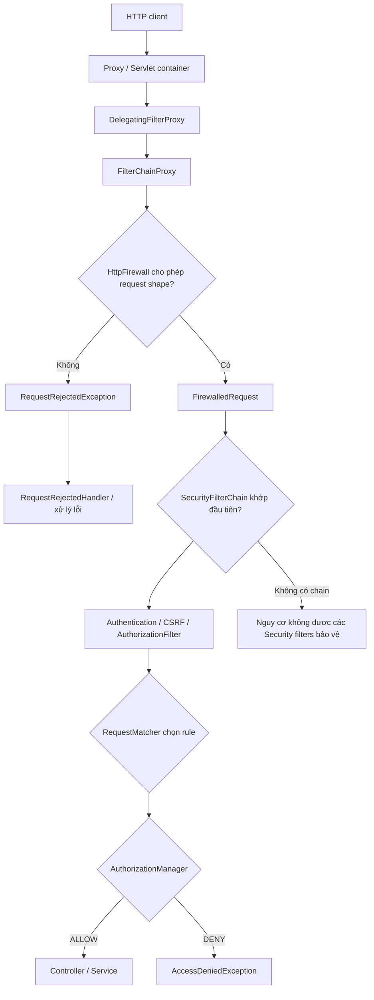

# HttpFirewall, chuẩn hóa đường dẫn và giới hạn của matcher

## Mục tiêu học tập

Để bảo vệ một endpoint, Spring Security không chỉ so sánh URL với một chuỗi như `"/admin/**"`. Một request đi qua reverse proxy, Servlet container, `FilterChainProxy`, `HttpFirewall`, `SecurityFilterChain`, `RequestMatcher`, `AuthorizationFilter` rồi mới tới controller. Các lớp này **không nhất thiết diễn giải URL theo cùng một cách**. Những biến thể như `//`, `..`, `;`, `%2F`, ký tự điều khiển hoặc HTTP method bất thường có thể gây lệch kết quả phân quyền.

Sau bài này, bạn có thể:

- Xác định vai trò `HttpFirewall`, `StrictHttpFirewall`, `DefaultHttpFirewall`, `FirewalledRequest` và `FilterChainProxy`.
- Phân biệt **request không hợp lệ** bị `RequestRejectedException` với **người dùng thiếu quyền** bị `AccessDeniedException`.
- Hiểu path normalization, URL decoding và khác biệt giữa `requestURI`, `contextPath`, `servletPath`, `pathInfo`, query string.
- Nhận biết **giới hạn của path matcher**: nó không giải quyết mọi dạng URL nhập nhằng, không thay thế policy authority và owner/tenant.
- Cấu hình `StrictHttpFirewall` thận trọng, test những ngoại lệ thật sự cần thiết và tránh tắt bảo vệ chỉ để loại bỏ một lỗi 400.
- Viết unit test, MockMvc test và HTTP integration tests khi nâng Spring Security hoặc thay đổi proxy/container/route.

Bối cảnh là **Spring Security authorization trên Servlet stack** (Spring MVC/Spring Boot, Spring Security 6.x/7.x). Các đoạn Spring trong bài là mã tích hợp cần dependencies. Phần Java 17 độc lập mô phỏng quyết định để đọc hiểu, **không phải implementation firewall thực tế**.

## 1. Vì sao cần HttpFirewall?

Hãy xem những request có hình thức khác nhau:

```text
GET /api/reports/42
GET /api/reports//42
GET /api/reports/./42
GET /api/reports/private/../42
GET /api/reports/42;v=1
GET /api/reports/%2F42
GET /api/reports/%252F42
GET /api/reports%2F42
```

Các chuỗi này **không mặc nhiên tương đương**. Tùy Servlet container, reverse proxy, URL decoder và matcher:

- Một lớp từ chối request ngay từ đầu.
- Một lớp bỏ path parameters hoặc chuẩn hóa dấu `/`.
- Một lớp giải mã phần trăm (percent-encoding) một lần, trong khi lớp khác dùng path đã giải mã theo cách khác.
- Một lớp thấy request URI gồm context path, còn lớp khác match phần servlet path.
- Matcher có thể chọn policy cho `/public/**` trong khi controller hiểu tài nguyên được truy cập theo path khác.

Nếu các lớp không thống nhất, kẻ tấn công có thể tìm đường dẫn trông “public” ở tầng Security nhưng lại ánh xạ tới dữ liệu nhạy cảm ở tầng ứng dụng.

**Mục tiêu của HttpFirewall là kiểm tra và cung cấp biểu diễn request đáng tin cậy hơn cho quá trình matching**, đồng thời từ chối nhiều dạng URL/request đáng ngờ. Nó **không phải** hệ thống phân quyền theo role hay ACL.

## 2. Vị trí trong luồng request

Với cấu hình Servlet tiêu biểu, `DelegatingFilterProxy` đưa request đến `FilterChainProxy`. `FilterChainProxy` áp dụng `HttpFirewall` để kiểm tra/wrap request, chọn `SecurityFilterChain` phù hợp, rồi chạy các filter xác thực và phân quyền trong chain.



Hai câu hỏi khác nhau:

1. **Firewall:** request có đủ hợp lệ để hệ thống xét tiếp không?
2. **Authorization:** request đã vào filter chain và có danh tính/quyền thích hợp chưa?

Một `ROLE_ADMIN` không thể “nâng” URL `/admin/%2Fsecret` qua `StrictHttpFirewall` nếu encoded slash đang bị từ chối. Ngược lại, URL `/admin/users` hoàn toàn bình thường vẫn có thể bị từ chối nếu authentication thiếu quyền admin.

### HttpFirewall không phải một RequestMatcher nữa

`HttpFirewall` là interface xử lý request/response trước việc chọn chain. Về mặt khái niệm, nó nhận `HttpServletRequest` và tạo `FirewalledRequest` hoặc ném `RequestRejectedException`:

```java
// Mô tả API ở mức khái niệm; không phải file Java độc lập.
FirewalledRequest firewalled =
    httpFirewall.getFirewalledRequest(httpServletRequest);
```

`FirewalledRequest` là một `HttpServletRequestWrapper` và có `reset()`. `FilterChainProxy` dùng nó trong phần bảo mật rồi có thể reset các giá trị path sau security chain. Vì vậy không nên giả định `servletPath`/`pathInfo` luôn có cùng biểu diễn ở tất cả giai đoạn.

## 3. StrictHttpFirewall: từ chối thay vì chuẩn hóa mạo hiểm

`StrictHttpFirewall` là implementation nghiêm ngặt, mặc định của Spring Security Servlet trong những cấu hình thông thường. Nó từ chối request đáng ngờ bằng `RequestRejectedException`.

Các nhóm bị kiểm tra gồm:

| Nhóm | Ví dụ | Rủi ro |
| --- | --- | --- |
| Path không chuẩn hóa | `/a/../admin`, `/a//b` | Directory traversal hoặc khác biệt khi match |
| URL path parameters | `/secure;v=1/data` | Semicolon xử lý khác ở container và matcher |
| Encoded slash | `/files/a%2Fb` | `%2F` có thể được coi là slash hoặc dữ liệu |
| Backslash | `\`, `%5C` | Một số parser có thể coi là separator |
| Encoded percent | `%25` | Double encoding có thể thay đổi path sau nhiều lần decode |
| Encoded period | `%2E` | Dot segments/traversal bị diễn giải mơ hồ |
| Null/control | `%00` hoặc encoded CR/LF | Malformed input / request splitting |
| HTTP method ngoài allowlist | `TRACE`, method tự đặt | HTTP verb tampering / XST |
| Host/header/parameter name không hợp lệ | Header chứa ký tự điều khiển | Parser disagreement hoặc input bất thường |

Theo API `StrictHttpFirewall`, mặc định quan trọng:

- **Không** cho semicolon ở URL.
- **Không** cho URL-encoded slash `%2F`, encoded percent `%25`, backslash và một số ký tự nguy hiểm khác.
- **Từ chối** URL không normalized; không có công tắc cho phép tùy ý non-normalized URLs vì rất rủi ro.
- **HTTP methods mặc định được cho phép:** DELETE, GET, HEAD, OPTIONS, PATCH, POST, PUT. Điều đó **chỉ** là accept về phương thức HTTP, không tự cấp quyền DELETE/PUT cho bất kỳ user nào.
- Có chính sách kiểm tra một số hostname, header và parameter values/names; các API cụ thể cần đối chiếu Javadoc của phiên bản thực tế.

**Quan trọng:** một raw URL có thể đã bị Servlet container, proxy hoặc WAF từ chối/normalize **trước khi** Spring nhận nó. Những ví dụ trên mô tả những gì firewall kiểm tra **nếu request tương ứng đi tới nó**, không cam kết mọi request ngoài Internet đều tồn tại ở dạng raw đó trong Spring.

### StrictHttpFirewall khác DefaultHttpFirewall

`DefaultHttpFirewall` có cơ chế xử lý/wrap path trong phạm vi được hỗ trợ, ví dụ loại path parameters trong giai đoạn matching; nó cũng từ chối nhiều path không normalized. `StrictHttpFirewall` có chính sách **từ chối rõ và chặt hơn** với nhiều biến thể như semicolon và encoded slash.

Tài liệu `FilterChainProxy` nhắc tới việc request wrapper có thể điều chỉnh `servletPath`/`pathInfo` cho matching rồi khôi phục. **Đừng kết luận từ đó rằng Strict mặc định cho phép semicolon rồi tự loại bỏ nó:** với Strict, semicolon thường bị **reject** trước.

Khi một URL đang bị chặn, đổi sang `DefaultHttpFirewall` chỉ để “hết lỗi” có thể thay đổi ranh giới bảo mật của toàn bộ ứng dụng. Trước hết hãy xem yêu cầu nghiệp vụ có cần URL đó hay không.

## 4. Đọc đúng Servlet request path

Giả sử người dùng gửi:

```text
https://example.com/app/mvc/api/reports/42?format=json
```

Và ứng dụng chạy dưới context root `/app`, DispatcherServlet được map theo `/mvc/*`:

| API/khái niệm | Ví dụ | Ý nghĩa |
| --- | --- | --- |
| `getRequestURI()` | `/app/mvc/api/reports/42` | Request URI path, **không gồm query string** |
| `getContextPath()` | `/app` | Prefix của ứng dụng trong servlet container |
| `getServletPath()` | `/mvc` | Phần đường dẫn được servlet mapping sử dụng trong ví dụ |
| `getPathInfo()` | `/api/reports/42` | Phần path tiếp theo sau servlet mapping |
| `getQueryString()` | `format=json` | Query string, không phải URL path |
| Path dưới context root | `/mvc/api/reports/42` | Đường dẫn được khớp theo matcher/builder phù hợp |

Các giá trị trên chỉ là **một tình huống Servlet mapping**. Khi servlet được map theo `/`, hoặc proxy đã rewrite path, `servletPath`/`pathInfo` có thể khác. Với URL percent-encoded, giá trị nhận được còn phụ thuộc container.

### getRequestURI không phải “path không chứa context”

Nếu tự viết:

```java
// Không phù hợp làm Security matcher tổng quát.
request.getRequestURI().startsWith("/api/private")
```

request dưới `/app` có thể không bao giờ match, vì `requestURI` bắt đầu bằng `/app`. Nếu sửa bằng `endsWith` hoặc thao tác substring tự chế, lại có thể tạo bypass theo path gần giống.

**Dùng các RequestMatcher chính thức** và kiểm thử với context path/servlet path thực tế. Với Spring Security 7, `PathPatternRequestMatcher` yêu cầu pattern bắt đầu bằng `/`, **loại context root**, và có cơ chế `basePath` phù hợp khi có servlet prefix.

### Query không được xem như một path segment

`GET /api/reports/42?format=csv` thường vẫn có path `/api/reports/42`. Nếu `format=csv` là thao tác export phải yêu cầu `report:export`, một matcher path-only `/api/reports/{id}` **không tự biết** khác biệt đó. Hãy dùng endpoint export riêng, hoặc policy kiểm tra query/operation tại service với dữ liệu chuẩn hóa và quyền cụ thể.

## 5. Giới hạn của RequestMatcher

`RequestMatcher` trả lời “request có khớp điều kiện không?”, **không phải** “đã bảo vệ an toàn khỏi mọi đường dẫn ác ý” và cũng **không** “người dùng có quyền không?”.

`securityMatcher(...)` ở `HttpSecurity` quyết định **toàn bộ SecurityFilterChain** nào được chọn. `requestMatchers(...)` trong `authorizeHttpRequests` quyết định **authorization rule** nào được dùng bên trong chain đã chọn.

`FilterChainProxy` chọn **chain đầu tiên khớp**; trong chain, `authorizeHttpRequests` chọn **rule đầu tiên khớp**. Không thử rule tiếp theo chỉ vì rule đầu trả DENY.

### Matcher quá rộng là lỗi dù firewall hoạt động đúng

```java
// SAI: rule path-only rộng có thể cho PATCH/DELETE đi qua.
http.authorizeHttpRequests(auth -> auth
    .requestMatchers("/api/**").authenticated()
    .requestMatchers(HttpMethod.DELETE, "/api/admin/**")
        .hasRole("ADMIN")
    .anyRequest().denyAll()
);
```

Với `DELETE /api/admin/users/42`, `/api/**` khớp trước và người đăng nhập bình thường có thể vượt **HTTP authorization**. URL ở đây hoàn toàn bình thường; firewall không có trách nhiệm sửa thứ tự policy sai.

Một cách phù hợp hơn:

```java
http.authorizeHttpRequests(auth -> auth
    .requestMatchers(HttpMethod.DELETE, "/api/admin/**")
        .hasRole("ADMIN")
    .requestMatchers(HttpMethod.GET, "/api/public/**")
        .permitAll()
    .anyRequest().denyAll()
);
```

Ngoài ra, matcher dù đúng path/method vẫn không kiểm tra **owner/tenant/ACL** của từng document. `hasAuthority("document:read")` chỉ cho phép thao tác đọc ở cấp chức năng; service/repository phải xem request này có quyền trên document 42 không.

### Không dùng String.startsWith làm policy path

`startsWith("/api/public")` cũng khớp `/api/publications` và `/api/public-secret`. Nó không hiểu servlet root, encoded slash, normalization hay segment boundary. Trong production, ưu tiên `requestMatchers(HttpMethod, pathPattern)` của đúng Spring Security version, rồi test pattern và rule order.

## 6. RequestRejectedException khác AccessDeniedException

| Thuộc tính | `RequestRejectedException` | `AccessDeniedException` |
| --- | --- | --- |
| Nơi thường phát sinh | `HttpFirewall` / `StrictHttpFirewall` | `AuthorizationFilter`, method security hoặc domain policy |
| Nguyên nhân | Request shape, URL, method, header không được chấp nhận | Người gọi không đủ quyền/mức xác thực |
| Thời điểm | Trước nhiều bước chọn rule và phân quyền | Sau khi đã tới bước đánh giá authorization |
| `ROLE_ADMIN` có bỏ qua được không? | Không, vì request shape vẫn không hợp lệ | Chỉ khi policy cấp quyền |
| Thành phần xử lý | `RequestRejectedHandler` hoặc tầng container/proxy | `ExceptionTranslationFilter` → entry point/denied handler khi exception lan tới |
| HTTP status thường gặp | **400** nếu được handler tương ứng xử lý; có thể khác theo cấu hình | **403** với full authentication thiếu quyền; anonymous có thể 401/redirect |

Một `RequestRejectedException` không được xử lý bằng cách thêm `.permitAll()` cho URL đó. Nó cũng **không phải** một `AccessDeniedException` để `AccessDeniedHandler` xử lý mặc định.

Spring Security có `RequestRejectedHandler` và `HttpStatusRequestRejectedHandler`, loại thứ hai có thể gửi status 400 theo cấu hình. Nhưng proxy/Servlet container cũng có thể từ chối request trước Spring. Do đó **HTTP 400 không chứng minh tầng nào đã từ chối**; kiểm tra log/correlation ID phù hợp.

### Ví dụ hai request có cùng path nghiệp vụ

```text
GET /api/reports/42
  → path hợp lệ, firewall chấp nhận
  → user không có report:read
  → AuthorizationManager DENY
  → AccessDeniedException / HTTP thường 403 với full user

GET /api/reports/%2F42
  → request có encoded slash
  → StrictHttpFirewall mặc định reject nếu nhận URL này
  → RequestRejectedException / handler, thường 400
  → chưa đánh giá report:read
```

Không phải mọi 403 đều do thiếu role: `CsrfFilter` hoặc policy tenant cũng có thể tạo 403. Không phải mọi 400 đều do firewall: HTTP parser và proxy cũng có thể trả 400.

## 7. Cấu hình StrictHttpFirewall thận trọng

Thông thường nên **giữ cấu hình Strict mặc định**, chỉ thay đổi khi có yêu cầu kỹ thuật được review và kiểm thử.

### Ví dụ giới hạn HTTP method

Nếu một ứng dụng thật sự chỉ nhận GET/POST, có thể khai báo bean:

```java
import java.util.List;
import org.springframework.context.annotation.Bean;
import org.springframework.context.annotation.Configuration;
import org.springframework.security.web.firewall.StrictHttpFirewall;

@Configuration
public class FirewallConfig {

    @Bean
    StrictHttpFirewall httpFirewall() {
        StrictHttpFirewall firewall = new StrictHttpFirewall();
        firewall.setAllowedHttpMethods(List.of("GET", "POST"));
        return firewall;
    }
}
```

Mẫu cấu hình **Spring**, cần dependency/context và việc wiring `FilterChainProxy` phù hợp; không chạy chỉ bằng `javac`. Nếu tự dựng `FilterChainProxy`, phải bảo đảm nó sử dụng instance firewall này. Trong ứng dụng thật, kiểm thử behavior chứ không chỉ thấy bean được tạo.

**Tác động:** `HEAD`, `OPTIONS`, `PATCH`, `PUT`, `DELETE` cũng bị chặn nếu không nằm trong allowlist. Điều đó có thể phá **CORS preflight OPTIONS**, health HEAD hoặc các API update. Ví dụ giới hạn này dùng để giải thích, **không phải khuyến nghị áp dụng mặc định**.

Mặc định Strict cho qua các method DELETE/GET/HEAD/OPTIONS/PATCH/POST/PUT ở **bước kiểm tra method**. Nó vẫn cần `AuthorizationManager` để cấp quyền theo từng HTTP method/path.

### Nới cho semicolon phải có lý do

```java
@Bean
StrictHttpFirewall httpFirewall() {
    StrictHttpFirewall firewall = new StrictHttpFirewall();
    firewall.setAllowSemicolon(true);
    return firewall;
}
```

Chỉ dùng nếu cần **matrix variables/path parameters** và đã kiểm tra cách proxy, Servlet container, matcher, MVC controller cùng xử lý `;`. Hãy cân nhắc thay dữ liệu bằng query/body; **không dùng session ID trong URL** vì dễ lộ qua logs, browser history hoặc referrer.

API còn có `setAllowUrlEncodedSlash`, `setAllowBackSlash`, `setAllowUrlEncodedPercent`, `setAllowNull`, `setAllowUrlEncodedPeriod` và `setUnsafeAllowAnyHttpMethod`. Đây là các **nút nới kiểm tra**, không phải danh sách nên bật. Đặc biệt đừng dùng `setUnsafeAllowAnyHttpMethod(true)` để làm các request method lạ vượt firewall.

## 8. Policy authorization vẫn phải rõ ràng

Ví dụ rule HTTP sau phân biệt GET và DELETE:

```java
import org.springframework.context.annotation.Bean;
import org.springframework.context.annotation.Configuration;
import org.springframework.http.HttpMethod;
import org.springframework.security.config.Customizer;
import org.springframework.security.config.annotation.web.builders.HttpSecurity;
import org.springframework.security.web.SecurityFilterChain;

@Configuration
public class SecurityConfig {

    @Bean
    SecurityFilterChain securityFilterChain(HttpSecurity http)
            throws Exception {
        http
            .authorizeHttpRequests(auth -> auth
                .requestMatchers(HttpMethod.GET, "/health")
                    .permitAll()
                .requestMatchers(HttpMethod.GET, "/api/reports/{id}")
                    .hasAuthority("report:read")
                .requestMatchers(HttpMethod.DELETE, "/api/reports/{id}")
                    .hasAuthority("report:delete")
                .anyRequest().denyAll()
            )
            .httpBasic(Customizer.withDefaults());
        return http.build();
    }
}
```

Đây là Spring configuration snippet, không tự tạo user store, database hay controller. `/api/reports/{id}` cần được test với matcher implementation thực tế: path pattern ở Spring Security 6.x/7.x có thể khác khi thay version hoặc Servlet mapping.

| HTTP request | Bước chọn | Ý nghĩa |
| --- | --- | --- |
| `GET /health` | Firewall chấp nhận, `permitAll` | Public khi URL hợp lệ |
| `GET /api/reports/42` với `report:read` | Rule GET | Qua HTTP authorization; service vẫn phải kiểm tra data |
| `DELETE /api/reports/42` chỉ có `report:read` | Rule DELETE | Thiếu `report:delete` → DENY |
| `POST /api/reports/42` | `denyAll` | Endpoint/method chưa khai → DENY |
| `TRACE /api/reports/42` | Strict method allowlist | REJECT trước authorization |
| `GET /api/reports/42;v=1` | Strict mặc định không cho `;` | REJECT nếu input đến firewall |
| `GET /api/reports/%2F42` | Strict mặc định không cho encoded slash | REJECT nếu input đến firewall |
| `GET /api/reports//42` | Firewall/container có thể từ chối path không normalized | Không chứng minh rule GET |

**Chỉ xem kết quả HTTP status là chưa đủ** để khẳng định một request bị đúng lớp từ chối. Phải tách kiểm thử firewall, authorization, controller và policy bản ghi.

## 9. Unit test StrictHttpFirewall

Với JUnit 5, `spring-test` và `spring-security-web` có thể kiểm tra trực tiếp exception type:

```java
import org.junit.jupiter.api.Test;
import org.springframework.mock.web.MockHttpServletRequest;
import org.springframework.security.web.firewall.RequestRejectedException;
import org.springframework.security.web.firewall.StrictHttpFirewall;

import static org.junit.jupiter.api.Assertions.assertNotNull;
import static org.junit.jupiter.api.Assertions.assertThrows;

class StrictHttpFirewallTest {

    private final StrictHttpFirewall firewall = new StrictHttpFirewall();

    @Test
    void normalGetIsAccepted() {
        MockHttpServletRequest request =
            new MockHttpServletRequest("GET", "/api/reports/42");
        assertNotNull(firewall.getFirewalledRequest(request));
    }

    @Test
    void semicolonIsRejected() {
        MockHttpServletRequest request =
            new MockHttpServletRequest("GET", "/api/reports/42;v=1");
        assertThrows(RequestRejectedException.class,
            () -> firewall.getFirewalledRequest(request));
    }

    @Test
    void encodedSlashIsRejected() {
        MockHttpServletRequest request =
            new MockHttpServletRequest("GET", "/api/reports/%2F42");
        assertThrows(RequestRejectedException.class,
            () -> firewall.getFirewalledRequest(request));
    }

    @Test
    void traceMethodIsRejected() {
        MockHttpServletRequest request =
            new MockHttpServletRequest("TRACE", "/api/reports/42");
        assertThrows(RequestRejectedException.class,
            () -> firewall.getFirewalledRequest(request));
    }
}
```

Đây là **JUnit/Spring test**, không phải chương trình Java độc lập. Với path có context root/servlet prefix, `MockHttpServletRequest` phải mô phỏng đúng `requestURI`, `contextPath`, `servletPath` và `pathInfo`. Một test chỉ đưa chuỗi raw URL vào constructor không thay thế hành vi decode/normalize của Servlet container thật.

### Kiểm tra từng ngoại lệ bằng test trước khi nới

Nếu ứng dụng thật sự cần `setAllowSemicolon(true)`, hãy test **cả** URL chuẩn và URL với `;`, rồi test matcher ở tầng Security/Servlet để chắc chắn URL semicolon không làm mất quyền. Không chỉ assert “không ném RequestRejectedException”, vì request có thể tiếp tục vào **một authorization rule khác** với ý định thiết kế.

Khi chỉnh allowed methods, thêm test OPTIONS preflight, HEAD và các POST/PATCH/DELETE thực tế. Việc firewall từ chối OPTIONS xảy ra **trước** khi một CORS filter phía sau có thể xử lý nó.

## 10. MockMvc test authorization sau firewall

Với Spring Boot 3.x + Spring Security 6.x và dependency `spring-security-test`, dùng `@SpringBootTest`/`@AutoConfigureMockMvc` hoặc áp `springSecurity()` vào `MockMvcBuilders.webAppContextSetup(...)`. Khi nâng Spring Boot major version, hãy cập nhật import test annotation theo BOM/version thực.

```java
import org.junit.jupiter.api.Test;
import org.springframework.beans.factory.annotation.Autowired;
import org.springframework.boot.test.autoconfigure.web.servlet.AutoConfigureMockMvc;
import org.springframework.boot.test.context.SpringBootTest;
import org.springframework.security.core.authority.SimpleGrantedAuthority;
import org.springframework.test.web.servlet.MockMvc;

import static org.springframework.security.test.web.servlet.request
    .SecurityMockMvcRequestPostProcessors.user;
import static org.springframework.test.web.servlet.request
    .MockMvcRequestBuilders.get;
import static org.springframework.test.web.servlet.result
    .MockMvcResultMatchers.status;

@SpringBootTest
@AutoConfigureMockMvc
class AuthorizationBoundaryTest {

    @Autowired
    MockMvc mvc;

    @Test
    void normalPathWithoutAuthorityIsForbidden() throws Exception {
        mvc.perform(get("/api/reports/42")
                .with(user("alice").authorities(
                    new SimpleGrantedAuthority("ROLE_USER"))))
            .andExpect(status().isForbidden());
    }

    @Test
    void newEndpointDeniedEvenForAdmin() throws Exception {
        mvc.perform(get("/api/unknown")
                .with(user("admin").roles("ADMIN")))
            .andExpect(status().isForbidden());
    }
}
```

Hai test trên nhắm vào **authorization** của cấu hình ở phần 8. Chúng không kiểm tra URI encoded hoặc Servlet container ngoài MockMvc. Nếu muốn test GET được phép và trả 200, cần controller fixture và dữ liệu; nếu không có controller thì request có thể qua Security rồi trả 404.

Thêm một nhóm test **policy dữ liệu**: người có `report:read` không được xem report khác tenant, ngay cả khi URL của report hợp lệ. `HttpFirewall` không tự giải quyết quyền owner/tenant/ACL.

## 11. Kiểm thử raw URL phải đi qua cả Servlet container/proxy

`MockMvc` tạo `MockHttpServletRequest` và **không** thực hiện toàn bộ logic HTTP parser, URL rewrite và normalization của web server. Với các trường hợp nhạy cảm hãy bổ sung embedded-server integration test và test staging qua gateway thật.

Kiểm tra:

- `/api/reports//42` và `/api/reports/../admin` bị chặn ở lớp nào?
- `%2F`, `%252F`, `%2E`, `%5C` có bị decode trước khi tới Java hay bị từ chối ở proxy?
- `getRequestURI()`, `getServletPath()`, `getPathInfo()` có đúng với context/servlet path của production?
- CDN/ingress có strip prefix hoặc rewrite path không? Security matcher và MVC controller có nhìn cùng một tài nguyên?
- `OPTIONS` preflight có bị CORS xử lý hợp lệ trước authentication nhưng vẫn có policy cho POST thật?
- `getQueryString()` có đang bị đưa nhầm vào path matcher không?
- URL ngoài `securityMatcher("/api/**")` có được fallback chain bảo vệ không?

Một response **400** có thể do Servlet container hoặc proxy, không chứng minh `StrictHttpFirewall` đã được gọi. Dùng log/metrics/correlation ID có kiểm soát để biết tầng nào tạo kết quả; **không log cookie/token/credential**, không hiển thị toàn bộ URL nhạy cảm cho client.

## 12. Java 17 độc lập: mô phỏng hai lớp quyết định

Ví dụ chạy được sau đây dùng quy tắc **cố ý đơn giản**, không sao chép parser của Spring. Nó giúp thấy khác nhau giữa `REJECT_FIREWALL` (request có hình thức không được phép) và `DENY_AUTHZ` (request hợp lệ nhưng không có quyền).

Lưu đúng tên file **`FirewallDecisionDemo.java`**:

```java
import java.util.Locale;
import java.util.Set;

public class FirewallDecisionDemo {

    record Request(
        String method, String path, Set<String> authorities
    ) {}

    enum Decision {
        REJECT_FIREWALL,
        DENY_AUTHZ,
        ALLOW
    }

    static Decision decide(Request request) {
        String path = request.path();
        String encoded = path.toLowerCase(Locale.ROOT);

        // Allowlist mô phỏng CỐ Ý chỉ GET/POST.
        // Đây KHÔNG phải mặc định của StrictHttpFirewall.
        if (!Set.of("GET", "POST").contains(request.method())
                || path.contains("//")
                || path.contains(";")
                || path.contains("..")
                || encoded.contains("%2f")) {
            return Decision.REJECT_FIREWALL;
        }

        if (request.method().equals("GET")
                && path.matches("/api/reports/[0-9]+")
                && request.authorities().contains("report:read")) {
            return Decision.ALLOW;
        }

        return Decision.DENY_AUTHZ;
    }

    static void show(
        String label, String method, String path, Set<String> authorities
    ) {
        Decision decision = decide(
            new Request(method, path, authorities)
        );
        System.out.println(label + " -> " + decision);
    }

    public static void main(String[] args) {
        show("read allowed", "GET", "/api/reports/42",
            Set.of("report:read"));
        show("read no permission", "GET", "/api/reports/42",
            Set.of("ROLE_USER"));
        show("double slash", "GET", "/api/reports//42",
            Set.of("report:read"));
        show("encoded slash", "GET", "/api/reports/%2F42",
            Set.of("report:read"));
        show("semicolon", "GET", "/api/reports;v=1/42",
            Set.of("report:read"));
        show("unknown method", "TRACE", "/api/reports/42",
            Set.of("report:read"));
        show("not declared method", "POST", "/api/reports/42",
            Set.of("report:read"));
    }
}
```

Biên dịch và chạy bằng JDK 17 trở lên:

```bash
javac FirewallDecisionDemo.java
java FirewallDecisionDemo
```

Stdout:

```text
read allowed -> ALLOW
read no permission -> DENY_AUTHZ
double slash -> REJECT_FIREWALL
encoded slash -> REJECT_FIREWALL
semicolon -> REJECT_FIREWALL
unknown method -> REJECT_FIREWALL
not declared method -> DENY_AUTHZ
```

Đọc kết quả:

1. URL bình thường và authority đúng → `ALLOW`.
2. URL bình thường thiếu authority → `DENY_AUTHZ`.
3. URL có path pattern bất thường/method ngoài allowlist của mô hình → `REJECT_FIREWALL`, **không cần xét authority**.
4. POST vào URL hợp lệ nhưng chưa có policy cho POST → `DENY_AUTHZ`.

**Không dùng code mô phỏng này làm firewall production.** `String.contains("..")` và `contains("%2f")` không bao quát URL decoding, container parsing hoặc encoded traversal; đôi khi còn có false positive. Dùng `StrictHttpFirewall` và các matcher chính thức, kiểm thử trên server thực.

## 13. Ma trận regression test khi đổi route hoặc nâng cấp

Một bảng kiểm thử nên có cả những request **được phép**, **thiếu quyền** và **bị firewall từ chối**:

| Input/ca test | Kỳ vọng kiểm tra |
| --- | --- |
| GET path chuẩn + `report:read` | Firewall qua; authorization cho phép; service kiểm tra tiếp |
| GET path chuẩn nhưng thiếu `report:read` | Qua firewall; HTTP authorization DENY |
| DELETE path chuẩn thiếu `report:delete` | HTTP authorization DENY |
| POST endpoint không khai | Fallback `denyAll` DENY |
| GET chứa `//` | Xác nhận container/firewall handling, không cho bypass |
| GET chứa `/../` | Không normalize thành đường được phép trái policy |
| GET có `;` | Strict mặc định từ chối semicolon nếu tới firewall |
| GET chứa `%2F` | Strict mặc định từ chối encoded slash nếu tới firewall |
| GET chứa `%252F` | Kiểm tra encoded percent và nhiều lần decode |
| GET có backslash hoặc `%5C` | Không cho path separator ambiguity bypass |
| HTTP method TRACE | Strict mặc định từ chối method |
| URL gần giống `/api/reports-old` | Không match nhầm `/api/reports/{id}` |
| Context path `/app` | Policy không nhầm path có/không context root |
| Servlet prefix `/mvc` | Matcher đúng servlet mapping |
| Reverse proxy rewrite path | Public URL và servlet path có hợp đồng rõ |
| CORS OPTIONS preflight | Không nhầm thành POST; CORS xử lý riêng |
| POST/PATCH thiếu CSRF token | CSRF policy từ chối đúng; không nhầm firewall |
| URL ngoài API chain | Fallback chain hoặc biện pháp tương đương bảo vệ |

Khi nâng Spring Security, Spring Framework hoặc Servlet container, hãy chạy **cùng một ma trận** trước/sau. Mọi chuyển đổi **REJECT → ALLOW** hoặc **DENY → ALLOW** phải được xem là thay đổi bảo mật và được review. Không nới `setAllow...` hoặc thay `denyAll` bằng `permitAll` chỉ để test xanh.

### Cách phân tích test đỏ

1. Request có tới Spring hay bị gateway/container xử lý trước?
2. Có `RequestRejectedException` hay chỉ thấy một HTTP status?
3. Firewall bean/config đang hoạt động thực tế là gì?
4. Sau firewall, `FilterChainProxy` chọn chain nào? Có URL nào ngoài tất cả chain?
5. Trong `AuthorizationFilter`, rule nào khớp đầu tiên và vì sao?
6. Có CSRF, method security hoặc object policy nào tạo 403 không?
7. Controller có tồn tại và trả response hợp lệ không?
8. Path decoding, context path, servlet path hoặc gateway rewrite có khác baseline không?

Không chỉ nhìn 401/403/404/405 hoặc 400 để đoán nguyên nhân; **xác định tầng quyết định** bằng unit + integration tests.

## 14. Lỗi triển khai thường gặp

1. **Tắt StrictHttpFirewall cho “dễ route”:** có thể mở URL bất thường mà security matcher và MVC xử lý khác nhau.
2. **Nhầm DefaultHttpFirewall với Strict:** semantics của URL handling và mức chặn có thể khác.
3. **Tự normalize mọi path đáng ngờ trước phân quyền:** có thể khiến controller nhìn resource khác với matcher.
4. **Dùng `getRequestURI()` như path không có context root:** sinh lỗi khi deployment đổi context.
5. **Dùng `startsWith` để kiểm tra admin/public:** match nhầm path gần giống và thiếu segment boundary.
6. **Coi RequestMatcher như toàn bộ phòng vệ URL:** nó chỉ chọn rule; firewall và policy còn trách nhiệm khác.
7. **Nhầm RequestRejectedException với AccessDeniedException:** cấu hình sai handler, log nhầm nguyên nhân.
8. **Nới `setAllowSemicolon`/`setAllowUrlEncodedSlash` khi chưa test:** dễ tạo mismatch với container/proxy.
9. **Cho mọi HTTP method qua firewall rồi chỉ dựa vào tên route:** HTTP verb tampering có thể thành rủi ro.
10. **Vô tình cấm OPTIONS preflight:** khi giới hạn method firewall, CORS có thể bị chặn trước.
11. **Quên CSRF:** một POST 403 chưa chứng minh HTTP matcher hoặc firewall đã chạy.
12. **Tin 400 luôn là lỗi Spring Security:** proxy/container cũng có thể tạo 400.
13. **Chỉ dùng MockMvc để thử raw URL encoding:** không có HTTP parser/proxy thực; cần test qua server.
14. **Không có fallback chain:** `anyRequest().denyAll()` trong API chain không bảo vệ URL ngoài `securityMatcher`.
15. **Bỏ quên owner/tenant:** URL hợp lệ + `report:read` vẫn có thể không được phép xem bản ghi 42.
16. **Không test nâng phiên bản:** parser/Servlet mapping thay đổi có thể tạo DENY→ALLOW không chủ đích.

## 15. Checklist áp dụng

- [ ] Xác nhận `FilterChainProxy` dùng `HttpFirewall` được kỳ vọng.
- [ ] Giữ `StrictHttpFirewall` mặc định nếu không có yêu cầu ngoại lệ đã review.
- [ ] Phân biệt `RequestRejectedException` và `AccessDeniedException` trong log/test.
- [ ] Hiểu path sau proxy, context root, servlet mapping và URL decoding.
- [ ] Không tự dùng `String.startsWith`/`substring` để tạo security path matcher.
- [ ] Đặt rule HTTP method/path cụ thể trước, fallback `anyRequest().denyAll()` khi yêu cầu.
- [ ] Kiểm tra nhiều SecurityFilterChain và URL nằm ngoài chain chuyên biệt.
- [ ] Test `//`, `..`, `;`, `%2F`, `%25`, backslash và HTTP method không mong muốn.
- [ ] Test CORS OPTIONS và CSRF riêng, không trộn nguyên nhân với firewall.
- [ ] Bổ sung HTTP integration tests qua Servlet container/proxy thật cho encoded URLs.
- [ ] Có policy owner/tenant/ACL ngoài HTTP authorization.
- [ ] Không thay đổi firewall hoặc nới quyền chỉ để các HTTP status tests xanh.
- [ ] Khi nâng version, review mọi thay đổi từ REJECT/DENY sang ALLOW.

### Câu hỏi tự kiểm tra

**Câu 1.** User có `ROLE_ADMIN` gọi URL chứa encoded slash `%2F` và StrictHttpFirewall từ chối. Thêm `hasRole("ADMIN")` có khắc phục không?

**Đáp án:** Không. Request bị từ chối **trước** việc xét role.

**Câu 2.** `GET /api/reports/42` bình thường, người dùng không có `report:read`. Nên phân loại lỗi nào?

**Đáp án:** Lỗi authorization, thường là `AccessDeniedException`; không phải request malformed.

**Câu 3.** Vì sao một test MockMvc `%2F` trả 400 không chứng minh chắc chắn production đã an toàn?

**Đáp án:** MockMvc không mô phỏng hết URL parsing/normalization của proxy/container; cần test toàn tuyến và xác định tầng đã chặn.

**Câu 4.** Cấu hình Strict chỉ cho `GET`, `POST` có thể làm hỏng chức năng nào dù API POST có quyền đúng?

**Đáp án:** CORS **OPTIONS preflight**, HEAD hoặc REST methods khác nếu ứng dụng cần chúng.

## Tài liệu tham khảo

- Spring Security, *HttpFirewall / Servlet HTTP Requests*: https://docs.spring.io/spring-security/reference/servlet/exploits/firewall.html
- Spring Security, *Servlet Architecture / FilterChainProxy*: https://docs.spring.io/spring-security/reference/servlet/architecture.html
- Spring Security, *StrictHttpFirewall API*: https://docs.spring.io/spring-security/reference/api/java/org/springframework/security/web/firewall/StrictHttpFirewall.html
- Spring Security, *DefaultHttpFirewall API*: https://docs.spring.io/spring-security/reference/api/java/org/springframework/security/web/firewall/DefaultHttpFirewall.html
- Spring Security, *RequestRejectedHandler API*: https://docs.spring.io/spring-security/reference/api/java/org/springframework/security/web/firewall/RequestRejectedHandler.html
- Spring Security, *HttpStatusRequestRejectedHandler API*: https://docs.spring.io/spring-security/reference/api/java/org/springframework/security/web/firewall/HttpStatusRequestRejectedHandler.html
- Spring Security, *Authorize HTTP Requests*: https://docs.spring.io/spring-security/reference/servlet/authorization/authorize-http-requests.html
