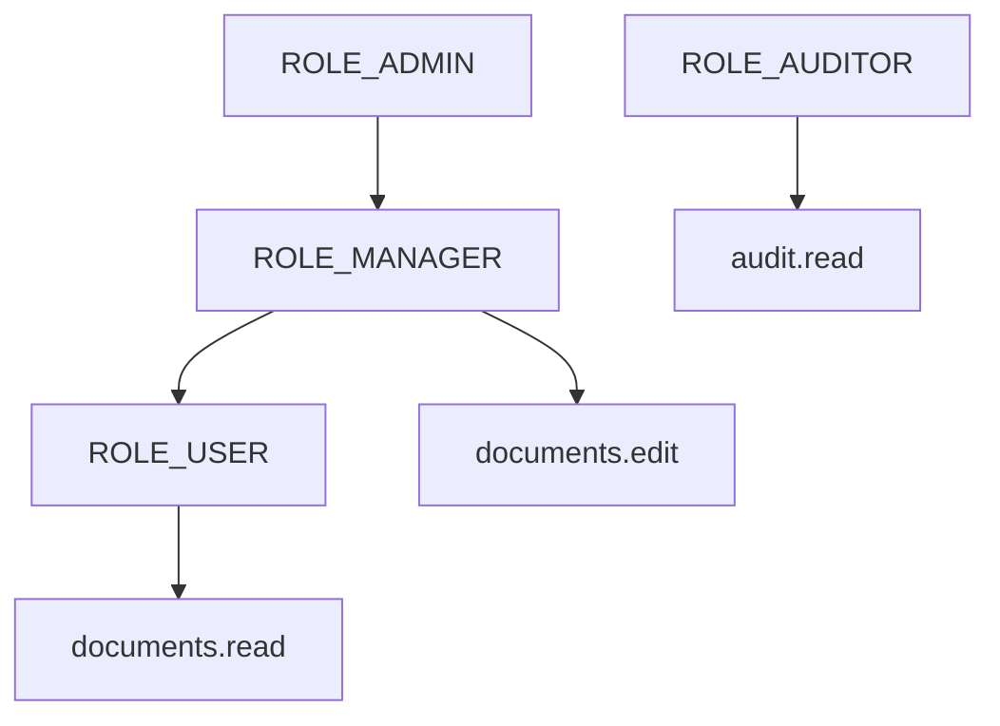

# Quan hệ kế thừa role và bài toán quyền bao hàm

Trong ứng dụng có nhiều vai trò như `ADMIN`, `MANAGER`, `USER`, yêu cầu quen thuộc là: **người giữ vai trò cấp cao được phép thực hiện những thao tác đã cấp cho một số vai trò cấp thấp**, mà không phải lưu mọi vai trò thấp hơn cho từng người hoặc viết `OR` dài trong từng rule.

**Role hierarchy (phân cấp vai trò)** là cơ chế khai báo **quan hệ bao hàm giữa các authority**. Với Spring Security, có thể viết:

```text
ROLE_ADMIN > ROLE_MANAGER
ROLE_MANAGER > ROLE_USER
```

Ký hiệu **`A > B` nghĩa là “A bao hàm B”**, **không** phải “A được thăng lên B”. Khi cơ chế authorization có tích hợp `RoleHierarchy`, người được gán `ROLE_ADMIN` được coi như có `ROLE_MANAGER` và `ROLE_USER` **khi kiểm tra quyền theo hierarchy**. Người chỉ có `ROLE_USER` **không** tự được nâng lên `ROLE_MANAGER`.

Ý tưởng rất hữu ích nhưng dễ gây lỗi cấp quyền vượt mức nếu hiểu sai hướng mũi tên, tạo các quan hệ quá rộng, hoặc dùng một hierarchy toàn cục cho quyền vốn phụ thuộc tenant, object hoặc trạng thái nghiệp vụ.

**Phạm vi bài học:** Spring Security authorization trên Servlet, `GrantedAuthority`/`hasRole`/`hasAuthority`, `RoleHierarchy`/`RoleHierarchyImpl`, kiểm tra HTTP và method, Java 17+, cách mô hình hóa graph và các trường hợp vận hành. Ví dụ framework tập trung vào **Spring Security 6.5.x**; khi dùng Spring Security 7.x hãy so tài liệu phiên bản vì các API tạo `AuthorizationManager` có thay đổi.

## 1. Bài toán: một vai trò có bao hàm vai trò khác không?

Giả sử một ứng dụng quản lý tài liệu có ba vai trò:

| Vai trò | Mục đích nghiệp vụ |
| --- | --- |
| `ROLE_USER` | Xem tài liệu công khai/được cấp quyền |
| `ROLE_MANAGER` | Làm các việc của USER và quản lý tài liệu thuộc phạm vi được phép |
| `ROLE_ADMIN` | Làm các việc của MANAGER và quản trị hệ thống theo chính sách |

Nếu không có cơ chế kế thừa, hệ thống phải chọn một trong những cách:

**Cách A – cấp trực tiếp nhiều role cho mỗi người:**

```text
Alice: ROLE_ADMIN, ROLE_MANAGER, ROLE_USER
Bob:   ROLE_MANAGER, ROLE_USER
Carol: ROLE_USER
```

Khi role USER có thêm một chức năng, hệ thống cần bảo đảm mọi tài khoản cấp cao cũng nhận vai trò đó. Độ phức tạp quản lý tăng theo số vai trò, số người dùng và số nhóm.

**Cách B – viết tất cả role được phép tại từng rule:**

```java
.requestMatchers("/dashboard").hasAnyRole("USER", "MANAGER", "ADMIN")
```

Khi thêm `ROLE_SUPERVISOR` hoặc thay đổi chính sách, phải sửa nhiều rule. Có nguy cơ một endpoint quên cập nhật nên bị từ chối nhầm hoặc mở nhầm quyền.

**Cách C – khai báo quan hệ bao hàm một lần:**

```text
ROLE_ADMIN > ROLE_MANAGER
ROLE_MANAGER > ROLE_USER
```

Giờ rule yêu cầu `ROLE_USER` có thể được đánh giá thành công với `ROLE_ADMIN` hoặc `ROLE_MANAGER` **khi authorization manager đã được nối với role hierarchy**:

```java
.requestMatchers("/dashboard").hasRole("USER")
```

Cơ chế này giúp rule nói đúng **mức quyền tối thiểu cần có**, thay vì liệt kê tất cả vai trò cấp cao có thể thỏa điều kiện.

### Điều gì KHÔNG tự xảy ra?

- Spring Security **không tự suy ra** quan hệ `ADMIN > MANAGER > USER` từ tên vai trò.
- Một chuỗi `ROLE_ADMIN` trong `SimpleGrantedAuthority` **không tự chứa** các quyền khác.
- Hierarchy **không tự biến user thành owner** của một tài liệu hoặc thành viên của tenant khác.
- Không có chuyện `ROLE_USER` “kế thừa ngược” `ROLE_ADMIN` chỉ vì cùng tồn tại trên graph.
- Chỉ tạo bean `RoleHierarchy` không phải bằng chứng mọi custom authorization manager, mọi token consumer và mọi service trong hệ thống đều sử dụng hierarchy đó.

## 2. Đọc đúng dấu `>`: quyền bao hàm có hướng

Xét:

```text
ROLE_ADMIN > ROLE_MANAGER
ROLE_MANAGER > ROLE_USER
ROLE_USER > documents.read
ROLE_MANAGER > documents.edit
ROLE_AUDITOR > audit.read
```



Mũi tên đi **từ authority nguồn có quyền mạnh hơn tới authority đích được bao hàm**. `ROLE_ADMIN` bao hàm `ROLE_MANAGER`, nên tiếp tục bao hàm `ROLE_USER`, `documents.read` và `documents.edit`. `ROLE_AUDITOR` là nhánh riêng: không có cạnh giữa auditor và manager thì **không có quyền kế thừa qua lại**.

### 2.1. Bao hàm trực tiếp và bao hàm bắc cầu

Với cạnh:

```text
A > B
B > C
```

Ta có:

- **Trực tiếp:** A bao hàm B, B bao hàm C.
- **Bắc cầu:** A bao hàm C qua B.
- **Không đối xứng:** B không mặc nhiên bao hàm A.
- **Không tự thêm quan hệ mới:** Nếu không có `C > D` hoặc một đường đi khác đến D, A không tự bao hàm D.

Trong lý thuyết đồ thị, `RoleHierarchy` giúp tìm **tập authority có thể đi tới** từ authority đã gán. Có thể hình dung:

```text
reachable(ROLE_ADMIN)
  = { ROLE_ADMIN,
      ROLE_MANAGER,
      ROLE_USER,
      documents.read,
      documents.edit }
```

Những chuỗi trong tập là **authority name**; không phải toàn bộ ngữ cảnh người dùng đã được xác minh hay chính sách truy cập một record cụ thể.

### 2.2. Vì sao cần bao gồm cả authority gốc?

Nếu người dùng đã được gán `ROLE_MANAGER`, họ vẫn phải thỏa rule yêu cầu chính `ROLE_MANAGER`, bên cạnh các authority kế thừa. `RoleHierarchy#getReachableGrantedAuthorities(...)` trả **authority gốc cùng những authority có thể đạt tới**, không chỉ các node đích mới phát sinh.

### 2.3. Diamond graph không làm “nhân đôi quyền”

Một hierarchy có thể tạo nhánh hội tụ:

```text
ROLE_ADMIN > ROLE_EDITOR
ROLE_ADMIN > ROLE_REVIEWER
ROLE_EDITOR > documents.read
ROLE_REVIEWER > documents.read
```

`documents.read` có thể đi tới theo hai đường, nhưng đây vẫn là **một quyền**; không có nguyên tắc “hai đường cấp phép mạnh gấp đôi”. Khi tính closure, các authority trùng tên được xử lý như phần tử trong một tập quyền.

### 2.4. Tránh chu trình

Một đồ thị hợp lý cho quan hệ cấp bậc thường **không có vòng** như:

```text
ROLE_ADMIN > ROLE_MANAGER
ROLE_MANAGER > ROLE_USER
ROLE_USER > ROLE_ADMIN
```

Chu trình khiến ý nghĩa “cao hơn” và “thấp hơn” bị phá vỡ. `RoleHierarchyImpl` trong Spring Security 6.5 phát hiện cycle trong quá trình xây dựng/pre-calculate và có thể ném `CycleInRoleHierarchyException`. Hãy kiểm DAG (directed acyclic graph), đặc biệt nếu sinh cấu hình từ database hoặc file ngoài.

## 3. Role không phải một Java type riêng biệt trong Authentication

Trong Spring Security, authority gắn với người dùng qua `GrantedAuthority`:

```java
GrantedAuthority authority =
        new SimpleGrantedAuthority("ROLE_ADMIN");
```

`SimpleGrantedAuthority` chỉ giữ chuỗi. Role thường là authority có tiền tố `ROLE_`; permission có thể là `documents.read`, `documents.edit` hoặc `invoice:approve`. Tham số string của `SimpleGrantedAuthority` **không tự phân loại** nó thành role hay permission.

Trong cấu hình mặc định:

- `hasRole("ADMIN")` có ý nghĩa kiểm authority `ROLE_ADMIN`.
- `hasAuthority("ROLE_ADMIN")` kiểm chuỗi đầy đủ.
- `hasAuthority("documents.read")` kiểm quyền nghiệp vụ tên `documents.read`.
- `hasRole("documents.read")` **không** tương đương `hasAuthority("documents.read")`, vì tiền tố role mặc định `ROLE_`.

Một hierarchy có thể nối **cả role lẫn authority thường**, ví dụ:

```text
ROLE_MANAGER > documents.edit
ROLE_USER > documents.read
```

Nhưng đây là một quan hệ **được khai báo rõ**, không phải tính năng Spring tự hiểu từ từ “manager” hoặc “read”. Mọi authority trong hierarchy phải dùng **đúng tên chuỗi** mà bộ kiểm tra truy xuất.

### Prefix và case sensitivity

`ROLE_ADMIN`, `ROLE_admin`, `ADMIN` và `role_admin` là những định danh khác nhau. Nếu dùng builder `RoleHierarchyImpl.withDefaultRolePrefix()`, có thể dùng tên ngắn như `ADMIN`/`USER` và builder gắn `ROLE_`. Nếu dùng `RoleHierarchyImpl.fromHierarchy(String)`, các dòng định nghĩa sử dụng **chuỗi authority đầy đủ** như `ROLE_ADMIN`.

Nếu ứng dụng tùy chỉnh role prefix bằng `GrantedAuthorityDefaults` hoặc policy riêng, cần kiểm mọi nơi tạo role, khai báo hierarchy và dùng `hasRole` để tránh lỗi lệch tiền tố.

## 4. RoleHierarchy trong Spring Security làm công việc gì?

Spring Security cung cấp interface:

```java
public interface RoleHierarchy {
    Collection<? extends GrantedAuthority> getReachableGrantedAuthorities(
            Collection<? extends GrantedAuthority> authorities);
}
```

Chữ ký trên là **minh họa tương đương về kiểu dữ liệu**; khi tích hợp dự án hãy import interface thật `org.springframework.security.access.hierarchicalroles.RoleHierarchy` và dùng signature của phiên bản đang chạy.

Implementation phổ biến: **`RoleHierarchyImpl`** tại:

```text
org.springframework.security.access.hierarchicalroles.RoleHierarchyImpl
```

Nó nhận định nghĩa các cạnh bao hàm và tính những authority có thể đạt tới theo quan hệ bắc cầu. Khi manager hỗ trợ hierarchy kiểm `hasRole` hoặc `hasAuthority`, nó sử dụng **tập reachable** để biết user có thỏa quyền yêu cầu hay không.

**Chú ý mô hình dữ liệu:**

- `Authentication#getAuthorities()` thường vẫn chứa **quyền được cấp ban đầu** do authentication provider tạo.
- `RoleHierarchyImpl#getReachableGrantedAuthorities(...)` trả một **tập nhìn nhận được sau khi áp hierarchy**.
- Việc role được coi là bao hàm quyền khác trong **một bước authorization** không đồng nghĩa đối tượng Authentication đã bị ghi sửa hoặc JWT đã được thêm claim.
- Nếu một service tự làm `authentication.getAuthorities().contains(...)` mà không dùng hierarchy-aware manager, nó có thể **không nhìn thấy** authority được bao hàm.
- Nếu ứng dụng có nhiều kiểu authorization (HTTP, method, endpoint tùy chỉnh, resource server độc lập), phải thống nhất nơi nào dùng cùng định nghĩa hierarchy và nơi nào chỉ xét quyền gốc.

### Dùng bean, không dùng setter cũ

Spring Security 6.5 hỗ trợ:

```java
@Bean
static RoleHierarchy roleHierarchy() {
    return RoleHierarchyImpl.fromHierarchy("""
        ROLE_ADMIN > ROLE_MANAGER
        ROLE_MANAGER > ROLE_USER
        ROLE_USER > documents.read
        ROLE_MANAGER > documents.edit
        ROLE_AUDITOR > audit.read
        """);
}
```

`fromHierarchy(...)` xây dựng object theo định nghĩa. Cách cũ dùng `new RoleHierarchyImpl()` rồi `setHierarchy(...)` đã được đánh dấu **deprecated** ở Spring Security 6.5; ưu tiên factory mới. Đoạn code là một **mảnh bean configuration** trong ứng dụng Spring Boot 3/Java 17+, cần import `@Bean`, `RoleHierarchy` và `RoleHierarchyImpl`.

## 5. Java 17 + Maven: chạy trực tiếp với RoleHierarchyImpl thật

Ví dụ hoàn chỉnh dùng **chính implementation Spring Security**, không phải mô phỏng graph. Nó in tập reachable đã được sắp xếp để stdout ổn định bất kể thứ tự collection thư viện trả về.

Cấu trúc dự án:

```text
role-hierarchy-demo/
├── pom.xml
└── src/
    └── main/
        └── java/
            └── demo/
                └── RoleHierarchyDemo.java
```

Tạo **`pom.xml`**:

```xml
<project xmlns="http://maven.apache.org/POM/4.0.0"
         xmlns:xsi="http://www.w3.org/2001/XMLSchema-instance"
         xsi:schemaLocation="http://maven.apache.org/POM/4.0.0
             https://maven.apache.org/xsd/maven-4.0.0.xsd">
    <modelVersion>4.0.0</modelVersion>
    <groupId>demo</groupId>
    <artifactId>role-hierarchy-demo</artifactId>
    <version>1.0.0</version>

    <properties>
        <maven.compiler.release>17</maven.compiler.release>
        <project.build.sourceEncoding>UTF-8</project.build.sourceEncoding>
    </properties>

    <dependencies>
        <dependency>
            <groupId>org.springframework.security</groupId>
            <artifactId>spring-security-core</artifactId>
            <version>6.5.11</version>
        </dependency>
    </dependencies>

    <build>
        <plugins>
            <plugin>
                <groupId>org.apache.maven.plugins</groupId>
                <artifactId>maven-compiler-plugin</artifactId>
                <version>3.14.0</version>
            </plugin>
            <plugin>
                <groupId>org.codehaus.mojo</groupId>
                <artifactId>exec-maven-plugin</artifactId>
                <version>3.5.1</version>
                <configuration>
                    <mainClass>demo.RoleHierarchyDemo</mainClass>
                </configuration>
            </plugin>
        </plugins>
    </build>
</project>
```

Tạo file **`src/main/java/demo/RoleHierarchyDemo.java`**:

```java
package demo;

import java.util.List;
import java.util.TreeSet;
import org.springframework.security.access.hierarchicalroles.RoleHierarchy;
import org.springframework.security.access.hierarchicalroles.RoleHierarchyImpl;
import org.springframework.security.core.GrantedAuthority;
import org.springframework.security.core.authority.SimpleGrantedAuthority;

public class RoleHierarchyDemo {

    static String visible(
            RoleHierarchy hierarchy, String directlyAssigned) {

        List<GrantedAuthority> original = List.of(
                new SimpleGrantedAuthority(directlyAssigned)
        );

        TreeSet<String> names = new TreeSet<>();
        for (GrantedAuthority authority :
                hierarchy.getReachableGrantedAuthorities(original)) {
            names.add(authority.getAuthority());
        }
        return names.toString();
    }

    static boolean has(
            RoleHierarchy hierarchy, String assigned, String required) {

        return hierarchy.getReachableGrantedAuthorities(List.of(
                new SimpleGrantedAuthority(assigned)
        )).stream().anyMatch(authority ->
                required.equals(authority.getAuthority()));
    }

    public static void main(String[] args) {
        RoleHierarchy hierarchy = RoleHierarchyImpl.fromHierarchy("""
                ROLE_ADMIN > ROLE_MANAGER
                ROLE_MANAGER > ROLE_USER
                ROLE_USER > documents.read
                ROLE_MANAGER > documents.edit
                ROLE_AUDITOR > audit.read
                """);

        System.out.println("ADMIN: " + visible(hierarchy, "ROLE_ADMIN"));
        System.out.println("MANAGER: "
                + visible(hierarchy, "ROLE_MANAGER"));
        System.out.println("USER: " + visible(hierarchy, "ROLE_USER"));
        System.out.println("AUDITOR: "
                + visible(hierarchy, "ROLE_AUDITOR"));

        System.out.println("ADMIN has ROLE_USER: "
                + has(hierarchy, "ROLE_ADMIN", "ROLE_USER"));
        System.out.println("USER has ROLE_ADMIN: "
                + has(hierarchy, "ROLE_USER", "ROLE_ADMIN"));
        System.out.println("MANAGER can documents.edit: "
                + has(hierarchy, "ROLE_MANAGER", "documents.edit"));
        System.out.println("AUDITOR can documents.read: "
                + has(hierarchy, "ROLE_AUDITOR", "documents.read"));
        System.out.println("USER can documents.edit: "
                + has(hierarchy, "ROLE_USER", "documents.edit"));
    }
}
```

Trong thư mục `role-hierarchy-demo` với **JDK 17+ và Maven tương thích**, chạy:

```bash
mvn -q compile exec:java
```

Stdout kỳ vọng của **chương trình**, theo `TreeSet` sắp tên quyền tăng dần:

```text
ADMIN: [ROLE_ADMIN, ROLE_MANAGER, ROLE_USER, documents.edit, documents.read]
MANAGER: [ROLE_MANAGER, ROLE_USER, documents.edit, documents.read]
USER: [ROLE_USER, documents.read]
AUDITOR: [ROLE_AUDITOR, audit.read]
ADMIN has ROLE_USER: true
USER has ROLE_ADMIN: false
MANAGER can documents.edit: true
AUDITOR can documents.read: false
USER can documents.edit: false
```

**Cách đọc kết quả:**

1. `ROLE_ADMIN` có được `ROLE_USER` do đi qua `ROLE_MANAGER`: đây là **kế thừa bắc cầu**.
2. `ROLE_USER` **không** được `ROLE_ADMIN` vì graph có hướng.
3. `ROLE_MANAGER` nhìn thấy cả `documents.edit` trực tiếp và `documents.read` thông qua `ROLE_USER`.
4. `ROLE_AUDITOR` chỉ có quyền `audit.read` được khai báo; không đương nhiên có tài liệu.
5. `TreeSet` chỉ dùng để **sắp xếp stdout** dễ so sánh; thứ tự phần tử trong một collection không mang ý nghĩa mức quyền.
6. Chương trình **không tạo Authentication đã xác thực, không bảo vệ HTTP endpoint và không cấp token**. Nó chỉ minh họa behavior của `RoleHierarchyImpl`.

## 6. Cách viết hierarchy bằng Builder

Spring Security 6.5 có builder tường minh tên role; dùng khi muốn khai báo từng cạnh bằng Java fluent API thay vì một string nhiều dòng:

```java
@Bean
static RoleHierarchy roleHierarchy() {
    return RoleHierarchyImpl.withDefaultRolePrefix()
        .role("ADMIN").implies("MANAGER")
        .role("MANAGER").implies("USER")
        .role("USER").implies("GUEST")
        .build();
}
```

Đoạn này sinh quan hệ bao hàm giữa những authority:

```text
ROLE_ADMIN > ROLE_MANAGER
ROLE_MANAGER > ROLE_USER
ROLE_USER > ROLE_GUEST
```

Phân biệt hai cách:

- `withDefaultRolePrefix()`: nhập **tên role không có `ROLE_`** trong lời gọi `role(...).implies(...)`.
- `fromHierarchy(...)`: viết **chính xác các chuỗi authority đầy đủ** trên từng dòng; có thể bao gồm permission không mang `ROLE_`.
- `withRolePrefix("CUSTOM_")` tồn tại nếu hệ thống có quy ước prefix riêng; phải đồng bộ với nơi tạo authorities và rule kiểm tra, không chỉ đổi builder.

**Không viết** `.role("ROLE_ADMIN")` rồi mặc định builder `withDefaultRolePrefix()` sẽ tự đoán bạn đã thêm prefix; hãy xem contract builder và dùng tên ngắn `ADMIN` để tránh sai tên authority.

## 7. Nối RoleHierarchy vào phân quyền HTTP

Trong Spring Security Servlet, `authorizeHttpRequests` sử dụng `AuthorizationManager` để kiểm rule. Tài liệu Spring Security 6.5 hỗ trợ sử dụng một bean `RoleHierarchy` cho những manager chuẩn theo URL.

Ví dụ lớp cấu hình Spring Boot 3.x:

```java
package com.example.security;

import org.springframework.context.annotation.Bean;
import org.springframework.context.annotation.Configuration;
import org.springframework.http.HttpMethod;
import org.springframework.security.access.hierarchicalroles.RoleHierarchy;
import org.springframework.security.access.hierarchicalroles.RoleHierarchyImpl;
import org.springframework.security.config.annotation.web.builders.HttpSecurity;
import org.springframework.security.web.SecurityFilterChain;

@Configuration
public class WebSecurityConfig {

    @Bean
    static RoleHierarchy roleHierarchy() {
        return RoleHierarchyImpl.fromHierarchy("""
            ROLE_ADMIN > ROLE_MANAGER
            ROLE_MANAGER > ROLE_USER
            ROLE_USER > documents.read
            ROLE_MANAGER > documents.edit
            """);
    }

    @Bean
    SecurityFilterChain filterChain(HttpSecurity http) throws Exception {
        http.authorizeHttpRequests(auth -> auth
            .requestMatchers("/admin/**").hasRole("ADMIN")
            .requestMatchers("/manager/**").hasRole("MANAGER")
            .requestMatchers(HttpMethod.GET, "/documents/**")
                .hasAuthority("documents.read")
            .requestMatchers(HttpMethod.PATCH, "/documents/**")
                .hasAuthority("documents.edit")
            .anyRequest().denyAll()
        );
        return http.build();
    }
}
```

**Đây là code tích hợp trong dự án Spring**, không phải chương trình Java standalone. Cần thêm authentication mechanism (session/JWT/HTTP Basic tùy hệ thống), controller, dependencies và CSRF/security headers phù hợp. Ứng dụng thực tế phải kiểm kết quả `RoleHierarchy` đã được wired vào **authorization manager** của chain; custom manager không tự biết bean hierarchy nếu chưa gắn.

Giả sử Alice được xác thực với **chỉ** `ROLE_ADMIN`, Bob với `ROLE_MANAGER`, Carol với `ROLE_USER`:

| Rule | Alice / ADMIN | Bob / MANAGER | Carol / USER |
| --- | --- | --- | --- |
| `hasRole("ADMIN")` | ALLOW | DENY | DENY |
| `hasRole("MANAGER")` | ALLOW qua hierarchy | ALLOW | DENY |
| `hasRole("USER")` | ALLOW qua hierarchy | ALLOW qua hierarchy | ALLOW |
| `hasAuthority("documents.read")` | ALLOW qua hierarchy | ALLOW qua hierarchy | ALLOW qua hierarchy |
| `hasAuthority("documents.edit")` | ALLOW qua hierarchy | ALLOW qua hierarchy | DENY |

Bảng phản ánh **quy tắc authorization khi hierarchy đã được dùng đúng**; nó không đảm bảo controller tồn tại, request đã qua CSRF hoặc user được xem đúng một tài liệu cụ thể.

### Lưu ý: hierarchy không thay toàn bộ quy tắc thứ tự URL

Với matcher:

```java
.requestMatchers("/documents/**").permitAll()
.requestMatchers(HttpMethod.PATCH, "/documents/**")
    .hasAuthority("documents.edit")
```

Rule `permitAll` có thể che rule PATCH đặt sau. **Role hierarchy không cứu được một request matcher có thứ tự sai.** Đặt rule cụ thể trước, fallback sau, và dùng `anyRequest().denyAll()` cho endpoint chưa thiết kế.

## 8. Áp dụng ở method security: @PreAuthorize, @Secured, JSR-250

Quyền trên URL chưa đủ với nhiều hệ thống. Nếu business logic gọi từ HTTP, message listener, scheduled job hoặc service khác, **method security** giúp kiểm soát tại tầng service.

Khi dùng Spring Boot 3.x/Spring Security 6.5, bật method security qua:

```java
@Configuration
@EnableMethodSecurity
public class MethodSecurityConfig {
    // Có thể khai báo bean cấu hình method security ở đây.
}
```

**Spring Boot starter security không tự bật `@EnableMethodSecurity`**. Bên cạnh đó, `@EnableMethodSecurity` áp trên Spring-managed beans và proxy/advisors; lời gọi `this.someProtectedMethod()` từ cùng bean có thể không đi qua proxy theo cấu hình Spring AOP mặc định.

### 8.1. Với @PreAuthorize cần cấu hình expression handler

Theo tài liệu Spring Security 6.5, nếu dùng pre/post method expressions, nên công bố expression handler có `RoleHierarchy`:

```java
@Bean
static MethodSecurityExpressionHandler methodSecurityExpressionHandler(
        RoleHierarchy roleHierarchy) {

    DefaultMethodSecurityExpressionHandler handler =
            new DefaultMethodSecurityExpressionHandler();

    handler.setRoleHierarchy(roleHierarchy);
    return handler;
}
```

Imports tương ứng:

```java
import org.springframework.context.annotation.Bean;
import org.springframework.security.access.expression.method.DefaultMethodSecurityExpressionHandler;
import org.springframework.security.access.expression.method.MethodSecurityExpressionHandler;
import org.springframework.security.access.hierarchicalroles.RoleHierarchy;
```

Bean `static` giúp Spring đăng ký handler kịp trước khi khởi tạo hạ tầng method security. Với Spring Security 6.5, các manager dựa trên `@Secured`/JSR-250 có cơ chế hỗ trợ hierarchy như tài liệu, nhưng **không nên suy ra mọi custom manager sẽ tự dùng bean này**.

### 8.2. Ví dụ service

```java
@Service
public class DocumentService {

    @PreAuthorize("hasRole('USER')")
    public String listDocuments() {
        return "list";
    }

    @PreAuthorize("hasAuthority('documents.edit')")
    public void updateMetadata(String id) {
        // Còn cần kiểm tenant/owner và trạng thái tài liệu id.
    }

    @PreAuthorize("hasRole('ADMIN')")
    public void manageUsers() {
        // Quản lý tài khoản, có thể yêu cầu MFA theo policy riêng.
    }
}
```

**Mảnh code này cần đặt trong ứng dụng Spring đã bật method security**, không chạy độc lập. Khi hierarchy đúng, `ROLE_MANAGER` qua được `listDocuments()` và `updateMetadata(...)`, nhưng không qua `manageUsers()`. `ROLE_USER` qua được `listDocuments()`, không qua `updateMetadata(...)`.

Một method chỉ kiểm `documents.edit` vẫn chưa bảo đảm user có quyền chỉnh **tài liệu `id`**. Cần kết hợp `@PreAuthorize("@docPolicy.canEdit(authentication, #id)")` hoặc kiểm tại service, với dữ liệu owner, tenant, trạng thái và chia sẻ đáng tin cậy.

### 8.3. Custom manager phải xử lý riêng

Nếu tự viết:

```java
boolean allowed = authentication.getAuthorities().stream()
    .anyMatch(a -> a.getAuthority().equals("ROLE_USER"));
```

Đoạn code **chỉ kiểm những authority gốc** có trong Authentication và bỏ qua hierarchy trừ khi bạn đã expand chúng vào Authentication trước đó. Nếu muốn cùng ngữ nghĩa:

```java
boolean allowed = roleHierarchy
    .getReachableGrantedAuthorities(authentication.getAuthorities())
    .stream()
    .anyMatch(a -> "ROLE_USER".equals(a.getAuthority()));
```

Đây là **mảnh code logic** có sẵn `roleHierarchy` và `authentication` đã được xác minh, không phải chương trình chạy độc lập. Tránh tự mở rộng rồi gán kết quả vĩnh viễn vào user khi chính sách kỳ vọng hierarchy được áp ở lúc kiểm tra; lựa chọn kiến trúc ảnh hưởng cập nhật quyền.

## 9. Từ role sang permission: hai tầng bao hàm không phải lúc nào cũng giống nhau

**Role hierarchy** mô tả quan hệ “A bao hàm B” giữa authorities. **Permission mapping** mô tả một role được thực hiện các hành động nào. Có thể triển khai permission mapping bằng chính `RoleHierarchyImpl` nếu tên authority đã rõ:

```text
ROLE_USER > documents.read
ROLE_MANAGER > ROLE_USER
ROLE_MANAGER > documents.edit
ROLE_ADMIN > ROLE_MANAGER
```

Hoặc tách ra thành **hai cấu trúc rõ ràng**:

```text
Role hierarchy:
  ROLE_ADMIN   > ROLE_MANAGER
  ROLE_MANAGER > ROLE_USER

Role -> permission:
  ROLE_USER    -> documents.read
  ROLE_MANAGER -> documents.edit
  ROLE_ADMIN   -> users.manage
```

Hai cách có ý nghĩa vận hành khác nhau:

| Thiết kế | Thuận lợi | Điểm phải cân nhắc |
| --- | --- | --- |
| Mọi cạnh trong `RoleHierarchy` | Một graph đơn giản, rule `hasAuthority` có thể tận dụng closure | Mọi consumer phải hiểu hierarchy; dễ lẫn role và fine-grained permission |
| Expand permissions lúc authentication | `Authentication#getAuthorities()` thấy quyền cụ thể trực tiếp | Session/JWT có thể giữ snapshot cũ; cập nhật mapping không tự tác động token cũ |
| Kiểm permission qua service/policy động | Phù hợp quyền đổi thường xuyên hoặc phụ thuộc tài nguyên | Phát sinh DB/cache/service consistency và chi phí truy vấn |
| Kết hợp hierarchy role + resource policy | Dễ đọc, giảm rule lặp nhưng vẫn bảo vệ object | Cần phân định nơi nào là coarse-grained, nơi nào kiểm owner/tenant |

**Không có một phương án bắt buộc** cho mọi hệ thống. Hãy chọn dựa vào đặc tính quyền: cố định hay biến động, chung cho mọi tài nguyên hay phụ thuộc từng record, yêu cầu thu hồi nhanh hay chịu được token/session snapshot.

### Ví dụ giới hạn quyền theo tài nguyên

Giả sử `ROLE_MANAGER > documents.edit`. Điều đó **không đồng nghĩa** manager của tenant A được sửa tài liệu của tenant B. Một policy thực tế có thể là:

```text
canEditDocument(user, document) =
    authenticated(user)
    AND hasEffectiveAuthority(user, "documents.edit")
    AND user.tenantId == document.tenantId
    AND (isOwner(user, document) OR isAssignedEditor(user, document))
    AND document.status != "LOCKED"
```

`hasEffectiveAuthority` ở đây là khái niệm, có thể dựa vào hierarchy-aware authorization manager. Các điều kiện về tenant, ownership, trạng thái cần đọc từ kho dữ liệu đáng tin, **không tự suy ra từ role**.

## 10. Quyền bao hàm không đồng nghĩa “mọi quyền của người khác”

Một hierarchy không nhất thiết là một **danh sách quyền tuyến tính**. Trong tổ chức, có những vai trò độc lập:

```text
ROLE_FINANCE_APPROVER > invoices.approve
ROLE_AUDITOR > audit.read
ROLE_SUPPORT > tickets.read
```

Không có lý do mặc định để:

```text
ROLE_FINANCE_APPROVER > ROLE_AUDITOR
ROLE_SUPPORT > ROLE_FINANCE_APPROVER
ROLE_ADMIN > tất cả
```

Điều cuối chỉ đúng **nếu tổ chức chủ động thiết kế như vậy** và đã đánh giá rủi ro. Trong hệ thống tài chính, nguyên tắc **separation of duties** có thể yêu cầu người tạo lệnh thanh toán và người duyệt là hai người khác nhau, kể cả admin hệ thống. Một hierarchy toàn cục “ADMIN bao hàm mọi role” có thể phá vỡ kiểm soát này.

### Nguyên tắc thiết kế hierarchy an toàn

1. Chỉ tạo cạnh khi quyền **bao hàm thực sự** theo nghiệp vụ, không do tên chức danh nghe cao hơn.
2. Chỉ rõ permission nào là **read**, **write**, **approve**, **export**, **delete**; đừng gom mọi thứ vào `ROLE_MANAGER` vô điều kiện.
3. Tránh hierarchy bắc cầu tạo quyền nhạy cảm ngoài ý muốn qua nhiều cạnh.
4. Tránh chu trình; tự kiểm tra graph trước khi triển khai.
5. Thay đổi cạnh phải qua code review, audit và kiểm thử **negative cases**.
6. Xác định liệu một role **đa tenant** có được quyền toàn tổ chức hay chỉ trong tenant hiện tại.
7. Phân biệt “quyền chức năng” và “quyền trên tài nguyên”; hierarchy không thay RBAC có scope, ABAC hoặc ReBAC.
8. Với thao tác nhạy cảm, bổ sung MFA/fresh authentication/dual control theo yêu cầu thay vì coi role là đủ.

## 11. Quan hệ bao hàm với nhiều role được cấp trực tiếp

Một người có thể có nhiều authority gốc:

```text
Assigned:
  ROLE_MANAGER
  ROLE_AUDITOR

Hierarchy:
  ROLE_MANAGER > ROLE_USER
  ROLE_USER > documents.read
  ROLE_AUDITOR > audit.read
```

Tập khả dụng:

```text
ROLE_MANAGER
ROLE_USER
documents.read
ROLE_AUDITOR
audit.read
```

Đây là **hợp của các tập reachable** từ từng role gốc. Nếu policy `hasAuthority("documents.read")` thì user được phép qua role manager; nếu `hasAuthority("audit.read")` thì được phép qua auditor.

Nếu cần **cả** hai quyền, phải dùng rule AND rõ ràng (`hasAllAuthorities` ở API có hỗ trợ, hoặc biểu thức `hasAuthority('documents.read') and hasAuthority('audit.read')`). `hasAnyAuthority` chỉ yêu cầu **một trong số** các authority, không phải tất cả.

**Không có ưu tiên “role gốc chiến thắng role kế thừa”** như một cơ chế từ chối quyền. `RoleHierarchy` thiên về **cấp thêm reachable authorities**; nó không mô hình hóa explicit deny, dynamic revocation hoặc điều kiện ràng buộc thời gian.

## 12. Tính mới của quyền: thay đổi role/hierarchy có hiệu lực khi nào?

Có hai loại thay đổi cần tách:

**A. Đổi role được gán cho một người.** Ví dụ xóa `ROLE_ADMIN` của Alice trong DB. Nếu Alice đang dùng session chứa `Authentication` cũ hoặc JWT mang role cũ, xóa DB **không tự cập nhật ngay** authority trong request. Cần refresh/revoke session/token hoặc kiểm quyền động theo chính sách.

**B. Đổi định nghĩa hierarchy.** Ví dụ bỏ cạnh `ROLE_MANAGER > documents.edit` ở configuration. Nếu một ứng dụng dùng `RoleHierarchyImpl` đã xây sẵn ở startup, cập nhật file/DB định nghĩa mà **không làm mới đối tượng hierarchy** (hoặc reload/redeploy đúng cách) thì instance cũ có thể tiếp tục dùng quan hệ cũ.

`RoleHierarchyImpl` xây closure từ các cạnh khai báo để dùng hiệu quả khi authorization. Không coi nó như một registry quyền tự đồng bộ với database. Nếu hierarchy thay đổi lúc runtime, cần thiết kế cơ chế build object mới, quản lý lifecycle, cache, đồng bộ trên các node và kiểm thử thứ tự cập nhật.

### Ví dụ thu hồi nhanh

Quyền `invoices.approve` bị tách khỏi `ROLE_MANAGER` trong chính sách mới. Nếu token cũ đã chứa trực tiếp `invoices.approve` (do expand lúc phát hành), gỡ cạnh hierarchy ở API **không tự xóa claim đó**. Nếu request chỉ kiểm token claims, quyền cũ vẫn có thể được nhận đến khi token hết hạn hoặc bị chặn.

Vì vậy phải ghi rõ: **quyền được tính lúc cấp token, lúc đăng nhập, hay tại mỗi lần authorization?** Điều này ảnh hưởng SLA thu hồi và kế hoạch thay đổi policy.

## 13. Tổ chức lớn: domain hierarchy và multi-tenant

Trong hệ thống nhiều tổ chức, cùng chuỗi `ROLE_MANAGER` có thể chỉ có ý nghĩa **“manager trong tenant A”**. Nếu ứng dụng tạo graph toàn cục:

```text
ROLE_MANAGER > ROLE_USER
```

Nó chỉ nói về **loại vai trò**, không nói **phạm vi áp dụng**. Nếu user là manager của tenant A nhưng đang gọi API tenant B, dùng riêng `hasRole("MANAGER")` có thể không đủ.

Một thiết kế an toàn thường bao gồm:

- **Principal đã xác thực** với stable subject/identity.
- **Nguồn thông tin tenant tin cậy** từ session/token đã xác minh hoặc DB, có kiểm tính hợp lệ của tenant đang chọn.
- **Role/permission theo tenant/project**, lưu rõ scope tại nguồn hoặc khi tính quyền.
- **Resource policy** kiểm yêu cầu thuộc tenant/project nào và user có quan hệ phù hợp không.
- **Quy định deny by default** nếu tenant không thuộc tập được phép.

Có thể biểu diễn một số quyền bằng authority có namespace, nhưng chỉ đặt chuỗi kiểu `tenantA:ROLE_MANAGER` không đủ nếu policy không kiểm tenant từ tài nguyên và không chống client tự khai. Với số lượng tenant lớn và quyền biến động, ABAC/ReBAC hoặc permission service theo scope thường phù hợp hơn một role hierarchy toàn cục quá phức tạp.

### Role hierarchy không thay “người quản lý trực tiếp”

`ROLE_MANAGER > ROLE_USER` không nói Alice là quản lý của Bob hoặc Alice quản lý dự án P. Quan hệ đó là **data-level relationship**: manager-of, member-of, owner-of, share-to... Phải kiểm trong policy theo record. Không nhầm “vai trò người quản lý” với một relation cụ thể.

## 14. Lỗi thường gặp khi cấu hình hierarchy

| Triệu chứng | Nguyên nhân | Hướng xử lý |
| --- | --- | --- |
| `ROLE_ADMIN` không qua được `hasRole("USER")` | Chưa khai báo/wire hierarchy vào manager hoặc tên role lệch | Kiểm bean, manager dùng, chuỗi `ROLE_` |
| `ROLE_USER` đột nhiên qua được admin | Định nghĩa cạnh ngược, hoặc gán nhầm `ROLE_ADMIN` trực tiếp | Kiểm graph, test cả chiều ngược |
| Custom service trả false dù HTTP rule cho phép | Service chỉ duyệt `getAuthorities()` gốc | Dùng hierarchy-aware manager hoặc expand đúng chỗ |
| Có `ROLE_ADMIN` nhưng `hasAuthority("documents.read")` fail | Chưa có đường đi từ admin đến permission hoặc manager không dùng hierarchy | Thêm edge có chủ đích, test closure và wiring |
| Cấp quyền quá rộng sau một thay đổi nhỏ | Closure bắc cầu tới permission nhạy cảm | Review transitive reachability và negative tests |
| Application không khởi động khi sửa graph | Có cycle hoặc cấu hình cạnh không hợp lệ | Kiểm DAG và format, sửa trước deploy |
| Thấy `ADMIN` nhưng rule yêu cầu `ROLE_ADMIN` | Prefix/chuỗi không nhất quán | Thống nhất ROLE_ và GrantedAuthorityDefaults |
| Token JWT không có role nhưng HTTP mong ROLE_USER | JWT converter chỉ tạo `SCOPE_...` theo mặc định | Ánh xạ role từ claim đã xác minh hoặc dùng scope policy phù hợp |
| Thay đổi hierarchy trong DB nhưng API vẫn dùng quan hệ cũ | `RoleHierarchyImpl` chưa được rebuild/reload | Thiết kế reload + consistency và kiểm trên mọi node |
| Xóa role trong DB nhưng session vẫn có quyền cũ | Authentication/token là snapshot | Có cơ chế invalidation/refresh/live check |
| Admin chỉnh được tài liệu tenant khác | Chỉ kiểm role khái quát, bỏ qua owner/tenant | Thêm object-level authorization |
| Mọi role được gộp dưới ADMIN | Vi phạm separation of duties | Tách role không được bao hàm và thêm policy kiểm soát |
| So sánh role bằng chữ thường/chữ hoa lẫn lộn | Authority so khớp chuỗi chính xác | Chuẩn hóa tên và test case |
| Method @PreAuthorize không thấy hierarchy | Chưa cấu hình `MethodSecurityExpressionHandler` đúng cách | Bật method security, khai báo handler static và wire hierarchy |
| Spring Security API không giống ví dụ online | Khác major/minor version | Đọc Javadoc chính phiên bản, update test trước khi migrate |

## 15. Kiểm thử role hierarchy: phải có cả chiều cho phép và từ chối

Đừng chỉ test “ADMIN được vào USER”; phải test “USER không được vào ADMIN” và tất cả nhánh độc lập.

### 15.1. Ma trận kiểm thử logic

Với định nghĩa:

```text
ROLE_ADMIN > ROLE_MANAGER
ROLE_MANAGER > ROLE_USER
ROLE_USER > documents.read
ROLE_MANAGER > documents.edit
ROLE_AUDITOR > audit.read
```

| Authority được gán ban đầu | Rule yêu cầu | Kết quả với hierarchy |
| --- | --- | --- |
| `ROLE_ADMIN` | `ROLE_ADMIN` | ALLOW |
| `ROLE_ADMIN` | `ROLE_MANAGER` | ALLOW – trực tiếp |
| `ROLE_ADMIN` | `ROLE_USER` | ALLOW – bắc cầu |
| `ROLE_ADMIN` | `documents.read` | ALLOW – bắc cầu |
| `ROLE_ADMIN` | `documents.edit` | ALLOW – bắc cầu |
| `ROLE_MANAGER` | `ROLE_USER` | ALLOW |
| `ROLE_MANAGER` | `ROLE_ADMIN` | DENY |
| `ROLE_USER` | `documents.read` | ALLOW |
| `ROLE_USER` | `documents.edit` | DENY |
| `ROLE_AUDITOR` | `audit.read` | ALLOW |
| `ROLE_AUDITOR` | `documents.read` | DENY |
| `ROLE_SUPPORT` | `ROLE_USER` | DENY nếu không có cạnh liên quan |

Lưu ý: **Kết quả là logic hierarchy-aware authorization**, không phải HTTP status chắc chắn. Request vẫn có thể bị CSRF, authentication, resource policy hoặc controller từ chối theo tầng khác.

### 15.2. Unit test trực tiếp RoleHierarchyImpl

Đoạn test JUnit 5 (cần `spring-security-core`, JUnit và imports thích hợp):

```java
@Test
void adminImpliesUserButUserDoesNotImplyAdmin() {
    RoleHierarchy hierarchy = RoleHierarchyImpl.fromHierarchy("""
        ROLE_ADMIN > ROLE_MANAGER
        ROLE_MANAGER > ROLE_USER
        """);

    Set<String> admin = hierarchy.getReachableGrantedAuthorities(
        List.of(new SimpleGrantedAuthority("ROLE_ADMIN"))
    ).stream().map(GrantedAuthority::getAuthority)
     .collect(Collectors.toSet());

    Set<String> user = hierarchy.getReachableGrantedAuthorities(
        List.of(new SimpleGrantedAuthority("ROLE_USER"))
    ).stream().map(GrantedAuthority::getAuthority)
     .collect(Collectors.toSet());

    assertTrue(admin.contains("ROLE_USER"));
    assertFalse(user.contains("ROLE_ADMIN"));
}
```

Đây là **mảnh test** trong project có JUnit 5; cần import `@Test`, `Set`, `List`, `Collectors`, `GrantedAuthority`, `RoleHierarchy`, `RoleHierarchyImpl`, `SimpleGrantedAuthority` và assertions.

### 15.3. Integration test HTTP và method security

Sau khi cấu hình bean `RoleHierarchy`, tạo principal chỉ có `ROLE_ADMIN` rồi kiểm:

- `GET /manager/...` với `hasRole("MANAGER")` được qua HTTP authorization.
- `GET /admin/...` với principal chỉ `ROLE_USER` bị từ chối.
- `GET /documents/42` với `documents.read` suy ra từ role được qua **HTTP authority check**; service vẫn kiểm owner/tenant.
- Method `@PreAuthorize("hasRole('USER')")` được qua với `ROLE_MANAGER` khi handler đã wire hierarchy.
- Method `@PreAuthorize("hasAuthority('documents.edit')")` bị chặn với `ROLE_USER`.
- Custom manager dùng hierarchy được kiểm riêng; không giả định auto apply cho custom code.
- Test principal có `ROLE_AUDITOR` chỉ được audit, không được phép tài liệu.
- Test thay đổi hierarchy/role và các session/token cũ nếu yêu cầu cập nhật quyền nhanh.

`MockMvc`/Spring Security Test có thể tạo authentication bằng `user("alice").roles("ADMIN")` hoặc `@WithMockUser(roles="ADMIN")`. Các test này có thể gắn `ROLE_ADMIN` theo builder, nhưng **không tự cấp mọi quyền kế thừa** nếu hệ thống chưa cấu hình RoleHierarchy cho manager đang chạy.

**Với POST/PATCH/DELETE**, cần dùng `with(csrf())` khi CSRF được bật để tách lỗi CSRF khỏi lỗi do hierarchy.

### 15.4. Kiểm đồ thị từ cấu hình ngoài

Nếu các cạnh được load từ DB/config file, nên có bước kiểm tự động:

1. Tất cả role/permission đích đều là tên hợp lệ theo convention.
2. Không có cạnh rỗng, lỗi chính tả hoặc mâu thuẫn policy.
3. Không có chu trình.
4. Một cạnh mới không vô tình làm `ROLE_USER` tới được quyền quản trị.
5. Không bao hàm role vốn phải tách biệt vì kiểm soát nội bộ.
6. Số node/cạnh và transitive closure tăng đúng kỳ vọng; có kiểm soát quyền “nở” bất thường.
7. Reload cập nhật thống nhất trên mọi instance và log/audit phiên bản policy.

## 16. Tình huống trước–sau: giảm rule lặp mà không mở quyền

**Trước hierarchy:**

```java
.requestMatchers("/workspace").hasAnyRole("USER", "MANAGER", "ADMIN")
.requestMatchers("/team").hasAnyRole("MANAGER", "ADMIN")
.requestMatchers("/admin").hasRole("ADMIN")
```

**Sau khi đã cấu hình**:

```text
ROLE_ADMIN > ROLE_MANAGER
ROLE_MANAGER > ROLE_USER
```

Rule có thể rõ hơn:

```java
.requestMatchers("/workspace").hasRole("USER")
.requestMatchers("/team").hasRole("MANAGER")
.requestMatchers("/admin").hasRole("ADMIN")
```

Tác dụng:

- Đường `/workspace` chỉ nói quyền tối thiểu là USER.
- Đường `/team` chỉ nói quyền tối thiểu là MANAGER.
- Đường `/admin` vẫn yêu cầu ADMIN, không bị cấp ngược cho MANAGER/USER.
- Khi bổ sung một vai trò mới, có thể quyết định cạnh kế thừa và test graph thay vì phải sửa mọi URL.

**Nhưng** nếu `/admin` còn thao tác duyệt tài chính cần dual control, không có lý do để giả định mọi admin hệ thống đều tự thỏa nghiệp vụ. Role hierarchy có thể giảm cú pháp, **không tự định nghĩa chính sách tổ chức**.

## 17. Câu hỏi tự kiểm tra

**Câu 1. `ROLE_ADMIN > ROLE_MANAGER` có nghĩa MANAGER được cấp ADMIN?**  
Không. Đó là **ADMIN bao hàm MANAGER**, chiều ngược không tự tồn tại.

**Câu 2. `ROLE_ADMIN > ROLE_MANAGER` và `ROLE_MANAGER > ROLE_USER` thì ADMIN có thỏa `hasRole("USER")` không?**  
Có **khi authorization manager áp dụng hierarchy**, nhờ kế thừa bắc cầu.

**Câu 3. Spring Security có tự biết chữ `ADMIN` “cao hơn” `USER` không?**  
Không. Các quan hệ phải được định nghĩa rõ ràng.

**Câu 4. Vì sao `ROLE_USER > ROLE_ADMIN` nguy hiểm?**  
Nó làm user thường bao hàm admin, dẫn tới leo thang đặc quyền nếu manager dùng hierarchy.

**Câu 5. Một `SimpleGrantedAuthority("ROLE_ADMIN")` có tự trả cả ROLE_USER từ `getAuthority()` không?**  
Không. Nó trả đúng `ROLE_ADMIN`; hierarchy-aware check mới xét tập reachable.

**Câu 6. Có thể khai báo `ROLE_ADMIN > permission:read` không?**  
Có; RoleHierarchy làm việc với **authorities**, không chỉ những chuỗi bắt đầu `ROLE_`, nhưng phải có wiring đúng.

**Câu 7. `RoleHierarchyImpl.setHierarchy(...)` có phải API được khuyến khích ở Spring Security 6.5 không?**  
Không. Constructor không tham số và setter đã deprecated; dùng `fromHierarchy(...)` hoặc builder.

**Câu 8. User là MANAGER của tenant A có tự sửa dữ liệu tenant B nhờ hierarchy không?**  
Không nên. Hierarchy không thay kiểm tenant/owner và quyền theo tài nguyên.

**Câu 9. Xóa quyền ADMIN trong DB có tức thì khiến mọi JWT đã cấp mất quyền không?**  
Không mặc định. JWT/session có thể lưu snapshot role cũ; cần cơ chế thu hồi/kiểm lại.

**Câu 10. Vì sao cần test cả chiều USER → ADMIN?**  
Để bắt lỗi khai báo cạnh ngược, cycle và những thay đổi khiến người ít quyền leo thang.

## Kết luận

- **Role hierarchy là quan hệ bao hàm có hướng** giữa các authorities. `A > B` nghĩa là có A thì được coi như có B khi kiểm tra quyền bằng manager áp dụng hierarchy.
- **Kế thừa có tính bắc cầu và không đối xứng**. Quyền cấp cao có thể bao hàm quyền thấp hơn nhưng chiều ngược không tự tồn tại.
- **`RoleHierarchyImpl`** của Spring Security là công cụ tính tập reachable; dùng `fromHierarchy(...)` hoặc builder phù hợp, kiểm các chu trình và tên authority.
- **Khai báo hierarchy chưa đủ** cho mọi đường truy cập: cần bảo đảm HTTP/method authorization manager sử dụng hierarchy và custom code không bỏ qua nó.
- **Role và permission khác nhau về ý nghĩa nghiệp vụ**, nhưng đều có thể được biểu diễn bằng `GrantedAuthority`; vai trò không tự trao quyền theo owner, tenant, quan hệ chia sẻ hoặc trạng thái.
- **Thiết kế theo least privilege, kiểm cả negative cases, quản lý cập nhật session/token và review đồ thị bao hàm** để không biến tiện ích kế thừa thành lỗi cấp quyền quá mức.

## Tài liệu tham khảo

- [Spring Security 6.5 – Authorization Architecture: Hierarchical Roles](https://docs.spring.io/spring-security/reference/6.5/servlet/authorization/architecture.html)
- [Spring Security 6.5 – Method Security](https://docs.spring.io/spring-security/reference/6.5/servlet/authorization/method-security.html)
- [Spring Security 6.5 – RoleHierarchyImpl Javadoc](https://docs.spring.io/spring-security/reference/6.5/api/java/org/springframework/security/access/hierarchicalroles/RoleHierarchyImpl.html)
- [Spring Security 6.5 – RoleHierarchy Interface Javadoc](https://docs.spring.io/spring-security/reference/6.5/api/java/org/springframework/security/access/hierarchicalroles/RoleHierarchy.html)
- [Spring Security 6.5 – GrantedAuthority Javadoc](https://docs.spring.io/spring-security/reference/6.5/api/java/org/springframework/security/core/GrantedAuthority.html)
- [Spring Security 6.5 – Authorize HttpServletRequests](https://docs.spring.io/spring-security/reference/6.5/servlet/authorization/authorize-http-requests.html)
