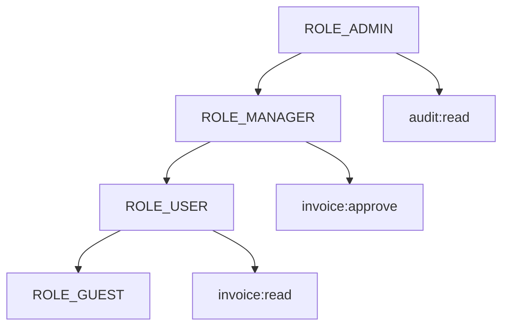

# RoleHierarchy và RoleHierarchyImpl

> **Module:** Spring Security - authorization  
> **Nhóm:** Role hierarchy  
> **Mục tiêu:** Hiểu cơ chế vai trò kế thừa theo đồ thị, phân biệt authority trực tiếp với authority đạt tới qua hierarchy, dùng đúng `RoleHierarchy` và `RoleHierarchyImpl` trong Spring Security 6.5+/7.x, cấu hình cho HTTP và method authorization, viết test chứng minh cả chiều cho phép lẫn chiều không được leo quyền, và biết giới hạn của hierarchy trước các quy tắc owner/tenant/ACL.

## 1. Bài toán: một vai trò cấp cao cần hưởng quyền của vai trò cấp thấp

Giả sử hệ thống có những vai trò:

- `ROLE_ADMIN`: quản trị hệ thống.
- `ROLE_MANAGER`: quản lý một bộ phận.
- `ROLE_USER`: người dùng thông thường.

Hầu hết chức năng dành cho USER cũng phải cho MANAGER và ADMIN sử dụng. Nếu chỉ viết từng rule riêng, code sẽ lặp:

```java
@PreAuthorize(
    "hasAnyRole('USER', 'MANAGER', 'ADMIN')"
)
public String viewDashboard() {
    return "Dashboard";
}
```

Ở nơi khác, một developer có thể quên thêm ADMIN vào danh sách `hasAnyRole`, khiến admin lại không được sử dụng chức năng của USER; hoặc thêm quá rộng, làm lộ endpoint nhạy cảm. Một lựa chọn khác là gán cả `ROLE_USER`, `ROLE_MANAGER`, `ROLE_ADMIN` vào mỗi admin account khi login, nhưng điều này phân tán logic kế thừa sang các provider, JWT converters và user stores.

`RoleHierarchy` giải quyết sự lặp đó bằng cách định nghĩa:

```text
ROLE_ADMIN   > ROLE_MANAGER
ROLE_MANAGER > ROLE_USER
```

Dấu `>` **không** là phép so sánh số học hay ưu tiên Spring filter. Trong syntax hierarchy, nó có nghĩa “vai trò bên trái **bao hàm** vai trò bên phải”. Khi một thành phần authorization sử dụng hierarchy này, người có `ROLE_ADMIN` có thể được đánh giá như có `ROLE_MANAGER` **và** `ROLE_USER`.

Điều không được quên: *hierarchy chỉ làm rộng tập authority được dùng trong phép kiểm tra được cấu hình để hiểu hierarchy*. Nó không xác nhận user là owner của mọi record, không vượt tenant isolation, không sửa dữ liệu và không tự đảm bảo mọi authorization manager tùy biến đều sử dụng hierarchy.

## 2. Mô hình đồ thị có hướng và tính bắc cầu

Một hierarchy có thể xem là đồ thị có hướng:



Các cạnh cho biết **quyền được bao hàm theo một chiều**:

- `ROLE_ADMIN` suy ra `ROLE_MANAGER`.
- `ROLE_MANAGER` suy ra `ROLE_USER`.
- Do tính **bắc cầu**, `ROLE_ADMIN` cũng suy ra `ROLE_USER`.
- Nếu có cạnh `ROLE_ADMIN > audit:read`, admin được xem là có quyền audit trong các kiểm tra sử dụng hierarchy.
- Nếu có cạnh `ROLE_MANAGER > invoice:approve` và `ROLE_USER > invoice:read`, admin/manager có thể có cả quyền approve và read.

Không có chiều ngược lại:

```text
ROLE_ADMIN -> ROLE_MANAGER -> ROLE_USER

ROLE_ADMIN có thể thỏa điều kiện ROLE_USER.
ROLE_USER KHÔNG được suy ra ROLE_MANAGER.
ROLE_MANAGER KHÔNG được suy ra ROLE_ADMIN.
```

Để phân biệt nguồn quyền:

| Actor có authority trực tiếp | Authority đạt tới qua hierarchy | `hasRole("USER")` khi hierarchy được áp dụng | `hasRole("ADMIN")` |
| --- | --- | --- | --- |
| `ROLE_ADMIN` | ADMIN, MANAGER, USER, GUEST... | Cho phép | Cho phép |
| `ROLE_MANAGER` | MANAGER, USER, GUEST... | Cho phép | Từ chối |
| `ROLE_USER` | USER, GUEST... | Cho phép | Từ chối |
| `ROLE_GUEST` | GUEST | Từ chối | Từ chối |
| Không có role phù hợp | Không đạt tới USER | Từ chối | Từ chối |

Đây là **mô hình kết quả** giả sử hierarchy có các cạnh trên, nguồn authentication đáng tin và manager/expression handler thực sự đã được nối với hierarchy. Nó không phải kết quả tự động có ở mọi cấu hình.

## 3. Role và GrantedAuthority: tiền tố chỉ là quy ước

Spring Security biểu diễn cả role và permission qua `GrantedAuthority`. Một `SimpleGrantedAuthority("ROLE_ADMIN")` có chuỗi authority là `ROLE_ADMIN`.

Hai điều kiện khác nhau:

```java
hasRole("ADMIN")                 // mặc định tìm ROLE_ADMIN
hasAuthority("ROLE_ADMIN")        // tìm đúng ROLE_ADMIN
```

Theo tiền tố mặc định `ROLE_`, `hasRole("ADMIN")` thêm prefix giúp bạn. Không truyền `"ROLE_ADMIN"` vào overload `hasRole` theo thói quen; nhiều API sẽ xử lý prefix hoặc từ chối chuỗi có prefix sai cách. `hasAuthority` kiểm tra chuỗi chính xác.

Chú ý thêm:

- `ROLE_ADMIN` không tự động là `ROLE_USER` **nếu không có hierarchy hoặc ánh xạ tương đương**.
- `ROLE_ADMIN` không tự động là `invoice:approve` chỉ vì tên role nghe “cao”.
- `SCOPE_read` do OAuth2/JWT converter tạo ra khác `ROLE_USER` và `invoice:read`.
- `hasAnyAuthority("a","b")` là OR; `hasAnyRole("ADMIN","USER")` cũng là OR sau khi áp prefix.
- Nếu hierarchy có cạnh role → permission, những phép kiểm tra hiểu hierarchy có thể nhận quyền permission đó mà không cần gắn chuỗi permission trực tiếp vào Authentication.

Role hierarchy là một **chính sách cấp quyền bắc cầu được định nghĩa tường minh**, không phải cơ chế “ADMIN luôn có mọi quyền” của Spring Security.

## 4. RoleHierarchy interface có nhiệm vụ gì?

Package:

```java
org.springframework.security.access.hierarchicalroles.RoleHierarchy
```

Phương thức trung tâm trong Spring Security 6.5 là:

```java
Collection<? extends GrantedAuthority>
    getReachableGrantedAuthorities(
        Collection<? extends GrantedAuthority> authorities
    );
```

Đầu vào là tập authorities **được cấp trực tiếp** hoặc tập hiện hành được trình cho phép kiểm tra. Đầu ra là những authority có thể đạt tới từ chúng, gồm **chính các authority đầu vào** và các authority được hierarchy suy ra.

Ví dụ:

```text
Hierarchy:
    ROLE_ADMIN > ROLE_MANAGER
    ROLE_MANAGER > ROLE_USER

Input authorities:
    [ROLE_ADMIN]

Reachable:
    [ROLE_ADMIN, ROLE_MANAGER, ROLE_USER]
```

Thứ tự phần tử của collection trả về **không phải hợp đồng quyền**. Khi cần so sánh trong test, hãy chuyển sang tập chuỗi hoặc dùng `containsExactlyInAnyOrder`, không buộc phải dựa vào thứ tự tùy implementation.

Những điều `RoleHierarchy` **không làm**:
- Không xác thực credential và không phát JWT.
- Không sửa `Authentication#getAuthorities()` bằng side effect khi bạn chỉ gọi `getReachableGrantedAuthorities`.
- Không quyết định một người có quyền trên `Document#42` khi chưa biết owner/tenant.
- Không tự động chặn URL; caller phải là một authorization component sử dụng hierarchy.
- Không tự động đồng bộ hóa quyền của người dùng đang có session/JWT với database.

## 5. RoleHierarchyImpl: implementation chuẩn

Package:

```java
org.springframework.security.access.hierarchicalroles.RoleHierarchyImpl
```

`RoleHierarchyImpl` là implementation có sẵn của `RoleHierarchy`. Nó lưu mối quan hệ role/authority và tiền xử lý các quan hệ bắc cầu để trả tập reachable hiệu quả. Hai đường xây dựng quan trọng:

1. `RoleHierarchyImpl.fromHierarchy(String)`: định nghĩa bằng văn bản, mỗi quan hệ `higher > lower`.
2. `RoleHierarchyImpl.withDefaultRolePrefix()` hoặc `withRolePrefix(String)`: builder xây hierarchy kiểu fluent, được giới thiệu từ **Spring Security 6.3**.

Cả hai đều có thể dùng trong 6.5. Khi project ở Spring Security 6.2 hoặc cũ hơn, builder này chưa tồn tại; cần kiểm tra API của version đang chạy trước khi sao chép snippet. `setHierarchy(String)` là cách từng dùng trong code cũ nhưng đã **deprecated** ở 6.5; ưu tiên factory `fromHierarchy` cho khai báo mới.

Ví dụ qua `fromHierarchy`:

```java
import org.springframework.security.access.hierarchicalroles.RoleHierarchy;
import org.springframework.security.access.hierarchicalroles.RoleHierarchyImpl;

RoleHierarchy hierarchy = RoleHierarchyImpl.fromHierarchy("""
    ROLE_ADMIN > ROLE_MANAGER
    ROLE_MANAGER > ROLE_USER
    ROLE_USER > ROLE_GUEST
    """);
```

Java text block `"""` cần Java 15+; Spring Boot 3 thường chạy với Java 17+, phù hợp. Ví dụ chỉ khởi tạo hierarchy, không chứa phần authentication/request authorization. Các dòng nhập bằng văn bản là **tên authority đầy đủ** có prefix `ROLE_`.

### Tại sao viết mỗi quan hệ trên một dòng?

Nó giúp review đường suy diễn dễ dàng: `ROLE_ADMIN > ROLE_MANAGER`, `ROLE_MANAGER > ROLE_USER`. Nếu có nhiều nhánh, có thể thêm:

```text
ROLE_ADMIN > ROLE_AUDITOR
ROLE_AUDITOR > audit:read
ROLE_MANAGER > invoice:approve
ROLE_USER > invoice:read
```

Đồ thị không bắt buộc tuyến tính; một role có thể bao hàm nhiều role/permission, và một role con có thể được nhiều role cha bao hàm.

## 6. Fluent Builder với withDefaultRolePrefix()

Đây là cấu hình được tài liệu Spring Security dùng trong phần hierarchical roles:

```java
import org.springframework.context.annotation.Bean;
import org.springframework.context.annotation.Configuration;
import org.springframework.security.access.hierarchicalroles.RoleHierarchy;
import org.springframework.security.access.hierarchicalroles.RoleHierarchyImpl;

@Configuration
public class RoleHierarchyConfiguration {

    @Bean
    static RoleHierarchy roleHierarchy() {
        return RoleHierarchyImpl.withDefaultRolePrefix()
            .role("ADMIN").implies("STAFF")
            .role("STAFF").implies("USER")
            .role("USER").implies("GUEST")
            .build();
    }
}
```

Chìa khóa là `withDefaultRolePrefix()`: builder sử dụng tiền tố mặc định `ROLE_`. Bạn truyền `ADMIN`/`STAFF`/`USER`/`GUEST` vào `role`/`implies`; kết quả là các quan hệ tương đương:

```text
ROLE_ADMIN > ROLE_STAFF
ROLE_STAFF > ROLE_USER
ROLE_USER  > ROLE_GUEST
```

Không đồng thời chèn prefix theo kiểu:

```java
// Sai ý định khi builder đã được cấu hình tự thêm ROLE_:
RoleHierarchyImpl.withDefaultRolePrefix()
    .role("ROLE_ADMIN").implies("ROLE_USER")
    .build();
```

Vì cấu hình builder có thể xử lý các tên này như tên role cần prefix thêm, code có nguy cơ tạo authority không khớp với dữ liệu thực. Hãy thống nhất một cách viết: **builder nhận role name không prefix**, còn `fromHierarchy` nhận chuỗi authority đầy đủ.

### Nhiều nhánh với builder

```java
RoleHierarchy hierarchy = RoleHierarchyImpl.withDefaultRolePrefix()
    .role("ADMIN").implies("MANAGER", "AUDITOR")
    .role("MANAGER").implies("USER")
    .role("AUDITOR").implies("VIEWER")
    .build();
```

Đây là một đồ thị phân nhánh. `implies(String... impliedRoles)` cho phép một role bao hàm nhiều role; method trả về builder để bạn tiếp tục khai báo nhánh khác.

Khi có permission string không dùng `ROLE_`, thường dễ đọc hơn nếu viết `fromHierarchy("ROLE_ADMIN > invoice:read")`. Builder prefix là công cụ tiện lợi cho **role-to-role**; đừng nhầm nó với toàn bộ cách cấp permission domain.

## 7. withRolePrefix(String) và sự đồng bộ tiền tố

Spring Security 6.3+ còn có:

```java
RoleHierarchy hierarchy = RoleHierarchyImpl.withRolePrefix("APP_")
    .role("ADMIN").implies("USER")
    .build();
```

Khi đó hierarchy dùng authority tên `APP_ADMIN` và `APP_USER`. Nhưng `hasRole("USER")` trong nhiều thành phần vẫn dùng tiền tố mặc định `ROLE_` **nếu không được cấu hình lại**.

**Bẫy:** custom hierarchy prefix và role checks phải dùng cùng quy ước. Một người có `APP_ADMIN` sẽ không tự vượt `hasRole("USER")` nếu rule tìm `ROLE_USER`.

Trong phiên bản/cơ chế thích hợp, có thể khai báo `GrantedAuthorityDefaults("APP_")` cho các expression handler được hỗ trợ, hoặc dùng `hasAuthority("APP_USER")` để làm rõ chuỗi mong muốn. Spring Security 7 còn có các điểm cấu hình `AuthorizationManagerFactory`/role prefix tùy release. **Phải kiểm tra đúng version và manager đang dùng**; đừng kỳ vọng chỉ đổi một bean là mọi custom manager, mọi JWT converter và mọi `hasRole` tự động đổi prefix đồng loạt.

Khuyến nghị thiết kế:
- Nếu không có lý do đặc biệt, giữ tiền tố `ROLE_` và dùng `hasRole("...")`.
- Nếu cần prefix khác, viết test cho cả HTTP và method security.
- Không ghi đè role prefix để sửa một lỗi quyền chưa được chẩn đoán.
- Với permission `invoice:read`, dùng `hasAuthority` và chuỗi permission rõ ràng thay vì ép mọi loại permission thành role.

## 8. Suy diễn quyền bắc cầu có nghĩa gì về bảo mật?

Với:

```text
ROLE_ADMIN > ROLE_MANAGER
ROLE_MANAGER > ROLE_USER
ROLE_USER > invoice:read
ROLE_MANAGER > invoice:approve
ROLE_ADMIN > audit:read
```

Người chỉ có `ROLE_ADMIN`, khi được kiểm tra qua hierarchy, có các quyền:

```text
ROLE_ADMIN
ROLE_MANAGER
ROLE_USER
invoice:read
invoice:approve
audit:read
```

Người chỉ có `ROLE_MANAGER` có:

```text
ROLE_MANAGER
ROLE_USER
invoice:read
invoice:approve
```

Người chỉ có `ROLE_USER` có:

```text
ROLE_USER
invoice:read
```

Không có cạnh từ `ROLE_USER` lên `ROLE_MANAGER`, nên `ROLE_USER` không có quyền approve. Không có cạnh từ `ROLE_MANAGER` lên `ROLE_ADMIN`, nên manager không có quyền audit.

**Một cạnh sai cũng là thay đổi phân quyền toàn cục.** Ví dụ thêm `ROLE_USER > audit:read` sẽ khiến mọi user có quyền đọc audit khi authorization consumer áp dụng hierarchy. Review thay đổi hierarchy như thay đổi security policy, không phải thay đổi cấu hình vô hại.

## 9. Cấu hình hierarchy vào HTTP authorization

Tài liệu Spring Security 6.5 mô tả `RoleHierarchy` được dùng trong `HttpSecurity#authorizeHttpRequests`. Khi khai báo bean `RoleHierarchy` trong context phù hợp, các thành phần chuẩn có thể được cấu hình để sử dụng hierarchy. **Không suy rộng sang mọi manager tự viết hoặc mọi overload trên mọi version.**

Ví dụ tích hợp Spring Boot 3 / Spring Security 6.5 Servlet:

```java
import org.springframework.context.annotation.Bean;
import org.springframework.context.annotation.Configuration;
import org.springframework.security.access.hierarchicalroles.RoleHierarchy;
import org.springframework.security.access.hierarchicalroles.RoleHierarchyImpl;
import org.springframework.security.config.annotation.web.builders.HttpSecurity;
import org.springframework.security.web.SecurityFilterChain;

@Configuration
class HttpAuthorizationConfiguration {

    @Bean
    static RoleHierarchy roleHierarchy() {
        return RoleHierarchyImpl.withDefaultRolePrefix()
            .role("ADMIN").implies("MANAGER")
            .role("MANAGER").implies("USER")
            .build();
    }

    @Bean
    SecurityFilterChain securityFilterChain(HttpSecurity http)
            throws Exception {
        http.authorizeHttpRequests(auth -> auth
            .requestMatchers("/api/admin/**")
                .hasRole("ADMIN")
            .requestMatchers("/api/manage/**")
                .hasRole("MANAGER")
            .requestMatchers("/api/profile/**")
                .hasRole("USER")
            .anyRequest().denyAll()
        );
        return http.build();
    }
}
```

Snippet chưa cấu hình authentication, session/JWT, CSRF, controller hoặc resource-specific policy nên **không phải ứng dụng hoàn chỉnh**. Khi hierarchy được kết nối đúng với manager của các rule:

- Người có `ROLE_ADMIN` được vào cả admin/manage/profile.
- Người có `ROLE_MANAGER` được vào manage/profile, không vào admin.
- Người có `ROLE_USER` được vào profile, không vào manage/admin.

Một manager tùy biến có thể vẫn kiểm tra chuỗi trực tiếp, **không tự đọc bean** `RoleHierarchy`. Nếu bạn tạo một `AuthorityAuthorizationManager` thủ công, hãy cấu hình hierarchy trên instance được sử dụng; chi tiết ở phần kế tiếp.

### Quy tắc cụ thể vẫn cần đứng trước quy tắc tổng quát

```java
// Sai khi /api/** đứng trước và chỉ yêu cầu authenticated:
.requestMatchers("/api/**").authenticated()
.requestMatchers("/api/admin/**").hasRole("ADMIN")
```

Hierarchy không sửa lỗi first-match. Mẫu `/api/**` đã khớp request admin trước khi rule admin được xét, nên user đã đăng nhập có thể vượt HTTP authorization tại route nhạy cảm. Vẫn phải viết matcher hẹp trước matcher rộng hoặc dùng policy kết hợp có kiểm thử.

## 10. Dùng RoleHierarchy trong AuthorityAuthorizationManager thủ công

`AuthorityAuthorizationManager<T>` có method `setRoleHierarchy(RoleHierarchy)` từ Spring Security 5.8. Javadoc ghi manager mặc định sử dụng `NullRoleHierarchy` nếu bạn không cung cấp hierarchy.

Với manager được tạo **thủ công**:

```java
import org.springframework.security.authorization.AuthorityAuthorizationManager;
import org.springframework.security.web.access.intercept.RequestAuthorizationContext;
import org.springframework.security.access.hierarchicalroles.RoleHierarchy;

AuthorityAuthorizationManager<RequestAuthorizationContext> manager =
    AuthorityAuthorizationManager.hasRole("USER");

manager.setRoleHierarchy(roleHierarchy);
```

`roleHierarchy` là bean/đối tượng `RoleHierarchy` đã được tạo và inject. Nếu không gọi `setRoleHierarchy` trên manager độc lập này, **đừng mặc định** nó hiểu `ROLE_ADMIN > ROLE_USER`.

Có thể gắn vào request authorization:

```java
http.authorizeHttpRequests(auth -> auth
    .requestMatchers("/api/profile/**").access(manager)
    .anyRequest().denyAll()
);
```

Đây là snippet tích hợp cần `HttpSecurity` và method cấu hình Spring thích hợp. Điểm học chính: rule `.access(manager)` sử dụng instance manager bạn đưa vào; nó không tự sửa một manager custom do bạn tạo riêng.

Trong hệ thống có nhiều `SecurityFilterChain` hoặc method interceptors, phải xác nhận **mỗi đường đánh giá thực tế** có cùng hierarchy nếu muốn hành vi nhất quán.

## 11. Dùng RoleHierarchy trong method security

Method security cho phép đặt:

```java
@PreAuthorize("hasRole('USER')")
public ProfileView readProfile(String accountId) {
    return service.readProfile(accountId);
}
```

Khi áp dụng hierarchy, một actor có `ROLE_ADMIN` có thể qua `hasRole('USER')`. Nhưng cần bật `@EnableMethodSecurity` và nối hierarchy đúng vào expression handler cho các biểu thức pre/post.

Cấu hình được tài liệu Spring Security 6.5 minh họa:

```java
import org.springframework.context.annotation.Bean;
import org.springframework.context.annotation.Configuration;
import org.springframework.security.access.expression.method.DefaultMethodSecurityExpressionHandler;
import org.springframework.security.access.expression.method.MethodSecurityExpressionHandler;
import org.springframework.security.access.hierarchicalroles.RoleHierarchy;
import org.springframework.security.access.hierarchicalroles.RoleHierarchyImpl;
import org.springframework.security.config.annotation.method.configuration.EnableMethodSecurity;

@Configuration
@EnableMethodSecurity
public class MethodHierarchyConfiguration {

    @Bean
    static RoleHierarchy roleHierarchy() {
        return RoleHierarchyImpl.withDefaultRolePrefix()
            .role("ADMIN").implies("MANAGER")
            .role("MANAGER").implies("USER")
            .build();
    }

    @Bean
    static MethodSecurityExpressionHandler
            methodSecurityExpressionHandler(RoleHierarchy hierarchy) {
        var handler = new DefaultMethodSecurityExpressionHandler();
        handler.setRoleHierarchy(hierarchy);
        return handler;
    }
}
```

Trong code thực, chỉ khai báo **một** bean `RoleHierarchy` phù hợp trong Spring context, không nhân bản cấu hình ở nhiều class như hai ví dụ độc lập của bài. Method `static @Bean` giúp framework nhìn thấy expression handler ở thời điểm khởi tạo method-security configuration.

**Ranh giới AOP:** `@PreAuthorize` áp dụng khi method-security interceptor thật sự chạy qua Spring proxy/AspectJ tương ứng; một lời gọi nội bộ `this.securedMethod()` có thể bỏ qua proxy. Hierarchy không khắc phục self-invocation bypass. Khi service có side effect, luôn bảo vệ cả business policy trong use case.

### @Secured và JSR-250

Method security còn có `@Secured` và `@RolesAllowed` (JSR-250) nếu được bật phù hợp. Tài liệu cho biết các `SecuredAuthorizationManager` và `Jsr250AuthorizationManager` có thể sử dụng `RoleHierarchy`. Tuy nhiên các annotation này có đường cấu hình riêng; không suy ra rằng chỉ thêm `@EnableMethodSecurity` là tất cả loại annotation đều được bật theo mặc định.

Ví dụ:

```java
@EnableMethodSecurity(
    securedEnabled = true,
    jsr250Enabled = true
)
```

Nếu dự án dùng `@PreAuthorize`, expression handler ở trên là đường kết nối rõ ràng. Với `@Secured`/JSR-250 hoặc manager tự viết, dùng test trong Spring context thật để chứng minh hierarchy được áp dụng.

## 12. Phân biệt hierarchy với ánh xạ authority khi xác thực

Một user có `ROLE_ADMIN` lúc authentication. Có hai kiểu kiến trúc:

### Kiểu A — Mở rộng authority tại lúc authorization

```text
Authentication#getAuthorities():
    [ROLE_ADMIN]

RoleHierarchy (được consumer dùng):
    ROLE_ADMIN > ROLE_MANAGER > ROLE_USER

Authorization:
    hasRole("USER") -> ALLOW theo tập reachable
```

`Authentication#getAuthorities()` **có thể vẫn chỉ trả `ROLE_ADMIN`**. Đây là điều bình thường: hierarchy được áp dụng khi manager/expression handler đánh giá.

### Kiểu B — Mở rộng authority tại lúc tạo Authentication

Một `GrantedAuthoritiesMapper` hoặc provider/adaptor có thể tạo ra:

```text
Authentication#getAuthorities():
    [ROLE_ADMIN, ROLE_MANAGER, ROLE_USER]
```

Khi đó các manager chỉ so sánh chuỗi trực tiếp có thể vẫn cho user vượt `hasRole("USER")`, nhưng việc expansion đã xảy ra ở **authentication mapping**. Kiến trúc này cần tính toán cache, refresh role, revocation và size của JWT/session.

Không phải mọi authentication provider tự chạy `RoleHierarchyImpl` khi bạn đăng ký bean. Phải cấu hình rõ các đường cần sử dụng và test. Tránh vô ý **mở rộng hai lần** hoặc tạo chuỗi authority thiếu kiểm soát.

### NullRoleHierarchy dùng khi nào?

`NullRoleHierarchy` là implementation không mở rộng hierarchy. Nó phù hợp làm hành vi mặc định cho manager không được cấu hình role inheritance. Nếu một test `hasRole("USER")` đối với `ROLE_ADMIN` bị DENY, hãy kiểm tra manager đang dùng `NullRoleHierarchy` thay vì vội sửa JWT để cấp thêm role.

## 13. Role hierarchy và JWT/OAuth2 scopes

Trong OAuth2 Resource Server, một JWT access token thường được convert scopes thành authorities như `SCOPE_read`, `SCOPE_write`, tùy cấu hình `JwtAuthenticationConverter`/`JwtGrantedAuthoritiesConverter`.

Một token có:

```json
{
  "sub": "alice",
  "scope": "reports.read reports.write"
}
```

có thể được map thành:

```text
SCOPE_reports.read
SCOPE_reports.write
```

Nếu muốn dùng `hasRole("ADMIN")`, phải có một chiến lược tin cậy để map claims/group thành `ROLE_ADMIN`. Role hierarchy **không** tự biến `SCOPE_reports.write` thành `ROLE_ADMIN`; chỉ thực hiện suy diễn theo cạnh đã khai báo và được consumer áp dụng.

Có thể có:

```text
ROLE_ADMIN > reports:read
ROLE_ADMIN > reports:export
```

nhằm giúp `@PreAuthorize("hasAuthority('reports:read')")` hoặc manager được gắn hierarchy nhận ra admin có permission đó. Nhưng:
- Cần chủ đích thống nhất role-to-permission với IAM/JWT mapping.
- Token phải được xác minh chữ ký, issuer, audience, thời hạn và chính sách resource server.
- Khi roles/scopes đổi theo thời gian, token cũ có thể còn hiệu lực tới khi hết hạn hoặc bị revoke.
- Không lấy chuỗi role/scope do client gửi trong body/header làm dữ kiện tin cậy.

**Cảnh báo:** gán `ROLE_ADMIN > SCOPE_write` là thay đổi quyền mạnh; nó mở quyền cho mọi component sử dụng hierarchy và kiểm tra `SCOPE_write`. Chỉ làm khi đó thực sự là chính sách được phê duyệt, không vì muốn sửa một test failing.

## 14. Hierarchy không phải ACL, owner check hay tenant isolation

Giả sử:

```text
ROLE_ADMIN > ROLE_EDITOR
ROLE_EDITOR > ROLE_VIEWER
```

Điều này nói gì? Admin có thể qua một rule yêu cầu vai trò EDITOR hoặc VIEWER **nếu manager hiểu hierarchy**. Nó không nói:

- Admin của tenant A được đọc dữ liệu tenant B.
- Editor được sửa mọi tài liệu.
- Manager được phê duyệt giao dịch do chính mình tạo.
- Người có `ROLE_VIEWER` có thể xem tài liệu CONFIDENTIAL.
- Bất cứ ai có `ROLE_ADMIN` đều được thực hiện payment transfer bất kể hạn mức.

Một use case vẫn phải kiểm tra policy theo actor–action–resource–context:

```java
@PreAuthorize("hasRole('EDITOR')")
public void renameDocument(long documentId, String title) {
    Actor actor = actorResolver.requireAuthenticatedActor();

    Document document = repository
        .findByIdAndTenantId(documentId, actor.tenantId())
        .orElseThrow(DocumentNotFoundException::new);

    if (!documentPolicy.canRename(actor, document)) {
        throw new AccessDeniedException("Rename not permitted");
    }

    document.rename(title);
}
```

Đây là **snippet tích hợp**; `Actor`, `Document`, `actorResolver`, `repository`, `documentPolicy` và exception nghiệp vụ phải do ứng dụng định nghĩa. Cần transaction/locking phù hợp để tránh thay đổi trạng thái giữa check và update.

Thiết kế đúng có thể gồm:
- HTTP hoặc method check quyền tổng quát bằng hierarchy.
- Query giới hạn tenant.
- Policy kiểm tra owner, ACL, grant, trạng thái.
- Domain invariant và concurrency control.
- Audit actor/resource/action để giải thích quyết định.

Role hierarchy giúp **giảm lặp quyền tổng quát**, không thay thế object-level authorization.

## 15. Multi-tenant: tránh role cấp cao “chảy” qua tenant

Với SaaS nhiều tổ chức, một user có thể là ADMIN ở tenant A nhưng chỉ VIEWER ở tenant B. Nếu Authentication chứa `ROLE_ADMIN` ở phạm vi global trong khi hierarchy bao hàm mọi quyền USER, một manager không xét tenant có thể cho quyền quá rộng ở tenant B.

Cần phân biệt:

```text
User identity: alice
Membership:
    Tenant A -> ADMIN
    Tenant B -> VIEWER
Active request:
    Tenant B /documents/42
```

Không đủ để kiểm tra:

```java
@PreAuthorize("hasRole('ADMIN')")
```

nếu role được gán global mà không gắn tenant context. Các cách thiết kế thường dùng:
- Tạo Authentication/actor authority trong **ngữ cảnh tenant đã xác minh**; không tin `X-Tenant` do client tự khai.
- Dùng permission string có scope tenant hoặc một `AuthorizationManager`/policy nhận actor và tenant.
- Query resource theo tenant thuộc quyền và check object.
- Không dùng một hierarchy chung để cho role tenant A kế thừa sang tenant B.
- Với service-to-service và background jobs, dùng service identity có quyền giới hạn đúng tenant.

Hierarchy là **quan hệ giữa authority strings**; nếu authority strings không mã hóa phạm vi, hierarchy không thể tự hiểu những ràng buộc tenant mà hệ thống chưa truyền vào.

## 16. Role hierarchy có thể chứa permission, nhưng cần governance

Ví dụ:

```java
RoleHierarchy h = RoleHierarchyImpl.fromHierarchy("""
    ROLE_ADMIN > ROLE_MANAGER
    ROLE_MANAGER > ROLE_USER
    ROLE_USER > dashboard:read
    ROLE_MANAGER > invoice:approve
    ROLE_ADMIN > audit:read
    """);
```

Khi check `hasAuthority('dashboard:read')` bằng hierarchy-aware component, admin, manager và user đều đạt tới quyền này.

Lợi ích:
- Rule endpoint nói rõ capability cần thiết, ví dụ `dashboard:read`.
- Quản trị role tập trung trong một đồ thị thay vì lặp OR trong mỗi rule.
- Có thể thử từng cạnh trong unit test.
- Có thể audit role nào đã suy ra permission nào.

Rủi ro:
- Một cạnh từ role cao sang permission write làm tăng quyền ở nhiều nơi cùng lúc.
- Nếu permission tên gần giống nhau, ví dụ `invoice:read` và `invoices:read`, string mismatch dẫn đến DENY khó hiểu.
- Nếu team lạm dụng hierarchy cho mọi quy tắc object, đồ thị sẽ nở lớn và khó bảo trì.
- Nếu nhiều hệ thống có hierarchy riêng, quyền ở HTTP, method và downstream service có thể lệch nhau.
- Nếu admin phải thỏa separation-of-duties/approval limit, role edge không thể thay thế policy đó.

Một guideline dễ review: **role → role** phù hợp mô hình quyền kế thừa có cấu trúc; **role → permission** phù hợp khi permission thực sự chung. Các điều kiện phụ thuộc resource/tenant/trạng thái nên đặt trong domain policy.

## 17. Ví dụ Java 17 chạy độc lập: tự mô phỏng tính reachable

Chương trình sau là **Java thuần** để thấy closure của đồ thị và chiều suy diễn. Nó không dùng Spring Security, không dùng `Authentication` và không xác thực JWT. Nó mô phỏng phần toán học của `getReachableGrantedAuthorities` bằng BFS và in kết quả theo thứ tự sắp xếp để stdout có thể kiểm tra chính xác.

Lưu file `RoleHierarchyDemo.java`:

```java
import java.util.ArrayDeque;
import java.util.Deque;
import java.util.Map;
import java.util.Set;
import java.util.TreeSet;

public class RoleHierarchyDemo {

    private static final Map<String, Set<String>> IMPLIES = Map.of(
        "ROLE_ADMIN", Set.of("ROLE_MANAGER", "audit:read"),
        "ROLE_MANAGER", Set.of("ROLE_USER", "invoice:approve"),
        "ROLE_USER", Set.of("invoice:read")
    );

    static Set<String> reachable(Set<String> direct) {
        Set<String> result = new TreeSet<>(direct);
        Deque<String> queue = new ArrayDeque<>(direct);

        while (!queue.isEmpty()) {
            String current = queue.removeFirst();

            for (String next : IMPLIES.getOrDefault(
                    current, Set.of())) {
                if (result.add(next)) {
                    queue.addLast(next);
                }
            }
        }
        return result;
    }

    static boolean hasAuthority(Set<String> direct, String required) {
        return reachable(direct).contains(required);
    }

    static boolean hasRole(Set<String> direct, String roleName) {
        return hasAuthority(direct, "ROLE_" + roleName);
    }

    public static void main(String[] args) {
        Set<String> admin = Set.of("ROLE_ADMIN");
        Set<String> manager = Set.of("ROLE_MANAGER");
        Set<String> user = Set.of("ROLE_USER");
        Set<String> guest = Set.of();

        System.out.println("Admin reachable: " + reachable(admin));
        System.out.println("Manager reachable: " + reachable(manager));
        System.out.println("User reachable: " + reachable(user));

        System.out.println("Admin has USER: "
            + hasRole(admin, "USER"));
        System.out.println("Manager can approve: "
            + hasAuthority(manager, "invoice:approve"));
        System.out.println("User can approve: "
            + hasAuthority(user, "invoice:approve"));
        System.out.println("User has ADMIN: "
            + hasRole(user, "ADMIN"));
        System.out.println("Guest can read: "
            + hasAuthority(guest, "invoice:read"));
    }
}
```

Biên dịch và chạy bằng JDK 17+:

```bash
javac RoleHierarchyDemo.java
java RoleHierarchyDemo
```

Stdout **chính xác**:

```text
Admin reachable: [ROLE_ADMIN, ROLE_MANAGER, ROLE_USER, audit:read, invoice:approve, invoice:read]
Manager reachable: [ROLE_MANAGER, ROLE_USER, invoice:approve, invoice:read]
User reachable: [ROLE_USER, invoice:read]
Admin has USER: true
Manager can approve: true
User can approve: false
User has ADMIN: false
Guest can read: false
```

Vì dùng `TreeSet`, output đã được sort theo chuỗi để luôn có thứ tự ổn định. Vì dùng `Set` cho đầu vào và queue nhưng thêm mọi authority một lần với `result.add`, cùng tập reachable được tính dù thứ tự duyệt ban đầu khác nhau.

Ý nghĩa:
- ADMIN có MANAGER, USER và các permission của hai role nhờ bắc cầu.
- MANAGER có quyền approve, USER thì không.
- Không có chiều từ USER lên ADMIN.
- User không có role/permission phù hợp vẫn bị từ chối.

**Giới hạn bắt buộc:** chương trình không kiểm tra cycle của cấu hình như `RoleHierarchyImpl`, không có Spring AOP/filter, không ánh xạ OAuth2 scopes và không bảo vệ database. Không copy hàm `reachable` vào production thay cho `RoleHierarchyImpl`; dùng API framework và test.

## 18. Unit test trực tiếp RoleHierarchyImpl

Spring Security cung cấp `SimpleGrantedAuthority` để tạo input và test kết quả đúng mà không cần HTTP.

```java
import java.util.Collection;
import java.util.List;
import java.util.Set;
import java.util.stream.Collectors;

import org.junit.jupiter.api.Test;
import org.springframework.security.access.hierarchicalroles.RoleHierarchy;
import org.springframework.security.access.hierarchicalroles.RoleHierarchyImpl;
import org.springframework.security.core.GrantedAuthority;
import org.springframework.security.core.authority.SimpleGrantedAuthority;

import static org.assertj.core.api.Assertions.assertThat;

class RoleHierarchyTest {

    private final RoleHierarchy hierarchy =
        RoleHierarchyImpl.fromHierarchy("""
            ROLE_ADMIN > ROLE_MANAGER
            ROLE_MANAGER > ROLE_USER
            ROLE_USER > invoice:read
            """);

    Set<String> reachable(String authority) {
        Collection<? extends GrantedAuthority> result =
            hierarchy.getReachableGrantedAuthorities(
                List.of(new SimpleGrantedAuthority(authority))
            );
        return result.stream()
            .map(GrantedAuthority::getAuthority)
            .collect(Collectors.toSet());
    }

    @Test
    void adminTransitivelyIncludesUserAndRead() {
        assertThat(reachable("ROLE_ADMIN"))
            .contains("ROLE_ADMIN", "ROLE_MANAGER",
                      "ROLE_USER", "invoice:read");
    }

    @Test
    void userDoesNotGainAdmin() {
        assertThat(reachable("ROLE_USER"))
            .contains("ROLE_USER", "invoice:read")
            .doesNotContain("ROLE_ADMIN", "ROLE_MANAGER");
    }

    @Test
    void unrelatedAuthorityIsNotEscalated() {
        assertThat(reachable("ROLE_AUDITOR"))
            .contains("ROLE_AUDITOR")
            .doesNotContain("ROLE_ADMIN", "invoice:read");
    }
}
```

Đây là **JUnit 5/AssertJ + Spring Security test snippet**, không chạy bằng `javac` đơn độc nếu không có dependencies. Những test này chỉ xác minh **đồ thị**. Để xác nhận HTTP/method security thực sự sử dụng hierarchy, cần integration tests.

### Các bất biến có giá trị kiểm thử

- **Reflexive:** authority trực tiếp vẫn có trong kết quả reachable.
- **Transitive:** nếu A suy ra B và B suy ra C, A suy ra C.
- **Directional:** C không suy ra A nếu không có đường tương ứng.
- **No accidental grant:** authority ngoài đồ thị không nhận thêm role nhạy cảm.
- **No cycle:** cấu hình từ nguồn quản trị không chứa chu trình.
- **No tenant bypass:** role tenant A không được áp ở tenant B.
- **Stable policy:** thay đổi một edge cần test regression cho những endpoint chịu ảnh hưởng.

## 19. Integration test cho @PreAuthorize

Giả sử một bean Spring có:

```java
import org.springframework.security.access.prepost.PreAuthorize;
import org.springframework.stereotype.Service;

@Service
public class ProfileService {

    @PreAuthorize("hasRole('USER')")
    public String currentProfile() {
        return "profile";
    }

    @PreAuthorize("hasRole('ADMIN')")
    public String auditConfiguration() {
        return "audit";
    }
}
```

Nếu `@EnableMethodSecurity` và `DefaultMethodSecurityExpressionHandler` đã được cấu hình hierarchy, có thể viết Spring integration tests:

```java
// Snippet JUnit 5 + Spring Security Test. Gọi bean qua Spring proxy.
@Test
@WithMockUser(roles = {"ADMIN"})
void adminCanEnterUserMethodViaHierarchy() {
    assertThat(profileService.currentProfile())
        .isEqualTo("profile");
}

@Test
@WithMockUser(roles = {"USER"})
void userCannotEnterAdminMethod() {
    assertThatThrownBy(profileService::auditConfiguration)
        .isInstanceOf(AccessDeniedException.class);
}
```

Test sử dụng bean `profileService` từ application context, không tạo `new ProfileService()`. Nếu tự tạo object, method-security proxy có thể không chạy, và test sẽ không chứng minh hierarchy authorization.

**Tránh dương tính giả:** admin có cả `ROLE_ADMIN` và `ROLE_USER` trong mock authentication thì test ALLOW không chứng minh tính bắc cầu. Dùng chỉ `roles={"ADMIN"}`, kiểm chứng authorities trực tiếp và ghi nhận hierarchy-aware handler mới giúp phép kiểm tra USER thành công.

## 20. Integration test HTTP khi có hierarchy

Giả sử cấu hình:

```java
http.authorizeHttpRequests(auth -> auth
    .requestMatchers("/api/admin/**").hasRole("ADMIN")
    .requestMatchers("/api/manage/**").hasRole("MANAGER")
    .requestMatchers("/api/profile/**").hasRole("USER")
    .anyRequest().denyAll()
);
```

Ma trận test với hierarchy `ADMIN > MANAGER > USER`:

| Direct role trong Authentication | GET profile | GET manage | GET admin |
| --- | --- | --- | --- |
| `ROLE_ADMIN` | ALLOW | ALLOW | ALLOW |
| `ROLE_MANAGER` | ALLOW | ALLOW | DENY |
| `ROLE_USER` | ALLOW | DENY | DENY |
| `ROLE_GUEST` | DENY | DENY | DENY |
| Anonymous | DENY | DENY | DENY |

Ví dụ MockMvc:

```java
import static org.springframework.security.test.web.servlet.request
    .SecurityMockMvcRequestPostProcessors.user;
import static org.springframework.test.web.servlet.request
    .MockMvcRequestBuilders.get;
import static org.springframework.test.web.servlet.result
    .MockMvcResultMatchers.status;

@Test
void adminCanAccessUserProfileViaHierarchy() throws Exception {
    mvc.perform(get("/api/profile/me")
            .with(user("alice").roles("ADMIN")))
        .andExpect(status().isOk());
}

@Test
void managerCannotAccessAdminApi() throws Exception {
    mvc.perform(get("/api/admin/users")
            .with(user("bob").roles("MANAGER")))
        .andExpect(status().isForbidden());
}
```

Đây là **snippets tích hợp**: cần MockMvc, controller mapping thật trả 200 khi được phép, Spring Security Test, JUnit và config chain có hierarchy đúng. Nếu controller không tồn tại, request có thể ra 404/405; nếu business policy chặn resource, user đủ role vẫn có thể nhận 403. Test phải phân biệt **HTTP hierarchy** với từ chối ở các chặng khác.

Cũng nên test endpoint WRITE với CSRF hợp lệ nếu ứng dụng đang bật CSRF; một test 403 vì thiếu CSRF token không chứng minh rule role đã từ chối.

## 21. Một bean RoleHierarchy không có nghĩa mọi manager đều dùng nó

Hãy phân biệt các thành phần:

| Thành phần | Vai trò | Cần kiểm tra |
| --- | --- | --- |
| `RoleHierarchyImpl` bean | Mô tả đồ thị kế thừa | Definition đúng, không cycle, đúng prefix |
| `DefaultMethodSecurityExpressionHandler` | Cung cấp hasRole/hasAuthority trong pre/post method expressions | `setRoleHierarchy` và `@EnableMethodSecurity` có hoạt động không |
| `AuthorityAuthorizationManager` | Manager có thể dùng hierarchy | Nếu tạo thủ công, có gọi `setRoleHierarchy` không |
| `HttpSecurity#authorizeHttpRequests` | Quyết định request authorization | Phiên bản/framework config đã wire hierarchy vào rules chưa |
| `@Secured`/JSR-250 managers | Bảo vệ method kiểu khác | Loại annotation đã bật và manager dùng hierarchy chưa |
| `JwtAuthenticationConverter` | Chuyển JWT claims thành authorities | Có map scope/role từ claim tin cậy, không tự suy ra hierarchy |
| Domain policy | Quyền trên resource/tenant | Có check owner/ACL/trạng thái, không dùng role như bypass mặc định |

Trong Spring Security 7, các API `AuthorizationManagerFactory`/`DefaultAuthorizationManagerFactory` có thêm khả năng cấu hình role prefix và hierarchy cho managers được factory tạo. Không coi cấu hình phiên bản 7 là có sẵn ở mọi bản 6.x. Với hệ thống lớn, chuẩn hóa nơi tạo manager sẽ giảm nguy cơ một số endpoint dùng hierarchy còn các endpoint khác không dùng.

Một test rõ ràng sẽ tạo actor chỉ có `ROLE_ADMIN`, gọi **từng loại checkpoint** thực tế và xác nhận `hasRole("USER")` ALLOW, trong khi `ROLE_USER` không được qua `hasRole("ADMIN")`.

## 22. Chu trình (cycle) và tính hợp lệ của cấu hình

Một hierarchy sai:

```text
ROLE_ADMIN > ROLE_MANAGER
ROLE_MANAGER > ROLE_USER
ROLE_USER > ROLE_ADMIN
```

Đây là **chu trình**. Nếu chấp nhận đồ thị này, mọi role trong vòng có thể đạt tới mọi role khác; một USER suy ra ADMIN — đúng điều bạn không muốn. `RoleHierarchyImpl` có cơ chế phát hiện cycle trong lúc tạo graph và báo lỗi (Javadoc mô tả `CycleInRoleHierarchyException`). Vì vậy, không nên tìm cách bỏ qua lỗi cấu hình hierarchy để ứng dụng khởi động.

Cần kiểm tra:
1. Một role không tự bao hàm chính nó qua cạnh được nhập sai.
2. Không có đường từ role thấp quay lại role cao.
3. Permission nhạy cảm không vô tình trở thành nguồn suy ra role cấp cao.
4. Không trộn nhầm tên `ROLE_ADMIN` và `ADMIN`.
5. Không có lỗi typo hoặc whitespace làm tên authority lệch nhau.
6. Với hierarchy từ DB/config, validate và test trước khi triển khai.

Nếu hierarchy được quản trị bởi GUI, hãy hiển thị đồ thị/closure trước khi phê duyệt thay đổi. Một cạnh nhỏ có thể tác động tới hàng trăm URL và service methods.

## 23. Tránh “ADMIN bao hàm mọi thứ” khi có separation of duties

Trong nghiệp vụ thanh toán, một người có role ADMIN hệ thống **không nhất thiết được** duyệt khoản thanh toán do mình lập. Nếu hierarchy chứa:

```text
ROLE_ADMIN > ROLE_FINANCE_APPROVER
```

thì `hasRole("FINANCE_APPROVER")` sẽ cho admin vượt bước kiểm tra **role**. Nhưng use case vẫn cần kiểm tra:
- Actor khác người tạo payment.
- Payment thuộc tenant/quỹ được cấp quyền.
- Hạn mức phù hợp với actor.
- Trạng thái PENDING và phiên bản record còn hợp lệ.
- Quy tắc hai người phê duyệt hoặc MFA nếu hệ thống yêu cầu.

Ví dụ:

```java
@PreAuthorize("hasRole('FINANCE_APPROVER')")
@Transactional
public void approve(long paymentId) {
    Actor actor = actorResolver.requireActor();
    Payment payment = repository
        .findForUpdate(paymentId, actor.tenantId())
        .orElseThrow(PaymentNotFoundException::new);

    if (!policy.mayApprove(actor, payment)) {
        throw new AccessDeniedException("Approval denied");
    }

    payment.approve(actor.id());
}
```

Snippet này phụ thuộc type/domain của ứng dụng, **không phải chương trình Java standalone**. Quyền role chỉ cho phép **đi vào use case**, còn business policy vẫn có quyền DENY. Cần transaction/locking phù hợp với concurrency; `@Transactional` không tự chữa mọi TOCTOU.

Nếu thật sự có quyền emergency admin bypass, đó phải là capability riêng, điều kiện bổ sung và audit rõ ràng — không tự suy diễn từ role hierarchy tổng quát.

## 24. Lỗi kiểm thử dễ đánh lừa khi dùng hierarchy

**Sai lầm A:** test user admin có cả ROLE_ADMIN và ROLE_USER; `hasRole("USER")` ALLOW dù hierarchy không hoạt động.  
**Cách sửa:** mock chỉ có ROLE_ADMIN; check reachable qua hierarchy bean riêng và integration behavior.

**Sai lầm B:** gọi trực tiếp `RoleHierarchyImpl#getReachableGrantedAuthorities` thấy đúng, kết luận mọi URL/method đều hiểu hierarchy.  
**Cách sửa:** thêm HTTP integration và method-security tests; mỗi consumer có thể chưa được wire.

**Sai lầm C:** test anonymous vào URL admin nhận 401, kết luận rule role đúng.  
**Cách sửa:** kiểm tra người đã đăng nhập thiếu role (ví dụ ROLE_USER) bị 403, còn ROLE_ADMIN được cho phép.

**Sai lầm D:** endpoint PATCH trả 403, kết luận hierarchy đã từ chối.  
**Cách sửa:** loại trừ CSRF bằng request test hợp lệ, xác định status đến từ authorization rule.

**Sai lầm E:** dùng `@WithMockUser(roles={"ADMIN"})` nhưng controller trả 404, kết luận role hierarchy sai.  
**Cách sửa:** bảo đảm handler tồn tại và fixture/domain policy cho phép; tách HTTP/method checks khỏi routing.

**Sai lầm F:** người có ROLE_MANAGER vào profile thành công; kết luận transitive rule hoạt động, nhưng user store đã cấp cả ROLE_USER.  
**Cách sửa:** kiểm tra direct roles và TestAuthentication có đúng một role.

**Sai lầm G:** chỉ test ALLOW; không kiểm tra role thấp không leo lên role cao.  
**Cách sửa:** thêm negative tests cho mọi cạnh trái chiều và quyền nhạy cảm.

## 25. Version awareness: áp dụng theo dependency thật

| Chủ đề | Spring Security cũ | Spring Security 6.3–6.5 | Spring Security 7.x |
| --- | --- | --- | --- |
| `RoleHierarchy` và `RoleHierarchyImpl` | Có từ lâu | Có | Có |
| Khai báo hierarchy string | `setHierarchy` từng thông dụng | Ưu tiên `fromHierarchy`; `setHierarchy` deprecated ở 6.5 | Ưu tiên factory/builder |
| Fluent builder | Không có ở các bản trước 6.3 | `withDefaultRolePrefix`/`withRolePrefix` từ 6.3 | Có |
| HTTP authorization | Trước đây có voter/access decision manager ở code legacy | `authorizeHttpRequests` + `AuthorizationManager` | `AuthorizationManager` và factory API được phát triển thêm |
| Method security | Legacy `@EnableGlobalMethodSecurity` | `@EnableMethodSecurity` và expression handler | Cấu hình theo version mới |
| Gắn hierarchy vào manager tự tạo | Phụ thuộc API version | `AuthorityAuthorizationManager#setRoleHierarchy` hỗ trợ | Vẫn hỗ trợ; thêm lựa chọn factory ở 7.x |
| JWT role mapping | Tùy authentication converter | Không tự map scope thành role | Không tự map scope thành role |

Không sao chép recipe của một bản Spring Security khác rồi kết luận Spring “không hiểu role”. Trước tiên xác minh:
- Framework và Spring Boot dependency versions.
- Bean hierarchy có được tạo không?
- Manager/expression handler nào thực sự được dùng?
- Prefix có đồng nhất không?
- User trực tiếp mang authority nào?
- Đường request vào đúng `SecurityFilterChain` không?
- Method invocation có đi qua Spring proxy không?

## 26. Kế hoạch đưa hierarchy vào hệ thống đang hoạt động

Một migration an toàn:

1. **Kiểm kê rules hiện tại:** phân biệt `hasRole`, `hasAnyRole`, `hasAuthority`, custom managers, annotations và policy dịch vụ.
2. **Vẽ graph dự kiến:** role cấp cao chứa role thấp nào? Có permission nào nên là cạnh riêng?
3. **Kiểm tra business constraints:** tenant, ACL, SoD, hạn mức và resource ownership không được bỏ qua.
4. **Chọn cấu hình duy nhất:** một bean `RoleHierarchy` được review; ưu tiên `fromHierarchy` hoặc builder tùy version.
5. **Nối vào đúng consumers:** HTTP managers, method expression handler, `@Secured`/JSR-250 nếu dùng và custom managers.
6. **Chuẩn hóa prefix:** `ROLE_`/custom prefix/permission strings không được bất nhất.
7. **Test graph:** direct, transitive, directional, unrelated authority, cycle/invalid config.
8. **Test HTTP:** admin → user route ALLOW, user → admin DENY; test rule first-match và chain selection.
9. **Test method:** gọi qua Spring proxy, dùng actor chỉ có role cấp cao.
10. **Test object policy:** user cùng role nhưng khác tenant/owner vẫn DENY.
11. **Đánh giá hiệu năng và revocation:** graph thường cấu hình khi khởi tạo; token/session có thể chứa roles không còn mới, cần chiến lược đồng bộ.
12. **Quan sát:** audit điều kiện role và resource denial, không log raw JWT/password hay dữ liệu nhạy cảm.
13. **Triển khai có rollback:** thay đổi edge tương đương thay đổi quyền; dùng approval/review và test regression trước rollout.

Đừng đồng thời đổi hierarchy, prefix, JWT converter, servlet path và toàn bộ method annotations trong một migration không có test; khi lỗi xảy ra sẽ khó xác định điểm thay đổi.

## 27. Chẩn đoán một request bị deny bất ngờ

Giả sử admin không gọi được `GET /api/profile/me` dù hierarchy có `ROLE_ADMIN > ROLE_USER`:

1. Actor có thực sự được xác thực với `ROLE_ADMIN`, hay chỉ có claim `admin=true` chưa map?
2. `RoleHierarchyImpl#getReachableGrantedAuthorities([ROLE_ADMIN])` có chứa `ROLE_USER` không?
3. `hasRole("USER")` trong rule đang dùng prefix `ROLE_` hay custom prefix khác?
4. HTTP request có đi vào chain chứa rule này, hay một chain ưu tiên khác đã match trước?
5. Rule `/api/profile/**` có bị `/api/**.authenticated()` hoặc `denyAll` đặt trước che không?
6. Manager được chọn có sử dụng bean hierarchy hay instance `NullRoleHierarchy`?
7. Nếu lỗi ở `@PreAuthorize`, `DefaultMethodSecurityExpressionHandler` đã set hierarchy và method đi qua proxy chưa?
8. Có domain policy 403 hoặc 404 sau khi HTTP ALLOW không?
9. Nếu request là POST/PATCH, có lỗi CSRF không?
10. Có cấu hình JWT role converter khác giữa local test và production không?

Nếu cần debug, bật logging Spring Security thích hợp trong môi trường phát triển, quan sát authority và decision reason code **không ghi secret**. Một HTTP 403 đơn lẻ không cho biết chặng nào đã DENY.

## 28. Bảng lỗi phổ biến

| Lỗi | Hệ quả | Cách sửa |
| --- | --- | --- |
| Nghĩ ADMIN tự bao hàm USER mà không khai báo | ADMIN bị từ chối ở rule USER | Khai báo cạnh hoặc mapping có chủ đích |
| Đọc `ROLE_ADMIN > ROLE_USER` ngược chiều | USER được giả định là ADMIN | Hiểu dấu `>` là “bao hàm” một chiều |
| Có cycle trong hierarchy | Graph không hợp lệ, nguy cơ leo quyền | Loại cycle; validate cấu hình |
| Prefix builder không trùng role strings | Không khớp authority thực | Dùng role names không prefix với builder, hoặc full strings trong `fromHierarchy` |
| Dùng `hasRole("ROLE_USER")` | Sai tiền tố hoặc lỗi API | Dùng `hasRole("USER")` theo default |
| Tạo bean hierarchy nhưng custom manager dùng `NullRoleHierarchy` | Quyền bắc cầu không áp dụng ở rule đó | Gắn `setRoleHierarchy`, test consumer |
| Quên method security handler | `@PreAuthorize` không hiểu hierarchy | `@EnableMethodSecurity` + handler phù hợp |
| Test service bằng `new` | Không chạy AOP interception | Gọi bean được quản lý bởi Spring |
| Map role từ header client tự khai | Leo thang đặc quyền | Authentication/claim validation từ nguồn tin cậy |
| Gộp scope JWT và role tùy tiện | Quyền rộng hơn dự kiến | Quản lý role mapping/permission rõ |
| Coi role chung là quyền object | IDOR/BOLA, cross-tenant | Policy owner/tenant/ACL tại use case |
| Rule URL rộng đứng trước admin rule | HTTP authorization bỏ điều kiện admin | First-match, matcher hẹp trước |
| Chỉ test ALLOW bằng user đã có mọi role | Không chứng minh hierarchy | Direct authority nhỏ nhất + negative tests |
| Nghĩ gọi hierarchy sẽ sửa `Authentication#getAuthorities` | Debug/tracing hiểu sai | Phân biệt direct vs reachable |
| Đổi hierarchy mà không audit | Một edge mở hàng loạt permissions | Approval, graph diff, regression tests |
| Dùng `setHierarchy` theo snippet cũ trên 6.5 | Deprecation/khó migration | `fromHierarchy` hoặc builder |

## 29. Checklist nắm vững RoleHierarchy/RoleHierarchyImpl

- Tôi giải thích được đồ thị role kế thừa và chiều của dấu `>`.
- Tôi phân biệt authorities **trực tiếp** với authorities **reachable**.
- Tôi biết `RoleHierarchy` là interface và `RoleHierarchyImpl` là implementation.
- Tôi hiểu `getReachableGrantedAuthorities` trả closure chứ không sửa Authentication.
- Tôi viết được `RoleHierarchyImpl.fromHierarchy(...)`.
- Tôi biết builder `withDefaultRolePrefix()` và `withRolePrefix(...)` có từ 6.3.
- Tôi không nhầm `hasRole("ADMIN")` với `hasAuthority("ADMIN")` hoặc `hasAuthority("ROLE_ADMIN")`.
- Tôi cấu hình được bean hierarchy và `DefaultMethodSecurityExpressionHandler`.
- Tôi biết manager tạo thủ công có thể cần `setRoleHierarchy`.
- Tôi không giả định mọi JWT converter, custom manager hay provider tự dùng hierarchy.
- Tôi biết thiết kế negative tests: USER không được tự leo lên ADMIN.
- Tôi có kiểm tra chu trình, typo, prefix và permission edge.
- Tôi giữ owner/tenant/SoD/domain policies ngoài graph role thuần túy.
- Tôi test thật trên HTTP filter chain và Spring method-security proxy.
- Tôi coi thay đổi graph hierarchy là thay đổi security policy cần review.

### Tự kiểm tra

**Câu 1.** Có `ROLE_ADMIN > ROLE_MANAGER` và `ROLE_MANAGER > ROLE_USER`. User chỉ có `ROLE_ADMIN` có qua `hasRole("USER")` không?  
→ **Có**, nếu component kiểm tra quyền đã được cấu hình sử dụng hierarchy đó.

**Câu 2.** User chỉ có `ROLE_USER` có qua `hasRole("ADMIN")` không?  
→ **Không**. Hierarchy là một chiều; không suy ngược.

**Câu 3.** Sau khi gọi `RoleHierarchyImpl#getReachableGrantedAuthorities`, `Authentication#getAuthorities()` bắt buộc được sửa thành danh sách mở rộng không?  
→ **Không**. Phép tính reachable trả một collection; Authentication chỉ thay đổi nếu ứng dụng cấu hình riêng cơ chế mapping khi tạo Authentication.

**Câu 4.** Hai factory phổ biến để tạo hierarchy trong 6.5 là gì?  
→ `RoleHierarchyImpl.fromHierarchy(String)` và builder `RoleHierarchyImpl.withDefaultRolePrefix()`/`withRolePrefix(String)`.

**Câu 5.** Đã có bean RoleHierarchy, một `AuthorityAuthorizationManager` tạo thủ công có tự động sử dụng nó không?  
→ **Không nên mặc định**. Hãy cấu hình `setRoleHierarchy` hoặc dùng factory được wire đúng và test.

**Câu 6.** Admin tenant A có ROLE_ADMIN, document 42 thuộc tenant B. Hierarchy ADMIN > USER cho admin đọc document 42 không?  
→ **Không tự động**. Domain policy vẫn phải kiểm tra tenant/resource thật.

**Câu 7.** Một test admin với roles ADMIN và USER qua `@PreAuthorize("hasRole('USER')")` có chứng minh hierarchy không?  
→ **Không**, vì ROLE_USER đã có trực tiếp. Test chỉ cấp ROLE_ADMIN và xác minh kết quả qua proxy.

**Câu 8.** Một graph có `ROLE_USER > ROLE_ADMIN` vì ai đó khai báo nhầm. Điều gì nguy hiểm?  
→ USER có thể suy ra ADMIN và được cấp quyền mạnh trong những component sử dụng hierarchy; cần chặn cấu hình sai bằng review và negative tests.

**Câu 9.** Một hierarchy có `ROLE_ADMIN > invoice:approve`. Có cần check ai tạo invoice và trạng thái invoice trước khi approve không?  
→ **Có**. Authority chung không thay thế separation-of-duties hoặc resource policy.

**Câu 10.** Tại sao admin đã khai báo kế thừa USER nhưng vẫn bị 403 ở một endpoint?  
→ Có thể manager chưa wire hierarchy, prefix sai, rule first-match khác, method proxy không chạy, CSRF hoặc domain policy từ chối. Cần tìm đúng checkpoint.

## Kết luận

`RoleHierarchy` định nghĩa contract để lấy các `GrantedAuthority` reachable từ một tập authority đầu vào. `RoleHierarchyImpl` cung cấp implementation đồ thị kế thừa có tính bắc cầu và các API cấu hình tiện lợi như `fromHierarchy` và builder từ Spring Security 6.3. Cấu hình đúng giúp rút gọn `hasRole`/`hasAuthority` và giữ chính sách vai trò nhất quán, nhưng **chỉ ở những authorization components thực sự sử dụng hierarchy**. Để bảo mật hoàn chỉnh, vẫn phải có kiểm tra tenant/owner/ACL, giới hạn command có side effect, kiểm thử role thấp không leo lên role cao và review từng cạnh như một thay đổi quyền truy cập.

## Tài liệu tham khảo chính thức

- [Spring Security 6.5 — Authorization Architecture: Hierarchical Roles](https://docs.spring.io/spring-security/reference/6.5/servlet/authorization/architecture.html) — mô hình, cấu hình bean và method handler.
- [Spring Security 6.5 — RoleHierarchy API](https://docs.spring.io/spring-security/reference/6.5/api/java/org/springframework/security/access/hierarchicalroles/RoleHierarchy.html) — `getReachableGrantedAuthorities`.
- [Spring Security 6.5 — RoleHierarchyImpl API](https://docs.spring.io/spring-security/reference/6.5/api/java/org/springframework/security/access/hierarchicalroles/RoleHierarchyImpl.html) — `fromHierarchy`, `withDefaultRolePrefix`, `withRolePrefix`.
- [Spring Security 6.5 — RoleHierarchyImpl.Builder API](https://docs.spring.io/spring-security/reference/6.5/api/java/org/springframework/security/access/hierarchicalroles/RoleHierarchyImpl.Builder.html).
- [Spring Security 6.5 — AuthorityAuthorizationManager API](https://docs.spring.io/spring-security/reference/6.5/api/java/org/springframework/security/authorization/AuthorityAuthorizationManager.html) — `setRoleHierarchy` và default NullRoleHierarchy.
- [Spring Security 6.5 — Method Security](https://docs.spring.io/spring-security/reference/6.5/servlet/authorization/method-security.html) — `@EnableMethodSecurity`, `@PreAuthorize` và expression handler.
- [Spring Security 6.5 — Authorize HTTP Requests](https://docs.spring.io/spring-security/reference/6.5/servlet/authorization/authorize-http-requests.html) — request rules và first-match.
- [Spring Security 7 — Authorization Architecture](https://docs.spring.io/spring-security/reference/7.0/servlet/authorization/architecture.html) — các API authorization manager/factory theo phiên bản mới.
