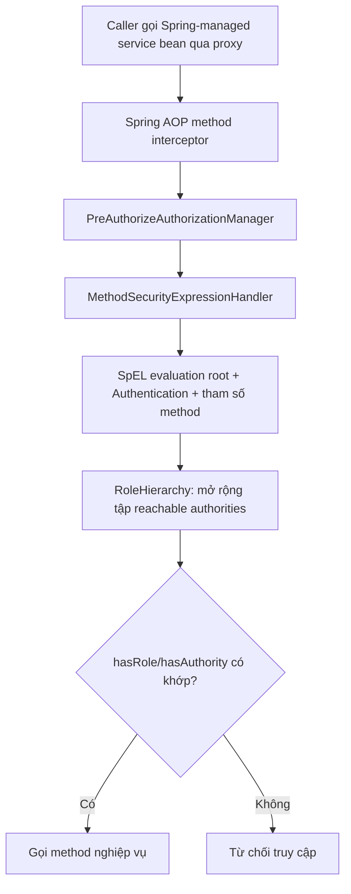

# Đưa hierarchy vào MethodSecurityExpressionHandler

Trong Spring Security, một người có thể được cấp trực tiếp **`ROLE_ADMIN`** nhưng ứng dụng lại yêu cầu **`hasRole('USER')`** tại một phương thức service. Nếu chính sách quy định `ROLE_ADMIN > ROLE_MANAGER > ROLE_USER`, người quản trị cần thỏa điều kiện `USER` mà không phải được lưu thêm từng vai trò thấp hơn vào account.

Để điều đó hoạt động với **method security theo biểu thức SpEL** (đặc biệt `@PreAuthorize`, `@PostAuthorize`, `@PreFilter`, `@PostFilter`), không chỉ khai báo graph vai trò: phải bảo đảm **`MethodSecurityExpressionHandler` đang được dùng có `RoleHierarchy` tương ứng**.

Cấu hình cốt lõi cho **Spring Security 6.5.x, Spring Boot 3.x và Java 17+**:

```java
@Bean
static RoleHierarchy roleHierarchy() {
    return RoleHierarchyImpl.fromHierarchy("""
            ROLE_ADMIN > ROLE_MANAGER
            ROLE_MANAGER > ROLE_USER
            ROLE_USER > documents.read
            ROLE_MANAGER > documents.edit
            """);
}

@Bean
static MethodSecurityExpressionHandler methodSecurityExpressionHandler(
        RoleHierarchy roleHierarchy) {
    DefaultMethodSecurityExpressionHandler handler =
            new DefaultMethodSecurityExpressionHandler();
    handler.setRoleHierarchy(roleHierarchy);
    return handler;
}
```

Và phải **bật method security**:

```java
@Configuration
@EnableMethodSecurity
class MethodSecurityConfig {
    // Đặt các @Bean ở đây hoặc trong cấu hình được component-scan.
}
```

Khi đã nối đúng, `@PreAuthorize("hasRole('USER')")` sẽ được thỏa bởi người có `ROLE_ADMIN` nhờ các quan hệ bắc cầu. Điều đó **không biến mọi method thành public**, **không thay đổi authority gốc bên trong Authentication**, và **không tự cấp quyền đối với mọi tài liệu/tenant**.

Bài học này đi sâu vào **cách wiring thực tế**, khác biệt giữa hierarchy và handler, thời điểm Spring đăng ký bean, tác động tới từng annotation, ví dụ **Spring Boot chạy được với Java 17**, cách test và những lỗi cấu hình có thể làm kiểm quyền sai.

## 1. Ba lớp cần phân biệt

### 1.1. `Authentication` giữ quyền được gán

Sau khi xác thực, `Authentication#getAuthorities()` có thể chứa:

```text
principal = alice
authorities = [ROLE_ADMIN]
authenticated = true
```

`SimpleGrantedAuthority("ROLE_ADMIN")` là một quyền được biểu diễn bằng chuỗi. Nó không tự chứa `ROLE_MANAGER` hoặc `ROLE_USER` và không tự biết ký hiệu `>`.

Khi service kiểm:

```java
@PreAuthorize("hasRole('USER')")
public String viewDashboard() {
    return "ok";
}
```

Spring Security cần xác định liệu `ROLE_ADMIN` có **bao hàm** `ROLE_USER` trong chính sách hay không. Đây là trách nhiệm của hierarchy-aware authorization, không phải của đối tượng `SimpleGrantedAuthority`.

### 1.2. `RoleHierarchy` tính tập quyền có thể đạt tới

`org.springframework.security.access.hierarchicalroles.RoleHierarchy` có contract chính:

```java
Collection<? extends GrantedAuthority> getReachableGrantedAuthorities(
        Collection<? extends GrantedAuthority> authorities);
```

Với định nghĩa:

```text
ROLE_ADMIN > ROLE_MANAGER
ROLE_MANAGER > ROLE_USER
ROLE_USER > documents.read
ROLE_MANAGER > documents.edit
```

Đầu vào `[ROLE_ADMIN]` cho ra tập reachable về mặt ý nghĩa:

```text
ROLE_ADMIN
ROLE_MANAGER
ROLE_USER
documents.read
documents.edit
```

**Hướng của cạnh rất quan trọng:** `ROLE_ADMIN > ROLE_MANAGER` nghĩa là *ADMIN bao hàm MANAGER*, **không phải** MANAGER được cấp ADMIN. Các cạnh có tính **bắc cầu**; ADMIN qua MANAGER có USER, qua USER có `documents.read`. Một user chỉ có `ROLE_USER` không tự có `ROLE_ADMIN` hoặc `documents.edit`.

`RoleHierarchyImpl` triển khai graph này; khi được gọi, nó trả các authority gốc và những authority kế thừa. Nó **không tự sửa Authentication**, **không tự sửa JWT claims**, và không có nhiệm vụ lấy quyền mới từ database.

### 1.3. `MethodSecurityExpressionHandler` làm gì?

`MethodSecurityExpressionHandler` cung cấp phần hạ tầng cho việc phân tích và đánh giá biểu thức **Spring Expression Language (SpEL)** tại method, bao gồm:

- Tạo `EvaluationContext` phù hợp với lần gọi method.
- Đưa vào biến/đối tượng như `authentication`, `principal`, các tham số method `#documentId`, đối tượng return của `@PostAuthorize` khi cần.
- Sử dụng **expression root** có các phép kiểm `hasRole`, `hasAuthority`, `hasAnyRole`, `hasPermission`…
- Cho phép tích hợp `RoleHierarchy`, `PermissionEvaluator`, role prefix và các chiến lược expression khác.

Implementation chuẩn cho servlet/imperative method security là **`DefaultMethodSecurityExpressionHandler`**. Khi gọi:

```java
handler.setRoleHierarchy(roleHierarchy);
```

ta làm cho các phép kiểm authority/role của **expression root** có khả năng sử dụng graph quyền. Đây là **nối một dependency**, không phải “sao chép quyền sang user” hay “bật hierarchy cho toàn bộ hệ thống theo một phép màu”.

## 2. Luồng kiểm quyền tại một lần gọi method

Đối với `@PreAuthorize` trong ứng dụng sử dụng Spring AOP:



Quy trình thực tế có thêm interceptor, caching, argument discovery và xử lý authorization result; sơ đồ chỉ nhấn mạnh đường đi liên quan tới hierarchy.

**Bước nào tạo nên sự khác biệt?** Khi handler đã nhận `RoleHierarchy`, biểu thức:

```java
@PreAuthorize("hasRole('USER')")
```

được đánh giá bằng **các authority có thể đạt tới**, không chỉ danh sách role được cấp trực tiếp. Nhưng nếu custom code lấy thẳng:

```java
authentication.getAuthorities()
```

rồi tìm chuỗi `ROLE_USER`, nó có thể **không nhìn thấy** ROLE_USER vì collection trên không tự được mở rộng.

### Hai phép kiểm tương đương trong quy ước prefix mặc định

Nếu hệ thống dùng tiền tố mặc định `ROLE_`:

```java
@PreAuthorize("hasRole('MANAGER')")
@PreAuthorize("hasAuthority('ROLE_MANAGER')")
```

Hai điều kiện trên có thể cùng cho phép user có `ROLE_ADMIN` **khi handler dùng hierarchy được cấu hình** và graph có cạnh `ROLE_ADMIN > ROLE_MANAGER`. Không được đặt cả hai annotation giống nhau trên một method; hai dòng chỉ là **hai cách viết thay thế**.

`hasRole('MANAGER')` chuyển tới định danh role với prefix mặc định `ROLE_MANAGER`; `hasAuthority('ROLE_MANAGER')` dùng đúng chuỗi. Permission thường được kiểm bằng:

```java
@PreAuthorize("hasAuthority('documents.read')")
```

Hierarchy cũng có thể bao hàm một permission không có tiền tố `ROLE_` nếu cạnh được khai báo tường minh, ví dụ `ROLE_USER > documents.read`.

## 3. Cấu hình đúng ba việc: bật method security, định nghĩa graph, nối handler

Một cấu hình đầy đủ về mặt wiring gồm:

1. **`@EnableMethodSecurity`**: đăng ký hạ tầng interceptor cho method security.
2. **Bean `RoleHierarchy`**: chứa chính sách các authority bao hàm nhau.
3. **Bean `MethodSecurityExpressionHandler`**: tạo `DefaultMethodSecurityExpressionHandler`, gọi `setRoleHierarchy(...)` và công bố bean cho hạ tầng method security dùng.

Ví dụ:

```java
import org.springframework.context.annotation.Bean;
import org.springframework.context.annotation.Configuration;
import org.springframework.security.access.expression.method.DefaultMethodSecurityExpressionHandler;
import org.springframework.security.access.expression.method.MethodSecurityExpressionHandler;
import org.springframework.security.access.hierarchicalroles.RoleHierarchy;
import org.springframework.security.access.hierarchicalroles.RoleHierarchyImpl;
import org.springframework.security.config.annotation.method.configuration.EnableMethodSecurity;

@Configuration
@EnableMethodSecurity
public class MethodAuthConfig {

    @Bean
    static RoleHierarchy roleHierarchy() {
        return RoleHierarchyImpl.fromHierarchy("""
                ROLE_ADMIN > ROLE_MANAGER
                ROLE_MANAGER > ROLE_USER
                ROLE_USER > documents.read
                ROLE_MANAGER > documents.edit
                """);
    }

    @Bean
    static MethodSecurityExpressionHandler methodSecurityExpressionHandler(
            RoleHierarchy roleHierarchy) {
        DefaultMethodSecurityExpressionHandler handler =
                new DefaultMethodSecurityExpressionHandler();
        handler.setRoleHierarchy(roleHierarchy);
        return handler;
    }
}
```

Đoạn class trên là **cấu hình thật có thể đưa vào Spring Boot 3.x/Spring Security 6.5.x**; nó không phải một ứng dụng độc lập thiếu `main`, dependencies và các service được bảo vệ.

### 3.1. Vì sao dùng `static @Bean`?

Tài liệu Spring Security khuyến nghị khai báo `MethodSecurityExpressionHandler` bằng **phương thức bean `static`** để Spring công bố bean **trước khi khởi tạo các configuration classes của method security**. Method security tạo một số advisor/interceptor sớm; nếu công bố handler muộn, các thành phần đó có thể sử dụng handler mặc định thay vì phiên bản bạn cấu hình.

```java
@Bean
static MethodSecurityExpressionHandler methodSecurityExpressionHandler(
        RoleHierarchy roleHierarchy) {
    DefaultMethodSecurityExpressionHandler handler =
            new DefaultMethodSecurityExpressionHandler();
    handler.setRoleHierarchy(roleHierarchy);
    return handler;
}
```

Những lưu ý:

- `static` là **khuyến nghị cho bean expression handler**, không phải yêu cầu để mọi bean `@Service` trở thành static.
- Có thể khai báo cả bean `RoleHierarchy` là static cho cấu hình rõ ràng, nhưng trọng tâm **lifecycle sớm** ở đây là bean handler.
- **Return type nên là interface `MethodSecurityExpressionHandler`**, như mẫu tài liệu chính thức, để hạ tầng lựa chọn đúng type.
- Đừng tự khởi tạo `new DefaultMethodSecurityExpressionHandler()` trong một utility rồi không đăng ký nó làm bean; khi đó hạ tầng method security có thể không dùng instance đó.
- Đừng tạo một handler mới trong từng lần gọi nghiệp vụ; handler là cấu hình hạ tầng được tái sử dụng.

### 3.2. Vì sao cần `@EnableMethodSecurity`?

Spring Boot starter security thường bảo vệ tầng HTTP khi có web application, nhưng **không tự bật method security mặc định**.

Thiếu:

```java
@EnableMethodSecurity
```

thì `@PreAuthorize` trên service có thể **không được áp dụng** dù annotation vẫn nằm trong source code và handler bean đã tồn tại. Method security theo kiến trúc hiện đại dùng `AuthorizationManager` và Spring AOP; cấu hình cũ `@EnableGlobalMethodSecurity` đã bị thay thế trong lộ trình Spring Security 6.

Mặc định `@EnableMethodSecurity` bật nhóm `@PreAuthorize`, `@PostAuthorize`, `@PreFilter`, `@PostFilter`. `@Secured` và JSR-250 không được bật chỉ vì bật pre/post; muốn dùng cần cấu hình rõ:

```java
@EnableMethodSecurity(securedEnabled = true, jsr250Enabled = true)
```

Chúng có hạ tầng authorization riêng; xem mục 10 trước khi suy ra việc gắn expression handler sẽ điều khiển tất cả annotation.

## 4. Ví dụ Spring Boot đầy đủ chạy được: method security dùng hierarchy

Ví dụ này thực sự khởi động **Spring ApplicationContext**, lấy service **qua bean/proxy**, đặt một `Authentication` mô phỏng cho từng user và gọi các method có `@PreAuthorize`. Không có controller/HTTP server vì bài tập nhằm chứng minh **method authorization**.

Sử dụng **Java 17+, Maven 3.6.3+ hoặc Maven tương thích, Spring Boot 3.5.16** (quản lý dependency Spring Security 6.5.x), chạy trong thư mục riêng. Phiên bản Boot ở đây cố định để ví dụ có dependency tái lập; khi triển khai production, cập nhật patch bảo mật được hỗ trợ tương ứng với dòng Spring đang dùng.

Cấu trúc thư mục:

```text
method-hierarchy-demo/
├── pom.xml
└── src/
    └── main/
        ├── java/
        │   └── demo/
        │       ├── MethodHierarchyApp.java
        │       └── DocumentService.java
        └── resources/
            └── application.properties
```

### 4.1. File pom.xml

```xml
<project xmlns="http://maven.apache.org/POM/4.0.0"
         xmlns:xsi="http://www.w3.org/2001/XMLSchema-instance"
         xsi:schemaLocation="http://maven.apache.org/POM/4.0.0
                             https://maven.apache.org/xsd/maven-4.0.0.xsd">
    <modelVersion>4.0.0</modelVersion>

    <parent>
        <groupId>org.springframework.boot</groupId>
        <artifactId>spring-boot-starter-parent</artifactId>
        <version>3.5.16</version>
        <relativePath/>
    </parent>

    <groupId>demo</groupId>
    <artifactId>method-hierarchy-demo</artifactId>
    <version>1.0.0</version>

    <properties>
        <java.version>17</java.version>
    </properties>

    <dependencies>
        <dependency>
            <groupId>org.springframework.boot</groupId>
            <artifactId>spring-boot-starter</artifactId>
        </dependency>
        <dependency>
            <groupId>org.springframework.boot</groupId>
            <artifactId>spring-boot-starter-security</artifactId>
        </dependency>
    </dependencies>

    <build>
        <plugins>
            <plugin>
                <groupId>org.springframework.boot</groupId>
                <artifactId>spring-boot-maven-plugin</artifactId>
            </plugin>
        </plugins>
    </build>
</project>
```

Đây là một **ứng dụng CLI dùng Spring Boot container**, không cần `spring-boot-starter-web`. Chỉ thêm module web nếu cần API thực tế. Không cần tự đặt version Spring Security trong dependencies vì Spring Boot parent quản lý các phiên bản tương thích.

### 4.2. File src/main/java/demo/MethodHierarchyApp.java

```java
package demo;

import java.util.List;
import java.util.function.Supplier;

import org.springframework.boot.CommandLineRunner;
import org.springframework.boot.SpringApplication;
import org.springframework.boot.autoconfigure.SpringBootApplication;
import org.springframework.context.annotation.Bean;
import org.springframework.security.access.AccessDeniedException;
import org.springframework.security.access.expression.method.DefaultMethodSecurityExpressionHandler;
import org.springframework.security.access.expression.method.MethodSecurityExpressionHandler;
import org.springframework.security.access.hierarchicalroles.RoleHierarchy;
import org.springframework.security.access.hierarchicalroles.RoleHierarchyImpl;
import org.springframework.security.authentication.UsernamePasswordAuthenticationToken;
import org.springframework.security.config.annotation.method.configuration.EnableMethodSecurity;
import org.springframework.security.core.authority.SimpleGrantedAuthority;
import org.springframework.security.core.context.SecurityContext;
import org.springframework.security.core.context.SecurityContextHolder;

@SpringBootApplication
@EnableMethodSecurity
public class MethodHierarchyApp {

    public static void main(String[] args) {
        SpringApplication.run(MethodHierarchyApp.class, args);
    }

    @Bean
    static RoleHierarchy roleHierarchy() {
        return RoleHierarchyImpl.fromHierarchy("""
                ROLE_ADMIN > ROLE_MANAGER
                ROLE_MANAGER > ROLE_USER
                ROLE_USER > documents.read
                ROLE_MANAGER > documents.edit
                """);
    }

    @Bean
    static MethodSecurityExpressionHandler methodSecurityExpressionHandler(
            RoleHierarchy roleHierarchy) {

        DefaultMethodSecurityExpressionHandler handler =
                new DefaultMethodSecurityExpressionHandler();
        handler.setRoleHierarchy(roleHierarchy);
        return handler;
    }

    @Bean
    CommandLineRunner runDemo(DocumentService service) {
        return args -> {
            exercise("ADMIN", "ROLE_ADMIN", service);
            exercise("MANAGER", "ROLE_MANAGER", service);
            exercise("USER", "ROLE_USER", service);
            exercise("GUEST", "ROLE_GUEST", service);
        };
    }

    private static void exercise(
            String label, String authority, DocumentService service) {

        SecurityContext context = SecurityContextHolder.createEmptyContext();
        context.setAuthentication(
                new UsernamePasswordAuthenticationToken(
                    label.toLowerCase(),
                    "demo-credential",
                    List.of(new SimpleGrantedAuthority(authority))
                )
        );
        SecurityContextHolder.setContext(context);

        try {
            check(label + " read", service::read);
            check(label + " edit", service::edit);
            check(label + " manage", service::manage);
            check(label + " admin", service::admin);
        } finally {
            SecurityContextHolder.clearContext();
        }
    }

    private static void check(String label, Supplier<String> invocation) {
        try {
            System.out.println(label + ": " + invocation.get());
        } catch (AccessDeniedException denied) {
            System.out.println(label + ": DENY");
        }
    }
}
```

**Giải thích:**

- `@SpringBootApplication` tạo ứng dụng/context; `@EnableMethodSecurity` bật method interceptors.
- `static RoleHierarchy` định nghĩa graph quyền; `static MethodSecurityExpressionHandler` nhận đúng object hierarchy đó và gọi `setRoleHierarchy`.
- `CommandLineRunner` **được Spring inject `DocumentService` bean**. Vì đây là bean được proxy cho method security, các lời gọi `service::read`, `service::edit`… thực sự đi qua interception.
- Mỗi `exercise` tạo `SecurityContext` mới, gắn `UsernamePasswordAuthenticationToken` đã được đánh dấu authenticated bởi constructor ba tham số có authorities, và **chỉ cấp trực tiếp một role**.
- `SecurityContextHolder.clearContext()` dọn dữ liệu giữa các ca để tránh principal “rò” sang ca sau khi chạy trên cùng thread.
- Các account/credentials trên **chỉ là test harness**. Không dùng cách tạo `UsernamePasswordAuthenticationToken` trực tiếp từ role do browser/request body khai để làm authentication production.

### 4.3. File src/main/java/demo/DocumentService.java

```java
package demo;

import org.springframework.security.access.prepost.PreAuthorize;
import org.springframework.stereotype.Service;

@Service
public class DocumentService {

    @PreAuthorize("hasAuthority('documents.read')")
    public String read() {
        return "ALLOW";
    }

    @PreAuthorize("hasAuthority('documents.edit')")
    public String edit() {
        return "ALLOW";
    }

    @PreAuthorize("hasRole('MANAGER')")
    public String manage() {
        return "ALLOW";
    }

    @PreAuthorize("hasRole('ADMIN')")
    public String admin() {
        return "ALLOW";
    }
}
```

Các method trả đúng chuỗi `ALLOW` **chỉ sau khi interceptor cho phép gọi**; nếu không đủ authority, Spring Security ném exception từ tầng method authorization trước khi chạy body. Ví dụ không khai báo permissions theo owner/tenant, nên chỉ nên dùng để học **tác động của role hierarchy vào expression handler**.

### 4.4. File src/main/resources/application.properties

```properties
spring.main.web-application-type=none
spring.main.banner-mode=off
logging.level.root=OFF
```

Để stdout minh họa chỉ tập trung vào các dòng từ `CommandLineRunner`; môi trường Maven/runtime có thể vẫn in thông báo build, cảnh báo hoặc lỗi tùy setup.

### 4.5. Lệnh chạy và stdout

Từ thư mục `method-hierarchy-demo`:

```bash
mvn -q spring-boot:run
```

Các **dòng in bởi chương trình** theo đúng thứ tự (không tính thông báo riêng từ Maven/launcher nếu có):

```text
ADMIN read: ALLOW
ADMIN edit: ALLOW
ADMIN manage: ALLOW
ADMIN admin: ALLOW
MANAGER read: ALLOW
MANAGER edit: ALLOW
MANAGER manage: ALLOW
MANAGER admin: DENY
USER read: ALLOW
USER edit: DENY
USER manage: DENY
USER admin: DENY
GUEST read: DENY
GUEST edit: DENY
GUEST manage: DENY
GUEST admin: DENY
```

Vì sao có kết quả này?

1. `ROLE_ADMIN` đi tới `ROLE_MANAGER`, `ROLE_USER`, `documents.edit` và `documents.read`, nên qua cả bốn method.
2. `ROLE_MANAGER` bao hàm `ROLE_USER` và các permission từ graph; nhưng **không** được `ROLE_ADMIN`.
3. `ROLE_USER` chỉ có `documents.read`; không được `documents.edit`, `ROLE_MANAGER` hay `ROLE_ADMIN`.
4. `ROLE_GUEST` không có cạnh trong hierarchy và không được cấp thêm permission.
5. Nếu handler chưa được nối hierarchy, người chỉ có `ROLE_ADMIN` có thể bị từ chối tại `read()`/`edit()`/`manage()` do không được cấp trực tiếp các authority tương ứng. Đây là phép thử quan trọng để chứng minh wiring thực sự được sử dụng.

**Mục đích học tập:** Code tạo context một cách cố ý trong `CommandLineRunner` để minh họa method security. Trong ứng dụng HTTP thật, Authentication phải đến từ cơ chế đáng tin như session đã xác thực, HTTP Basic qua authentication provider hoặc Bearer JWT đã xác minh issuer/audience/claims; không tự tin chuỗi role do caller tự gửi.

## 5. Vì sao “chỉ khai báo RoleHierarchy bean” có thể chưa đủ?

Người học thường viết:

```java
@Bean
RoleHierarchy roleHierarchy() {
    return RoleHierarchyImpl.fromHierarchy(
            "ROLE_ADMIN > ROLE_USER"
    );
}
```

rồi mong `@PreAuthorize("hasRole('USER')")` tự mở rộng trong mọi project. Điều này phụ thuộc **cách hạ tầng method authorization được cấu hình và bean handler được chọn**. Để rõ ràng với cấu hình method SpEL ở Spring Security 6.5, hãy công bố handler:

```java
@Bean
static MethodSecurityExpressionHandler methodSecurityExpressionHandler(
        RoleHierarchy roleHierarchy) {

    DefaultMethodSecurityExpressionHandler handler =
            new DefaultMethodSecurityExpressionHandler();

    handler.setRoleHierarchy(roleHierarchy);
    return handler;
}
```

Đặc biệt khi ứng dụng có nhiều configuration class, dễ xảy ra các lỗi:

| Biểu hiện | Lý do khả dĩ | Cách xử lý |
| --- | --- | --- |
| ADMIN không qua `@PreAuthorize("hasRole('USER')")` | Handler đang dùng không có RoleHierarchy | Xác minh bean `MethodSecurityExpressionHandler` và `setRoleHierarchy` |
| `@PreAuthorize` không chặn bất kỳ ai | Chưa bật `@EnableMethodSecurity` hoặc lời gọi không qua proxy | Bật annotation, gọi bean từ bên ngoài, test denied case |
| Bean handler có trong project nhưng cấu hình vẫn không áp dụng | Bean tạo quá muộn, bị bỏ qua do custom manager khác | Đưa bean handler thành `static`, kiểm context/manager thực tế |
| Có hai handler beans gây ambiguity | Nhiều bean cùng type không được lựa chọn rõ | Chỉ duy trì handler ứng dụng muốn dùng, kiểm cấu hình |
| Bean hierarchy đúng nhưng role cần kiểm không khớp | Sai hướng cạnh, prefix hoặc chữ hoa | Kiểm `ROLE_`, graph và input Authentication |
| HTTP `hasRole` đúng nhưng method `@PreAuthorize` sai | Cơ chế HTTP và method có wiring riêng | Kiểm hạ tầng method expression handler |
| `@Secured` sai trong khi `@PreAuthorize` đúng | Manager của `@Secured` khác expression handler | Kiểm `securedEnabled` và RoleHierarchy wiring cho manager đó |
| Direct check ở service không thấy role kế thừa | So sánh `Authentication#getAuthorities()` gốc | Dùng manager/handler hierarchy-aware hoặc gọi RoleHierarchy rõ ràng |

**Không sửa bằng cách cấp `ROLE_USER` trực tiếp cho mọi ADMIN khi lỗi thực chất là thiếu wiring**, trừ khi đó là lựa chọn kiến trúc có chủ đích; như vậy có thể che lỗi cấu hình và tạo snapshot role khó cập nhật.

## 6. Bean handler giải quyết gì đối với biểu thức SpEL?

`DefaultMethodSecurityExpressionHandler` cấp các biểu thức thông dụng:

| Biểu thức | Ý nghĩa khi đã nối RoleHierarchy |
| --- | --- |
| `hasRole('USER')` | Kiểm quyền `ROLE_USER` mặc định trong tập reachable |
| `hasAnyRole('USER','AUDITOR')` | Chỉ cần một role trong danh sách có thể đạt tới |
| `hasAuthority('documents.read')` | Kiểm chính xác authority `documents.read` sau khi áp hierarchy |
| `hasAnyAuthority('documents.read','audit.read')` | Chỉ cần một authority được tìm thấy |
| `isAuthenticated()` | Xác định trạng thái đã xác thực theo security expression root, **không phải kết quả hierarchy** |
| `authentication.name` | Tên principal trong Authentication; **không phải role kế thừa** |
| `#documentId` | Tham số method nhận diện document; **không tự được hierarchy kiểm** |
| `hasPermission(#documentId,'Document','read')` | Gọi `PermissionEvaluator`, không tự do RoleHierarchy quyết định |
| `returnObject.owner` trong `@PostAuthorize` | Kiểm thuộc tính kết quả trả về; phụ thuộc dữ liệu object và policy |

**RoleHierarchy chỉ giải quyết phần authority reachability.** Nó không biến `hasPermission` thành quyền theo owner/tenant, không tin được request input hoặc đảm bảo dữ liệu trả về đã được lọc.

### 6.1. Ví dụ biểu thức trước khi mở rộng

Đôi khi người học viết:

```java
@PreAuthorize(
    "hasRole('ADMIN') or hasRole('MANAGER') or hasRole('USER')"
)
public String listDocuments() {
    return "list";
}
```

Sau khi có:

```text
ROLE_ADMIN > ROLE_MANAGER
ROLE_MANAGER > ROLE_USER
```

và handler có hierarchy, có thể viết gọn:

```java
@PreAuthorize("hasRole('USER')")
public String listDocuments() {
    return "list";
}
```

Đây là cách giảm lặp, **không thay đổi chính sách gốc nếu graph thật sự biểu diễn đầy đủ các quan hệ được phép**. Nếu có một vai trò chuyên biệt không nên được bao hàm, không được tự thêm nó vào graph chỉ để làm rule đẹp hơn.

### 6.2. Permission cũng có thể được bao hàm

Nếu graph có:

```text
ROLE_USER > documents.read
ROLE_MANAGER > ROLE_USER
```

thì `@PreAuthorize("hasAuthority('documents.read')")` cho user có `ROLE_MANAGER` qua được. Nhưng việc tên quyền có `documents.read` là **quy ước ứng dụng**, không có quan hệ đặc biệt được Spring tự suy từ từ “documents”.

### 6.3. Biểu thức duyệt thẳng Authentication không tự dùng hierarchy

Ví dụ:

```java
@PreAuthorize(
    "authentication.authorities.?[authority == 'ROLE_USER'].size() > 0"
)
```

Mảnh này chủ yếu đọc danh sách authority gốc của `Authentication`, không phải phép gọi `hasRole` đã được expression handler hỗ trợ hierarchy. Với người chỉ được gán `ROLE_ADMIN`, kết quả có thể là false dù `hasRole('USER')` true.

Không viết một phép kiểm trực tiếp phức tạp trong SpEL khi `hasRole`/`hasAuthority` đã diễn đạt đúng ý định. Nếu policy cần logic bổ sung, tạo bean service chuyên trách và gọi nó từ SpEL theo dữ liệu đáng tin.

## 7. @PreAuthorize, @PostAuthorize, @PreFilter và @PostFilter

`@EnableMethodSecurity` kích hoạt các annotations pre/post mặc định. Chúng sử dụng expression handling nhưng **thời điểm chạy khác nhau**:

- **`@PreAuthorize`**: quyết định **trước** khi thực thi method. Phù hợp role/permission chung và kiểm theo tham số.
- **`@PostAuthorize`**: đánh giá **sau** khi method trả về, có thể kiểm `returnObject`.
- **`@PreFilter`**: lọc đầu vào là collection/array/stream trong một số tình huống hỗ trợ, dựa trên biểu thức cho phần tử.
- **`@PostFilter`**: lọc collection kết quả theo biểu thức từng phần tử.

**Hierarchy được dùng trong các kiểm tra authority của expression root** nhưng bản thân `@PostAuthorize`/`@PostFilter` còn cần kiểm tính đúng của đối tượng trả về và filter semantics.

### 7.1. @PreAuthorize có tham số method

Ví dụ mảnh service trong project có `@EnableMethodSecurity`:

```java
@PreAuthorize(
    "hasAuthority('documents.read') " +
    "and @documentPolicy.canRead(authentication.name, #documentId)"
)
public DocumentDto read(@P("documentId") String documentId) {
    return repository.findDto(documentId);
}
```

Trong ví dụ này:

1. `hasAuthority('documents.read')` có thể dùng RoleHierarchy qua handler.
2. `@documentPolicy.canRead(...)` phải là bean/policy ứng dụng kiểm owner, tenant, share hoặc trạng thái document từ nguồn tin cậy.
3. `@P("documentId")` tại `org.springframework.security.access.method.P` giúp nhận tham số trong SpEL khi metadata tên tham số không có.
4. `DocumentDto`, `repository`, `documentPolicy` là **các thành phần tự định nghĩa**, không được Spring Security cung cấp sẵn.

Chỉ có authority khái quát `documents.read` không đủ bảo đảm người dùng được đọc *document ID được truyền vào*.

### 7.2. @PostAuthorize với returnObject

Ví dụ mảnh code:

```java
@PostAuthorize(
    "hasAuthority('documents.read') and " +
    "returnObject.ownerId == authentication.name"
)
public DocumentDto readOwned(String id) {
    return repository.findDto(id);
}
```

`DocumentDto` có property `ownerId` được SpEL truy cập. Nếu method trả null hoặc dữ liệu chưa phù hợp, cần xử lý trường hợp đó trong policy trước khi đưa vào biểu thức.

**Lưu ý quan trọng:** `@PostAuthorize` chạy **sau khi method thực thi**. Với phương thức ghi, gửi email, thanh toán, gọi API khác hoặc làm lộ thông tin qua side effect, việc từ chối sau đó **không hoàn tác** hành động đã xảy ra. Hãy kiểm trước khi gây side effect nhạy cảm. Trường hợp đọc dữ liệu, dù returnObject bị chặn trước khi trả cho caller, method vẫn có thể đã thực hiện truy vấn tốn kém; thiết kế query và data access phù hợp.

### 7.3. @PreFilter / @PostFilter không tự bảo vệ mọi cách truy cập

Nếu áp filter trên một tập tài liệu, hãy hiểu cơ chế:

- `filterObject` là phần tử đang được đánh giá.
- Expression có thể kết hợp `hasAuthority('documents.read')` (qua hierarchy) với owner/tenant condition.
- Chỉ những method có annotation tương ứng và **được gọi qua proxy** mới chạy filter.
- Với list lớn, post-filter **sau khi tải toàn bộ dữ liệu** thường kém hiệu quả và có thể làm sai phân trang. Ưu tiên lọc theo policy ngay trong query khi cần.

Ví dụ ý tưởng:

```java
@PostFilter(
    "hasAuthority('documents.read') and " +
    "filterObject.ownerId == authentication.name"
)
public List<DocumentDto> findOwnedDocuments() {
    return repository.findCandidates();
}
```

Đây là **mảnh tích hợp**, không thay được query filter và access check ở mọi endpoint. Không dùng quy tắc này để cho phép xuất toàn bộ dữ liệu qua một endpoint khác thiếu annotation.

## 8. Vai trò của Spring AOP proxy: handler đúng nhưng method không bị chặn

Ngay cả khi RoleHierarchy và handler đã cấu hình chính xác, method security chỉ thực thi khi lời gọi **đi qua cơ chế interception**.

### 8.1. Lời gọi qua Spring bean

```java
@Service
public class ExportService {
    private final DocumentService documents;

    public ExportService(DocumentService documents) {
        this.documents = documents;
    }

    public void export() {
        documents.read(); // qua Spring-managed bean/proxy
    }
}
```

Lời gọi ở trên có cơ hội đi qua method interceptor vì `DocumentService` được Spring inject.

### 8.2. Tự gọi method trong cùng instance (self-invocation)

```java
@Service
public class InternalService {

    public void runBatch() {
        deleteSensitiveData(); // this.deleteSensitiveData(): có thể bypass proxy
    }

    @PreAuthorize("hasRole('ADMIN')")
    public void deleteSensitiveData() {
        // Thao tác nhạy cảm.
    }
}
```

Trong mode Spring AOP proxy phổ biến, lời gọi `this.deleteSensitiveData()` từ bên trong cùng bean **không đi qua proxy**, nên annotation trên method đó có thể **không được thực thi**. Đây là lỗi rất nguy hiểm vì kiểm tra qua controller/test một đường có thể đúng nhưng đường nội bộ khác lại bỏ qua.

Khắc phục: tách method được bảo vệ sang một Spring bean khác và gọi **qua bean/proxy**, hoặc chọn chế độ weaving phù hợp khi có lý do kiến trúc và test đầy đủ. Không sửa lỗi bằng cách đặt thêm hierarchy edge.

### 8.3. Các trường hợp AOP thường gặp

- `new DocumentService()` bằng tay: object không được Spring quản lý, **không có proxy**.
- Private/final method hoặc class final: khả năng can thiệp của proxy phụ thuộc proxy strategy; nên bảo vệ service public được Spring quản lý theo mô hình rõ ràng.
- Annotation đặt trên method không được gọi thực tế: không có bảo vệ ngầm cho các path khác.
- Bean tạo trong một `ApplicationContext` khác với context chứa method security: có thể không nhận advisor.
- Async/scheduled invocation: cần bảo đảm danh tính và `SecurityContext` được truyền đúng; hierarchy không tự tạo Authentication ở thread mới.
- Unit test tự `new` service rồi gọi: kiểm tra business logic được nhưng **không kiểm được method security**.

**Kiểm thử tốt phải xác nhận service được Spring lấy từ context và negative case thật sự bị từ chối.**

## 9. Prefix ROLE_ và cách tránh lệch tên

Nếu graph định nghĩa:

```text
ROLE_ADMIN > ROLE_MANAGER
ROLE_MANAGER > ROLE_USER
```

thì các authority được cấp cần nhất quán, ví dụ:

```java
new SimpleGrantedAuthority("ROLE_ADMIN")
```

và các biểu thức:

```java
@PreAuthorize("hasRole('MANAGER')")
@PreAuthorize("hasAuthority('ROLE_MANAGER')")
```

Với prefix mặc định `ROLE_`, hai dạng có thể tương ứng. Nhưng nếu nguồn đăng nhập phát authority `ADMIN` không có tiền tố, `hasRole('ADMIN')` mặc định tìm `ROLE_ADMIN` và không tự tìm thấy `ADMIN`.

**Ba nơi cần nhất quán:**

1. Nơi cấp/convert `GrantedAuthority` vào `Authentication`.
2. Định nghĩa cạnh trong `RoleHierarchyImpl`.
3. Cách `hasRole`/`hasAuthority` trong method expression root tính tên yêu cầu.

### Thay đổi role prefix

`DefaultMethodSecurityExpressionHandler#setDefaultRolePrefix(...)` cho phép thay prefix dùng bởi các hàm `hasRole`/`hasAnyRole`. Spring Security còn có `GrantedAuthorityDefaults` hoặc cấu hình prefix khác ở các cơ chế authorization. Nếu chỉnh prefix:

- Chuỗi authority từ user/IdP phải đúng quy ước mới.
- `RoleHierarchyImpl.fromHierarchy(...)` phải dùng chính xác chuỗi có prefix dự kiến.
- Các `hasAuthority(...)` cần full string, không tự prefix.
- HTTP và method có thể dùng các manager khác nhau; phải kiểm cấu hình trên từng tầng.
- Không trộn `ROLE_ADMIN` và `ADMIN` rồi tin hệ thống tự quy đổi.

Với Spring Security 6.5, `RoleHierarchyImpl.withDefaultRolePrefix()` cho builder đặt tên role ngắn; còn `fromHierarchy(String)` nhận **chuỗi authority đầy đủ**. Tránh thêm `ROLE_` hai lần khi dùng builder.

### JWT Resource Server và SCOPE_

Một JWT Resource Server thông dụng ánh xạ `scope`/`scp` thành `SCOPE_docs.read`, không tự thành `ROLE_USER` hoặc `documents.read`. Nếu @PreAuthorize kiểm `documents.read`, cần:

- Mapping token claim đáng tin thành authority ứng dụng phù hợp, **hoặc**
- Định nghĩa chính sách kiểm trực tiếp authority `SCOPE_docs.read`, **hoặc**
- Chủ động khai báo một quan hệ bao hàm giữa authority tương ứng nếu điều đó đúng ý nghĩa bảo mật.

Không bao giờ lấy một claim `roles` do client tùy ý gửi rồi tự gắn `ROLE_ADMIN` mà không xác minh token/issuer/audience và quyền được phép cấp.

## 10. @Secured và @RolesAllowed không dùng chung cơ chế expression handler

Một khác biệt quan trọng:

| Cơ chế method security | Được bật mặc định bởi @EnableMethodSecurity? | Thành phần kiểm quyền chính |
| --- | --- | --- |
| `@PreAuthorize` | Có | `PreAuthorizeAuthorizationManager` và `MethodSecurityExpressionHandler` |
| `@PostAuthorize` | Có | `PostAuthorizeAuthorizationManager` và `MethodSecurityExpressionHandler` |
| `@PreFilter` / `@PostFilter` | Có | Hạ tầng pre/post filter với expression handler |
| `@Secured` | Không; cần `securedEnabled=true` | `SecuredAuthorizationManager` |
| `@RolesAllowed` (JSR-250) | Không; cần `jsr250Enabled=true` | `Jsr250AuthorizationManager` |

Spring Security có **hỗ trợ `RoleHierarchy`** cho `SecuredAuthorizationManager` và `Jsr250AuthorizationManager`, nhưng chúng **không phải cùng phép đánh giá SpEL của DefaultMethodSecurityExpressionHandler**. Cấu hình bean `RoleHierarchy` theo tài liệu Spring Security có thể được các manager chuẩn này dùng; với manager tùy biến hoặc cấu hình đặc biệt, phải kiểm wiring thực tế.

Đừng nghĩ `@Bean MethodSecurityExpressionHandler` có thể biến `@Secured` thành biểu thức SpEL hoặc làm `@RolesAllowed` tự hỗ trợ `hasPermission(#id,...)`. Chúng có contract riêng.

Nếu hệ thống bắt đầu từ đầu và cần policy có method parameter, object và authority kết hợp, **`@PreAuthorize` thường linh hoạt hơn**.

## 11. Khi cần PermissionEvaluator hoặc custom expression

`RoleHierarchy` trả lời “role/authority A có bao hàm B không?”. Nghiệp vụ còn có thể cần:

- Người dùng có phải **owner** của tài liệu?
- User có thuộc **tenant** tương ứng không?
- Hóa đơn đang ở trạng thái cho phép duyệt không?
- Có ràng buộc “người tạo không được tự duyệt” không?
- Người gọi có MFA hoặc fresh authentication theo yêu cầu không?

Đây là những phép kiểm **ngoài graph hierarchy chung**.

Có thể cấu hình thêm `PermissionEvaluator` vào cùng handler:

```java
@Bean
static MethodSecurityExpressionHandler methodSecurityExpressionHandler(
        RoleHierarchy roleHierarchy,
        PermissionEvaluator permissionEvaluator) {

    DefaultMethodSecurityExpressionHandler handler =
            new DefaultMethodSecurityExpressionHandler();
    handler.setRoleHierarchy(roleHierarchy);
    handler.setPermissionEvaluator(permissionEvaluator);
    return handler;
}
```

Code là **mảnh cấu hình**, `PermissionEvaluator` cần một bean implementation đáng tin, ví dụ dùng ACL hoặc repository. Tránh tạo một bean evaluator trống rồi cho mọi `hasPermission` trả true để “sửa” test.

Ví dụ policy đầy đủ thường là:

```java
@PreAuthorize(
    "hasAuthority('documents.edit') " +
    "and @docPolicy.canEdit(authentication, #documentId)"
)
public void update(@P("documentId") String documentId) {
    // Chỉ thao tác sau khi kiểm quyền phù hợp.
}
```

Hierarchy có thể làm `documents.edit` reachable từ `ROLE_MANAGER`, còn `docPolicy` bảo vệ **document cụ thể**. Các ngữ cảnh tenant và owner phải đến từ dữ liệu server xác thực, không chỉ từ tham số URL do user đưa lên.

**Không nhét mọi ID tài liệu vào role hierarchy toàn cục.** Một đồ thị quan hệ quyền theo từng document/project/user thường phù hợp với resource policy, ABAC hoặc ReBAC hơn là ROLE_ hierarchy cố định.

## 12. Debug: xác định đúng nơi thiếu hierarchy

Khi ADMIN có `ROLE_ADMIN` nhưng `@PreAuthorize("hasRole('USER')")` bị từ chối, theo thứ tự:

1. **Method security có bật?** Kiểm `@EnableMethodSecurity` được đăng ký trong cùng context với service.
2. **Có proxy/interceptor không?** Service lấy từ Spring bean hay `new`? Có self-invocation không?
3. **Authentication thực tế là gì?** `SecurityContextHolder.getContext().getAuthentication()` có đúng user đã xác thực?
4. **Authorities gốc có chuỗi nào?** Kiểm `ROLE_ADMIN`, `ADMIN`, chữ hoa/thường và tiền tố.
5. **RoleHierarchy graph có đúng chiều không?** Kiểm `ROLE_ADMIN > ROLE_MANAGER`, không đảo ngược.
6. **Reachable set có chứa ROLE_USER không?** Có thể gọi `getReachableGrantedAuthorities` trong unit test.
7. **Bean expression handler có đúng type/được công bố sớm không?** Kiểm `static @Bean MethodSecurityExpressionHandler`, `setRoleHierarchy` và số lượng beans.
8. **Method dùng annotation nào?** `@Secured`/`@RolesAllowed` không tương đương `@PreAuthorize`.
9. **Role prefix có nhất quán không?** `hasRole('USER')` mặc định tìm `ROLE_USER`.
10. **Có policy khác từ chối?** HTTP filter, CSRF, `@PostAuthorize`, resource policy hoặc method annotation khác.
11. **Test context có khác production không?** Bean profile, auto-config, package scan, custom authorization manager hoặc context bị mock sai.
12. **Những thay đổi role/hierarchy đã được load lại chưa?** Session/JWT và RoleHierarchyImpl có thể là snapshot cũ.

Khi debug, chỉ log **tên authority cần thiết và kết quả policy** theo mức được phép; không ghi Bearer token, session cookie, mật khẩu, hoặc dữ liệu tài liệu nhạy cảm vào logs.

### Sơ đồ chẩn đoán ngắn

```text
@PreAuthorize không có tác dụng?
  -> @EnableMethodSecurity + proxy/self-invocation

@PreAuthorize chặn đúng nhưng ADMIN không kế thừa USER?
  -> Authentication authorities
  -> RoleHierarchyImpl graph/ROLE_ prefix
  -> static MethodSecurityExpressionHandler#setRoleHierarchy

@PreAuthorize OK nhưng @Secured sai?
  -> securedEnabled + SecuredAuthorizationManager wiring

Vai trò kế thừa đúng nhưng dữ liệu tenant khác bị mở?
  -> thiếu resource/tenant/ownership policy
```

## 13. Kiểm thử tích hợp: bằng chứng thực sự đã nối handler

Chỉ test graph riêng `RoleHierarchyImpl#getReachableGrantedAuthorities(...)` là **chưa đủ**. Graph có thể đúng nhưng expression handler không được sử dụng, khiến app vẫn từ chối quyền kế thừa.

### 13.1. Ma trận kỳ vọng

Với graph trong ví dụ chính:

| Quyền cấp trực tiếp | `hasRole('ADMIN')` | `hasRole('MANAGER')` | `hasRole('USER')` | `documents.read` | `documents.edit` |
| --- | --- | --- | --- | --- | --- |
| `ROLE_ADMIN` | ALLOW | ALLOW | ALLOW | ALLOW | ALLOW |
| `ROLE_MANAGER` | DENY | ALLOW | ALLOW | ALLOW | ALLOW |
| `ROLE_USER` | DENY | DENY | ALLOW | ALLOW | DENY |
| `ROLE_GUEST` | DENY | DENY | DENY | DENY | DENY |

Phải test **cả chiều cho phép lẫn từ chối**. Kiểm chỉ `ADMIN -> USER` mà không kiểm `USER -X-> ADMIN` có thể bỏ sót một cạnh nguy hiểm.

### 13.2. Unit test graph

Ví dụ JUnit 5 (đòi dependency JUnit và các import tương ứng):

```java
@Test
void adminCanReachUserButNotTheReverse() {
    RoleHierarchy hierarchy = RoleHierarchyImpl.fromHierarchy("""
            ROLE_ADMIN > ROLE_MANAGER
            ROLE_MANAGER > ROLE_USER
            """);

    var admin = hierarchy.getReachableGrantedAuthorities(
            List.of(new SimpleGrantedAuthority("ROLE_ADMIN")));
    var user = hierarchy.getReachableGrantedAuthorities(
            List.of(new SimpleGrantedAuthority("ROLE_USER")));

    assertTrue(admin.stream().anyMatch(
            a -> "ROLE_USER".equals(a.getAuthority())));
    assertFalse(user.stream().anyMatch(
            a -> "ROLE_ADMIN".equals(a.getAuthority())));
}
```

Test này chỉ chứng minh **graph đúng**, chưa xác minh Spring method interceptor dùng handler.

### 13.3. Integration test method proxy

Trong test có Spring context với `@EnableMethodSecurity`, inject `DocumentService` và dùng Spring Security Test:

```java
@Test
@WithMockUser(roles = "ADMIN")
void adminCanReadViaInheritedPermission() {
    assertEquals("ALLOW", documentService.read());
}

@Test
@WithMockUser(roles = "USER")
void userCannotEdit() {
    assertThrows(AccessDeniedException.class,
            () -> documentService.edit());
}
```

Các đoạn này là **mảnh JUnit/Spring Test**: cần `spring-security-test` test scope, test context `@SpringBootTest`, field `@Autowired DocumentService`, JUnit imports và cơ chế exception tương thích. `@WithMockUser(roles="ADMIN")` gán authority `ROLE_ADMIN`, **không tự gán `documents.read`**; pass ở ca đầu là dấu hiệu method security đang áp hierarchy.

Các case cần bổ sung:

- ADMIN được `read`, `edit`, `manage`, `admin`.
- MANAGER được `read`, `edit`, `manage` nhưng bị chặn `admin`.
- USER chỉ được `read`.
- GUEST không được cả bốn method.
- Anonymous bị chặn ở method cần quyền.
- Method bị gọi từ bean khác được chặn; test self-invocation để phát hiện bypass.
- Thay `RoleHierarchy` hoặc tắt bean handler trong test riêng để thấy test kế thừa thất bại đúng nguyên nhân.
- Test resource policy từ chối tenant/owner sai dù role đủ.
- Nếu dùng `@Secured`/JSR-250, test riêng manager và cờ bật tương ứng.

### 13.4. Nếu test qua MockMvc

Khi controller gọi service đã được proxy, test HTTP có thể quan sát kết quả từ cả **request-level authorization** và **method-level authorization**. Hãy phân biệt:

- Request bị HTTP filter chặn trước khi đến controller.
- Controller vào được nhưng service `@PreAuthorize` từ chối.
- Service qua được nhưng controller trả 404 hoặc validation lỗi.
- POST/PATCH/DELETE bị CSRF từ chối trước method call.

Muốn **kiểm đúng handler**, nên có một integration test gọi **Spring-managed service** trực tiếp dưới test Authentication. Test chỉ có status 200/403 qua MockMvc đôi khi không chỉ ra tầng nào ra quyết định.

## 14. Vòng đời thay đổi quyền: hierarchy không tự làm mới session/token

Khi quản trị viên xóa role `ROLE_ADMIN` khỏi DB:

- `RoleHierarchyImpl` vẫn có cùng graph chính sách.
- `Authentication` trong HTTP session hiện hữu hoặc JWT đã phát hành có thể tiếp tục chứa `ROLE_ADMIN` nếu không có refresh/revocation.
- Handler sẽ mở rộng **những authority mà request đang mang**. Nếu request vẫn mang ROLE_ADMIN cũ, nó có thể tiếp tục được xem như có USER/MANAGER cho đến khi hệ thống từ chối snapshot cũ hoặc làm mới Authentication.

Ngược lại, khi sửa graph:

```text
Trước: ROLE_MANAGER > documents.edit
Sau:   xóa cạnh này
```

nếu RoleHierarchyImpl đang dùng là bean được build tại startup, ứng dụng **không mặc định tự rebuild** khi một bản ghi DB khác thay đổi. Cần reload/redeploy hoặc cập nhật graph thông qua quy trình được thiết kế, bảo đảm nhất quán ở nhiều node và cache.

Với thao tác nhạy cảm, ngoài coarse-grained role hierarchy, cân nhắc **kiểm quyền động** sát ranh giới nghiệp vụ và chiến lược session/token revocation theo SLA thay đổi quyền.

## 15. Sai lầm phổ biến cần tránh

| Sai lầm | Hậu quả | Khuyến nghị |
| --- | --- | --- |
| Chỉ định nghĩa `RoleHierarchy` rồi không kiểm handler | Method SpEL có thể không áp graph | Công bố `static MethodSecurityExpressionHandler` có `setRoleHierarchy` |
| Quên `@EnableMethodSecurity` | Annotation có thể không được enforce | Bật method security và test denied cases |
| Tự `new` service có `@PreAuthorize` | Bỏ qua Spring AOP proxy | Gọi Spring-managed bean |
| Self-invocation trong cùng bean | Bỏ qua interception trong proxy mode thông thường | Tách protected operation sang bean khác |
| Đảo `ROLE_USER > ROLE_ADMIN` | Người ít quyền có thể kế thừa admin | Review hướng cạnh, negative tests |
| Dùng `hasRole('ROLE_ADMIN')` lẫn với `hasAuthority` không kiểm prefix | Dễ gây nhầm khi đổi prefix | Quy ước rõ `ROLE_` và test |
| Cấp `ADMIN` nhưng hierarchy dùng `ROLE_ADMIN` | Không match chuỗi | Đồng bộ GrantedAuthority naming |
| JWT chỉ có `SCOPE_docs.read` nhưng rule đòi `documents.read` | Method deny dù token hợp lệ | Ánh xạ scope/permission rõ ràng |
| Nghĩ handler cũng tự cấu hình mọi custom authorization manager | Custom manager có thể không đọc handler | Wire hierarchy riêng cho manager |
| Nhầm `@Secured` với `@PreAuthorize` | Cờ bật/manager khác | Kiểm `securedEnabled` và cấu hình liên quan |
| Dùng `@PostAuthorize` để chặn method có side effects | Side effect đã diễn ra trước khi từ chối | Kiểm trước khi thực hiện thao tác nhạy cảm |
| So sánh trực tiếp `authentication.authorities` | Bỏ qua quyền kế thừa không gắn trực tiếp | Ưu tiên `hasRole`/`hasAuthority` qua handler |
| Quyền manager mở tài liệu tenant khác | Hierarchy không có ràng buộc tenant/owner | Thêm policy theo tài nguyên |
| Chỉ có test positive | Không phát hiện privilege escalation | Test denial và graph direction |
| Thay đổi hierarchy nhưng không reload | Dùng graph cũ | Quản lý lifecycle, event/refresh, consistency |
| Chỉ kiểm role từ dữ liệu request chưa xác minh | Client có thể tự khai admin | Tin authentication provider/token validation, không trust input |

## 16. Câu hỏi tự kiểm tra

**Câu 1:** `ROLE_ADMIN > ROLE_USER` có làm `Authentication#getAuthorities()` tự thêm `ROLE_USER` không?  
**Đáp án:** Không. Handler/hierarchy-aware check có thể xem USER là reachable, nhưng authorities gốc không tự bị sửa.

**Câu 2:** Vì sao `@Bean MethodSecurityExpressionHandler` nên là `static`?  
**Đáp án:** Để Spring công bố bean trước khi khởi tạo các method-security configuration classes và interceptor cần dùng nó.

**Câu 3:** Có `RoleHierarchyImpl` rồi nhưng `@PreAuthorize` hoàn toàn không hoạt động; lỗi đầu tiên nên kiểm?  
**Đáp án:** Kiểm `@EnableMethodSecurity` và việc lời gọi có đi qua Spring AOP proxy.

**Câu 4:** MANAGER có được ADMIN không nếu `ROLE_ADMIN > ROLE_MANAGER`?  
**Đáp án:** Không. Bao hàm có hướng; chiều ngược không tự có.

**Câu 5:** Nếu `ROLE_USER > documents.read`, ADMIN có `documents.read` không?  
**Đáp án:** Có **nếu** ADMIN bao hàm USER qua các cạnh và expression handler áp cùng hierarchy.

**Câu 6:** Tại sao test trực tiếp `RoleHierarchy#getReachableGrantedAuthorities` chưa đủ?  
**Đáp án:** Nó chứng minh graph, không chứng minh `@PreAuthorize` thực sự dùng handler đó hoặc method proxy đang hoạt động.

**Câu 7:** `@Secured("ROLE_USER")` có chạy cùng SpEL engine với `@PreAuthorize("hasRole('USER')")` không?  
**Đáp án:** Không. `@Secured` dùng manager riêng, phải bật `securedEnabled` và kiểm RoleHierarchy wiring phù hợp.

**Câu 8:** `@PostAuthorize` có an toàn để chặn một thao tác chuyển tiền sau khi đã thực hiện không?  
**Đáp án:** Không. Nó chạy sau method; side effect có thể đã xảy ra. Kiểm quyền trước thao tác.

**Câu 9:** Một manager của tenant A có tự sửa tài liệu tenant B nhờ hierarchy không?  
**Đáp án:** Không nên. Role hierarchy không thay kiểm tenant, owner và trạng thái tài nguyên.

**Câu 10:** Spring Security method hierarchy có tự cập nhật khi role trong JWT cũ bị thu hồi ở DB không?  
**Đáp án:** Không mặc định. Cần thiết kế refresh/revocation hoặc live policy.

## Kết luận

Để dùng role hierarchy thật sự trong method security, ghi nhớ chuỗi kết nối:

```text
Authentication (authority gốc)
         |
         v
@EnableMethodSecurity + Spring AOP proxy
         |
         v
@PreAuthorize / @PostAuthorize / pre/post filter
         |
         v
MethodSecurityExpressionHandler
  -> DefaultMethodSecurityExpressionHandler
  -> setRoleHierarchy(RoleHierarchy bean)
         |
         v
hasRole / hasAuthority
  kiểm tra tập authority reachable
```

**Ba bước cấu hình phải đi cùng nhau:** bật `@EnableMethodSecurity`, tạo `RoleHierarchy`, và công bố **`static @Bean MethodSecurityExpressionHandler`** dùng `setRoleHierarchy(...)`.

Khi làm đúng, `ROLE_ADMIN > ROLE_MANAGER > ROLE_USER` giúp `@PreAuthorize("hasRole('USER')")` cho phép admin/manager mà không phải thêm role gốc vào Authentication. Tuy nhiên **hierarchy không thay authentication, proxy, tenant policy hoặc quyền theo từng tài nguyên**. Cần test cả allow và deny để biết hệ thống thật sự bảo vệ method đúng ý định.

## Tài liệu tham khảo

- [Spring Security 6.5 — Method Security](https://docs.spring.io/spring-security/reference/6.5/servlet/authorization/method-security.html)
- [Spring Security 6.5 — Authorization Architecture: Hierarchical Roles](https://docs.spring.io/spring-security/reference/6.5/servlet/authorization/architecture.html)
- [Spring Security 6.5 — DefaultMethodSecurityExpressionHandler Javadoc](https://docs.spring.io/spring-security/reference/6.5/api/java/org/springframework/security/access/expression/method/DefaultMethodSecurityExpressionHandler.html)
- [Spring Security 6.5 — MethodSecurityExpressionHandler Javadoc](https://docs.spring.io/spring-security/reference/6.5/api/java/org/springframework/security/access/expression/method/MethodSecurityExpressionHandler.html)
- [Spring Security 6.5 — RoleHierarchyImpl Javadoc](https://docs.spring.io/spring-security/reference/6.5/api/java/org/springframework/security/access/hierarchicalroles/RoleHierarchyImpl.html)
- [Spring Security 6.5 — EnableMethodSecurity Javadoc](https://docs.spring.io/spring-security/reference/6.5/api/java/org/springframework/security/config/annotation/method/configuration/EnableMethodSecurity.html)
- [Spring Boot 3.5.16 — Documentation](https://docs.spring.io/spring-boot/3.5/documentation.html)
