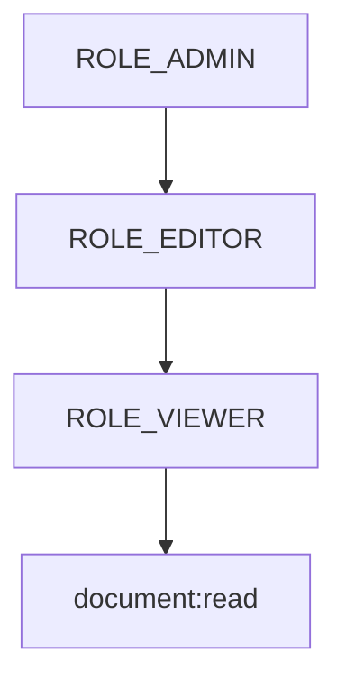

# Phân biệt kế thừa role với điều kiện sở hữu dữ liệu

> **Chủ đề:** Spring Security - authorization  
> **Nhóm:** Role hierarchy  
> **Đề bài:** Phân biệt kế thừa role với điều kiện sở hữu dữ liệu  
> **Kết quả cần đạt:** Biết rằng `RoleHierarchy` chỉ mở rộng tập authority được dùng để kiểm tra, không tự xác nhận owner/tenant/ACL của một bản ghi; biết kết hợp quyền chức năng và quyền theo tài nguyên, đặt chính sách tại đúng điểm thực thi, và xây test bắt được người **đủ role nhưng không có quyền trên object**.

## 1. Hai câu hỏi bảo mật không thể thay thế nhau

Giả sử một ứng dụng quản lý tài liệu có hierarchy:

```text
ROLE_ADMIN > ROLE_EDITOR
ROLE_EDITOR > ROLE_VIEWER
```

Alice có `ROLE_VIEWER` và sở hữu tài liệu 42. Bob có `ROLE_ADMIN` nhưng không sở hữu tài liệu 42. Bob gọi `GET /api/documents/42`. Có được xem không?

**Chưa đủ dữ liệu để quyết định.** Hierarchy cho biết `ROLE_ADMIN` có thể được đánh giá như bao hàm `ROLE_EDITOR` và `ROLE_VIEWER` khi thành phần authorization sử dụng hierarchy. Nó **không thay đổi** `document.ownerId`, không tự cấp ACL và không bảo đảm Bob có quyền xem dữ liệu của Alice.

Nếu policy quy định tài liệu private chỉ owner đọc được, Bob phải bị **DENY**. Nếu chính sách ứng dụng có quy tắc riêng cho admin cùng tenant được đọc tài liệu của thành viên, Bob có thể được **ALLOW**; quyền này đến từ **một capability và policy được khai báo tường minh**, không phải từ ý nghĩa mặc định của chữ ADMIN.

Đây là nguyên tắc chính:

> **Role hierarchy trả lời “actor có quyền chức năng gì?”. Object authorization trả lời “actor có quyền làm hành động này trên tài nguyên cụ thể này, trong ngữ cảnh này không?”.**

Cả hai phải đúng trước khi thực hiện hành động được bảo vệ.

## 2. Mô hình quyết định đủ điều kiện

Hãy biểu diễn việc cho phép thao tác:

```text
allow(actor, action, object, context)
    = authenticated(actor)
      AND functionalPermission(actor, action)
      AND authorizedScope(actor, object, context)
      AND objectGrantOrOwnership(actor, action, object)
      AND domainConstraints(actor, action, object)
```

Trong đó:
- `authenticated`: actor đến từ danh tính được xác thực; không tin userId do client khai.
- `functionalPermission`: actor có role/capability cho action này, có thể nhờ kế thừa role.
- `authorizedScope`: tenant, project, organization hoặc resource boundary đúng.
- `objectGrantOrOwnership`: actor là owner hoặc có ACL/delegation/permission cấp rõ.
- `domainConstraints`: trạng thái, hạn mức, separation of duties, workflow, version.

Không phải mọi use case đều cần đủ năm bước y hệt, nhưng **chỉ một bước `hasRole` thường không đủ cho tài liệu gắn với owner hoặc tenant**.

### Bảng so sánh

| Tiêu chí | Role hierarchy | Ownership / ACL / domain policy |
| --- | --- | --- |
| Dữ liệu | Role/authority của principal | Actor ID, object ID, owner ID, tenant, ACL, trạng thái |
| Ví dụ | `ROLE_ADMIN > ROLE_VIEWER` | `document.ownerId == actor.id` |
| Phạm vi | Quyền chung của actor | Một object hoặc tập object cụ thể |
| Cơ chế Spring | `RoleHierarchy`, `RoleHierarchyImpl`, `hasRole` | Policy bean, `PermissionEvaluator`, ACL, service guard |
| Cập nhật | Khi role/hierarchy đổi | Khi owner, share grants, tenant hoặc state đổi |
| Câu hỏi | “Có được dùng chức năng đọc không?” | “Có được đọc document 42 không?” |
| Lỗi nếu chỉ dùng loại này | Có thể thiếu chức năng chung | Có thể thiếu role/permission hiện hành |
| Rủi ro khi hiểu sai | Overgrant, role escalation | IDOR/BOLA, cross-tenant access |

## 3. RoleHierarchy và RoleHierarchyImpl tính những gì?

Spring Security biểu diễn role và permission qua `GrantedAuthority`, thường là một chuỗi như `ROLE_ADMIN`, `ROLE_VIEWER` hoặc `document:read`. `RoleHierarchy` có method:

```java
Collection<? extends GrantedAuthority>
    getReachableGrantedAuthorities(
        Collection<? extends GrantedAuthority> authorities
    );
```

Nó trả tập authority có thể đạt tới từ authorities đầu vào theo các cạnh hierarchy, **bao gồm các authority đầu vào**. `RoleHierarchyImpl` là implementation phổ biến.

Ví dụ khai báo:

```java
import org.springframework.security.access.hierarchicalroles.RoleHierarchy;
import org.springframework.security.access.hierarchicalroles.RoleHierarchyImpl;

RoleHierarchy hierarchy = RoleHierarchyImpl.fromHierarchy("""
    ROLE_ADMIN > ROLE_EDITOR
    ROLE_EDITOR > ROLE_VIEWER
    ROLE_VIEWER > document:read
    """);
```

Nếu Authentication có duy nhất `ROLE_ADMIN`, một hierarchy-aware consumer có thể sử dụng các authority reachable:

```text
ROLE_ADMIN
ROLE_EDITOR
ROLE_VIEWER
document:read
```

Nhưng **không có các dữ liệu sau trong kết quả**:

```text
document42.owner = alice
document42.tenant = organization-A
document42.isLocked = true
document42.grants contains bob
request.action = RENAME
```

Đó là dữ liệu domain. Một câu `hasAuthority('document:read')`, dù được thỏa nhờ hierarchy, không thể tự cho biết actor được đọc bản ghi nào.

### Một chiều và bắc cầu



`ROLE_ADMIN` suy ra `ROLE_EDITOR` và `ROLE_VIEWER` theo chiều mũi tên; `ROLE_VIEWER` không suy ngược lên ADMIN. Không cấu hình cạnh `ROLE_VIEWER > ROLE_ADMIN` chỉ vì ai đó muốn “viewer cũng dùng một trang admin”: đó là thay đổi quyền toàn hệ thống và có thể tạo privilege escalation.

Một cạnh `ROLE_ADMIN > document:read` có thể hợp lệ nếu business muốn admin có chức năng đọc chung. Nhưng đó **không phải** một cạnh mang nghĩa owner hoặc quyền truy cập mọi tenant.

## 4. Owner, creator, tenant và ACL khác nhau thế nào?

| Thuộc tính | Ý nghĩa | Nhầm lẫn thường gặp |
| --- | --- | --- |
| `createdBy` | Người đã tạo tài liệu | Người tạo vẫn mãi là owner |
| `ownerId` | Người chịu trách nhiệm hoặc sở hữu hiện tại | Owner tự động có mọi quyền kể cả khi tài liệu bị khóa |
| `tenantId` | Tổ chức chứa tài nguyên | Cùng tenant được xem mọi dữ liệu |
| `projectId` | Dự án/tập hợp chứa tài liệu | Project membership luôn cho quyền delete |
| `sharedWith` | Người được chia sẻ trực tiếp | Share READ đồng nghĩa share WRITE |
| ACL READ/WRITE/DELETE | Grant trên một object | Mọi role cấp cao mặc định có grant |
| `status` | DRAFT, LOCKED, ARCHIVED... | Chỉ cần owner/role là bỏ qua status |
| `classification` | PUBLIC, INTERNAL, CONFIDENTIAL | Được đọc PUBLIC đồng nghĩa được đọc CONFIDENTIAL |

Quyền sở hữu là một quy tắc nghiệp vụ, không phải một loại `GrantedAuthority` tự sinh từ Spring. Một object có thể có nhiều “chủ” theo nghĩa nghiệp vụ: người tạo, owner hiện tại, nhóm sở hữu, tenant chứa bản ghi. Hãy định nghĩa rõ permission nào áp dụng cho loại owner nào.

Ví dụ người dùng Alice là owner của document 42 nhưng document đã `LOCKED`: policy có thể vẫn cho đọc nhưng không cho chỉnh sửa. Với một khoản thanh toán, creator có thể **không được tự phê duyệt** (separation of duties). Chính vì vậy không nên viết một hàm `isOwner` rồi dùng làm điều kiện cho tất cả READ/WRITE/APPROVE.

## 5. Ví dụ IDOR: role đúng nhưng object sai

Method chưa an toàn:

```java
@PreAuthorize("hasRole('VIEWER')")
public DocumentView readDocument(long id) {
    return repository.findViewById(id);
}
```

Nếu Alice có ROLE_VIEWER, request `GET /api/documents/42` có thể hợp lệ. Nhưng Alice đổi ID thành 43 và `findViewById(43)` trả tài liệu của Bob, service **không hề kiểm tra quyền object**.

Đây là IDOR/BOLA: client chọn ID của object mà mình không được phép và hệ thống chỉ kiểm tra quyền chức năng.

Sửa theo hai lớp:

```java
@PreAuthorize("hasRole('VIEWER')")
public DocumentView readDocument(long id) {
    Actor actor = actorResolver.requireAuthenticatedActor();

    Document document = repository
        .findByIdAndTenantId(id, actor.activeTenantId())
        .orElseThrow(DocumentNotFoundException::new);

    documentPolicy.requireCanRead(actor, document);
    return mapper.toView(document);
}
```

Đây là **snippet Spring tích hợp, không phải file Java standalone**: các type `Actor`, `Document`, repository, policy, mapper và exception do ứng dụng tự xây dựng.

Các bước:
1. `@PreAuthorize` kiểm tra quyền chức năng nhờ role/authority.
2. Actor ID và tenant được xác minh từ Authentication/server context.
3. Query chỉ chọn tài liệu ở tenant hợp lệ.
4. Policy xét owner, ACL, trạng thái và grant khác.
5. Chỉ sau ALLOW mới trả DTO chứa nội dung.

Chỉ việc thêm `ROLE_ADMIN > ROLE_VIEWER` sẽ không tự điền bước 3–4.

## 6. Role cao nhưng ở tenant khác vẫn bị từ chối

Ví dụ:

```text
Actor:
    id = bob
    directRole = ROLE_ADMIN
    activeTenant = org-A

Document:
    id = 44
    ownerId = bob
    tenantId = org-B
```

Nếu policy yêu cầu mọi truy cập phải thuộc active tenant được xác minh, Bob bị DENY dù có role ADMIN **và dù ownerId trùng**. Role hierarchy không làm dịch chuyển tenant boundary.

Cách viết nguy hiểm:

```java
if (hasRole(actor, "ADMIN")
        || document.ownerId().equals(actor.id())) {
    return document;
}
```

Nhánh ADMIN bỏ qua tenant, status và ACL. Một admin thuộc org-A có thể đọc dữ liệu org-B, tạo lỗ hổng cách ly tổ chức.

Cách thiết kế bảo thủ:

```java
if (!actor.activeTenantId().equals(document.tenantId())) {
    throw new AccessDeniedException("Not accessible");
}

if (document.ownerId().equals(actor.id())
        || policy.hasTenantWideRead(actor, document)) {
    return document;
}

throw new AccessDeniedException("Not accessible");
```

Đây là snippet domain policy; `hasTenantWideRead` phải kiểm tra **quyền tường minh** và phạm vi tenant. Nếu một loại global operator thật sự được quyền cross-tenant, hãy thiết kế capability khác, MFA/approval/audit phù hợp thay vì suy diễn từ ROLE_ADMIN thông thường.

`X-Tenant-ID` trên HTTP header, path `/tenants/{id}` hoặc query `?tenantId=...` chỉ là dữ liệu client cung cấp. Backend phải xác nhận user thuộc tenant đó và được phép chọn nó, không sử dụng trực tiếp như bằng chứng authorization.

## 7. Đặt vai trò và object policy ở đâu trong luồng Spring Security?

```text
GET /api/documents/42
       |
       v
Spring Security FilterChainProxy / SecurityFilterChain
       |
       v
Authentication -> principal và authorities
       |
       v
AuthorizationFilter:
  HTTP matcher yêu cầu document:read?
       | NO -> DENY
       v YES
Method interceptor:
  @PreAuthorize hasRole('VIEWER')?
       | NO -> DENY
       v YES
Application service:
  tải document 42 theo tenant được phép
       | không có / ngoài scope -> NOT FOUND hoặc DENY
       v
Domain policy:
  actor là owner / có ACL READ / được ủy quyền?
  trạng thái cho phép đọc?
       | NO -> DENY
       v YES
Serialize DTO và gửi response
```

`RoleHierarchyImpl` tham gia ở những checkpoint kiểm tra authority **đã được cấu hình dùng nó**. Nó không biến `AuthorizationFilter` thành một bộ máy tự truy vấn owner từ database. `SecurityFilterChain` chọn theo matcher, rule URL chọn theo thứ tự khai báo, rồi service mới có dữ liệu entity cụ thể để xét quyền.

Trong hệ thống có GraphQL, scheduler hoặc message consumer, HTTP filter không bảo vệ các đường gọi ngoài HTTP. Vì thế **domain guard trong application service** thường là điểm tái sử dụng quan trọng. Method-security interceptor cũng cần được gọi qua Spring AOP proxy, không được bypass bởi self-invocation.

## 8. Ví dụ Spring 6.5+: cấu hình role hierarchy

```java
import org.springframework.context.annotation.Bean;
import org.springframework.context.annotation.Configuration;
import org.springframework.security.access.hierarchicalroles.RoleHierarchy;
import org.springframework.security.access.hierarchicalroles.RoleHierarchyImpl;

@Configuration
class HierarchyConfiguration {
    @Bean
    static RoleHierarchy roleHierarchy() {
        return RoleHierarchyImpl.fromHierarchy("""
            ROLE_ADMIN > ROLE_EDITOR
            ROLE_EDITOR > ROLE_VIEWER
            ROLE_VIEWER > document:read
            ROLE_EDITOR > document:rename
            """);
    }
}
```

Chữ `>` có nghĩa “bao hàm”, ví dụ ADMIN đạt tới VIEWER. Các permission `document:read`, `document:rename` là **quyền chức năng chung**, vẫn phải kết hợp document scope trong service.

Cấu hình method security cho `@PreAuthorize`:

```java
import org.springframework.context.annotation.Bean;
import org.springframework.context.annotation.Configuration;
import org.springframework.security.access.expression.method.DefaultMethodSecurityExpressionHandler;
import org.springframework.security.access.expression.method.MethodSecurityExpressionHandler;
import org.springframework.security.access.hierarchicalroles.RoleHierarchy;
import org.springframework.security.config.annotation.method.configuration.EnableMethodSecurity;

@Configuration
@EnableMethodSecurity
class MethodSecurityConfiguration {

    @Bean
    static MethodSecurityExpressionHandler
            methodSecurityExpressionHandler(RoleHierarchy hierarchy) {
        var handler = new DefaultMethodSecurityExpressionHandler();
        handler.setRoleHierarchy(hierarchy);
        return handler;
    }
}
```

**Đây là snippet cấu hình Spring**, không chạy bằng `javac` đơn độc. Định nghĩa hierarchy bean ở một nơi phù hợp; khi tổ chức code, tránh tạo trùng nhiều bean cùng kiểu nếu không có chủ đích. Với Spring Security 7, kiểm tra API manager/factory đúng version; không áp dụng vô điều kiện các cú pháp của 7 cho nhánh cũ.

Nếu tạo `AuthorityAuthorizationManager` riêng thay vì dùng DSL mặc định, manager có thể cần `setRoleHierarchy(roleHierarchy)`. Một custom manager tự viết sẽ không mặc định dùng mọi bean hierarchy chỉ vì chúng tồn tại trong context.

## 9. @PreAuthorize có thể kết hợp hai loại chính sách

Một biểu thức đặt hai điều kiện:

```java
@PreAuthorize(
    "hasAuthority('document:read') "
    + "and @documentPolicy.canRead(authentication, #id)"
)
public DocumentView get(long id) {
    return repository.getView(id);
}
```

Ý nghĩa:
- `hasAuthority('document:read')` kiểm tra quyền chung, có thể được hierarchy suy ra nếu handler hiểu hierarchy.
- `documentPolicy.canRead(...)` phải xác minh owner, tenant và trạng thái dựa trên dữ liệu **server tin cậy**.
- Hai điều kiện liên kết bằng **AND**, không phải OR.

Nhưng có hai giới hạn:
1. `#id` yêu cầu tên parameter có thể resolve từ compiler metadata hoặc annotation phù hợp.
2. Policy query trước body và body query sau có thể tạo race (TOCTOU) nếu quyền hoặc owner thay đổi giữa hai bước. Với lệnh write, nên tải entity/check policy trong transaction ngay trước thay đổi.

Khi biểu thức phức tạp, để chính sách domain trong class Java dễ test hơn một SpEL dài và nạp resource nhiều lần.

## 10. Command thay đổi dữ liệu: policy phải chạy trước side effect

Ví dụ sửa tên tài liệu:

```java
import org.springframework.security.access.AccessDeniedException;
import org.springframework.security.access.prepost.PreAuthorize;
import org.springframework.stereotype.Service;
import org.springframework.transaction.annotation.Transactional;

@Service
public class DocumentCommandService {
    private final ActorResolver actorResolver;
    private final DocumentRepository repository;
    private final DocumentPolicy policy;

    public DocumentCommandService(
            ActorResolver actorResolver,
            DocumentRepository repository,
            DocumentPolicy policy) {
        this.actorResolver = actorResolver;
        this.repository = repository;
        this.policy = policy;
    }

    @PreAuthorize("hasAuthority('document:rename')")
    @Transactional
    public void rename(long documentId, String newTitle) {
        Actor actor = actorResolver.requireAuthenticatedActor();

        Document doc = repository
            .findForUpdateWithinTenant(
                documentId, actor.activeTenantId()
            ).orElseThrow(DocumentNotFoundException::new);

        if (!policy.canRename(actor, doc)) {
            throw new AccessDeniedException("Rename denied");
        }

        doc.rename(newTitle);
    }
}
```

Đây là **snippet tích hợp**; Actor, repository, policy và entity là type do dự án định nghĩa. Tên `findForUpdateWithinTenant` chỉ biểu diễn hợp đồng; cần implementation DB/JPA locking hoặc optimistic version thực tế.

Quyết định có các bước:
1. Role/permission gate ở `@PreAuthorize` từ chối người thiếu quyền chung trước khi body chạy.
2. Truy vấn có tenant scope chặn tài nguyên thuộc tổ chức khác.
3. Domain policy kiểm tra owner hoặc ACL WRITE, trạng thái DRAFT, khóa và các điều kiện liên quan.
4. **Chỉ sau khi tất cả điều kiện đúng** mới sửa title.

Một ROLE_ADMIN có thể được hierarchy cấp `document:rename` nhưng vẫn bị policy từ chối nếu không phải owner, không có grant tenant-wide hoặc document bị LOCKED. Đó là chủ ý bảo mật, không phải lỗi của hierarchy.

## 11. Cần policy riêng cho từng action

Một hàm `isOwner(actor, doc)` không nên tự quyết định tất cả thao tác:

| Action | Quyền chức năng | Quyền resource bổ sung |
| --- | --- | --- |
| READ | `document:read` | Owner, PUBLIC, ACL READ, tenant-wide READ được cấp |
| RENAME | `document:rename` | Owner/ACL WRITE, chưa LOCKED, version hợp lệ |
| DELETE | `document:delete` | Owner/ACL DELETE, retention policy |
| SHARE | `document:share` | Owner/ACL ADMINISTER, người nhận được phép |
| TRANSFER | `document:transfer` | Owner hiện tại, người nhận hợp lệ, approval |
| EXPORT | `document:export` | READ trên toàn tập object, hạn mức, audit |
| APPROVE PAYMENT | `payment:approve` | Không tự duyệt, đúng tenant, hạn mức, trạng thái |
| READ AUDIT | `audit:read` | Scope dự án/tổ chức và lý do truy cập |

Lý do: sở hữu dữ liệu không đồng nghĩa được phá quy định nghiệp vụ. Người tạo thanh toán có thể bị cấm tự duyệt dù là owner; chủ sở hữu tài liệu bị khóa có thể được đọc nhưng không được sửa.

Role hierarchy chỉ giúp loại bỏ việc lặp vai trò trong **cột quyền chức năng**, không tự triển khai toàn bộ **cột quyền resource**.

## 12. Tenant-wide permission không đồng nghĩa global admin

Nếu chính sách cho phép admin tổ chức đọc dữ liệu của các thành viên, định nghĩa capability riêng:

```text
ROLE_ADMIN > ROLE_EDITOR
ROLE_EDITOR > ROLE_VIEWER
ROLE_ADMIN > document:read:tenant
```

Sau đó policy:

```text
canRead(actor, document)
    = hasDocumentRead(actor)
      AND sameAuthorizedTenant(actor, document)
      AND notRestrictedForRead(document)
      AND (
        isOwner(actor, document)
        OR hasAclRead(actor, document)
        OR (
            hasAuthority(actor, "document:read:tenant")
            AND tenantPolicyAllows(actor, document)
        )
      )
```

Điều quan trọng:
- `document:read:tenant` là grant **chủ động thiết kế**; không phải mặc định của `ROLE_ADMIN`.
- Trong ví dụ này quyền tenant-wide vẫn yêu cầu cùng tenant.
- Quyền vượt tenant nên là capability khác, kiểm soát riêng với MFA, approval/audit khi cần.
- Nếu có quyền support impersonation, phải phân biệt acting user và original operator trong audit.
- Khi thay edge role-to-permission, nhiều endpoint có thể thay đổi kết quả cùng lúc; cần review như một thay đổi policy.

Tránh viết `if (admin) return true;` ở đầu `canRead`: nó bypass cả tenant, ACL và trạng thái.

## 13. Role hierarchy và ACL inheritance là hai đồ thị khác nhau

```text
Actor role graph:
  ROLE_ADMIN -> ROLE_EDITOR -> ROLE_VIEWER

Resource ACL graph:
  Project Alpha
       |
       +-- Folder Contracts
               |
               +-- Document 42
```

Role graph nói actor có authorities nào. ACL graph nói tài nguyên con có thể **kế thừa access control entries** từ tài nguyên cha theo cơ chế ACL.

Spring Security ACL sử dụng các khái niệm `Acl`, `AccessControlEntry`, `Sid`, `ObjectIdentity`, `Permission` và `AclService`. Nếu dự án dùng module ACL, `PermissionEvaluator` có thể hỗ trợ `hasPermission` trong method-security expressions. Nhưng không mặc định module này đã cấu hình chỉ vì dùng `RoleHierarchyImpl`.

Một ROLE_EDITOR không tự có ACE WRITE cho mọi document. Một user có ACL READ trên document 42 cũng không tự có quyền DELETE document 42, bất kể role chung.

## 14. Đừng đưa owner từng object vào chuỗi role

Một cách thiếu bền vững là tạo authorities:

```text
OWNER_DOCUMENT_42
OWNER_DOCUMENT_43
OWNER_DOCUMENT_44
...
```

rồi cố biểu diễn quan hệ sở hữu bằng role hierarchy. Cách này khó:
- Token/JWT phình lên theo số object.
- Chủ sở hữu chuyển giao làm authority cũ mất hiệu lực khó kiểm soát.
- Quyền bị cache quá lâu.
- Có thể lộ metadata object cho ứng dụng khác.
- Rule trở nên khó hiểu khi hàng triệu documents.

Role hierarchy phù hợp cho tập role/permission tương đối ổn định. Quyền theo object nên dùng DB queries có scope, ACL và policy từ trạng thái hiện tại.

Khi cần tối ưu kiểm tra ACL số lượng lớn, truy vấn theo tenant và grants có index, batch lookup, cache có invalidation — không chuyển cả database ownership thành tập static authorities.

## 15. Danh sách và phân trang: chỉ role gate dễ làm lộ toàn bộ dữ liệu

Không an toàn:

```java
@PreAuthorize("hasRole('VIEWER')")
public List<DocumentView> listDocuments() {
    return repository.findAll().stream()
        .map(mapper::toView)
        .toList();
}
```

Một viewer được qua role gate và nhận cả document của người khác. Giải pháp tốt hơn là **query có scope**:

```sql
SELECT d.*
FROM documents d
WHERE d.tenant_id = :authorized_tenant
  AND (
       d.owner_id = :actor_id
       OR EXISTS (
            SELECT 1
            FROM document_grants g
            WHERE g.document_id = d.id
              AND g.user_id = :actor_id
              AND g.permission = 'READ'
       )
  )
ORDER BY d.created_at DESC
LIMIT :page_size OFFSET :offset;
```

SQL này chỉ minh họa; nếu policy có tenant-wide read, public visibility, trạng thái hoặc delegation thì thêm điều kiện tương ứng **một cách tường minh**. Không tự nối `OR role_admin=true` mà bỏ qua tenant.

`@PostFilter` có thể lọc collection sau khi method đã load, nhưng không phải giải pháp mặc định cho list lớn: dữ liệu không được phép đã được đưa vào memory, pagination/count có thể sai và download/export path dễ bỏ qua filter.

## 16. Java 17+ runnable: hierarchy không tự biến người khác thành owner

Chương trình sau **mô phỏng** một role graph và policy đọc tài liệu bằng Java thuần. Không dùng Spring, Servlet, JWT hoặc DB; actor được khởi tạo như test fixture. Đây là cách nhìn rõ rằng ADMIN suy ra VIEWER nhưng vẫn có thể bị từ chối trên object khác tenant, object bị khóa hoặc object không sở hữu.

Lưu file `RoleOwnershipDemo.java`:

```java
import java.util.ArrayDeque;
import java.util.Deque;
import java.util.HashSet;
import java.util.Map;
import java.util.Set;

public class RoleOwnershipDemo {

    record Actor(String id, String tenant, Set<String> direct) {}
    record Document(long id, String tenant,
                    String owner, boolean locked) {}

    private static final Map<String, Set<String>> IMPLIES = Map.of(
        "ROLE_ADMIN", Set.of("ROLE_EDITOR", "document:read:tenant"),
        "ROLE_EDITOR", Set.of("ROLE_VIEWER")
    );

    static Set<String> reachable(Set<String> direct) {
        Set<String> reached = new HashSet<>(direct);
        Deque<String> queue = new ArrayDeque<>(direct);
        while (!queue.isEmpty()) {
            String current = queue.removeFirst();
            for (String next : IMPLIES.getOrDefault(current, Set.of())) {
                if (reached.add(next)) {
                    queue.addLast(next);
                }
            }
        }
        return reached;
    }

    static boolean hasRole(Actor actor, String role) {
        return reachable(actor.direct()).contains("ROLE_" + role);
    }

    static boolean has(Actor actor, String authority) {
        return reachable(actor.direct()).contains(authority);
    }

    static String canRead(Actor actor, Document doc) {
        if (!hasRole(actor, "VIEWER")) return "DENY missing-role";
        if (!actor.tenant().equals(doc.tenant())) return "DENY tenant";
        if (doc.locked()) return "DENY locked";
        if (actor.id().equals(doc.owner())) return "ALLOW owner";
        if (has(actor, "document:read:tenant")) {
            return "ALLOW tenant-grant";
        }
        return "DENY owner";
    }

    public static void main(String[] args) {
        Actor alice = new Actor("alice", "A", Set.of("ROLE_VIEWER"));
        Actor bob = new Actor("bob", "A", Set.of("ROLE_ADMIN"));
        Actor carol = new Actor("carol", "A", Set.of("ROLE_EDITOR"));
        Actor guest = new Actor("alice", "A", Set.of("ROLE_GUEST"));

        Document own = new Document(42, "A", "alice", false);
        Document other = new Document(43, "A", "bob", false);
        Document cross = new Document(44, "B", "bob", false);
        Document locked = new Document(45, "A", "alice", true);

        System.out.println("Admin has VIEWER: "
            + hasRole(bob, "VIEWER"));
        System.out.println("Viewer has ADMIN: "
            + hasRole(alice, "ADMIN"));
        System.out.println("Alice own: " + canRead(alice, own));
        System.out.println("Alice other: " + canRead(alice, other));
        System.out.println("Carol other: " + canRead(carol, other));
        System.out.println("Bob admin same tenant: "
            + canRead(bob, own));
        System.out.println("Bob admin cross tenant: "
            + canRead(bob, cross));
        System.out.println("Bob admin locked: "
            + canRead(bob, locked));
        System.out.println("Guest own: " + canRead(guest, own));
        System.out.println("Bob own: " + canRead(bob, other));
    }
}
```

Biên dịch/chạy bằng JDK 17 trở lên:

```bash
javac RoleOwnershipDemo.java
java RoleOwnershipDemo
```

Stdout **chính xác**:

```text
Admin has VIEWER: true
Viewer has ADMIN: false
Alice own: ALLOW owner
Alice other: DENY owner
Carol other: DENY owner
Bob admin same tenant: ALLOW tenant-grant
Bob admin cross tenant: DENY tenant
Bob admin locked: DENY locked
Guest own: DENY missing-role
Bob own: ALLOW owner
```

Giải thích:
- ADMIN kế thừa EDITOR và VIEWER; VIEWER không kế thừa ADMIN.
- Alice có VIEWER và là owner document 42 nên được đọc.
- Alice không được đọc document 43 dù cũng có role VIEWER.
- Carol có EDITOR và VIEWER reachable nhưng không được đọc object của Bob khi thiếu grant.
- Bob được đọc document Alice/A nhờ **permission tenant-wide tường minh trong hierarchy**, không phải vì mọi admin tự động sở hữu mọi dữ liệu.
- Bob không đọc document tenant B, dù ID owner là Bob.
- Document khóa đọc bị từ chối theo policy demo.
- Guest có cùng tên owner nhưng không có role chức năng được yêu cầu.
- Bob có thể đọc document chính mình vì thỏa cả role, tenant, state và owner.

**Giới hạn:** hàm `reachable` chỉ minh họa traversal đồ thị bằng `HashSet`/`ArrayDeque`; không thay `RoleHierarchyImpl`. Việc cấp permission tenant-wide trong demo là **lựa chọn policy để giải thích**, không phải mặc định an toàn cho tất cả sản phẩm.

## 17. Unit test role graph và domain policy là hai nhóm riêng

### Test A: xác minh tính bắc cầu

```java
RoleHierarchy h = RoleHierarchyImpl.fromHierarchy("""
    ROLE_ADMIN > ROLE_EDITOR
    ROLE_EDITOR > ROLE_VIEWER
    """);

var roles = h.getReachableGrantedAuthorities(
    List.of(new SimpleGrantedAuthority("ROLE_ADMIN"))
).stream()
 .map(GrantedAuthority::getAuthority)
 .collect(Collectors.toSet());

assertThat(roles)
    .contains("ROLE_ADMIN", "ROLE_EDITOR", "ROLE_VIEWER");
```

Đây là snippet JUnit/AssertJ/Spring Security: cần imports và dependencies. Nó chỉ xác minh graph, không chứng minh method/HTTP manager đang sử dụng hierarchy.

### Test B: xác minh quyền object

```java
@Test
void roleEditorWithoutOwnershipCannotRename() {
    Actor actor = actor("carol", "tenant-A", "ROLE_EDITOR");
    Document doc = document(43L, "tenant-A", "bob", "DRAFT");

    assertThat(policy.canRename(actor, doc)).isFalse();
}

@Test
void tenantAdminCannotReadOtherTenant() {
    Actor admin = actor("bob", "tenant-A", "ROLE_ADMIN");
    Document doc = document(44L, "tenant-B", "bob", "DRAFT");

    assertThat(policy.canRead(admin, doc)).isFalse();
}
```

`actor`, `document` và `policy` là test fixtures/domain contracts, không phải API có sẵn. Điều quan trọng là tạo tình huống **đủ role nhưng không có quyền object**.

### Test C: integration test qua Spring

```java
// Snippet JUnit 5 + Spring Security Test, cần service bean qua AOP.
@Test
@WithMockUser(roles = {"ADMIN"})
void adminCanPassViewerGateWhenHierarchyIsWired() {
    assertThat(profileService.viewPublicProfile())
        .isNotNull();
}
```

Fixture chỉ cấp ROLE_ADMIN trực tiếp; nếu đã cấp cả ROLE_VIEWER, test ALLOW không chứng minh hierarchy hoạt động. Sau đó test một service đọc document khác tenant phải từ chối **ở domain policy**, không để role ADMIN bỏ qua object guard.

## 18. MockMvc: status 403 có thể đến từ nhiều nơi

Đối với route đọc document:

```java
import static org.springframework.security.test.web.servlet.request
    .SecurityMockMvcRequestPostProcessors.user;
import static org.springframework.test.web.servlet.request
    .MockMvcRequestBuilders.get;
import static org.springframework.test.web.servlet.result
    .MockMvcResultMatchers.status;

@Test
void viewerCanReadOwnDocument() throws Exception {
    mvc.perform(get("/api/documents/42")
            .with(user("alice").roles("VIEWER")))
        .andExpect(status().isOk());
}

@Test
void viewerCannotReadOthersDocument() throws Exception {
    mvc.perform(get("/api/documents/43")
            .with(user("alice").roles("VIEWER")))
        .andExpect(status().isForbidden());
}
```

Đây là **snippet integration**, cần controller mapping thật, MockMvc, test fixtures tài liệu 42/43, actorResolver và error handling đúng contract. Nếu hệ thống cố tình che sự tồn tại tài liệu không có quyền bằng 404 thì chỉnh kỳ vọng theo policy; nếu controller không tồn tại thì 404 không chứng minh object authorization.

Đối với write test, nếu CSRF được bật phải cung cấp CSRF token hợp lệ để tránh một response 403 **do CSRF** bị hiểu nhầm là do owner check. Hãy verify entity không đổi sau DENY và external side effects không chạy.

Cần có ít nhất:
1. Role thấp không được dùng chức năng cao.
2. Role cao được hưởng chức năng thấp khi hierarchy wired.
3. Role cao **không** tự đọc object khác tenant.
4. Role cao **không** tự sửa tài liệu không có grant/owner.
5. Owner đủ role được phép theo state.
6. Owner thiếu role không tự được vào chức năng.
7. ACL READ không tự cho WRITE.
8. Trạng thái LOCKED ngăn write dù có role/ownership.
9. Admin tenant-wide grant bị giới hạn tenant.
10. Request thiếu Authentication bị từ chối theo entry point phù hợp.

## 19. TOCTOU: owner có thể thay đổi giữa check và sử dụng

Ví dụ:

```java
@PreAuthorize("@policy.isOwner(authentication, #id)")
public void rename(long id, String title) {
    repository.renameById(id, title);
}
```

Nếu object owner đổi hoặc bị khóa sau khi pre-expression đọc DB nhưng trước khi body update, thao tác có thể vi phạm rule. Đây là **time-of-check/time-of-use**.

Với command quan trọng:
- Nạp entity trong transaction có tenant scope.
- Kiểm tra policy trên state mà transaction sẽ thay đổi.
- Dùng optimistic locking `@Version`, row lock hoặc conditional update tùy yêu cầu.
- Nếu dùng conditional SQL, include tenant/owner/status/version trong `WHERE` và kiểm tra affected rows.
- Không gửi email/payment gateway trước khi quyền được xác nhận.
- Kiểm soát outbox/side effects nếu command phụ thuộc commit thành công.

Ví dụ SQL minh họa cho “chỉ owner được rename tài liệu DRAFT”:

```sql
UPDATE documents
SET title = :new_title,
    version = version + 1
WHERE id = :document_id
  AND tenant_id = :authorized_tenant
  AND owner_id = :actor_id
  AND status = 'DRAFT'
  AND version = :expected_version;
```

Nếu số dòng cập nhật = 0, xử lý DENY/CONFLICT/NOT_FOUND theo contract, không coi là thành công. SQL này chưa hỗ trợ delegation/ACL WRITE; cần mở rộng khi business policy yêu cầu.

## 20. Vì sao @PostAuthorize không thể là bảo vệ write chính?

Ví dụ đọc:

```java
@PostAuthorize("returnObject.ownerId == authentication.name")
public DocumentView read(long id) {
    return repository.loadView(id);
}
```

Post-check có thể hữu ích khi owner chỉ biết sau khi method trả kết quả, nhưng method **đã chạy** để sinh `returnObject`. Nếu method có side effect, exception DENY sau đó không bảo đảm hoàn tác mọi thay đổi hoặc message gửi ra ngoài.

Với write:

```java
@PostAuthorize("returnObject.ownerId == authentication.name")
public Document renameAndReturn(long id, String title) {
    return repository.renameAndReturn(id, title);
}
```

Đây là **anti-pattern** nếu dùng làm chốt quyền duy nhất. Domain policy phải kiểm tra trước khi sửa, trong transaction phù hợp. `@Transactional` không tự bảo đảm rollback external API calls/email, và thứ tự AOP advisors có thể ảnh hưởng thời điểm commit.

Ngoài ra, `authentication.name` có thể là email/OIDC subject trong khi `ownerId` ở DB là UUID; luôn chuẩn hóa identity trước khi so sánh.

## 21. Multi-tenant roles không phải global roles

Một user có thể:
- ADMIN ở tenant A.
- VIEWER ở tenant B.
- Không là thành viên tenant C.

Nếu Authentication chỉ chứa `ROLE_ADMIN` global, hierarchy có thể khiến các permission check theo URL không phân biệt tenant. Cần xác định scope theo actor và active tenant đã xác minh.

Những lựa chọn thực tế:
- Chọn tenant context có xác minh membership, rồi tạo actor/authority đúng tenant.
- Dùng domain policy xét `membership(actor, tenant, role)` riêng.
- Dùng permission có scope/tên cụ thể nếu kiến trúc chấp nhận.
- Không tin header/path tenant do client tự gửi là bằng chứng membership.
- Với superadmin, có capability và audit riêng cho truy cập khác tenant.

**Không nên tự động** coi một cạnh `ROLE_ADMIN > ROLE_VIEWER` là quyền đọc VIEWER trong mọi tenant. Quan hệ role là một quy tắc về authority; việc authority thuộc scope nào phải được thiết kế riêng.

## 22. Quyền có thể bị thu hồi dù role chưa thay đổi

Ví dụ:
- Alice chuyển quyền sở hữu document 42 cho Bob.
- Document 42 bị chuyển sang LOCKED.
- Grant ACL READ cho Carol bị thu hồi.
- Membership tenant của Bob hết hạn.
- Role EDITOR của Carol vẫn còn trong JWT cũ.

Từ lúc này, kết quả object policy phải theo contract thu hồi đã định; không thể dựa mãi vào authority lúc login. Role hierarchy thường được cấu hình tương đối ổn định, còn owner/ACL/data state đổi thường xuyên.

Nếu ứng dụng cache policy/ACL:
- Cần invalidation/version/TTL phù hợp rủi ro.
- Với write nhạy cảm, revalidate trước side effect.
- Với JWT, cân nhắc expiry, revocation và cách đồng bộ membership.
- Không nhồi mọi document owner grant vào token dài hạn.
- Không dùng một cache key chỉ theo role mà bỏ object ID, tenant và policy version.

## 23. Những lỗi phổ biến

| Hiểu sai | Hậu quả | Cách đúng |
| --- | --- | --- |
| “ADMIN kế thừa VIEWER nên sở hữu mọi tài liệu” | IDOR/BOLA | Kiểm tra owner/ACL trên entity thật |
| “ROLE_ADMIN có thể bypass mọi tenant” | Lộ dữ liệu cross-tenant | Active tenant đã xác minh + policy |
| “Có role READ là xem mọi ID” | Đọc tài liệu người khác | Scope query + resource policy |
| “Client gửi ownerId đúng tên user nên là owner” | Chủ động giả mạo quan hệ owner | Lấy owner từ DB theo documentId |
| “Owner luôn được DELETE” | Xóa data bị retention lock | Per-action policy và state guard |
| “ROLE_EDITOR cao hơn nên có ACL WRITE mọi object” | Sửa dữ liệu trái phép | ACL/owner/delegation riêng |
| “Có bean RoleHierarchy thì mọi manager tự dùng” | Hành vi HTTP/method không nhất quán | Wire manager/handler và test |
| “@PreAuthorize là đủ dù self-invocation” | Bypass AOP | Bảo vệ use case và test proxy |
| “@PostAuthorize deny nghĩa chưa cập nhật gì” | Side effect đã xảy ra | Guard write trước cập nhật |
| “Cùng tenant đồng nghĩa cùng owner” | Đọc chéo tài liệu trong tenant | Owner/ACL policy sau tenant |
| “Test admin vào được chứng minh bảo mật” | Không phát hiện admin truy cập sai object | Negative tests khác owner/tenant |
| “HTTP 403 chắc do ownership policy” | CSRF/role/filter có thể deny | Xác định đúng checkpoint |
| “ACL inheritance chính là role hierarchy” | Thiết kế sai đồ thị quyền | Phân biệt authority graph và object ACL graph |

## 24. Checklist khi review một service đọc/sửa dữ liệu

1. Actor có được tạo từ Authentication tin cậy không?
2. Role hierarchy có đúng hướng và manager thật sự sử dụng không?
3. Action cần permission nào, hay chỉ kiểm tra `authenticated()`?
4. Tenant/organization scope có được xác minh server-side không?
5. Resource có được tải bằng query giới hạn tenant/owner phù hợp không?
6. Owner thật có lấy từ entity thay vì request không?
7. ACL/delegation có xác minh grant READ/WRITE tương ứng không?
8. Vai trò ADMIN có bypass không? Nếu có, phạm vi/bằng chứng/audit đâu?
9. Entity status có cho phép action không?
10. List/export có query scope trước khi trả dữ liệu không?
11. Write có transaction/lock/version/conditional update không?
12. Side effect chỉ chạy sau khi ALLOW chưa?
13. Có test đủ role nhưng sai owner không?
14. Có test đủ role/owner nhưng sai tenant không?
15. Có test khác state và token/revocation không?
16. Có test role thấp không leo lên role cao không?
17. Đường gọi ngoài HTTP có dùng policy tương tự không?
18. Có bảo vệ khỏi self-invocation bypass trong method security không?
19. Khi DENY, response 403/404 có theo contract và không rò metadata không?
20. Audit có actor, action, object ID, outcome nhưng không chứa secret không?

### Câu hỏi tự kiểm tra

**1.** `ROLE_ADMIN > ROLE_EDITOR > ROLE_VIEWER`. Bob có ADMIN. Có tự đọc được document của Alice không?  
→ **Không tự động**. Bob vượt role gate VIEWER, nhưng còn owner/ACL/tenant/state policy.

**2.** Alice có VIEWER và là owner document 42. Có luôn được DELETE không?  
→ **Không**. DELETE có permission riêng, retention/state và domain policy.

**3.** Bob có ADMIN tenant A; document 44 thuộc tenant B. Có quyền không?  
→ **Không** theo chính sách cách ly tenant, dù Bob có role cao và trùng owner ID.

**4.** Một user gửi `ownerId=alice` và token xác thực Alice nhưng `documentId` của Bob. Chỉ so ownerId với principal có an toàn không?  
→ **Không**. Owner thật phải lấy từ document theo ID từ DB.

**5.** ACL READ ở Document 42 có nghĩa ROLE_VIEWER tự mở quyền đọc mọi document không?  
→ **Không**. ACL READ gắn với object cụ thể; role hierarchy gắn với authority của actor.

**6.** Một command được chặn bằng `@PostAuthorize` theo owner. Có đảm bảo chưa ghi DB trước DENY không?  
→ **Không**. Post-check chạy sau method; bảo vệ write phải trước thay đổi.

**7.** Method `@PreAuthorize("hasRole('VIEWER')")` được gọi trực tiếp qua `this` bên trong cùng bean. Có chắc proxy security chạy không?  
→ **Không** trong proxy AOP thông dụng; cần thiết kế invocation/boundary đúng và có domain guard.

**8.** Một test mock actor có cả ROLE_ADMIN và ROLE_VIEWER trực tiếp, qua VIEWER endpoint. Có chứng minh hierarchy không?  
→ **Không**. Phải test actor chỉ có ROLE_ADMIN và kiểm tra được kế thừa qua manager/handler.

**9.** Khi owner đổi giữa pre-check và update, cần làm gì?  
→ Kiểm tra quyền ở điểm sử dụng, dùng transaction/locking/version/conditional update phù hợp tránh TOCTOU.

**10.** Vì sao một response 403 không đủ chứng minh owner guard chính xác?  
→ Có thể đến từ HTTP matcher, thiếu role, CSRF hoặc exception khác. Cần test dữ liệu và invocation thực.

## Kết luận

**Kế thừa role không đồng nghĩa kế thừa quyền sở hữu dữ liệu.** `RoleHierarchy`/`RoleHierarchyImpl` giúp actor mang role cao thỏa các yêu cầu role thấp, nhưng không tự đánh giá `document.ownerId`, `tenantId`, ACL hay trạng thái nghiệp vụ. Thiết kế an toàn phải **kết hợp quyền chức năng với policy trên object thật**, bảo vệ tenant, kiểm tra trước side effect và có test âm tính cho actor đủ role nhưng không được phép truy cập tài nguyên cụ thể.

## Tài liệu tham khảo chính thức

- [Spring Security 6.5 — Authorization Architecture (Hierarchical Roles)](https://docs.spring.io/spring-security/reference/6.5/servlet/authorization/architecture.html).
- [Spring Security 6.5 — Method Security](https://docs.spring.io/spring-security/reference/6.5/servlet/authorization/method-security.html).
- [Spring Security 6.5 — Domain Object Security (ACLs)](https://docs.spring.io/spring-security/reference/6.5/servlet/authorization/acls.html).
- [Spring Security 6.5 — RoleHierarchy API](https://docs.spring.io/spring-security/reference/6.5/api/java/org/springframework/security/access/hierarchicalroles/RoleHierarchy.html).
- [Spring Security 6.5 — RoleHierarchyImpl API](https://docs.spring.io/spring-security/reference/6.5/api/java/org/springframework/security/access/hierarchicalroles/RoleHierarchyImpl.html).
- [Spring Security 6.5 — Authorize HTTP Requests](https://docs.spring.io/spring-security/reference/6.5/servlet/authorization/authorize-http-requests.html).
- [Spring Security 6.5 — Testing Method Security](https://docs.spring.io/spring-security/reference/6.5/servlet/test/method.html).
