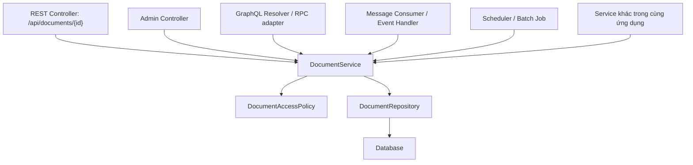
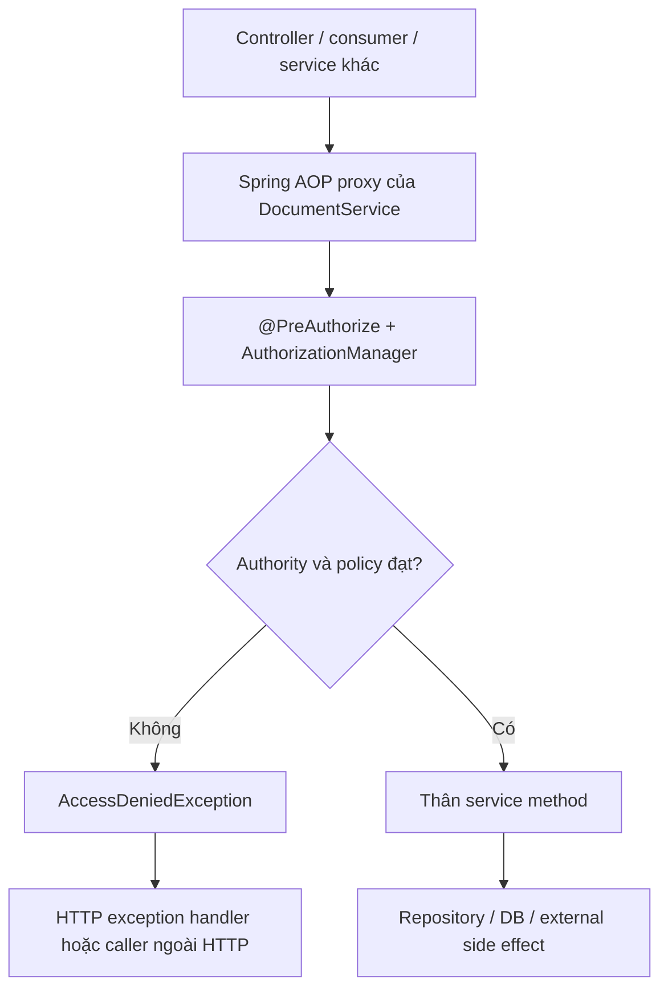

# Vì sao cần bảo vệ service ngoài quy tắc HTTP ở Controller?

## Mục tiêu bài học

Khi một ứng dụng Spring Boot khai báo quy tắc phân quyền HTTP, ví dụ `GET /api/documents/**` yêu cầu `document:read`, chúng ta đã bảo vệ một **đường vào qua HTTP**. Nhưng thao tác nghiệp vụ **đọc, sửa, duyệt, xóa tài liệu** không nhất thiết chỉ được gọi từ một controller duy nhất. Cùng một `DocumentService` có thể được gọi từ endpoint khác, GraphQL resolver, message consumer, tác vụ định kỳ, lời gọi từ module nội bộ hoặc một service khác. Nếu quyền chỉ nằm ở Controller hoặc chỉ được mô tả bằng URL, một đường gọi khác có thể **bỏ qua ý định bảo mật**.

Bài học này giải thích **vì sao cần đặt thêm ranh giới bảo mật ở service**, cách Spring Security thực thi **method security**, thiết kế kết hợp HTTP + method + object-level authorization, những giới hạn của Spring AOP proxy, và cách kiểm thử để không nhầm “endpoint đã khóa” với “nghiệp vụ đã được bảo vệ”.

Sau bài học, bạn sẽ:

1. Phân biệt **HTTP authorization**, **controller-level checks**, **method security** và **quyền trên từng đối tượng dữ liệu**.
2. Giải thích rủi ro khi logic nghiệp vụ được tái sử dụng qua nhiều đường vào.
3. Bật `@EnableMethodSecurity` và viết `@PreAuthorize` trên Spring-managed service.
4. Kết hợp `hasAuthority`, `hasRole` và chính sách owner/tenant từ tham số method.
5. Biết giới hạn của proxy, self-invocation, background jobs, `@PostAuthorize` và transaction.
6. Viết test trực tiếp gọi service để chứng minh không thể vượt quyền chỉ bằng cách **không đi qua controller**.

**Phạm vi:** Spring Security authorization trên **Servlet stack** và **service layer** (Spring Security 6.x/7.x, Java 17+). Một số ví dụ sử dụng Spring Boot/Spring MVC để minh họa đường vào HTTP. Chúng không mặc nhiên áp dụng y hệt cho WebFlux hoặc các lời gọi không có Spring-managed context.

## 1. Vấn đề cơ bản: Controller không phải người gọi duy nhất của service

Giả sử hệ thống lưu trữ tài liệu có cấu trúc:

```text
DocumentController
    → DocumentService
        → DocumentRepository
```

Controller nhận HTTP request, kiểm tra input và gọi service. Khi ứng dụng phát triển, cấu trúc thực tế thường trở thành:



Đặt `@PreAuthorize` **chỉ trên controller method** hoặc `hasAuthority` **chỉ trên URL** không tự bảo đảm tất cả những mũi tên khác sẽ được kiểm tra. Một service method không được bảo vệ có thể chạy từ một caller không hề đi qua URL ban đầu.

Ví dụ:

- Endpoint `GET /api/documents/42` có rule `document:read`. Sau đó nhóm phát triển thêm `GET /api/preview/42` và gọi cùng `documentService.read(42)` nhưng quên rule quyền tương ứng.
- Một GraphQL query `document(id: 42)` dùng `DocumentService` nhưng không đi qua `requestMatchers("/api/documents/**")` của REST.
- Một message consumer nhận sự kiện “export document 42” do một nguồn không tin cậy gửi, rồi gọi service.
- Một controller nội bộ ghi nhầm quyền: user thường được phép gọi một method xóa tài liệu vốn chỉ nên cho quản trị viên.
- Một bean khác dùng lại service mà tác giả service cho rằng “controller đã kiểm tra rồi”.

Rủi ro không nằm ở việc service tái sử dụng — đó là thiết kế tốt — mà ở **giả định rằng mọi caller đều đã được kiểm tra ở cùng một lớp**.

## 2. Tư duy defense in depth: hai lớp bảo vệ hai câu hỏi khác nhau

| Lớp | Câu hỏi | Ví dụ | Giới hạn |
| --- | --- | --- | --- |
| HTTP authorization | Request URL/method có được đi vào ứng dụng? | `GET /api/documents/**` cần `document:read` | Chỉ bảo vệ request đi qua filter chain tương ứng |
| Controller validation / mapping | Request đúng format và ánh xạ handler nào? | `@GetMapping`, `@Valid` | Validation input không thay thế phân quyền |
| Method security tại service | Principal có được thực hiện **hành động nghiệp vụ** này? | `DocumentService.delete` cần `document:delete` | Cần Spring AOP/interceptor hoạt động; không tự cấp quyền dữ liệu cụ thể |
| Object-level policy | Principal có quyền trên **đúng bản ghi** này không? | Tenant, owner, ACL của document 42 | Phải lấy dữ liệu đáng tin cậy từ server/repository |
| Database/query scope | Những bản ghi nào thật sự được đọc/ghi? | Query lọc theo tenant/owner, update có điều kiện | Query sai vẫn có thể làm lộ dữ liệu dù HTTP có rule |

Trong hệ thống thực, một request có thể cần **đồng thời**:

```text
ALLOW =
    request HTTP hợp lệ và qua HTTP rule
    AND principal đủ authority cho action
    AND principal được phép truy cập object cụ thể
    AND trạng thái tài nguyên cho phép thao tác
```

Các lớp này **bổ sung cho nhau**, không phải lựa chọn “hoặc HTTP, hoặc service”. Đặt method security không có nghĩa bỏ hết HTTP security. HTTP vẫn cần chặn route nhạy cảm, xử lý authentication/CORS/CSRF và áp các biện pháp bảo vệ request; service bổ sung ranh giới ở đúng nơi hành động nghiệp vụ được thực hiện.

### Ví dụ trước và sau

**Trước — chỉ chặn ở HTTP:**

```java
http.authorizeHttpRequests(auth -> auth
    .requestMatchers(HttpMethod.DELETE, "/api/documents/**")
        .hasAuthority("document:delete")
    .anyRequest().authenticated()
);
```

Nếu một endpoint khác `POST /api/batch/cleanup` đi vào service `deleteDocument(...)` nhưng chỉ được bảo vệ bởi `authenticated()`, HTTP rule DELETE ban đầu **không có tác dụng** với lệnh gọi từ batch endpoint.

**Sau — vẫn có HTTP rule và thêm service invariant:**

```java
// Đặt trên service bean thực, không phải chỉ controller.
@PreAuthorize("hasAuthority('document:delete')")
public void deleteDocument(long id) {
    // kiểm tra đối tượng và thực hiện thao tác xóa
}
```

Bây giờ một caller **đi qua Spring-managed service proxy** phải vượt qua kiểm tra `document:delete`, không phụ thuộc controller nào gọi nó.

**Quan trọng:** điều này không bảo đảm với caller tạo service bằng `new`, tự gọi nội bộ qua `this`, hoặc chạy ngoài một security context hợp lệ. Phải hiểu ranh giới của method interceptor.

## 3. HTTP authorization làm tốt việc gì — và không làm được việc gì?

Với Spring Security Servlet, `authorizeHttpRequests` thường tạo ra các request authorization rules qua `AuthorizationFilter` và `AuthorizationManager`. Ví dụ:

```java
import org.springframework.context.annotation.Bean;
import org.springframework.context.annotation.Configuration;
import org.springframework.http.HttpMethod;
import org.springframework.security.config.Customizer;
import org.springframework.security.config.annotation.web.builders.HttpSecurity;
import org.springframework.security.web.SecurityFilterChain;

@Configuration
public class HttpSecurityConfig {

    @Bean
    SecurityFilterChain apiSecurity(HttpSecurity http) throws Exception {
        http
            .authorizeHttpRequests(auth -> auth
                .requestMatchers(HttpMethod.GET, "/health")
                    .permitAll()
                .requestMatchers(HttpMethod.GET, "/api/documents/**")
                    .hasAuthority("document:read")
                .requestMatchers(HttpMethod.DELETE, "/api/documents/**")
                    .hasAuthority("document:delete")
                .anyRequest().denyAll()
            )
            .httpBasic(Customizer.withDefaults());
        return http.build();
    }
}
```

Đây là **snippet Spring Security**, không thể chạy độc lập bằng `javac`; dự án phải có framework, authentication source, controller và dữ liệu. Với form login hoặc OAuth2 Bearer, cần cấu hình authentication/entry point phù hợp thay cho HTTP Basic.

Cấu hình đó có ích vì:

- Chặn ngay từ cổng HTTP những request không có role/authority.
- Tách quyền đọc và xóa theo HTTP method.
- Dùng `anyRequest().denyAll()` để endpoint mới không tự mở.
- Tích hợp với cơ chế authentication, SecurityContext, exception translation và các security filters.

Nhưng nó **không** trực tiếp áp lên:

- Lời gọi `documentService.deleteDocument(42)` từ một bean khác trong cùng process.
- Một consumer xử lý message ngoài HTTP filter chain.
- Một scheduler gọi service theo lịch.
- Một GraphQL/RPC entrypoint có mapping HTTP khác route REST.
- Một business operation được thực hiện qua một endpoint đã được `permitAll` hoặc `authenticated` do cấu hình sơ suất.

Và `requestMatchers(HttpMethod.GET, "/api/documents/**")` chỉ diễn đạt quyền **trên đường dẫn**; nó không tự xác minh **document 42 thuộc ai**.

### Nhiều SecurityFilterChain không thay thế service protection

Nếu ứng dụng dùng `http.securityMatcher("/api/**")`, rule bên trong chain đó **chỉ** áp cho những request đã chọn chain API. URL `/admin`, `/graphql` hay `/internal` có thể được xử lý ở chain khác, hoặc thậm chí **không có chain phù hợp** nếu cấu hình thiếu. Khi đó service-level guard vẫn giúp giữ một ranh giới nghiệp vụ cho các lời gọi qua proxy, nhưng **không được coi là bù hoàn toàn cho lỗ hổng filter-chain coverage**. Hãy bảo vệ cả hai.

## 4. Controller-level checks có những điểm yếu gì?

Một cách dễ viết nhưng khó duy trì là rải quyền trong controller:

```java
@DeleteMapping("/api/documents/{id}")
public void delete(@PathVariable long id, Authentication auth) {
    if (!auth.getAuthorities().stream()
            .anyMatch(a -> a.getAuthority().equals("document:delete"))) {
        throw new AccessDeniedException("Forbidden");
    }
    documentService.deleteDocument(id);
}
```

Đây là snippet minh họa, cần class/controller/import Spring phù hợp. Nó có thể chặn đúng HTTP endpoint này, nhưng các vấn đề còn lại:

1. **Rule không gắn với action:** nếu service được gọi từ một controller khác, kiểm tra không đi cùng nó.
2. **Logic bị lặp:** nhiều adapters kiểm tra cùng `document:delete` dễ bị lệch, nhất là khi đổi tên quyền.
3. **Quyền trên dữ liệu thiếu ngữ cảnh:** controller thường có `id` nhưng không nên tự nạp và quyết định owner/tenant tại mỗi endpoint.
4. **Khó kiểm thử độc lập:** muốn chứng minh `deleteDocument` an toàn lại phải kiểm thử tất cả controllers.
5. **Refactor dễ quên:** tách method controller, thêm GraphQL, thêm async handler có thể bỏ qua một `if` từng tồn tại.

Controller vẫn nên thực hiện authentication-related request handling, input validation, format/HTTP status mapping. **Chính sách quyền của một business operation có thể được thực thi ở service**, gần nơi thao tác quan trọng xảy ra và dùng lại giữa các adapters.

### Không hiểu nhầm: mọi service method đều cần annotation?

Không nhất thiết. Cần xác định **ranh giới nghiệp vụ cần bảo vệ**: service public operations đọc/ghi dữ liệu nhạy cảm, cập nhật trạng thái quan trọng, xuất báo cáo, cấp quyền, thao tác tài khoản. Các helper thuần tính toán hoặc private methods bên trong một operation đã được bảo vệ có thể không cần annotation riêng. Tránh rải `@PreAuthorize` giống nhau trên mọi method không có chủ đích, vì chính sách trở nên khó review.

## 5. Method security trong Spring Security hoạt động thế nào?

Method security cho phép kiểm tra **lời gọi method trên Spring-managed bean**, thay vì chỉ kiểm tra request URL.

Bật bằng:

```java
import org.springframework.context.annotation.Configuration;
import org.springframework.security.config.annotation.method.configuration.EnableMethodSecurity;

@Configuration
@EnableMethodSecurity
public class MethodSecurityConfig {
}
```

**Không nên bỏ qua bước này:** Spring Boot Starter Security **không tự bật** `@PreAuthorize`/`@PostAuthorize`. `@EnableMethodSecurity` là cách cấu hình hiện đại thay cho `@EnableGlobalMethodSecurity` cũ.

Sau khi bật, Spring Security xuất bản các method security interceptors; với `@PreAuthorize`, Spring AOP proxy chặn lời gọi method, lấy `Authentication` từ context, đánh giá biểu thức qua authorization manager, rồi:

- **ALLOW:** chuyển tiếp gọi thân service method.
- **DENY:** ném `AccessDeniedException` (hoặc subclass tương ứng trong version đang dùng). Trong một HTTP request, exception có thể lan tới `ExceptionTranslationFilter` để chuyển thành 401/403/redirect tùy trạng thái xác thực và entry point/handler.
- Với lời gọi **ngoài HTTP**, không có `ExceptionTranslationFilter` tự tạo response; scheduler/consumer/caller phải xử lý lỗi một cách rõ ràng.



**Điểm mấu chốt:** interceptor nằm ở **method boundary**. Nó không phụ thuộc vào tên URL của controller; vì vậy cùng một method được gọi từ hai HTTP routes khác nhau vẫn có thể giữ cùng kiểm tra quyền.

### Annotation thường dùng

| Annotation | Khi nào đánh giá | Ứng dụng |
| --- | --- | --- |
| `@PreAuthorize` | **Trước khi** gọi method | Chặn hành động dựa trên principal, authorities và method arguments |
| `@PostAuthorize` | **Sau khi** method trả kết quả | Kiểm tra kết quả trả về, ví dụ owner của object đã đọc |
| `@PreFilter` | Lọc một collection argument trước khi chạy method | Chỉ chuyển tiếp items người dùng được phép xử lý; cần hiểu filter semantics |
| `@PostFilter` | Lọc collection result sau khi chạy method | Các tập dữ liệu nhỏ; không thay thế pagination/query scoping |
| `@Secured` | Trước method, dựa trên roles/authorities | Cơ chế legacy, cần bật `securedEnabled = true` nếu dùng |
| `@RolesAllowed` | Trước method | JSR-250, cần `jsr250Enabled = true` nếu dùng |

`@EnableMethodSecurity` bật các annotation pre/post theo mặc định. `@Secured` và JSR-250 cần opt-in. Một method có **nhiều loại annotation bảo mật** thì các kiểm tra được thực hiện theo chuỗi, hiểu như **AND**; không lặp `@PreAuthorize` hai lần trên cùng method. Nếu cần OR quyền, viết trong một biểu thức với `or`/`hasAnyAuthority`.

## 6. Ví dụ thực tế: HTTP rule + Service @PreAuthorize

Ví dụ hệ thống cho phép đọc và xóa tài liệu. Service phải bảo vệ lệnh xóa ngay cả khi một caller không thông qua `DELETE /api/documents/{id}`.

### 6.1. Cấu hình kích hoạt Method Security

```java
@Configuration
@EnableMethodSecurity
public class ApplicationSecurity {
    // Các @Bean SecurityFilterChain có thể khai báo ở cấu hình khác.
}
```

Snippet này cần import `@Configuration` và `@EnableMethodSecurity` như phần 5.

### 6.2. Service chứa ranh giới business operation

```java
import org.springframework.security.access.prepost.PreAuthorize;
import org.springframework.stereotype.Service;

@Service
public class DocumentService {

    private final DocumentRepository repository;

    public DocumentService(DocumentRepository repository) {
        this.repository = repository;
    }

    @PreAuthorize("hasAuthority('document:read')")
    public Document read(long id) {
        return repository.findById(id)
            .orElseThrow(() -> new DocumentNotFoundException(id));
    }

    @PreAuthorize("hasAuthority('document:delete')")
    public void delete(long id) {
        repository.deleteById(id);
    }
}
```

Đây là **đoạn tích hợp**: `Document`, `DocumentRepository` và `DocumentNotFoundException` phải được định nghĩa bởi dự án. Service-level rules này kiểm tra **quyền chức năng**, chưa kiểm tra owner/tenant; phần tiếp theo mở rộng policy. `deleteById` chỉ là thao tác minh họa; production cần kiểm tra điều kiện tồn tại, owner/tenant, transaction và race conditions.

### 6.3. Controller chỉ chuyển lời gọi vào service

```java
import org.springframework.web.bind.annotation.DeleteMapping;
import org.springframework.web.bind.annotation.GetMapping;
import org.springframework.web.bind.annotation.PathVariable;
import org.springframework.web.bind.annotation.RequestMapping;
import org.springframework.web.bind.annotation.RestController;

@RestController
@RequestMapping("/api/documents")
public class DocumentController {

    private final DocumentService documents;

    public DocumentController(DocumentService documents) {
        this.documents = documents;
    }

    @GetMapping("/{id}")
    public Document read(@PathVariable long id) {
        return documents.read(id);
    }

    @DeleteMapping("/{id}")
    public void delete(@PathVariable long id) {
        documents.delete(id);
    }
}
```

Một controller khác có thể inject chính `DocumentService` này. Nếu gọi `delete` **qua proxy Spring**, `@PreAuthorize` vẫn yêu cầu `document:delete`; không phải sao chép authorization if vào controller mới.

### 6.4. Quyết định từ ba tầng

| Tình huống | HTTP layer | Service layer | Kết quả |
| --- | --- | --- | --- |
| Anonymous GET document | Không qua `hasAuthority("document:read")` | Không tới service | Bị từ chối/challenge |
| Full user có `document:read` GET | Qua HTTP | Qua `@PreAuthorize` read | Có thể trả document sau policy dữ liệu |
| Full user chỉ có `document:read` DELETE | Không qua HTTP rule delete | Không tới service | Bị từ chối |
| Một endpoint mới gọi `documents.delete(id)` với user chỉ có `document:read` | Có thể vô tình qua HTTP của endpoint mới | **Bị `@PreAuthorize` tại service từ chối** | Không thực hiện thân method |
| Một scheduler tự gọi `documents.delete(id)` | Không có HTTP layer | Kiểm tra phụ thuộc SecurityContext của job | Không tự được phép; cần thiết kế system identity/chính sách |
| Full user có `document:delete` nhưng tài liệu thuộc tenant khác | Có thể qua HTTP và authority service | Cần **object-level policy** thêm | Phải từ chối tại service/query |

Lớp thứ hai giảm tác động của một HTTP mapping bị bỏ sót, **không** biến service thành nơi tự động giải quyết mọi bất cập về authentication, transaction hay dữ liệu.

## 7. Bảo vệ object-level tại service: cùng quyền chức năng, khác tài nguyên

Đây là lý do rất quan trọng để giữ authorization gần **business data**. Hai người cùng có `document:read` nhưng không nhất thiết được đọc cùng một tài liệu.

Ví dụ:
- Alice có `document:read` trong tenant A.
- Bob cũng có `document:read` trong tenant B.
- Document 42 thuộc tenant B.
- Alice biết hoặc đoán được ID 42 và gửi `GET /api/documents/42`.

Rule HTTP `hasAuthority("document:read")` **không đủ** để bảo vệ document 42. Service phải kết hợp **authority + object policy**.

### Bean chính sách dùng trong @PreAuthorize

```java
import org.springframework.security.core.Authentication;
import org.springframework.stereotype.Component;

@Component("documentPolicy")
public class DocumentPolicy {

    private final DocumentRepository repository;

    public DocumentPolicy(DocumentRepository repository) {
        this.repository = repository;
    }

    public boolean canRead(Authentication actor, long documentId) {
        if (actor == null || !actor.isAuthenticated()) {
            return false;
        }
        // Production: lọc tenant/owner theo thông tin xác thực
        // và dữ liệu server, không tin client khai tenantId.
        return repository.isReadableBy(documentId, actor.getName());
    }
}
```

**Chú thích:** `DocumentRepository.isReadableBy` là API do dự án thiết kế, phải thực hiện truy vấn/policy thật. `actor.isAuthenticated()` một mình **không đủ** để loại anonymous token trong mọi cấu hình; `@PreAuthorize` bên dưới còn yêu cầu authority phù hợp, và một policy thực tế nên sử dụng trust resolver/nhận diện principal thật hoặc nguồn identity được xác thực. Đoạn code trên minh họa một phần logic, không phải toàn bộ authn policy production.

### Service đọc tài liệu với quyền từng bản ghi

```java
import org.springframework.security.access.method.P;
import org.springframework.security.access.prepost.PreAuthorize;

@PreAuthorize(
    "hasAuthority('document:read') and " +
    "@documentPolicy.canRead(authentication, #documentId)"
)
public Document read(@P("documentId") long documentId) {
    return repository.findById(documentId)
        .orElseThrow(() -> new DocumentNotFoundException(documentId));
}
```

Đây là snippet **thay thế/hoàn thiện method read** ở phần 6, không dán hai method cùng chữ ký trong một class. `@P` giúp tên tham số trong SpEL ổn định nếu class không được compile với `-parameters`. Spring Security sử dụng `authentication` từ security context, không nhận principal do client tự khai.

**Không dùng tenantId do client gửi** làm bằng chứng quyền. Với ứng dụng multi-tenant, hãy lấy tenant membership/ACL từ identity được xác thực và database; nếu có nhiều tenant được chọn, kiểm tra user được phép thao tác trong tenant đó. Lưu ý vấn đề time-of-check/time-of-use: dữ liệu owner/ACL có thể đổi giữa kiểm tra và truy vấn. Với thao tác ghi nhạy cảm nên áp **query scoping/update có điều kiện/transaction**.

### Vì sao chỉ dùng @PostAuthorize có thể nguy hiểm?

```java
@PostAuthorize("returnObject.ownerUsername == authentication.name")
public Document read(long id) { ... }
```

`@PostAuthorize` hữu ích với kết quả đọc: interceptor đánh giá object được trả về **sau khi method chạy**. Tuy nhiên:
- Đối với thao tác đã gửi email, xóa tệp, chuyển tiền hoặc cập nhật DB, hậu kiểm **quá muộn**; side effect có thể đã xảy ra.
- Với một collection rất lớn, tải tất cả rồi `@PostFilter` có thể tốn tài nguyên, sai pagination và có nguy cơ dữ liệu bị sử dụng ngoài kiểm soát trước khi lọc.
- Ưu tiên **kiểm tra trước side effect**, giới hạn dữ liệu trong query hoặc dùng policy đối tượng phù hợp.

Nếu cần ẩn sự tồn tại của tài nguyên ngoài scope, API có thể chủ ý trả 404 thay vì 403, nhưng phải là quyết định nhất quán ở endpoint/query, không chỉ chọn status theo sở thích.

## 8. Ví dụ Java 17 độc lập: Controller guard không bảo vệ service

Để thấy nguy cơ khi không dùng Spring, hãy viết một chương trình Java 17 chỉ mô phỏng **controller check vs service check**. Ví dụ này tự chạy bằng `javac`, không cần Spring.

Lưu tệp đúng tên **`ServiceBoundaryDemo.java`**:

```java
import java.util.Set;

public class ServiceBoundaryDemo {

    record Actor(String name, Set<String> authorities) {
        boolean has(String authority) {
            return authorities.contains(authority);
        }
    }

    static class UnsafeService {
        String delete(long id) {
            return "DELETED document " + id;
        }
    }

    static class ControllerOnly {
        private final UnsafeService service = new UnsafeService();

        String deleteThroughHttp(Actor actor, long id) {
            if (!actor.has("document:delete")) {
                return "HTTP DENIED";
            }
            return service.delete(id);
        }

        // Một entrypoint khác vô tình bỏ qua controller.
        String deleteFromOtherCaller(long id) {
            return service.delete(id);
        }
    }

    static class ProtectedService {
        String delete(Actor actor, long id) {
            if (!actor.has("document:delete")) {
                return "SERVICE DENIED";
            }
            return "DELETED document " + id;
        }
    }

    public static void main(String[] args) {
        Actor reader = new Actor("alice", Set.of("document:read"));
        Actor editor = new Actor("bob", Set.of("document:delete"));

        ControllerOnly controller = new ControllerOnly();
        ProtectedService protectedService = new ProtectedService();

        System.out.println(
            "Controller, reader: "
                + controller.deleteThroughHttp(reader, 42)
        );
        System.out.println(
            "Other caller, reader: "
                + controller.deleteFromOtherCaller(42)
        );
        System.out.println(
            "Service, reader: "
                + protectedService.delete(reader, 42)
        );
        System.out.println(
            "Service, editor: "
                + protectedService.delete(editor, 42)
        );
    }
}
```

Chạy trên **JDK 17+**:

```bash
javac ServiceBoundaryDemo.java
java ServiceBoundaryDemo
```

**Stdout chính xác:**

```text
Controller, reader: HTTP DENIED
Other caller, reader: DELETED document 42
Service, reader: SERVICE DENIED
Service, editor: DELETED document 42
```

Kết quả minh họa:

1. Controller có `if` chặn reader, nên HTTP caller không xóa.
2. Caller khác gọi thẳng service **không được bảo vệ** và “xóa” thành công trong mô phỏng.
3. Khi service tự kiểm tra authority, reader bị từ chối bất kể caller là ai.
4. Editor có đúng authority được phép. Trong production, cần thêm owner/tenant và transaction.

**Không nhầm mô hình Java thuần với Spring method security:** ví dụ tự truyền `Actor` vào service. Spring Security thực lấy `Authentication` từ `SecurityContextHolder`/AOP interceptor và có những giới hạn về proxy; không dựa vào `Actor` do client tự tạo để bảo mật.

## 9. Proxy AOP là ranh giới kỹ thuật phải hiểu

`@PreAuthorize` hoạt động trên **method invocation được Spring Security intercept**. Vì vậy annotation có mặt trong source không đồng nghĩa mọi cách gọi đều được bảo vệ.

### 9.1. Lời gọi từ bên ngoài Spring bean qua proxy

```text
Controller bean → DocumentService proxy
                    → @PreAuthorize
                    → target DocumentService method (nếu ALLOW)
```

Đây là trường hợp nên sử dụng: inject `DocumentService` vào controller/bean khác thông qua Spring container.

### 9.2. Self-invocation có thể bỏ qua interceptor

```java
@Service
public class DocumentService {

    public void cleanup(long id) {
        // Gọi qua this, không đi lại qua Spring proxy.
        this.delete(id);
    }

    @PreAuthorize("hasAuthority('document:delete')")
    public void delete(long id) {
        // side effect minh họa
    }
}
```

Nếu gọi `cleanup` từ proxy mà `cleanup` không được bảo vệ, lời gọi nội bộ `this.delete(id)` thường **bỏ qua method interceptor** ở chế độ Spring AOP proxy mặc định. Khi đó không được kỳ vọng annotation trên `delete` sẽ tự chặn lời gọi từ trong class.

**Cách sửa thiết kế:** bảo vệ entrypoint `cleanup` đúng quyền, hoặc tách `delete` sang **bean được bảo vệ riêng** rồi gọi qua injected proxy. AspectJ weaving có semantics khác nhưng cần cấu hình/kiểm thử riêng; không coi việc bật `@EnableMethodSecurity` là tự giải quyết self-invocation.

### 9.3. Không Spring bean, không proxy

Những tình huống sau không tự kích hoạt method security:

- Dùng `new DocumentService(...)` thay vì lấy bean từ Spring context.
- Gọi private/helper method không đi qua interception point.
- Gọi qua các đường self-invocation, final/static method hoặc cơ chế proxy không thể intercept kiểu lời gọi đó.
- Mock toàn bộ service trong test rồi tưởng `@PreAuthorize` của service thật đã chạy.

Một số giới hạn phụ thuộc JDK dynamic proxies, class-based proxies, visibility, final methods và cấu hình AspectJ. **Test một lời gọi qua bean thật** là bằng chứng đáng tin hơn việc chỉ đọc annotation.

## 10. Background job và message consumer: bảo vệ service chưa đủ nếu không có danh tính

Ở HTTP request, các authentication filters thường thiết lập `SecurityContextHolder`. Nhưng một `@Scheduled` job, message listener hay async task **không tự có cùng `SecurityContext`**.

Ví dụ:

```java
@Scheduled(fixedDelayString = "PT10M")
public void cleanupExpiredDocuments() {
    documentService.deleteExpired();
}
```

Nếu `deleteExpired` được bảo vệ bởi `@PreAuthorize` và không có authentication thích hợp, nó có thể bị từ chối. Đó không nhất thiết là bug; job phải có **mô hình quyền rõ ràng**.

Các phương án cần cân nhắc:

- **User-initiated async work:** lưu/chuyển tiếp identity qua cơ chế context propagation được framework hỗ trợ và phù hợp, nhưng xác minh token/session/role còn hiệu lực tại thời điểm xử lý.
- **Message consumer:** xác thực **nguồn message** và quyền thực hiện hành động theo metadata đáng tin; không chấp nhận `userId`/`ROLE_ADMIN` nằm trong body như bằng chứng quyền.
- **System job:** dùng một **system principal/service identity** có quyền tối thiểu, được cấp/audit rõ ràng, hoặc thiết kế operation nội bộ chuyên biệt với chính sách an toàn riêng. Không gán admin toàn quyền mặc định.
- **Cross-service call:** nếu việc gọi service nằm trong process khác, proxy annotation của process này **không đi theo qua mạng**; mỗi service phải xác thực và phân quyền tại trust boundary của nó.

**Không chia sẻ mutable SecurityContext cho tất cả threads**, không truyền nguyên một HTTP session tùy tiện, và không giả định `InheritableThreadLocal` giải quyết được toàn bộ async/thread pool semantics. Trong mô hình không có HTTP request, một `AccessDeniedException` phải được caller xử lý như lỗi nghiệp vụ/bảo mật, không phải tự có response 403.

## 11. @PreAuthorize so với kiểm tra quyền lập trình trong service

Không phải mọi policy đều thuận tiện để viết trong SpEL.

### Khi nào @PreAuthorize hợp lý?

- Quyền rõ ràng: `hasAuthority("document:delete")`.
- Điều kiện từ tham số method: `#documentId`, `#tenantId` đã được map an toàn.
- Một bean policy có API rõ: `@documentPolicy.canRead(authentication, #documentId)`.
- Cần đảm bảo **thân method không chạy** nếu quyền bị từ chối.

### Khi nào cân nhắc policy Java / AuthorizationManager?

- Quy tắc nhiều bước, cần truy vấn dữ liệu hoặc audit phức tạp.
- Quyết định kết hợp tenant membership, owner, resource state, product plan, approval chain.
- Muốn tái sử dụng policy ở method security, HTTP hoặc các adapter ngoài web.
- Cần kiểm thử logic quyền độc lập với SpEL.

Ví dụ một bean:

```java
@Component("approvalPolicy")
public class ApprovalPolicy {

    public boolean canApprove(
            Authentication actor, PurchaseOrder order) {
        // Kiểm tra permission, đúng tenant và state
        // dựa trên dữ liệu thật của server.
        return hasApprovalAuthority(actor)
            && isSameTenant(actor, order)
            && order.isPending();
    }
}
```

Đây là **pseudocode Java định hướng**, chưa định nghĩa `PurchaseOrder` và helper methods. Trong production, tách các helper để test, không dùng giá trị `tenant` từ client làm bằng chứng. Có thể gọi trong `@PreAuthorize` bằng bean SpEL hoặc tự xây `AuthorizationManager<MethodInvocation>` khi cần kiểm soát lớn hơn.

**Một invariant nên có nguồn sự thật rõ ràng.** Đừng viết business policy hoàn toàn khác giữa Controller, GraphQL và service. HTTP kiểm tra quyền thô theo route, service/policy giữ quy tắc nghiệp vụ, DB/query giữ scope dữ liệu.

## 12. Dữ liệu, transaction và thời điểm kiểm tra quyền

### Từ chối trước side effect

Nếu service chuyển tiền, duyệt đơn hoặc xóa dữ liệu, `@PreAuthorize` kiểm tra **trước khi thân method chạy**. `@PostAuthorize` chỉ kiểm tra sau khi method trả về, nên không phù hợp làm hàng rào duy nhất cho hành động đã:

- ghi database;
- gửi email;
- gọi API thanh toán;
- xuất file ra storage;
- phát event ra message broker.

`@Transactional` không tự biến hậu kiểm thành an toàn. Side effect bên ngoài database có thể đã xảy ra và không rollback được. Hãy chọn **điểm kiểm tra trước khi tác động**.

### Race condition / TOCTOU

Giả sử service kiểm tra Alice còn là owner của document 42; giữa bước check và `DELETE`, quyền owner có thể đã đổi. Với thao tác nhạy cảm, có thể dùng:

- Database query có điều kiện cả `id`, `tenantId`, `ownerId`.
- Transaction/locking phù hợp để kiểm soát dữ liệu thay đổi.
- Policy theo ID và trạng thái lấy **trong cùng phạm vi nghiệp vụ** với thao tác ghi.
- Kiểm tra lại bất biến nếu có hệ thống ngoài DB hoặc asynchronous workflow.

Không chỉ dựa vào một check `existsByIdAndOwner(...)` rồi xóa `deleteById(id)` trong mọi môi trường; nếu dữ liệu/ACL thay đổi giữa hai lệnh, cần cơ chế đảm bảo nhất quán.

### Truy vấn danh sách

Một service `listAllDocuments()` được bảo vệ bằng `hasAuthority("document:read")` nhưng trả **toàn bộ** DB vẫn không đúng chính sách đa tenant. Đừng tải mọi record rồi chỉ dùng `@PostFilter` để loại dữ liệu ngoài quyền khi có thể dùng query filtering/pagination ở nguồn. Trả dữ liệu trong scope ngay từ repository giảm rò rỉ, giảm chi phí và giữ phân trang/đếm nhất quán.

## 13. Kiểm thử method security trực tiếp, không phụ thuộc Controller

Một điểm kiểm thử quan trọng là **gọi service bean đã được proxy** từ JUnit test, không đi qua MockMvc. Nếu user thiếu quyền và method vẫn chạy, service boundary đang không hoạt động.

### JUnit/Spring test tối thiểu, đầy đủ về cấu trúc

Ví dụ sau dùng JUnit 5, `spring-test` và `spring-security-test`, không yêu cầu Spring Boot. Nó phải có Spring Security dependencies phù hợp và được chạy qua build tool (Maven/Gradle); **không chạy bằng `javac` thuần**.

```java
import org.junit.jupiter.api.Test;
import org.springframework.beans.factory.annotation.Autowired;
import org.springframework.context.annotation.Bean;
import org.springframework.context.annotation.Configuration;
import org.springframework.security.access.AccessDeniedException;
import org.springframework.security.access.prepost.PreAuthorize;
import org.springframework.security.config.annotation.method.configuration.EnableMethodSecurity;
import org.springframework.security.test.context.support.WithAnonymousUser;
import org.springframework.security.test.context.support.WithMockUser;
import org.springframework.test.context.junit.jupiter.SpringJUnitConfig;

import static org.junit.jupiter.api.Assertions.assertEquals;
import static org.junit.jupiter.api.Assertions.assertThrows;

@SpringJUnitConfig(ServiceAuthorizationTest.Config.class)
class ServiceAuthorizationTest {

    @Autowired
    GuardedDocumentService service;

    @Test
    @WithMockUser(authorities = "document:delete")
    void correctAuthorityAllowsMethodCall() {
        assertEquals("deleted:42", service.delete(42L));
    }

    @Test
    @WithMockUser(authorities = "document:read")
    void missingDeleteAuthorityDeniesMethodCall() {
        assertThrows(
            AccessDeniedException.class,
            () -> service.delete(42L)
        );
    }

    @Test
    @WithAnonymousUser
    void anonymousDoesNotGetDeletePermission() {
        assertThrows(
            AccessDeniedException.class,
            () -> service.delete(42L)
        );
    }

    @Configuration
    @EnableMethodSecurity
    static class Config {
        @Bean
        GuardedDocumentService guardedDocumentService() {
            return new GuardedDocumentService();
        }
    }

    public static class GuardedDocumentService {
        @PreAuthorize("hasAuthority('document:delete')")
        public String delete(long id) {
            return "deleted:" + id;
        }
    }
}
```

Với dependency tương thích, các test này chứng minh **method invocation qua Spring bean** bị kiểm tra. Không có HTTP URL nào trong ví dụ; đây chính là lý do method security là một ranh giới độc lập với Controller.

Khi tích hợp vào dự án thật, đừng dùng `@MockBean`/Mockito mock để thay **chính service cần kiểm tra**: mock có thể làm proxy/annotation của service thật không chạy. Có thể mock repository phụ thuộc, nhưng service phải là bean thật từ application context. Thêm test xác minh repository **không bị gọi** khi deny.

### Test nghiệp vụ theo object

Một bộ test khác cần cover:

| Principal | Authority | Document | Kỳ vọng |
| --- | --- | --- | --- |
| Alice | `document:read` | Document Alice trong tenant A | ALLOW |
| Alice | `document:read` | Document Bob trong tenant B | DENY |
| Alice | `document:delete` | Document của Alice, trạng thái cho phép xóa | ALLOW |
| Alice | `document:delete` | Document thuộc tenant khác | DENY |
| Alice | Chỉ `ROLE_USER` | Bất kỳ document | DENY theo `hasAuthority` |
| Anonymous | Không có | Document công khai/riêng theo policy | Chọn rõ rule; không tự coi anonymous là user đăng nhập |
| System job | Identity/phân quyền system được thiết kế rõ | Tài liệu hết hạn | Quyết định theo policy job, có audit |

Viết test trực tiếp trên service để chứng minh object policy; sau đó thêm **MockMvc tests** để xác minh URL, HTTP method, CSRF, entry point và response mapping. Chỉ test 403 của HTTP mà không test service thì khó phát hiện một đường gọi khác đang bypass.

## 14. Exception và mã HTTP khi service từ chối

`@PreAuthorize` từ chối thường ném `AccessDeniedException` hoặc subclass `AuthorizationDeniedException`. Khi method được gọi trong một Servlet HTTP request và exception lan ra qua security filter chain, `ExceptionTranslationFilter` có thể xử lý:

- Người đã xác thực đầy đủ nhưng thiếu quyền → thường qua `AccessDeniedHandler`, trả **403**.
- Anonymous hoặc mức xác thực chưa đủ → có thể qua `AuthenticationEntryPoint`, trả **401** (Basic/Bearer) hoặc redirect tới login (form).
- Một lời gọi trong scheduler/consumer → **không có HTTP response**, phải xử lý exception tại caller.

`@ControllerAdvice` có thể xử lý exception từ controller/service ở MVC, nhưng **không phải phương án bảo đảm xử lý mọi lỗi authorization phát từ filters trước DispatcherServlet**. Hãy thống nhất hợp đồng lỗi và kiểm thử cả HTTP-level denial lẫn service-level denial.

Quan trọng: **403 không chứng minh method security đã chạy**. 403 có thể do CSRF, HTTP rule hoặc policy khác. Để test service, hãy gọi bean trực tiếp với `@WithMockUser` hoặc xác minh interceptor/side effect tại test tích hợp.

## 15. Các lỗi thiết kế thường gặp

1. **Chỉ dùng `requestMatchers` rồi tin mọi lời gọi business đã bảo vệ:** HTTP filter chỉ bao các request đi qua chain và matcher tương ứng.
2. **Gắn `@PreAuthorize` ở controller mà không bảo vệ service tái sử dụng:** một GraphQL/consumer/entrypoint khác có thể gọi method trực tiếp.
3. **Bỏ quên `@EnableMethodSecurity`:** annotation trông có vẻ đúng nhưng method interceptor không được bật.
4. **Dùng `new Service()` hoặc mock service cần test:** không đi qua Spring-managed proxy.
5. **Self-invocation bằng `this.method()`:** thường bypass interceptor trên method được gọi nội bộ.
6. **Đặt annotation trên private/static/final method rồi kỳ vọng proxy intercept:** tùy kiểu proxy, những lời gọi ấy không được bảo vệ như public method được gọi qua proxy.
7. **Cho rằng service có `hasAuthority("read")` là được đọc mọi ID:** cần owner/tenant/ACL và query scoping.
8. **Tin `tenantId`/`ownerId` do client gửi:** attacker có thể đổi giá trị; kiểm tra với identity và DB server-side.
9. **Dùng `@PostAuthorize` trên method đã ghi/xóa:** kiểm tra sau side effect là quá muộn.
10. **Chạy background job như system admin toàn quyền:** cần xác thực nguồn việc, least privilege và audit.
11. **Chuyển SecurityContext tùy tiện qua async threads:** context có thể mất, cũ hoặc dùng sai principal.
12. **Viết trùng business policy ở nhiều adapters:** dễ lệch khi refactor; tách policy service dùng chung.
13. **Chỉ test controller HTTP 403:** có thể 403 do CSRF, chưa chứng minh service guard chặn được caller khác.
14. **Bỏ mặc transaction/TOCTOU:** quyền có thể đổi giữa kiểm tra và thao tác; dùng update/query có điều kiện khi cần.
15. **Dùng `anyRequest().authenticated()` và cho là mọi endpoint đã có quyền nghiệp vụ:** authenticated chỉ chứng minh mức danh tính, không phải permission.
16. **Cho rằng service security thay thế hoàn toàn HTTP security:** vẫn phải bảo vệ route, authentication, CSRF, CORS, filter-chain scope.
17. **Dùng `@PreAuthorize` lặp hai lần trên cùng method để thể hiện OR:** không hỗ trợ annotation lặp; dùng một biểu thức kết hợp.
18. **Không thử các đường gọi ngoài REST:** hệ thống nhiều adapters cần test direct service, message consumer, GraphQL và job theo policy.

## 16. Checklist áp dụng tại service boundary

- [ ] Liệt kê **business operations** quan trọng và những nơi có thể gọi từng operation, không chỉ URL REST.
- [ ] Đặt HTTP rule theo method/path phù hợp, có fallback rõ ràng; không bỏ quên filter chain khác.
- [ ] Kích hoạt `@EnableMethodSecurity` và kiểm tra interceptor thật có hoạt động.
- [ ] Bảo vệ những public service entrypoints nhạy cảm bằng `@PreAuthorize` hoặc policy tương đương.
- [ ] Quyền chức năng, owner/tenant, trạng thái dữ liệu và yêu cầu tái xác thực được biểu diễn riêng, rõ.
- [ ] Tránh self-invocation bypass; tách bean bảo vệ khi cần, gọi qua Spring proxy.
- [ ] Với job/message/async, xác minh identity và security context; không giả định mọi công việc có HTTP principal.
- [ ] Kiểm tra quyền trước side effect, dùng transaction/query scoping/update có điều kiện khi phù hợp.
- [ ] Test direct service với principal đủ quyền, thiếu quyền, anonymous, wrong tenant và wrong resource ID.
- [ ] Test HTTP layer riêng cho 401/403, CSRF, HTTP method, request matcher và route lạ.
- [ ] Kiểm tra audit, correlation ID và tránh log credentials hoặc dữ liệu nhạy cảm trong exception.
- [ ] Giữ business policy nhất quán giữa REST, GraphQL, consumers và internal callers.

### Tự kiểm tra

**Câu 1.** `DELETE /api/documents/42` yêu cầu `document:delete` trong HTTP rule, nhưng một endpoint batch khác gọi `documentService.delete(42)` và service không có guard. Điều gì có thể xảy ra?

**Đáp án:** Endpoint batch có thể qua HTTP policy của nó rồi gọi thao tác xóa không được service kiểm tra lại. Cần bảo vệ action tại service, ngoài HTTP rule của từng endpoint.

**Câu 2.** `DocumentService.read(42)` có `@PreAuthorize("hasAuthority('document:read')")`. Alice có quyền đó nhưng tài liệu thuộc tenant của Bob. Alice có được đọc không?

**Đáp án:** Không nên. Authority cấp chức năng đọc **không phải** quyền trên mọi document. Service/repository cần owner/tenant/ACL policy.

**Câu 3.** `@PreAuthorize` được đặt trên `delete()` nhưng cùng class gọi `this.delete()`. Có chắc interceptor hoạt động không?

**Đáp án:** Không. Với Spring AOP proxy mặc định, self-invocation thường bỏ qua proxy. Bảo vệ entrypoint hoặc tách method qua bean bảo vệ khác.

**Câu 4.** Test HTTP trả 403 cho PATCH thiếu quyền, có đủ chứng minh method security hoạt động không?

**Đáp án:** Không. 403 có thể do CSRF hoặc HTTP authorization. Hãy test **trực tiếp gọi service bean** bằng `@WithMockUser` và assert `AccessDeniedException`/không có side effect.

**Câu 5.** Scheduler gọi một service bảo vệ bằng `@PreAuthorize` nhưng không có authentication context. Có tự nhận `ROLE_ADMIN` vì chạy trong server không?

**Đáp án:** Không. System jobs cần principal/chính sách riêng, least privilege và audit; không mặc định có quyền của user/admin.

## Tài liệu tham khảo chính thức

- Spring Security, *Method Security*: https://docs.spring.io/spring-security/reference/servlet/authorization/method-security.html
- Spring Security 7.0, *Method Security*: https://docs.spring.io/spring-security/reference/7.0/servlet/authorization/method-security.html
- Spring Security, *Authorize HttpServletRequests*: https://docs.spring.io/spring-security/reference/servlet/authorization/authorize-http-requests.html
- Spring Security, *Java Configuration and SecurityFilterChain*: https://docs.spring.io/spring-security/reference/servlet/configuration/java.html
- Spring Security, *Testing Method Security*: https://docs.spring.io/spring-security/reference/servlet/test/method.html
- Spring Security, *Test WithMockUser*: https://docs.spring.io/spring-security/reference/servlet/test/method.html#test-method-withmockuser
- Spring Framework, *Proxying Mechanisms and Self Invocation*: https://docs.spring.io/spring-framework/reference/core/aop/proxying.html
