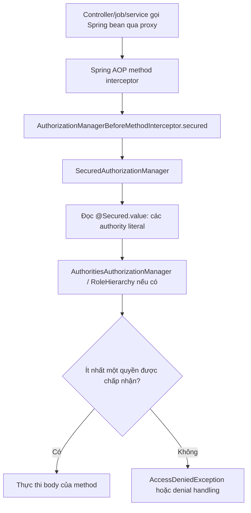

# @Secured và danh sách authority được chấp nhận

Trong Spring Security, `@Secured` là annotation dùng để bảo vệ **lời gọi phương thức Java** bằng một hoặc nhiều **tên authority được chấp nhận**. Ví dụ:

```java
@Secured("ROLE_ADMIN")
public void deleteUser(String userId) {
    // Chỉ người có authority ROLE_ADMIN mới đi qua kiểm tra này.
}

@Secured({"ROLE_EDITOR", "ROLE_AUDITOR"})
public void reviewDocument(String documentId) {
    // Chấp nhận ROLE_EDITOR HOẶC ROLE_AUDITOR.
}
```

**Điểm cốt lõi:** các chuỗi trong mảng `@Secured({"A", "B"})` được đánh giá theo ý nghĩa **OR (ít nhất một authority khớp)**, **không phải AND (phải có tất cả)**. Các giá trị là **tên authority literal**, không phải biểu thức Spring Expression Language (SpEL). `@Secured("hasRole('ADMIN')")` không có nghĩa như `@PreAuthorize("hasRole('ADMIN')")`.

Để annotation thật sự được Spring Security thực thi trong cấu hình method security hiện đại, cần bật:

```java
@Configuration
@EnableMethodSecurity(securedEnabled = true)
class MethodSecurityConfig {
}
```

`@Secured` được Spring Security xem là lựa chọn **legacy**; tài liệu khuyến nghị `@PreAuthorize` cho thiết kế mới, nhất là khi chính sách cần tham số method, owner, tenant, phép AND/OR phức tạp hoặc dữ liệu trả về. Tuy vậy, `@Secured` vẫn hữu ích để hiểu các ứng dụng hiện có và những kiểm tra authority đơn giản.

**Ngữ cảnh:** Spring Security 6.5.x / Spring Boot 3.x / Java 17+, trên Spring-managed service bean. Bài làm rõ cách danh sách authority được đánh giá, `ROLE_` prefix, `RoleHierarchy`, proxy/AOP, các trường hợp từ chối, ví dụ Spring Boot chạy được và chiến lược kiểm thử.

## 1. @Secured kiểm tra gì và không kiểm tra gì?

`@Secured` nằm trong package:

```java
import org.springframework.security.access.annotation.Secured;
```

Javadoc mô tả annotation này có một thuộc tính bắt buộc:

```java
String[] value();
```

Nó có thể gắn ở **type/class** hoặc **method**, được giữ ở runtime để infrastructure phát hiện. Những chuỗi trong `value` là **security configuration attributes**, thường chính là tên `GrantedAuthority` như `ROLE_USER`, `ROLE_ADMIN`, nhưng cũng có thể là permission tùy hệ thống như `documents.export`.

Ví dụ:

```java
@Secured("ROLE_VIEWER")
public String readSummary() {
    return "summary";
}
```

Để lời gọi trên được cho phép, hệ thống cần xác nhận `Authentication` hiện tại có authority `ROLE_VIEWER` hoặc authority **bao hàm** nó khi `RoleHierarchy` được tích hợp đúng vào `SecuredAuthorizationManager`.

Những điều `@Secured` **không tự làm**:

- **Không xác thực** password, session hoặc JWT; `Authentication` phải đến từ cơ chế xác thực đáng tin.
- **Không tự bật** method security trong Spring Boot.
- **Không tự khai báo** rằng `ROLE_ADMIN > ROLE_VIEWER`; hierarchy phải được định nghĩa.
- **Không đọc tham số `#id` hoặc `authentication.name` như một biểu thức SpEL**.
- **Không tự kiểm tra owner/tenant** của tài liệu có ID nằm trong tham số method.
- **Không tự mở rộng** danh sách authority trong `Authentication` hay sửa token đã phát hành.
- **Không bảo vệ** lời gọi bypass Spring AOP proxy trong cấu hình proxy thông dụng.
- **Không ngăn được** mọi endpoint khác nếu chúng gọi đường code không đi qua method đã bảo vệ.

### Điểm khác biệt giữa role và authority

Trong Spring Security, một role thường được biểu diễn thành một `GrantedAuthority` có tiền tố `ROLE_`. Ví dụ:

```java
new SimpleGrantedAuthority("ROLE_ADMIN");
new SimpleGrantedAuthority("documents.export");
```

Cả hai là `GrantedAuthority`; chuỗi thứ hai là permission nghiệp vụ theo quy ước của ứng dụng. `@Secured` kiểm **tên chuỗi đã khai báo**, không tự biến `ADMIN` thành `ROLE_ADMIN` chỉ vì developer nghĩ đó là role.

## 2. Danh sách được chấp nhận có nghĩa OR, không phải AND

Đây là ý nghĩa quan trọng nhất của đề bài.

```java
@Secured({"ROLE_EDITOR", "ROLE_AUDITOR"})
public String review(String documentId) {
    return "reviewed";
}
```

Với **cơ chế kiểm tra authority thông thường**, một người có:

- Chỉ `ROLE_EDITOR` → **ALLOW**.
- Chỉ `ROLE_AUDITOR` → **ALLOW**.
- Cả hai → **ALLOW**.
- Chỉ `ROLE_VIEWER` → **DENY**.
- Chỉ `ROLE_ADMIN` → **DENY nếu không có hierarchy/mapping bao hàm EDITOR hoặc AUDITOR**.
- `ROLE_EDITOR` nhưng chưa được xác thực hợp lệ → phải bị từ chối theo authentication policy; không được tin authority do client tự khai.

Bảng minh họa **không dùng RoleHierarchy**, và các principal được coi là đã xác thực:

| Tập authority của user | `@Secured("ROLE_EDITOR")` | `@Secured({"ROLE_EDITOR", "ROLE_AUDITOR"})` | `@Secured("ROLE_ADMIN")` |
| --- | --- | --- | --- |
| `{ROLE_EDITOR}` | ALLOW | ALLOW | DENY |
| `{ROLE_AUDITOR}` | DENY | ALLOW | DENY |
| `{ROLE_EDITOR, ROLE_AUDITOR}` | ALLOW | ALLOW | DENY |
| `{ROLE_VIEWER}` | DENY | DENY | DENY |
| `{ROLE_ADMIN}` | DENY | DENY | ALLOW |
| `{}` | DENY | DENY | DENY |

**Không được suy rằng** mảng hai phần tử “bắt buộc có cả hai quyền”. Trong Spring Security 6.5, `SecuredAuthorizationManager` sử dụng cơ chế kiểm tra authority trong collection; manager chuẩn `AuthoritiesAuthorizationManager` cho phép khi **có bất kỳ authority yêu cầu nào khớp**.

### 2.1. Vì sao cú pháp mảng dễ bị nhầm?

Java annotation nhận mảng:

```java
@Secured({"ROLE_EDITOR", "ROLE_AUDITOR"})
```

Nhưng **mảng Java chỉ là hình thức truyền các lựa chọn**, không quyết định toán tử logic. Chính **authorization manager** mới xác định đây là danh sách OR.

So sánh ba ý định:

```text
Ý định A: EDITOR hoặc AUDITOR
  @Secured({"ROLE_EDITOR", "ROLE_AUDITOR"})  -> phù hợp

Ý định B: EDITOR và AUDITOR
  @Secured({"ROLE_EDITOR", "ROLE_AUDITOR"})  -> KHÔNG phù hợp

Ý định C: EDITOR, cùng quyền trên documentId
  @Secured({"ROLE_EDITOR", "ROLE_AUDITOR"})  -> KHÔNG diễn đạt được
```

Muốn AND hoặc kiểm theo tài nguyên, dùng `@PreAuthorize` và policy bean rõ ràng; ví dụ:

```java
@PreAuthorize(
    "hasAuthority('ROLE_EDITOR') and hasAuthority('ROLE_AUDITOR')"
)
public void requireBothRoles() {
    // Mảnh service minh họa.
}
```

Hoặc:

```java
@PreAuthorize(
    "hasAuthority('ROLE_EDITOR') and " +
    "@documentPolicy.canEdit(authentication, #documentId)"
)
public void editDocument(String documentId) {
    // Mảnh service, cần bean documentPolicy đáng tin.
}
```

Các mảnh trên **không chạy độc lập**; cần Spring-managed bean, method security, SpEL parameter metadata và `documentPolicy` tương ứng. Chúng minh họa **năng lực SpEL mà @Secured không có**.

### 2.2. Một authority là trường hợp đặc biệt của OR

`@Secured("ROLE_ADMIN")` là danh sách chỉ có một phần tử. Nó tương đương về mặt khai báo với:

```java
@Secured({"ROLE_ADMIN"})
```

Nếu user không có `ROLE_ADMIN` (trực tiếp hoặc reachable qua hierarchy), kết quả là DENY. Không tồn tại “thứ tự ưu tiên phần tử” hay “chọn authority đầu tiên có quyền mạnh nhất” trong danh sách lựa chọn.

## 3. Bật @Secured trong Spring Security 6.5

Kể từ Spring Security 6, annotation hiện đại để bật method-level authorization là `@EnableMethodSecurity`. Nó mặc định bật nhóm pre/post expression annotations, nhưng **không mặc định bật `@Secured`**.

Cấu hình cần thiết:

```java
import org.springframework.context.annotation.Configuration;
import org.springframework.security.config.annotation.method.configuration.EnableMethodSecurity;

@Configuration
@EnableMethodSecurity(securedEnabled = true)
public class MethodSecurityConfig {
}
```

Có thể dùng:

```java
@EnableMethodSecurity(
    securedEnabled = true,
    prePostEnabled = true,
    jsr250Enabled = false
)
```

Trong đó:

- `securedEnabled = true`: bật interceptor dành cho `@Secured`.
- `prePostEnabled = true`: bật `@PreAuthorize`/`@PostAuthorize`/filter expressions; đây là mặc định.
- `jsr250Enabled = false`: chưa bật nhóm annotation JSR-250 như `@RolesAllowed`; đây là mặc định.

**Chỉ thêm dependency `spring-boot-starter-security` không tự khiến `@Secured` được enforce.** Nếu thiếu `@EnableMethodSecurity(securedEnabled=true)`, method có thể chạy bình thường dù annotation hiện diện — một lỗ hổng cấu hình nghiêm trọng nếu người phát triển chỉ đọc annotation và tin rằng đã được bảo vệ.

Với ứng dụng đang dùng `@EnableGlobalMethodSecurity(securedEnabled = true)` từ đời cũ, hãy lên kế hoạch chuyển sang `@EnableMethodSecurity` theo migration guide; đừng trộn nhiều cấu hình cùng chức năng mà không kiểm advisor thực tế.

## 4. @Secured chạy ở đâu trong luồng Spring Method Security?

Khi gọi một **Spring-managed service bean** đã được proxy:



Phần quan trọng:

1. `@Secured` được kiểm **trước khi gọi method body** trong cơ chế method authorization mặc định.
2. `SecuredAuthorizationManager` dùng annotation để xác định **các authority được phép**.
3. Một manager kiểu `AuthoritiesAuthorizationManager` kiểm liệu authentication có **ít nhất một** authority trong danh sách hay không.
4. Có RoleHierarchy được cấu hình đúng thì tập authority **reachable** cũng có thể được xét.
5. Khi không đủ quyền, method body thông thường **không được chạy**. Lỗi `AccessDeniedException` có thể được chuyển thành 403 trong ứng dụng HTTP có exception handling phù hợp; trong CLI/batch cần xử lý exception ở caller.

### 4.1. Không nhầm với mô hình voters đời cũ

Trong các thế hệ Spring Security cũ, method security có thể dựa trên `MethodSecurityInterceptor`, `AccessDecisionManager` và `RoleVoter`, nơi cấu hình metadata từ `@Secured` được giải thích qua các voters.

Ở Spring Security 6.5 với `@EnableMethodSecurity` hiện đại, đường tiêu chuẩn sử dụng **`AuthorizationManagerBeforeMethodInterceptor`** và **`SecuredAuthorizationManager`**. Hai mô hình có lịch sử và extension points khác nhau; không mặc định áp lời giải thích của một `RoleVoter` tùy biến từ ứng dụng cũ vào hệ thống hiện đại.

Tài liệu cũ có ví dụ:

```java
@Secured("IS_AUTHENTICATED_FULLY")
```

Đừng sao chép rồi tin rằng đó luôn là cách kiểm trạng thái authenticated trong cấu hình `AuthorizationManager` hiện đại. Với yêu cầu trạng thái xác thực hoặc SpEL, dùng `@PreAuthorize("isAuthenticated()")` hay `isFullyAuthenticated()` theo đúng chính sách.

### 4.2. Method-level và HTTP-level là hai lớp bảo vệ

Ví dụ:

```java
http.authorizeHttpRequests(auth -> auth
    .requestMatchers("/admin/**").hasRole("ADMIN")
    .anyRequest().authenticated()
);
```

và service:

```java
@Secured("ROLE_ADMIN")
public void deleteAccount(String accountId) {
    // ...
}
```

`HttpSecurity` bảo vệ URL đã khai báo; `@Secured` bảo vệ **lời gọi method** thông qua Spring proxy, kể cả khi method được gọi từ nơi khác có proxy phù hợp. **Không lấy role ở HTTP layer thay cho method policy**, cũng không bỏ bảo vệ dữ liệu ở service chỉ vì một controller có URL bị khóa.

## 5. Tên authority là literal: ROLE_ prefix và permission riêng

Trong `@PreAuthorize("hasRole('ADMIN')")`, helper `hasRole` theo quy ước thông dụng sẽ tìm authority `ROLE_ADMIN`. Trái lại:

```java
@Secured("ADMIN")
```

là chuỗi literal **`ADMIN`**, không mặc định được đổi thành `ROLE_ADMIN`. Nếu user có:

```java
new SimpleGrantedAuthority("ROLE_ADMIN")
```

thì rule `@Secured("ADMIN")` không khớp chỉ vì từ “ADMIN” giống nhau. Dùng:

```java
@Secured("ROLE_ADMIN")
```

hoặc thống nhất quy ước authority khác trong toàn hệ thống.

### Bảng minh họa không có hierarchy

| Authority của Authentication | Annotation | Kết quả |
| --- | --- | --- |
| `ROLE_ADMIN` | `@Secured("ROLE_ADMIN")` | ALLOW |
| `ROLE_ADMIN` | `@Secured("ADMIN")` | DENY |
| `ADMIN` | `@Secured("ROLE_ADMIN")` | DENY |
| `documents.export` | `@Secured("documents.export")` | ALLOW |
| `SCOPE_documents.export` | `@Secured("documents.export")` | DENY |
| `SCOPE_documents.export` | `@Secured("SCOPE_documents.export")` | ALLOW |
| `ROLE_editor` | `@Secured("ROLE_EDITOR")` | DENY |

Các tên authority phân biệt chữ hoa/thường và dấu/ký tự. Không có cơ chế chuẩn hóa tự động giữa `ROLE_ADMIN`, `ROLE_admin` và `ADMIN` ở annotation này.

### 5.1. @Secured chấp nhận permission không phải role

Dù tên annotation là `Secured` và ví dụ thường dùng `ROLE_`, mảng giá trị có thể chứa permission:

```java
@Secured("documents.export")
public byte[] exportDocument(String documentId) {
    // Chỉ minh họa authority tĩnh, còn cần kiểm quyền trên document cụ thể.
    return new byte[0];
}
```

Điều này hữu ích nếu hệ thống xây dựng authority rõ ràng theo hành động. Nhưng `@Secured` chỉ biết **string**, không hiểu ý nghĩa nghiệp vụ của `documents.export`. Nếu permission theo tenant/document ID, phải thêm kiểm tra tài nguyên ở tầng nghiệp vụ.

### 5.2. OAuth2/JWT: không tự đồng nhất scope và role

Trong Spring Security OAuth2 Resource Server, scope như `documents.read` thường được chuyển thành `SCOPE_documents.read` bởi converter mặc định. Nếu method khai báo:

```java
@Secured("documents.read")
```

nhưng authentication chỉ có `SCOPE_documents.read`, method sẽ bị từ chối trừ khi ứng dụng đã cấu hình mapping/hierarchy tương ứng. Một JWT hợp lệ không bảo đảm authority literal phù hợp.

Không tin claim role do client tự cung cấp; authority phải được tạo từ Authentication đã xác minh token, issuer, audience và policy ánh xạ đáng tin.

## 6. RoleHierarchy có thể mở rộng authority được chấp nhận

Trong mô hình cha **Role hierarchy**, có thể định nghĩa:

```text
ROLE_ADMIN > ROLE_EDITOR
ROLE_EDITOR > ROLE_VIEWER
ROLE_EDITOR > documents.export
ROLE_AUDITOR > audit.read
```

Khi Spring Security dùng đúng `RoleHierarchy` cho `@Secured`:

- Người chỉ có `ROLE_ADMIN` được xem như có `ROLE_EDITOR`, `ROLE_VIEWER` và `documents.export`.
- Người có `ROLE_EDITOR` được xem như có `ROLE_VIEWER` và `documents.export`.
- Người có `ROLE_AUDITOR` có `audit.read` nhưng không tự có quyền của EDITOR.
- Người chỉ có `ROLE_VIEWER` không tự được ROLE_EDITOR hay ROLE_ADMIN.

Bean ví dụ:

```java
@Bean
static RoleHierarchy roleHierarchy() {
    return RoleHierarchyImpl.fromHierarchy("""
            ROLE_ADMIN > ROLE_EDITOR
            ROLE_EDITOR > ROLE_VIEWER
            ROLE_EDITOR > documents.export
            ROLE_AUDITOR > audit.read
            """);
}
```

Theo kiến trúc Spring Security 6.5, hỗ trợ hierarchy của method security gồm **`SecuredAuthorizationManager`** cho `@Secured`, bên cạnh `DefaultMethodSecurityExpressionHandler` cho pre/post annotations và `Jsr250AuthorizationManager` cho JSR-250. Khi sử dụng cấu hình mặc định, một bean `RoleHierarchy` có thể được hạ tầng `@Secured` tiếp nhận; hãy xác minh bằng **integration test qua Spring-managed service**, đặc biệt nếu dự án có custom manager hoặc nhiều context.

### 6.1. Phân biệt hai loại wiring hierarchy

Đối với **`@Secured`**:

```text
@Secured
  -> SecuredAuthorizationManager
  -> AuthoritiesAuthorizationManager
  -> RoleHierarchy khi được cấu hình
```

Đối với **`@PreAuthorize`**:

```text
@PreAuthorize (SpEL)
  -> PreAuthorizeAuthorizationManager
  -> MethodSecurityExpressionHandler
  -> RoleHierarchy được handler sử dụng
```

Nếu cần cho `@PreAuthorize` dùng hierarchy, mẫu Spring Security 6.5:

```java
@Bean
static MethodSecurityExpressionHandler methodSecurityExpressionHandler(
        RoleHierarchy roleHierarchy) {

    DefaultMethodSecurityExpressionHandler handler =
            new DefaultMethodSecurityExpressionHandler();
    handler.setRoleHierarchy(roleHierarchy);
    return handler;
}
```

**Không nhầm:** khai báo expression handler như trên phục vụ **SpEL pre/post**; `@Secured` sử dụng manager khác, không biến danh sách trong `@Secured` thành một biểu thức SpEL.

### 6.2. OR và hierarchy phối hợp

Với:

```java
@Secured({"ROLE_EDITOR", "ROLE_AUDITOR"})
public void review() {}
```

và `ROLE_ADMIN > ROLE_EDITOR`, người có duy nhất `ROLE_ADMIN` có thể **ALLOW** vì nó *reachable* tới EDITOR — một trong hai lựa chọn. Đây không phải phép “AND giữa ADMIN và EDITOR”; nó là:

```text
Cho phép nếu:
  reachableAuthorities(user) giao với
  {"ROLE_EDITOR", "ROLE_AUDITOR"}
  là tập khác rỗng.
```

**Chú ý security boundary:** RoleHierarchy không tự diễn đạt “admin của tenant A có quyền trên record B”. Các role tổng quát cần kết hợp owner/tenant/resource checks.

## 7. Ví dụ chạy được: Java 17, Maven và Spring Boot 3.5.16

Ví dụ sau chạy **một ứng dụng Spring Boot CLI** (không cần HTTP server), lấy service từ Spring context và kiểm `@Secured` thực sự thông qua Spring AOP proxy. Mỗi user được cấp trực tiếp **chỉ một authority**; các quyền bao hàm (nếu có) phải đến từ hierarchy được cấu hình.

**Yêu cầu:** JDK 17+, Maven 3.6.3+, Internet để Maven tải dependencies lần đầu. Spring Boot **3.5.16** là bản 3.5.x đã phát hành, phù hợp Java 17; Spring Security thuộc dòng 6.5.x được quản lý qua BOM của parent. Đối với ứng dụng production, xem lịch hỗ trợ và kế hoạch nâng major version, không giả định một bản demo cố định luôn là phiên bản bảo mật mới nhất.

Cấu trúc thư mục:

```text
secured-demo/
├── pom.xml
└── src/
    └── main/
        ├── java/
        │   └── demo/
        │       ├── SecuredDemoApplication.java
        │       └── DocumentOperations.java
        └── resources/
            └── application.properties
```

### 7.1. pom.xml

```xml
<project xmlns="http://maven.apache.org/POM/4.0.0"
         xmlns:xsi="http://www.w3.org/2001/XMLSchema-instance"
         xsi:schemaLocation="http://maven.apache.org/POM/4.0.0
             https://maven.apache.org/xsd/maven-4.0.0.xsd">
    <modelVersion>4.0.0</modelVersion>

    <parent>
        <groupId>org.springframework.boot</groupId>
        <artifactId>spring-boot-starter-parent</artifactId>
        <version>3.5.16</version>
        <relativePath/>
    </parent>

    <groupId>demo</groupId>
    <artifactId>secured-demo</artifactId>
    <version>1.0.0</version>

    <properties>
        <java.version>17</java.version>
    </properties>

    <dependencies>
        <dependency>
            <groupId>org.springframework.boot</groupId>
            <artifactId>spring-boot-starter</artifactId>
        </dependency>
        <dependency>
            <groupId>org.springframework.boot</groupId>
            <artifactId>spring-boot-starter-security</artifactId>
        </dependency>
    </dependencies>

    <build>
        <plugins>
            <plugin>
                <groupId>org.springframework.boot</groupId>
                <artifactId>spring-boot-maven-plugin</artifactId>
            </plugin>
        </plugins>
    </build>
</project>
```

Không thêm `spring-boot-starter-web` vì bài tập này **chỉ cần method security**, không tạo REST API. Với dự án đã có Spring Boot parent/BOM, không tự trộn các phiên bản `spring-security-*` không tương thích.

### 7.2. src/main/java/demo/SecuredDemoApplication.java

```java
package demo;

import java.util.List;
import java.util.function.Supplier;

import org.springframework.boot.CommandLineRunner;
import org.springframework.boot.SpringApplication;
import org.springframework.boot.autoconfigure.SpringBootApplication;
import org.springframework.context.annotation.Bean;
import org.springframework.security.access.AccessDeniedException;
import org.springframework.security.access.hierarchicalroles.RoleHierarchy;
import org.springframework.security.access.hierarchicalroles.RoleHierarchyImpl;
import org.springframework.security.authentication.UsernamePasswordAuthenticationToken;
import org.springframework.security.config.annotation.method.configuration.EnableMethodSecurity;
import org.springframework.security.core.authority.SimpleGrantedAuthority;
import org.springframework.security.core.context.SecurityContext;
import org.springframework.security.core.context.SecurityContextHolder;

@SpringBootApplication
@EnableMethodSecurity(securedEnabled = true)
public class SecuredDemoApplication {

    public static void main(String[] args) {
        SpringApplication.run(SecuredDemoApplication.class, args);
    }

    @Bean
    static RoleHierarchy roleHierarchy() {
        return RoleHierarchyImpl.fromHierarchy("""
                ROLE_ADMIN > ROLE_EDITOR
                ROLE_EDITOR > ROLE_VIEWER
                ROLE_EDITOR > documents.export
                ROLE_AUDITOR > audit.read
                """);
    }

    @Bean
    CommandLineRunner runDemo(DocumentOperations service) {
        return args -> {
            runFor("ADMIN", "ROLE_ADMIN", service);
            runFor("EDITOR", "ROLE_EDITOR", service);
            runFor("AUDITOR", "ROLE_AUDITOR", service);
            runFor("GUEST", "ROLE_GUEST", service);
        };
    }

    private static void runFor(
            String label, String authority, DocumentOperations service) {

        SecurityContext context = SecurityContextHolder.createEmptyContext();
        context.setAuthentication(
                new UsernamePasswordAuthenticationToken(
                    label.toLowerCase(),
                    "demo-only",
                    List.of(new SimpleGrantedAuthority(authority))
                )
        );
        SecurityContextHolder.setContext(context);

        try {
            check(label + " read", service::read);
            check(label + " edit", service::edit);
            check(label + " review", service::review);
            check(label + " export", service::export);
            check(label + " admin", service::admin);
        } finally {
            SecurityContextHolder.clearContext();
        }
    }

    private static void check(String label, Supplier<String> invocation) {
        try {
            System.out.println(label + ": " + invocation.get());
        } catch (AccessDeniedException denied) {
            System.out.println(label + ": DENY");
        }
    }
}
```

Các điểm cố ý trong mã:

- `@EnableMethodSecurity(securedEnabled=true)` đảm bảo hạ tầng `@Secured` được đăng ký.
- Bean `RoleHierarchy` định nghĩa graph; nếu bỏ bean này, kết quả ADMIN trên method đòi EDITOR/VIEWER có thể thay đổi.
- `DocumentOperations` được **inject** vào `CommandLineRunner`, vì vậy lời gọi method đi qua **Spring-managed proxy**, khác với `new DocumentOperations()` bằng tay.
- `UsernamePasswordAuthenticationToken` constructor ba tham số có authorities dùng trong demo tạo **Authentication đã xác thực**; không dùng cách tự tạo token từ role do client khai cho ứng dụng production.
- Mỗi trường hợp có `SecurityContext` riêng, cuối cùng gọi `SecurityContextHolder.clearContext()` để không rò danh tính giữa các ca.
- Ví dụ chỉ in **dòng từ chương trình**; thông báo Maven/JVM phụ thuộc môi trường.

### 7.3. src/main/java/demo/DocumentOperations.java

```java
package demo;

import org.springframework.security.access.annotation.Secured;
import org.springframework.stereotype.Service;

@Service
public class DocumentOperations {

    @Secured("ROLE_VIEWER")
    public String read() {
        return "ALLOW";
    }

    @Secured("ROLE_EDITOR")
    public String edit() {
        return "ALLOW";
    }

    @Secured({"ROLE_EDITOR", "ROLE_AUDITOR"})
    public String review() {
        return "ALLOW";
    }

    @Secured("documents.export")
    public String export() {
        return "ALLOW";
    }

    @Secured("ROLE_ADMIN")
    public String admin() {
        return "ALLOW";
    }
}
```

Ở method `review()`, danh sách `ROLE_EDITOR` và `ROLE_AUDITOR` là **OR**: editor hoặc auditor đều được. ADMIN trong ví dụ cũng được vì RoleHierarchy bao hàm EDITOR. Method `export()` nhận đúng **permission literal** `documents.export`; ADMIN và EDITOR có permission này thông qua hierarchy.

### 7.4. src/main/resources/application.properties

```properties
spring.main.web-application-type=none
spring.main.banner-mode=off
logging.level.root=OFF
```

File này tắt banner/root logging để các dòng từ `CommandLineRunner` dễ quan sát. Trong môi trường production không nên tắt audit/operational logs chỉ để giảm chữ trên terminal.

### 7.5. Chạy bằng Maven

Từ thư mục `secured-demo`:

```bash
mvn -q spring-boot:run
```

**Stdout do chương trình in** theo đúng thứ tự (không tính dòng khởi động/build của Maven/JVM nếu môi trường có):

```text
ADMIN read: ALLOW
ADMIN edit: ALLOW
ADMIN review: ALLOW
ADMIN export: ALLOW
ADMIN admin: ALLOW
EDITOR read: ALLOW
EDITOR edit: ALLOW
EDITOR review: ALLOW
EDITOR export: ALLOW
EDITOR admin: DENY
AUDITOR read: DENY
AUDITOR edit: DENY
AUDITOR review: ALLOW
AUDITOR export: DENY
AUDITOR admin: DENY
GUEST read: DENY
GUEST edit: DENY
GUEST review: DENY
GUEST export: DENY
GUEST admin: DENY
```

### 7.6. Vì sao mỗi kết quả đúng?

- **ADMIN** chỉ mang trực tiếp `ROLE_ADMIN` nhưng hierarchy cho reach tới `ROLE_EDITOR`, `ROLE_VIEWER`, `documents.export`; vì vậy read/edit/review/export đều được, đồng thời admin được vì ROLE_ADMIN gốc.
- **EDITOR** được read nhờ `ROLE_EDITOR > ROLE_VIEWER`; edit/review theo ROLE_EDITOR; export nhờ `ROLE_EDITOR > documents.export`; không có ROLE_ADMIN nên admin bị deny.
- **AUDITOR** có `ROLE_AUDITOR`. Nó thỏa một trong hai lựa chọn của `@Secured({"ROLE_EDITOR","ROLE_AUDITOR"})` tại `review`, nhưng không được tự nâng lên VIEWER/EDITOR.
- **GUEST** chỉ có `ROLE_GUEST`; không có cạnh nào từ guest nên năm method đều từ chối.

**Nếu quên `securedEnabled=true`**, các annotation `@Secured` có thể không được kiểm soát, và các dòng DENY dự kiến có thể biến thành ALLOW. Vì vậy cần test **trường hợp thiếu quyền** chứ không chỉ test các quyền đủ.

**Nếu bỏ bean hierarchy**, ADMIN vẫn được `admin()`, nhưng nó không có trực tiếp `ROLE_VIEWER` hay `ROLE_EDITOR`. Việc thay đổi kết quả ở những method tương ứng là bằng chứng rõ ràng rằng hierarchy ảnh hưởng đến authority lookup.

### Giới hạn của ví dụ

Ví dụ không chứa controller, persistence hoặc HTTP security; nó cố ý giữ mọi thứ trong một CLI để quan sát **method interceptor**. Trong ứng dụng thật, bạn còn phải cấu hình authentication provider, session/JWT, CSRF, request authorization, resource policy và xử lý exception phù hợp.

## 8. @Secured không phải SpEL: phân biệt cú pháp và năng lực

So sánh:

```java
@Secured("ROLE_ADMIN")
public void oneRole() {}

@Secured({"ROLE_EDITOR", "ROLE_AUDITOR"})
public void eitherRole() {}

@PreAuthorize("hasRole('ADMIN')")
public void expressionRole() {}

@PreAuthorize(
    "hasRole('EDITOR') and @documentPolicy.canEdit(authentication, #id)"
)
public void expressionAndResource(String id) {}
```

Bảng năng lực:

| Nhu cầu | `@Secured` | `@PreAuthorize` |
| --- | --- | --- |
| Chỉ cần một authority literal | Phù hợp | Phù hợp |
| Chấp nhận một trong nhiều authorities | Phù hợp, array OR | Phù hợp, SpEL OR/`hasAnyAuthority` |
| Cần tất cả N authority | **Không biểu diễn trực tiếp** | Dùng `and` hoặc custom manager |
| Cần tham số method `#id` | **Không** | Có |
| Cần gọi bean policy `@docPolicy` | **Không** | Có |
| Cần kiểm ownership/tenant/status | Không tự có | Có thể diễn đạt qua bean/service policy |
| Cần điều kiện theo thời điểm/feature flag | Không trực tiếp | Biểu thức hoặc policy bean |
| Cần lọc kết quả/kiểm returnObject | Không | Dùng `@PostAuthorize`/`@PostFilter` |
| Dự án đã dùng `@Secured` legacy | Có thể duy trì khi policy đơn giản | Có thể migrate có kiểm thử |
| Muốn viết security policy mới | Hạn chế; Spring docs ưu tiên lựa chọn khác | **Thường được khuyến nghị hơn** |

**Lưu ý:** `@PreAuthorize("hasAnyAuthority('ROLE_EDITOR','ROLE_AUDITOR')")` có ngữ nghĩa OR giống danh sách trong `@Secured` ở trường hợp authority matching thuần túy, khi cả hai được cấu hình cùng hierarchy/prefix phù hợp. Nhưng không tự tuyên bố hai annotation hoàn toàn giống nhau về interceptor, lifecycle hoặc customizations.

### Biểu thức có đặt vào @Secured được không?

Ví dụ sai:

```java
@Secured("hasRole('ADMIN')")
public void bad() {}
```

`@Secured` nhận chuỗi authority literal `hasRole('ADMIN')`. Nó **không parse chuỗi thành SpEL**. Nếu Authentication không có đúng authority với tên kỳ lạ đó, rule sẽ không hoạt động như người viết mong đợi. Cách đúng:

```java
@PreAuthorize("hasRole('ADMIN')")
public void good() {}
```

Hoặc nếu dùng `@Secured`:

```java
@Secured("ROLE_ADMIN")
public void alsoGood() {}
```

## 9. Class-level @Secured và method-level @Secured

`@Secured` có `@Target({METHOD, TYPE})` nên có thể đặt ở class:

```java
@Service
@Secured("ROLE_SUPPORT")
public class SupportService {

    public String searchTickets() {
        return "tickets";
    }

    public String readTicket(String id) {
        return "ticket " + id;
    }
}
```

Khi class được Spring quản lý và `@Secured` được bật, annotation ở type có thể áp điều kiện cho các method của service theo cơ chế metadata/pointcut. Đây là cách đặt chính sách mặc định ở class.

Nếu một method có chính sách khác:

```java
@Service
@Secured("ROLE_SUPPORT")
public class SupportService {

    public void readTickets() {
        // Quyền class-level.
    }

    @Secured("ROLE_ADMIN")
    public void purgeTickets() {
        // Quyền method-level cụ thể.
    }
}
```

Hãy **kiểm tra rõ cách annotation method được ưu tiên/diễn giải** trong phiên bản và proxy strategy đang dùng, đặc biệt với interface, inheritance hoặc nhiều lớp annotation. Đừng tin rằng mọi annotation class-level và method-level mặc định được kết hợp theo phép AND. Nếu thao tác cần **hai điều kiện cùng đúng**, viết policy rõ bằng `@PreAuthorize` hoặc custom manager, rồi test denial cases.

### 9.1. Annotation trên interface

Một interface có thể mang annotation ở method, và Spring method security có thể khám phá nó trong nhiều cách proxy thông dụng. Tuy nhiên việc đặt trên interface so với implementation có khác biệt khi dùng JDK proxy, CGLIB, inheritance hoặc AspectJ weaving.

Khuyến nghị:

- Chọn một convention nhất quán (thường đặt policy trên service interface hoặc implementation theo thiết kế kiến trúc, nhưng kiểm bằng integration test).
- Tránh có hai `@Secured` khác nhau cùng tuyên bố chính sách tại cùng method qua nhiều interface nếu không có quy tắc rõ ràng.
- Không dựa trên hành vi suy đoán từ Java `@Inherited` cho method: Java không kế thừa method annotation theo cùng cách như class.
- Khi migrate sang AspectJ, kiểm lại support annotation trên interface vì weaving và Spring AOP proxy không giống nhau.

## 10. @Secured, @PreAuthorize và @RolesAllowed: không nên đánh đồng

Ba annotation cùng phục vụ bảo mật method nhưng dùng hạ tầng và cú pháp khác nhau:

| Annotation | Cần bật | Hình thức điều kiện | Manager/hạ tầng hiện đại |
| --- | --- | --- | --- |
| `@Secured` | `securedEnabled=true` | Danh sách authority literal, OR | `SecuredAuthorizationManager` |
| `@PreAuthorize` | `prePostEnabled=true` (mặc định) | SpEL, AND/OR, tham số, bean policy | `PreAuthorizeAuthorizationManager` |
| `@RolesAllowed` | `jsr250Enabled=true` | Danh sách role theo quy tắc JSR-250 | `Jsr250AuthorizationManager` |

`@RolesAllowed` thuộc Jakarta Annotations/Jakarta Security API tương ứng trong Boot 3, không phải cùng annotation hoặc namespace với `@Secured`. Ngữ nghĩa role prefix và danh sách của JSR-250 cần được kiểm theo cấu hình; đừng thay cơ học `@Secured("ROLE_ADMIN")` bằng `@RolesAllowed("ROLE_ADMIN")` mà không kiểm tên quyền được manager chuyển đổi.

### 10.1. Nhiều annotation khác loại trên cùng method

Spring Security 6.5 mô tả nhiều annotation method security **được kiểm lần lượt**, về mặt chính sách tương đương yêu cầu **tất cả kiểm tra đều phải qua**. Ví dụ:

```java
@Secured({"ROLE_EDITOR", "ROLE_AUDITOR"})
@PreAuthorize("@tenantPolicy.isAllowed(authentication, #tenantId)")
public void reviewForTenant(String tenantId) {
    // Logic nghiệp vụ.
}
```

Ở đây:

1. `@Secured` yêu cầu EDITOR **hoặc** AUDITOR.
2. `@PreAuthorize` yêu cầu tenant policy được cho phép.
3. Cả hai điều kiện phải thỏa để body method được gọi.

Mảnh code cần `@EnableMethodSecurity(securedEnabled=true)`, bean `tenantPolicy`, tham số SpEL nhận diện được, cùng Spring bean/proxy đúng chỗ. Đối với policy phức tạp, thường **dễ đọc hơn** khi gom vào một `@PreAuthorize` thay vì gắn nhiều annotation.

**Không gắn hai `@Secured` lặp trên một method**; annotation này không phải một API biểu diễn phép AND giữa nhiều danh sách. Nếu yêu cầu là “EDITOR và APPROVER”, viết một biểu thức/manager duy nhất theo chính sách.

## 11. @Secured hoạt động khi lời gọi đi qua Spring AOP proxy

`@Secured` không phải một câu lệnh Java được JVM thực thi tự động khi thấy annotation. Spring Security đăng ký interceptor, còn Spring AOP phải **bao quanh lời gọi tới Spring bean**.

### 11.1. Lời gọi qua proxy

Ví dụ:

```java
@Service
public class ReportService {
    private final DocumentOperations operations;

    public ReportService(DocumentOperations operations) {
        this.operations = operations;
    }

    public String build() {
        return operations.export(); // Gọi qua Spring-managed bean/proxy.
    }
}
```

Nếu `operations` được inject từ Spring context và `@Secured` bật, method `export` được kiểm trước khi body chạy.

### 11.2. Self-invocation có thể bypass

Ví dụ dễ mắc lỗi:

```java
@Service
public class UnsafeService {

    public void runJob() {
        deleteSensitiveData(); // this.deleteSensitiveData(): không qua proxy.
    }

    @Secured("ROLE_ADMIN")
    public void deleteSensitiveData() {
        // Thao tác nhạy cảm.
    }
}
```

Trong Spring AOP proxy mode phổ biến, `runJob()` gọi thẳng method khác trên **cùng instance**, bỏ qua proxy dành cho `deleteSensitiveData()`. Đây là lỗi cơ chế interception, **không phải lỗi mảng authority**.

Cách thiết kế tốt hơn: đưa thao tác nhạy cảm sang **service bean khác** và gọi qua injected bean/proxy; bảo vệ nghiệp vụ tại điểm cần thiết. Nếu dùng AspectJ weaving, quy tắc interception khác; phải cấu hình và test tương ứng.

### 11.3. Những trường hợp dễ làm annotation bị bỏ qua

- Tạo object bằng `new` thay vì lấy từ Spring context.
- Chỉ viết `@Secured` nhưng thiếu `@EnableMethodSecurity(securedEnabled=true)`.
- Gọi method trong cùng instance thay vì qua proxy.
- Đặt annotation lên private method không thể được intercept bởi proxy thông dụng.
- Class/method final hoặc cấu hình proxy khác với giả định, làm proxy không thể chặn.
- Có nhiều ApplicationContext, nhưng method security chỉ bật trong context khác.
- Lời gọi diễn ra ở worker thread không có `SecurityContext` hoặc principal phù hợp.
- Test dùng Mockito/mock service thay cho bean có advisor thật, nên không chạy method security.

Không sửa các lỗi này bằng cách thêm role vào mọi principal. Trước hết phải chứng minh **interceptor thật sự chạy** và negative test hoạt động.

## 12. Vì sao 403 không nhất thiết đến từ @Secured?

Trong ứng dụng Web Servlet, một request có thể bị chặn ở nhiều tầng:

```text
HTTP request
  -> Spring Security filter chain (authentication, CSRF, URL authorization...)
  -> controller
  -> Spring AOP method security (@Secured / @PreAuthorize)
  -> domain/service policy
  -> repository
```

Nếu client nhận 403, nguyên nhân có thể là:

- `CsrfFilter` từ chối POST thiếu CSRF token.
- URL authorization (ví dụ `hasRole("ADMIN")` ở HTTP layer) từ chối **trước** khi controller chạy.
- `@Secured` của service từ chối vì thiếu authority.
- `@PreAuthorize`/resource policy khác từ chối.
- User chưa được xác thực và entry point/exception handling xử lý theo cấu hình, có thể là 401 hoặc redirect thay vì 403.

**Không suy từ một status HTTP 403 rằng `@Secured` đang hoạt động.** Nếu chưa bật `securedEnabled=true` nhưng HTTP filter đã chặn request, test 403 vẫn có thể pass dù method thực tế không được bảo vệ.

Để chứng minh `@Secured` được enforce, viết **integration test gọi trực tiếp Spring-managed service** với principal đủ và thiếu quyền, ngoài các MockMvc test ở HTTP layer.

## 13. Kiểm thử: bảng trường hợp cho danh sách OR

Giả sử method:

```java
@Secured({"ROLE_EDITOR", "ROLE_AUDITOR"})
public String review() {
    return "review";
}
```

Và **không bật hierarchy**. Ma trận:

| Quyền cấp trực tiếp | Kết quả | Ý nghĩa |
| --- | --- | --- |
| `ROLE_EDITOR` | ALLOW | Phần tử thứ nhất khớp |
| `ROLE_AUDITOR` | ALLOW | Phần tử thứ hai khớp |
| `ROLE_EDITOR, ROLE_AUDITOR` | ALLOW | Có ít nhất một (thực tế cả hai) |
| `ROLE_VIEWER` | DENY | Không khớp |
| `ROLE_ADMIN` | DENY | Không có kế thừa/mapping tự động |
| `ROLE_editor` | DENY | Phân biệt hoa/thường |
| `EDITOR` | DENY | Thiếu prefix so với chuỗi literal |
| Không authority | DENY | Không có lựa chọn nào thỏa |

Nếu bật graph `ROLE_ADMIN > ROLE_EDITOR`, một user chỉ có `ROLE_ADMIN` trở thành **ALLOW** ở method này khi manager áp dụng RoleHierarchy. Vì vậy test nên có **hai cấu hình riêng** (có/không có hierarchy) để làm rõ nguyên nhân.

### 13.1. Integration test với @WithMockUser

Trong Spring Boot project có `spring-boot-starter-test` và `spring-security-test` test scope, có thể dùng:

```java
@SpringBootTest
class SecuredMethodTests {

    @Autowired
    DocumentOperations operations;

    @Test
    @WithMockUser(authorities = "ROLE_EDITOR")
    void editorCanReview() {
        assertEquals("ALLOW", operations.review());
    }

    @Test
    @WithMockUser(authorities = "ROLE_AUDITOR")
    void auditorCanReview() {
        assertEquals("ALLOW", operations.review());
    }

    @Test
    @WithMockUser(authorities = "ROLE_GUEST")
    void guestCannotReview() {
        assertThrows(AccessDeniedException.class, operations::review);
    }
}
```

Đây là **mảnh test JUnit 5**, không nằm trong ví dụ CLI tối thiểu trừ khi thêm test dependencies và imports: `@SpringBootTest`, `@Autowired`, `@Test`, `@WithMockUser`, `assertEquals`, `assertThrows`, `AccessDeniedException`. Nó chứng minh **bean/proxy thực** cho review method. Nên thêm một test tắt `securedEnabled` trong context riêng để chắc chắn test có khả năng phát hiện policy không chạy.

### 13.2. Test hierarchy và permission literal

Bổ sung:

```java
@Test
@WithMockUser(authorities = "ROLE_ADMIN")
void adminCanReadViaRoleHierarchy() {
    assertEquals("ALLOW", operations.read());
}

@Test
@WithMockUser(authorities = "ROLE_AUDITOR")
void auditorCannotExport() {
    assertThrows(AccessDeniedException.class, operations::export);
}
```

Nếu rule `ROLE_ADMIN > ROLE_EDITOR > ROLE_VIEWER` được khai báo và hạ tầng `@Secured` dùng đúng hierarchy, test admin read sẽ pass dù `@WithMockUser` chỉ cấp **một authority gốc ROLE_ADMIN**. Nếu test fail, kiểm wiring RoleHierarchy hoặc tên role, không vội thêm mọi authority vào mock user để che lỗi.

### 13.3. Test phương pháp AND khi migrate

Nếu đổi một method sang:

```java
@PreAuthorize(
    "hasAuthority('ROLE_EDITOR') and hasAuthority('audit.approve')"
)
public void approveAudit() {
}
```

phải test:

- Có cả `ROLE_EDITOR` và `audit.approve` → ALLOW.
- Chỉ có `ROLE_EDITOR` → DENY.
- Chỉ có `audit.approve` → DENY.
- Không có cả hai → DENY.

Các ca này **khác hoàn toàn** `@Secured({"ROLE_EDITOR", "audit.approve"})` vì annotation sau là OR và có thể mở quyền khi user chỉ sở hữu một trong hai.

## 14. Security context trong batch, async và event listener

`@Secured` hoạt động với Authentication **có sẵn trong SecurityContext tại thời điểm method interceptor chạy**. Trong HTTP request, authentication thường do Spring Security filter chain thiết lập. Nhưng scheduled job, message listener, Kafka consumer, async executor và background thread **không mặc định có một user Authentication**.

Nếu job gọi service `@Secured("ROLE_ADMIN")` mà không có Authentication phù hợp, nó có thể bị từ chối. Giải pháp an toàn **không phải** tắt method security hoặc cấp admin cho mọi job. Hãy thiết kế:

- **Service identity** riêng với quyền tối thiểu, đã được hệ thống xác thực.
- **Context propagation** khi thật sự chuyển công việc của user sang thread khác, dùng công cụ `DelegatingSecurityContextRunnable`/executor phù hợp.
- **Separation** giữa entry point của job và thao tác cần quyền người dùng, với policy rõ tại service.
- **Audit** ai/yếu tố nào đã khởi tạo hành động, không thay thế bằng tên “system” cố định cho mọi việc nhạy cảm.
- **Freshness** của role/permission trong session/token đối với công việc chạy lâu.

`@Secured` kiểm authority tại thời điểm interceptor chạy; nó không tự làm mới JWT claim, kiểm revoke hay xác nhận người dùng vẫn còn vai trò trong database.

## 15. Lỗi thiết kế thường gặp và hướng khắc phục

| Lỗi/ngộ nhận | Tại sao nguy hiểm hoặc sai | Cách xử lý |
| --- | --- | --- |
| `@Secured({"ROLE_EDITOR","ROLE_AUDITOR"})` được hiểu là AND | Cho phép user chỉ có một role, có thể vượt policy | Nhớ **OR**, dùng `@PreAuthorize` khi cần AND |
| Chỉ khai báo `@Secured` mà không bật `securedEnabled` | Annotation không được enforce | `@EnableMethodSecurity(securedEnabled=true)` |
| Gán role trong request body rồi tạo Authentication | Client có thể tự nâng quyền | Chỉ dùng trusted authentication/token validation |
| Viết `@Secured("ADMIN")` nhưng user có `ROLE_ADMIN` | Chuỗi không khớp | Thống nhất tên authority literal |
| Viết `@Secured("hasRole('ADMIN')")` | Chuỗi được hiểu như authority literal, không phải SpEL | Dùng `@PreAuthorize("hasRole('ADMIN')")` |
| Coi `ROLE_ADMIN` tự bao hàm mọi role | Không có hierarchy thì ADMIN không tự có role thấp hơn | Định nghĩa graph rõ ràng và kiểm reachability |
| Đặt `@Secured` vào class không được Spring quản lý | Không có proxy/interceptor | Đăng ký bean và gọi qua Spring |
| Gọi method trong cùng bean | Self-invocation có thể bypass AOP proxy | Tách service, kiểm đường gọi |
| Bật `@Secured` nhưng chỉ test HTTP 403 | 403 có thể đến từ filter khác | Integration test service/proxy trực tiếp |
| Dùng `@Secured` để kiểm owner/tenant | Chỉ biết authority tĩnh, không biết record ID | Resource policy hoặc `@PreAuthorize` với bean |
| Dùng `@Secured` cho cả permission read và destructive action | Quyền quá rộng | Tách `documents.read`, `documents.delete` rõ |
| Trộn class-level/method-level annotations khác nhau không test | Không rõ metadata được áp trong proxy/interface hierarchy | Quy ước rõ, negative tests |
| Chỉ test một principal được phép | Không phát hiện annotation thiếu/OR rộng | Test thiếu cả hai, chỉ từng role, sai prefix |
| Dùng `@PostAuthorize` để bảo vệ side effect | Method đã thực thi trước khi bị deny | Bảo vệ trước bằng `@PreAuthorize`/`@Secured` |
| Quên jwt scope converter | `SCOPE_...` không khớp permission literal | Mapping/annotation nhất quán |
| Xóa role khỏi DB rồi tưởng session/JWT tự mất quyền | Authentication có thể giữ snapshot cũ | Refresh/revoke/live policy theo SLA |
| Dùng annotation legacy làm chuẩn cho policy mới phức tạp | Khó diễn đạt AND, owner, tenant | Cân nhắc `@PreAuthorize` hoặc custom manager |

## 16. Câu hỏi tự kiểm tra

**1. `@Secured({"ROLE_USER","ROLE_ADMIN"})` cần cả hai role không?**  
Không. Đây là **OR**: ít nhất một authority được chấp nhận.

**2. Spring Boot starter security có tự bật `@Secured` không?**  
Không. Cần `@EnableMethodSecurity(securedEnabled=true)` hoặc cấu hình method security tương đương.

**3. User có `ROLE_ADMIN` nhưng method dùng `@Secured("ADMIN")`, mặc định được phép?**  
Không. `@Secured` so tên authority literal; `ADMIN` và `ROLE_ADMIN` khác nhau.

**4. Có thể ghi `@Secured("hasRole('ADMIN')")` để dùng SpEL không?**  
Không. Chuỗi đó là một authority literal, không phải biểu thức được parse.

**5. Vì sao user chỉ có `ROLE_ADMIN` vẫn có thể qua `@Secured("ROLE_VIEWER")`?**  
Vì một `RoleHierarchy` đã được tích hợp đúng có thể định nghĩa `ROLE_ADMIN > ROLE_EDITOR > ROLE_VIEWER`.

**6. `@Secured` kiểm trước hay sau method body?**  
Trong hạ tầng hiện đại mặc định, nó được kiểm **trước** khi gọi body qua `AuthorizationManagerBeforeMethodInterceptor`.

**7. Vì sao test bằng `new DocumentOperations()` không chứng minh được bảo mật?**  
Vì object tự tạo không đi qua Spring AOP proxy, annotation không được framework intercept.

**8. Muốn user phải vừa là EDITOR vừa có `audit.approve`, dùng `@Secured({"ROLE_EDITOR","audit.approve"})` đúng không?**  
Sai. Nó là OR. Dùng `@PreAuthorize("hasAuthority('ROLE_EDITOR') and hasAuthority('audit.approve')")` hoặc manager tương đương.

**9. Có `@Secured` rồi, cần kiểm tenant/owner không?**  
Có nếu nghiệp vụ yêu cầu. Authority tĩnh không thay quyết định trên tài nguyên cụ thể.

**10. `@Secured` và `@RolesAllowed` dùng cùng interceptor?**  
Không. Các annotation được xử lý bởi những authorization manager khác nhau và có các cờ bật riêng.

**11. Admin vừa bị thu hồi role trong DB, session còn `ROLE_ADMIN`; method có thể tiếp tục allow?**  
Có thể. `@Secured` kiểm Authentication hiện tại; nó không tự query DB để cập nhật role.

**12. Vì sao người có ROLE_AUDITOR trong ví dụ được review nhưng không được edit?**  
`review` chấp nhận danh sách OR `ROLE_EDITOR` hoặc `ROLE_AUDITOR`; `edit` chỉ chấp nhận `ROLE_EDITOR` và không có cạnh từ AUDITOR tới EDITOR.

## 17. Checklist ứng dụng trước khi merge code

- [ ] Cấu hình `@EnableMethodSecurity(securedEnabled=true)` có nằm trong đúng ApplicationContext không?
- [ ] Protected service là **Spring-managed bean** và lời gọi đi qua proxy?
- [ ] Mảng authority của `@Secured` được review theo ngữ nghĩa **OR**, không nhầm AND?
- [ ] Tên literal, tiền tố `ROLE_`, `SCOPE_` và chữ hoa/thường nhất quán?
- [ ] Nếu dùng `RoleHierarchy`, đã test trực tiếp người có role cao được quyền thấp **và** chiều ngược bị chặn?
- [ ] Nếu có policy theo object, owner, tenant hoặc trạng thái, có kiểm ở service/`@PreAuthorize` phù hợp?
- [ ] Các annotation trên class, interface, method có kết quả rõ và được test trong proxy strategy thật?
- [ ] Tất cả đường vào service (HTTP, job, listener, async, export, batch) đều được bảo vệ?
- [ ] Có negative tests với principal chỉ có từng authority, không authority, role sai prefix?
- [ ] Có test chứng minh method được chặn do `@Secured`, không chỉ HTTP filter/CSRF?
- [ ] Có chiến lược cập nhật/thu hồi session-token khi thay đổi quyền?
- [ ] Có đánh giá việc migrate policy mới sang `@PreAuthorize` thay vì thêm logic phức tạp vào annotation legacy?

## Kết luận

**`@Secured` nhận một danh sách authority literal được chấp nhận và kiểm theo quan hệ OR.** Có authority nào khớp (trực tiếp hoặc reachable qua RoleHierarchy khi được cấu hình đúng) thì method được phép chạy; không khớp thì bị từ chối **trước method body** trong hạ tầng Spring method security hiện đại.

Để dùng đúng, cần:

1. Bật `@EnableMethodSecurity(securedEnabled=true)`.
2. Gắn `@Secured("ROLE_X")` hoặc `@Secured({"ROLE_X","ROLE_Y"})` trên **Spring-managed bean**.
3. Đồng bộ tên authority, converter JWT/session và `RoleHierarchy` nếu dùng.
4. Kiểm lời gọi qua AOP proxy cùng **positive + negative integration tests**.
5. Khi cần AND, tham số, tenant, owner hoặc logic phức tạp, chọn `@PreAuthorize`/custom policy rõ ràng.

**Quy tắc nhớ ngắn:** `@Secured({"A","B"})` = **A hoặc B**, không phải **A và B**.

## Tài liệu tham khảo

- [Spring Security 6.5 – Method Security: Authorizing Method Invocation with @Secured](https://docs.spring.io/spring-security/reference/6.5/servlet/authorization/method-security.html)
- [Spring Security 6.5 – Secured annotation Javadoc](https://docs.spring.io/spring-security/reference/6.5/api/java/org/springframework/security/access/annotation/Secured.html)
- [Spring Security 6.5 – SecuredAuthorizationManager Javadoc](https://docs.spring.io/spring-security/reference/6.5/api/java/org/springframework/security/authorization/method/SecuredAuthorizationManager.html)
- [Spring Security 6.5 – AuthoritiesAuthorizationManager Javadoc](https://docs.spring.io/spring-security/reference/6.5/api/java/org/springframework/security/authorization/AuthoritiesAuthorizationManager.html)
- [Spring Security 6.5 – Authorization Architecture: Hierarchical Roles](https://docs.spring.io/spring-security/reference/6.5/servlet/authorization/architecture.html)
- [Spring Security 6.5 – EnableMethodSecurity Javadoc](https://docs.spring.io/spring-security/reference/6.5/api/java/org/springframework/security/config/annotation/method/configuration/EnableMethodSecurity.html)
- [Spring Boot 3.5 – Java and Maven Requirements](https://docs.spring.io/spring-boot/3.5/system-requirements.html)
