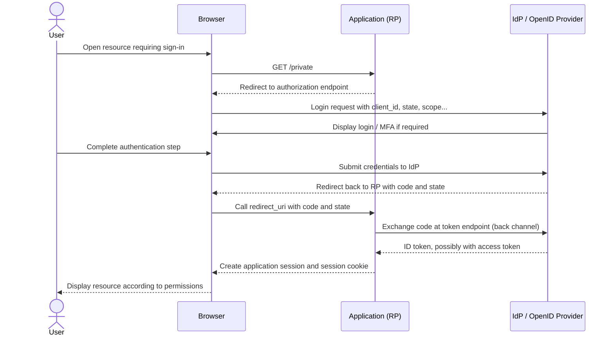

# Identity Provider (IdP), Relying Applications, and Users

## Objectives

After this lesson, you will be able to:

- Distinguish the **End-User**, **Identity Provider (IdP)**, and **relying application (Relying Party – RP / Service Provider – SP)**.
- Explain who authenticates the user, who receives the authentication result, and who decides permissions to use features in the application.
- Describe the federated login flow via **OpenID Connect (OIDC)** or **SAML 2.0** and why parties must establish a trust relationship.
- Identify the corresponding roles in Spring Security, avoiding confusion among ID tokens, access tokens, and application login sessions.

## 1. Three Core Roles of Identity Federation

**Identity federation** enables an application to accept authentication results from an external trusted identity system. As a result, the application does not necessarily have to manage user passwords itself.

| Role | Who Is It? | Primary Responsibilities | Not Automatically Responsible For |
| --- | --- | --- | --- |
| **End-User** | An individual wanting to access the application, e.g., employee Linh | Requests resources, interacts with the IdP login screen, performs MFA if needed, uses the application session | Asserting identity on their own via a URL parameter or browser-crafted content |
| **IdP (Identity Provider)** | An identity system such as an enterprise login server | Authenticates users per its policy, manages IdP-side login state, issues identity information or evidence per protocol | Automatically deciding whether Linh can edit reports, approve invoices, or view specific data in every application |
| **Relying Application (RP/SP)** | A web app trusting the IdP, e.g., a reporting portal | Redirects users to the IdP, receives and **verifies** the protocol response, maps the user internally, creates an application session, and enforces access control | Assuming a login message is genuine without verifying signature, issuer, audience, and related conditions |

The **Browser (User Agent)** is the fourth component to recognize in the flow: it redirects between the application and the IdP and stores appropriate cookies. The browser is **neither the IdP** nor an authoritative party confirming identity. Information sent through the browser must be verified by the application.

### Protocol-Specific Terminology

- In **OpenID Connect**, the IdP is commonly called the **OpenID Provider (OP)**; the application is the **Relying Party (RP)** and is also an **OAuth 2.0 Client**.
- In **SAML 2.0**, the IdP is the **Asserting Party**; the application is the **Service Provider (SP)**, and may also be called a **Relying Party**.
- An organization may operate the same identity system providing multiple protocols, but that does not make OIDC tokens and SAML assertions directly interchangeable.

Key point: **The IdP provides identity authentication evidence; the application verifies the evidence and enforces its own access policies.**

## 2. Example: One User, One IdP, Two Applications

Suppose a company has:

- An IdP at `https://login.example.com`, where employees sign in and perform MFA.
- Application A at `https://portal.example.com`; Application B at `https://reports.example.com`.
- Linh has an identity at the IdP and is granted permission to view the internal portal, but does not yet have permission to approve reports.

When Linh opens Application A, the application redirects the browser to the IdP. Linh authenticates at the IdP; Application A receives the response, verifies it, and creates **A's own session**. Next, Linh opens B: the IdP may recognize that Linh already has **a separate session at the IdP** and complete federated login without prompting for a password again. Even so, B must still verify the response and create **B's own session**.

This is the foundation of **Single Sign-On (SSO)**: reusing an authentication event at the IdP across multiple applications. SSO **does not mean** a single shared cookie across all applications, does not guarantee every application permits every action, and does not guarantee logging out of A immediately logs out of the IdP or B.

If Linh accesses the "Approve" page, B can still return **403 Forbidden** because Linh lacks permission, even though identity was authenticated successfully.

## 3. Who Does What During an OIDC Sign-In?

A typical flow for a server-side web application is the **OIDC Authorization Code Flow**. OIDC adds an identity authentication layer onto OAuth 2.0.



Explanation by responsibility:

1. **The application initiates the request.** When a resource requires sign-in, the RP constructs a request to the configured IdP. Common parameters include `client_id` (application identifier), `redirect_uri` (registered callback URL), `scope` containing `openid`, `state` to prevent flow forgery, and appropriate security parameters such as `nonce`/PKCE.
2. **The IdP authenticates the user.** Handling passwords, passkeys, MFA, or checking the SSO session belongs to the IdP. In a proper federated login model, the application never needs to receive the user's IdP password.
3. **The IdP returns the browser.** The browser receives a redirect containing an **authorization code** and `state`. In the code flow, the code is a short-lived value for the RP to exchange for tokens; it is not standalone identity evidence.
4. **The application verifies and exchanges the code.** The RP matches `state`, performs the exchange at the token endpoint, uses the PKCE `code_verifier` if applied, and authenticates the client according to client type. This exchange channel occurs server-to-server for server-side web applications.
5. **The RP processes the ID token.** The RP must rely on the library/protocol to verify the signature, allowed algorithm, `iss` (issuer), `aud` (audience containing the RP's client ID), expiration, `nonce` when used, and related conditions. Additional user attributes may be read from UserInfo when valid and needed.
6. **The application creates a session and decides permissions.** After authentication, Spring Security stores the `Authentication` object in the security context, and the application typically maintains the login session via a secure cookie. Permissions to view/edit/delete resources continue to be checked by the application.

You should not write custom handling code or bypass token/assertion verification when Spring Security already provides standard mechanisms.

## 4. Same Three Roles, SAML 2.0 Protocol

In SAML 2.0 Web Browser SSO, the **SP** application can send an `AuthnRequest` via the browser to the **IdP**. After authentication, the IdP issues a `SAMLResponse` containing an appropriate assertion; the browser posts it back to the SP's **Assertion Consumer Service (ACS)**, typically via HTTP POST. The SP verifies the response and creates an application session.

| Criterion | OIDC | SAML 2.0 |
| --- | --- | --- |
| Identity provider name | OpenID Provider (IdP/OP) | Identity Provider / Asserting Party |
| Relying application name | Relying Party / OAuth Client | Service Provider / Relying Party |
| Typical login evidence | **ID token**, usually JWT | **SAML assertion** inside SAML Response |
| Trust setup information | Issuer/discovery, client ID, redirect URI, verification keys, and client configuration | Entity ID, SSO endpoint, ACS URL, metadata, X.509 certificate, and assertion conditions |
| Spring Security for web apps | `oauth2Login()` with OIDC client | `saml2Login()` with relying-party registration |

Although the protocols differ, responsibilities remain consistent: **the IdP authenticates and issues assertions/tokens; the SP/RP checks validity, identifies the local user, and applies authorization.** A browser POSTing a `SAMLResponse` is not sufficient to trust if the SP does not verify signature, issuer, audience, destination, time validity, and flow replay protection.

### Does OAuth 2.0 Equal Identity Login?

**No.** OAuth 2.0 primarily describes a resource access authorization mechanism. An **access token** proves permission to call a resource under an appropriate context and audience; it does not by itself become an **ID token** or OIDC login evidence for a web application. **OIDC** adds user authentication rules, ID tokens, and the corresponding verification requirements.

## 5. Whom Does the Received Information Belong To?

| Data / Evidence | Usually Issued By | Used For | Notes |
| --- | --- | --- | --- |
| **ID token** (OIDC) | OpenID Provider | RP verifies the authentication event and End-User identity | Check `iss`, `aud`, signature, expiration, `nonce` when applicable; do not use as an API calling token just because it is a JWT |
| **Access token** (OAuth 2.0) | Authorization Server | Client calls **Resource Server/API** per granted audience and permissions | API must verify the token has the right recipient, scope, and related constraints |
| **SAML assertion** | SAML IdP | SP verifies authentication and attributes per trust relationship | Must verify signature, issuer, audience, time conditions, and match with the request |
| **Application session cookie** | The RP/SP application itself | Binds subsequent HTTP requests after sign-in to the application session | Application-private data; must be protected with HTTPS, proper cookie flags, and session management |
| **IdP session cookie** | IdP | Recognizes that the user already has a login session at the IdP | Does not replace each RP/SP's own session cookie |

**Stable identity:** In OIDC, the `(iss, sub)` key pair is usually more suitable than email for linking a local account to a federated identity. `sub` identifies the subject within the issuer's scope; matching emails do not guarantee the same trusted account, and emails can change. With SAML, understand the NameID type, identifier stability, and specific mapping policy with the IdP. Never automatically merge sensitive accounts solely by unverified email.

**Attributes do not automatically become permissions:** The IdP may provide `email`, name, groups, or roles; the application must define and control how they map to local authorities/permissions. For example, "signed in via IdP" does not mean "allowed to approve invoices".

## 6. Trust Relationships and Responsibility Boundaries

For an RP/SP to trust an IdP, appropriate **registration and trust configuration** must exist before users sign in:

- **OIDC:** the application knows the trusted issuer, endpoints, and verification keys (typically via discovery/JWKS), has a `client_id`, configures client authentication if required, and registers the exact redirect URI at the IdP. Accept only results intended for the application itself, from the expected issuer.
- **SAML:** the SP and IdP agree on Entity ID, ACS/SSO endpoints, signature verification certificates/keys, and assertion policies. The SP must not trust an assertion simply because the XML contains a username.
- **User:** interacts with the genuine IdP login domain and the authentication factors the IdP requires. MFA policies, authentication time, and assurance levels may differ across applications; if high assurance is required, the RP must configure and verify corresponding signals.
- **Application:** controls sessions, linked accounts, functional permissions, audit logging, and handling cases where users are locked, change groups, or lose access. A separate sync/provisioning mechanism may be needed; a login assertion is not a complete account synchronization system.

**Boundaries to remember:**

1. **Authentication:** who is that person? The IdP performs authentication and the RP verifies the evidence.
2. **Identity Federation:** the RP accepts an identity issued by another IdP under an established trust relationship.
3. **Authorization:** what is that person allowed to do at the application/API? The RP and Resource Server enforce the resource's policies.
4. **Session:** the IdP and each RP have separate sessions/lifecycles; logout, expiration, and revocation must be designed to match the protocol and architecture.

## 7. Mapping to Spring Security

| Spring Component Role | Common Configuration / Mechanism | Scope |
| --- | --- | --- |
| Web app as **OIDC Relying Party / OAuth Client** | `oauth2Login()`, `ClientRegistration`, `OidcUser` | Redirects user to IdP, handles callback, verifies login, creates web app's `Authentication` |
| Web app as **SAML 2.0 Service Provider** | `saml2Login()`, `RelyingPartyRegistration` | Receives and verifies SAML Response/assertion from IdP and logs user in |
| Backend API as **OAuth 2.0 Resource Server** | `oauth2ResourceServer(oauth2 -> oauth2.jwt())` (if using JWT) | Validates bearer access tokens to protect APIs; distinct role from interactive web login |
| System acting as **Authorization Server / OIDC Provider** | IdP solution or properly configured Spring Authorization Server | Provides authorization/token endpoints; this is the IdP-side role, not an automatic effect of `oauth2Login()` |

A web app can simultaneously act as an RP when authenticating users and as an OAuth Client when calling APIs. An API may be solely a Resource Server, with no login screen at all. Do not confuse `oauth2Login()` with `oauth2ResourceServer()`.

### Minimal Configuration Example for a Spring Boot Application Using OIDC

This is a **configuration example inside a Spring Boot application**, not a standalone Java program run solely with `javac`. The application needs `spring-boot-starter-security` and `spring-boot-starter-oauth2-client`, and must have a valid client registered at the IdP.

```java
import org.springframework.context.annotation.Bean;
import org.springframework.context.annotation.Configuration;
import org.springframework.security.config.Customizer;
import org.springframework.security.config.annotation.web.builders.HttpSecurity;
import org.springframework.security.web.SecurityFilterChain;

@Configuration
public class WebSecurityConfig {
    @Bean
    SecurityFilterChain securityFilterChain(HttpSecurity http) throws Exception {
        return http
            .authorizeHttpRequests(auth -> auth
                .requestMatchers("/", "/public/**").permitAll()
                .anyRequest().authenticated()
            )
            .oauth2Login(Customizer.withDefaults())
            .build();
    }
}
```

```yaml
spring:
  security:
    oauth2:
      client:
        registration:
          company:
            provider: company
            client-id: ${OIDC_CLIENT_ID}
            client-secret: ${OIDC_CLIENT_SECRET}
            scope: [openid, profile, email]
        provider:
          company:
            issuer-uri: https://idp.example.com/realms/company
```

Explanation:

- `company` is an application-chosen `registrationId`. `issuer-uri` is merely an illustrative URL; it must be replaced with the real issuer provided by an IdP that supports OIDC discovery.
- A server-side web application stores the client secret in environment variables/a secret manager, **never** committing secrets to Git. The client authentication method depends on the actual registration.
- With the default callback configuration, the client's redirect URI is typically `{baseUrl}/login/oauth2/code/{registrationId}`, e.g., `https://portal.example.com/login/oauth2/code/company`; that exact URI must be registered at the IdP.
- `oauth2Login()` configures the sign-in mechanism, while **business authorization** logic (approval rights, project view rights, admin rights) must still be designed and enforced by the application.
- The example does not create an IdP and cannot complete sign-in without a real IdP/client registration. There is no fixed stdout for an interactive login session.

If the same application uses **SAML 2.0** instead of OIDC, the corresponding login branch is `saml2Login()` and requires configuring a **relying party registration** along with appropriate IdP metadata/certificates. That is a protocol choice, not just swapping a method name while reusing the OIDC configuration as-is.

## 8. Common Misunderstandings and Risks

| Misconception | Correct Understanding / Mitigation |
| --- | --- |
| "The user signed in at the IdP successfully, so every screen is permitted." | Sign-in only confirms identity. Resource-level permission checks must still occur in the application/API. |
| "Receiving `email` in the URL or JSON is enough to trust it." | Attributes are only trustworthy after verifying the response according to protocol, issuer, audience, and integrity. |
| "Any JWT is proof of OIDC sign-in." | Distinguish ID tokens from access tokens; check issuer, audience, intended use, and required claims. |
| "The application must store the user's IdP password." | RPs/SPs delegate authentication to the IdP; avoid collecting or storing passwords outside your responsibility. |
| "An SSO session is a single session shared across applications." | The IdP and each RP/SP manage separate sessions; single logout/revocation must be implemented and verified per system. |
| "Verifying the signature alone is enough." | You must also check issuer, audience, timestamps, nonce/state or appropriate SAML conditions, and correlation between response and request. |
| "If a role/group is in the token, trust it and grant admin." | Map claims only from trusted sources per explicit policy; verify audience, issuer, and enforce least privilege. |
| "All identical emails belong to the same person." | Use issuer-scoped stable identifiers and controlled account-linking workflows, especially with multiple IdPs. |

In addition, use **HTTPS**, keep codes/tokens and secrets out of URL logs or application logs, limit requested scopes/claims, prevent session fixation, and use secure cookies appropriately. The authentication library is responsible for enforcing most protocol checks; the application must still configure it properly and test failure cases.

## 9. Self-Check Scenarios

**Scenario A:** An employee signs in to the company via the IdP and opens two applications. The second application does not prompt for a password again but still creates a new session cookie. Is this reasonable?

**Answer:** Yes. The IdP can reuse the SSO session to authenticate quickly, while each application still validates the federated response and maintains its own session.

**Scenario B:** An API receives a valid access token, but the user does not have permission to delete data. Who rejects the DELETE request?

**Answer:** The API/Resource Server or business layer is responsible for authorization checks and returning an appropriate error (typically `403 Forbidden`). A valid token does not guarantee permission for every operation.

**Scenario C:** Two IdPs both return the email `linh@example.com`. Can they be automatically merged into one account?

**Answer:** No. You must distinguish the issuing source and subject identifier (OIDC `iss` + `sub` or an established stable SAML identifier), and then use an approved account-linking workflow.

**Scenario D:** A Spring Security application needs web sign-in using OIDC, while a separate API only validates JWT access tokens. Which mechanisms will the two components choose?

**Answer:** The web app uses `oauth2Login()`; the API uses `oauth2ResourceServer(...jwt())` if the tokens are JWTs with appropriate verification configured. The two roles have different responsibilities.

## Key Takeaways

The **User** is the subject wanting to sign in; the **IdP** authenticates and issues identity evidence; the **RP/SP** verifies the evidence and decides how the application handles the user. Mastering the three roles, the boundary between authentication/authorization, and the differences between tokens/sessions is the prerequisite for designing secure SSO with Spring Security.

### References

- [Spring Security – OAuth 2.0 Login](https://docs.spring.io/spring-security/reference/servlet/oauth2/login/index.html)
- [Spring Security – SAML 2.0 Login Overview](https://docs.spring.io/spring-security/reference/servlet/saml2/login/overview.html)
- [OpenID Connect Core 1.0](https://openid.net/specs/openid-connect-core-1_0.html)
