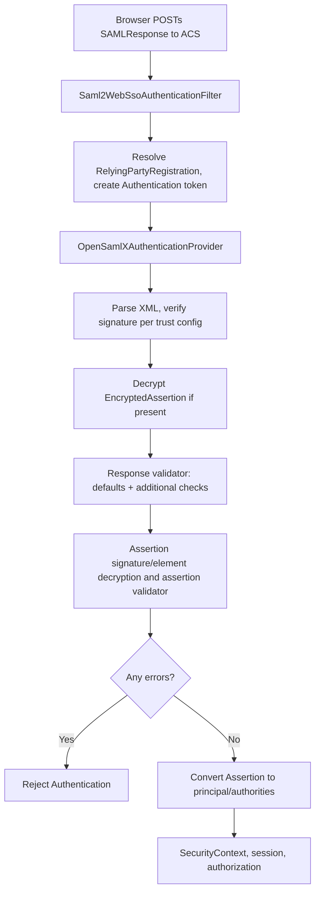

# Extending OpenSAML Validators While Retaining Default Checks

## 1. Objective and Scope

In SAML 2.0 federation, a Spring Boot application acts as a **Service Provider (SP)** receiving `SAMLResponse` from an **Identity Provider (IdP)**. Before creating a login session, Spring Security uses OpenSAML to parse the message, verify signatures, decrypt when required, and validate Response/Assertion conditions. Enterprises sometimes require custom policies as well, such as:

- Allowing only **SP-initiated login**, rejecting SAML Responses without prior request context.
- Allowing only a specific `AuthnContextClassRef` committed by the IdP, or requiring sufficiently recent authentication.
- Blocking assertions with invalid business attributes after ensuring the assertion comes from a trusted IdP.
- Enforcing additional rules on `OneTimeUse`, device, user groups, or verified tenant data.

The safe way **is not replacing the entire default validator with a lambda returning "success"**. You must preserve the framework's required validation layers, **append** business rules, and combine errors. If either branch reports an error, Authentication must fail.

This lesson uses **Spring Security 6.x/OpenSAML 4** to illustrate the two hooks `setResponseValidator` and `setAssertionValidator`, while contrasting key differences in **Spring Security 7/OpenSAML 5**. The Spring Boot example uses Java 17+; a valid SAML IdP is needed to run end-to-end login.

**Expected outcomes:** distinguish response-level and assertion-level validation; preserve default validation; add fail-closed rules; chain `Saml2ResponseValidatorResult` properly; test rejection of bad issuer/audience/signature; avoid confusing validators with signature verification or authentication conversion.

## 2. Seeing the Layers of the SAML Authentication Pipeline Clearly



The diagram is a **responsibility model**, not a guarantee of exact internal step ordering across all versions, bindings, and signature placements. Depending on whether Response or Assertion is signed/encrypted, the provider processes signatures and decryption at the right points so as not to invalidate signed content.

In Spring Security, classes have distinct responsibilities:

| Component | Responsibility | Do not confuse with |
| --- | --- | --- |
| `Saml2WebSsoAuthenticationFilter` | Receives HTTP POST at ACS; requires authentication | Standalone business validator |
| `Saml2AuthenticationTokenConverter` | Reads response from request and resolves `RelyingPartyRegistration` | Proof that the IdP validly signed |
| `OpenSaml4AuthenticationProvider` / `OpenSaml5AuthenticationProvider` | Authentication pipeline and OpenSAML hooks | Plain Servlet filter or controller |
| Response validator | Checks **Response** conditions, e.g. issuer/destination/correlation per version | Assertion-level audience and subject confirmation |
| Assertion validator | Checks **Assertion** and conditions/subject confirmation | XML decryption or TLS checks |
| Signature verification | Ensures signature belongs to trusted IdP key and signed content matches | Simply checking an `Issuer` string |
| Response authentication converter | Converts verified result into `Authentication`/principal | Place to replace all security checks |
| `RelyingPartyRegistrationRepository` | Holds SP–IdP trust config (Entity ID, ACS, verification keys) | Store for pending AuthnRequests |

### Defaults That Must Never Be Lost

Depending on version/profile, the default pipeline checks a set of conditions such as `Issuer`, `Destination`, `InResponseTo` correlation, `AudienceRestriction`, `SubjectConfirmation`, time bounds, and implemented assertion conditions. **Do not assume every anti-replay check or domain-specific policy is automatically present just by enabling `saml2Login`**; verify against the release, SAML agreement, and threat model.

Signatures may be verified in a separate step from `setResponseValidator`/`setAssertionValidator`. Therefore, **do not alter validators to "add signature checks" by reading XML attributes**; keep the provider's configured signature verification with trusted IdP certificates intact.

## 3. When Should Checks Live on Response vs. Assertion?

A SAML protocol Response carries protocol attributes and one or more Assertions. Choose the hook matching what the rule actually governs.

### 3.1. Response-Level Rules

Examples of protocol-envelope rules:

- Partner permits only **SP-initiated flow**, disallowing unsolicited/IdP-initiated responses.
- Requiring `Response@InResponseTo` to be present per transaction policy **already verified at the correlation layer**, rather than treating "any ID string exists" as sufficient.
- Extra checks on `Response@IssueInstant`, `StatusCode`, or partner-agreed metadata **when the framework does not enforce that policy yet**.
- Binding endpoint, tenant, or response type to an allowed registration.

`Response` carries `Issuer`, `Destination`, `ID`, `InResponseTo`, `Status`, and `IssueInstant`. Never compare a browser-sent URI and declare Response "trusted"; before converting to Authentication, signatures and trust keys must be verified per `RelyingPartyRegistration`.

### 3.2. Assertion-Level Rules

Examples of identity-content rules:

- `AuthnStatement/AuthnContextClassRef` belongs to an accepted set of authentication methods.
- `AuthnInstant` meets a freshness threshold when business logic requires it.
- Attributes signed by the IdP and verified by the SP contain a valid tenant ID, proper email format, or required attributes.
- Assertion uses `OneTimeUse` and the app has a corresponding replay cache strategy if profile requires.

`Assertion` carries `Subject`, `Conditions`, `AuthnStatement`, `AttributeStatement`, and optionally its own signature. Checks for `AudienceRestriction`, `SubjectConfirmationData@Recipient`, `NotBefore`/`NotOnOrAfter`, and correlation may live in OpenSAML's default validator. When adding policy, **never disable** these validation layers.

### 3.3. Placement Rule

If a rule only inspects `Response.getInResponseTo()`, place it in the response validator. If a rule needs `Assertion.getAuthnStatements()` or attributes, place it in the assertion validator. If a rule only changes how **an already-verified assertion** maps to user roles, consider the response authentication converter or authorization service; never use a validator to grant privileges before trusting the data.

A high-assurance requirement may also need **server-stored transaction context**; inspecting the response XML alone cannot prove whether this browser requested step-up.

## 4. Dangerous Mistakes When Extending Validators

### 4.1. Overriding the Entire Validator and Returning Success

```java
provider.setAssertionValidator(token ->
        Saml2ResponseValidatorResult.success());
```

**Never do this in production.** This snippet discards errors the default **assertion validator** should have returned, such as audience/subject confirmation/assertion conditions depending on version. Steps outside the validator (like signature verification) do not automatically vanish, yet critical protective layers have been stripped away.

### 4.2. Checking Only Custom Rules Without Calling Default Validator

```java
provider.setResponseValidator(token -> {
    if (someBusinessRule(token)) {
        return Saml2ResponseValidatorResult.success();
    }
    return Saml2ResponseValidatorResult.failure(
            new Saml2Error(Saml2ErrorCodes.INVALID_RESPONSE,
                    "Application policy failed"));
});
```

This is **pseudocode with an undefined `someBusinessRule` function**, illustrating an anti-pattern, **not a standalone Java program**. It enforces only a business rule while potentially dropping default issuer, destination, and response condition checks.

### 4.3. Changing Metadata/Trust to "Fix" Policy Failures

If callbacks fail on `AudienceRestriction` or `Recipient`, never drop the audience validator or accept any ACS. The cause may be the IdP registering the wrong Entity ID/ACS or a reverse proxy skewing `{baseUrl}`. **Fix the root configuration** instead of lowering verification standards.

## 5. Spring Security 6.x: Safe Validator Composition API

With `OpenSaml4AuthenticationProvider`, the provided APIs are:

```java
provider.setResponseValidator(responseToken -> ...);
provider.setAssertionValidator(assertionToken -> ...);
```

Both methods accept a Spring `Converter<...Token, Saml2ResponseValidatorResult>`. Spring Security provides the factories:

```java
OpenSaml4AuthenticationProvider.createDefaultResponseValidator();
OpenSaml4AuthenticationProvider.createDefaultAssertionValidator();
```

**Key point:** call the factory **once** to obtain default logic, evaluate it for each token, and **chain** custom results with `concat`.

```java
var responseDefaults =
        OpenSaml4AuthenticationProvider.createDefaultResponseValidator();

provider.setResponseValidator(token -> {
    Saml2ResponseValidatorResult builtIn =
            responseDefaults.convert(token);
    Saml2ResponseValidatorResult custom =
            validateApplicationResponsePolicy(token);
    return builtIn.concat(custom);
});
```

This is a **configuration fragment** with an undefined `validateApplicationResponsePolicy` function, showing only the formula; the full example is in section 9. Important points about `Saml2ResponseValidatorResult`:

- `success()` represents zero errors.
- `failure(new Saml2Error(code, description))` represents an error.
- `getErrors()` or `hasErrors()` checks status.
- `concat(Saml2Error)` or `concat(Saml2ResponseValidatorResult)` creates **a new result** holding both original and added errors. **Never ignore the return value**.
- If the default validator fails while custom returns success, the combined result **still fails**.
- If default passes while the custom rule fails, the combined result **still fails**.
- Only when neither has errors can processing continue, provided other authentication steps also succeed.

An added rule must never `return Saml2ResponseValidatorResult.success()` to **override a default failure**. Use "error accumulation" composition, never "if custom is OK then allow".

## 6. Standalone Demonstration: Fail-Closed Composition in Java 17

To understand `concat` before implementing real SAML, consider a standalone Java 17 example using a `List` to accumulate errors. The program **is not OpenSAML**, handles no signatures, and solely demonstrates error-preserving composition across two checkers.

Save file `ValidatorCompositionDemo.java`:

```java
import java.util.ArrayList;
import java.util.List;

public final class ValidatorCompositionDemo {

    static List<String> combine(
            List<String> defaultErrors,
            List<String> customErrors) {
        List<String> errors = new ArrayList<>(defaultErrors);
        errors.addAll(customErrors);
        return List.copyOf(errors);
    }

    static void show(String name, List<String> defaults,
                     List<String> custom) {
        List<String> all = combine(defaults, custom);
        System.out.println(name + "=" + (all.isEmpty() ? "PASS" : "FAIL")
                + ",errors=" + all.size());
    }

    public static void main(String[] args) {
        show("bothGood", List.of(), List.of());
        show("issuerBad", List.of("invalid issuer"), List.of());
        show("contextBad", List.of(), List.of("low assurance"));
        show("bothBad",
                List.of("invalid audience"),
                List.of("low assurance"));
    }
}
```

Run with Java 17+:

```bash
javac ValidatorCompositionDemo.java
java ValidatorCompositionDemo
```

Exact stdout:

```text
bothGood=PASS,errors=0
issuerBad=FAIL,errors=1
contextBad=FAIL,errors=1
bothBad=FAIL,errors=2
```

All four cases show **a single error in any checker is enough to reject**. In Spring Security, `Saml2ResponseValidatorResult` provides this accumulation without building a `List` manually. This example does not replace SAML protocol validation.

## 7. Minimal Configuration of the Spring Boot Application

Section 9's example uses **Java 17+, Spring Boot 3.x/Spring Security 6.x, and OpenSAML 4**. If your project uses Spring Security 7, follow the `OpenSaml5AuthenticationProvider` API in section 12; do not mix classes from both versions into the same file.

### 7.1. Gradle Dependencies

In a Spring Boot project with Gradle wrapper, Java plugin, and dependency management already set up, you can add to `build.gradle`:

```groovy
repositories {
    mavenCentral()
    // Only add Shibboleth repository if required by transitive OpenSAML artifacts.
    maven { url "https://build.shibboleth.net/maven/releases/" }
}

dependencies {
    implementation "org.springframework.boot:spring-boot-starter-web"
    implementation "org.springframework.boot:spring-boot-starter-security"
    implementation "org.springframework.security:spring-security-saml2-service-provider"
}
```

The snippet above is **not a complete build file**. Do not force an OpenSAML 5 version if using the `OpenSaml4AuthenticationProvider` example. Spring Security 6.5 supports both OpenSAML 4 and 5, yet each API set has different classes/providers.

### 7.2. application.yml

Configure trusted IdP:

```yaml
spring:
  security:
    saml2:
      relyingparty:
        registration:
          corp:
            assertingparty:
              metadata-uri: "${SAML_IDP_METADATA_URI}"
```

Spring requires a valid `RelyingPartyRegistration` containing IdP Entity ID and endpoints, verification certificate, and ACS URL per metadata or SP config. `SAML_IDP_METADATA_URI` must come from trusted infrastructure; never accept a metadata URI passed by a user over an unauthenticated HTTP request.

Example sandbox metadata URI for illustration only: `https://idp.example.test/metadata`. For real login, the application must have its SP Entity ID and ACS URL registered at the IdP, plus signing credentials if the partner profile demands them.

## 8. Illustrative Additional Policies for Practice

The exercise defines two clearly separated additional policies:

1. **Response rule – SP-initiated only:** reject any Response not carrying `InResponseTo` in the handled context. This rule requires **presence**, and does not replace verifying whether the ID actually matches a saved AuthnRequest; default protocol/correlation validation must still run.
2. **Assertion rule – authentication context:** accept only an assertion having at least one `AuthnStatement` reporting `AuthnContextClassRef` equal to `urn:oasis:names:tc:SAML:2.0:ac:classes:PasswordProtectedTransport`. This is an **illustrative policy for a specific context**, **not an MFA policy**, and applies only if the real IdP supports this class.

Neither rule requires manually parsing raw XML strings or handling HTTP forms. They read **OpenSAML objects** inside the provider pipeline. Even if a request/response contains multiple assertions, only assertions accepted by the provider per policy may build identity. Custom rules must not delete assertions or swap verification keys during evaluation.

**Important:** `PasswordProtectedTransport` does not mean multi-factor login. If business logic requires MFA, phishing resistance, or high assurance levels, agree on specific context URIs with the IdP and verify those exact contexts, combined with freshness/authorization as needed. Never swap URI strings to pretend to enforce MFA.

## 9. Java 17+/Spring Security 6.x: Provider Config Keeping Defaults and Adding Rules

Save at `src/main/java/demo/saml/SamlValidationApplication.java` in a project with the dependencies and application.yml above:

```java
package demo.saml;

import org.opensaml.saml.saml2.core.AuthnContext;

import org.springframework.boot.SpringApplication;
import org.springframework.boot.autoconfigure.SpringBootApplication;
import org.springframework.context.annotation.Bean;
import org.springframework.core.convert.converter.Converter;
import org.springframework.security.authentication.ProviderManager;
import org.springframework.security.config.annotation.web.builders.HttpSecurity;
import org.springframework.security.saml2.core.Saml2Error;
import org.springframework.security.saml2.core.Saml2ErrorCodes;
import org.springframework.security.saml2.core.Saml2ResponseValidatorResult;
import org.springframework.security.saml2.provider.service.authentication.OpenSaml4AuthenticationProvider;
import org.springframework.security.web.SecurityFilterChain;
import org.springframework.web.bind.annotation.GetMapping;
import org.springframework.web.bind.annotation.RestController;

@SpringBootApplication
@RestController
public class SamlValidationApplication {

    private static final String REQUIRED_CONTEXT =
            "urn:oasis:names:tc:SAML:2.0:ac:classes:PasswordProtectedTransport";

    public static void main(String[] args) {
        SpringApplication.run(SamlValidationApplication.class, args);
    }

    @Bean
    SecurityFilterChain samlSecurity(HttpSecurity http) throws Exception {
        OpenSaml4AuthenticationProvider provider =
                new OpenSaml4AuthenticationProvider();

        // 1. Keep ALL built-in Response validation.
        Converter<OpenSaml4AuthenticationProvider.ResponseToken,
                Saml2ResponseValidatorResult> responseDefaults =
                OpenSaml4AuthenticationProvider.createDefaultResponseValidator();

        provider.setResponseValidator(token -> {
            Saml2ResponseValidatorResult result =
                    responseDefaults.convert(token);

            // Additional application policy: no unsolicited login.
            String inResponseTo = token.getInResponseTo();
            if (inResponseTo == null || inResponseTo.isBlank()) {
                result = result.concat(new Saml2Error(
                        Saml2ErrorCodes.INVALID_IN_RESPONSE_TO,
                        "SP-initiated SAML login is required"));
            }
            return result;
        });

        // 2. Keep ALL built-in Assertion validation.
        Converter<OpenSaml4AuthenticationProvider.AssertionToken,
                Saml2ResponseValidatorResult> assertionDefaults =
                OpenSaml4AuthenticationProvider.createDefaultAssertionValidator();

        provider.setAssertionValidator(token -> {
            Saml2ResponseValidatorResult result =
                    assertionDefaults.convert(token);

            boolean approved = token.getAssertion()
                    .getAuthnStatements().stream()
                    .anyMatch(statement ->
                            statement.getAuthnContext() != null
                            && statement.getAuthnContext()
                                    .getAuthnContextClassRef() != null
                            && REQUIRED_CONTEXT.equals(
                                    statement.getAuthnContext()
                                            .getAuthnContextClassRef().getURI()));

            if (!approved) {
                result = result.concat(new Saml2Error(
                        Saml2ErrorCodes.INVALID_ASSERTION,
                        "Authentication context is not permitted"));
            }
            return result;
        });

        return http
                .authorizeHttpRequests(auth -> auth
                        .requestMatchers("/").permitAll()
                        .anyRequest().authenticated())
                .saml2Login(saml -> saml
                        .authenticationManager(new ProviderManager(provider)))
                .build();
    }

    @GetMapping("/")
    public String publicPage() {
        return "Public page";
    }

    @GetMapping("/private")
    public String privatePage() {
        return "Authenticated SAML user";
    }
}
```

**Reading the example in order:**

- `OpenSaml4AuthenticationProvider` is the provider handling SAML2 authentication with OpenSAML 4; never replace it with an "always succeed" `AuthenticationManager`.
- `responseDefaults` is built with the official factory and invoked **on every Response verification**.
- The custom rule checks `token.getInResponseTo()` to reject unsolicited responses per the **SP-initiated only** policy. Mere presence of `InResponseTo` is insufficient against replay/session confusion; default layers must still correlate the transaction per capability and configuration.
- `assertionDefaults` is invoked **for each Assertion**; its errors are preserved in `result`.
- `getAuthnStatements()` reads the assertion's statements; the code requires an allowlisted context to proceed. If the IdP omits context or uses another URI, authentication is rejected per exercise policy.
- Each `concat(new Saml2Error(...))` **creates and returns a new error result**, so `result` must be reassigned.
- `ProviderManager(provider)` wires the configured provider into `saml2Login`, ensuring the hooks are actually used. Never declare a provider bean without wiring it into the filter and assume the app picks it up automatically.
- `/private` returns only a fixed string after the user is authenticated; the illustrative code never emits raw SAML XML in responses.

### 9.1. Prerequisites Before Running

The app can only run end-to-end SAML login when real IdP metadata has an issuer/cert, the SP has matching entity ID/ACS, and the browser is sent to a valid IdP SSO endpoint. Some IdPs require the SP to sign AuthnRequests; in that case a private signing credential from a secret store is also needed.

You can start the project (POSIX shell):

```bash
SAML_IDP_METADATA_URI=https://idp.example.test/metadata ./gradlew bootRun
```

The `example.test` domain is illustrative only; real login is impossible without replacing it with a configured sandbox IdP. There is **no fixed stdout** for this process: startup logs, assertion classes, and IdP pages depend on environment. When the Response is valid, SP-initiated, and has the right context, `/private` returns:

```text
Authenticated SAML user
```

If the IdP returns another context, such as `unspecified`, login fails per the configured rule. This may be a **policy mapping** issue, not a Java syntax error.

### 9.2. Limitations of the Example

- The demo enforces the context policy on **every SAML login**. Real apps may require high assurance only on certain resources. In that case manage SP-stored transaction/context and separate step-up rather than loosening global validators for critical resources.
- The Response rule checks **presence** of InResponseTo, not guaranteeing the ID matches AuthnRequest. Never drop repository/response correlation.
- The Assertion rule does not compare `AuthnInstant`, verify issuer signatures, or enforce business authorization. Those duties belong to the framework or other policy checks.
- Never use a context present in unverified raw XML to assign `ROLE_ADMIN`.

## 10. Exact Explanation: How Does Keeping Defaults Differ from Full Replacement?

These two approaches share a business goal yet yield very different security outcomes:

| Approach | Default Response validation | Default Assertion validation | Additional rule | Outcome |
| --- | --- | --- | --- | --- |
| **Chain standard validators** | Retained | Retained | Added | Error in any layer → FAIL |
| Set only custom Response validator | **May be lost** | Retained if untouched | Response custom applied | Risk of losing issuer/destination checking |
| Set only custom Assertion validator | Retained if untouched | **May be lost** | Assertion custom applied | Risk of losing audience/subject confirmation |
| Manually `return success()` | Lost in overridden hook | Lost in overridden hook | None/incomplete | Unsafe |
| Run built-in yet discard `concat` return | Built-in kept in code | Built-in kept in code | **Custom errors dropped** if return unused | Fails goal |

Here "lost" refers to **logic residing inside the replaced validator hook**, not that XML signatures automatically stop being verified: the provider has separate signature/decryption steps. However, losing part of default validation can let the app accept an Assertion with the wrong audience or missing subject confirmation, remaining a serious security flaw.

### Code Review Rules

- Is `createDefaultResponseValidator()` or equivalent `ResponseValidator.withDefaults(...)` invoked?
- Is `createDefaultAssertionValidator()` or `AssertionValidator.builder()` retaining default validators?
- Are custom errors combined via `concat` and **is the combined result returned**?
- Does any `try/catch` accidentally return `success()` when defaults throw?
- Are validation and conversion separated, granting no privileges before receiving a valid SAML Response?
- Do unit/integration tests prove responses with invalid signatures, issuers, and audiences still fail?

## 11. Security Conditions Outside Custom Validators

### 11.1. Trust Keys and Signatures

The IdP verification certificate must be configured from trusted metadata/trust stores. If the app fetches keys directly from a URL provided by an unverified SAMLResponse, an attacker can trick the system into trusting their key. `Issuer` written as text in XML **does not prove who signed**.

A SAML Response may be signed at the Response or Assertion level per profile and policy. The provider must use the exact signed part to construct the principal, preventing **XML Signature Wrapping**. Never extract `NameID` from a node other than the verified node.

### 11.2. ACS, Destination, Recipient

`Response@Destination` and `SubjectConfirmationData@Recipient` typically must match the public ACS URL. Behind a reverse proxy, `{baseUrl}` may resolve to the wrong scheme/host if forwarded headers are not handled safely.

Never remove Destination/Recipient validators to "fix" proxy errors. Fix the public ACS, IdP registration, and forwarded headers from trusted proxies only.

### 11.3. AudienceRestriction

`AudienceRestriction` defines which SP the assertion is intended for, usually the **SP Entity ID**. It is not the IdP SSO URL and need not equal the ACS URL. If default assertion validation rejects the audience, compare the SP Entity ID in metadata and at the IdP. Never replace `AudienceRestrictionValidator` with "accept all".

### 11.4. Timestamps and Clock Skew

`Conditions@NotBefore`, `Conditions@NotOnOrAfter`, `SubjectConfirmationData@NotOnOrAfter`, and `AuthnInstant` serve different rules. A brief clock skew may be needed if IdP/SP hosts drift by a few seconds, yet you must **never** raise skew by hours to accept stale assertions. Use NTP, consistent clocks, and proper tests.

**`AuthnInstant` is not when the Response was sent.** If a workflow requires recent authentication, check AuthnInstant/freshness separately rather than only Response IssueInstant.

### 11.5. Request Correlation and Replay

In SP-initiated SSO, `Saml2AuthenticationRequestRepository` stores `AuthnRequest` to correlate `InResponseTo`, RelayState, and session across the flow. If the repository loses state due to SameSite cookies or multiple replicas, do not accept Responses lacking correlation.

Anti-replay may require a cache/state mechanism strong enough across instances. Reading `OneTimeUse` and returning success does not turn the system into replay protection; you must store used assertion/response IDs and handle TTL/atomic consume if policy requires.

## 12. Spring Security 7 / OpenSAML 5: Preserving Defaults with the New API

When upgrading to Spring Security 7/OpenSAML 5, examples using `OpenSaml4AuthenticationProvider.createDefaultAssertionValidator()` **should not be copied directly to OpenSaml5**. Newer docs use different helpers/builders.

### 12.1. ResponseValidator.withDefaults(...)

For response validation, the documented structure is:

```java
OpenSaml5AuthenticationProvider provider =
        new OpenSaml5AuthenticationProvider();

ResponseValidator validator =
        ResponseValidator.withDefaults(myCustomValidator);

provider.setResponseValidator(validator);
```

This is an **API illustration snippet for Spring Security 7**, assuming `myCustomValidator` conforms to the `ResponseValidator` contract. The idea is **retaining defaults** and adding custom logic, not replacing them with logic checking only a custom rule.

### 12.2. AssertionValidator.builder()

A Spring Security 7 example from the guide adding an OpenSAML `ConditionValidator`:

```java
OpenSaml5AuthenticationProvider provider =
        new OpenSaml5AuthenticationProvider();

AssertionValidator validator = AssertionValidator.builder()
        .conditionValidators(validators -> validators.add(myConditionValidator))
        .build();

provider.setAssertionValidator(validator);
```

This is a **configuration fragment** (depending on defining `myConditionValidator` compatible with OpenSAML), not standalone Java SE. The builder starts from default validators and adds condition validators via a consumer; that differs from creating an empty list containing only custom validators. Read the exact API of your running version, especially if customizing multiple validator groups.

Older code using `OpenSaml5AuthenticationProvider.createDefaultAssertionValidator()` will need adjustment when moving to Spring Security 7. Do not mix Spring Security 6.x `Saml2ResponseValidatorResult` callback patterns with new helpers without checking method signatures.

### 12.3. Instead of Guessing, Pin the Release

In deployment and test docs, record:

- Exact Spring Boot and Spring Security versions.
- Runtime OpenSAML version (4 or 5).
- Active provider: `OpenSaml4AuthenticationProvider` or `OpenSaml5AuthenticationProvider`.
- Corresponding API used to build default/extended validators.
- Negative test suite proving validation did not regress on upgrade.

Specifically during migrations, a custom authentication provider setup can bypass configuration that Spring Security builds automatically in the new version. Therefore re-test ACS, metadata, signatures, assertion constraints, and principal output after upgrading.

## 13. Increasing Clock Skew While Keeping Default Checks

Sometimes learners assume they must replace the entire validator just to allow clock drift between IdP and SP. Spring Security 6.x/OpenSAML 4 has an API to build the **default assertion validator with validation context parameters**:

```java
provider.setAssertionValidator(
        OpenSaml4AuthenticationProvider
                .createDefaultAssertionValidatorWithParameters(parameters -> {
                    // Customize parameters per OpenSAML version
                    // and validation context docs, without removing validators.
                }));
```

This snippet **illustrates the extension point**, without passing specific parameters. To adjust clock skew, consult `SAML2AssertionValidationParameters.CLOCK_SKEW` and the data unit required by your library version. Never assume the same key takes "milliseconds" vs "Duration" across every OpenSAML version.

In Spring Security 7, `AssertionValidator.builder().clockSkew(Duration.ofMinutes(2)).build()` is the documented API style, preserving builder-managed validators. Only raise skew within organization-approved bounds. Never patch severe NTP drift via validator parameters.

## 14. Adding OneTimeUse Checks: Designing It Right

`<saml:OneTimeUse/>` is an assertion condition in SAML 2.0. If an integration partner requires "assertions may only be used once", a custom validator can check this condition, yet **stateful replay enforcement** is an additional responsibility.

A safe design requires:

1. Determining whether the IdP's SAML profile actually emits `OneTimeUse`; you may reject assertions missing the element if that is a mandatory application requirement.
2. Checking assertions whose signatures and conditions are already verified, never acting on unverified XML.
3. Using a replay cache with an appropriate key, e.g. **trusted issuer + assertion ID**, retained through the validity window plus reasonable clock skew.
4. With multiple replicas, the cache must be shared with atomic write/consume operations so two concurrent callbacks cannot both succeed.
5. If the cache is unreachable or errors, enforce fail-closed behavior for high-security policies.

Writing only:

```java
boolean hasOneTimeUse = assertion.getConditions() != null
        && assertion.getConditions().getOneTimeUse() != null;
```

only checks **element presence**, without implementing replay prevention. This is an **illustrative Java snippet on an existing `assertion` variable**, not a standalone program. Never claim replay protection merely because `OneTimeUse` is present.

## 15. Authentication Context and Sensible MFA Policy Additions

`AuthnContextClassRef` describes the context reported by the IdP to the SP in `AuthnStatement`. Section 9's code example requires `PasswordProtectedTransport` to demonstrate extending the assertion validator. That is merely a common authentication class; **never** call it MFA.

If the application requires MFA or phishing-resistant authentication:

- SP and IdP must agree on one or more meaningful class URIs and how the IdP maps classes to authentication methods.
- The SP should send an appropriate `RequestedAuthnContext` in the flow's AuthnRequest.
- Upon receiving the Response, the SP verifies the **actual context** inside the verified assertion.
- You may also need to check `AuthnInstant` to ensure authentication is sufficiently fresh, especially for step-up.
- Authentication context does not grant business permissions on its own. Still apply `GrantedAuthority`/authorization in the application.

Some IdPs report `unspecified` even when the user used MFA; if business rules mandate context assurance, coordinate IdP config/mapping rather than unconditionally succeeding when the class is absent.

## 16. Multiple IdPs/Tenants: Preserving Trust Boundaries

An application may have registrations `corp`, `partner`, and `customer`, each bound to a different IdP issuer, metadata, and verification certificate.

When extending validators:

- Never rely solely on a browser-sent `registrationId` request parameter; still resolve registration through a trusted flow and verify issuer/cert.
- Custom rules may require **per-registration policies**. An `AuthnContextClassRef` URI understood by IdP A may not mean the same thing at IdP B.
- When an assertion contains a `tenant` attribute, match it against the active transaction's tenant; never accept a client-supplied string.
- If merging users from two different IdPs into one account, protect account linking; an identical `NameID` does not prove the same identity on its own.
- Default signature/issuer/audience/destination validation must remain enforced for **each** IdP; never share one verification certificate or drop audience checks.

For user/tenant data, enforce policy server-side via a configured service rather than turning the allowed IdP list into a browser-modifiable runtime variable.

## 17. Never Write Post-Authentication Logic to Replace Pre-Authentication Validators

There are two separate stages:

1. **Authentication validation:** decides whether the SAML Assertion is trustworthy to establish identity.
2. **Authorization:** decides whether the authenticated identity may access a route or perform an action.

A common mistake:

```java
// Wrong approach when intending to protect assertions:
String role = request.getParameter("role");
if ("admin".equals(role)) {
    // ...
}
```

This is **illustrative anti-pattern code**, not an implementation. Any untrusted browser parameter can never replace attributes signed by the IdP and verified by the SP. Even a `groups=admins` attribute inside the assertion needs explicit policy mapping rather than blindly granting full application privileges.

If customizing a converter to build the post-authentication principal, retain the default converter or an equivalent safe mechanism; never manually build `Authentication(authenticated=true)` from raw XML/HTTP requests. Converter and validator can both be customized, yet each layer must be tested independently.

## 18. Test Plan for Extending Validators

### 18.1. Positive Test

Using a sandbox IdP and test certificate, configure the SP with the right issuer, entity ID, ACS, and response binding. Create an SP-initiated AuthnRequest; the IdP returns a Response with valid signature/correlation/audience, and Assertion has an allowlisted context. Expected: request authenticates, `/private` is accessible; no errors from custom validators.

### 18.2. Key Negative Tests

| Scenario | Default validation | Custom validation | Outcome SP must enforce |
| --- | --- | --- | --- |
| Issuer differs from trusted IdP | Fails | Even if custom passes | **FAIL** |
| Invalid signature | Fails at signature stage | Must not override | **FAIL** |
| Audience for another SP | Fails | Even if context valid | **FAIL** |
| Wrong Destination/Recipient | Fails | Even if SP-initiated | **FAIL** |
| Expired assertion | Fails | Even if context valid | **FAIL** |
| Response missing InResponseTo when SP-initiated only | May depend on flow | Fails | **FAIL** |
| InResponseTo present yet mismatches saved request | Fails at correlation | Presence check alone insufficient | **FAIL** |
| Context is `unspecified` | Default may pass | Fails | **FAIL** |
| Context is `PasswordProtectedTransport` and other conditions valid | Passes | Passes | **PASS** |
| Tampered SAML XML (signature wrapping) | Signature/payload validation must block | Do not process raw nodes | **FAIL** |
| Replay Response/Assertion | Requires full replay/correlation design | Must not bypass | **FAIL** per policy |
| Wrong IdP connection / metadata | Trust/configuration error | Unrelated | **FAIL** |

**Tests must prove defaults are preserved**: if a unit test only exercises the `PasswordProtectedTransport` rule without testing a wrong-audience assertion, it has not proven the custom validator is safe.

### 18.3. Unit Tests for Custom Rules

You can extract `isAuthnContextAllowed(Assertion)` into a small class/predicate and unit-test cases:

- Empty `getAuthnStatements()`.
- Null `getAuthnContext()`.
- Null `getAuthnContextClassRef()`.
- ClassRef in allowlist.
- ClassRef outside allowlist.
- Multiple AuthnStatements, one valid class.

These tests verify **content rules**, not SAML protocol validation. You still need integration tests through the real authentication provider with a test IdP/certificate to ensure invalid signatures/issuers/audiences continue to be rejected.

## 19. Safe Observability and Logging

During authentication failure, Spring Security can emit errors from `Saml2ResponseValidatorResult`. Error descriptions for operators should be concise, for example:

- `Response rejected by default issuer/destination validation`.
- `Assertion rejected: authentication context not permitted`.
- `Unsolicited SAML Response not allowed for registration corp`.
- `Validation failure: expected audience mismatch`.

Never log full `SAMLResponse`, `SAMLRequest`, assertion XML, `NameID`, cookies, session IDs, private keys, or access tokens. Responses can carry identity info and login proof. When emitting metrics, count failures by **error code**, registration, and redacted cause category, rather than using strings holding sensitive IdP data as metric labels.

Never return raw stack traces or XML to the browser on failure. User-facing screens can state "Unable to authenticate" or "Login method does not meet policy"; access-controlled internal logs hold a safe correlation ID for investigation.

## 20. Code Review Checklist

- [ ] Correct Spring Security/OpenSAML versions used; never mix OpenSAML 4/5 providers.
- [ ] Default response validator is still called or `ResponseValidator.withDefaults` is properly used.
- [ ] Default assertion validator is still called or the builder retains default validators.
- [ ] `concat` is used and **its return value** is returned to the provider.
- [ ] Custom errors use clear `Saml2Error`/`Saml2ErrorCodes`, never swallowing exceptions and returning success.
- [ ] Signature and decryption remain intact in the standard pipeline.
- [ ] IdP verification certificate/metadata originate from a trusted source.
- [ ] `Issuer`, `Destination`, `Recipient`, `AudienceRestriction`, and timing/correlation checks are not bypassed.
- [ ] Never use raw HTTP parameters as identity/authority.
- [ ] Clear decision on SP-initiated/IdP-initiated along with replay strategy.
- [ ] If assurance/MFA applies, actual class and freshness are verified per policy.
- [ ] Never bypass `Saml2AuthenticationRequestRepository` to work around session bugs.
- [ ] Tests prove **invalid signature/audience/destination** still FAIL after customization.
- [ ] Multi-replica and cookies/sessions tested against a real IdP.
- [ ] Expose only redacted diagnostic info; never print SAML Response.

## 21. Self-Assessment Questions

**Q1. Why shouldn't you use `setAssertionValidator(token -> Saml2ResponseValidatorResult.success())`?**  
Because it replaces default assertion validation steps and can drop audience/subject confirmation/conditions depending on version. Signatures may still be checked elsewhere, yet an important protective layer is lost.

**Q2. What is the safe way to chain custom validation in Spring Security 6.x?**  
Call `createDefaultAssertionValidator()` or `createDefaultResponseValidator()`, run the token through the default validator, append custom errors via `Saml2ResponseValidatorResult.concat(...)`, and return the combined result.

**Q3. If the default validator fails yet the custom validator passes, can login succeed?**  
No. The combined result still contains the default failure.

**Q4. What if an assertion has the wrong audience yet an allowlisted AuthnContextClassRef?**  
Authentication must be rejected. A valid context does not replace `AudienceRestriction`.

**Q5. If `Response.getInResponseTo()` is non-null, does that guarantee the response belongs to this browser?**  
No. Presence check is only a preliminary rule; correlation against AuthnRequest/server-side state must still be checked.

**Q6. To enforce OneTimeUse, is checking element presence enough?**  
No. Stateful replay cache and proper consumption policy are required when single-use is mandated.

**Q7. Does Spring Security 7 still use the exact same `OpenSaml4AuthenticationProvider` API?**  
No. Spring Security 7 documentation guides toward `OpenSaml5AuthenticationProvider`, `ResponseValidator.withDefaults`, and `AssertionValidator.builder`; verify against your release.

**Q8. Can an invalid issuer error be fixed by removing the issuer validator?**  
No. Inspect IdP registration/metadata/certificates and trust configuration.

**Q9. If you only want to change role mapping after SAML login, must you replace the assertion validator?**  
No. Handle it via converter/authorization after the assertion is verified, preserving identity checks.

**Q10. What must the minimum test suite for a custom validator include?**  
Beyond a valid context case, it must include invalid issuer/signature/audience/destination/time/correlation and missing/invalid context to prove fail-closed behavior.

## 22. References

- [Spring Security 6.x – Authenticating SAML Responses](https://docs.spring.io/spring-security/reference/6.5/servlet/saml2/login/authentication.html): validation extension hooks, `createDefaultAssertionValidator`, and `concat`.
- [OpenSaml4AuthenticationProvider Javadoc](https://docs.spring.io/spring-security/site/docs/6.5.6/api/org/springframework/security/saml2/provider/service/authentication/OpenSaml4AuthenticationProvider.html): default validator factories, `setResponseValidator`, and `setAssertionValidator`.
- [Saml2ResponseValidatorResult Javadoc](https://docs.spring.io/spring-security/site/docs/6.5.6/api/org/springframework/security/saml2/core/Saml2ResponseValidatorResult.html): `success`, `failure`, `getErrors`, and `concat`.
- [Saml2Error / Saml2ErrorCodes Javadoc](https://docs.spring.io/spring-security/site/docs/6.5.6/api/org/springframework/security/saml2/core/Saml2Error.html): verification error codes.
- [Spring Security – OpenSAML Support](https://docs.spring.io/spring-security/reference/6.5/servlet/saml2/opensaml.html): OpenSAML 4 and OpenSAML 5 in Spring Security 6.5.
- [Spring Security 7 – Authenticating SAML Responses](https://docs.spring.io/spring-security/reference/7.0/servlet/saml2/login/authentication.html): `ResponseValidator.withDefaults`, `AssertionValidator.builder`.
- [SAML 2.0 Core](https://docs.oasis-open.org/security/saml/v2.0/saml-core-2.0-os.pdf): assertion conditions, subject confirmation, message validation.
- [OWASP SAML Security Cheat Sheet](https://cheatsheetseries.owasp.org/cheatsheets/SAML_Security_Cheat_Sheet.html): XML Signature Wrapping, replay, trust/key validation, and additional safeguards.
