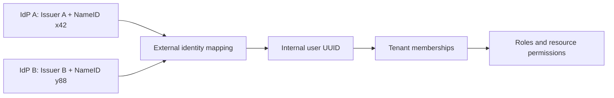
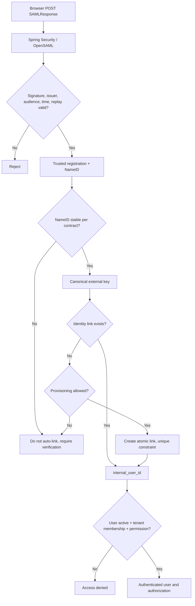

# Choosing an Identity Key from Issuer and a Stable NameID

**Module:** Spring Security – federation. **Knowledge group:** Identity and authorities.

In SAML2 federation, a user can log in through multiple Identity Providers (IdPs), change email addresses, change usernames, or migrate identity systems. If a Service Provider (SP) application chooses email or uses only the `NameID` string as its account key, the risk of creating duplicate accounts, losing historical data, or mixing permissions across organizations is very high.

The solution is to clearly separate **the external identity issued by an IdP** from **the application's internal account**. The usual starting point is a composite key **(verified IdP Issuer, stable NameID)**. When multiple SPs/tenants exist, or NameID Format or qualifiers carry meaning, the key must be **scoped to the right namespace** according to the federation contract. Key resolution happens **after Spring Security has verified the SAML Assertion**, never from unverified XML or browser parameters.

This lesson uses SAML 2.0 Web Browser SSO, Spring Security Servlet, and Java 17+. The Spring Security code illustrates 7.x APIs; 6.x branches have some differences. Content covers key-selection principles, processing flow, SQL schema, standalone Java examples, Spring examples, and an anti-account-takeover checklist.

## 1. Three concepts that must not be merged into one

| Concept | Role | Example |
| --- | --- | --- |
| **External subject** | Identity issued by a trusted IdP within a federation scope | `Issuer A + persistent NameID x42` |
| **Internal user** | User managed by the business system via an immutable ID | `user_id = 7c0e...` |
| **Authorization** | Permissions of the internal user over tenants, actions, and resources | Allowed to view tenant A orders, not allowed to approve payments |

SAML confirms that a subject was authenticated by the IdP according to the protocol; the application must look up that subject to an `internal_user_id` and then evaluate active account status, memberships, and permissions. Receiving a SAML Response with a valid signature **does not automatically grant permissions**.



Two external identities may link to the same internal user **only through a trusted account-linking process**. Never infer that they belong to the same person from matching email addresses.

## 2. Issuer: who has authority to issue the identity?

`Issuer` in a SAML Assertion is typically a URI identifying the issuing IdP, for example:

```xml
<saml:Issuer
  xmlns:saml="urn:oasis:names:tc:SAML:2.0:assertion">
  https://idp.partner-a.example/metadata
</saml:Issuer>
```

The Issuer establishes the namespace for the NameID. Two independent IdPs can easily issue the exact same string `abc123` referring to two different people. If the application uses `NameID` alone as a global key, A's subject can accidentally merge with B's subject.

**The Issuer used for mapping must be verified.** The SP must:
1. Identify the exact `RelyingPartyRegistration` permitted to handle the transaction.
2. Verify the SAML Response/Assertion: signature, issuer, destination, audience, recipient, validity window, subject confirmation, and replay per policy.
3. Obtain the **trusted IdP entity ID** bound to the verified registration; do not read issuer directly from unverified HTTP/XML payloads outside the security library.
4. Never use the IdP login page hostname, email domain, or `registrationId` as an unconditional substitute for issuer/entity ID.

Spring Security's `registrationId` (for example `partner-a`) is a **local configuration label**. It can change during application refactoring while the IdP keeps the same entity ID. `RelyingPartyRegistration.getAssertingPartyMetadata().getEntityId()` gives the IdP entity ID from trusted metadata. If the actual issuer changes, a verified migration process is required—never treat two similar-looking URIs as the same authority.

**Distinguish the IdP's Issuer from the SP entity ID:** the issuer issues the identity; the SP entity ID identifies the assertion recipient and is sometimes a scoping component of a pairwise NameID. Do not swap these roles in the database.

## 3. NameID: an identifier string with Format and scope

A `NameID` inside `Subject` may contain:

```xml
<saml:Subject
  xmlns:saml="urn:oasis:names:tc:SAML:2.0:assertion">
  <saml:NameID
      Format="urn:oasis:names:tc:SAML:2.0:nameid-format:persistent"
      NameQualifier="https://idp.partner-a.example/metadata"
      SPNameQualifier="https://portal.example.com/saml/sp">
      opaque-x42
  </saml:NameID>
</saml:Subject>
```

This is only an **illustrative XML fragment**, not an Assertion sufficient for authentication.

- **Value:** the text content `opaque-x42`.
- **Format:** the declared identifier type, which may be persistent, transient, emailAddress, or unspecified.
- **NameQualifier:** additional namespace/authority for the name; can matter across brokers/federation proxies.
- **SPNameQualifier:** namespace of the SP or set of SPs to which the identifier is scoped.
- **SPProvidedID:** optional attribute, not present by default, which can participate in SAML linking models.

### 3.1. Which Formats are suitable as a long-term key?

| NameID Format or IdP source | Characteristics | Recommendation |
| --- | --- | --- |
| `urn:oasis:names:tc:SAML:2.0:nameid-format:persistent` | Opaque, designed to persist across sessions; typically per IdP–SP pair | **Preferred**, after verifying stability and non-reassignment guarantees |
| `urn:oasis:names:tc:SAML:2.0:nameid-format:transient` | Temporary; may change on every SSO | **Do not** use as a long-term account key |
| `urn:oasis:names:tc:SAML:1.1:nameid-format:emailAddress` | Email can change, be reassigned, or have aliases | Do not use as key by default |
| `urn:oasis:names:tc:SAML:1.1:nameid-format:unspecified` | No standard semantic guarantee | Use only with a documented source-attribute and lifecycle contract |
| UPN/username/`sAMAccountName` | Can change, be reused, or collide across namespaces | Do not use as key by default |
| Immutable directory object ID | Can be stable within a single directory/tenant | Use only when the IdP guarantees uniqueness, immutability, non-reuse, and scope |
| HR/employee number | May not be unique across partners, may change upon rehiring | Do not trust blindly without a lifecycle contract |

The format name `persistent` **is not enough to prove** that the IdP is issuing a truly persistent identifier. An IdP configuration might source it from UPN/email while labeling it persistent. Test what happens when changing email, username, MFA, password, app registration, and SP entity ID.

### 3.2. Pairwise NameID and privacy

SAML Core describes a persistent identifier as an opaque value, often **specific to an IdP–SP pair or affiliation**, to limit cross-SP activity correlation. Consequently:
- One person can receive **different NameIDs** at two SPs even when using the same IdP.
- SP A has no right to infer that SP B's pairwise ID corresponds to the same person.
- Do not expose raw persistent NameIDs in analytics, logs, or uncontrolled URLs.
- When changing SP entity ID, cloning an enterprise application, or re-establishing federation, pairwise IDs may change—test and migrate with verification.

`NameQualifier` and `SPNameQualifier` can add identity boundaries. With a fixed IdP and a single SP, these two attributes may be constant or absent; when designing multi-IdP/multi-SP or broker architectures, ask the IdP precisely how they are generated and updated.

## 4. Building a properly scoped identity key

### 4.1. Basic combination

With one SP and a stable NameID policy:

```text
external_identity = (trusted_idp_issuer, stable_name_id_value)
```

Example:

| Issuer | NameID | Result |
| --- | --- | --- |
| `https://idp.a.example` | `42XYZ` | External identity A |
| `https://idp.b.example` | `42XYZ` | External identity B, **distinct from A** |
| `https://idp.a.example` | `99XYZ` | External identity C, **distinct from A** |

The same NameID text **does not** mean the same subject if the issuer differs. The same issuer is also insufficient if the NameID differs.

### 4.2. Multi-tenant or multi-SP systems

In complex systems, adopt a structure like:

```text
VerifiedExternalSubject {
  trusted_issuer_entity_id
  relying_party_scope
  stable_name_id_value
  agreed_name_id_format
  canonical_name_qualifier (if part of the actual namespace)
  canonical_sp_name_qualifier (if part of the actual namespace)
}
```

Not every project needs all six fields in a unique constraint. **Only the components that actually determine uniqueness per the contract** belong in the key:
- A single SP, one issuer, and persistent NameID → two fields may suffice.
- Two SPs receiving pairwise NameIDs → SP scope is needed to avoid merging coincidental collisions.
- A federation proxy using meaningful qualifiers → store and evaluate qualifiers.
- Multiple tenants sharing one IdP → tenant mapping/membership policy is required; tenant may be an identity scope or authorization scope depending on architecture.
- IdP changes issuer URI → an approved canonical alias is needed; never normalize silently.

**What not to do:** apply `nameId.toLowerCase()`, `trim()`, URL-decoding, Unicode normalization, or inconsistent hashing. Opaque NameIDs can be case- and character-sensitive. Only normalize according to rules published by the IdP. Nor should two Issuer URIs differing only by a trailing `/` be treated as equivalent without a contract.

### 4.3. Do not concatenate strings naively

`issuer + "|" + nameId` can be ambiguous if a component is allowed to contain `|`. Prefer:
- **Composite columns + unique index** in the DB.
- **Java record** with typed fields.
- If a single string key is unavoidable: length-prefixed serialization or unambiguous encoding, followed by HMAC if data protection policy requires it.

Hashing only changes the representation; it **cannot fix a wrong issuer/NameID choice**. When using HMAC, manage key versions and rotation; otherwise, rotating the secret can break every identity lookup.

## 5. Mapping flow from SAML Response to internal user



**Security boundary:** before step C, all SAML XML from the browser is untrusted data. Never look up accounts or auto-create users based on email/NameID from a raw POST. After step C, the NameID can be trusted **within the IdP issuer's scope**, yet access rights still depend on application policy.

Trusting an IdP for login does not automatically grant the IdP authority to assign the `ADMIN` role at the SP. Role mapping must follow an allowlist, tenant scope, and internal permission data. Only consume claims/attributes from sources with explicit authority.

## 6. Database design for identity linking

PostgreSQL sample:

```sql
CREATE TABLE users (
    user_id UUID PRIMARY KEY,
    status VARCHAR(20) NOT NULL
        CHECK (status IN ('ACTIVE', 'DISABLED')),
    display_name TEXT,
    contact_email TEXT,
    created_at TIMESTAMPTZ NOT NULL DEFAULT now()
);

CREATE TABLE external_identities (
    identity_id UUID PRIMARY KEY,
    user_id UUID NOT NULL REFERENCES users(user_id),
    issuer_namespace TEXT NOT NULL,
    sp_scope TEXT NOT NULL,
    nameid_format TEXT NOT NULL,
    subject_value TEXT NOT NULL,
    created_at TIMESTAMPTZ NOT NULL DEFAULT now(),
    last_seen_at TIMESTAMPTZ,
    UNIQUE (issuer_namespace, sp_scope, nameid_format, subject_value)
);

CREATE INDEX idx_external_identities_user
    ON external_identities(user_id);
```

This is a **reference schema**. It assumes `issuer_namespace` already incorporates NameQualifier when the contract requires distinguishing it, and `sp_scope` incorporates SPNameQualifier as needed. If separate qualifiers are required, add columns and adjust the unique index. In PostgreSQL, multiple `NULL` values can bypass a unique constraint; prefer `NOT NULL` canonical values or a unique index with explicit NULL semantics.

Do not use `contact_email` as a business foreign key. Orders, audit events, and access rights should reference `users.user_id`—an immutable surrogate key. When an IdP or NameID changes through a governed process, **the external link can change** while business history remains attached to the same internal user.

### 6.1. JIT provisioning and race conditions

When two browsers log in for the first time concurrently, both may see that the external key does not yet exist. Never run `SELECT` followed by `INSERT` without a constraint. Instead:

1. Verify the assertion and construct the canonical key.
2. Look up the mapping inside a transaction.
3. If missing, create the user/link only if JIT policy for that **issuer and tenant** allows it.
4. Rely on a unique constraint to guard against races; on conflict, roll back the partial user/link and re-read the existing record.
5. Never auto-assign roles or memberships beyond policy; if JIT is disallowed, deny or require invitation/onboarding.

If the NameID changed while the email stayed the same, **do not auto-merge** into the old user. It could be a new person to whom the email was reassigned. Require verification via IdP/admin, SCIM, or an authenticated account-linking flow with proof.

## 7. Spring Security 7: reading verified NameID

Spring Security 7.x uses `Saml2AssertionAuthentication` and `Saml2ResponseAssertionAccessor`. The earlier `Saml2AuthenticatedPrincipal` interface is **deprecated**; the migration guide recommends `Saml2AssertionAuthentication.getRelyingPartyRegistrationId()` and the assertion accessor.

After successful SAML authentication:
- `Saml2AssertionAuthentication.getRelyingPartyRegistrationId()`: the selected registration ID.
- `getCredentials().getNameId()`: the NameID **text** from the processed assertion.
- `RelyingPartyRegistrationRepository.findByRegistrationId(...)`: looks up the configured registration.
- `registration.getAssertingPartyMetadata().getEntityId()`: the **trusted IdP entity ID**.
- `registration.getEntityId()`: the SP entity ID, useful as the relying-party scope.

**Important API limitation:** `Saml2ResponseAssertionAccessor.getNameId()` returns only the NameID value; it **does not expose Format/NameQualifier/SPNameQualifier through this accessor**. If you need those attributes to determine uniqueness, build an extractor at the **verified assertion processing step** using OpenSAML/converter APIs matching your version. Never parse raw browser `SAMLResponse` in a controller and treat extracted attributes as trusted.

### 7.1. Spring Boot 4.1 + Security 7 example

Use Spring Boot dependencies with a compatible BOM:

```xml
<dependencies>
    <dependency>
        <groupId>org.springframework.boot</groupId>
        <artifactId>spring-boot-starter-webmvc</artifactId>
    </dependency>
    <dependency>
        <groupId>org.springframework.boot</groupId>
        <artifactId>spring-boot-starter-security</artifactId>
    </dependency>
    <dependency>
        <groupId>org.springframework.boot</groupId>
        <artifactId>spring-boot-starter-security-saml2</artifactId>
    </dependency>
</dependencies>
```

This is a **snippet inside a Maven project** with a Spring Boot parent/plugin, the Shibboleth Releases repository when OpenSAML requires it, and real IdP metadata. Do not compile Spring classes individually with `javac`.

`src/main/java/com/example/identity/ExternalSubject.java`:

```java
package com.example.identity;

import java.util.Objects;

public record ExternalSubject(String issuer, String spScope, String nameId) {
    public ExternalSubject {
        Objects.requireNonNull(issuer);
        Objects.requireNonNull(spScope);
        Objects.requireNonNull(nameId);
        if (issuer.isBlank() || spScope.isBlank() || nameId.isBlank()) {
            throw new IllegalArgumentException("Identity key is incomplete");
        }
    }
}
```

`src/main/java/com/example/identity/SamlSubjectResolver.java`:

```java
package com.example.identity;

import org.springframework.security.access.AccessDeniedException;
import org.springframework.security.core.Authentication;
import org.springframework.security.saml2.provider.service.authentication
        .Saml2AssertionAuthentication;
import org.springframework.security.saml2.provider.service.registration
        .RelyingPartyRegistration;
import org.springframework.security.saml2.provider.service.registration
        .RelyingPartyRegistrationRepository;
import org.springframework.stereotype.Component;

@Component
public class SamlSubjectResolver {
    private final RelyingPartyRegistrationRepository registrations;

    public SamlSubjectResolver(
            RelyingPartyRegistrationRepository registrations) {
        this.registrations = registrations;
    }

    public ExternalSubject resolve(Authentication auth) {
        if (!(auth instanceof Saml2AssertionAuthentication saml)
                || !saml.isAuthenticated()) {
            throw new AccessDeniedException("Verified SAML login required");
        }
        RelyingPartyRegistration registration = registrations
                .findByRegistrationId(
                        saml.getRelyingPartyRegistrationId());
        if (registration == null || saml.getCredentials() == null) {
            throw new AccessDeniedException("Missing SAML identity context");
        }
        String nameId = saml.getCredentials().getNameId();
        if (nameId == null || nameId.isBlank()) {
            throw new AccessDeniedException("Missing NameID");
        }
        String issuer = registration.getAssertingPartyMetadata()
                .getEntityId();
        String spScope = registration.getEntityId();
        return new ExternalSubject(issuer, spScope, nameId);
    }
}
```

**Exact role of this sample:** it only extracts the issuer–SP scope–NameID tuple **after authentication**. It does not mean every NameID is accepted as persistent. Before looking up or creating an account link, the application must maintain an **allowlist of IdP registrations with a stable NameID contract**, map qualifiers/formats per policy, and block non-compliant registrations. If the assertion uses the transient format, do not use this result as a durable key.

If SecurityContext has already erased credentials or the application uses custom authentication, the accessor may no longer be present at some read points. Perform identity mapping at the **verified authentication success / response converter step**, and store only the minimal **internal user ID**/custom principal for business requests; avoid keeping the full raw SAML response/Assertion in the session longer than necessary.

### 7.2. Servlet login configuration

`src/main/java/com/example/identity/SecurityConfig.java`:

```java
package com.example.identity;

import org.springframework.context.annotation.Bean;
import org.springframework.context.annotation.Configuration;
import org.springframework.security.config.Customizer;
import org.springframework.security.config.annotation.web.builders.HttpSecurity;
import org.springframework.security.web.SecurityFilterChain;

@Configuration
public class SecurityConfig {
    @Bean
    SecurityFilterChain securityFilterChain(HttpSecurity http)
            throws Exception {
        http.authorizeHttpRequests(auth -> auth
                .requestMatchers("/", "/error").permitAll()
                .anyRequest().authenticated())
            .saml2Login(Customizer.withDefaults());
        return http.build();
    }
}
```

`src/main/resources/application.yml`:

```yaml
spring:
  security:
    saml2:
      relyingparty:
        registration:
          partner-a:
            assertingparty:
              metadata-uri: https://idp.partner-a.example/metadata
```

This URL is illustrative only; replace it with real IdP metadata, certificates, and ACS/SP entity ID. `saml2Login` enables authentication; it does not provide a mapping table or tenant authorization on its own. Having `GET /private` succeed through SAML login is not enough to prove the NameID is safe for long-term use.

### 7.3. If the project is on Spring Security 6

In Spring Security 6.x, much code uses `Saml2AuthenticatedPrincipal` and `principal.getName()` to obtain NameID. Security 7 moves to `Saml2AssertionAuthentication` and `Saml2ResponseAssertionAccessor`. When doing a major upgrade, consult the JavaDoc and the [SAML migration reference](https://docs.spring.io/spring-security/reference/migration/servlet/saml2.html); do not force mismatched test/framework module versions. Upgrading APIs does not change the business rule: **the NameID value must still sit within a trusted, stable issuer/scope**.

## 8. Standalone Java 17: same NameID, different Issuer

The example below only illustrates the key tuple structure using a Java `record` and `HashMap`; **it does not process XML, signatures, SAMLResponse, or a database**. It assumes issuer/nameID strings were already validated by a SAML validation layer and that the IdP guarantees stability.

File `IdentityKeyDemo.java`:

```java
import java.util.HashMap;
import java.util.Map;

public class IdentityKeyDemo {
    record Key(String issuer, String spScope, String nameId) {
        Key {
            if (issuer == null || spScope == null || nameId == null
                    || issuer.isBlank() || spScope.isBlank()
                    || nameId.isBlank()) {
                throw new IllegalArgumentException("Incomplete identity");
            }
        }
    }

    public static void main(String[] args) {
        String portal = "https://portal.example.com/sp";
        Key a = new Key("https://idp-a.example", portal, "n42");
        Key aAgain = new Key("https://idp-a.example", portal, "n42");
        Key b = new Key("https://idp-b.example", portal, "n42");
        Key otherSp = new Key("https://idp-a.example",
                "https://billing.example/sp", "n42");

        Map<Key, String> links = new HashMap<>();
        links.put(a, "user-100");

        System.out.println("Same issuer and NameID: "
                + a.equals(aAgain));
        System.out.println("Different issuer: " + a.equals(b));
        System.out.println("Different SP scope: "
                + a.equals(otherSp));
        System.out.println("Known login: " + links.get(aAgain));
        System.out.println("Other IdP: "
                + links.getOrDefault(b, "unlinked"));
    }
}
```

Run with JDK 17+:

```bash
javac IdentityKeyDemo.java
java IdentityKeyDemo
```

**Exact** stdout:

```text
Same issuer and NameID: true
Different issuer: false
Different SP scope: false
Known login: user-100
Other IdP: unlinked
```

Using a `record` ensures equality compares each component instead of concatenating strings with `|` or delimiters prone to collision. In production, only store from **verified** data, using DB unique constraints, tenant mapping, and transactions for linking.

## 9. Four lifecycle scenarios to handle

### 9.1. User changes email

```text
Before: Issuer=A, NameID=opaque-42, email=alice@old.example
After : Issuer=A, NameID=opaque-42, email=alice@new.example
```

Because NameID did not change, the external identity link still points to the same internal user. Email is a profile attribute that can be updated; do not create a new user and do not automatically alter permissions.

### 9.2. Email stays the same, but NameID changes

```text
Before: Issuer=A, NameID=opaque-42, email=alice@example.com
After : Issuer=A, NameID=opaque-99, email=alice@example.com
```

**Do not auto-map** `opaque-99` to the old internal user by email. Possible causes include an application registration change, IdP changing its source attribute, SP entity ID change, pairwise ID reset, or email reassignment to someone else. Require a migration ticket, IdP evidence, and approval before adding a new external link.

### 9.3. IdP changes Issuer/entity ID

`https://idp.old.example/entity` and `https://idp.new.example/entity` are **two different namespaces in SAML**, even under the same organization. If this is a formal migration, establish a time-bounded verified alias/mapping, reconcile each subject/tenant, record an audit trail, and prepare a rollback plan. Never migrate all users by editing URIs in the DB solely because two URLs look similar.

### 9.4. Switching from IdP A to IdP B

This is a change of identity issuer; you cannot assume `Issuer A + n42` = `Issuer B + n42`. To preserve the internal user:
- Use a mapping verified by IdP/HR/SCIM or an administrator.
- Or have the user prove ownership of **both** accounts through a protected account-linking flow.
- Create the new external link B pointing to the same internal user without uncritically re-granting old roles.
- Log audit records, maintain rollback capability, and handle disabled/deprovisioned accounts.

**Especially with pairwise IDs:** cloning an enterprise application or changing SP entity ID can change NameIDs. Test these operations in an IdP sandbox before upgrading.

## 10. Multi-tenant, brokers, and qualifiers

A broker C may sit between IdPs A/B and the SP. If broker C issues the assertion to the SP, the Issuer may be **C**; attributes describing the upstream IdP are only trustworthy per the broker's contract and validation. Do not use an unapproved `originalIssuer` attribute to switch into namespace A/B.

If `NameQualifier` and `SPNameQualifier` are meaningful under the SAML profile, include them **in the canonical namespace or key**. If the `getNameId()` API does not expose qualifiers, do not silently assume they do not exist in the system. You can:
1. Establish a fixed registration contract: constant or absent qualifiers, NameID scoped by Issuer + SP.
2. Or build a converter reading the exact NameID XMLObject **after signature/Assertion validation** and map it into an internal structure, backed by integration tests.
3. If uniqueness cannot be guaranteed, reject JIT linking and require the IdP to emit another stable subject attribute.

Tenant boundaries are a separate concern: one IdP can serve multiple tenants, or one tenant can use multiple IdPs. Restrict which IdP registrations are allowed per tenant and check membership on reads/writes; never infer tenant from an email suffix.

## 11. Preventing account takeover and operational incidents

| Mistake | Why is it dangerous? | Solution |
| --- | --- | --- |
| Using email as user key | Email change/reassignment causes takeover or data loss | Stable issuer+NameID, email as profile attribute |
| Using NameID alone | Two IdPs emit the same string → collision | Composite key with verified issuer |
| Using transient NameID | Creates a new account on every SSO | Require stable contract, reject transient for durable mapping |
| Concatenating issuer+NameID with arbitrary separator | Tuple collision if separator appears in component | Composite columns or typed tuple |
| Lowercasing/trimming opaque NameID | Can merge two distinct identifiers | Exact comparison, normalize only per contract |
| Parsing raw SAMLResponse in controller | Can read forged data from the browser | Only after Spring Security/OpenSAML validation |
| Auto-linking two IdPs on matching email | Attacker owns similar/reassigned email | Approval/proof, explicit external link |
| Granting admin to all IdP users | Authentication confused with authorization | Deny-by-default, role mapping per IdP/tenant |
| Non-transactional JIT provisioning | Duplicate users/links on concurrent first login | Unique constraint + transaction/conflict handling |
| IdP changes NameID source unannounced | Users split or mis-mapped | Contract monitoring, migration/rollback |
| Logging raw NameID or assertion | Leaks pairwise identifiers and PII | Hash/mask when needed, retention and ACLs |
| Skipping signed assertion/replay checks | Attacker forges or replays wrong subject | Verify signature, issuer, audience, time, InResponseTo, replay |

**Rule:** use the account key to **identify** the user; use session/authentication to **verify** SSO; use the policy engine/DB to **authorize**. None of these three components can replace the other two.

## 12. Pre-production testing checklist

| Test case | Expected result |
| --- | --- |
| Same Issuer + persistent NameID logs in multiple times | Same internal user |
| Same NameID but different Issuer | Different external identity; do not auto-link |
| Same NameID/Issuer but different SP scope | Do not merge outside contract |
| Email changes, NameID stays stable | Preserves internal user and history |
| Email reassigned, NameID differs | No access to previous user |
| Transient format | Do not use as stable key |
| Unspecified format without guarantee | Do not auto-JIT/link |
| Meaningful NameQualifier/SPNameQualifier changes | Do not merge; use verified migration |
| Unapproved Issuer change | Do not auto-match old user |
| DISABLED user login | Authentication may succeed, authorization denied |
| User authorized for tenant A accesses tenant B | Deny by membership/resource |
| Two concurrent JIT logins | Single external link, no duplicate users |
| IdP signing cert rotation | Same issuer/NameID keeps internal user unchanged |
| SP entity ID/enterprise app changes | Test pairwise NameID, prepare migration plan |
| SAML Response with bad signature/issuer/audience | Reject, do not lookup/create user |
| Replayed assertion | Reject; do not reuse to establish a session |
| Logout/re-login, SessionIndex changes | Does not change internal user because session ID is not identity |
| Privacy audit | Do not log raw persistent NameID/Assertion unnecessarily |
| IdP A–B account linking | Proof/admin approval, audit trail, and revocability |

You can build **test fixtures** with the same NameID across two issuers, the same email across two NameIDs, transient IDs, and changed issuers; however, end-to-end security testing requires an IdP sandbox and signed assertions, not just unit tests on a string comparison function.

## 13. Quick FAQ

**Q1. Why is Issuer needed if NameID is persistent?** Because NameID only has semantics within an IdP's namespace and may be pairwise per SP. Two IdPs can issue the same value to two different people.

**Q2. Is `NameID Format=persistent` enough?** No; confirm the IdP actually draws from a stable source, does not reassign it, does not change it on email/UPN/registration changes, and defines clear scope.

**Q3. Should NameQualifier be included in the key?** Yes, if it serves as an identity boundary under the contract; if constant or absent in a well-defined federation, a corresponding canonical namespace can be used. Never drop meaningful qualifiers arbitrarily.

**Q4. When a user changes email, what changes?** The profile email; the external subject key does not change when persistent NameID honors its contract.

**Q5. Is an IdP having authenticated a user enough to grant access?** No; you must also resolve the internal user, check active status, tenant membership, roles, and resource permissions.

## 14. References

1. [OASIS – SAML 2.0 Core](https://docs.oasis-open.org/security/saml/v2.0/saml-core-2.0-os.pdf): `NameIDType`, persistent/transient, privacy, issuer, and qualifiers.
2. [OASIS – SAML 2.0 Technical Overview](https://docs.oasis-open.org/security/saml/Post2.0/sstc-saml-tech-overview-2.0.html): Subject, NameID, assertions, and federation roles.
3. [Spring Security – SAML2 Login Overview](https://docs.spring.io/spring-security/reference/servlet/saml2/login/overview.html): verification flow, RP/AP, registration, and principal.
4. [Spring Security – SAML2 Migration](https://docs.spring.io/spring-security/reference/migration/servlet/saml2.html): migrating from Saml2AuthenticatedPrincipal to Security 7 APIs.
5. [JavaDoc – Saml2AssertionAuthentication](https://docs.spring.io/spring-security/reference/api/java/org/springframework/security/saml2/provider/service/authentication/Saml2AssertionAuthentication.html) and [Saml2ResponseAssertionAccessor](https://docs.spring.io/spring-security/reference/api/java/org/springframework/security/saml2/provider/service/authentication/Saml2ResponseAssertionAccessor.html).
6. [JavaDoc – RelyingPartyRegistration](https://docs.spring.io/spring-security/reference/api/java/org/springframework/security/saml2/provider/service/registration/RelyingPartyRegistration.html).
7. [Microsoft Entra – SAML Claims Customization](https://learn.microsoft.com/en-us/entra/identity-platform/saml-claims-customization): NameID sources, pairwise IDs, and formats.
8. [OWASP – SAML Security Cheat Sheet](https://cheatsheetseries.owasp.org/cheatsheets/SAML_Security_Cheat_Sheet): trust, replay, issuer, signature, and audience.

**Conclusion:** obtain the **Issuer from a verified IdP**, use a **genuinely stable NameID**, and add **SP/qualifier/tenant scope** when the contract requires it. Map the external key to an **immutable internal user ID** via transactions and unique constraints; do not merge accounts by email, do not use transient NameIDs as durable keys, and never let identity resolution replace authorization.