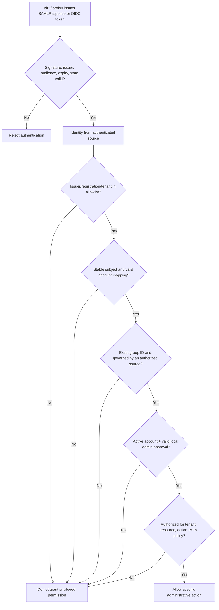

# Never Auto-Grant Admin Privileges from Unapproved Group Names or Attributes

## Learning objectives

After this lesson, you will be able to:

1. Distinguish **identity authentication**, **IdP-asserted claims/attributes**, **identity-system groups**, **application permissions (authorities/permissions)**, and **privileged entitlement approvals**.
2. Explain why a **validly signed SAML Assertion or OIDC token** does not mean any group/attribute inside it is allowed to turn into `ROLE_ADMIN`.
3. Design permission mapping around **deny by default**, **least privilege**, and an **explicit allowlist**, constrained by `issuer`/`registrationId`, tenant, stable subject, group governance source, and locally approved grants.
4. Spot common privilege-granting vulnerabilities: `contains("admin")`, blindly prepending `ROLE_` to claims, matching accounts by email, trusting user-editable attributes, conflating partner groups with internal groups, or trusting stale groups.
5. Write a **standalone Java 17+ demo** verifying allow/deny decisions and configure **Spring Boot 3/Spring Security 6** to enforce tenant-scoped admin permissions at the business layer.
6. Test positive/negative cases, manage permission lifecycles, and respond safely when IdP/broker/group mappings change.

## 1. Context: SSO authenticates identity; it does not auto-grant full privileges

In a **federated identity** system, a Spring Security application can log users in via **SAML2** or **OpenID Connect (OIDC)** through an Identity Provider (IdP) or an identity broker.

For example, employee `u-42` logs into a reporting management app. The IdP issues a valid SAML Assertion:

- `NameID`/subject: `u-42`;
- an attribute named `groups` with value `Administrators`;
- email: `user@company.example`.

If the SP has **verified the signature, issuer, audience, validity window, recipient, and SAML conditions**, the app can trust that the IdP **asserted** these values. However, that **does not prove** the `Administrators` group means "administer all data in this application", nor does it prove the IdP restricts who can add members to that group.

**Core rule: a source-authenticated claim does not automatically become an approved application permission.**

| Concept | Question it answers | Example | Auto-grants admin? |
| --- | --- | --- | --- |
| **Authentication** | Through which source did this person log in? | Valid SAMLResponse from corporate IdP | **No** |
| **Identity subject** | Whose stable identifier within which issuer domain? | `(IdP company, u-42)` | **No** |
| **Group membership** | Which groups does the IdP assert the subject belongs to? | `groups=["Administrators"]` | **No** |
| **Role mapping** | Per application policy, which groups map to which permissions? | `urn:company:portal:reviewers → REPORT_VIEW` | Only allowed permissions |
| **Local privileged entitlement** | Has an authorized party approved admin rights for this subject/tenant/function? | Active entitlement record in IAM/app DB | Can be **a necessary condition** |
| **Authorization decision** | May this request execute on the specific resource? | `MANAGE_USERS` in `tenant-a` | Granted only when **all conditions** pass |

SAML and OIDC provide identity authentication; the application must define and enforce its own **authorization model**. Never use `hasRole("ADMIN")` as a shortcut if any claim containing `admin` can produce `ROLE_ADMIN`.

## 2. The hazard: turning group names into admin privileges

### 2.1. Dangerous mapping patterns

**Wrong** example:

```java
// WRONG: any group string containing "admin" automatically becomes ROLE_ADMIN.
if (groupName.toLowerCase().contains("admin")) {
    authorities.add(new SimpleGrantedAuthority("ROLE_ADMIN"));
}
```

Why is this wrong?

1. A group `backup-admin-docs` might simply be editors of **administration documentation**, not application administrators.
2. Another IdP might have an `Administrators` group scoped only to administering a **different tenant or resource**.
3. Attributes `department=Admin`, `title=System Administrator`, or `email=admin@...` are profile data; **not authorization grants**.
4. Users may be able to edit display names, profile fields, or join self-service groups; such values must never become high privileges.
5. Operations like `toUpperCase()`, `trim()`, prepending `ROLE_`, or "fuzzy" regexes can produce unintended, unapproved matches.

Another wrong example:

```java
// WRONG: every role value from the assertion is granted directly.
for (String claimRole : assertedRoles) {
    authorities.add(new SimpleGrantedAuthority("ROLE_" + claimRole));
}
```

If `assertedRoles` contains `ADMIN` from an IdP or attribute not authorized to control app permissions, this turns a claim into `ROLE_ADMIN` with zero **policy**, **issuer scope**, or **approval**.

### 2.2. Identifying the attack surface

| Input data | Risk scenario | Conclusion |
| --- | --- | --- |
| `displayName=Admin Team` | Display name edited by user/HR | Never use as a role |
| `email=admin@company.example` | Email can change/be reassigned or lack policy verification | Never use email to identify admins |
| `jobTitle=Administrator` | HR job title is not an app privilege | Never use job title as a permission |
| `groups=["Admins"]` | Same-named group across IdPs/tenants, unclear owner | Never grant admin by display name |
| `groups=["urn:company:app:admins"]` | Exact group ID, yet can anyone self-join? Does policy allow this IdP to grant it? | Only **one condition** after verifying governance |
| `isAdmin=true` | Attribute may come from an arbitrary source or user control | Never trust blindly; require explicit trust/policy |
| `roles=["ROLE_ADMIN"]` | Role string mimicking Spring Security format | Never add directly to `GrantedAuthority` |
| `scope=admin` | Scope/permission issued for a different audience | Never apply automatically to current resources |
| Authenticated via partner IdP | Partner IdP calls the user "admin" in the partner's system | Never infer admin rights in your company |

**A SAML signature proves the IdP sent the claim; it does not prove that group's membership governance is trustworthy for a specific function.** Two separate layers are needed: **technical trust** in the assertion and **policy trust** in the attribute's meaning/authority.

## 3. Trust layers from IdP to authorization decision

A secure design can be pictured along this path:



This sequence is a **decision model**, not a requirement to implement SAML cryptography yourself. Spring Security/OpenSAML must validate protocol messages **before** application code inspects the principal. The application evaluates groups/entitlements only from framework-authenticated identities.

### 3.1. Minimum mandatory conditions

For an action like "modify user roles in tenant A", the application should require **all** of these simultaneously:

1. **Valid authentication:** SP verified the SAML Response, or OIDC RP/API verified the token/issuer/audience for its role. Never build authorization from HTTP request params, custom cookies, or unverified JWTs.
2. **Right IdP/registration:** admin rights may come only from the allowlist of IdPs/brokers authorized to assert for that tenant.
3. **Right subject:** use a durable namespaced key such as `(issuer, subject)` or an established `(registrationId, persistent NameID)`. Avoid matching users by email/display name.
4. **Approved group:** if policy uses a group claim, it must be an **exact allowlisted ID** for the application, issued from a source with proper membership governance. Group membership can be an additional condition, **never the sole condition**.
5. **Valid local entitlement:** an active admin grant bound to the right account/tenant, approved through a controlled workflow, neither revoked, locked, nor expired.
6. **Right action/resource:** user-management admin rights do not imply editing billing, exporting org-wide records, or administering another tenant.
7. **Appropriate authentication assurance:** sensitive actions may require recent MFA/step-up per policy. Never infer MFA from a group name.
8. **Enforced at enforcement points:** every sensitive endpoint/service method must enforce permissions; never rely on hiding admin buttons in the frontend.

**Deny by default:** whenever source, subject, policy, expiration, or entitlement state is unclear, **deny**, never falling back to "admin to avoid UX errors".

### 3.2. "Exact group ID" differs from "group display name"

For instance, accepting only a group ID managed by the IAM team:

```text
issuer        = https://idp.company.example/saml
registration = company
tenant        = tenant-a
attribute     = urn:company:identity:groups
group_id      = urn:company:app:portal:administrators
```

This is an example namespace, not a universal value mandated by SAML. The application defines the **exact namespace and value** expected per its agreement with the IdP. If another IdP uses the same `group_id` string, never assume identical semantics; check **issuer/registration** and group governance.

**Never use fuzzy matching:** `contains("admin")`, `startsWith("ROLE_")`, `equalsIgnoreCase("administrator")`, or turning group names into permissions via "string normalization" cannot substitute for an approved allowlist.

## 4. Attribute provenance matters as much as the signature

An attribute might be:

- Directory data controlled by an IAM team with an approval workflow.
- Data synced from HRIS; useful for identifying departments, not necessarily for granting admin access.
- User-editable attributes (profile, title, nickname).
- Claims transformed/aggregated by an identity broker from multiple IdPs.
- Group memberships from an external directory whose semantics differ from internal authorization.

**Example:** An IdP signs an assertion containing `department=IT`. That confirms the IdP directory lists the user in IT, but does not allow concluding every IT employee may administer all customer accounts.

| Source | Use for profile display? | Use to auto-grant admin? |
| --- | --- | --- |
| `displayName`/`preferred_username` | Yes, after output escaping | **No** |
| `email`/`email_verified` | May assist contact/identity matching per policy | **No** |
| `department`/`title` | May assist organizational workflows | **No** |
| Group display name from any IdP | May hint display info when permitted | **No** |
| Stable group ID from trusted IdP with approved governance | Can serve as a condition toward a specific role | **Insufficient alone** |
| Permission approval in IAM/app system | Dedicated authorization store | Only after checking account/tenant/action and status |

A design may choose to **rely strictly on the local authorization DB**, ignoring group claims completely for admin decisions. This is often easier to govern when multiple IdPs have differing group semantics. If combining group ID and local approval, explicitly decide whether the rule is AND or OR. For high privileges, **never accidentally use OR** between a group claim and local approval when policy requires both.

## 5. Distinguishing role, authority, and permission in Spring Security

In Spring Security:

- `GrantedAuthority` is a string/privilege that has been **authenticated and mapped** by the system.
- `hasAuthority("APP_ADMIN")` requires the **exact string** `APP_ADMIN`.
- `hasRole("ADMIN")` is shorthand by default for `ROLE_ADMIN` (the prefix is configurable).
- `@PreAuthorize` or `authorizeHttpRequests` evaluates authorities/conditions contextually.
- `hasRole("ADMIN")` **does not create permissions itself**; danger arises in an unguarded **claims-to-GrantedAuthority mapping** step.

### 5.1. Application permission models should be narrow

Instead of one global `ROLE_ADMIN` across the entire app, use granular rights:

| Permission | Permitted operation | Scope |
| --- | --- | --- |
| `REPORT_READ` | View reports | Specific tenant |
| `REPORT_EXPORT` | Export reports | Specific tenant and data type |
| `USER_MANAGE` | Invite, lock, assign user roles | Specific tenant |
| `BILLING_APPROVE` | Approve invoices/payments | Tenant and monetary limit |
| `AUDIT_VIEW` | View audit logs | Scoped by function |
| `APP_ADMIN` | A well-defined set of admin actions | Not org-wide by default |

In multi-tenant authorization, checking a bare `APP_ADMIN` string in the session **lacks tenant context**. Use a dynamic policy taking `tenantId`/resource, or namespaced/scoped authorities alongside owner/tenant checks. Never allow a tenant A admin to administer tenant B by changing an ID in the URL.

### 5.2. Default authentication does not grant admin from SAML groups

Spring Security SAML2 Login may extract SAML attributes into the principal and grant a baseline authority like `ROLE_USER` depending on version/configuration. That **does not mean** the framework trusted `groups=["Administrators"]` to become `ROLE_ADMIN`.

Adding privileged authorities usually comes from the app's **custom converter/authorization mapping**. Mandatory rule: authorities must originate from a governed policy, never copying group/role strings verbatim from a SAML Assertion into `Authentication`.

## 6. Right vs. wrong when handling group claims

### 6.1. Wrong: granting admin by "admin-looking names"

```java
// DO NOT use in production.
boolean admin = assertedGroups.stream()
    .anyMatch(group -> group.toLowerCase().contains("admin"));

if (admin) {
    authorities.add(new SimpleGrantedAuthority("ROLE_ADMIN"));
}
```

Groups like `not-an-admin` or `admin-document-readers` also match this check. If users can name groups or use another IdP, this creates an escalation path.

### 6.2. Right direction: accept only allowlisted group IDs combined with local decisions

```java
// Illustrative snippet inside logic that has received a valid Authentication
// from Spring Security. Not a hand-rolled ACS verifier.
String requiredGroup = "urn:company:app:portal:administrators";
boolean groupApproved = verifiedGroupIds.stream()
    .anyMatch(requiredGroup::equals);

// Must combine IdP/tenant/subject source and local approval.
boolean canManageUsers =
    verifiedIssuerAllowed
    && tenantMatches
    && persistentSubjectMapped
    && groupApproved
    && localAdminApprovalIsActive;
```

`verifiedIssuerAllowed`, `tenantMatches`, `persistentSubjectMapped`, and `localAdminApprovalIsActive` must never come from browser input; they must be computed from **vetted registration/trust configuration and entitlement stores**. If any condition is missing or inconsistent, deny.

**Caution:** even an "exact group ID" can be abused if the IdP lets users self-join the group. Verify **who can change membership** and **whether the IdP/broker emits claims strictly from a managed directory**.

## 7. Standalone Java 17+: allowlist-based admin decision

This is a **pure Java authorization-rule exercise**, not a SAML verifier program. The `VerifiedIdentity` objects in the demo are **manually constructed as fixtures** to test policy; in production, create equivalent identities **only after** Spring Security validates the SAML Response/OIDC token. Never use this demo class to turn user-supplied HTTP/JSON payloads into principals.

**File `AdminPolicyDemo.java`:**

```java
import java.util.Set;

public final class AdminPolicyDemo {
    private static final String TRUSTED_REGISTRATION = "company";
    private static final String TRUSTED_TENANT = "tenant-a";
    private static final String APPROVED_GROUP =
            "urn:company:app:portal:administrators";

    // "Verified" is only a fixture assumption for this exercise.
    record VerifiedIdentity(String registrationId, String subject,
                            String tenantId, Set<String> groups) {}

    record LocalApproval(String registrationId, String subject,
                         String tenantId, boolean active,
                         boolean approvedForAdmin) {}

    static boolean canManage(VerifiedIdentity identity,
                             LocalApproval local) {
        if (identity == null || local == null) {
            return false;
        }
        // Do not grant permissions from an unpermitted issuer/tenant.
        if (!TRUSTED_REGISTRATION.equals(identity.registrationId())
                || !TRUSTED_TENANT.equals(identity.tenantId())) {
            return false;
        }
        if (identity.subject() == null || identity.subject().isBlank()) {
            return false;
        }
        if (identity.groups() == null
                || !identity.groups().contains(APPROVED_GROUP)) {
            return false;
        }
        // Require internal approval within the same identity namespace.
        return local.active()
                && local.approvedForAdmin()
                && identity.registrationId().equals(local.registrationId())
                && identity.subject().equals(local.subject())
                && identity.tenantId().equals(local.tenantId());
    }

    public static void main(String[] args) {
        VerifiedIdentity approved = new VerifiedIdentity(
                "company", "u-42", "tenant-a", Set.of(APPROVED_GROUP));
        LocalApproval local = new LocalApproval(
                "company", "u-42", "tenant-a", true, true);

        VerifiedIdentity lookalike = new VerifiedIdentity(
                "company", "u-42", "tenant-a", Set.of("admin-doc-readers"));
        VerifiedIdentity otherIdP = new VerifiedIdentity(
                "partner", "u-42", "tenant-a", Set.of(APPROVED_GROUP));
        VerifiedIdentity otherTenant = new VerifiedIdentity(
                "company", "u-42", "tenant-b", Set.of(APPROVED_GROUP));
        LocalApproval revoked = new LocalApproval(
                "company", "u-42", "tenant-a", true, false);
        LocalApproval disabled = new LocalApproval(
                "company", "u-42", "tenant-a", false, true);

        System.out.println("Approved admin: "
                + canManage(approved, local));
        System.out.println("Similar group: "
                + canManage(lookalike, local));
        System.out.println("Other IdP: "
                + canManage(otherIdP, local));
        System.out.println("Other tenant: "
                + canManage(otherTenant, local));
        System.out.println("Revoked approval: "
                + canManage(approved, revoked));
        System.out.println("Disabled account: "
                + canManage(approved, disabled));
    }
}
```

Run with JDK 17 or higher:

```bash
javac AdminPolicyDemo.java
java AdminPolicyDemo
```

**Exact stdout:**

```text
Approved admin: true
Similar group: false
Other IdP: false
Other tenant: false
Revoked approval: false
Disabled account: false
```

The code clearly illustrates **conjunction (AND)**: only when registration, tenant, subject, group ID, and approval all align is access allowed. In production, add resource/action checks, ensure the subject is non-transient, and implement a real membership/entitlement store. An identity record named "Verified" **does not replace cryptographic verification**; this Java snippet alone cannot prove a user logged in.

## 8. Spring Boot 3/Spring Security 6: enforcing admin in the right place

The next example consists of **files inside a Spring Boot Servlet Java 17+ project**, not a standalone program run with `javac`. End-to-end SSO requires a real IdP, trusted X.509 certificate, properly configured registration/ACS, app session, and entitlement database. Hostnames, subjects, and group IDs below are **illustrative lab values**.

Design ideas:

- Let `saml2Login()`/OpenSAML perform all **SAML signature, issuer, audience, recipient, time, and request correlation validation**.
- **Do not grant `ROLE_ADMIN` in a success handler** merely because `groups` contains `admin`.
- Protect admin operations on **service methods**, checking exact `registrationId`, tenant, stable subject, group ID, and **local admin approval**.
- Allow admin operations only while **all conditions** remain true; never rely on showing/hiding UI buttons.

### 8.1. Gradle dependencies

For a project already using the Spring Boot 3 plugin and synchronized Spring Security BOM:

```groovy
dependencies {
    implementation 'org.springframework.boot:spring-boot-starter-web'
    implementation 'org.springframework.boot:spring-boot-starter-security'
    implementation 'org.springframework.security:spring-security-saml2-service-provider'

    testImplementation 'org.springframework.boot:spring-boot-starter-test'
    testImplementation 'org.springframework.security:spring-security-test'
}
```

Choose the OpenSAML version/repository managed by your Spring Security release. Never force an incompatible library version. The example uses **Spring Security 6.x** `Saml2AuthenticatedPrincipal`; Spring Security 7 branches change principal/accessor APIs, so consult official migration docs before upgrading.

### 8.2. SAML registration for the corporate IdP

File `src/main/resources/application.yml`:

```yaml
spring:
  security:
    saml2:
      relyingparty:
        registration:
          company:
            entity-id: "https://portal.example.org/saml2/service-provider-metadata/company"
            acs:
              location: "https://portal.example.org/login/saml2/sso/company"
            assertingparty:
              entity-id: "https://idp.company.example/saml"
              verification:
                credentials:
                  - certificate-location: "classpath:idp-company.crt"
              singlesignon:
                url: "https://idp.company.example/sso"
                sign-request: false
```

`company` is a **server-configured** registration bound to the company's IdP issuer and certificate; never let clients arbitrarily change issuers or load new metadata from browser-supplied URLs. `sign-request: false` is appropriate only when the IdP permits unsigned AuthnRequests; if signed requests are required, add SP signing credentials and update configuration.

**Business prerequisite for this demo:** after the SAML response is verified, `principal.getName()` must be a **stable, unique NameID/subject within the corporate IdP domain**. If the IdP uses transient NameID, mutable email, or recycled NameIDs, **never use that raw value as an admin grant key**; establish a stable identifier/subject mapping with IAM before permitting administration.

### 8.3. Startup class and enabling method security

File `src/main/java/com/example/federation/FederationApplication.java`:

```java
package com.example.federation;

import org.springframework.boot.SpringApplication;
import org.springframework.boot.autoconfigure.SpringBootApplication;

@SpringBootApplication
public class FederationApplication {
    public static void main(String[] args) {
        SpringApplication.run(FederationApplication.class, args);
    }
}
```

File `src/main/java/com/example/federation/SecurityConfiguration.java`:

```java
package com.example.federation;

import org.springframework.context.annotation.Bean;
import org.springframework.context.annotation.Configuration;
import org.springframework.security.config.Customizer;
import org.springframework.security.config.annotation.method.configuration.EnableMethodSecurity;
import org.springframework.security.config.annotation.web.builders.HttpSecurity;
import org.springframework.security.web.SecurityFilterChain;

@Configuration
@EnableMethodSecurity
public class SecurityConfiguration {

    @Bean
    SecurityFilterChain securityFilterChain(HttpSecurity http) throws Exception {
        return http
            .authorizeHttpRequests(auth -> auth
                .requestMatchers("/").permitAll()
                .anyRequest().authenticated()
            )
            .saml2Login(Customizer.withDefaults())
            .build();
    }
}
```

`@EnableMethodSecurity` activates `@PreAuthorize` enforcement on Spring-managed service beans. Calling `saml2Login()` without enabling method security leaves method-level annotations **inactive**. `.anyRequest().authenticated()` requires authentication without deciding admin rights; admin checks reside in the policy bean and service method.

### 8.4. Local privilege approval source in the demo

File `src/main/java/com/example/federation/LocalAdminApprovals.java`:

```java
package com.example.federation;

import java.util.Set;
import org.springframework.stereotype.Component;

@Component
public class LocalAdminApprovals {
    private record Key(String registrationId, String subject,
                       String tenantId) {}

    // DEMO ONLY: this record represents an account that is active
    // and approved for admin access through the company's workflow.
    private final Set<Key> activeApprovedGrants =
            Set.of(new Key("company", "u-42", "tenant-a"));

    public boolean isActiveAndApproved(
            String registrationId, String stableSubject, String tenantId) {
        return activeApprovedGrants.contains(
                new Key(registrationId, stableSubject, tenantId));
    }
}
```

In production, **never hard-code grants** in source code and never let users add `Key` entries themselves. Replace with a repository/service querying approved grants, account active state, tenant ownership, grant expiration, approver, and audit trail; ensure privilege revocation takes effect within SLA. This is the "second source" controlled by the application/IAM.

### 8.5. Policy bean accepting only Spring Security-verified SAML authentication

File `src/main/java/com/example/federation/AdminGate.java`:

```java
package com.example.federation;

import java.util.List;
import org.springframework.security.core.Authentication;
import org.springframework.security.saml2.provider.service.authentication.Saml2Authentication;
import org.springframework.security.saml2.provider.service.authentication.Saml2AuthenticatedPrincipal;
import org.springframework.stereotype.Component;

@Component("adminGate")
public class AdminGate {
    private static final String REGISTRATION = "company";
    private static final String TENANT = "tenant-a";
    private static final String GROUP_ATTRIBUTE =
            "urn:company:identity:groups";
    private static final String APPROVED_GROUP =
            "urn:company:app:portal:administrators";

    private final LocalAdminApprovals approvals;

    public AdminGate(LocalAdminApprovals approvals) {
        this.approvals = approvals;
    }

    public boolean canManage(Authentication auth, String tenantId) {
        // Fail closed: reject unauthenticated or wrong-type tokens.
        if (!(auth instanceof Saml2Authentication saml)
                || !saml.isAuthenticated()) {
            return false;
        }
        if (!(saml.getPrincipal()
                instanceof Saml2AuthenticatedPrincipal principal)) {
            return false;
        }

        // registrationId must map to the SP-controlled issuer/certificate
        // in RelyingPartyRegistrationRepository.
        if (!REGISTRATION.equals(
                principal.getRelyingPartyRegistrationId())) {
            return false;
        }
        if (!TENANT.equals(tenantId)) {
            return false;
        }

        // Must have an agreement for a stable/persistent NameID from the IdP.
        String stableSubject = principal.getName();
        if (stableSubject == null || stableSubject.isBlank()) {
            return false;
        }

        // Attribute name and group ID must be strictly allowlisted.
        // Values are inspected ONLY AFTER Spring Security verifies SAML.
        List<?> groups = principal.getAttribute(GROUP_ATTRIBUTE);
        boolean hasApprovedGroup = groups != null
                && groups.stream().anyMatch(
                        value -> APPROVED_GROUP.equals(value));
        if (!hasApprovedGroup) {
            return false;
        }

        // Require active + approved internal admin privilege.
        return approvals.isActiveAndApproved(
                REGISTRATION, stableSubject, tenantId);
    }
}
```

**Important explanations:**

1. `Saml2Authentication` here originates from the Spring Security authentication pipeline; **never construct it from self-declared JSON/form/header inputs**.
2. `Saml2AuthenticatedPrincipal.getRelyingPartyRegistrationId()` follows Spring Security 6.x to namespace trust; registrations must be pinned server-side with the right **IdP issuer + verification cert**.
3. `principal.getName()` is safe as an entitlement key only when the IdP guarantees a **durable NameID**. If the contract uses another user ID attribute, map the subject via a verified mechanism.
4. `getAttribute(GROUP_ATTRIBUTE)` takes a list of values because a SAML Attribute can be multi-valued. The code **matches the exact ID string** without automatically adding `ROLE_ADMIN`.
5. `LocalAdminApprovals` models the second approval source. Group present yet approval revoked → **deny**. Local admin account yet wrong IdP/subject/tenant → **deny**.
6. The group ID is an **example value permitted by the policy itself**, not a globally meaningful ID. If the IdP allows users to modify membership in that group themselves, the group source policy remains unsafe; fix governance/source before enabling.
7. In multi-tenant/multi-IdP systems, replace demo constants with a **governed mapping table**: `(registrationId, issuer, tenant, groupID, permission)`, versioned and audited. Never build the map from user-submitted data.

**Demo limitations:** the local grant `u-42`/`tenant-a` is a fixture, not proof that the person is active in a real system. For production, swap in a real repository and integrate entitlement lifecycle, risk/MFA checks, tenant isolation, and grant-workflow security checks.

### 8.6. Enforcing on a service method

File `src/main/java/com/example/federation/AdminService.java`:

```java
package com.example.federation;

import org.springframework.security.access.prepost.PreAuthorize;
import org.springframework.stereotype.Service;

@Service
public class AdminService {

    // #p0 is the first parameter, independent of compiler -parameters.
    @PreAuthorize("@adminGate.canManage(authentication, #p0)")
    public String viewAdminStatus(String tenantId) {
        return "Admin status available for " + tenantId;
    }
}
```

File `src/main/java/com/example/federation/AdminController.java`:

```java
package com.example.federation;

import org.springframework.web.bind.annotation.GetMapping;
import org.springframework.web.bind.annotation.PathVariable;
import org.springframework.web.bind.annotation.RestController;

@RestController
public class AdminController {
    private final AdminService adminService;

    public AdminController(AdminService adminService) {
        this.adminService = adminService;
    }

    @GetMapping("/tenants/{tenantId}/admin/status")
    public String status(@PathVariable String tenantId) {
        // Call through Spring bean/proxy so @PreAuthorize takes effect.
        return adminService.viewAdminStatus(tenantId);
    }
}
```

With a browser that completed **real SAML login** via `company`, holding subject `u-42`, the exact group ID, and lab approval `tenant-a`:

```text
GET /tenants/tenant-a/admin/status
-> 200: Admin status available for tenant-a
```

If an unknown group/revoked approval/wrong tenant occurs:

```text
GET /tenants/tenant-b/admin/status
-> 403 Forbidden (after valid authentication, yet rejected by policy)
```

These are **expected HTTP outputs given the premises**, not stdout from a running application. If the browser is not logged in yet, Spring Security may **redirect to the IdP** instead of immediately returning 403 because authentication is missing.

**Important note:** `@PreAuthorize` operates on Spring-managed beans/proxies. If called internally via `this.viewAdminStatus(...)` from another method **inside the same object** bypassing the proxy, method security may be skipped under standard Spring AOP mechanics. Place security boundaries at the service boundary, enforce HTTP authorization where appropriate, and write integration tests to prevent bypasses.

### 8.7. When permissions allow modifying data

The example above uses read-only **GET**. If opening mutating actions such as `POST /tenants/{id}/admin/users`, ensure:

- Preserve **CSRF protection** for cookie/session-based web apps; never disable it globally just because a POST returns 403.
- Check specific method permission/tenant/object inside the service.
- Verify the admin approval is still active, requiring fresh auth/step-up when appropriate.
- Audit who did what to which user in which tenant, before and after the change.
- Require dual-approval/just-in-time elevation for high-risk actions.

Never rely on `isAdmin=true` in a request body; frontend/HTTP requests are not authorization sources.

## 9. SAML2 and OIDC: same principles, different token types

| Scenario | Verified proof | Common identity fields | Specific conditions |
| --- | --- | --- | --- |
| **SAML2 Login** | `SAMLResponse`/`Assertion` verified via ACS | `Issuer` + persistent `NameID` or agreed ID attribute | Verify signature/trust/issuer/audience/recipient/conditions; groups in `AttributeStatement` |
| **OIDC Login** | `ID token` authenticating user to OIDC RP | `(iss, sub)` pair | Verify issuer, audience/client, expiry, flow nonce/state; groups in IdP-specific claim |
| **OAuth2 Resource Server** | `Access token` targeting a specific API/resource | Issuer + subject or mapped user ID | API verifies audience/scope/signature; never accept ID token instead of access token |
| **Identity broker** | App trusts **broker-issued token/assertion**; broker verifies upstream | Broker `iss/sub` plus approved account linking | Never equate upstream groups with app admin when the broker translates claims |

OIDC `groups`, `roles`, or `email_verified` **carry no universal application-authorization semantics**. Issuers may have distinct group hierarchies or naming conventions. A JWT with a valid signature **is insufficient** if `aud` targets another service or the issuer is not allowlisted.

OIDC example:

```json
{
  "iss": "https://login.company.example",
  "sub": "u-42",
  "aud": "portal-client",
  "groups": ["Administrators", "docs-admin"]
}
```

This is **illustrative claim JSON**, not a real signed JWT. The application must verify issuer/audience/expiry/nonce per flow before reading claims, then look up local rights. The string `Administrators` does not become `ROLE_ADMIN`.

### 9.1. Brokers can obscure attribute provenance

Brokers typically receive assertions/tokens from upstream IdPs A/B and issue a new token to the application. The downstream application may see only the **broker** as issuer, not the upstream IdP. In that setup:

- Maintain a **claim provenance** contract between broker and application.
- Ensure the broker isolates groups/roles across upstream tenants.
- Allow only the broker/IAM to map an approved upstream group to an **app-specific entitlement**; mappings must be audited and isolated.
- Prevent tenant A from naming a group "Administrators" and having the broker emit a claim resembling tenant B's admin.
- If downstream lacks enough data to identify provenance/tenant, **do not grant admin rights**; rely on local authorization policy or extend the contract.

Even when the broker is valid and the token signature is legitimate, **the meaning of privileges** must still be explicitly designed, never inferred from name strings.

## 10. Stable identity and preventing wrongful account merging

Two systems may both see `user@company.example` or `NameID=alice`. That never makes them the same person when **the issuer differs**.

Example:

| Issuer/registration | Subject | Display email | Permissions |
| --- | --- | --- | --- |
| `company` / corporate IdP | `u-42` | `alice@company.example` | May be approved for `USER_MANAGE` in tenant A |
| `partner` / partner IdP | `u-42` | `alice@company.example` | **Does not** inherit corporate permissions |
| `company` / corporate IdP | `u-43` | `alice@company.example` | **Not merged** despite matching email |
| `company` / corporate IdP | `u-42` | Email changed | Permissions follow account lifecycle workflow |

In SAML, `NameID` has `Format` and qualifiers. A system using transient `NameID` needs a separately established stable subject via an ID/identifier attribute; never use transient strings as long-term keys for admin rights.

**Account linking** between two identities can be valid, but must go through a workflow verifying ownership of both accounts or authorized admin approval. Never auto-link solely because emails match, a user changed names, or two IdPs return the same display name.

## 11. Managing the admin privilege lifecycle

Admin privileges do not persist forever merely because an IdP once returned a matching group claim.

### 11.1. Granting

- The requester must be an authenticated, stable identity.
- The approver must hold authority and may not self-approve per policy rules.
- Record **application, tenant, resource/function, duration, justification, and approval ticket**.
- If using a group claim, the group must be governed by an **authorized IAM source** without self-enrollment.
- Grant least privilege, preferring **just-in-time/temporary elevation** when appropriate.

### 11.2. Revoking

If an admin leaves the group, their account is disabled, or the local grant expires:

- The system must update the entitlement store/effective rights; never rely indefinitely on stale claims.
- Implement **session/token TTL**, revocation, policy re-evaluation on sensitive requests/actions, and bounded caching TTLs.
- A SAML assertion was used to establish a session; the user's session may outlive upstream group removal. If the admin gate reads only **old session claims**, the group still appears present after removal. Therefore **checking active local approval on every call** provides fast revocation; when policy mandates "removing the group takes immediate effect", add group-membership refresh/rechecks or active session revocation.
- If the IdP fails or entitlement status is unknown, admin actions should **fail closed** per designed policy and fallback rules.

### 11.3. MFA and step-up

For high-sensitivity operations (creating another admin, rotating keys, bulk data exports), organizations may require higher authentication assurance:

- SAML offers `AuthnContext`; OIDC offers `acr`/`amr`/`auth_time` when supplied by contract.
- Never treat `mfa=true` or an arbitrary `acr` string as satisfying required MFA without understanding its source and semantics.
- Assurance levels must be **agreed between IdP/broker and app**, checking auth freshness, step-up, and required constraints.
- An admin group/role **does not itself prove** the user just performed MFA; those are independent control axes.

## 12. Multi-tenant and multi-IdP policy design

With multiple IdPs, an approved mapping table might look like:

| Registration | Registered IdP issuer | Allowed tenant | Allowed group ID | Application permission |
| --- | --- | --- | --- | --- |
| `company` | `https://idp.company.example/saml` | `tenant-a` | `urn:company:app:portal:administrators` | `USER_MANAGE` in tenant-a, with local approval |
| `partner` | `https://idp.partner.example/saml` | `tenant-b` | `urn:partner:app:reports:reviewers` | `REPORT_REVIEW` in tenant-b |
| `company` | `https://idp.company.example/saml` | `tenant-a` | `urn:company:app:portal:readers` | `REPORT_READ` in tenant-a |

**No entry** allows the partner IdP to grant `USER_MANAGE` in tenant-a. When a new group appears, default to **unmapped**; policy changes must be reviewed/audited, never auto-generating permissions from new names.

### 12.1. Distinguishing RBAC and ABAC

- **RBAC (role-based access control):** checks whether the user holds a granted role such as `REPORT_REVIEWER`.
- **ABAC (attribute-based access control):** decides based on multiple vetted attributes such as subject, tenant, resource owner, action, time, and MFA level.
- **Combined policy:** an approved group ID may act as an **input** condition toward a role, while final access still checks tenant, resource, approval state, and other attributes.

Regardless of model, **deny by default** and enforce all resource access paths; hiding UI buttons alone leaves APIs exposed directly.

## 13. Required security testing

### 13.1. Mapping unit-test matrix

| Case | Premise | Expected result |
| --- | --- | --- |
| Valid | Company IdP; subject `u-42`; tenant-a; exact group ID; active + approved local grant | **ALLOW** granted action |
| Lookalike name | Group `admin-doc-readers` | **DENY** |
| Display group name only | `Administrators` without approved ID | **DENY** |
| Different IdP | Partner IdP sends same group ID string as company | **DENY** for company permissions |
| Different tenant | Tenant-a admin user accesses tenant-b resource | **DENY** |
| Unapproved | Right group, but local grant does not exist | **DENY** |
| Revoked grant | Group still in session, local grant revoked | **DENY** |
| Disabled user | Local/IdP account locked per policy | **DENY** |
| Different subject | Matching email, different subject | **DENY** |
| Wrong source | User edits `department`/`title` to "Admin" | **DENY** |
| Missing claim | `groups` absent or empty | **DENY** for policy requiring group |
| Non-string ID claim | Group attribute returns unexpected type/format | **DENY**, never coerce to privilege |
| Unverified assertion/token | Invalid issuer/aud/signature/time/recipient | **Authentication FAIL**, before authorization |
| Authenticated without role | Valid user calls admin API | **403 Forbidden** when authenticated without sufficient rights |

### 13.2. HTTP and Spring Security testing

In a real application:

1. Test public routes; anonymous access to admin endpoints must require login/401 depending on app type.
2. Use a configured test IdP and **genuinely verified** SAML Responses to test admin flows.
3. Tamper/substitute group names to `ROLE_ADMIN`, `administrators`, `admin-docs` – none may auto-grant admin.
4. Verify the partner IdP cannot use company IdP permissions even with matching subject/email/group text.
5. Create an account with local approval, then revoke it; new admin requests must be denied within SLA.
6. Test tenant A → tenant B by altering path parameters, body IDs, and object IDs; cross-tenant access must fail.
7. Verify MFA/step-up on risky actions if required by policy.
8. Test SAML/XSS/CSRF/token replay per library capabilities; never create a custom ACS validator to "fake login".
9. Ensure `@EnableMethodSecurity` is enabled, services are invoked through Spring proxies, and sensitive endpoints have test coverage.
10. Verify audits do not expose raw SAMLResponses, access tokens, private keys, session cookies, or sensitive user claims.

**Do not test URLs solely with a mocked browser session holding a fabricated `ROLE_ADMIN`.** Negative tests are needed across the full SAML/OIDC claim → local policy → service enforcement path.

### 13.3. Build and source verification

In a Spring Boot Gradle project with a wrapper:

```bash
./gradlew dependencyInsight --configuration runtimeClasspath --dependency spring-security-saml2-service-provider
./gradlew compileJava
./gradlew test
```

On Windows you can run `.\gradlew.bat`. These commands verify configured dependencies/builds/tests; **they do not prove end-to-end SSO** without a real IdP, certificate, SP entity ID, and registered ACS. For the pure Java demo in Section 7, `javac AdminPolicyDemo.java` and `java AdminPolicyDemo` produce the stdout shown above.

## 14. Common mistakes and fixes

| Mistake | Consequence | Proper fix |
| --- | --- | --- |
| `group.contains("admin")` | Similar-sounding group triggers high privilege | Match **exact stable group ID** from allowlist |
| `ROLE_` + any claim value | User/new IdP can mint application roles | Map strictly via approved policy; never copy raw groups |
| Trusting an `isAdmin=true` string | Self-asserted attribute escalates privileges | Check source governance, issuer, local approval |
| Matching only email/group without issuer | Account/tenant mix-up | Key by issuer+subject or registration+stable subject |
| Counting partner IdP groups as company groups | Cross-tenant privilege escalation | Scope allowlist by IdP/tenant and group namespace |
| Valid group yet revoked approval | Admin still gets in | Re-check local active entitlement, TTL/session revocation |
| Skipping authorization because SAML signature passed | Authenticated user gains excessive access | Enforce service/API/object-level access |
| Checking permissions only when rendering UI buttons | Direct API calls bypass checks | Enforce via server-side policy |
| Using `hasRole("ADMIN")` with uncontrolled authorities | Privilege escalation if mapper is loose | Control/restrict sources producing `GrantedAuthority` |
| Relying on `@PreAuthorize` on internal `this.` calls | AOP proxy may be bypassed | Enforce at service boundary, call via Spring proxy, test |
| Relying only on stale session claims | Upstream revocation has no effect | Re-check local entitlements and use session/token revocation |
| API accepting ID token as access token | Wrong token purpose/audience | API validates access tokens with exact issuer/audience/scope |
| Falling back to admin on missing claim errors | Fail-open | Deny by default, log errors safely |
| Auto-merging accounts by email | Admin rights transferred to wrong subject | Verified/approved account linking |
| Global admin role without tenant scope | Tenant A admin operates on tenant B | Scope by tenant, action, resource and deny out-of-scope |

### 14.1. When can group claims inform permission decisions?

Only **when all of these are designed and proven**: right IdP; claim protected by verified assertion/token; group source governed by authorized IAM; non-self-service membership; exact namespaced group ID; approved permission mapping; tenant/resource enforced; revocation mechanism in place. If any foundation is missing, **do not let that claim grant high privileges**.

### 14.2. Why isn't a "signed claim" enough?

A signature authenticates **who stated what**. If an issuer states that a user belongs to `Administrators` of a **partner IdP**, the signature only proves the partner made that statement. It does not prove the partner has authority to grant admin access in your company's system, nor that an internal governance board approved the user.

## 15. Production deployment checklist

- [ ] Document **admin actions** and tenant/resource boundaries; avoid "admin" as an unbounded role without functional separation.
- [ ] Enable signature/issuer/audience/time/state validation per Spring Security SAML2/OIDC; never establish sessions from unverified claims.
- [ ] Pin **issuer/registration ID → tenant → attribute namespace → group ID → permission** in reviewed configuration.
- [ ] Never grant `ROLE_ADMIN` from `contains("admin")`, group display names, email, job title, department, or user-controlled attributes.
- [ ] Maintain **local approved grants** with active status, approver, expiration, justification, and audit; deny when missing.
- [ ] Mapping subjects are **durable**, issuer-namespaced, and never auto-linked by email.
- [ ] Enforce permissions on **server-side services/APIs/objects**, enable `@EnableMethodSecurity`, and verify proxy behavior.
- [ ] Re-check entitlements/active status/tenant on every sensitive action, with TTL/revocation and session strategy.
- [ ] Separate authentication from authorization; authenticated users lacking rights must be denied (usually 403), not bounced back to admin login.
- [ ] High-risk admin actions enforce appropriate step-up/MFA; never interpret claims with unclear semantics.
- [ ] Unit + integration tests cover different issuers, different tenants, lookalike groups, missing claims, revoked grants, and disabled accounts.
- [ ] Govern policy/IdP/broker/claim changes with reviews, staging validation, auditing, and rollback plans.

## 16. Self-check questions

**1. A validly signed SAML Response contains `groups=["Administrators"]`. Should `ROLE_ADMIN` be granted immediately?**

**No.** The signature only proves the IdP issued the claim. You must verify the agreed group and allowlist, who governs membership, tenant/subject, local grants, and the target action first.

**2. Why is `contains("admin")` an anti-pattern?**

Because groups like `admin-docs`, `not-admin`, or `team-administration` also match, despite having no application administration privileges.

**3. Two IdPs emit the same `NameID=u-42` or the same email. Is that definitely one account?**

**No.** Subjects must be namespaced by issuer/registration; email and display name do not prove the same person. Account linking requires its own approval/verification workflow.

**4. Why does the example policy require both the exact group ID and local approval?**

To separate **membership assertion provenance** from **approved application privileges**. If either is missing, high privileges are denied; local grants also enable controlled revocation.

**5. Does `hasRole("ADMIN")` grant `ROLE_ADMIN` on its own?**

**No.** It checks already-granted authorities (with the default prefix). The danger lies in code that arbitrarily maps claims/groups into `GrantedAuthority`.

**6. A tenant A admin changes `tenant-a` to `tenant-b` in the URL. If A's group and local grant are valid, should it succeed?**

**No.** Policy must ensure the requested tenant/resource/action matches the granted scope. Changing a path ID never expands entitlements.

**7. A user is removed from an upstream group, yet the SAML session still holds the old group claim. What should the system do?**

Have session TTL/revocation/group-recheck strategies where needed, and especially verify active local privileged entitlements at action execution time. Never let stale session data perpetuate admin access.

**8. A group claim is signed by a broker and carries the broker's `iss`. Can it be treated as proof of admin across all upstream IdPs?**

**No.** You need broker provenance contracts, tenant isolation, mapping rules, and governance; without clear provenance, never allow that claim to grant admin.

**9. Why is `@PreAuthorize` insufficient if a method is called internally via `this.`?**

Method security typically relies on Spring AOP proxies; internal self-invocation bypasses the proxy and skips the interceptor. Design service boundaries and integration tests accordingly.

**10. To let an admin user create other admins, is a single `APP_ADMIN` group enough?**

Usually **no**. That is a high-privilege action that may require a dedicated `USER_MANAGE` permission, tenant scope, active local approval, recent MFA, auditing, and dual approval per policy.

## Key takeaway

**Never auto-grant admin privileges from unapproved group names or attributes.** In federated identity apps, separate clearly:

**SAML/OIDC proves identity source → groups/attributes are raw inputs → policy mapping determines approved meaning → local entitlements confirm active rights → authorization checks tenant, resource, and action.**

A secure setup combines an **explicit allowlist**, **issuer/registration-scoped stable subjects**, **deny by default**, **least privilege**, **auditing**, **revocation**, and **server-side enforcement**. Whenever a group lacks clear ownership, data is user-editable, claims fall outside the namespace, or privileged approval is absent, **deny instead of inferring ADMIN**.

### References

- [Spring Security – SAML2 Login: Authenticating Responses](https://docs.spring.io/spring-security/reference/servlet/saml2/login/authentication.html)
- [Spring Security – SAML2 Login Overview](https://docs.spring.io/spring-security/reference/servlet/saml2/login/overview.html)
- [Spring Security – Method Security](https://docs.spring.io/spring-security/reference/servlet/authorization/method-security.html)
- [Spring Security – Authorize HTTP Requests](https://docs.spring.io/spring-security/reference/servlet/authorization/authorize-http-requests.html)
- [OWASP – Authorization Cheat Sheet](https://cheatsheetseries.owasp.org/cheatsheets/Authorization_Cheat_Sheet.html)
- [OWASP – Access Control Patterns](https://cheatsheetseries.owasp.org/cheatsheets/Authorization_Patterns_Cheat_Sheet.html)
