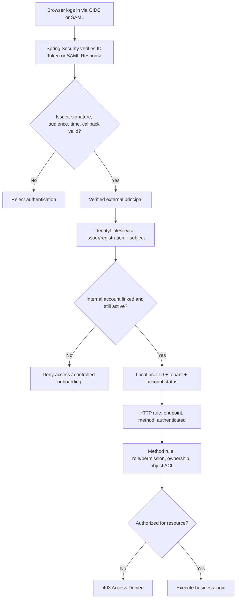

# HTTP and Method Authorization Based on Linked Identity in Spring Security Federation

## 1. The problem: federated login does not mean granted permissions

A Spring Boot application may use **OpenID Connect (OIDC)** or **SAML 2.0** to authenticate users at an external identity system. After the OpenID Provider (OP) or SAML Identity Provider (IdP) authenticates successfully, Spring Security creates an `Authentication` in `SecurityContext`. However, the application still must decide: which **internal account** is this person, which **endpoints** may they access, which **records** may they view/edit, and which **business operations** may they perform?

The two questions have distinct boundaries:

- **Authentication:** "Which external identity did a trusted identity provider just authenticate this person as?"
- **Authorization:** "What permissions does the corresponding internal account have, on which resource and tenant, right now?"

For example, a user who has completed a valid SSO login but is not yet linked to an internal employee account: the application **must not auto-grant permissions** to view records simply because the SAMLResponse/ID Token is valid. Nor is a linked user automatically allowed to read someone else's document merely because they can reach `GET /api/documents/{id}`.

The lesson goal is to build **two-layer** authorization with Spring Security Servlet:

1. **HTTP request authorization** via `SecurityFilterChain` and `authorizeHttpRequests`: controls access to routes, HTTP methods, and minimum authentication requirements.
2. **Method authorization** via `@EnableMethodSecurity` and `@PreAuthorize`/`@PostAuthorize`: enforces business policy by **linked internal account** and specific domain objects.

Examples use Java 17+, Spring Boot 3.x, and Spring Security 6.x. URLs and account IDs in code are **hypothetical test data**; running real federation requires an OIDC/SAML provider, client/metadata config, callbacks, and valid credentials.

## 2. Trust flow from external identity to access decision



This diagram shows the **logical steps**; by default Spring Security validates the protocol and enforces HTTP/method authorization at the appropriate stages. Linked-identity resolution can run at login, inside a custom `Authentication`, or in an authorization service. **Where mapping runs does not change the rule:** trust only verified principals and draw authorization decisions from organization-governed sources.

If a link is created wrongly, every downstream HTTP and method rule may accidentally admit the wrong person. Choosing the right identification keys and account-linking workflow is therefore foundational.

## 3. Three types of IDs that must not be equated

| Data | Example | Meaning | Suitable as linking key? |
| --- | --- | --- | --- |
| OIDC `iss` | `https://login.example.test/realms/corp` | Verified ID Token issuer | **Yes**, paired with `sub` |
| OIDC `sub` | `sub-001` | User identifier **within the issuer's scope** | **Yes**, but never used alone |
| SAML IdP/entity ID or trusted registration | `partner` at RP | Identifies the SAML source/partner | **Yes** within the defined key tuple |
| SAML persistent NameID | `persistent-401` | Identifier received by SP from assertion | **Conditionally**, if IdP guarantees stability/non-reassignment |
| SAML transient NameID | Per-session rotating value | Temporary identifier | **Unsuitable** for durable linking |
| Email | `user@example.test` | Profile/contact attribute | **Insufficient** for automatic linking |
| `preferred_username`/display name | `nguyenvana` | Display/login name | Neither unique nor durable |
| Local user ID | `1001` | Account identifier **inside the app** | **Yes**, primary key for business permissions |
| Tenant ID | `tenant-a` | Organization/data scope | Must participate in tenant isolation checks |

Per OIDC Core, the **`(iss, sub)` tuple** is the key an RP can trust as a unique, stable identifier within an issuer's scope. `sub` only has meaning under one issuer; two issuers can both assign `sub-001` to two different people. OIDC may also use *pairwise subjects*, giving one person different `sub` values across RPs; linking those requires an authorized workflow, never guessing from email.

In SAML, `Saml2AuthenticatedPrincipal#getName()` usually reads NameID from the assertion. NameID is **not durable by default**: check `NameID Format`, issuer relationship, `NameQualifier`/`SPNameQualifier` when used by the profile, and IdP commitments. In simple examples, `registrationId` is an internal key mapped to a trusted IdP; pair it with a NameID guaranteed persistent by the IdP. Multi-tenant/multi-partner systems should also store necessary issuers/qualifiers to prevent collisions.

### Never link accounts by email alone

An account takeover can occur if an ID Token/SAML Assertion from a lower-trust provider asserts an email matching an existing admin account in the app and the app auto-links them. Even `email_verified=true` in OIDC does not prove the address is controlled by the **same internal account** across every lifecycle and issuer.

Account linking requires one of these controlled workflows: the user is already logged into their internal account and actively links via a verified flow, an administrator approves it, or provisioning comes from an authorized identity-lifecycle source. Audit changes, restrict who can link/unlink, and use unique constraints to prevent an external identity from binding improperly to two local users.

## 4. Recommended data model for linked identities

A conceptual schema:

```sql
CREATE TABLE app_user (
    id BIGINT PRIMARY KEY,
    tenant_id VARCHAR(80) NOT NULL,
    status VARCHAR(20) NOT NULL
);

CREATE TABLE external_identity_link (
    id BIGINT PRIMARY KEY,
    user_id BIGINT NOT NULL REFERENCES app_user(id),
    provider_kind VARCHAR(20) NOT NULL,
    provider_key VARCHAR(500) NOT NULL,
    external_subject VARCHAR(500) NOT NULL,
    status VARCHAR(20) NOT NULL,
    UNIQUE (provider_kind, provider_key, external_subject)
);

CREATE TABLE document_acl (
    document_id BIGINT NOT NULL,
    local_user_id BIGINT NOT NULL REFERENCES app_user(id),
    permission VARCHAR(30) NOT NULL,
    PRIMARY KEY (document_id, local_user_id, permission)
);
```

This is an **illustrative schema**, not an optimized migration for every DBMS. Production needs indexes, tenant constraints, audit trails, and clear state management. `provider_key` may be a canonical/allowlisted issuer URI for OIDC, or a trusted IdP identifier bound to the SAML registration. Never use arbitrary browser-submitted strings to choose keys.

An authorization decision should evaluate at least:

```text
trusted external identity
  -> active external_identity_link
  -> active local app_user
  -> tenant and membership
  -> local roles / permissions
  -> document ownership / ACL
  -> requested action (READ, APPROVE, DELETE...)
  -> optional assurance/freshness requirements
```

In multi-tenant applications, check `tenant_id` before or alongside permission lookup. Never just ask "does this document ACL contain user ID?" if the ACL/ID could cross tenants or the user is disabled. When an account is locked or a link is revoked, new decisions must reflect current state per business requirements.

## 5. Authorization layers in Spring Security

| Layer | Common API | Example rule | Strength | When is it insufficient? |
| --- | --- | --- | --- | --- |
| HTTP | `authorizeHttpRequests`, `requestMatchers`, `AuthorizationManager<RequestAuthorizationContext>` | Only authenticated users reach `/api/documents/**`; only local admins reach `/api/admin/**` | Early filtering before controllers | Does not know per-document permissions from path alone |
| Method | `@PreAuthorize`, `@PostAuthorize`, `@PreFilter`/`@PostFilter` | `canRead(authentication, documentId)` | Binds policy to service/use case even outside HTTP | Needs working proxies and data-accurate policies |
| Domain/repository | Tenant + owner/ACL queries, transaction checks | `WHERE tenant_id=:t AND id=:id` | Guards against IDOR/BOLA and TOCTOU | Does not replace protocol auth or HTTP session security |
| Data propagation | Authority/role mapping from verified link | `APP_DOC_APPROVE` | Convenient for `hasAuthority`/`hasRole` | Can go stale on revocation; awkward for per-object ACLs |

**Combine the layers.** HTTP rules can require valid login. Service rules verify the user is linked and authorized on the specific document. Data queries further restrict tenant/ownership before updates. Never put the entire decision only in the frontend, API gateway, or `if (userId == ...)` inside a controller.

## 6. Accurately understanding GrantedAuthority, role, and scope

Spring Security uses `GrantedAuthority` to express permissions carried by an `Authentication`:

- `hasAuthority("APP_ADMIN")` checks the **exact** string `APP_ADMIN`.
- `hasRole("ADMIN")` under default config checks authority `ROLE_ADMIN` (adding the `ROLE_` prefix; the prefix is customizable).
- `hasAuthority("SCOPE_documents.read")` typically applies authorities from **OAuth2/JWT scopes** mapped to `SCOPE_...`. An access token scope **does not automatically grant** document ownership or internal admin rights.
- OIDC logins may carry authorities like `OIDC_USER`, `SCOPE_openid`; SAML logins carry framework-provided authorities, which are not automatically `APP_ADMIN` or document read access.

If an IdP sends attribute `groups=["admins"]` or claim `roles=["admin"]`, **do not** blindly convert it into `ROLE_ADMIN`. Require a group allowlist, specific issuer trust, tenant-scoped mapping, duration limits, and lifecycle controls. A group named `admin` in a sandbox IdP must never grant production system admin.

**Safe implementation approach:** where external identity links to `localUserId`, load internal roles/permissions from a controlled database or policy service, and then map them into `GrantedAuthority` explicitly if needed. Resource-dependent rights like `document:42:read` are usually better checked in a service rather than stuffing thousands of authorities into the session.

## 7. HTTP authorization rules with authorizeHttpRequests

In modern Spring Security Servlet, configure `SecurityFilterChain`:

```java
@Bean
SecurityFilterChain security(HttpSecurity http) throws Exception {
    return http
            .authorizeHttpRequests(auth -> auth
                    .requestMatchers("/", "/error").permitAll()
                    .requestMatchers(HttpMethod.GET, "/api/documents/**")
                        .authenticated()
                    .requestMatchers(HttpMethod.POST, "/api/documents/**")
                        .authenticated()
                    .anyRequest().authenticated())
            .oauth2Login(Customizer.withDefaults())
            .saml2Login(Customizer.withDefaults())
            .build();
}
```

This is a **Java configuration snippet needing imports** inside an app with OIDC/SAML dependencies; the full class appears in Section 10. The HTTP rules intentionally check only **authenticated**, leaving per-document permissions to method security in the service. That does not weaken security: the two layers have distinct responsibilities.

### Matcher order and deny by default

- `requestMatchers` are evaluated in order; a broad matcher placed earlier can shadow a narrower rule below.
- Always put explicit rules for sensitive endpoints before the `anyRequest()` fallback.
- When an app has internal APIs not using SSO, you can use `anyRequest().denyAll()` after declaring permitted endpoints; carefully verify endpoints handled by SAML/OIDC filters.
- `permitAll()` should cover only public resources and protocol/callback routes designed by the framework. Never put `permitAll()` on `/api/**` claiming "method security handles it" without auditing every code path.
- If multiple `SecurityFilterChain` beans coexist, `securityMatcher` and `@Order` determine which chain applies. Ensure login/callback chains are not unintentionally blocked by a stateless API chain.

### Why checking URLs alone is insufficient

Two users can both request `GET /api/documents/42`. The HTTP `authenticated()` rule passes for both, yet one user has an entry in `document_acl` while the other does not. This is **Broken Object Level Authorization (BOLA/IDOR)** if the API checks only "logged in". Enforce object-level checks in the service or conditional query.

## 8. Method security: protecting business calls

Spring Security supports:

- `@EnableMethodSecurity`: activates method authorization (not enabled automatically merely by adding the security starter).
- `@PreAuthorize("...")`: evaluates policy **before** invoking the method; suitable for reads/edits/approvals with side effects.
- `@PostAuthorize("...")`: evaluates against the return value **after** the method runs; suitable for certain side-effect-free reads.
- `@PreFilter`/`@PostFilter`: filters lists/inputs, though performance and policy coverage must be understood.
- `@Secured` and `@RolesAllowed`: alternatives; `@PreAuthorize` expresses richer policies.

Example:

```java
@PreAuthorize("@linkedPolicy.canRead(authentication, #p0)")
public DocumentView read(long documentId) {
    return repository.load(documentId);
}
```

`#p0` refers to the **first parameter** of the method; this syntax does not rely on the compiler retaining parameter names. `#documentId` works if parameter names are exposed via `-parameters` or `@P` per version. `@linkedPolicy` is a Spring bean with a public `canRead` method; `authentication` is provided by the method-security expression context.

### Watch out for proxies and self-invocation

Method security usually works through Spring AOP proxies. If a bean method **calls another method on itself** via `this.restrictedMethod()`, the call can bypass the proxy and skip `@PreAuthorize`. Put protected methods on a **separate Spring-managed service**, invoked by controllers or other services through the bean proxy, and cover them with unit/integration tests.

Do not put `@PreAuthorize` on a private method assuming Spring AOP will always intercept it. For transactions with side effects, prefer `@PreAuthorize`/pre-checks before writing data; `@PostAuthorize` runs **after** the method, which is too late to stop side effects that already occurred.

## 9. Sample Spring Boot project config with both OIDC and SAML

### 9.1. Dependencies

In a Gradle Groovy DSL project already configured with Spring Boot/Java plugins and consistent dependency management, add:

```groovy
repositories {
    mavenCentral()
    // Some OpenSAML combinations require the Shibboleth Maven repository.
    maven { url "https://build.shibboleth.net/maven/releases/" }
}

dependencies {
    implementation "org.springframework.boot:spring-boot-starter-web"
    implementation "org.springframework.boot:spring-boot-starter-security"
    implementation "org.springframework.boot:spring-boot-starter-oauth2-client"
    implementation "org.springframework.security:spring-security-saml2-service-provider"
    testImplementation "org.springframework.boot:spring-boot-starter-test"
    testImplementation "org.springframework.security:spring-security-test"
}
```

This is a **build configuration excerpt**, not a complete `build.gradle`. Select compatible Java 17+ and Spring Boot 3.x/Spring Security 6.x versions. If an app uses only OIDC or only SAML, include only the matching dependency. Never force an OpenSAML version that conflicts with Spring Security.

### 9.2. application.yml

```yaml
spring:
  security:
    oauth2:
      client:
        registration:
          corp:
            provider: corp
            client-id: "${OIDC_CLIENT_ID}"
            client-secret: "${OIDC_CLIENT_SECRET}"
            authorization-grant-type: authorization_code
            scope:
              - openid
              - profile
        provider:
          corp:
            issuer-uri: "https://login.example.test/realms/corp"
    saml2:
      relyingparty:
        registration:
          partner:
            assertingparty:
              metadata-uri: "${SAML_IDP_METADATA_URI}"

server:
  servlet:
    session:
      cookie:
        http-only: true
```

OIDC `corp` and SAML `partner` are illustrative partners. `OIDC_CLIENT_ID`, `OIDC_CLIENT_SECRET`, and `SAML_IDP_METADATA_URI` are injected outside source control from a secret/config manager or deployment environment. Domain `example.test` is fictional, not a live IdP. In production, properly configure HTTPS, `Secure` cookies, OIDC callbacks, SAML SP Entity ID/ACS, trust certificates, ingress, and session policies.

**Never place real client secrets or SAML private keys in source code or READMEs**. If the SAML IdP requires signed AuthnRequests or encrypted assertions, add signing/decryption credentials per Spring Security docs; this sample does not generate keys.

When OIDC returns an ID Token with `iss=https://login.example.test/realms/corp`, Spring Security must verify its issuer/audience/signature before using it as an identity link. For SAML, the `partner` registration must be trusted and NameID must be persistent per IdP contract.

## 10. Java 17 example: linking identity then enforcing HTTP and service authorization

The complete example below uses a **single Java source file** with package-private beans/classes for readability. It compiles inside a Spring Boot project with the dependencies and real config from Section 9; running end-to-end SSO requires an OIDC/SAML sandbox IdP with the SP/RP registered. Never auto-create accounts at the IdP.

For simplicity, identity links and ACLs are stored in `Map.of` **strictly for illustration**, not a production database. Each request checks the verified identity in `Authentication` and looks up the **local user ID** in the Map; in a real application replace the Map with a transactional repository, tenant constraints, and link status checks.

Save at `src/main/java/demo/federation/FederationAccessApplication.java`:

```java
package demo.federation;

import java.util.Map;
import java.util.Set;

import org.springframework.boot.SpringApplication;
import org.springframework.boot.autoconfigure.SpringBootApplication;
import org.springframework.context.annotation.Bean;
import org.springframework.http.HttpMethod;
import org.springframework.http.HttpStatus;
import org.springframework.security.config.Customizer;
import org.springframework.security.config.annotation.method.configuration.EnableMethodSecurity;
import org.springframework.security.config.annotation.web.builders.HttpSecurity;
import org.springframework.security.core.Authentication;
import org.springframework.security.oauth2.core.oidc.user.OidcUser;
import org.springframework.security.saml2.provider.service.authentication.Saml2AuthenticatedPrincipal;
import org.springframework.security.access.prepost.PreAuthorize;
import org.springframework.security.web.SecurityFilterChain;
import org.springframework.stereotype.Service;
import org.springframework.web.bind.annotation.GetMapping;
import org.springframework.web.bind.annotation.PathVariable;
import org.springframework.web.bind.annotation.PostMapping;
import org.springframework.web.bind.annotation.RestController;
import org.springframework.web.server.ResponseStatusException;

@SpringBootApplication
@EnableMethodSecurity
public class FederationAccessApplication {
    public static void main(String[] args) {
        SpringApplication.run(FederationAccessApplication.class, args);
    }

    @Bean
    SecurityFilterChain webSecurity(HttpSecurity http) throws Exception {
        return http
                .authorizeHttpRequests(auth -> auth
                        .requestMatchers("/", "/error").permitAll()
                        .requestMatchers(HttpMethod.GET, "/api/documents/**")
                            .authenticated()
                        .requestMatchers(HttpMethod.POST, "/api/documents/**")
                            .authenticated()
                        .anyRequest().authenticated())
                .oauth2Login(Customizer.withDefaults())
                .saml2Login(Customizer.withDefaults())
                .build();
    }
}

// Key for an external identity verified by a provider.
// "issuer/registration" and "subject" scope the key to the right trust domain.
record ExternalKey(String protocol, String provider, String subject) {}

// API DTO.
record DocumentView(long id, String title) { }

@Service("linkedPolicy")
class LinkedIdentityPolicy {

    // Sample data: two external identities map to local user 1001.
    private static final Map<ExternalKey, Long> LINKS = Map.of(
            new ExternalKey(
                    "oidc",
                    "https://login.example.test/realms/corp",
                    "sub-001"),
            1001L,
            new ExternalKey(
                    "saml",
                    "partner",
                    "persistent-401"),
            1001L,
            new ExternalKey(
                    "oidc",
                    "https://login.example.test/realms/corp",
                    "sub-002"),
            1002L
    );

    // In production, query the DB checking tenant, account status,
    // and ACL. This demo only simulates the ACL.
    private static final Map<Long, Set<Long>> DOCUMENT_READERS = Map.of(
            42L, Set.of(1001L),
            77L, Set.of(1002L)
    );

    private static final Map<Long, Set<Long>> DOCUMENT_APPROVERS = Map.of(
            42L, Set.of(1001L)
    );

    private Long localUserId(Authentication authentication) {
        if (authentication == null || !authentication.isAuthenticated()) {
            return null;
        }

        Object principal = authentication.getPrincipal();
        ExternalKey key;

        if (principal instanceof OidcUser oidc) {
            // Use only the ID Token verified by the OIDC login provider.
            if (oidc.getIdToken() == null
                    || oidc.getIdToken().getIssuer() == null) {
                return null;
            }
            key = new ExternalKey(
                    "oidc",
                    oidc.getIdToken().getIssuer().toString(),
                    oidc.getIdToken().getSubject());
        } else if (principal instanceof Saml2AuthenticatedPrincipal saml) {
            // Use NameID as a long-term key only if the IdP guarantees persistence.
            key = new ExternalKey(
                    "saml",
                    saml.getRelyingPartyRegistrationId(),
                    saml.getName());
        } else {
            return null;
        }

        return LINKS.get(key); // No link => deny.
    }

    public boolean canRead(Authentication authentication, long documentId) {
        Long userId = localUserId(authentication);
        return userId != null
                && DOCUMENT_READERS.getOrDefault(documentId, Set.of())
                        .contains(userId);
    }

    public boolean canApprove(Authentication authentication, long documentId) {
        Long userId = localUserId(authentication);
        return userId != null
                && DOCUMENT_APPROVERS.getOrDefault(documentId, Set.of())
                        .contains(userId);
    }
}

@Service
class DocumentService {

    private static final Map<Long, DocumentView> DOCUMENTS = Map.of(
            42L, new DocumentView(42L, "Budget 2026"),
            77L, new DocumentView(77L, "Partner contract")
    );

    // #p0 refers to the first parameter: documentId.
    @PreAuthorize("@linkedPolicy.canRead(authentication, #p0)")
    public DocumentView read(long documentId) {
        DocumentView result = DOCUMENTS.get(documentId);
        if (result == null) {
            throw new ResponseStatusException(HttpStatus.NOT_FOUND);
        }
        return result;
    }

    // Check permission BEFORE invocation. Do not use PostAuthorize
    // for side-effecting actions like approving a transaction.
    @PreAuthorize("@linkedPolicy.canApprove(authentication, #p0)")
    public String approve(long documentId) {
        if (!DOCUMENTS.containsKey(documentId)) {
            throw new ResponseStatusException(HttpStatus.NOT_FOUND);
        }
        // Demo returns a string; production must update DB transactionally.
        return "approved:" + documentId;
    }
}

@RestController
class DocumentController {
    private final DocumentService documents;

    DocumentController(DocumentService documents) {
        this.documents = documents;
    }

    @GetMapping("/")
    public String index() {
        return "Public federation demo";
    }

    @GetMapping("/api/documents/{id}")
    public DocumentView read(@PathVariable long id) {
        return documents.read(id);
    }

    @PostMapping("/api/documents/{id}/approve")
    public String approve(@PathVariable long id) {
        return documents.approve(id);
    }
}
```

### Explaining the security properties of the code

1. `@EnableMethodSecurity` enables the proxy enforcing `@PreAuthorize`. If omitted, the HTTP `authenticated()` rule still runs, yet the service **does not enforce document ACLs**.
2. `SecurityFilterChain` protects `/api/documents/**`. It does not try to decide document ownership at the URL matcher.
3. `LinkedIdentityPolicy` consumes the `Authentication` built by Spring Security, **never reading email/sub/NameID directly from browser inputs**. If the principal is not from configured OIDC/SAML, it returns `null`.
4. For OIDC, the key uses verified `iss` and `sub`, never `sub` alone.
5. For SAML, the key uses the **app-registered** registration name and NameID. This is simplified for the lesson; production must verify NameID format/persistence and may need IdP-guaranteed issuer/qualifiers.
6. Only when an identity link exists does policy resolve a local user ID. Someone with valid SSO who is unlinked is denied document access.
7. `canRead` and `canApprove` are **two separate permissions**. Never infer approval rights from read rights.
8. `DocumentService` is a separate Spring bean invoked by the controller through a proxy so `@PreAuthorize` runs before the method. Never invoke service methods internally via `this`.
9. If the ACL lacks the document ID or user ID, empty `Set.of()` makes the policy fail closed.
10. `POST /approve` still enforces default CSRF protection for browser sessions. Clients must send a valid CSRF token; **never** disable CSRF application-wide to test the endpoint. The SAML ACS endpoint is a protocol callback handled separately by the framework.

### Expected access outcomes

Once the principal is verified for OIDC `(iss=https://login.example.test/realms/corp, sub=sub-001)` or SAML `(registration=partner, NameID=persistent-401)`:

| Request | HTTP gate | Method rule | Outcome |
| --- | --- | --- | --- |
| `GET /` | Public | No method guard required | HTTP 200 |
| `GET /api/documents/42` | Authenticated | local 1001 in readers(42) | HTTP 200, JSON document 42 |
| `GET /api/documents/77` | Authenticated | local 1001 not in readers(77) | **Access denied** |
| `POST /api/documents/42/approve` | Authenticated + CSRF | local 1001 in approvers(42) | Returns `approved:42` with valid CSRF |
| `POST /api/documents/77/approve` | Authenticated + CSRF | local 1001 lacks permission | **Access denied** |
| Unlinked SSO user | Authenticated | No local ID found | **Access denied** |

An unauthenticated browser without a session may receive a **302 redirect to the login page** instead of HTTP 401; authenticated without permission typically results in HTTP 403. Actual responses depend on entry points, exception handlers, CSRF, and API config. Because the fictional SAML/OIDC sandbox does not exist, there is no fixed network or stdout output.

## 11. Standalone Java 17: why the linking key needs the issuer too

The snippet below illustrates a common design flaw: using `sub` alone as a user ID. It **requires no Spring**, compiles with Java 17, and has deterministic stdout.

Save `ExternalIdentityKeyDemo.java`:

```java
import java.util.Map;

public final class ExternalIdentityKeyDemo {

    record Key(String issuer, String subject) { }

    public static void main(String[] args) {
        Map<Key, Long> links = Map.of(
                new Key("https://idp-a.example.test", "42"), 1001L,
                new Key("https://idp-b.example.test", "42"), 1002L
        );

        System.out.println("idpA=" +
                links.get(new Key("https://idp-a.example.test", "42")));
        System.out.println("idpB=" +
                links.get(new Key("https://idp-b.example.test", "42")));
        System.out.println("unlinked=" +
                links.get(new Key("https://idp-c.example.test", "42")));
    }
}
```

Run:

```bash
javac ExternalIdentityKeyDemo.java
java ExternalIdentityKeyDemo
```

Exact stdout:

```text
idpA=1001
idpB=1002
unlinked=null
```

Both issuers use subject `42`, yet the application knows these are **two distinct links**. Using `subject` alone as the key risks merging different identities. This program only demonstrates key structure; **it does not verify ID Token signatures**. Production must verify OIDC tokens/SAML assertions before constructing keys.

## 12. Advanced HTTP authorization: application-issued roles

Suppose only users with internal permission `APP_ADMIN` may access admin endpoints. The request rule could be:

```java
.requestMatchers("/api/admin/**").hasAuthority("APP_ADMIN")
```

This is **one line added to `authorizeHttpRequests` before the fallback**, not a standalone config. It takes effect only if the app **actually grants** `GrantedAuthority("APP_ADMIN")` to `Authentication` after trusted mapping. Section 10's example does not grant this authority, so admin endpoints remain closed even with a link.

If authorities are mapped at login time:

- Resolve `localUserId` from a **verified** identity link.
- Look up internal/tenant permissions in a controlled store.
- Map only active permissions allowed for that client/session type.
- Design refresh or re-checks when roles change/are revoked; session-cached permissions can go stale.

An OIDC login mapper can use `GrantedAuthoritiesMapper` or `OidcUserService` as needed. Do not take an `OidcUserAuthority` snippet and apply it verbatim to `Saml2Authentication`: the two authentication mechanisms construct principals/authorities differently.

### Custom request-level AuthorizationManager

When permissions depend on dynamic URLs/paths and must be checked right at the filter, you can use `AuthorizationManager<RequestAuthorizationContext>` backed by a linked policy service. Conceptually:

```java
.requestMatchers("/api/reports/**")
.access((authentication, context) ->
        new AuthorizationDecision(
                policy.canViewReport(authentication.get(), context.getRequest())))
```

This is a **configuration fragment**, assuming `policy.canViewReport(...)` is implemented and `AuthorizationDecision` is imported. It is not included in the sample project. When authorization needs domain details (document owner, tenant, action), service-method `@PreAuthorize` is usually easier to test, easier to reuse in background jobs, and avoids stuffing heavy DB queries into filters.

### Never put permissive rules before restrictive ones

**Wrong** example:

```java
.requestMatchers("/api/**").permitAll()
.requestMatchers("/api/admin/**").hasAuthority("APP_ADMIN")
```

The first matcher already opens all of `/api/**`, rendering the later admin rule ineffective. In HTTP rules, ordering is part of the security policy.

## 13. Method authorization with @PreAuthorize and @PostAuthorize

### @PreAuthorize: the default choice for side-effecting operations

Service example:

```java
@PreAuthorize("@linkedPolicy.canApprove(authentication, #p0)")
public void approvePayment(long paymentId) {
    // Runs only when policy approves.
}
```

Policy should evaluate approver rights, tenant, account status, transaction status, and business conditions prior to mutation. Under concurrency, re-check required state inside a transaction/atomic update to prevent **time-of-check to time-of-use (TOCTOU)**.

### @PostAuthorize: checking the returned object

Read-only example:

```java
@PostAuthorize("returnObject != null && " +
        "@linkedPolicy.canRead(authentication, returnObject.id())")
public DocumentView loadForViewing(long id) {
    return repository.load(id);
}
```

This is an **illustrative snippet**, not part of Section 10's class (`repository` is undeclared here). `returnObject` is the method's return value, usable to enforce access checks on the returned data. However, the method **has already executed** before policy runs: never use `@PostAuthorize` for deletes, money transfers, emails, DB writes, or any side effect that must be blocked upfront.

### Limits of @PreFilter and @PostFilter

`@PostFilter` filters items after fetching a list, yet if the DB already loaded millions of rows across tenants, filtering in Java post-query wastes resources and risks log/cache exposure. For paginated lists, total counts, and tenant isolation, **filtering inside the repository/query** is usually much better. `@PreFilter` filters inputs without replacing per-item edit permission checks.

## 14. Authentication differs across OIDC, SAML, and JWT Resource Servers

| Flow | Common Authentication/principal | How to extract trusted identity | What to keep distinct |
| --- | --- | --- | --- |
| OIDC browser login | `OAuth2AuthenticationToken` + `OidcUser` | `oidc.getIdToken().getIssuer()` and `getSubject()` | Access token scopes are not object permissions inside the app |
| SAML browser login | `Saml2Authentication` + `Saml2AuthenticatedPrincipal` | Trusted IdP registration + agreed persistent NameID/qualifiers | NameID is not always durable |
| OAuth2 Resource Server JWT | `JwtAuthenticationToken` / `Jwt` | Verified JWT issuer + sub, plus audience/client/tenant per policy | Bearer APIs and browser sessions have different threat models |

**Important:** `JwtAuthenticationToken` is not an `OidcUser`. If an API receives bearer JWTs, code handling only `OidcUser`/`Saml2AuthenticatedPrincipal` like Section 10 will **fail closed** (finding no link), rather than automatically working for bearer tokens. To support JWT resource servers, add a branch converting a `JwtDecoder`-verified `Jwt` into a key per resource-server policy, while verifying audience, token type/scopes, and tenant.

Never use `authentication.getName()` unconditionally to link the same user across OIDC, SAML, and JWT. It can represent a subject, NameID, or differently configured name without a shared namespace.

### Mapping claims/attributes to permissions

OIDC: claims in ID Token/UserInfo are checked by the library per the flow; yet the trustworthiness of **each claim** and authorization to use it must be defined. SAML: only attributes from a SP-verified Assertion may be used. For an external group `finance-approvers`, map it to internal `APP_PAYMENT_APPROVE` only when issuer/tenant/group are allowlisted and the organization actually delegates that group's governance to the IdP.

Typically the app still needs **local account status**, object policy, and business state even when IdP role mapping is permitted.

## 15. Record-level permissions: preventing IDOR/BOLA and cross-tenant data leaks

Suppose there are two URLs:

```text
GET /api/documents/42
GET /api/documents/77
```

Changing 42 to 77 is trivial. If code checks only whether the user is logged in, an attacker can read documents they have no right to view. **An arbitrary ID from a URL is never proof of permission.**

Checks should bind **local user ID + tenant + resource ID + action**:

```sql
SELECT d.id, d.title
FROM documents d
JOIN document_acl a ON a.document_id = d.id
JOIN app_user u ON u.id = a.local_user_id
WHERE d.id = :documentId
  AND u.id = :localUserId
  AND u.tenant_id = d.tenant_id
  AND u.status = 'ACTIVE'
  AND a.permission = 'READ';
```

This SQL **illustrates query structure**, assuming a `documents` table with matching columns, not a complete migration or query. In production, prevent SQL injection via prepared statements/bindings, apply tenant filters consistently, and account for soft-deletes, versioning, visibility, and role-based rights if policy permits.

A `@PreAuthorize` check outside a transaction can go stale if ACLs/resource state change before an update. Critical operations should check and mutate inside the same transaction, using optimistic locking, row-level locking, or atomic updates. Method guards remain helpful, yet **do not replace data-integrity checks**.

## 16. Lifecycle of identity links and permissions: check beyond login

An external account may be locked, an IdP group changed, an employee offboarded, or an identity link revoked **while the browser still holds a Spring Security session**. If the app snapshots roles into `Authentication` only at login, the user may keep stale permissions until session expiry.

The design must explicitly decide:

- Do permissions refresh only on re-login or get re-checked on sensitive requests/actions?
- When an identity link is disabled, are active sessions invalidated immediately?
- What is the role/ACL cache TTL and how are revocation events delivered?
- How are cross-tenant resource transfers performed atomically?
- Are audits required for "who approved, which local user ID, which link/issuer, at what time"?

For financial actions, data deletion, or modifying other users' permissions, query current **link + account + permission** state at decision time, or use a reliable invalidation mechanism. For ordinary reads, a bounded TTL cache may be acceptable if risks are assessed and timeouts are explicit.

Never store permissions in a browser-editable claim. Session cookies and CSRF tokens likewise do not prove permission on a specific record.

## 17. Step-up authentication and business permissions are two distinct conditions

Someone may hold local role `APP_PAYMENT_APPROVE` yet their current session used only standard authentication. For large transactions, policy may require **MFA/phishing-resistant authentication** and **freshness** in addition to the role.

Two independent conditions:

1. **Authorization:** the local user is allowed to approve the specific transaction (`tenant`, `role`, `ACL`, transaction state).
2. **Authentication assurance:** the current session meets the IdP-attested assurance level, is sufficiently fresh, and belongs to the right user/session.

OIDC can use `acr`, `amr`, `auth_time` per issuer agreement; SAML can use `AuthnContextClassRef`, `AuthnInstant`, and `RequestedAuthnContext`. **Never treat having sent an MFA request as proof it was performed.** The SP must inspect the actual context in the verified ID Token/SAML Assertion and store assurance server-side when needed.

Example rule:

```text
canApprovePayment(user, payment)
    = linkedLocalAccountIsActive
    AND userHasPermissionForPayment
    AND paymentTenantMatchesUserTenant
    AND paymentStateAllowsApproval
    AND verifiedAuthenticationContextMeetsPolicy
    AND authenticationIsFreshEnough
```

This is business-rule pseudocode, not runnable Spring SpEL. When assurance is unmet, trigger a controlled step-up flow; never grant elevated roles from a request parameter like `?mfa=true`.

## 18. HTTP status, CSRF, CORS, and sessions in federated apps

### 18.1. 401, 403, and login redirects

- Unauthenticated requests to a web app with `oauth2Login`/`saml2Login` usually redirect to the IdP entry point (HTTP 302) rather than returning 401 JSON.
- Authenticated users denied by `@PreAuthorize` typically see HTTP 403.
- Stateless bearer-token APIs may return 401 for missing/bad tokens and 403 for insufficient rights, depending on entry point/handler.
- For JSON-only APIs, configure custom `AuthenticationEntryPoint`/`AccessDeniedHandler` to avoid redirecting to the IdP; never alter authorization rules when changing response formats.

### 18.2. CSRF

Browsers using cookie sessions face CSRF risk on side-effecting methods. In Section 10's example, `POST /api/documents/42/approve` requires a matching CSRF token by default. If a POST gets 403, distinguish **CSRF denial** from **method security denial**, never disabling CSRF app-wide.

SAML HTTP-POST ACS and OAuth2 callbacks are protocol endpoints with dedicated handling; never treat callback CSRF exemptions as an excuse to disable CSRF for business APIs.

### 18.3. CORS and proxies

CORS only governs browser cross-origin request policies; it **is not an authorization mechanism** and does not replace identity-link checks. Reverse proxies must forward headers accurately, protect `Secure`/`HttpOnly`/`SameSite` cookies, avoid misrouting callbacks, and prevent open redirects. HTTPS, ID Token/SAML Assertion signatures, and issuer/audience checks form the prerequisite foundation before authorization decisions.

## 19. Testing HTTP and method authorization

### 19.1. Mandatory test matrix

| Scenario | Expected outcome |
| --- | --- |
| Unauthenticated user accesses protected resource | Initiates login/401 per entry point; cannot view data |
| Valid OIDC token, `iss+sub` linked to local 1001, read doc 42 | Allow |
| Valid OIDC token, local 1001 reads doc 77 | Deny |
| OIDC same `sub` yet **different issuer** | Does not reuse link from the old issuer |
| SAML persistent NameID linked to local 1001 | Granted rights per 1001's ACL |
| SAML transient NameID or untrusted IdP registration | Do not auto-link; fail closed |
| Matching email, different `iss+sub` | Does not take over local account |
| Inactive local user or revoked external link | Deny per lifecycle policy |
| Group claim `admins` from IdP unauthorized for mapping | Never grant local admin |
| Holds `ROLE_USER` but lacks document ACL | Deny record access |
| Tamper document ID in URL | Object-level policy still blocks |
| Approve without CSRF token | Blocked when using cookie session |
| Approve with CSRF yet lacking APP permission | Method security denies |
| Calling service via background job | Still passes appropriate authorization or dedicated service-account policy |
| Internal self-invocation via `this.method()` | Tests catch proxy-bypass issues |
| Live SSO session when link/role was just revoked | Reflects chosen permission-refresh policy |
| Tenant A requests tenant B's data | Deny even if ID is guessable |
| Resource owner changes between check and write | Transaction/atomic guard prevents TOCTOU |

### 19.2. Using Spring Security Test with OIDC principals

Spring Security Test provides `oidcLogin()` to simulate `OidcUser` at the HTTP layer without calling a real OP. In an initialized Spring Boot/MockMvc test context:

```java
mvc.perform(get("/api/documents/42")
        .with(oidcLogin().idToken(token -> token
                .claim("iss", "https://login.example.test/realms/corp")
                .claim("sub", "sub-001"))))
        .andExpect(status().isOk());

mvc.perform(get("/api/documents/77")
        .with(oidcLogin().idToken(token -> token
                .claim("iss", "https://login.example.test/realms/corp")
                .claim("sub", "sub-001"))))
        .andExpect(status().isForbidden());
```

This is a **test fragment** (requires `MockMvc mvc`, static imports `get`/`oidcLogin`/`status`, and a Spring test context), not a standalone Java class. It mocks the security context to test **HTTP/method policy**; it **does not prove** OP-signed ID Tokens and Spring Security validation in production. Run separate E2E tests against an OP/IdP sandbox for authentication.

For session-based POSTs, tests need `with(csrf())` when CSRF is enabled. For SAML principals, use test support or construct an `Authentication` fixture accurately modeling registration/NameID; never use `@WithMockUser(username="persistent-401")` thinking it tests the `Saml2AuthenticatedPrincipal` branch.

**Note on metadata at test startup:** if `application.yml` references live SAML metadata, the context may attempt to fetch it; test environments must use a mock/sandbox IdP or explicitly configured test fixture repository. Never place private keys or production SAMLResponses in test fixtures.

### 19.3. Testing service methods independently

You can unit-test `LinkedIdentityPolicy` with `Authentication` fixtures holding standard OIDC/SAML principals, or integration-test `DocumentService` with `@EnableMethodSecurity`. Specifically verify two things:

1. Controllers actually invoke the service through the Spring bean proxy so `@PreAuthorize` fires.
2. Users with valid authentication who lack an external link or ACL entry **cannot execute** business methods.

Tests using only `@WithMockUser(roles="ADMIN")` do not exercise the OIDC `iss+sub` or SAML `registrationId+NameID` mapping branches of this lesson.

## 20. Common anti-patterns

| Anti-pattern | Why it is dangerous | Proper approach |
| --- | --- | --- |
| Using `authentication.getName()` as universal ID across SSO providers | NameID/sub/name have distinct scopes and semantics | Issuer/registration namespace + stable subject |
| Auto-linking users by email from any IdP | Account takeover, email changes/reassignment | Verified and audited linking workflow |
| Granting `ROLE_ADMIN` from uncontrolled `groups=admin` strings | External party escalates internal rights | Allowlist mapping, IdP trust, tenant, local policy |
| `anyRequest().authenticated()` alone with no ACL checks | IDOR/BOLA | HTTP + method + repository scoping |
| Protecting controllers only | Service may be called from other paths | Guard at service/use-case layer |
| Using `@PostAuthorize` alone on writes | Side effects happen before the check | `@PreAuthorize` and transactional authorization |
| Self-invocation bypassing proxy | Annotations are not intercepted | Call via bean proxy; restructure services |
| Linking a SAML transient NameID as permanent | Unstable, can point to wrong person | Persistent ID/qualified name per IdP contract |
| Forgetting tenant on local account lookup | Cross-tenant access | Composite constraints, tenant-aware policy |
| Trusting session permissions indefinitely | Revocations fail to take effect | Refresh/re-check/invalidation per risk |
| Using `permitAll()` on `/api/**` to avoid login redirects | Opens all endpoints | Configure dedicated entry point/handler |
| Disabling CSRF because POST returns 403 | Exposes cookie sessions to CSRF | Send valid token and debug denials |
| Copying OIDC policy to `JwtAuthenticationToken` without JWT handling | Different principal, token type/audience | Dedicated resource-server policy |
| Logging full tokens/assertions to debug permissions | Leaks credentials, PII, session state | Log redacted audit IDs/decision metadata |

## 21. Production deployment checklist

- [ ] OP/IdP trust is configured; signatures/issuer/audience/recipient/time are verified per protocol.
- [ ] OIDC linking key uses **`iss + sub`** strictly from verified ID Tokens.
- [ ] SAML linking key binds trusted registration/issuer and a **truly persistent** NameID, handling qualifiers if needed.
- [ ] Never auto-link by email/name/group without a governed workflow.
- [ ] Database enforces unique constraints on external identity links, audits link/unlink, and tracks ACTIVE/REVOKED states.
- [ ] LocalUser/tenant is resolved before making permission decisions.
- [ ] Mapping external groups/claims to app authorities uses an organization-approved allowlist.
- [ ] HTTP rules restrict endpoints/methods in proper matcher order; fallback protects all remaining requests.
- [ ] `@EnableMethodSecurity` is enabled and all sensitive services have appropriate guards.
- [ ] Self-invocation/private methods are never relied upon as the sole security boundary.
- [ ] BOLA/IDOR is prevented via owner/ACL/tenant-aware queries or domain policies.
- [ ] Side-effecting methods check permissions before execution; transaction guards prevent races.
- [ ] `hasRole`/`hasAuthority`/`SCOPE_` are never mistaken for object-level rights.
- [ ] Browser SSO and bearer JWT resource servers are kept distinct; never reuse the wrong identity extractor.
- [ ] Role/link revocation is reflected in sessions/caches per policy.
- [ ] Sensitive operations check authentication assurance/freshness when required.
- [ ] CSRF/cookies/HTTPS/proxies/CORS are configured cleanly without disabling global protections.
- [ ] Negative tests cover different issuers, unlinked identities, cross-tenant access, missing ACLs, self-invocation, and CSRF.
- [ ] Never log ID Tokens, SAMLResponses, access/refresh tokens, cookies, NameIDs, or secrets.
- [ ] Audits record local user ID, action, resource ID, tenant, and decision in compliance with personal data protection rules.

## 22. Self-assessment questions

**1. Is OIDC `sub` alone enough as a local user key?**  
No. It is stable/unique only within an issuer's scope; you need a verified `(iss, sub)`.

**2. A user completes SAML login and `authentication.isAuthenticated()` is true; can they access any document automatically?**  
No. You need an identity link to a local account and permission checks for that account on the exact document/tenant.

**3. Why not use email to automatically link SSO accounts?**  
Emails can change, be reassigned, or match across issuers; auto-linking can cause account takeover.

**4. How does `hasRole("ADMIN")` differ from `hasAuthority("APP_ADMIN")`?**  
By default `hasRole("ADMIN")` checks `ROLE_ADMIN`; `hasAuthority("APP_ADMIN")` checks the exact string `APP_ADMIN`.

**5. Why are both HTTP and method authorization needed?**  
HTTP filters invalid routes/methods early, while method security enforces business rules and object-level ACLs even when services are invoked outside controllers.

**6. Is `@EnableMethodSecurity` enabled automatically when installing `spring-boot-starter-security`?**  
No. You must declare `@EnableMethodSecurity` or the equivalent mechanism.

**7. Should `@PostAuthorize` be used on a payment approval command?**  
No. A side-effecting method would already execute before `@PostAuthorize` runs. Use pre-checks and transaction guards.

**8. What can happen when a method is called via `this.someProtectedMethod()`?**  
The call bypasses the Spring AOP proxy, so method-security advice may be skipped; structure services and write tests accordingly.

**9. Is SAML NameID always persistent?**  
No. Transient NameIDs are unsuitable as long-term keys; persistent NameIDs require an IdP guarantee and qualifier consideration.

**10. Does OIDC scope `SCOPE_read` allow viewing every document?**  
No. Scopes express token permission boundaries in the issuing context; application ACLs/ownership/tenant checks remain mandatory.

**11. When an employee's permissions are revoked while an SSO session is still active, what happens?**  
You need re-check/invalidation/cache-TTL strategies proportional to risk. Never assume login-time permission snapshots remain valid forever.

**12. What should happen when a user has approval permission yet their current session lacks required MFA/assurance?**  
Deny the operation or trigger a step-up flow; after strong IdP authentication, the SP must still verify actual assurance/freshness.

## 23. Reference documentation

- [Spring Security – Authorize HTTP Servlet Requests](https://docs.spring.io/spring-security/reference/servlet/authorization/authorize-http-requests.html): `authorizeHttpRequests`, `requestMatchers`, custom `AuthorizationManager`, rule ordering.
- [Spring Security – Method Security](https://docs.spring.io/spring-security/reference/servlet/authorization/method-security.html): `@EnableMethodSecurity`, `@PreAuthorize`, `@PostAuthorize`, Spring AOP proxies, parameter binding.
- [Spring Security – OIDC Login Advanced Configuration](https://docs.spring.io/spring-security/reference/servlet/oauth2/login/advanced.html): `OidcUser`, `GrantedAuthoritiesMapper`, and `OidcUserService`.
- [Spring Security – SAML 2.0 Login Overview](https://docs.spring.io/spring-security/reference/servlet/saml2/login/overview.html): `Saml2Authentication` and `Saml2AuthenticatedPrincipal`, NameID/registration.
- [Spring Security – OAuth 2.0 Resource Server JWT](https://docs.spring.io/spring-security/reference/servlet/oauth2/resource-server/jwt.html): verified JWT principals and `SCOPE_` scopes.
- [Spring Security – MockMvc OAuth2 Test](https://docs.spring.io/spring-security/reference/servlet/test/mockmvc/oauth2.html): `oidcLogin()` and testing claims.
- [OpenID Connect Core 1.0 – Subject Identifiers and Claim Stability](https://openid.net/specs/openid-connect-core-1_0.html): `(iss,sub)` as stable identifier, avoiding email/name as unique IDs.
- [OWASP Authorization Cheat Sheet](https://cheatsheetseries.owasp.org/cheatsheets/Authorization_Cheat_Sheet.html): deny-by-default, least privilege, object-level authorization, and testing.
- [OWASP API Security – Broken Object Level Authorization](https://owasp.org/API-Security/editions/2023/en/0xa1-broken-object-level-authorization/): IDOR/BOLA and per-resource ownership/tenant checks.
- [OWASP Session Management Cheat Sheet](https://cheatsheetseries.owasp.org/cheatsheets/Session_Management_Cheat_Sheet.html): sessions, cookies, and permission revocation.
