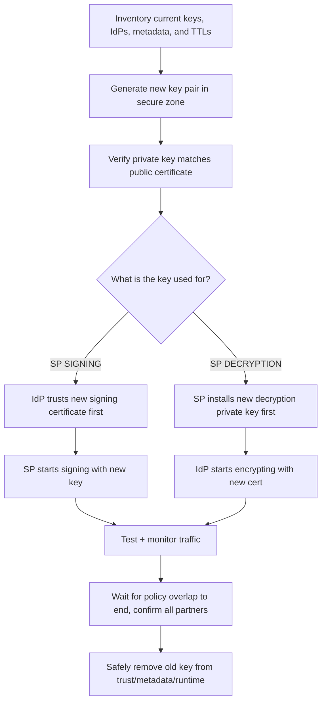
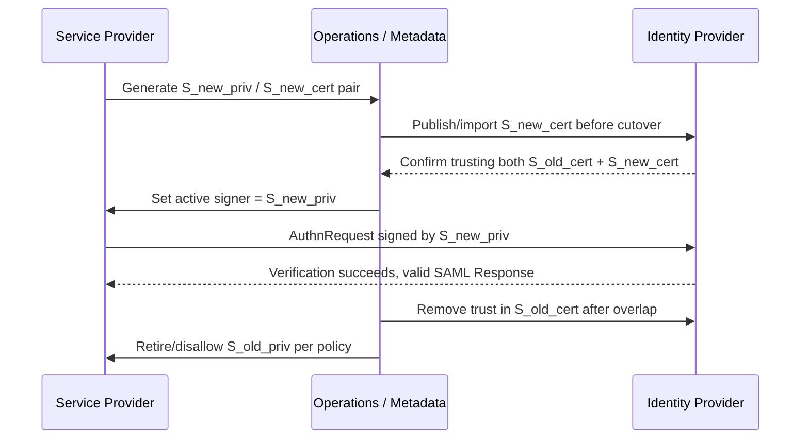
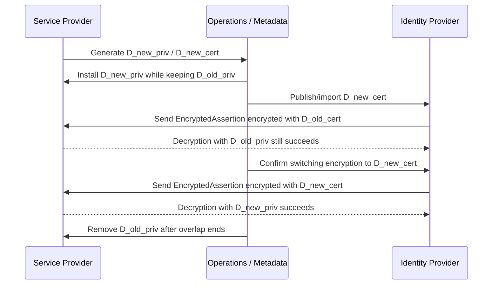

# Rotating Service Provider signing and decryption keys in SAML2

**Topic:** Spring Security – federation → Keys and certificates.

A SAML2 Service Provider (SP/Relying Party) application can hold a **private key used to sign** messages sent to an Identity Provider (IdP/Asserting Party) and a **private key used to decrypt** assertions or attributes encrypted by the IdP for the SP. Both purposes can use public X.509 certificates in metadata, yet **their key replacement sequences differ**. If keys rotate without IdP coordination and an appropriate overlap window, users may be unable to log in even though both sides implement SAML properly.

**Core principles:**

- **Rotating the SP signing key:** The IdP must know and **trust the new public certificate before the SP begins signing with the new private key**. During transition, the IdP may need to accept signatures produced by both the old and new keys.
- **Rotating the SP decryption key:** The SP must **pre-install the new private key before the IdP begins encrypting with the new public certificate**, while keeping the old private key long enough to decrypt in-flight SAML Responses or those still sent by the IdP under the old certificate.
- **If a private key is compromised:** Do not treat this as a routine rollover with a relaxed waiting window. Activate incident response, remove/revoke trust in the compromised key, and coordinate an emergency switchover.

This lesson uses Spring Security Servlet/MVC, `RelyingPartyRegistration`, `Saml2X509Credential`, and `saml2Metadata`; sample configs target Spring Boot 4.1.x, Java 17+. Cryptographic and SAML metadata principles apply broadly, yet exact config paths and APIs must be checked against your running version.

## 1. Accurately distinguishing who uses which key

In SAML federation, there are typically **two private-key owners** and **four cryptographic roles**. Confusing the direction causes many rotation incidents.

| Owner | Role | Where is the private key? | Who uses the public certificate? |
| --- | --- | --- | --- |
| **SP** | **SIGNING**: signs `AuthnRequest`, potentially `LogoutRequest`/`LogoutResponse` per config | **SP only** (or HSM/KMS service signing on SP's behalf) | **IdP** uses SP's public certificate to verify signatures |
| **SP** | **DECRYPTION**: decrypts `EncryptedAssertion`, `EncryptedID`, `EncryptedAttribute` sent to SP | **SP only** | **IdP** uses SP's public certificate to encrypt messages for SP |
| **IdP** | **SIGNING**: signs SAML Response/Assertion | **IdP only** | **SP** holds IdP verification certificate to verify signatures |
| **IdP** | **ENCRYPTION**: encrypts outbound payload | Usually no IdP private key needed when encrypting with SP public key; exact role depends on protocol | **SP decryption public certificate** is the input for IdP encryption |

**Signature ≠ encryption.** Signatures let the receiver verify origin/integrity; encryption protects payload confidentiality when the right decryption private key is kept secure. A valid signature **does not make an assertion confidential**; an encrypted assertion **does not by itself prove the IdP is a trusted source** if signature/issuer/condition checks are skipped.

**Yet another certificate:** the HTTPS/TLS certificate for `https://portal.example.com` protects browser/gateway connections. It has its **own lifecycle** and does not automatically rotate when updating SAML `signing.credentials` or `decryption.credentials`. TLS certificate, SP signing certificate, and SP decryption certificate can have separate cadences.

### 1.1. Can one key serve both functions?

Spring Security provides `Saml2X509Credential` with `SIGNING` and `DECRYPTION` types on the SP side; the same key pair can be configured for both if algorithms, IdP, and policy allow. However, in high-security systems, consider **separating signing and decryption keys**:

- Independent rotation per purpose; no need to force the IdP to change encryption settings every time the SP rotates its signing key.
- Limits blast radius if one key is compromised.
- Clean key/HSM access separation: a signing service needs no right to decrypt sensitive data.
- Easy to identify which certificate maps to `KeyDescriptor use="signing"` vs. `use="encryption"`.

If the SP currently shares one key pair across both roles, **plan rollover for both roles**, since one change can simultaneously impact AuthnRequest verification and Assertion decryption. Never swap a single key alias without accounting for the other side.

## 2. Metadata and certificate boundaries

`RelyingPartyRegistration` models an SP–IdP connection, including:

- Local `registrationId` in Spring Security.
- SP `entityId` and ACS address.
- **SP signing credentials**: SP private key + X.509 certificate.
- **SP decryption credentials**: SP private key + X.509 certificate.
- **IdP verification credentials**: trusted public certificate for the SP to verify IdP signatures.
- SSO URL, issuer/entity ID, and requirements from IdP metadata.

Spring Security provides the DSL:

```java
http.saml2Login(Customizer.withDefaults())
    .saml2Metadata(Customizer.withDefaults());
```

When `saml2Metadata` is enabled, the SP publishes metadata from its registrations at paths such as:

```text
GET https://portal.example.com/saml2/metadata/partner-a
GET https://portal.example.com/saml2/service-provider-metadata/partner-a
```

Metadata helps the IdP load the right public keys/certificates. However, **published metadata ≠ IdP accepted or refreshed**. Some IdPs import XML once, some fetch periodically, some allow only one signing certificate or one encryption certificate, and some require manual admin steps to switch the active key.

### 2.1. `KeyDescriptor` in SP metadata

A simple SAML metadata document can contain:

```xml
<md:SPSSODescriptor
    xmlns:md="urn:oasis:names:tc:SAML:2.0:metadata"
    xmlns:ds="http://www.w3.org/2000/09/xmldsig#"
    protocolSupportEnumeration="urn:oasis:names:tc:SAML:2.0:protocol">
  <md:KeyDescriptor use="signing">
    <ds:KeyInfo>
      <ds:X509Data>
        <ds:X509Certificate>BASE64_PUBLIC_CERT_OLD</ds:X509Certificate>
      </ds:X509Data>
    </ds:KeyInfo>
  </md:KeyDescriptor>
  <md:KeyDescriptor use="signing">
    <ds:KeyInfo>
      <ds:X509Data>
        <ds:X509Certificate>BASE64_PUBLIC_CERT_NEW</ds:X509Certificate>
      </ds:X509Data>
    </ds:KeyInfo>
  </md:KeyDescriptor>
  <md:KeyDescriptor use="encryption">
    <ds:KeyInfo>
      <ds:X509Data>
        <ds:X509Certificate>BASE64_PUBLIC_DECRYPTION_CERT_NEW</ds:X509Certificate>
      </ds:X509Data>
    </ds:KeyInfo>
  </md:KeyDescriptor>
</md:SPSSODescriptor>
```

**This is an illustrative XML snippet, not complete metadata or valid Base64 certificates.** Real SAML metadata requires `EntityDescriptor@entityID`, ACS, and mandatory fields; certificates must be real PEM/DER X.509 public keys. Each certificate/key has its own role. `KeyDescriptor@use` can be `signing`, `encryption`, or omitted per schema/agreement; the importing party must interpret it accurately.

**When multiple keys exist during rollover:** The OASIS Metadata Interoperability Profile allows advertising an upcoming signing key to prepare for cutover; currently accepted keys must be represented per the metadata contract. Never see both certificates present and assume the IdP will automatically trust or use them: **verify the IdP's actual capabilities**.

### 2.2. Public certificates are not private keys

- `.crt` typically holds a **public X.509 certificate**, which can be sent to the IdP over an authenticated channel.
- `.key`/private keys must live in a secret manager, HSM, or restricted filesystem, never committed to Git, image layers, logs, tickets, or metadata.
- The certificate's **SHA-256 fingerprint** is useful for two-party comparison; it is not a secret and does not replace verifying the metadata source.
- **Never edit XML metadata by hand** to insert a new certificate if the running app lacks the matching private key. Update runtime config, export fresh metadata, and verify from the exact environment.
- **Do not use X.509 expiry as the sole decider of SAML trust.** In many SAML profiles, certificates serve as metadata-trusted public-key containers; expiry/CA-chain rules are governed by the IdP, metadata trust policy, and organizational policy. Still, monitor `notBefore/notAfter` to satisfy vendor/policy requirements and rollover planning.

## 3. Overall strategy: prepare → publish → switch → retire

Both flows share the **overlap window** principle, yet "who must have the key first" differs.



**Overlap duration is not a single universal number.** Calculate at minimum from: IdP metadata refresh cadence, cache/`validUntil`/`cacheDuration`, cluster/config propagation, IdP retries, in-flight SAML sessions, rollback capability, and partner SLAs. Many IdPs do not refresh metadata automatically, so a "24-hour" overlap solves nothing if they still trust only the old certificate.

### 3.1. Partner checklist to inventory beforehand

| Field | Example / reason |
| --- | --- |
| `registrationId` | `partner-a` or `partner-b` — each separate IdP may have a different cutover schedule |
| SP entity ID / ACS | Must stay **stable** across key rotation unless an independent change was approved |
| Old / new signing cert | Fingerprint, serial, `notAfter`, where the private key lives |
| Old / new decryption cert | Fingerprint, where the private key lives, list of IdPs encrypting with each cert |
| IdP metadata refresh | Auto-fetched, manual file import, or admin action? How frequent? |
| Multiple cert support | Can it trust two signing certs? Can it pick an encryption cert and switch gradually? |
| Test endpoint | Staging IdP/SP/ACS, test login users, partner contacts |
| Deployment architecture | Single instance or multiple pods, secret mounts, HSM/KMS, and rollout order |
| Rollback | Can the old signer be re-enabled? Does IdP still trust both? How long is old decrypt key kept? |

Do not start rollout without knowing **which partners receive the new public key, which key is active, and whether rollback is possible**.

## 4. Zero-downtime rotation of the **SP signing key**

### 4.1. Context

SP signs `AuthnRequest` with `S_old_priv`. IdP trusts `S_old_cert`. Goal: SP signs with `S_new_priv` and IdP trusts `S_new_cert`, keeping entity ID/ACS unchanged.

**Correct order:** establish **trust first**, switch signer second.



### 4.2. Phases

**S0 — Baseline:** SP signs with old key; IdP trusts only old certificate. Capture metadata/fingerprints, baseline login success rate, and current IdP settings.

**S1 — Prepare:** Generate new key via tool/HSM meeting mutually allowed algorithms and sizes (e.g., RSA per org policy); verify certificate matches private key, validity window, storage, and access controls.

**S2 — Publish/pretrust:** Place the new public certificate into IdP trust configuration or imported metadata. If the IdP supports old+new, have it trust **both** before cutover. Some IdPs limit you to a single key; in that case plan synchronized cutover timing, canarying, or a maintenance window — **never promise zero downtime**.

**S3 — Activate new signer:** Once the partner confirms trusting the new key, switch the **credential actually used for signing** to the new private key. Inspect the AuthnRequest signature in the **actual binding** and compare against the public certificate the IdP trusts. Never treat "added an entry to `signing.credentials`" as proof the framework chose the new key; observe real requests.

**S4 — Observe:** Test login with every IdP/tenant, SP-initiated flows, SAML Logout Requests if used, multiple nodes/canaries, and `SignatureVerificationFailed` error rates at the IdP. During overlap, partners may need to keep trusting old+new while pods finish switching.

**S5 — Retire old:** When every SP node signs with the new key, the IdP no longer needs old trust, rollback has expired, and old transactions have ended, remove the old cert from trust/metadata and the old private key from runtime; destroy the key per policy. Never delete before confirming partners have switched.

### 4.3. Why does the reverse order fail?

Wrong:

```text
T=0: SP switches to S_new_priv
T=1: IdP still trusts only S_old_cert
T=2: IdP receives AuthnRequest signed with S_new_priv
T=3: IdP rejects InvalidSignature
```

Right:

```text
T=0: IdP trusts S_old_cert + S_new_cert
T=1: SP switches to S_new_priv
T=2: IdP verifies with S_new_cert
T=3: SP and IdP complete login
T=4: After overlap, retire S_old_cert
```

**Signing binding note:** SAML HTTP-Redirect can sign query parameters (`SAMLRequest`/`RelayState`/`SigAlg`), whereas HTTP-POST can use an embedded XML Signature. **Never conclude a request is unsigned merely because decoded Redirect XML lacks `ds:Signature`.** Inspect signatures per actual binding and configuration.

## 5. Zero-downtime rotation of the **SP decryption key**

### 5.1. Context

IdP currently encrypts `EncryptedAssertion` with `D_old_cert`; SP decrypts using `D_old_priv`. Goal: IdP encrypts with `D_new_cert` and SP decrypts with `D_new_priv`.

**Correct order: SP must support decrypting with the new private key before the IdP uses the new public key.** Simultaneously, the SP must typically continue accepting content encrypted with the old cert during transition.



### 5.2. Phases

**D0 — Baseline:** IdP uses old public certificate to encrypt; SP holds only old private decryption key.

**D1 — Prepare new decryptor:** Generate new key pair and **install `D_new_priv` on all SP nodes** in decryption credentials first while keeping `D_old_priv`. Verify runtime can decrypt test payloads with both private keys. If the IdP does not yet send encrypted payloads, use fixtures created by a trusted tool from the public cert or IdP sandbox.

**D2 — Publish new encryption certificate:** Publish updated SP metadata with the new public cert per contract. **Caution:** if metadata lists two `KeyDescriptor use="encryption"` entries, the IdP might pick either key when encrypting, depending on implementation. Never assume XML order forces the IdP to choose a specific cert. Thus every SP node must be ready to decrypt with **both private keys before publishing the new cert**.

**D3 — Ask IdP to switch encryptor:** Partner imports metadata/selects the active key and confirms when it begins encrypting with the new cert. Send test responses carrying `EncryptedAssertion`/`EncryptedID`/`EncryptedAttribute`. Without encrypted payloads in tests, there is no proof decryption was exercised.

**D4 — Observe mixed traffic:** Retain old+new private keys, as the IdP may have caches/parallel paths or requests started pre-cutover. Check every tenant, certificate fingerprints/key hints in encrypted data (where available), decryption errors, logins, and SSO sessions.

**D5 — Retire old decryptor:** Only when confirmed **no IdP still encrypts with the old cert**, message/retry/cache lifetimes have elapsed, and rollback is finalized, remove the old public cert from metadata and the old private key from active runtime. Destroy/seal the old private key per retention policy; do not rush deletion if historical encrypted data needs decryption, yet never keep keys indefinitely "just in case".

### 5.3. Why does the reverse order fail?

Wrong:

```text
T=0: SP metadata already publishes D_new_cert
T=1: IdP picks D_new_cert to encrypt response
T=2: SP still holds only D_old_priv
T=3: Spring Security cannot decrypt EncryptedAssertion
```

Right:

```text
T=0: SP runtime holds D_old_priv + D_new_priv
T=1: SP metadata publishes D_new_cert per agreement
T=2: IdP switches encryptor to D_new_cert
T=3: SP decrypts with D_new_priv
T=4: Once overlap ends, remove D_old_priv
```

### 5.4. Do not confuse with IdP verification certificate

SP decrypts using the **SP private key**; SP verifies IdP signatures using the **IdP public certificate**. If login fails with `InvalidSignature` from OpenSAML, that is not automatically a `decryption.credentials` error. Distinguish:

- `Cannot decrypt EncryptedAssertion`: check SP decryption key matching and encryption algorithm/binding.
- `Signature validation failed`: check **IdP verification trust** and IdP signing certificate.
- `AuthnRequest signature invalid` at IdP: check **SP signing private key** and SP signing certificate trusted by the IdP.

Rotating the IdP signing cert is a different runbook from rotating SP signing/decryption; never overwrite `assertingparty.verification.credentials` by mistake during an SP key rotation.

## 6. Splitting two workflows when the SP uses **the same key pair**

Legacy setups often look like:

```text
SP.key = K_old_private
SP.cert = K_old_public

K_old used for SIGNING and DECRYPTION
```

To split into two dedicated pairs:

1. Create `S_new` for signing and `D_new` for decryption; verify compatible algorithms/keystore/HSM.
2. Install `D_new_priv` on all SP nodes, **still keeping `K_old_priv` for decryption**.
3. Publish signing certificate `S_new_cert` to the IdP and have the IdP trust it first.
4. Only after trust is ready, switch the signer to `S_new_priv`.
5. Publish decryption certificate `D_new_cert` (SP already has the decryptor installed), letting the IdP begin encrypting with the new cert.
6. Keep `K_old_priv` for late-arriving encrypted assertions, and keep the old signing cert trusted at the IdP while any node still signs with old.
7. Verify every IdP and every encryption/signature flow; retire `K_old` only after overlap finishes.

Never perform every step in **a single unobservable deployment** when multiple IdPs vary in import/trust mechanics. Separating signing cutover from decryption cutover makes root-causing login failures straightforward.

## 7. Spring Boot configuration for a SAML SP

### 7.1. Maven dependencies and Spring Security Servlet

Example for **Spring Boot 4.1.2 + Spring Security managed by Boot BOM + Java 17+**. This lesson contains only the necessary fragments of a Maven project, not an app that can log in against fake domains.

`pom.xml` (abbreviated yet showing dependencies and repository):

```xml
<?xml version="1.0" encoding="UTF-8"?>
<project xmlns="http://maven.apache.org/POM/4.0.0"
         xmlns:xsi="http://www.w3.org/2001/XMLSchema-instance"
         xsi:schemaLocation="http://maven.apache.org/POM/4.0.0
           https://maven.apache.org/xsd/maven-4.0.0.xsd">
  <modelVersion>4.0.0</modelVersion>
  <parent>
    <groupId>org.springframework.boot</groupId>
    <artifactId>spring-boot-starter-parent</artifactId>
    <version>4.1.2</version>
    <relativePath/>
  </parent>
  <groupId>com.example</groupId>
  <artifactId>saml-key-rotation</artifactId>
  <version>1.0.0</version>
  <properties><java.version>17</java.version></properties>
  <repositories>
    <repository>
      <id>shibboleth-releases</id>
      <url>https://build.shibboleth.net/maven/releases/</url>
      <snapshots><enabled>false</enabled></snapshots>
    </repository>
  </repositories>
  <dependencies>
    <dependency>
      <groupId>org.springframework.boot</groupId>
      <artifactId>spring-boot-starter-webmvc</artifactId>
    </dependency>
    <dependency>
      <groupId>org.springframework.boot</groupId>
      <artifactId>spring-boot-starter-security</artifactId>
    </dependency>
    <dependency>
      <groupId>org.springframework.boot</groupId>
      <artifactId>spring-boot-starter-security-saml2</artifactId>
    </dependency>
    <dependency>
      <groupId>org.springframework.boot</groupId>
      <artifactId>spring-boot-starter-test</artifactId>
      <scope>test</scope>
    </dependency>
  </dependencies>
</project>
```

Spring Security SAML2 Service Provider uses OpenSAML; official docs require configuring the **Shibboleth Releases** repository. Depending on Boot branch, starters differ in name (e.g., Boot 3.5 uses `spring-security-saml2-service-provider` directly). Never swap Spring Security 6/7 or OpenSAML major versions against the BOM without testing.

`SecurityConfig.java` (class fragment placed inside a configured Spring Boot app):

```java
package com.example.federation;

import org.springframework.context.annotation.Bean;
import org.springframework.context.annotation.Configuration;
import org.springframework.security.config.Customizer;
import org.springframework.security.config.annotation.web.builders.HttpSecurity;
import org.springframework.security.web.SecurityFilterChain;

@Configuration
public class SecurityConfig {

    @Bean
    SecurityFilterChain securityFilterChain(HttpSecurity http)
            throws Exception {
        http.authorizeHttpRequests(auth -> auth
                .requestMatchers(
                    "/",
                    "/error",
                    "/saml2/metadata",
                    "/saml2/metadata/**",
                    "/saml2/service-provider-metadata/**"
                ).permitAll()
                .anyRequest().authenticated())
            .saml2Login(Customizer.withDefaults())
            .saml2Metadata(Customizer.withDefaults());
        return http.build();
    }
}
```

In a real project, you need `@SpringBootApplication`/main class, valid IdP metadata/registration, and existing certificates and secret files; **this code alone does not create accounts or an IdP**. `saml2Login` handles SSO; `saml2Metadata` publishes SP metadata for partners. If organizational policy restricts metadata exposure, apply proper trusted network/gateway policies so the IdP can fetch XML rather than forcing user logins just to import metadata.

### 7.2. Configuring multiple decryption credentials during rollover

`application.yml` (phase **D1/D2**: SP already holds both decryptors; new signer enabled **only after IdP trust**):

```yaml
spring:
  security:
    saml2:
      relyingparty:
        registration:
          partner-a:
            entity-id: https://portal.example.com/saml2/sp/partner-a
            signing:
              credentials:
                - private-key-location: file:/run/secrets/saml/signing-new.key
                  certificate-location: file:/run/secrets/saml/signing-new.crt
            decryption:
              credentials:
                - private-key-location: file:/run/secrets/saml/decrypt-new.key
                  certificate-location: file:/run/secrets/saml/decrypt-new.crt
                - private-key-location: file:/run/secrets/saml/decrypt-old.key
                  certificate-location: file:/run/secrets/saml/decrypt-old.crt
            assertingparty:
              metadata-uri: https://login.partner.example/metadata.xml
```

**Important note:** this is the **target snapshot after the IdP has accepted the new signing cert**, not a safe configuration to apply immediately at phase S0 when the IdP still trusts only the old signing cert. While in S0/S1, keep `signing-old.key/crt` as the active signer until the IdP has pretrusted. You can advertise the new signing cert in metadata/trust before switching signers, yet confirm **which key the app actually picks** to sign (check exact version flow/JavaDoc, especially if declaring multiple signing credentials). If active signing selection cannot be clearly controlled, separate pretrust from the runtime signer and coordinate cutover.

**Values in the example:**
- `signing-new.key` is the new SP signing private key; `signing-new.crt` is the paired public certificate.
- `decrypt-new.key/crt` and `decrypt-old.key/crt` retain **two private decryptors** during overlap. Ordering may influence decryption attempt strategy depending on version — verify empirically rather than guessing from filenames.
- `assertingparty.metadata-uri` is the **IdP metadata URL**; SP metadata is exposed via `saml2Metadata` on the SP domain. Never swap the two URLs.
- `entity-id` should remain stable across rotation. Changing the entity ID can make the IdP treat the app as a brand-new SP.

**Never place private keys in Git or unprotected ConfigMaps.** On Kubernetes, use governed secrets/HSM/CSI drivers per policy, mount read-only, restrict RBAC and filesystem permissions, and audit access; update key versions through planned deployments. Some HSMs sign via API without exportable private keys; those require library customization support and vendor-specific integration testing.

### 7.3. SAML metadata after rotation must be verified from the **public host**

```bash
curl -fSL \
  https://portal.example.com/saml2/metadata/partner-a \
  -o sp-metadata.xml

xmllint --noout sp-metadata.xml
```

`xmllint` is not part of the Java JDK; install the corresponding XML tool. Well-formed XML is only the first step; verify `EntityDescriptor@entityID`, `SPSSODescriptor`, `KeyDescriptor`, `AssertionConsumerService`, and certificate fingerprints inside the metadata.

If the app runs behind a reverse proxy/ingress, metadata can accidentally emit `http://localhost` or an internal host, causing the IdP to import wrong ACS/entity IDs. Configure forwarded headers **trusted only from controlled proxies**; never use key rotation as a cover to silently alter ACS or SP entity IDs.

### 7.4. Java API when not using YAML auto-configuration

Spring Security provides `Saml2X509Credential.signing(privateKey, certificate)` and `Saml2X509Credential.decryption(privateKey, certificate)` alongside the `RelyingPartyRegistration` builder. The snippet below is a **Java fragment illustrating object roles**, not a standalone program; key/cert loading must come from a security/secret manager.

```java
// Example within building a RelyingPartyRegistration already loaded from trusted IdP metadata.
Saml2X509Credential signingNew =
        Saml2X509Credential.signing(signingPrivateKey, signingCertificate);

Saml2X509Credential decryptionNew =
        Saml2X509Credential.decryption(decryptionNewPrivateKey,
                decryptionNewCertificate);
Saml2X509Credential decryptionOld =
        Saml2X509Credential.decryption(decryptionOldPrivateKey,
                decryptionOldCertificate);

// Builder already initialized from trusted IdP metadata:
builder.signingX509Credentials(credentials -> {
    credentials.clear();
    credentials.add(signingNew);
});
builder.decryptionX509Credentials(credentials -> {
    credentials.clear();
    credentials.add(decryptionNew);
    credentials.add(decryptionOld);
});
```

If your actual Spring version does not support this exact overload/collection, check the JavaDoc of your running version. **Never manually decrypt XML or sign SAML with private keys inside controllers**. Spring Security/OpenSAML manages XML signatures, SAML bindings, and validation; custom resolvers, metadata builders, or HSM adapters must be tested independently.

### 7.5. Avoid single-node-only rollovers

Suppose there are 6 pods:

```text
Pods 1–3: decrypt new + old
Pods 4–6: decrypt old only
IdP: just started encrypting with new cert
```

Callbacks routed by the load balancer to pods 4–6 will fail randomly. Therefore **finish deploying the new decryptor across the entire SP fleet before the IdP starts encrypting with the new cert**. When switching signers, during the window when half the pods sign old and half sign new, the IdP must trust both signing certs. Never let pods publish metadata with different key sets behind the same URL if partners cache/refresh without knowing which pod generated the XML.

## 8. Managing certificates/keys and verifying with OpenSSL

### 8.1. Inspecting public certificates without reading private key values

Commands run in an environment with `openssl` and read only **public certificates**:

```bash
openssl x509 -in signing-new.crt -noout -subject -issuer -serial -dates
openssl x509 -in signing-new.crt -noout -fingerprint -sha256

openssl x509 -in decrypt-new.crt -noout -subject -issuer -serial -dates
openssl x509 -in decrypt-new.crt -noout -fingerprint -sha256
```

Printed values depend on real certificates; **there is no fixed stdout**. Record in the change ticket: old/new SHA-256 fingerprints, public cert roles, serials, cutover timestamps, IdP owners, and import confirmations. Fingerprints **do not replace protecting private keys**.

### 8.2. Verifying a certificate matches its private key

One OpenSSL check (run only on a secure host authorized to read the private key; never write keys to disk/logs):

```bash
openssl x509 -in signing-new.crt -pubkey -noout \
  | openssl pkey -pubin -outform DER \
  | openssl dgst -sha256

openssl pkey -in signing-new.key -pubout -outform DER \
  | openssl dgst -sha256
```

Both digests must be **equal** if the certificate's public key matches the private key. This method does not depend on RSA modulus specifically and works across OpenSSL-supported key types. If the private key is non-exportable inside an HSM, use APIs checking the public key/key alias or a test signature verified with the matching certificate; never force exporting private keys merely to compare fingerprints.

**Safety:** `.key` files must never appear in screenshots/tickets; never run commands that might print private keys to stdout, never copy secrets to personal laptops, and never introduce keys into uncontrolled CI environments.

### 8.3. When generating new key pairs

Use OpenSSL/HSM compliant with organizational algorithm standards. Example generating an RSA key pair **in a controlled zone** (illustrative only; never use simple names/paths like these in production without a secret policy):

```bash
openssl genpkey -algorithm RSA -pkeyopt rsa_keygen_bits:3072 \
  -out sp-signing-new.key

openssl req -new -x509 -sha256 -days 365 \
  -key sp-signing-new.key \
  -subj "/CN=portal-saml-sp-signing" \
  -out sp-signing-new.crt
```

The example generates a self-signed X.509 certificate to represent the public key; in SAML federation, trust usually follows metadata/pinned certificates and IdP policy — **never assume the IdP will accept a self-signed cert**. Production may require certificates issued by an internal/partner-approved CA, non-exportable HSM keys, specific algorithms/sizes, KeyUsage/ExtendedKeyUsage extensions, and contractual rotation schedules. Generating keys directly inside an approved secret manager/HSM is preferred whenever possible.

## 9. Standalone Java 17: simulating the two switchover sequences

The program below is a **simulation of inter-party security dependencies**; it does not read SAML/XML, perform real signing/decryption, or replace integration tests. It clarifies the invariant at each step: the new signer may be used only after the IdP trusts it, and the new encryptor may be turned on only after the SP installs the matching decryptor.

File `SamlKeyRotationDemo.java`:

```java
public class SamlKeyRotationDemo {
    record SigningState(
            boolean idpTrustOld,
            boolean idpTrustNew,
            String activeSigner) {

        boolean canSignAndVerify() {
            return switch (activeSigner) {
                case "old" -> idpTrustOld;
                case "new" -> idpTrustNew;
                default -> false;
            };
        }
    }

    record EncryptionState(
            boolean spCanDecryptOld,
            boolean spCanDecryptNew,
            String activeIdpEncryptor) {

        boolean canEncryptAndDecrypt() {
            return switch (activeIdpEncryptor) {
                case "old" -> spCanDecryptOld;
                case "new" -> spCanDecryptNew;
                default -> false;
            };
        }
    }

    public static void main(String[] args) {
        SigningState unsafeSign =
                new SigningState(true, false, "new");
        SigningState safeSign =
                new SigningState(true, true, "new");

        EncryptionState unsafeDecrypt =
                new EncryptionState(true, false, "new");
        EncryptionState safeDecrypt =
                new EncryptionState(true, true, "new");

        System.out.println("Signer before IdP trust: "
                + unsafeSign.canSignAndVerify());
        System.out.println("Signer after IdP trust: "
                + safeSign.canSignAndVerify());
        System.out.println("IdP encrypts before SP setup: "
                + unsafeDecrypt.canEncryptAndDecrypt());
        System.out.println("IdP encrypts after SP setup: "
                + safeDecrypt.canEncryptAndDecrypt());
    }
}
```

Run from the directory containing the file:

```bash
javac SamlKeyRotationDemo.java
java SamlKeyRotationDemo
```

**Exact stdout with JDK 17+:**

```text
Signer before IdP trust: false
Signer after IdP trust: true
IdP encrypts before SP setup: false
IdP encrypts after SP setup: true
```

The boolean model lacks metadata caches, networking, XML Signatures, encryption algorithms, and distributed sessions; it solely teaches the ordering rule. Real systems require a **sandbox IdP performing real signing/encryption, browser SSO, and multi-node runtimes** to verify safety.

## 10. Transition state and rollback table

| Phase | SP active signing | IdP trusts SP signing | IdP encryption key | SP decryption keys | Can users log in? |
| --- | --- | --- | --- | --- | --- |
| Before rotation | Old | Old | Old | Old | Yes, if other SAML conditions pass |
| Prepare signing | Old | Old + New | Old | Old | Yes; signing not yet switched |
| Switch signing | New | Old + New | Old | Old | Yes; monitor results per IdP |
| Prepare decryption | New | Old + New | Old | Old + New | Yes; SP ready for new encryptor |
| Switch decryption | New | Old + New | New or temporarily Old | Old + New | Yes during overlap if SP handles both |
| Complete | New | New | New | New | Yes, once all parties verified |

**These are target states, not automatic guarantees.** If an IdP trusts only one signing key, supports only one encryption certificate, or does not fetch new metadata, the plan requires a dedicated coordinated cutover and possibly maintenance. If the new certificate is not yet valid or the IdP rejects the new algorithm/key, resolve that beforehand.

### 10.1. Rollback on signer failure

If the SP already signs with the new key yet the IdP cannot verify:
1. Halt rollout of the new signer across the remaining fleet.
2. If the IdP still trusts the old cert, temporarily **revert the active signer to the old key** from the protected secret version, with change/incident approval.
3. Verify real requests after rollback are signed with the old cert; re-test login/SP logout.
4. Fix trust metadata/import at the IdP and confirm before retrying.
5. Never roll back to the old key if rotation was triggered because the **private key was compromised**.

### 10.2. Rollback on decryptor failure

If the IdP already encrypts with the new cert yet some SP nodes fail to decrypt:
1. Verify every node has the **real new private key** matching the certificate the IdP uses.
2. If infrastructure is intact, ask the IdP to temporarily encrypt with the old cert **only if the old private key remains uncompromised and all nodes can decrypt old**.
3. Never remove the new decrypt key from runtime while the IdP still sends ciphertext using the new public cert.
4. Check rollout consistency, encodings/algorithms, key selection, and key file formats.
5. If the old key was compromised, never revert to the old encryptor; prioritize finishing rollout of the new decryptor and incident response.

**Rollback does not mean restoring an old container image lacking the new private key.** An old image might only decrypt old while the IdP encrypts new; ensure secret compatibility across both release and rollback versions.

## 11. Handling private key compromise

Routine rollover and key compromise response differ:

| Scenario | Severity | Decision |
| --- | --- | --- |
| Certificate nearing expiry, key uncompromised | Planned rotation | Schedule overlap based on metadata/cache/partner SLA |
| Weak algorithm, migrating RSA/key size or policy | Planned migration with risk | Test IdP algorithm support and sign/encrypt beforehand |
| SP private signing key leaked | **Security incident** | Block key usage, notify IdP to urgently remove old trust, rotate, and investigate forged AuthnRequest/LogoutRequest |
| SP private decryption key leaked | **Data confidentiality incident** | Stop IdP from encrypting further with old public cert, rotate key, assess captured encrypted assertions, audit logs/storage |
| IdP verification certificate changed without notice | Potential trust incident or migration | Never auto-import to "restore login"; verify with IdP via official channels |
| Old key retired per procedure | End of overlap | Remove trust/public metadata/key from runtime per policy; keep protected audit/backups if required |

**Per the OASIS Metadata Interoperability Profile, compromised keys must be removed from the owning entity's metadata.** Never keep advertising an old cert because "partners are slow to update" if that leaves a compromised key as a trusted option. Coordinate controlled isolation/rollback in incident response, accepting downtime if needed to protect users and data.

For a compromised **decryption key**, payloads previously encrypted under the corresponding public cert can be decrypted if an attacker captured ciphertext. Assess data exposure over time per security policy rather than merely swapping certificates and closing the ticket.

## 12. Differences across IdP vendors and multiple partners

| IdP characteristic | Rotation impact | Questions to confirm |
| --- | --- | --- |
| Supports multiple SP signing certificates | Allows old+new pretrust and smooth cutover | Does it verify both on incoming AuthnRequest? Does order matter? |
| Supports only one SP signing certificate | Cutover must be synchronized; zero downtime cannot be assumed | Exact cutover time on IdP? Any staged/duplicate app or test slot? |
| Supports multiple SP encryption certificates | May pick the new cert immediately upon metadata import | Did the SP install the new decrypt key on **all nodes**? How does IdP choose a cert? |
| Supports only one encryption certificate | Switching encryptor requires exact coordination | Cert rollback mechanics, retries, and stale messages? |
| Auto-refreshes metadata | Must understand cache/validUntil/refresh schedule | Last refresh timestamp, fetch errors, currently trusted cert? |
| Manual metadata import | Updating SP XML is not enough | Who confirms importing the new fingerprint and when? |
| Signs SAML Logout | Changing SP signer can break SLO | Has the partner tested signed LogoutRequest/LogoutResponse? |
| Uses encrypted attributes/EncryptedID | Not just EncryptedAssertion needs decryption | Have all actual encrypted payload types been tested? |
| Has federation proxy/broker | Multiple trust layers and caches | Is the broker or upstream IdP actually verifying/encrypting? |
| Multiple SP instances/regions | Instances might hold different keys | Is exported metadata identical? Has secret rollout finished? |

For each partner, maintain a **change record** with old/new fingerprints of signing and decryption certs, tenant registration, IdP import status, cutover date, test verifier, overlap duration, old-key removal criteria, and rollback plan. Never write merely "rotated certificate" — record the **role** and **private key owner**.

## 13. Practical testing before, during, and after rollover

### 13.1. Before cutover

- [ ] Verify baseline login per IdP, issuer/entity ID, ACS, response signatures, and actual encryption.
- [ ] Inventory SP signing/decryption keys (never copy private keys into docs).
- [ ] Verify new key pairs via public-key digest or HSM test operation; record exact certificate fingerprints.
- [ ] Document key roles, algorithms, lengths, certificate validity, and IdP policies.
- [ ] Fetch SP metadata via the public domain, not localhost; XML contains accurate key descriptors and ACS.
- [ ] If using multiple signing certs, prove the IdP **actually verifies both**.
- [ ] Deploy the new decryptor to all nodes **before** any IdP uses the new cert.
- [ ] Verify key/secret mounts and read permissions across every pod/region.
- [ ] Test SAML login and SLO if enabled, checking `InResponseTo` correlation, request repository, and tenant.
- [ ] Confirm canarying, observability, on-call contacts, and freeze other IdP changes during the rotation window.

### 13.2. During cutover

| Test | How to test | Expected |
| --- | --- | --- |
| Signed AuthnRequest old | While old signer still active, IdP trusts old | Login succeeds, matching certificate |
| Signed AuthnRequest new | After IdP pretrust, SP signs new | Login succeeds, IdP verifies signature |
| Mixed signer nodes | Canary split old/new | All requests accepted by IdP; if not, halt rollout |
| Encryption old cert | IdP sends `EncryptedAssertion` using old cert | SP decrypts with old private key |
| Encryption new cert | IdP sends payload encrypted with new cert | SP decrypts with new private key on every node |
| EncryptedID/Attribute | If partner uses these types | Decrypted and authenticated properly |
| SAML Response signature | IdP signs response/assertion | SP still verifies issuer/certificate properly; do not confuse with decrypt |
| Replay/malformed SAML | Send expired assertion, bad signature, wrong audience | SP rejects; never accidentally disable validation |
| SP-initiated callback | IdP returns matching `InResponseTo` | Session/authentication request correlates |
| IdP-initiated (if enabled) | App launcher sends unsolicited response | Follows dedicated policy; never skips verification |
| SAML Single Logout | If deployed | Partner verifies request/response using new signer |
| Certificate metadata | Public XML post-deploy | Certificate/KeyDescriptor accurate, no private key leak |
| Rollback version | Run pre-rotation release as planned | Still handles payloads per active IdP cert without losing new decryptor |

### 13.3. After cutover

- [ ] No active node still signs with old when the IdP is about to remove old trust.
- [ ] No IdP still encrypts with the old certificate before the SP removes the old decryptor.
- [ ] Metadata cache/refresh or manual import confirmed for **every** IdP.
- [ ] No unapproved changes to `entityId`, `registrationId`, ACS URL, session cookies, or signing algorithms.
- [ ] SSO success, signature verification failure, and decryption failure rates stable vs. baseline.
- [ ] Re-test users across tenants, IdP app tiles, deep links, MFA, and logout.
- [ ] Keep audited change log of fingerprints/key versions without storing private keys.
- [ ] Retire old certs/keys on schedule; clear caches if needed and revoke access to old keys.
- [ ] Confirm NameID formatting/user mapping and authorization were unaffected by rotation.

## 14. Troubleshooting failures after certificate changes

| Symptom | Common cause | Proper investigation |
| --- | --- | --- |
| IdP reports `InvalidSignature` on AuthnRequest | SP signed new yet IdP does not trust new public cert yet, or different algorithm/binding | Compare fingerprints, Redirect/POST signing, IdP imported metadata, clock/relay state |
| Only some pods fail login | Mixed keys/secret versions, pod reading stale file, inconsistent metadata | Check certificate hash and secret version on **every** pod and canary traffic |
| `Unable to decrypt EncryptedAssertion` | IdP encrypts new yet SP is old-only, key/cert mismatch, or unsupported algorithm | Check `decryption.credentials`, key pair, IdP active cert, test payload |
| `EncryptedAttribute` fails while basic login works | Untested encrypted payload type, different decrypter/credential | Test exact payload/`OpenSaml5AuthenticationProvider` strategy |
| XML metadata lists both certs yet IdP uses old | IdP caches/manual import, no auto-refresh, or explicit key choice | Check IdP active encryption/signing key and metadata import timestamp |
| Public metadata changed yet login still fails | Unsynchronized runtime private key, wrong SP entity ID/ACS | Check mounted files, active signer/decryptors, metadata, and callbacks |
| New public cert has unexpected fingerprint | Wrong file/keypair or wrong cert uploaded | Compare public key hash against private key; check cert chain/serial |
| Expired key/cert rejected by vendor | IdP policy enforces specific validity/CA | Check vendor profile and validity; reissue cert per policy |
| SAML Response `Signature validation failed` | IdP signing cert changed, SP lacks new IdP verification trust | Investigate **IdP verification certificate** separately; do not tweak SP decryptor |
| `AudienceRestriction` or `Recipient` mismatch | SP entity ID/ACS accidentally changed on redeploy | Keep entity ID/ACS stable; inspect public host/forwarded headers |
| SSO callback loses session | SameSite/cookies/backend session; unrelated directly to keys | Inspect `HttpSessionSaml2AuthenticationRequestRepository`, proxy, and request correlation |
| Signing works yet SLO fails | IdP does not yet trust new cert for logout signing | Separately test LogoutRequest/LogoutResponse and key roles |
| Old decryptor removed yet old ciphertexts still arrive | Stale IdP cache, retries, or unmigrated tenant | Restore old decryptor **only if key remains safe**, or have IdP stop old encryptor per plan |
| Emergency rotation caused downtime | Old key compromised, so overlap impossible | Prioritize incident response, remove old trust, tighten controls |

**Reading logs:** separate **IdP-side signature failures on AuthnRequest**, **SP-side decryption failures on EncryptedAssertion**, and **SP-side verification failures on IdP signatures**. Never change all credential fields just because the word "certificate" appears. Log fingerprint/id/registration/timestamp and sanitized errors; never log private keys, raw SAML Assertions, session cookies, or secrets.

## 15. Real-world scenarios

**A — Partner portal, signing AuthnRequest only:** SP receives no encrypted assertions. Rotate only SP signing credential via IdP pretrust → SP activate → remove old. Do not invent decryption keys just because "rotation needs both".

**B — Hospital portal, IdP encrypts assertions:** payload confidentiality is critical; SP must install old+new decryptors before publishing the new encryption cert. Test real `EncryptedAssertion` payloads, not just metadata.

**C — Portal sharing one key for signing/decryption:** split the two key roles in phases, ensuring signer switchover never strips the old decryptor prematurely. Document which key is authorized for each role.

**D — Multi-partner SaaS with IdPs A, B, C:** IdP A supports two signing certs, B supports only one, C imports metadata manually. There is no "one-click rotate all" guaranteeing zero downtime. Agree cutover/overlap per partner with a tracking matrix.

**E — Leaked private signing key:** notify and require the IdP to remove trust in the old key; do not use planned overlap keeping a compromised key active. If IdP B cannot update immediately, temporarily blocking the affected flow may be safer than accepting forged signatures.

## 16. Condensed operations runbook

**Before:** notify partners, generate new key pairs, store in HSM/secret manager, verify fingerprints, build test matrix, snapshot metadata and baseline rollout.

**Signing key:** IdP trusts **new public signing cert first** → confirm active key → SP signs with new → test real login/Logout → retire old trust/key once overlap ends.

**Decryption key:** SP installs **new private decryptor first** while keeping old decryptor → publish new public encryption cert → IdP encrypts with new → test both old/new ciphertexts → retire old private decryptor once all partners have switched.

**Close change:** metadata, runtime secret versions, and IdP settings align; SSO passes across tenants; no old keys retained against policy; audit records fingerprints, approvers, and rollback criteria.

**If compromise occurs:** switch immediately to incident response; never extend trust in an exposed key merely to avoid login errors.

## 17. Official documentation and standards

1. [Spring Security – SAML2 Login Overview](https://docs.spring.io/spring-security/reference/servlet/saml2/login/overview.html): `RelyingPartyRegistration`, signing/decryption credentials, and SP/IdP key roles.
2. [Spring Security – SAML2 Metadata](https://docs.spring.io/spring-security/reference/servlet/saml2/metadata.html): `saml2Metadata`, SP metadata endpoints, and customizing resolvers.
3. [Spring Security – Authenticating SAML Responses](https://docs.spring.io/spring-security/reference/servlet/saml2/login/authentication.html): `OpenSaml5AuthenticationProvider`, decrypting `EncryptedAssertion`/`EncryptedID`/`EncryptedAttribute`.
4. [Spring Security JavaDoc – Saml2X509Credential](https://docs.spring.io/spring-security/reference/api/java/org/springframework/security/saml2/core/Saml2X509Credential.html): `SIGNING`, `DECRYPTION`, `VERIFICATION`, `ENCRYPTION` types.
5. [Spring Security JavaDoc – RelyingPartyRegistration](https://docs.spring.io/spring-security/reference/api/java/org/springframework/security/saml2/provider/service/registration/RelyingPartyRegistration.html): signing/decryption config and builders.
6. [Spring Boot – SAML2 Relying Party configuration](https://docs.spring.io/spring-boot/4.1/reference/web/spring-security.html): configuring `signing.credentials`, `decryption.credentials`, and IdP metadata.
7. [OASIS – SAML 2.0 Metadata](https://docs.oasis-open.org/security/saml/v2.0/saml-metadata-2.0-os.pdf): `SPSSODescriptor` and `KeyDescriptor use`.
8. [OASIS – SAML Metadata Interoperability Profile](https://docs.oasis-open.org/security/saml/Post2.0/sstc-metadata-iop-os.html): publishing signing/encryption keys, key rollover, handling compromised keys.
9. [OWASP – SAML Security Cheat Sheet](https://cheatsheetseries.owasp.org/cheatsheets/SAML_Security_Cheat_Sheet): signatures, metadata trust, XML validation, replay, and federation threat model.
10. [Spring Security – SAML2 Login and Logout](https://docs.spring.io/spring-security/reference/servlet/saml2/logout.html): verifying SLO signatures when the SP rotates signing keys.

**Summary:** When rotating SAML SP keys, always ask **"which side must be ready first?"**. For **SP signing**, the IdP trusts the new certificate first and then the SP signs with it. For **SP decryption**, the SP installs the new private key first and then the IdP encrypts with the new public certificate. Maintain overlap, verify both metadata and runtime, test real signed logins/SLO and encrypted assertions, and retire old keys only once all partners have switched — except in a key compromise, where information security takes precedence over avoiding downtime.