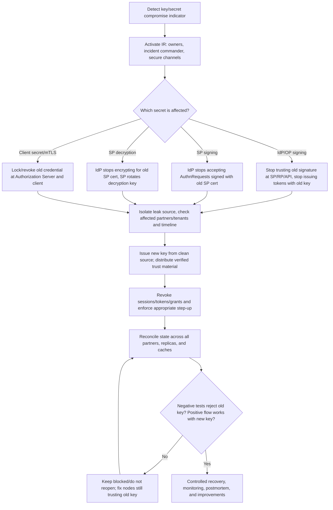

# Key compromise response: revoking trust, invalidating sessions, and partner coordination

## Learning objectives

After this lesson, you will be able to:

1. Distinguish **IdP signing key compromise**, **Service Provider (SP) signing key compromise**, **SP decryption key compromise**, **OpenID Provider (OP) JWT signing key compromise**, and **OAuth client secret compromise**; never apply one generic action to all key types.
2. Build an **emergency response runbook**: detection → triage and scoping → isolation/trust revocation → issuing new keys from a clean environment → revoking related sessions, tokens, or privileges → partner coordination → verification and recovery.
3. Understand why **replacing a certificate or rotating a key does not automatically delete existing Spring Security/IdP sessions**, does not invalidate already-signed JWTs, and **Single Logout is not guaranteed proof that all sessions were revoked**.
4. Properly update **SAML2 Relying Party Registration**, IdP metadata, or **OIDC JWKS**; understand the difference between **scheduled key rollover** and **immediate removal of a potentially compromised key**.
5. Use Spring Security/Spring Session to illustrate protecting logins after trust changes and **deleting identified sessions**; understand limitations when revoking across an entire user/tenant/application.
6. Design shared notifications and coordination plans across **IdP, SP, identity broker, enterprise partners, and API Resource Servers**, with closure criteria, auditing, and recurrence prevention.

## 1. Context: a compromised key is a trust-relationship incident

In **federated identity**, parties communicate via SAML 2.0, OpenID Connect (OIDC), and OAuth 2.0. Keys/certificates decide **who may sign**, **who verifies**, **who can decrypt**, and **which secret proves client identity**. When a private key or secret leaks, the incident can cross an application's boundaries and impact multiple partners.

Example system:

- IdP `https://idp.company.example/saml` signs SAML Assertions with a private signing key.
- Spring Boot app acts as SP, receiving `SAMLResponse` at `/login/saml2/sso/company` and verifying with an issued/approved **public verification certificate**.
- SP may sign `AuthnRequest` with the **SP private signing key** and receive `EncryptedAssertion` encrypted for the **SP public encryption certificate**.
- A similar OIDC system has an OP signing `ID tokens`/`JWT access tokens` with a private signing key; RPs/APIs verify via public keys published at JWKS.
- Parties may use **client secrets**, client assertions, or mTLS to authenticate applications at the token endpoint.

**Core point:** if a signing/decryption secret is exposed, "the X.509 certificate hasn't expired yet" is no reason to keep trusting it. When a compromised key is detected, handle it via **incident response**, unlike scheduled rotation which may let old and new keys operate in parallel.

### 1.1. Who owns which key?

| Secret type | Owner | Purpose | Risk when compromised |
| --- | --- | --- | --- |
| **IdP SAML signing private key** | IdP / Asserting Party | Signs SAMLResponse/Assertion for SP | Holder can forge IdP signatures, crafting bogus responses/assertions if bypassing protocol checks and state |
| **SP SAML signing private key** | SP / Relying Party | Signs AuthnRequest, potentially SAML LogoutRequest/metadata per design | Can forge SP-signed requests to IdP/partners; **does not automatically allow signing IdP SAML Assertions** |
| **SP SAML decryption private key** | SP | Decrypts EncryptedAssertions encrypted by IdP with SP public key | Threatens **confidentiality** of captured assertions and future assertions using the old cert; does not inherently forge IdP signatures |
| **OIDC OP / OAuth Authorization Server JWT signing private key** | OP/Authorization Server | Signs ID tokens or JWT access tokens | Can forge tokens within audiences/validators trusting the key; old tokens may remain accepted until validators drop trust or check revocation |
| **OAuth client secret** | Confidential client and Authorization Server | Authenticates client in secret-based flows | Attacker can impersonate the client at the token endpoint within protocol/credential limits; **does not automatically grant** arbitrary user access tokens |
| **Identity broker keys** | Broker | Signs downstream assertions/tokens or verifies/translates protocols | Can affect multiple upstream IdPs and downstream apps simultaneously; must pinpoint the **exact trust hop** |
| **TLS/mTLS keys** | Endpoint or client | Authenticates TLS endpoints/connections | Can create MITM/endpoint-spoofing risks under certain conditions; requires cert replacement and trust updates, yet **differs from** SAML signing keys |

**Never mix roles:** the SP needs only the **IdP public certificate** to verify Assertions, never the IdP private signing key. When the SP private decryption key leaks, replacing the IdP verification certificate does not fix the decryption exposure. When the IdP signing key leaks, replacing the SP decryption key does not stop forged signatures either.

## 2. Detecting and verifying compromise severity

An incident may start from:

- Secret/private key appearing in Git history, CI artifacts, logs, unprotected backups, email/chat, or public config files.
- HSM/KMS recording unauthorized sign/decrypt calls, overly broad key permissions, compromised automation tokens, or signs of key export.
- IdP/SP observing a SAMLResponse, signed AuthnRequest, or JWT with a valid signature that **does not match any expected transaction, session, or issuer**.
- Partner alerting that a key/certificate fingerprint leaked or unexpected assertions/tokens arrived.
- Malware on a host/container with read access to private keys; operator or vendor reporting suspected compromise.

**Never wait to observe a forged assertion before acting:** once a private signing key becomes public or shows proof of unauthorized export, assume the key is untrusted. Even a key stored in an HSM designed as non-exportable can be **abused to sign** if HSM-controlling credentials/permissions are compromised; examine **usage capability**, not just private key files.

### 2.1. Collecting minimum data sufficient for decisions

| Data | What to clarify |
| --- | --- |
| **Key ID/fingerprint** | Certificate SHA-256 fingerprint or JWK thumbprint/key ID `kid` paired with issuer; `kid` alone does not verify trust |
| **Key role** | IdP signing, SP signing, SP decryption, OP signing, client secret, mTLS, or broker |
| **Usage scope** | IdP issuer, SP entityId, OAuth client IDs, audiences, tenants, registrations, environments |
| **Storage/backups** | KMS/HSM, filesystem, Kubernetes secrets, secret manager, CI/CD, images, backups |
| **Exposure window** | When discovered, earliest possible leak time, earliest suspicious usage logs |
| **Relying parties** | List of SPs/RPs, API Resource Servers, partners, brokers, gateways, JWKS/metadata caches |
| **Issued sessions/tokens** | IdP SSO sessions, SP sessions, refresh tokens, JWTs, API sessions, logout topology |
| **Confirmation level** | Raw key bytes leaked, unauthorized signing observed, suspected access, or merely a properly shared public certificate |

**A public certificate appearing in public metadata is normal.** Do not call it a private key leak when only `BEGIN CERTIFICATE` is present. Conversely, `BEGIN PRIVATE KEY`, `BEGIN RSA PRIVATE KEY`, a private JWK with parameter `d`, or a client secret in a public repo is an alarm bell.

### 2.2. Decision rules

- **Confirmed private key/secret leak or compromised signing service:** treat as compromise; execute urgent trust-reduction measures.
- **Strong suspicion without final conclusion:** activate incident commander, preserve evidence, apply proportionate containment; never declare safety merely because no forged login has been seen yet.
- **Only public certificate shared as designed:** no need to revoke all sessions solely over a public cert; still check fingerprints and metadata if other alerts exist.
- **Unknown scope:** make conservative assumptions across related keys until key separation/usage isolation is proven.

Never announce unsubstantiated recovery times or legal deadlines. Response SLAs and customer/regulatory notifications must follow the organization's **contracts, impact assessment, and applicable law**, never an arbitrary number invented for all incidents.

## 3. Emergency decision diagram



**Priority principle:** block the path to further abuse even if it disrupts logins; recover using **new trust verified by both sides**. An old private key/secret copy sitting elsewhere does not become safe by renaming a file or issuing a new certificate for the same public key.

## 4. Runbook phase 1 — Immediate containment and trust revocation

### 4.1. Activate incident channels with clear accountability

Assign:

- **Incident commander:** authority to pause logins/endpoints, set priorities, and coordinate communications.
- **IdP/OP/broker owner:** halt usage of the old signing key, update metadata/JWKS, revoke sessions/tokens.
- **SP/RP owner:** remove old verification credentials, update decryption/signing credentials, revoke sessions.
- **Security/forensics:** collect logs safely, maintain chain of custody, analyze leak timing/scope.
- **Partner liaison:** verify new fingerprints/issuers/certificates via an unaffected channel, record cutover times.
- **Operations/SRE:** roll out config to every replica, inspect CDN/JWKS/metadata caches, observe SSO.

If an attacker may have access to the secret management system, **do not store new private keys in the same compromised zone** before cleaning the environment. Pausing an integration may be necessary rather than rotating straight into an insecure key.

### 4.2. What does "revoking trust" actually mean?

**For a leaked IdP signing key:** SPs trusting the corresponding public signing certificate can still verify forged assertions. You must **stop signing with the old private key** and **remove the old cert/key from SPs' verification credentials**. Never merely delete the signing file on the IdP while SPs keep trusting the old public certificate.

**For a leaked OP signing key:** stop signing JWTs with the old key; remove the old public key from **trusted JWKS of OP/RP/resource servers**, clearing caches and validator state. If systems still cache the old key, they can keep accepting forged tokens until caches expire or are refreshed.

**For a leaked SP signing key:** IdPs/partners must **remove trust in the old SP signing certificate** when verifying signed AuthnRequest/LogoutRequest; the SP stops using the old private key. Never assume a leaked SP signing key lets someone forge IdP-signed Assertions.

**For a leaked SP decryption key:** the IdP must **stop encrypting assertions for the old public encryption certificate**, and the SP must rotate its private decryption key and assess captured assertions/ciphertexts. If policy permits the SP to keep decrypting with the old key during transition, confidentiality risk persists; never use routine overlap as a default answer for a compromise incident.

**For a leaked OAuth client secret:** revoke/disable the old secret at the authorization server and client; if multiple client credentials exist, identify which credential leaked and which client/resource scopes are involved. Never merely change an env variable on the client while the authorization server still accepts the old secret.

### 4.3. Never use scheduled-rotation "overlap" for a compromised key

**Scheduled** rotation normally looks like:

```text
Old trusted + new trusted -> new active -> old retired
```

When the **old signing key is compromised**, that approach keeps allowing an attacker to forge valid signatures while both remain trusted. Prioritize:

```text
Old key urgently blocked / untrusted
    -> issue new key from clean environment
    -> partner confirms new trust
    -> re-enable flow after testing
```

If operational constraints genuinely force a brief transition window, the incident commander must document an **explicit risk acceptance**, mitigations, short deadline, and targeted monitoring. Never assume an overlap window is safe merely because certificates have not expired.

**CRL/OCSP is not a global kill switch for SAML:** many SAML deployments use **certificate pinning in metadata/registrations**, without running public-web-PKI revocation checks by default. You must **change the actual trusted certificate set on the SP**, update metadata, reload apps, and confirm the signature validator dropped the old key. CA revocation (if any) is supplementary, not a substitute for fixing trust config.

## 5. Runbook phase 2 — Generating new keys and coordinating cutover

### 5.1. Generating credentials from a clean source

- Use a **governed KMS/HSM/secret manager**, fresh accounts/permissions if compromise is suspected, and policy-compliant algorithms.
- Generate a **new key pair**; never reissue a certificate over the **same leaked private key**.
- Confirm certificate/issuer/registration identity, fingerprint, key usage, key strength, and cryptographic algorithm.
- Private keys stay strictly with the functional owner; send only **public certificates/JWKs** to verifiers.
- Distribute certificates/JWKS/metadata via vetted channels and verify fingerprints **out-of-band**.
- Record creator, approver, KMS key ID/version, and activation time; never write key bytes to tickets/logs.
- Inspect all pods/replicas/configmaps/secrets, gateways, worker apps, scheduled jobs, DR environments, and backup deployment paths.

Never generate keys inside build logs or paste private PEMs into email, chat, or spreadsheets. Public certificate fingerprints help coordinate; **private keys must never be attached to incident reports**.

### 5.2. Scenario A — IdP SAML signing key leaked

1. **IdP:** stop signing with the old private key, lock accounts/services that could access it, and audit unauthorized signing.
2. **SPs:** identify all `RelyingPartyRegistration`/verification certificates trusting that IdP issuer and old certificate; put apps into a state rejecting new SSO from the old key.
3. **IdP:** create a new signing key pair in a secure zone, publish new public cert/metadata, and announce verified fingerprints.
4. **SPs:** replace `assertingparty.verification.credentials` or vetted metadata, **removing the old public certificate from trust**; do not keep both old/new certs by default in this incident.
5. **IdP and SP:** confirm issuer, audience, ACS, signature placement, algorithms, and metadata caches; test logins with the new key.
6. **Sessions:** evaluate revoking both IdP sessions and **SP application sessions created during the exposure window**; this **does not happen automatically** when replacing verification certs.
7. **Monitor:** look for anomalous responses/assertions in controlled logs, admin/role changes, un-updated SPs, and reappearance of the old key fingerprint.

**Risk:** an attacker holding the IdP private signing key can forge IdP-like signatures; SPs must still enforce issuer, audience, recipient, `InResponseTo`/request correlation, time bounds, and anti-replay. Yet those checks **do not make continuing to trust a leaked signing key safe**.

### 5.3. Scenario B — SP SAML signing key leaked

1. **SP:** disable the old signing key and access paths from CI/jobs/replicas; create a new private signing key.
2. **IdP:** **stop accepting the SP's old public signing certificate** in service registrations/metadata. If signed `AuthnRequest` is required, the IdP must load the new cert before allowing new flows.
3. **SP:** export updated SP metadata (public cert only), confirming `entityId`/ACS/`registrationId` did not change unintentionally.
4. **Both sides:** test new AuthnRequests signed with the new key and verified by the IdP; test signed logout requests/responses if SLO is used.
5. **Impact scope:** investigate potentially affected unauthorized AuthnRequests, SLO/logouts, or partner links. **Never assume** a leaked SP signing key lets an attacker forge IdP Assertion signatures.

If the SP shared **the same private key** for signing and decryption, exposure triggers **both classes of impact**. Handle both IdP signing trust **and** encrypted assertion confidentiality.

### 5.4. Scenario C — SP SAML decryption key leaked

1. Stop sending sensitive data encrypted with the old public certificate; immediately share the **new SP public encryption certificate** with the IdP.
2. SP generates a new private decryption key; secure and distribute it to all replicas handling ACS.
3. IdP updates the SP encryption certificate in metadata/config and switches to encrypting new assertions for the new cert.
4. SP verifies new assertions decrypt cleanly while signatures and all SAML conditions remain enforced.
5. Investigate previously recorded/captured traffic and assess retroactive risk: **previously stored ciphertexts can be read if an attacker holds the old key and ciphertext**. Rotation does not erase already-exposed data.
6. If in-flight messages still use the old key, prefer **rejecting/reissuing new authentication** or temporarily pausing flows rather than keeping the leaked private key in runtime indefinitely.
7. Assess personal-data security impact and notification obligations per actual scope.

**Key difference:** primary risk is assertion **confidentiality**, not forging IdP signatures. Rotating the decryption key without stopping the IdP from encrypting for the old cert still lets attackers decrypt future traffic.

### 5.5. Scenario D — OP/OAuth signing key or client secret leaked

**OP/Authorization Server signing key:**

- Stop issuing tokens with the old key, rotate the signing key, and publish updated JWKS.
- RPs/API Resource Servers must **stop trusting the old key**; recheck issuer, audience, `alg`, `kid`, expiry, and validators.
- **`kid` is merely a key-selection label**, not proof of trust. Never accept attacker-embedded JWKs inside tokens or unvetted `jku`/`x5u` URLs.
- Check JWKS caches, CDNs, proxies, and offline copies; never think "JWKS updated" means every resource server instantly dropped the old key.
- Handle issued tokens: **self-contained JWTs** can remain accepted until `exp` if validators still trust the old key; update validators, apply denylists/epochs/revocation where supported, or switch sensitive flows to introspection.
- Refresh tokens, IdP/OP sessions, and other grants must be revoked per policy. Key rotation **does not automatically revoke refresh tokens**.

**OAuth client secret:**

- Disable the old secret at the AS, roll out the new secret to the client via secret manager, and update all jobs/replicas.
- Audit token issuance events, OAuth grants, refresh tokens, and anomalous client actions since suspected exposure.
- Depending on grant type, holding a client secret **does not necessarily** give an attacker user authorization codes/refresh tokens; assess exact conditions and blast radius.
- Where feasible, consider stronger client authentication such as private-key JWT/mTLS and protect the corresponding keys.

## 6. Runbook phase 3 — Revoking issued sessions, tokens, and privileges

**Changing trust material affects only verification of new requests or re-validated tokens.** Previously established sessions may hold a valid `SecurityContext` in the session store. They do not force the SP to re-verify a SAMLResponse on every HTTP request.

### 6.1. Layers requiring independent revocation

| Layer | Where managed | Why handle separately? |
| --- | --- | --- |
| **IdP SSO session** | IdP, IdP-domain cookies | Users could keep using SSO; must invalidate/force reauth across affected scope |
| **SP/RP application session** | Spring Security `HttpSession` or Spring Session store | Already-created login `Authentication` persists after dropping old IdP cert |
| **Broker / downstream sessions** | Identity broker and downstream SP apps | Broker may hold its own session and have issued tokens/assertions to multiple partners |
| **OAuth authorization grants** | Authorization Server | May keep minting tokens via refresh/grants without a new browser login |
| **Refresh tokens** | Authorization Server / grant store | Can still request new tokens even after old signing key is gone |
| **JWT access tokens / ID tokens** | Client and Resource Server token validators | Self-contained JWTs lack a universal instant-revocation mechanism; need validator updates/denylist/short TTL |
| **Local privileged authorizations** | Application/IAM DB/cache | A spoofed account may have been granted admin/roles; audit and revoke changed privileges |
| **Application-specific API keys/sessions** | Individual apps/downstream APIs | Not automatically revoked by SAML Single Logout |

**SAML Single Logout (SLO)** and **OIDC Back-Channel Logout** help, yet must be evaluated realistically: which partners implement them, which messages are signed/verified, which sessions are indexed, and which callbacks succeed. They are **no mathematical guarantee** that every session across every app has vanished.

### 6.2. Revoking Servlet sessions in Spring Security

In web apps using `saml2Login()` or `oauth2Login()`, Spring Security can store `SecurityContext` in the HTTP session. Subsequent requests can remain authenticated **without revisiting the IdP**. Therefore:

- **Local logout** in one browser (`/logout`) clears only that session and configured handlers, not sessions of all users/partners.
- **Shorter session TTLs** only cap session age; they do not replace emergency revocation.
- Revoking by user requires a reliable **session index** and cluster-wide session repository access.
- Revoking by issuer/tenant/incident window requires **data linking sessions to their IdP/registration origin and creation timestamp** (e.g., server-side audit/session index); you cannot target sessions "from IdP X" if that metadata was never recorded.
- In a cluster, deleting a session on one pod while sessions live on another is insufficient. Use a **distributed session store** or act on every session owner.
- Avoid merely deleting the `JSESSIONID` cookie in an admin's browser—that revokes no other user's session.

**Scope selection policy:**

1. If suspicious sessions cannot be separated from clean ones, consider **broader revocation** and forcing re-login.
2. If affected users/tenants and windows are identifiable via reliable audits, revoke that exact session set per risk appetite.
3. If active sessions need **immediate denial**, add a **server-side incident epoch/deny flag/entitlement recheck** on every request or sensitive action rather than waiting for cookies to expire.
4. When deleting sessions, separately check cached data/remember-me, WebSocket connections, and long-lived operations; session deletion does not necessarily terminate running jobs or open connections.

### 6.3. Spring Session support for deleting indexed sessions

Assuming the app **configured Spring Session with a repository supporting `FindByIndexNameSessionRepository`**, principal names are properly indexed, and the cluster shares the store. Illustrative Java service:

```java
package com.example.security.incident;

import java.util.Set;
import org.springframework.session.FindByIndexNameSessionRepository;
import org.springframework.session.Session;
import org.springframework.stereotype.Service;

@Service
public class IncidentSessionRevoker {
    private final FindByIndexNameSessionRepository<? extends Session> sessions;

    public IncidentSessionRevoker(
            FindByIndexNameSessionRepository<? extends Session> sessions) {
        this.sessions = sessions;
    }

    public int revokeAllForPrincipal(String principalName) {
        if (principalName == null || principalName.isBlank()) {
            throw new IllegalArgumentException("principalName is required");
        }

        // Use ONLY on verified repositories/indexes.
        // Must be called from an approved IR workflow, NEVER a public endpoint.
        Set<String> ids =
                Set.copyOf(sessions.findByPrincipalName(principalName).keySet());
        ids.forEach(sessions::deleteById);
        return ids.size();
    }
}
```

**This is a Spring Boot service snippet, not a standalone Java program.** It requires `spring-session-core` plus Redis/JDBC or a properly managed store. Never assume every Spring Security session is found if the principal name index is missing, NameID varies by issuer, sessions live outside the store, or the app stores sessions elsewhere.

Detailed notes:

- `findByPrincipalName` relies on an index; if empty because the app didn't write principals, a `0` result **is not proof** no sessions exist.
- `deleteById` removes the session from the active repository, typically causing subsequent requests to lack a security context. It **does not guarantee** in-flight requests, established WebSockets, external JWTs, IdP cookies, or downstream app sessions terminate immediately.
- The same principal string can appear across two IdPs; if the index lacks issuer/tenant namespacing, check mappings before deleting or proactively revoke more broadly. Never use colliding `email` values as a sole key without policy.
- Never expose a public REST endpoint `/revoke?principal=...` calling this service. Run strictly via authenticated admin channels with approvals, audits, and restricted incident access.
- To **revoke all sessions from a compromised IdP**, principal-indexed repositories lack a default "by issuer" query. Use a pre-designed index/audit or controlled purge/session epoch mechanism and verify actual results.

### 6.4. Handling JWTs and refresh tokens

JWTs signed with a leaked key are dangerous because **anyone holding the private signing key can mint forged tokens** while verifiers still trust the key. Coordinated steps:

1. Remove the old key from trust/JWKS across **all resource servers**, not just the authorization server.
2. Force-refresh/roll out validator caches or configure "deny old `kid`/fingerprint" in a **separate trust layer**, never relying on attacker-supplied `kid` values alone.
3. Revoke refresh tokens/grants and force re-authentication/re-authorization per risk scope.
4. If an API validates JWTs offline via public keys, do not expect calling an AS revocation endpoint to notify APIs automatically.
5. Apply incident epochs/denylists keyed by `jti`/`sub`/`iss`/`iat` where **genuinely supported** by the architecture, with appropriate TTL and consistency.
6. With introspection-based opaque tokens, the Authorization Server can return inactive per policy; resource servers must still manage **introspection caching**.
7. Do not confuse `ID tokens` (authentication at OIDC RP) with `access tokens` (API authorization). Revoking one does not invalidate the other.

**OIDC Back-Channel Logout** requires the RP to verify the logout token, match sessions via `iss`/`sub`/`sid`, and clear corresponding state. Inspect actual RP and OP support. Without compatible support, proactively purge sessions through app administrative mechanisms.

## 7. Spring Security SAML2 config sample after replacing IdP signing certificate

Scenario: **company IdP signing key leaked**; SP must **stop trusting the old public cert** and trust only the vetted new public cert `idp-signing-replacement.crt`.

Spring Boot 3 / Spring Security 6 example:

### 7.1. `build.gradle` (relevant dependencies)

```groovy
dependencies {
    implementation 'org.springframework.boot:spring-boot-starter-web'
    implementation 'org.springframework.boot:spring-boot-starter-security'
    implementation 'org.springframework.security:spring-security-saml2-service-provider'

    // ONLY when using Spring Session to manage sessions across a cluster:
    // implementation 'org.springframework.session:spring-session-data-redis'
}
```

Versions are managed by the Spring Boot BOM and project official repositories. Spring SAML2 uses OpenSAML underneath; do not force incompatible versions to work around an incident.

### 7.2. `application.yml` with only the new IdP certificate

```yaml
spring:
  security:
    saml2:
      relyingparty:
        registration:
          company:
            entity-id: "https://portal.example.org/saml2/service-provider-metadata/company"
            acs:
              location: "https://portal.example.org/login/saml2/sso/company"
            assertingparty:
              entity-id: "https://idp.company.example/saml"
              verification:
                credentials:
                  - certificate-location: "file:/run/certs/saml/idp-signing-replacement.crt"
              singlesignon:
                url: "https://idp.company.example/sso"
                sign-request: false
```

**Why only the new certificate?** In an IdP signing key compromise incident, keeping both `old.crt` and `replacement.crt` under `verification.credentials` can let the SP keep accepting forged signatures made with the old key. Omitting the old cert is **only part of the fix**: ensure caches, config versions, metadata URIs, un-updated replicas, and fallback validation paths **do not reintroduce the old cert**.

**Notes:**

- `company` is the internal `registrationId`, bound to the exact issuer `https://idp.company.example/saml`.
- The new certificate in the example is the **IdP's public verification cert**, containing no private key.
- `sign-request: false` assumes the IdP allows unsigned AuthnRequests. If the IdP requires signing, add matching SP signing credentials and set `true`.
- If the SP uses an automatic metadata URI instead of manual config, check the metadata source, reload/cache, and effective trust values post-update.
- Successfully signing a SAMLResponse with the new cert **does not replace** verifying `Issuer`, `AudienceRestriction`, `Destination`, `Recipient`, `NotBefore/NotOnOrAfter`, and request correlation.
- This is a **template requiring a real IdP**; `example.org` domains do not point to a live learner system.

### 7.3. `SecurityFilterChain` for web SSO

```java
package com.example.security.incident;

import org.springframework.context.annotation.Bean;
import org.springframework.context.annotation.Configuration;
import org.springframework.security.config.Customizer;
import org.springframework.security.config.annotation.web.builders.HttpSecurity;
import org.springframework.security.web.SecurityFilterChain;

@Configuration
public class SamlSecurityConfiguration {

    @Bean
    SecurityFilterChain securityFilterChain(HttpSecurity http) throws Exception {
        return http
            .authorizeHttpRequests(auth -> auth
                .requestMatchers("/", "/error").permitAll()
                .anyRequest().authenticated()
            )
            .saml2Login(Customizer.withDefaults())
            .logout(logout -> logout
                .invalidateHttpSession(true)
                .deleteCookies("JSESSIONID")
            )
            .build();
    }
}
```

- `saml2Login()` uses Spring Security/OpenSAML to validate incoming SAMLResponses against `RelyingPartyRegistration`.
- `logout().invalidateHttpSession(true)` only handles **logging out the current active session** in normal flow; it **does not** proactively hunt down/delete all sessions from the old certificate or old issuer.
- `deleteCookies("JSESSIONID")` depends on the servlet container/cookie path; verify in a browser. It does not revoke JWTs or other SPs.
- During an incident, run an **independent session-revocation operation** per section 6; blocking new logins with the old cert while keeping old sessions alive can still let an attacker use established sessions.
- Never write an ACS POST controller that "manually checks fingerprints" and builds authentication from raw parsed XML. Keep framework verification/validation intact.

**New key installation must be uniform across all instances.** If one replica still holds `old.crt` in its trust store, the load balancer can route forged logins through that replica even after other instances updated.

## 8. Standalone Java 17+ demo: fail-closed trust policy by issuer and fingerprint

The example below **does not perform SAML/JWT cryptographic verification**. It simulates **managing the trusted key set** when an old key is blocked. In practice, fingerprints are computed only from certificates matched against IdP metadata/channels, and validators must still verify signatures with the real key. Never take a browser-supplied fingerprint in a request and treat it as verified identity.

File `TrustCutoverDemo.java`:

```java
import java.util.Set;

public final class TrustCutoverDemo {
    record VerificationKey(String issuer, String fingerprint) {}

    private static final String ISSUER =
            "https://idp.company.example/saml";

    static boolean mayUseForVerification(
            VerificationKey candidate,
            Set<VerificationKey> explicitlyTrusted,
            Set<VerificationKey> compromised) {

        if (candidate == null) {
            return false;
        }
        // Simulates trust-store governance; does not verify signatures here.
        return explicitlyTrusted.contains(candidate)
                && !compromised.contains(candidate);
    }

    public static void main(String[] args) {
        VerificationKey oldKey =
                new VerificationKey(ISSUER, "SHA256:OLD");
        VerificationKey newKey =
                new VerificationKey(ISSUER, "SHA256:NEW");
        VerificationKey otherIssuer =
                new VerificationKey("https://partner.example/saml", "SHA256:NEW");

        // Assumes stale config still exists in an aggregate store.
        Set<VerificationKey> known =
                Set.of(oldKey, newKey);
        Set<VerificationKey> blocked =
                Set.of(oldKey);

        System.out.println("Old compromised key allowed: "
                + mayUseForVerification(oldKey, known, blocked));
        System.out.println("Replacement key allowed: "
                + mayUseForVerification(newKey, known, blocked));
        System.out.println("Other issuer allowed: "
                + mayUseForVerification(otherIssuer, known, blocked));
        System.out.println("Unknown key allowed: "
                + mayUseForVerification(
                        new VerificationKey(ISSUER, "SHA256:UNKNOWN"),
                        known, blocked));
    }
}
```

Compile and run with JDK 17+:

```bash
javac TrustCutoverDemo.java
java TrustCutoverDemo
```

**Exact stdout:**

```text
Old compromised key allowed: false
Replacement key allowed: true
Other issuer allowed: false
Unknown key allowed: false
```

The exercise illustrates **fail-closed behavior**: even if the old key lingers in a "known" key set someone forgot to clean, the deny list rejects it; keys from another issuer are never accepted. **In production, genuinely remove the old key from verification credentials/JWKS and all caches/replicas**, rather than relying solely on an in-code `Set`. Most importantly: `mayUseForVerification` **does not verify SAML Signatures**; it only models policy decisions **ahead of or alongside** the library's verifier.

### 8.1. Why not simply compare browser-supplied `kid` or fingerprint strings?

An attacker can populate any `kid`, XML `KeyInfo`, or fingerprint text into their message. Identifiers are only **lookup keys** into an already-provisioned/approved list, never proof of a valid signature. The verifier must:

1. Select the trusted key set for the server-configured **issuer/registration/audience**.
2. Verify the actual certificate/key and that algorithm/usage are permitted.
3. Verify the signature using the corresponding public key.
4. Check all SAML/OIDC conditions/time/state; reject if any step fails.

Never let `jku`/`x5u` URLs in a token direct the verifier to an attacker-chosen server to fetch and trust JWKS.

## 9. Partner coordination: messages must be actionable

A federation incident usually cannot be resolved by one side alone because **signer and verifier may belong to two separate organizations**.

### 9.1. Information to send partners via verified channels

| Field | Meaning |
| --- | --- |
| Incident/correlation ID | Shared tracking ID, containing no private keys |
| Affected party | IdP/SP/OP/AS/broker, tenant, and environment |
| Key role | IdP signing, SP signing/decryption, OP JWT signing, client secret |
| Issuer/entityId/clientId | Pinpoints exact federation relationship |
| Old public certificate fingerprint / JWK `kid` | Helps partner locate exact key to untrust; pair `kid` with issuer/fingerprint |
| Exposure scope and timeline | Earliest potential exposure time (if unknown, state unknown) |
| Containment action | Stop trusting old verification cert, stop encrypting for old SP cert, or disable old client credential |
| Replacement cert/JWKS | Public material verified via trusted channel, key usage, and algorithm |
| Which sessions need revocation | IdP/RP/downstream sessions, token grants, API authorizations |
| Mandatory tests | Old signatures rejected; new signatures pass; old sessions blocked per scope |
| Contacts and confirmation | Handlers, out-of-band channel, cutover status, and timing |

**Never send private keys, client secrets, or raw SAMLResponses/JWTs containing PII** in broad notices. When forensic evidence must be exchanged, use access-controlled secure stores with strict retention.

### 9.2. Operational notification template

```text
INCIDENT: FED-2026-11-07-01
SEVERITY: Assessing based on impact and available evidence
PROTOCOL: SAML2
AFFECTED PARTY: IdP company
ISSUER: https://idp.company.example/saml
KEY ROLE: IdP SAML signing
COMPROMISED PUBLIC CERT FINGERPRINT: SHA-256:<verified fingerprint>
REQUIRED NOW: Stop trusting / remove old certificate from verification credentials
REPLACEMENT CERT: Delivered via separate authenticated channel
SESSION ACTION: Revoke sessions within agreed scope and verify invalidated sessions
VALIDATION: Old cert rejected; new cert accepted; audience/ACS/issuer verified
CONFIRMATION: Confirm owner, rollout time, and all replicas updated
```

This is a **structural template**, not an actual historical incident; replace incident numbers and fingerprints with verified system values. External notices must be reviewed by legal/compliance and partner relationship leads when policy requires.

### 9.3. Who is responsible for what?

- **IdP owner:** signing keys, SAML metadata, IdP SSO sessions, and IdP-side audit events.
- **SP owner:** trusted IdP verification certs, SP sessions, user/role mapping, ACS, and SAML negative tests.
- **OAuth/OIDC AS owner:** JWKS, client credentials, refresh tokens/grants, revocation endpoint, or introspection.
- **Resource Server owner:** JWT/JWKS caches, audience/issuer validation, session/token policy, denylist/epoch.
- **Broker owner:** upstream and downstream key pairs; account linking, scopes/claims, and logout propagation.
- **KMS/Platform team:** key generation, access logs, secret manager, distribution, non-exportability/rotation.
- **Incident commander:** completion evidence, cutover timing coordination, stay-down vs. recover decisions, and residual risk reporting.

**Every partner must confirm with concrete actions taken**, not merely reply "email received". Example: "Removed SHA-256:... from all SAML verification sets, finished redeploying 5/5 nodes, old-signature negative test failed as expected, new-signature positive test passed."

## 10. Verification criteria before reopening service

### 10.1. Trust/certificate checks

- Compromised old IdP signing certificate is **absent** from `verification.credentials` across all affected SPs.
- Old OP signing public key is no longer accepted by any JWT validator; verified JWKS caches, proxies/CDNs, and offline copies.
- Old SP signing certificate is no longer accepted by IdPs/partners for signed requests; new certificate is registered.
- Old SP encryption certificate is no longer used by IdPs for new assertions; new SP decryption key works.
- Old OAuth client secret is rejected by the AS; new secret is distributed securely.
- For new key pairs, public key/cert **matches private key**, algorithms/usage comply, and no leaked private key was reused.

**Note:** for a compromised key, never require "old-key logins must still work during overlap for rollback". The goal of negative testing is **old key rejected**. If rollback is needed because the new key fails, roll back to a **state rejecting logins** or an approved safe recovery path—never re-enable the leaked key.

### 10.2. Session and token checks

- Target session set identified, deleted/marked denied, and follow-up requests verified → no remaining authenticated access in scope.
- IdP SSO sessions revoked or reauthentication forced for impacted users.
- OIDC RP/Broker/downstream apps notified and logout/invalidation confirmed per design.
- Suspect refresh tokens/grants cannot mint new tokens; verified via safe monitored negative test.
- JWTs with the old key fail verification at resource servers post-cutover; confirmed no stale key cache lingers on un-updated nodes.
- Audited local privileged entitlement/role changes, account creations, and API keys created by suspect accounts and revoked per findings.
- Session stores, WebSocket/session-based transports, and background workers retain no stale-state privileged access.
- If all sessions/tokens cannot be exhaustively enumerated, document the **coverage gap** and compensating controls; never claim "all revoked" after clearing a single cookie.

### 10.3. SAML positive/negative tests

| Test | Expected outcome |
| --- | --- |
| IdP signs SAML Response with **compromised old key** | **FAIL** at SP, no session created |
| IdP signs with **vetted replacement key** | **PASS** if issuer/audience/recipient/time/state pass |
| Valid signature yet different issuer | **FAIL** |
| Valid signature yet another SP's audience | **FAIL** |
| Expired Response or wrong `InResponseTo` | **FAIL** |
| Assertion encrypted with retired SP public cert | **FAIL or require reissue** per incident policy |
| Browser whose session was revoked tries `GET /private` | Prompts re-login / returns no data, never recreates old session |
| User logs in cleanly yet lacks business role | 403 per authorization |
| One replica has not updated verification cert | **Must not reopen**; fix/remove from traffic |

**Never use an attacker's forged SAMLResponse on production for disruptive testing.** Generate test fixtures in a dedicated integration environment or via authorized security testing procedures. Inspect verifier/config trust state to verify the old signing cert is inactive.

### 10.4. OIDC/OAuth negative tests

| Test | Expected outcome |
| --- | --- |
| JWT signed with old compromised signing key | Resource Server **rejects** post-cutover |
| JWT signed with new key, valid issuer/audience/expiry | Accepted per policy if unrevoked |
| JWT has `kid` matching new key yet invalid signature | **Rejected** |
| Token uses `jku`/`x5u` pointing to attacker key | Never adds keys outside trusted source |
| Revoked refresh token | Mints no new tokens |
| Client uses old secret | Token endpoint rejects client authentication |
| Old RP session within revoked scope | No continued access via old session |
| API node holds stale JWKS cache | Treated as incomplete rollout; do not reopen |

## 11. Incident observability and evidence preservation

Maintain an auditable timeline:

| Milestone | Data to record |
| --- | --- |
| T0 – detection | Reporter, alert source, key/secret type, initial evidence |
| T1 – containment | Key usage/credentials disabled, which apps/partners temporarily paused |
| T2 – scoping | Affected issuers, clients, registrations, audiences, tenants, SPs/APIs |
| T3 – new key issuance | Public key ID/fingerprint, generation source, approvers, security zone |
| T4 – trust cutover | Updated partners/replicas, cache invalidation, config revisions |
| T5 – revocation | Count of deleted sessions/grants, scoping method, unobservable gaps |
| T6 – testing | Negative/positive tests executed, which systems PASSED/FAILED |
| T7 – recovery | Reopen approver, timestamp, monitoring conditions |
| T8 – postmortem | Root cause, excessive permissions, improvements, and re-tests |

**Preserving evidence vs. removing secrets from production:** do not wipe logs/artifacts needed for forensics before capturing evidence, yet **never keep a leaked key on active runtime paths**. If raw key bytes must be preserved as evidence, do so strictly under approved forensics handling—encrypted, access-restricted, and never pasted into tickets.

Collect logs safely: key IDs/certificate fingerprints, issuers, request IDs, statuses, timestamps, IP addresses governed by policy, token-issuance events, and admin accounts making changes. Never log raw private keys, `SAMLResponse`, ID tokens/access tokens/refresh tokens, or session cookies. When privilege escalation is suspected, also audit **admin user creations, role changes, API key creations, and data exports** during the exposure window.

## 12. Common incident response pitfalls

| Anti-pattern | Why dangerous | Right approach |
| --- | --- | --- |
| Rotating only the private key file on the IdP | SPs still trust the old public cert and accept forged signatures | Update **verification trust** across all SPs |
| Adding the new cert alongside the leaked old cert | Attackers can still sign with the accepted old key | Urgently remove/deny old key; overlap only under explicit risk acceptance |
| Revoking certificate only at the CA | SAML SPs using cert pinning/metadata may skip OCSP/CRL checks | Remove old cert from actual SAML registrations/trust |
| Changing only `kid` in JWKS | Does not prove the private key changed or caches cleared | Generate new key pair, drop old key trust, check all resource servers |
| Letting JWTs pick arbitrary `jku`/public keys | Attackers control the verification key source | Use only configured issuer JWKS URI/allowlist |
| Rotating certs and declaring all users logged out | Already-created `HttpSession` remains authenticated | Delete/deny sessions across SP, IdP, and downstream per scope |
| Clearing only one browser's cookies | Leaves all other users' sessions intact | Revoke in session store/central policy |
| Sending only SAML Single Logout | Some SPs lack SLO or logout fails | Verify each SP; run proactive revocation where needed |
| Stopping JWT issuance with old key while APIs still trust old | Forged tokens remain accepted in caches/validators | Update trust at resource servers; check token TTL/revocation |
| Deleting evidence hastily | Prevents investigating attack source/window | Isolate production and preserve evidence under control |
| Generating new keys inside the same compromised environment | Attacker can steal the new key too | Clean/re-permission and generate keys in a trusted KMS/HSM |
| Sharing one key for signing/decryption yet fixing only half | Leaves confidentiality or signing attack surface open | Assess every **key usage** and distribute accordingly |
| Forgetting non-production/DR/backups | Old key can return on deploy/restore | Scan source configs, secrets, backup restore paths, and replicas |
| Skipping issuer/tenant checks when swapping certs | Risks trusting the wrong IdP | Bind fingerprints/keys to exact issuers/registrations |
| Skipping partner coordination | One side signs new while the other does not trust yet | Synchronize cutover with out-of-band two-way confirmation |
| Reopening immediately once positive login PASSES | Old key may still PASS on one replica | Mandate negative tests and check every node/cache |

## 13. End-to-end practice scenarios

### 13.1. Scenario 1: corporate IdP private signing key leak

**Context:** an IdP private PEM was accidentally saved into a public artifact. The IdP certificate is still unexpired and trusted by five SPs. You cannot rely on SP anti-replay to keep trusting the old signing key.

**Plan:**

1. Confirm the actual private signing key leaked (do not confuse with the public certificate in metadata).
2. Activate IR, block access to the old key, and investigate where the key may have been copied.
3. Immediately notify all five SPs with issuer, old key fingerprint, **remove-trust** action, and login impact.
4. Generate a new signing key from a trusted HSM/KMS and verify the new public certificate out-of-band.
5. Each SP removes the old cert from its verification list and refreshes metadata/caches across all replicas, keeping logins blocked until synchronized.
6. IdP emits SAMLResponses with the new key; test positive SSO and negative old signatures, wrong issuer/audience/time.
7. Identify sessions created during the exposure window; revoke IdP/SP sessions per assessment and force reauth where needed.
8. Audit unauthorized user/role changes; reopen only once every SP confirms test results. Conduct postmortem on leak source and CI secret scanning.

**Checkpoint:** an SP reports "replaced the cert" yet a SAMLResponse signed with the old key still succeeds on one node → the incident is **not yet contained**.

### 13.2. Scenario 2: SP loses private decryption key

**Context:** an SP backup containing the EncryptedAssertion decryption private key leaked externally.

**Plan:**

- SP and IdP jointly identify the matching public cert and which traffic was encrypted for that cert.
- Create a new SP decryption key; IdP obtains the new SP encryption certificate from a verified source.
- IdP stops encrypting with the old cert; SP rejects ciphertexts using the old cert or coordinates re-issuing assertions as needed.
- Assess data captured in backups/logs/proxies; notify on confidentiality impact when evidence warrants.
- Test new logins, verify IdP signatures, remove old key from runtime, and audit secret store and backup security.

**Checkpoint:** rotation cannot make an attacker "forget" old ciphertexts already captured. A leaked decryption key does not automatically mean an attacker can sign IdP assertions.

### 13.3. Scenario 3: OP JWT signing key leaked, multiple APIs with JWKS caches

**Context:** the OP rotates keys at the JWKS endpoint, yet some resource servers still cache the old public key.

**Plan:**

- Stop minting JWTs with the old signing key and revoke affected grants/refresh tokens.
- Resource servers update trust/caches; fail closed if JWKS cannot confirm the new version.
- Verify a JWT signed with the old key is rejected at **every API node**, not only at the OP.
- For sessions/tokens reusable without re-validation, apply token denylists/epochs/session invalidation per architecture.
- Reopen only after all critical APIs PASS and monitoring watches for misconfigs/unknown `kid`.

**Checkpoint:** "New JWT works" does not prove "forged JWT signed with old key is blocked".

## 14. Containment and recovery checklist

### 14.1. During containment

- [ ] Classified **key usage** and confirmed which private secret is suspected compromised.
- [ ] Identified affected issuers, registrations, client IDs, audiences, tenants, and partners.
- [ ] Halted use of old signing/decryption/client credentials where applicable; protected clean key generation source.
- [ ] Verifiers **removed old trust**, not merely published a new public certificate.
- [ ] Evaluated pausing logins to avoid continuing to accept forged assertions/tokens.
- [ ] Preserved evidence safely and recorded incident milestones without leaking raw keys or tokens.

### 14.2. Before reopening

- [ ] Replacement key pair generated in a clean environment; public material/fingerprint confirmed out-of-band.
- [ ] Involved SPs/IdPs/OPs/brokers/Resource Servers confirmed new trust and zero trust in old key.
- [ ] No replicas, CDN/JWKS caches, metadata caches, pipelines, or DR restores still hold old config.
- [ ] **Old signatures/tokens are rejected**, new flows succeed, and full SAML/OIDC conditions are verified.
- [ ] Sessions/refresh tokens/grants/relevant privileged entitlements revoked in scope; unobservable gaps documented.
- [ ] Partners confirmed auditably; SLO/backchannel procedures tested in practice.
- [ ] Reopen approver, heightened monitoring plan, and rollback path (**never restoring leaked key**) in place.

### 14.3. Post-incident

- [ ] Analyzed root cause, blast radius, and leak timeline (marked **unknown** where evidence is lacking).
- [ ] Replaced/locked exposed credentials across Git, CI, backups, DR, and secret managers.
- [ ] Tightened key access permissions; adopted KMS/HSM and non-exportable keys where feasible.
- [ ] Added secret scanning, key-usage auditing, and alerts for unscheduled trust-material changes.
- [ ] Automated inventory of partners trusting each issuer/certificate per environment.
- [ ] Enabled cluster-wide session revocation capability, including by issuer/tenant/incident epoch.
- [ ] Practiced emergency key cutover separately from planned rollover, including negative tests and outage trade-offs.

## 15. Self-check questions

**1. The IdP signing private key leaked, yet the public certificate is still unexpired. Should the SP keep accepting signatures from that key?**

**No.** An unexpired cert does not eliminate the risk of a compromised private key. The SP must stop trusting the old certificate/verification key and accept only a verified replacement key; existing sessions/tokens must be handled separately.

**2. Does a leaked SP signing key automatically let an attacker sign IdP SAML Assertions?**

**No.** An SP signing key is normally used to sign AuthnRequest/LogoutRequest sent to the IdP. Still, stop trusting the old SP cert at the IdP and investigate forged requests/logouts; if the key was shared across other roles, address every key usage.

**3. If the SP decryption key leaks, is updating only the IdP verification certificate enough?**

**No.** The IdP verification cert validates IdP signatures; a decryption compromise requires a new SP decryption key and having the IdP encrypt assertions for the **new SP public encryption cert**. Retroactive risk to old ciphertexts may still exist.

**4. Why does rotating the OP's JWKS not automatically invalidate all old JWTs?**

Because resource servers may cache the old public key and keep performing offline JWT validation; refresh tokens/grants/sessions also persist independently. Update trust at validators and caches and enforce revocation per architecture.

**5. During a key compromise, should you always keep old + new certs in parallel for weeks like routine rotation?**

**No.** Keeping the old signing key trusted means an attacker can still forge signatures. Emergency cutover prioritizes dropping old key trust immediately, even if accepting login disruption. Overlap only with explicit risk acceptance and mitigations.

**6. Does successful SAML Single Logout at one SP guarantee all other SPs logged out?**

**No.** Check which SPs implement SLO and verify actual session invalidation; additionally, API keys, JWTs, and broker sessions are not cleared by SLO alone.

**7. Is calling `sessions.deleteById(...)` for all found sessions of a username enough to declare full revocation?**

**Not yet.** Verify complete session indexing, multi-IdP namespacing, cluster stores, unindexed sessions, in-flight requests, WebSockets, and sessions/tokens outside that repository.

**8. Is a public cert appearing in metadata definitely a "key leak"?**

**No.** Public certificates are designed to be shared for verification/encryption. The major risk is exposure/compromise of private keys, secrets, or unauthorized signing capability.

**9. A partner says "added the new cert", yet negative testing with the old cert still succeeds. Can you reopen?**

**No.** The verifier still trusts the compromised old key; clear trust/caches or alternate validation paths and test every replica before recovery.

**10. In the runbook, who revokes local user roles granted by an attacker during the incident window?**

The application/IAM owning authorization and auditing must investigate and revoke unauthorized grants/roles/API keys. Rotating an IdP signing key or logging out sessions does not undo application permission data changes.

## Key takeaways

**A key compromise in a federation system is not merely issuing a new certificate.** A safe procedure combines:

**Revoke trust in the old key across all verifiers → generate new keys in a clean environment → update trust/metadata/JWKS at all partners → revoke related sessions/tokens/grants → verify old key is rejected and new key works → coordinate audited recovery.**

- **IdP/OP signing leaked:** block **signature trust** and investigate forged authentications.
- **SP signing leaked:** IdP blocks old request-signing cert; distinct from IdP signing.
- **SP decryption leaked:** stop encrypting for old public cert and address confidentiality risk, including historical captured ciphertexts.
- **Session/token revocation is a separate layer:** replacing certificates does not delete existing sessions or refresh tokens.
- **Planned rollover differs from emergency compromise:** never keep a leaked old signing key in the trusted set merely to avoid downtime.
- **Verify every partner, cache, replica, and downstream system:** one node still trusting the old key can defeat full containment.

### References

- [Spring Security – SAML 2.0 Login Overview and credential management](https://docs.spring.io/spring-security/reference/servlet/saml2/login/overview.html)
- [Spring Security – SAML2 Authentication Responses](https://docs.spring.io/spring-security/reference/servlet/saml2/login/authentication.html)
- [Spring Security – Session Management](https://docs.spring.io/spring-security/reference/servlet/authentication/session-management.html)
- [Spring Session – Indexed Sessions and FindByIndexNameSessionRepository](https://docs.spring.io/spring-session/reference/api.html)
- [OWASP – Key Management Cheat Sheet](https://cheatsheetseries.owasp.org/cheatsheets/Key_Management_Cheat_Sheet.html)
- [OpenID Connect – Back-Channel Logout 1.0](https://openid.net/specs/openid-connect-backchannel-1_0.html)
- [RFC 7009 – OAuth 2.0 Token Revocation](https://www.rfc-editor.org/rfc/rfc7009)
