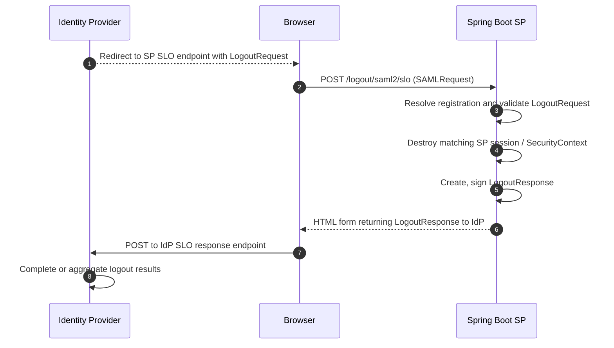

# Configuring saml2Logout and the SingleLogoutService Endpoint in Metadata

## 1. Context: Single-App Logout vs. Federated Logout

When a user logs in to Spring Boot using **SAML 2.0**, the application acts as a **Service Provider (SP)** or *Relying Party (RP)*, while the identity system is the **Identity Provider (IdP)** or *Asserting Party (AP)*. Both sides typically maintain separate sessions:

- **Session at the SP:** HTTP session/Spring Security `SecurityContext`, application session cookie, and SP business state.
- **Session at the IdP:** SSO login session managed by the IdP, which may be serving multiple different SPs.

If only cookies or sessions at the SP are deleted, the user can revisit the application and be logged in automatically by the IdP thanks to the unexpired SSO session. **SAML 2.0 Single Logout (SLO)** is a coordinated logout request protocol allowing the SP and IdP to exchange `LogoutRequest` and `LogoutResponse` messages to terminate related sessions according to system capability and policy.

In Spring Security Servlet, **`saml2Logout`** configuration allows the application to participate in **RP-initiated SLO** (SP-initiated) and **AP-initiated SLO** (IdP-initiated). Another key piece of configuration is **`SingleLogoutService` in SAML metadata**, declaring the endpoint receiving SLO messages, the binding, and the response destination.

**Lesson objectives:**

1. Understand the difference between **local logout**, **RP-initiated SLO**, **AP-initiated SLO**, and logout response.
2. Know Spring Security's default endpoints and why `/logout` differs from `/logout/saml2/slo`.
3. Configure `saml2Logout`, signing credentials, and `singlelogout.url` for Spring Boot 3.x/Spring Security 6.x.
4. Distinguish `SingleLogoutService` in **SP metadata** from `SingleLogoutService` in **IdP metadata**.
5. Synchronize metadata, HTTP bindings, public HTTPS URLs, and filter matchers when changing endpoints.
6. Verify signature, issuer, Destination, `InResponseTo`, `NameID`/`SessionIndex`, session correlation, and common errors.
7. Design safe logout behavior that never claims all sessions have ended when the IdP or another SP has not confirmed.

URLs like `example.test`, IDs, and secret paths in this lesson are **examples** and must be replaced with real infrastructure and IdP metadata when deploying.

## 2. Map of SAML Endpoints to Distinguish

| Default Endpoint | Common Method/Binding | Who Calls It? | Purpose |
| --- | --- | --- | --- |
| `/saml2/authenticate/{registrationId}` | GET/redirect to start login | Browser → SP | Generates SAML `AuthnRequest`; **not logout** |
| `/login/saml2/sso/{registrationId}` | POST HTTP-POST binding | IdP via browser → SP | ACS receiving **login** `SAMLResponse`; not LogoutResponse |
| **`/logout`** | **POST** in app with CSRF | Logged-in browser → SP | Spring logout trigger; when `saml2Logout` is configured with a valid SAML principal, can initiate RP SLO |
| **`/logout/saml2/slo`** | POST HTTP-POST binding per standard config | IdP via browser → SP | Receives **`SAMLRequest` containing LogoutRequest** or **`SAMLResponse` containing LogoutResponse** |
| `/saml2/metadata` | GET | Admin/IdP → SP | Exports metadata for one or more SP registrations |
| `/saml2/metadata/{registrationId}` | GET | Admin/IdP → SP | Exports metadata for a specific SP registration |

With Spring Security 6.x, the standard SLO path receiving requests and responses is `/logout/saml2/slo`; some APIs or newer releases have route variations, so check your pinned version. The SLO URL in this model **does not need to contain `registrationId`**, because the framework can resolve the registration from the authenticated session, prior request, or protocol data via the resolver mechanism.

**Do not confuse two form fields with the same name:** `SAMLResponse` sent to ACS in the login flow contains **`<samlp:Response>`**, whereas `SAMLResponse` sent to the SLO callback contains **`<samlp:LogoutResponse>`**. The HTTP form field name is identical, but **the content, handling filter, and security goal differ**.

## 3. Distinguishing Local Logout and Single Logout

**Local logout** is an SP-side operation: clearing `Authentication` and `SecurityContext`, invalidating the HTTP session (per configuration), and deleting relevant cookies when needed. It sends no request to the IdP.

**Single Logout** adds the SAML protocol to notify the other party and optionally coordinate terminating related SSO sessions:

| Scenario | Clears SP Session? | Sends SAML LogoutRequest? | Expectation at IdP |
| --- | --- | --- | --- |
| Local logout | Yes per handler | No | IdP session may remain active |
| RP-initiated SLO | Yes | SP → IdP | IdP processes logout and may respond |
| AP-initiated SLO | Yes if request is valid/matches session | SP receives LogoutRequest, returns LogoutResponse | IdP coordinates logout |
| Closing tab/browser | Not guaranteed | No | Not SAML logout |
| Session timeout at SP | SP session expires | Not by default | IdP may still hold a session |

**Do not promise "logging out of one SP definitely logs out all SPs".** SLO is a conditional protocol: the IdP may not support it, another SP may be offline, the callback may be lost, or the IdP may return an error/`PartialLogout` status. The browser may continue holding third-party sessions outside SAML federation. Applications must distinguish "cleared local session" from "received SLO confirmation".

## 4. RP-Initiated SLO: The Application Initiates Logout

In the **RP-initiated** flow, a user holding a `Saml2Authentication` sends a POST to the logout trigger at the SP. Spring Security performs local logout and uses the RP/IdP configuration to build a `LogoutRequest` sent to the IdP's SLO endpoint. The IdP processes it and may return a `LogoutResponse` to the SP's SLO endpoint.

```mermaid
sequenceDiagram
    autonumber
    participant B as Browser
    participant SP as Spring Boot SP
    participant IdP as SAML IdP
    B->>SP: POST /logout + CSRF token
    SP->>SP: LogoutHandler clears SecurityContext / session
    SP->>SP: Create, sign LogoutRequest; store request state
    SP-->>B: Direct browser to IdP SLO endpoint
    B->>IdP: HTTP-POST carrying SAMLRequest
    IdP->>IdP: Verify, process SSO session and related SPs
    opt IdP returns LogoutResponse
        IdP-->>B: Form containing SAMLResponse (LogoutResponse)
        B->>SP: POST /logout/saml2/slo
        SP->>SP: Verify signature, issuer, status, InResponseTo
        SP-->>B: Redirect to configured logout-success page
    end
```

**Key points:**

- `POST /logout` is an **application-side trigger**, not the `SingleLogoutService` endpoint for the IdP to POST callbacks.
- An SP-generated `LogoutRequest` must be signed per SAML/partner policy; Spring Security uses the **SP signing credential** in `RelyingPartyRegistration`.
- The `Destination` of the LogoutRequest targets the **IdP SLO Location** (taken from IdP metadata/trust configuration), not the ACS/login URL.
- When the IdP returns a `LogoutResponse`, the SP checks `InResponseTo` against the created request and typically stored correlation state; since the session has already been invalidated, how request state is retained must be designed properly.
- The IdP **might not respond**; local session deletion cannot be "undone" merely because no callback arrived.
- If the principal is not SAML or the registration lacks SLO configuration, logout behavior may differ; test flows for each login type.

In browser cookie/session setups, calling POST `/logout` requires a valid CSRF token under Spring Security defaults. Never switch to GET logout just to simplify UI forms.

## 5. AP-Initiated SLO: The IdP Initiates Logout

In **AP-initiated SLO**, the IdP starts the transaction by sending a signed `<samlp:LogoutRequest>` (via the browser per binding) to the **SP's SLO endpoint**. Spring Security verifies the request, then executes local logout based on the verification result, and creates and sends a `LogoutResponse` back to the IdP.



Several differences from RP-initiated:

- The address where **the IdP sends a LogoutRequest to the SP** is the `SingleLogoutService` URL in **SP metadata**.
- In the AP-initiated branch, if the SP returns a LogoutResponse to the IdP, **the IdP holds browser control next**, so the SP's local redirect configuration may never be seen.
- The IdP needs a certificate trusted by the SP to verify signatures; a browser POST with `SAMLRequest` is not inherently trustworthy.
- `NameID`/`SessionIndex` must be matched against the proper session/identity per profile; never use an arbitrary XML string to destroy all sessions in the application.
- Multi-replica applications need a suitable session store/lookup policy so requests landing on another node can locate or destroy the required session when supported by the framework.

**Do not create a `@PostMapping("/logout/saml2/slo")` controller to manually parse XML and delete sessions.** The SLO flow is handled by Spring Security filters and validators. Skipping signature/issuer/destination checks when handling IdP-initiated logout can create **logout CSRF/denial-of-service** vulnerabilities.

## 6. What Is SingleLogoutService in Metadata?

In SAML metadata, the **`<md:SingleLogoutService>`** element describes the endpoint at which an entity receives Single Logout messages. It commonly has these attributes:

- **`Binding`:** how the message is transported, e.g. `urn:oasis:names:tc:SAML:2.0:bindings:HTTP-POST` or `...:HTTP-Redirect`.
- **`Location`:** the URL receiving `LogoutRequest` (and in many profiles also receiving LogoutResponse if no separate URL is given).
- **`ResponseLocation` (optional):** the URL receiving `LogoutResponse` when using an endpoint different from `Location`.
- There may be multiple `SingleLogoutService` elements for different bindings; **do not** assume all of them are supported by your Spring Security/IdP version.

`SingleLogoutService` appears in:

- **`IDPSSODescriptor` of IdP metadata:** describes the **IdP-side SLO receiver**. The SP uses this to send LogoutRequests/LogoutResponses to the IdP as appropriate.
- **`SPSSODescriptor` of SP metadata:** describes the **SP-side SLO receiver**. The IdP uses this to send LogoutRequests/LogoutResponses to the application.

These are **two independent entities**, even though they share the element name. Distinguish "the URL we publish" (SP) from "the IdP URL we call" (IdP).

## 7. Example SP Metadata with SingleLogoutService

The XML below **shows only an excerpt** of SP metadata, not a full digitally signed metadata document:

```xml
<md:EntityDescriptor
    xmlns:md="urn:oasis:names:tc:SAML:2.0:metadata"
    entityID="https://app.example.test/saml2/service-provider-metadata/corp">
  <md:SPSSODescriptor
      protocolSupportEnumeration="urn:oasis:names:tc:SAML:2.0:protocol">
    <md:SingleLogoutService
        Binding="urn:oasis:names:tc:SAML:2.0:bindings:HTTP-POST"
        Location="https://app.example.test/logout/saml2/slo"
        ResponseLocation="https://app.example.test/logout/saml2/slo"/>
    <md:AssertionConsumerService
        Binding="urn:oasis:names:tc:SAML:2.0:bindings:HTTP-POST"
        Location="https://app.example.test/login/saml2/sso/corp"
        index="0" isDefault="true"/>
  </md:SPSSODescriptor>
</md:EntityDescriptor>
```

Items to verify:

1. `entityID` identifies the SP; **it is not the logout callback address**.
2. `SingleLogoutService@Location` is the public URL **the IdP uses to send LogoutRequests**.
3. `ResponseLocation` in this example equals `Location`. This is a common configuration choice; not every IdP requires two distinct endpoints.
4. `AssertionConsumerService` is for **login SAMLResponse**, not for SLO.
5. `KeyDescriptor` uses the SP's public certificate (when published) without exposing the private key; omitted here to keep the example concise.
6. Real metadata includes additional namespaces, descriptors, and signing certificates per configuration; **do not upload this truncated XML snippet to an IdP**.

For the IdP to initiate SLO, the IdP needs the SP's exact `SingleLogoutService`. If the IdP still stores an old SLO URL after deployment, requests may hit 404 or land on the wrong filter.

## 8. Example IdP Metadata with SingleLogoutService

Similarly, part of IdP metadata may describe:

```xml
<md:EntityDescriptor
    xmlns:md="urn:oasis:names:tc:SAML:2.0:metadata"
    entityID="https://idp.example.test/entity">
  <md:IDPSSODescriptor
      protocolSupportEnumeration="urn:oasis:names:tc:SAML:2.0:protocol">
    <md:SingleLogoutService
        Binding="urn:oasis:names:tc:SAML:2.0:bindings:HTTP-POST"
        Location="https://idp.example.test/saml/logout"
        ResponseLocation="https://idp.example.test/saml/logout/response"/>
    <md:SingleSignOnService
        Binding="urn:oasis:names:tc:SAML:2.0:bindings:HTTP-Redirect"
        Location="https://idp.example.test/saml/login"/>
  </md:IDPSSODescriptor>
</md:EntityDescriptor>
```

Things to note:

- `SingleLogoutService Location` here resides on the **IdP domain**: the SP's RP-initiated LogoutRequest will be sent **to the IdP**, not to the SP's `/logout/saml2/slo`.
- `ResponseLocation`, if declared, is the endpoint receiving LogoutResponse at the IdP in the AP-initiated flow.
- `SingleSignOnService` is used for **login**, distinct from `SingleLogoutService`.
- Spring Security reads the configured trusted IdP metadata to know whether the partner supports SLO and which endpoint/binding to use.
- The IdP's public certificate used to verify SAML message signatures is not the SP's private signing key; manage its source, updates, and rotation properly.

Before claiming SLO works, confirm the IdP metadata **actually contains `SingleLogoutService`**; having `SingleSignOnService` alone is not enough. Some IdPs support login but not the required logout profile.

## 9. Minimum Prerequisites for Spring Security to Perform SLO

According to Spring Security Servlet 6.x guides, a typical SLO configuration needs:

1. **The IdP supports SAML SLO** and publishes `SingleLogoutService` in IdP metadata.
2. **The SP has a signing credential**: a PKCS#8 private key and matching X.509 certificate to sign `LogoutRequest`/`LogoutResponse` per partner policy.
3. **RelyingPartyRegistration has the SP's SLO Location**, such as `{baseUrl}/logout/saml2/slo`; enabled per registration.
4. **Enable `saml2Logout`** in `SecurityFilterChain` so the framework installs SLO filters/handlers.
5. **SP metadata is published/updated at the IdP** so the IdP knows the SLO endpoint and SP signing certificate.
6. **Actual HTTP endpoints** receive the exact path and binding, including behind proxies/context paths.
7. Session, cookie, CSRF, signature, and SAML correlation conditions are satisfied.

**Merely calling `.saml2Logout(withDefaults())` is not enough** if the registration lacks an SLO service location or the IdP does not support SLO. SAML login can work normally while SLO remains incomplete.

## 10. Configuring Spring Boot 3.x with application.yml

Example for a Spring Boot 3.x / Spring Security 6.x project with compatible SAML dependencies. The `registrationId` is `corp`, and the app is accessed from a public HTTPS host. The following configuration uses IdP metadata as the trusted source of endpoints/certificates:

```yaml
spring:
  security:
    saml2:
      relyingparty:
        registration:
          corp:
            assertingparty:
              metadata-uri: "${SAML_IDP_METADATA_URI}"
            signing:
              credentials:
                - private-key-location: "file:/run/secrets/saml/sp-signing.key"
                  certificate-location: "file:/etc/app/saml/sp-signing.crt"
            singlelogout:
              url: "{baseUrl}/logout/saml2/slo"
              binding: POST
```

**Key fields:**

- `assertingparty.metadata-uri`: IdP metadata from an admin-approved source, never accepted from a user HTTP request. Metadata must contain the SLO service, verification credentials, and appropriate endpoints.
- `signing.credentials`: SP private key and certificate. The private key must not be packaged into the JAR or committed to Git; provide it via a secret manager/read-only mount with minimal permissions.
- `singlelogout.url`: the **SP's** URL receiving SLO requests/responses. `{baseUrl}` is resolved by the framework from trusted request/host info; it can be replaced with a registered absolute HTTPS URL if architecture requires.
- `singlelogout.binding: POST`: specifies the HTTP-POST binding matching the SP/IdP metadata configuration.
- **Do not put the IdP's `singlelogout.response-url` into the SP location.** `ResponseLocation` is a separate field belonging to each entity's own metadata and path.

The configuration above uses property binding. When configuring programmatically via Java `RelyingPartyRegistration.Builder`, you can use `singleLogoutServiceLocation("{baseUrl}/logout/saml2/slo")` together with `signingX509Credentials(...)` per Spring Security API; **do not maintain two parallel sources of configuration**.

### 10.1. Key Files and Secret Sources

Example paths:

```text
/run/secrets/saml/sp-signing.key   <-- SP private key, PKCS#8
/etc/app/saml/sp-signing.crt       <-- SP public X.509 certificate
```

The private key is a secret; the public certificate generally is not. In practice, many organizations provision both certificate and private key via a secret manager/volume and manage versioning/rotation. The key must match the SP certificate registered with the IdP; rotating the key without updating the certificate will cause the IdP to reject LogoutRequest signatures.

**Never take the IdP's private key to sign on behalf of the SP.** The SP signs with the SP's key; the SP verifies IdP messages with the trusted **IdP** certificate. The IdP must also trust the SP's public certificate to verify SP-signed LogoutRequests/LogoutResponses.

## 11. Java 17+: Enabling saml2Logout and Exporting SP Metadata

In a Spring Boot/Gradle project already equipped with the appropriate plugin and dependency management, declare dependencies:

```groovy
repositories {
    mavenCentral()
    // Some OpenSAML versions require the Shibboleth release repository.
    maven { url "https://build.shibboleth.net/maven/releases/" }
}

dependencies {
    implementation "org.springframework.boot:spring-boot-starter-web"
    implementation "org.springframework.boot:spring-boot-starter-security"
    implementation "org.springframework.security:spring-security-saml2-service-provider"
}
```

This is a **`build.gradle` snippet**, not a complete build file. Compatible Spring Boot 3.x/Spring Security 6.x and Java 17+ versions must be used.

Complete class at `src/main/java/demo/saml/SamlLogoutApplication.java`:

```java
package demo.saml;

import org.springframework.boot.SpringApplication;
import org.springframework.boot.autoconfigure.SpringBootApplication;
import org.springframework.context.annotation.Bean;
import org.springframework.security.config.Customizer;
import org.springframework.security.config.annotation.web.builders.HttpSecurity;
import org.springframework.security.core.annotation.AuthenticationPrincipal;
import org.springframework.security.saml2.provider.service.authentication.Saml2AuthenticatedPrincipal;
import org.springframework.security.web.SecurityFilterChain;
import org.springframework.web.bind.annotation.GetMapping;
import org.springframework.web.bind.annotation.RestController;

@SpringBootApplication
@RestController
public class SamlLogoutApplication {

    public static void main(String[] args) {
        SpringApplication.run(SamlLogoutApplication.class, args);
    }

    @Bean
    SecurityFilterChain securityFilterChain(HttpSecurity http) throws Exception {
        return http
                .authorizeHttpRequests(auth -> auth
                        .requestMatchers("/", "/error").permitAll()
                        .anyRequest().authenticated())
                .saml2Login(Customizer.withDefaults())
                .saml2Logout(Customizer.withDefaults())
                .saml2Metadata(Customizer.withDefaults())
                .build();
    }

    @GetMapping("/")
    public String home() {
        return "SAML 2.0 Single Logout demo";
    }

    @GetMapping("/whoami")
    public String whoami(
            @AuthenticationPrincipal Saml2AuthenticatedPrincipal principal) {
        return "registration=" + principal.getRelyingPartyRegistrationId()
                + ",subject=" + principal.getName();
    }
}
```

**Reading the example:**

- `saml2Login` enables Web Browser SSO login. Accessing `/whoami` requires a valid SAML Response from the IdP.
- `saml2Logout` enables SLO filters/handlers; this is an **addition** compared to an app with only `saml2Login`.
- `saml2Metadata` enables the SP metadata export endpoint. You use this metadata to configure the IdP with the SP Entity ID, ACS URL, certificate, and **SingleLogoutService**.
- You do not need to write a custom `/logout/saml2/slo` or `/logout` controller; Spring Security filters/handlers process the protocol.
- `/whoami` demonstrates the authenticated SAML principal. **Never print raw SAMLResponses or private keys** in production; NameID can be sensitive data, so debug endpoints like this are for testing only and must be gated before release.

The example uses `application.yml` from section 10 and secret files that actually exist. Without valid IdP metadata or a private key/certificate, the application **cannot complete real SLO**.

### 11.1. Launching and Observed Results

In an environment with a sandbox IdP:

```bash
SAML_IDP_METADATA_URI=https://idp.example.test/metadata ./gradlew bootRun
```

`example.test` is only an illustrative domain; the command must use the real metadata URL issued by the sandbox IdP. When opening `/whoami`, the browser redirects to the IdP for login. After successful login, submit `POST /logout` with the CSRF token and session cookie to test SLO.

There is no fixed SLO stdout: requests/responses and statuses depend on the IdP. If validly configured, a successful logout may return the user to `/login?logout` or the configured success URL. Do not treat mere redirection to the IdP as proof that all sessions have been terminated.

## 12. Creating a Secure Browser POST Logout Form

Using `GET /logout` to log out is not recommended by default. With CSRF protection, Spring Security normally requires **POST with a CSRF token**. If the app uses Thymeleaf integrated with Spring Security, a form can look like:

```html
<form method="post" th:action="${/logout}"
      xmlns:th="http://www.thymeleaf.org">
  <button type="submit">SSO Logout</button>
</form>
```

This is a **Thymeleaf template fragment**, not a static HTML file that runs with the section 11 app without adding view dependencies and configuration. When Thymeleaf and Spring Security are integrated in the standard way, a CSRF hidden field is automatically added to forms with `th:action`. Depending on stack/version, verify that the request actually carries the token.

If not using Thymeleaf, the frontend application must fetch the CSRF token via a secure server-provided mechanism and send it back alongside the session cookie. Avoid placing CSRF tokens in URLs or logs. Do not disable `csrf` application-wide just because a logout form returns 403.

**For example, `curl -X POST /logout` without a cookie/CSRF token is not a complete SLO test.** Getting 403 may be the expected behavior; test with a logged-in browser session and a valid token.

## 13. Separating Local Logout from SAML Single Logout

Some applications want users to choose:

- **Log out of this application:** clears the local session while keeping the IdP session (suitable when multiple SSO apps are used).
- **Log out of SSO:** requests the IdP to terminate the federated session per policy.

Spring Security allows configuring **two distinct URLs**. In `SecurityFilterChain`, replace `.saml2Logout(Customizer.withDefaults())` with:

```java
.logout(logout -> logout.logoutUrl("/logout"))
.saml2Logout(saml -> saml.logoutUrl("/saml2/logout"))
```

These are **two replacement DSL lines inside the sample class**, not standalone Java. After configuration:

| Request | Meaning |
| --- | --- |
| `POST /logout` | Local logout, clears SP session, **does not** send SAML LogoutRequest |
| `POST /saml2/logout` | RP-initiated SLO, sends SAML LogoutRequest via the IdP |
| `POST /logout/saml2/slo` | IdP sends LogoutRequest or LogoutResponse to the SP |

The name `/saml2/logout` in the example is a **custom RP-side logout trigger**. It is **not the SLO callback endpoint**; the IdP still sends SAML protocol messages to `/logout/saml2/slo` (unless you change both the filter URL and metadata). This distinction is critical when entering URLs into an IdP dashboard.

### When Multiple Login Types Exist

If the application also supports OIDC, a shared `POST /logout` can cause different behavior depending on the `Authentication` type and logout handlers. Design explicit policies per provider: SAML SLO, OIDC RP-initiated logout, or local logout; do not assume `saml2Logout` will log out Google/Microsoft OIDC sessions. For SAML principals, the outcome depends on whether the corresponding `RelyingPartyRegistration` supports SLO.

## 14. Changing the SingleLogoutService Endpoint per IdP Requirements

Suppose a legacy system already registered `https://app.example.test/SLOService.saml2` as the SP's SLO address. You want to keep this URL to avoid modifying multiple IdP configurations. **Changing only `singlelogout.url` in YAML is not enough**, because the default filter may still only match `/logout/saml2/slo`.

Both **SP registration/metadata** and the **Spring Security DSL** must be synchronized.

### 14.1. Updating SP Metadata Configuration

```yaml
spring:
  security:
    saml2:
      relyingparty:
        registration:
          corp:
            singlelogout:
              url: "{baseUrl}/SLOService.saml2"
              binding: POST
```

This is an **override snippet** for section 10's `application.yml`. Do not replace the entire file with this snippet, as `assertingparty.metadata-uri` and `signing.credentials` are still needed.

### 14.2. Updating Request and Response Handling Filters

In `SecurityFilterChain`, replace the default `saml2Logout` with:

```java
.saml2Logout(saml -> saml
        .logoutRequest(request -> request
                .logoutUrl("/SLOService.saml2"))
        .logoutResponse(response -> response
                .logoutUrl("/SLOService.saml2")))
```

This is a **Java snippet to integrate into the sample class**, not a standalone class. The path in `logoutUrl` on both handlers is the **internal path** of the request matcher; `singlelogout.url` is the **public URL** published in metadata to the IdP.

After changing, verify:

1. `SP metadata `SingleLogoutService Location` is actually `https://app.example.test/SLOService.saml2`.
2. The IdP has imported/loaded the updated metadata.
3. The ingress route forwards HTTP-POST on the exact path to the app.
4. `SAMLRequest` and `SAMLResponse` from the IdP reach the right filter.
5. Responses are signed/verified and correlation succeeds.
6. You did not accidentally overwrite `saml2Logout.logoutUrl("/saml2/logout")` (the trigger) with the callback URL if they need to remain separate.

### 14.3. Can Redirect Binding Be Used Instead of POST?

The SAML protocol defines both HTTP-Redirect and HTTP-POST for many SLO cases, but **do not assume every combination of IdP/Spring Security/configured URL supports both**. Spring Security 6.x minimal guides recommend that the IdP **sign and POST** LogoutRequest/LogoutResponse to `/logout/saml2/slo`. If switching binding to Redirect, confirm the framework version and IdP truly support it, and check query string signatures, URL length limits, and logging security. Never change Binding in metadata without testing the actual filter/validation.

## 15. How Should SingleLogoutService in SP and IdP Metadata Be Checked?

After enabling `.saml2Metadata(...)`, Spring Security typically exposes:

```text
GET /saml2/metadata
GET /saml2/metadata/corp
GET /saml2/service-provider-metadata/corp
```

These URLs are **metadata endpoints**, not SLO callbacks. You can fetch metadata from the path matching the registration and inspect `SPSSODescriptor/SingleLogoutService`.

### Checklist for SP Metadata

- `EntityDescriptor@entityID` is the expected SP Entity ID.
- `SPSSODescriptor` contains `SingleLogoutService` when the registration has an SLO location configured.
- `SingleLogoutService@Binding` matches the binding the IdP uses to send requests.
- `SingleLogoutService@Location` points to the **SP's public HTTPS URL**.
- `ResponseLocation`, if present, points to the SP's LogoutResponse receiver.
- The SP's public signing certificate matches the private key actually in use.
- `AssertionConsumerService` for SSO login remains accurate and was not accidentally replaced by the SLO URL.
- Contains no `localhost`, pod hostnames, or internal `http://` in production.

### Checklist for IdP Metadata

- `IDPSSODescriptor` contains `SingleLogoutService` (not just `SingleSignOnService`).
- Location/ResponseLocation are **IdP domain** endpoints to which the SP sends SAML logout messages.
- The Binding is agreed upon by Spring Security and the IdP.
- IdP entity ID and verification certificate match the right partner/tenant.
- When the IdP rotates signing certificates, the SP updates trust from a trusted metadata source and rotation policy.

Metadata only describes **capabilities and published configuration**. Having a `SingleLogoutService` element does not by itself prove HTTP filters are working, signatures are valid, or sessions match accurately. **End-to-end tests** are required.

## 16. Reverse Proxy, Context Path, and HTTPS Configuration

In production, the browser may hit:

```text
https://app.example.test/logout/saml2/slo
                    |
                    v
              Trusted ingress (TLS)
                    |
                    v
             Spring Boot :8080
             /logout/saml2/slo
```

If Spring Boot only sees `http://app-service:8080`, the `{baseUrl}` placeholder may resolve incorrectly in SP metadata. The IdP POSTs callbacks to `https://app.example.test` while the SP validator expects a different host, leading to **Destination mismatch**.

Example `application-prod.yml`:

```yaml
server:
  forward-headers-strategy: framework
  servlet:
    session:
      cookie:
        secure: true
        http-only: true
```

This configuration is safe only when the trusted proxy **strips/overwrites** `Forwarded`/`X-Forwarded-*` headers sent by Internet clients. The backend must not be publicly exposed so attackers can spoof these headers. If the app runs under `/portal`, the public SLO URL may be `https://app.example.test/portal/logout/saml2/slo`, while the internal filter matcher still uses the path relative to the servlet context path.

Verify:

1. HTTP method and `application/x-www-form-urlencoded` body reach the filter intact.
2. WAF/ingress permits SAML logout message payloads within controlled size limits.
3. No HTTP→HTTPS redirects happen on POST that drop the form body.
4. The SP session cookie is sent by the browser under SameSite/Secure/Domain/Path settings compatible with SAML HTTP-POST.
5. Exported metadata does not expose pod hostnames or internal IPs.
6. Every replica shares the same registration, signing credentials, and session/repository strategy.

If the IdP sends SLO to a URL not matching SP metadata or the active login session, **do not** disable Destination validation to work around proxy issues.

## 17. Contents and Security of LogoutRequest/LogoutResponse

### 17.1. LogoutRequest

A `LogoutRequest` can contain `ID`, `IssueInstant`, `Destination`, `Issuer`, `NameID`, and `SessionIndex`. Simplified example:

```xml
<samlp:LogoutRequest
    xmlns:samlp="urn:oasis:names:tc:SAML:2.0:protocol"
    xmlns:saml="urn:oasis:names:tc:SAML:2.0:assertion"
    ID="_logout-123"
    Version="2.0"
    IssueInstant="2026-11-07T03:15:00Z"
    Destination="https://idp.example.test/saml/logout">
  <saml:Issuer>https://app.example.test/sp</saml:Issuer>
  <saml:NameID Format="urn:oasis:names:tc:SAML:2.0:nameid-format:persistent">
    user-persistent-001
  </saml:NameID>
  <samlp:SessionIndex>_session-001</samlp:SessionIndex>
</samlp:LogoutRequest>
```

This XML is only a structural learning aid and **must not be used as a valid LogoutRequest without signing and correlated state**. `NameID` must belong to the verified identifier of the relevant session. `SessionIndex` can help the IdP/SP locate the session within profile scope; do not assume it is always present or globally unique.

### 17.2. LogoutResponse

Example response from the IdP to the RP:

```xml
<samlp:LogoutResponse
    xmlns:samlp="urn:oasis:names:tc:SAML:2.0:protocol"
    xmlns:saml="urn:oasis:names:tc:SAML:2.0:assertion"
    ID="_logout-response-456"
    InResponseTo="_logout-123"
    Version="2.0"
    IssueInstant="2026-11-07T03:16:00Z"
    Destination="https://app.example.test/logout/saml2/slo">
  <saml:Issuer>https://idp.example.test/entity</saml:Issuer>
  <samlp:Status>
    <samlp:StatusCode Value="urn:oasis:names:tc:SAML:2.0:status:Success"/>
  </samlp:Status>
</samlp:LogoutResponse>
```

In practice, the XML is signed/encoded per the agreed binding, not plain unencoded XML as illustrated. For `LogoutResponse`, `InResponseTo` must correlate with the SP-sent request; `Success`, `PartialLogout`, or error statuses must be handled per policy.

**Checks that must never be skipped:**

- Message signature (matching IdP trust certificate or SP certificate depending on direction).
- Valid `Issuer`, `Destination`, binding, and message structure.
- `InResponseTo`/RelayState matching the stored request for RP-initiated SLO.
- Time window and uniqueness/replay checks per framework capabilities and policy.
- `NameID`/`SessionIndex` matching the session/subject to log out in the AP-initiated flow.
- Destroy only matching, authenticated sessions; never rely on unverified user-supplied data.

Never write custom code that bypasses verification steps just to "make logout succeed". With SLO, validation failures can lead to forged logouts or repeated forced logouts.

## 18. Where Is State Stored After the RP Invalidates the Session?

Spring Security provides **`Saml2LogoutRequestRepository`** to store the emitted `LogoutRequest` before receiving the `LogoutResponse`. In Servlet, the related implementation is `HttpSessionLogoutRequestRepository`. This data is needed to match `InResponseTo` and `RelayState` on the callback.

Easy-to-confuse components:

| Repository | Data | Purpose |
| --- | --- | --- |
| `Saml2AuthenticationRequestRepository` | SSO login `AuthnRequest` | Correlates login `SAMLResponse` with AuthnRequest |
| **`Saml2LogoutRequestRepository`** | SLO `LogoutRequest` | Correlates LogoutResponse with LogoutRequest |
| `SecurityContextRepository` | Session `Authentication` | Persists authentication across HTTP requests |
| `RelyingPartyRegistrationRepository` | SP–IdP trust/configuration | IdP metadata, Entity ID, keys, ACS/SLO URLs |

Do not roll your own `sessionId -> LogoutRequest` Map without TTL, concurrency safety, and cleanup. With multiple replicas, a `LogoutRequest` issued at pod A may receive its callback at pod B; verify state is shared or choose an appropriate repository backend and protect stored data.

Spring Security can customize the repository via the DSL:

```java
.saml2Logout(saml -> saml
        .logoutRequest(request -> request
                .logoutRequestRepository(myLogoutRequestRepository)))
```

This is a **configuration snippet** requiring a `myLogoutRequestRepository` bean of the corresponding `Saml2LogoutRequestRepository` type, not standalone Java. When building a Redis/DB-backed store, ensure finite TTL, sufficient randomness for request ID/RelayState, atomic consume-once semantics, issuer+registration scoping, and appropriate session-bound policy. Never disable `InResponseTo` validation to mask lost state errors.

## 19. CSRF, Logout CSRF, and SameSite Cookies

### 19.1. RP-Initiated Local Trigger

`POST /logout` is a user request from a logged-in browser. Because the app uses session cookies, CSRF protection is needed for this action per Spring Security configuration. If only `GET /logout` were used, an external website could easily force users out of their sessions (logout CSRF). Never switch to GET just to bypass a 403 error.

### 19.2. IdP-Initiated SAML Callback

`POST /logout/saml2/slo` is a cross-site request from the IdP through the browser. The IdP does not possess the SP's internal web form CSRF token. The framework must apply an appropriate CSRF exception/flow **only for the protocol endpoint**, while verifying signature, issuer, destination, correlation, and NameID/SessionIndex. When customizing the SLO URL, verify the actual CSRF matcher; never disable CSRF for all of `/api/**`.

### 19.3. SameSite and Session Persistence

If the SP cookie uses `SameSite=Lax`, the browser may withhold the cookie on a **cross-site POST** from the IdP. This can cause the SP to lose session/transaction state when handling an AP-initiated LogoutRequest or RP-initiated LogoutResponse. `SameSite=None` typically requires `Secure`, and broadens cookie transmission contexts so CSRF must be evaluated. Beyond cookies, multi-replica setups without shared sessions can also cause mismatches.

Do not conclude "SLO succeeded" merely because of HTTP 302 or the IdP displaying a signed-out page. Verify the actual SP/IdP session state and validated response.

## 20. Common Errors and Diagnosis

| Symptom | Possible Cause | Right Investigation Path |
| --- | --- | --- |
| Logout only clears local session, IdP stays logged in | Only `logout` enabled, missing `saml2Logout`/SLO registration, or IdP lacks support | Check `SecurityFilterChain`, `singlelogout.url`, and IdP metadata |
| `POST /logout` returns 403 | Missing CSRF token in browser session | Check CSRF form/token; do not disable CSRF app-wide |
| SP metadata lacks `SingleLogoutService` | SLO Location not configured in registration | Check `singlelogout.url`/RelyingPartyRegistration |
| IdP reports SP does not support SLO | IdP has not imported new metadata or binding mismatch | Publish metadata, update IdP, test binding |
| LogoutRequest sent to IdP login URL | Confused `SingleSignOnService` with `SingleLogoutService` | Read IdP metadata and logout destination |
| IdP POSTs SLO to app but gets 404/405 | `singlelogout.url` differs from filter matcher; wrong proxy rewrite | Compare public metadata, ingress, and `logoutRequest/logoutResponse.logoutUrl` |
| Invalid Signature | Wrong SP/IdP certificate or recent key rotation | Cross-check verification key/certificate via trusted source |
| Invalid Destination | Wrong `{baseUrl}` due to proxy or IdP holding old URL | Check public HTTPS host, forwarded headers, and metadata |
| `InResponseTo` mismatch | Lost LogoutRequest state or callback from another transaction | Check repository, session/cookie/SameSite, and ID |
| LogoutResponse arrives but IdP did not log out all SPs | Some SP offline or IdP handled PartialLogout | Check status/IdP logs and SLO policy; do not promise global logout |
| AP-initiated SLO does not destroy SP session | Session lookup/NameID/SessionIndex mismatch, missing cookie | Test AP-initiated with real browser and session store |
| Local logout then user logs back in without password | IdP session remains alive | Expected behavior for local logout; use SLO if policy requires |
| SLO lost across multiple pods | Repository/session stored locally in-memory | Shared session/repository or appropriate routing |
| Spring app fails to start | IdP metadata URL unreachable or missing/invalid key file | Check metadata/secret mount/TLS, fail-fast |
| Logout-success page never shown | IdP retained browser control; returned no callback | Depends on RP/AP flow and IdP, not always a bug |

**Useful debug sequence:** confirm user chose local vs. SLO → does registration have SLO metadata → where did SP send the message → which callback did the browser POST → did the filter handle it → did signature/correlation pass → how did SP and IdP session states change.

## 21. End-to-End Testing Procedure

### A. Check Metadata Before Login/Logout

1. Open SP metadata `/saml2/metadata/corp` in a test environment.
2. Locate `SPSSODescriptor/SingleLogoutService`, verify public HTTPS Location/ResponseLocation, Binding, and certificate.
3. Retrieve IdP metadata from the trusted configured source, locate `IDPSSODescriptor/SingleLogoutService` and certificate.
4. Cross-check both end-to-end URLs; never use SSO ACS in place of the SLO callback.
5. Verify the IdP has ingested the latest SP metadata with a compatible SLO signing policy.

### B. RP-Initiated Test

1. Log in at the SP via SAML; confirm `/whoami` or protected resources are accessible.
2. Submit a valid `POST /logout` with CSRF token (or `/saml2/logout` if local/SLO are separated).
3. Observe the browser redirecting to the **IdP SLO endpoint** carrying `LogoutRequest`.
4. If the IdP returns `LogoutResponse`, confirm the browser POSTs to the **SP SLO callback**.
5. Verify signature/status/`InResponseTo` are validated; the SP session is no longer authenticated.
6. Try accessing protected resources. If the IdP session has ended, the user must re-authenticate per policy; if the IdP session persists, investigate or document IdP limitations.

### C. AP-Initiated Test

1. Log in to the SP and keep the session active in the browser.
2. From the IdP, trigger logout when the IdP supports initiating SLO.
3. Observe the IdP sending a signed `LogoutRequest` to the SP `/logout/saml2/slo`.
4. Verify the SP validates and destroys the appropriate session and sends `LogoutResponse` back to the IdP.
5. Try accessing SP resources after logout; no valid `Authentication` remains.
6. Verify alternate behavior if the IdP cannot reach the SP or the user no longer has the session cookie.

### D. Essential Negative Tests

| Test | Expected Outcome |
| --- | --- |
| Unsigned SAML LogoutRequest or bad signature | Rejected; does not destroy other sessions |
| `Issuer` not belonging to trusted IdP | Rejected |
| `Destination` pointing to another SLO URL | Rejected per validation policy |
| LogoutResponse with non-matching `InResponseTo` | Response rejected; SLO not reported complete |
| `NameID`/`SessionIndex` not belonging to target session | Wrong session not destroyed |
| Replaying the same LogoutRequest/LogoutResponse | Replay rejected per policy |
| IdP lacks `SingleLogoutService` | Local-only logout or report missing SLO per policy |
| Updated SP metadata without updating filter route | Catch 404/mismatch before production |
| HTTP-POST from IdP drops session cookie | Correlation error handled safely without bypass |
| New SP signing key lacks cert at IdP | IdP rejects message; perform coordinated rotation |
| IdP returns `PartialLogout` | UI/logs do not claim all sessions ended |
| Concurrent logouts across tabs/pods | No wrong session/partner deleted; state consistent per design |

Never use real production SAMLResponses, `LogoutRequest` payloads, or session cookies as public test fixtures. Use a sandbox IdP, test accounts, test certificates, and redacted logs.

## 22. Operational Security and Key Rotation

### 22.1. Key Hierarchy

- **SP signing private key:** used solely by the SP to sign its own LogoutRequests/LogoutResponses; kept in a protected secret store/volume.
- **SP signing certificate:** public key used by the IdP to verify SP signatures, publishable in SP metadata.
- **IdP signing certificate:** public key used by the SP to verify IdP signatures; obtained from IdP metadata/trust configuration via a trusted process.
- **TLS certificate:** secures HTTPS transport; does not replace XML signatures on SAML messages.

Signing credential rotation requires coordination by both parties. Switching the SP private key before the IdP trusts the new certificate causes invalid signatures; conversely, revoking an old IdP cert too early can block in-flight responses. Where supported by IdP/framework, use a certificate overlap window and test both RP- and AP-initiated SLO.

### 22.2. Logging and Sensitive Information

Never log raw `SAMLRequest`, `SAMLResponse`, `RelayState`, session cookies, `NameID`, `SessionIndex`, XML assertions, or private keys. SAML LogoutRequest/Response payloads can contain identifiers and correlation data. In production, log safe metadata such as registration, request type, signature/status outcome, controlled internal correlation ID, and error category.

Do not expose `/actuator/env` or `/actuator/configprops` publicly to inspect key paths. When debugging metadata, inspect only public outputs and verify the signing cert is never confused with the private key.

## 23. Pre-Release Checklist

- [ ] Real IdP supports SAML 2.0 SLO and publishes `SingleLogoutService` in IdP metadata.
- [ ] `saml2Logout` enabled in SecurityFilterChain with clearly defined local/SLO triggers.
- [ ] Every SLO-enabled `RelyingPartyRegistration` has the exact `singlelogout.url`.
- [ ] Matching SP PKCS#8 signing private key and X.509 certificate configured and trusted by the IdP.
- [ ] SP metadata `SPSSODescriptor/SingleLogoutService Location` matches the public HTTPS URL.
- [ ] IdP metadata `IDPSSODescriptor/SingleLogoutService Location` matches the IdP's receiving endpoint.
- [ ] HTTP-POST/Redirect binding chosen only when both sides actually support and test it.
- [ ] `/logout` or `/saml2/logout` acts as trigger; `/logout/saml2/slo` acts as protocol callback.
- [ ] SP filters handle both request and response callbacks properly, not just YAML metadata.
- [ ] Proxy forwarded headers come from trusted sources; public hostname/context path are accurate.
- [ ] LogoutRequest and LogoutResponse are signed/verified per policy.
- [ ] Protection against forged issuer, destination, `InResponseTo` correlation, session NameID/SessionIndex, and replay.
- [ ] HTTP-POST logout trigger includes CSRF token; unprotected GET logout is not enabled.
- [ ] SameSite/Secure/HttpOnly cookies and session backend work across IdP redirects/POSTs.
- [ ] Multi-replica deployment has an appropriate session/request-repository strategy.
- [ ] Tested RP-initiated, AP-initiated, local-only, and `PartialLogout` failure cases.
- [ ] Plan exists for signing key/certificate rotation and metadata refresh.
- [ ] Users are informed accurately about logout completeness without claiming global logout unless verified.
- [ ] No SAML messages, cookies, IDs, or secrets leaked in logs/tracing.

## 24. Self-Assessment Questions

**1. Does `saml2Logout` differ from Spring Security's default `logout`?**  
Yes. Standard `logout` clears the SP session; `saml2Logout` also participates in SAML 2.0 Single Logout via LogoutRequest/LogoutResponse when validly configured.

**2. Is `/logout` the SingleLogoutService in SP metadata?**  
No. `POST /logout` is normally the user trigger at the SP. The default SLO callback is `/logout/saml2/slo`.

**3. Metadata has `SingleLogoutService` elements on both sides—do they share the same URL?**  
No. The element in **SPSSODescriptor** publishes the SP's URL; the element in **IDPSSODescriptor** publishes the IdP's URL.

**4. Is adding `.saml2Logout(withDefaults())` alone enough for every IdP?**  
No. You need IdP SLO support, a registration with an SLO Location, and proper SP signing credentials/metadata.

**5. When changing `singlelogout.url` in YAML, must the DSL also change?**  
If moving away from the path handled by the default filter, you must configure `logoutRequest(...logoutUrl)` and `logoutResponse(...logoutUrl)` accordingly, and update IdP metadata.

**6. Do `SAMLResponse` payloads at login ACS and SLO callback contain the same content?**  
No. Login ACS receives a `Response`/Assertion; the SLO callback receives a `LogoutResponse`.

**7. If the IdP does not return a `LogoutResponse` after an SP-initiated request, can global logout be guaranteed?**  
No. The SP cleared its local session, but there is no proof all IdP and other SP sessions ended.

**8. Why not accept an unsigned LogoutRequest and destroy the session?**  
Because a browser can send forged requests; signature, issuer, destination, and matching session must be verified to prevent logout CSRF/DoS.

**9. What are `NameID` and `SessionIndex` used for in a LogoutRequest?**  
They help tie the logout request to the SAML identity and session per profile, rather than acting as access rights or secrets.

**10. What should you do when the SLO callback cannot find the stored request?**  
Check `Saml2LogoutRequestRepository`, cookies/session, multi-replica state, RelayState, and `InResponseTo`; never disable correlation verification.

**11. Which endpoint should be used when only local logout is desired?**  
Explicitly define local `POST /logout` and SLO `POST /saml2/logout` in the DSL so the two behaviors are never mixed.

**12. Does enabling `SameSite=None` make all SLO errors disappear?**  
No. It only affects cross-site cookies and requires Secure/CSRF evaluation; certificates, bindings, metadata, routing, session stores, and validators still matter.

## 25. Authoritative References

- [Spring Security 6.5 – Performing Single Logout](https://docs.spring.io/spring-security/reference/6.5/servlet/saml2/logout.html): RP/AP-initiated SLO, `saml2Logout`, default routes, custom endpoints, local logout, logout request repository.
- [Spring Security – Performing Single Logout](https://docs.spring.io/spring-security/reference/servlet/saml2/logout.html): SLO mechanics and hooks in the current release.
- [Spring Security – SAML 2.0 Metadata](https://docs.spring.io/spring-security/reference/servlet/saml2/metadata.html): enabling `saml2Metadata` and SP metadata export endpoints.
- [Spring Boot 3.5 – Spring Security SAML2 Configuration](https://docs.spring.io/spring-boot/3.5/reference/web/spring-security.html): `singlelogout.url`, `singlelogout.binding`, signing credentials, and changing processing URLs.
- [Spring Security – SAML2 Login Overview](https://docs.spring.io/spring-security/reference/servlet/saml2/login/overview.html): login/ACS routes distinct from SLO.
- [OASIS – SAML 2.0 Metadata](https://docs.oasis-open.org/security/saml/v2.0/saml-metadata-2.0-os.pdf): `IDPSSODescriptor`/`SPSSODescriptor` structure and `SingleLogoutService`.
- [OASIS – SAML 2.0 Profiles](https://docs.oasis-open.org/security/saml/v2.0/saml-profiles-2.0-os.pdf): Single Logout Profile, responses, and protocol limitations.
- [OASIS – SAML 2.0 Bindings](https://docs.oasis-open.org/security/saml/v2.0/saml-bindings-2.0-os.pdf): HTTP-POST and HTTP-Redirect bindings.
- [OWASP SAML Security Cheat Sheet](https://cheatsheetseries.owasp.org/cheatsheets/SAML_Security_Cheat_Sheet.html): signatures, trust, replay, and message forgery prevention.
