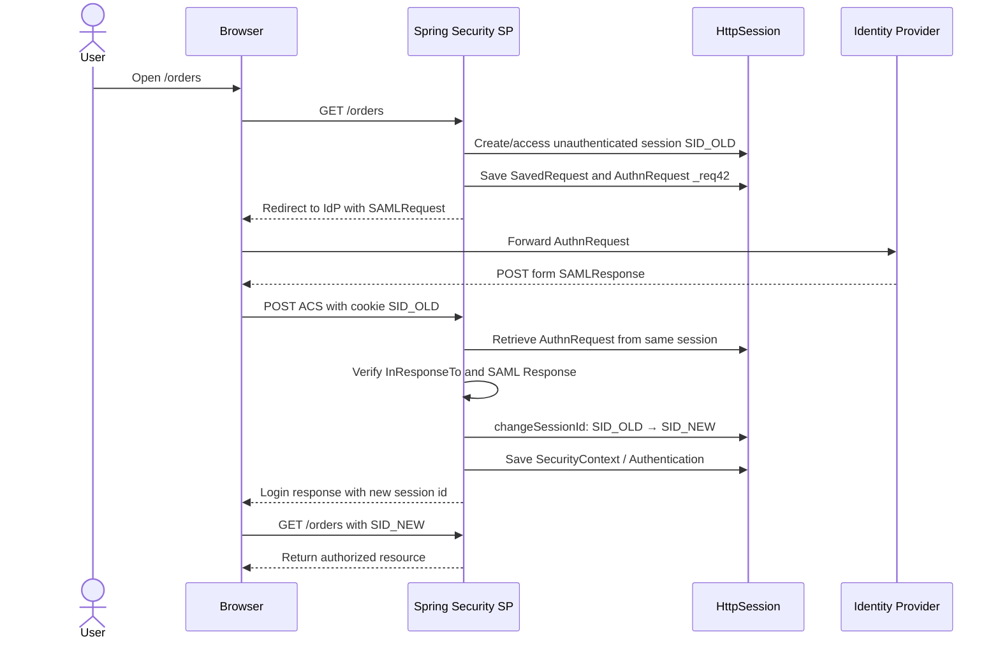
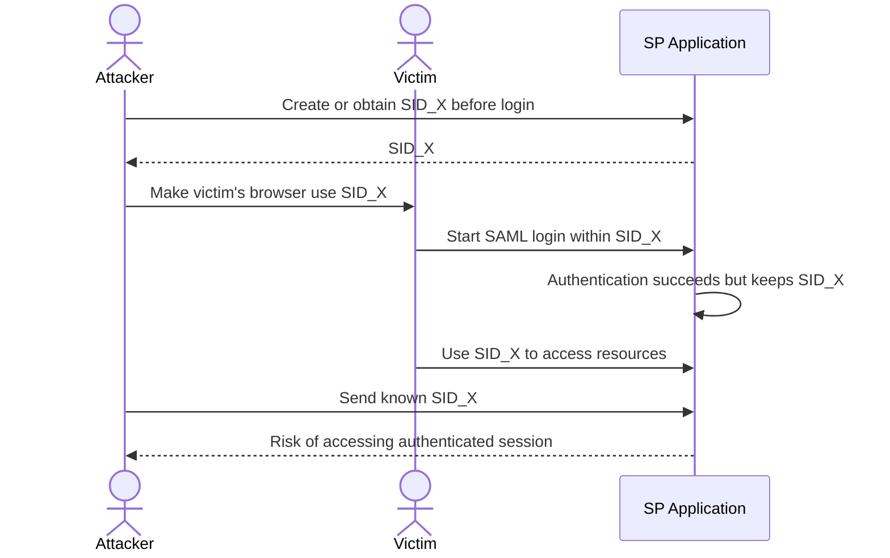

# Session Fixation and Changing the Session ID After SAML2 Login in Spring Security

**Topic:** Spring Security – federation → Sessions and browsers.

A Service Provider (SP) application using Spring Security SAML2 typically creates an `HttpSession` **before the user successfully authenticates**: it must remember the `AuthnRequest`, the related `RelayState`, the page the user wants to access, and browser context. After the Identity Provider (IdP) returns a valid SAML Response, the application must transition from an **unauthenticated** state to an **authenticated** state without letting an attacker continue using the old session ID. Spring Security's **session fixation** protection solves this by **changing the session ID upon successful login**, by default via `HttpServletRequest.changeSessionId()` on modern Servlet containers.

**Most important takeaway:** changing the session ID **does not mean deleting the HttpSession or creating a new user**. With `changeSessionId()`, the old session identifier loses access to the newly authenticated session, while necessary session data is preserved. This mechanism complements—and **does not replace**—SAML signature verification, `InResponseTo`, login CSRF protection, secure cookies, and authorization.

This lesson targets **Spring Security Servlet/MVC**, Spring Boot 4.x/Security 7.x, and Java 17+. The principles also apply to Security 6.x; consult the exact API for your deployed version. Do not use Servlet configurations directly for WebFlux.

## 1. From Anonymous Session to Authenticated Session

In SAML2 SP-initiated SSO, a user may access `GET /orders` before logging in. Spring Security begins the journey:

1. The browser opens the protected URL. The SP may create an unauthenticated `HttpSession` to hold pre-login information.
2. `Saml2WebSsoAuthenticationRequestFilter` builds an `AuthnRequest` and stores the request in `Saml2AuthenticationRequestRepository`; the default is `HttpSessionSaml2AuthenticationRequestRepository`.
3. The browser is redirected to the IdP. The IdP authenticates the user and sends a `SAMLResponse` to the SP's Assertion Consumer Service (ACS).
4. `Saml2WebSsoAuthenticationFilter` and the SAML processor verify the response, matching the saved request, issuer, signature, audience, validity period, recipient, and conditions.
5. Upon successful authentication, the login mechanism's `SessionAuthenticationStrategy` handles the session. **Session fixation protection** changes the session ID per policy, typically using `changeSessionId()`.
6. The resulting `Authentication`/`SecurityContext` is saved per the persistence mechanism; the browser receives a new session cookie or appropriate session tracking update and proceeds to access the protected page.

Conceptual example:

```text
Before login:
  Browser cookie: JSESSIONID=SID_OLD
  HttpSession(SID_OLD):
    - pending AuthnRequest ID=_req42
    - SavedRequest=/orders
    - Unverified Authentication

After valid SAMLResponse and session fixation protection:
  Cookie/session id: JSESSIONID=SID_NEW
  SID_OLD can no longer access the authenticated session
  HttpSession(SID_NEW):
    - SecurityContext / Authentication of the authenticated user
    - Attributes retained per session strategy
  Browser accesses /orders with SID_NEW
```

**SID_OLD and SID_NEW are purely symbolic names**, not actual formats or tokens. Real session IDs must be randomly generated and protected by the container/session manager. Do not use two fixed IDs in production.

### 1.1. Two-Phase Diagram of a Session



**The diagram shows logical sequence of responsibilities**, not a guarantee of the exact internal method order in every Spring version, especially when an application has a custom success handler/session strategy. Verify actual behavior with a browser and the deployed version.

### 1.2. Three Distinct State Objects

| Object | When does it appear? | Purpose |
| --- | --- | --- |
| Unauthenticated `HttpSession` | Potentially before SAML login begins | Maintains browser continuity, holds pre-login state |
| `AbstractSaml2AuthenticationRequest` | Created by SP before redirecting to IdP | Correlates with the SAML Response via `InResponseTo` in the right browser session |
| `SecurityContext` and `Authentication` | Only after SAML validation succeeds | Represents logged-in identity for authorization on subsequent requests |
| `SavedRequest` | Potentially when accessing a protected URL | Remembers the return destination after success |
| `Session ID` | HttpSession locator identifier | Changes on transition to authenticated state; not a user ID or SAML ID |

**An existing HttpSession does not mean the user is logged in.** This distinction is crucial when testing fixation: an anonymous session may need to exist to hold the SAML handshake, yet its ID must not continue authorizing the authenticated session after login.

## 2. What Is Session Fixation?

**Session fixation** is a scenario where an attacker knows or has forced the victim to use **a specific session ID** before the victim logs in. If the SP keeps that same ID after the victim authenticates, the attacker can attempt to use that same ID to access the victim's authenticated state.

Unlike stealing cookies after login, session fixation assumes the attacker knows or controls **the ID before login**. Whether the attack succeeds depends on whether the application allows setting/fixing session IDs via URL rewriting, cookie injection, session adoption, subdomain bugs, proxies, or another vulnerability.

### 2.1. Progression Without Protection



This is a **risk model**, not proof that any attacker can set cookies for every domain. Browser environment, domain, ability to fixate IDs, and session tracking policies determine whether the attack is exploitable.

### 2.2. When Spring Changes the Session ID

```text
Attacker knows SID_X beforehand.
Victim authenticates in initial HttpSession SID_X.
SessionAuthenticationStrategy replaces SID_X with SID_Y.
Victim receives SID_Y.
Re-accessing with SID_X: not treated as authenticated session SID_Y.
```

If the attacker does not receive SID_Y, this blocks using the **old ID** to hijack the session after login. It does not block an attacker who stole SID_Y via XSS/malware or log leaks, does not replace CSRF protection, and does not allow skipping SAML validation.

**Do not disable session fixation protection just because "SSO uses a trusted IdP".** SAML is an identity authentication mechanism; the SP's session still needs its own defenses.

## 3. Spring Security's Default Mechanism on Modern Servlets

Spring Security provides `SessionAuthenticationStrategy` to handle newly authenticated users. For interactive login mechanisms like SAML2 Web SSO, the authentication filter/handler coordinates with the filter chain's session strategy. On Servlet containers supporting Servlet 3.1+, the default session fixation protection is typically:

```java
HttpServletRequest.changeSessionId()
```

This is a **Servlet API** method, not an OpenSAML function or an HTTP endpoint. The Servlet container changes the session identifier while preserving the corresponding session attributes. The framework executes this at the right moment via `ChangeSessionIdAuthenticationStrategy` when authentication succeeds.

**Defaults confirmed by Spring Security documentation:** `changeSessionId` for Servlet 3.1 and later; `migrateSession` on older containers (Servlet 3.0 and earlier). With Spring Boot 4.x, a modern compatible Servlet container should support `changeSessionId`.

### 3.1. Four Options to Distinguish

| Strategy | Behavior | When to use? | Risks/considerations |
| --- | --- | --- | --- |
| **`changeSessionId()`** | Changes ID **of the existing session**, keeps session attributes | **Preferred/default** on modern Servlets | Must test container, cookies, session store, and event listeners |
| **`migrateSession()`** | Invalidates old session, creates new session, **copies all** session attributes | When environment/design needs full migration strategy | Copies objects with binding listeners, serialization/cost, and unwanted pre-auth data |
| **`newSession()`** | Creates a new session, **does not copy all** app attributes; still copies Spring Security-related attributes per docs | When wanting to clear out most pre-auth data | May lose cart, locale, app state, or custom deep-links held in session |
| **`none()`** | Performs no session fixation protection | Rarely, when another proven protection exists | **Not recommended**, opens the door to fixation |

**Do not equate "newSession" with "nothing left in the session".** Documentation notes that certain Spring Security attributes are still copied to preserve security operations. Exact behavior of application attributes must be tested with your actual configuration.

### 3.2. Object/Attribute Differences When Using `changeSessionId`

Suppose a session currently holds:

```text
HttpSession id = S_old
attributes:
    SAVED_REQUEST = /reports/2026
    CART = {...}
    SAML_AUTHENTICATION_REQUEST = {...}
```

With `changeSessionId`, the identifier changes to `S_new` while existing session attributes **are preserved**. Spring Security may have already consumed/removed the pending `AuthnRequest` during login processing per its own lifecycle, so **do not assume every attribute listed above remains after success**. Retained attributes and attributes actively removed by filters are two separate mechanisms.

With `migrateSession`, the container/framework may create a new HttpSession object and copy attributes, firing binding/unbinding events. With `newSession`, most application attributes may be lost; if application components rely on cart/saved state, safe recovery must be redesigned.

**Whatever strategy you choose must not break `InResponseTo` checking.** The SAML request must be found and verified in the **initial session when the callback arrives**, before authenticated state is established.

## 4. Configuring Session Fixation in Spring Security

On Spring Security 6.x/7.x, you can use the DSL:

```java
http.sessionManagement(session -> session
    .sessionFixation(fixation -> fixation.changeSessionId())
);
```

This is a **Java snippet for configuring HttpSecurity**, not a standalone `javac` program. In most modern Servlet applications, rewriting it is unnecessary since it is already the default. Explicit configuration helps document policy and prevents another custom configuration from accidentally changing it.

### 4.1. Example `SecurityFilterChain` with SAML2 Login

`src/main/java/com/example/federation/SecurityConfig.java`:

```java
package com.example.federation;

import org.springframework.context.annotation.Bean;
import org.springframework.context.annotation.Configuration;
import org.springframework.security.config.Customizer;
import org.springframework.security.config.annotation.web.builders.HttpSecurity;
import org.springframework.security.web.SecurityFilterChain;

@Configuration
public class SecurityConfig {

    @Bean
    SecurityFilterChain securityFilterChain(HttpSecurity http)
            throws Exception {
        http
            .authorizeHttpRequests(auth -> auth
                .requestMatchers("/", "/error").permitAll()
                .anyRequest().authenticated()
            )
            .saml2Login(Customizer.withDefaults())
            .sessionManagement(session -> session
                .sessionFixation(fixation -> fixation.changeSessionId())
            );
        return http.build();
    }
}
```

**Scope:** this is a class inside a **Servlet** Spring Boot application using the matching SAML2 starter version. It contains no IdP metadata/credentials and therefore **cannot execute real login on its own**.

When the SAML callback arrives at `/login/saml2/sso/{registrationId}`, Spring Security must validate the response first. Upon successful authentication, the configured session management policy is applied via the login processing mechanism. Do not put manual `request.changeSessionId()` calls inside an ACS controller—ACS belongs to the filter, and rotating the session at the wrong time can break correlation or cause side effects.

### 4.2. Alternative Configurations When Clearly Justified

If you want a new session keeping all app attributes:

```java
http.sessionManagement(session -> session
    .sessionFixation(fixation -> fixation.migrateSession())
);
```

If post-login sessions must restrict pre-auth data:

```java
http.sessionManagement(session -> session
    .sessionFixation(fixation -> fixation.newSession())
);
```

These two configurations **replace** `changeSessionId`; do not declare all three simultaneously in the same chain. Before choosing, review carts, CSRF tokens, SavedRequest, the SAML request repository, session-bound listeners, caches, and application state. In particular, `newSession` can discard custom data that the application expected to survive login.

Do not use `fixation.none()` to "fix SAML redirect losing cookies"; cross-IdP cookies and fixation protection are two separate problems.

### 4.3. Do Not Blindly Set `SessionCreationPolicy.STATELESS`

A typical SAML2 Web SSO application needs `HttpSession` for request correlation and authenticated web sessions. `SessionCreationPolicy.STATELESS` prevents SecurityContext from being stored via the default session mechanism and can conflict with `HttpSessionSaml2AuthenticationRequestRepository`/SavedRequest.

| Policy | Impact to remember |
| --- | --- |
| `IF_REQUIRED` | Creates a session when needed for login/SavedRequest; fits most web SPs |
| `NEVER` | Does not actively create a session for SecurityContext, though other components may still create one; not strictly stateless |
| `STATELESS` | Does not use HttpSession to load/save SecurityContext; requires redesign if a truly stateless SAML login mechanism is desired |
| `ALWAYS` | Creates sessions more eagerly; does not replace fixation protection |

Do not pick a policy by intuition: inspect the request repository, browser cookies, and authenticated state persistence needs.

## 5. Maven and Spring Boot: Preparing a Hands-On Example

The example below targets **Spring Boot 4.1.x + Boot-managed Spring Security + Java 17+**. SAML2 requires OpenSAML and real IdP metadata; the configuration section uses a placeholder hostname for illustration.

`pom.xml`:

```xml
<?xml version="1.0" encoding="UTF-8"?>
<project xmlns="http://maven.apache.org/POM/4.0.0"
         xmlns:xsi="http://www.w3.org/2001/XMLSchema-instance"
         xsi:schemaLocation="http://maven.apache.org/POM/4.0.0
           https://maven.apache.org/xsd/maven-4.0.0.xsd">
    <modelVersion>4.0.0</modelVersion>
    <parent>
        <groupId>org.springframework.boot</groupId>
        <artifactId>spring-boot-starter-parent</artifactId>
        <version>4.1.2</version>
        <relativePath/>
    </parent>
    <groupId>com.example</groupId>
    <artifactId>saml-session-fixation</artifactId>
    <version>1.0.0</version>
    <properties><java.version>17</java.version></properties>
    <repositories>
        <repository>
            <id>shibboleth-releases</id>
            <url>https://build.shibboleth.net/maven/releases/</url>
            <snapshots><enabled>false</enabled></snapshots>
        </repository>
    </repositories>
    <dependencies>
        <dependency>
            <groupId>org.springframework.boot</groupId>
            <artifactId>spring-boot-starter-webmvc</artifactId>
        </dependency>
        <dependency>
            <groupId>org.springframework.boot</groupId>
            <artifactId>spring-boot-starter-security</artifactId>
        </dependency>
        <dependency>
            <groupId>org.springframework.boot</groupId>
            <artifactId>spring-boot-starter-security-saml2</artifactId>
        </dependency>
        <dependency>
            <groupId>org.springframework.boot</groupId>
            <artifactId>spring-boot-starter-test</artifactId>
            <scope>test</scope>
        </dependency>
    </dependencies>
    <build>
        <plugins>
            <plugin>
                <groupId>org.springframework.boot</groupId>
                <artifactId>spring-boot-maven-plugin</artifactId>
            </plugin>
        </plugins>
    </build>
</project>
```

Spring Security SAML2 Service Provider relies on OpenSAML; depending on your environment, you may need the Shibboleth Releases repository or a valid artifact repository mirror. Keep versions managed by the Spring Boot BOM; Boot 3.x uses different starter names, so do not copy Boot 4 dependencies verbatim.

`src/main/java/com/example/federation/Application.java`:

```java
package com.example.federation;

import org.springframework.boot.SpringApplication;
import org.springframework.boot.autoconfigure.SpringBootApplication;
import org.springframework.web.bind.annotation.GetMapping;
import org.springframework.web.bind.annotation.RestController;
import org.springframework.security.core.Authentication;

@SpringBootApplication
@RestController
public class Application {
    public static void main(String[] args) {
        SpringApplication.run(Application.class, args);
    }

    @GetMapping("/")
    String index() {
        return "SAML SP online";
    }

    @GetMapping("/private")
    String privatePage(Authentication auth) {
        return "Welcome: " + auth.getName();
    }
}
```

Together with `SecurityConfig.java` in section 4, `src/main/resources/application.yml`:

```yaml
spring:
  security:
    saml2:
      relyingparty:
        registration:
          partner-a:
            assertingparty:
              metadata-uri: https://login.partner.example/metadata.xml
```

Once replaced with valid IdP metadata and configured with the appropriate public entity ID/ACS, run:

```bash
mvn -DskipTests compile
mvn spring-boot:run
```

**There is no fixed stdout for SSO.** Login depends on the IdP, X.509 verification, browser, SameSite cookies, session storage, and gateway; successful compilation only checks code/dependencies and does not prove session rotation runs safely.

## 6. Relationship with `HttpSessionSaml2AuthenticationRequestRepository`

A common point of confusion: SAML2 often needs a session **before** login to store the AuthnRequest. If Spring deletes the session or changes the ID at the **wrong time**, the response from the IdP may fail to find the pending request.

### 6.1. Request Correlation Happens Before the Authenticated Session

In Spring Security:
- `Saml2WebSsoAuthenticationRequestFilter` creates `AuthnRequest` and stores `AbstractSaml2AuthenticationRequest` in `Saml2AuthenticationRequestRepository`.
- `HttpSessionSaml2AuthenticationRequestRepository` is the default repository, binding the request to the browser's initiated `HttpSession`.
- `Saml2WebSsoAuthenticationFilter` receives the response and uses `Saml2AuthenticationTokenConverter` to resolve the saved registration/request.
- After the response is verified, the authentication success mechanism handles session fixation protection.

**Goal:** the callback carrying session cookie **SID_OLD** locates the exact pending request `_req42`; only after verification does it transition to a new session ID. Running `changeSessionId()` from a custom filter **before** the callback or invalidating the session too early breaks correlation.

### 6.2. Session Fixation and Login Fixation Are Two Different Problems

| Scenario | Defense mechanism |
| --- | --- |
| Attacker **knows the old HttpSession ID** and victim logs in | **Change session ID after authentication** via SessionAuthenticationStrategy |
| Attacker issues a valid SAMLResponse for the **attacker's own account** and forces the victim's browser to POST to ACS | **Session-bound AuthnRequest correlation**, anti-unsolicited/login CSRF policy, and SAML validations |
| Attacker steals the **new session ID after login** | HTTPS, Secure/HttpOnly cookies, XSS prevention, session controls, timeout/revocation, incident response |
| Attacker resends an already-used SAMLResponse | Replay detection, time/recipient/audience checks, and request correlation |
| Attacker uses the same ID to enter another tenant | Tenant/role/resource-level authorization |

**Changing the session ID is not enough to prevent login CSRF**, because an attacker could cause the victim to log in under the attacker's identity, and Spring would still rotate the session ID legitimately. Conversely, a properly correlated AuthnRequest does not solve the risk of an attacker knowing a session ID retained across authentication.

### 6.3. IdP-Initiated SSO

When the IdP proactively sends an unsolicited SAMLResponse, there is no SP-issued `AuthnRequest` in that transaction. If the SP **intentionally allows** IdP-initiated SSO and the response passes verification, session fixation protection remains important for the newly authenticated SP session. However, there is no request/session correlation like SP-initiated SSO, so additional controls are needed against login CSRF, replay, `RelayState` open redirects, and tenant confusion.

If policy permits only SP-initiated SSO, **do not** automatically fall back to treating a "lost-session" response as IdP-initiated to avoid login errors.

## 7. Cookies, SameSite, and Cross-Site POST SAML Callbacks

A frequent scenario: the browser holds the `JSESSIONID` cookie before redirecting to the IdP, yet when the IdP submits an `HTTP POST` form to the SP's ACS, the browser omits the old cookie. Spring creates a different session or fails to find the pending AuthnRequest; the user sees a redirect loop or `InResponseTo` mismatch.

### 7.1. SameSite Affects the Callback Before ID Rotation

Suppose:
- SP: `https://portal.example.com`.
- IdP: `https://login.partner.example`.
- Callback: cross-site `POST /login/saml2/sso/partner-a`.

| Cookie policy | Common impact |
| --- | --- |
| `SameSite=Strict` | Does not send cookie on cross-site navigation; easily loses pre-auth session |
| `SameSite=Lax` | Usually does not send cookie on **cross-site POST**, despite top-level GET exceptions |
| `SameSite=None; Secure` | Allows sending cookie in cross-site contexts per browser policy, requires HTTPS; requires CSRF and browser-behavior assessment |
| `HttpOnly` | Normal JavaScript cannot read the cookie, reducing one theft channel (does not eliminate XSS/CSRF) |
| `Secure` | Cookie is sent only over HTTPS, essential for production auth sessions |
| `Domain` / `Path` | Cookie scope; wrong host/path can prevent the callback from receiving the session |

Do not assume every environment needs `SameSite=None`. How browsers classify "same-site" depends on site/scheme, not merely "different hostname"; an IdP and SP sharing a registrable domain can behave differently. Test with a real browser/IdP and inspect `Set-Cookie`/Cookie headers on **the callback itself**.

Example Boot configuration **only after verifying cross-site POST cookies are required**:

```yaml
server:
  servlet:
    session:
      cookie:
        secure: true
        http-only: true
        same-site: none
```

**Warning:** this setting affects every request using the session cookie and requires designing CSRF protection for business POSTs. Do not disable CSRF across the entire website; Spring Security handles SAML callbacks via its own mechanism. Do not set overly broad `Domain=.example.com` cookies when subdomains are not equally trusted.

### 7.2. Observing Signals in a Network Trace

A valid trace may show:

```text
GET /saml2/authenticate/partner-a
  → Set-Cookie: JSESSIONID=SID_OLD; Secure; HttpOnly; SameSite=...
  → Redirect to IdP

POST /login/saml2/sso/partner-a
  → Cookie: JSESSIONID=SID_OLD
  → SAMLResponse verified
  → SessionAuthenticationStrategy rotates session ID
  → Set-Cookie: JSESSIONID=SID_NEW; Secure; HttpOnly; SameSite=...

GET /private
  → Cookie: JSESSIONID=SID_NEW
  → Authenticated and authorized
```

This is a **representative diagram**, not a guarantee that every container puts `Set-Cookie` on the exact same response as shown or always issues a pre-login cookie. If the browser has no session before login, a session must be created/accessed to have an old ID to compare. Verify **whether the actual value changed** using appropriate tools, rather than relying solely on a single specific header.

**Do not copy real cookie values into tickets/Slack/logs.** If comparison is required, record masked or hashed forms in authorized test environments.

## 8. Session Stores, Redis, Load Balancers, and Rolling Deployments

With multiple instances, session fixation protection must work consistently across the entire SP fleet.

### 8.1. Sticky Sessions Do Not Solve Every Case

```text
Pre-login request → Pod A (local session SID_OLD)
ACS callback      → Pod B (unaware of SID_OLD)
```

Pod B cannot find `AuthnRequest`. This failure **occurs before session fixation protection even succeeds**. If using sticky sessions, handle pod crashes, retries, load-balancer rerouting, and rolling upgrades.

**Spring Session Redis** can replace the HttpSession backing store so multiple pods read the same session ID/state; if used, secure Redis ACLs/TLS/secrets, namespaces, TTLs, serializers, and version consistency. When the container/session abstraction rotates the session ID, the storage layer must reflect the change so **the old ID can no longer access authenticated state**.

Do not replace `HttpSessionSaml2AuthenticationRequestRepository` with a `RelayState`-keyed cache simply because Redis looks easy to deploy: a session-bound repository provides built-in protection against login swapping. Spring Session Redis lets you share `HttpSession` without sacrificing correlation semantics.

### 8.2. Testing That the Old ID Is Rejected on Other Nodes

After successful SAML login, do not test only the pod that received the callback:
- Send requests with **SID_NEW** to multiple nodes → user is recognized properly, permissions do not bleed across tenants.
- Send requests with **SID_OLD** from a staging environment → no authenticated state for the new session.
- Verify the cache/session store changed keys or mapped safely; no long-lived public alias exists from old ID to new ID.
- Test rolling deploys and rollbacks. Do not let old pods read only old session versions or incompatible serializers.
- Test failover when a pod dies between the redirect to the IdP and the callback.
- Do not rely on "changing the session ID" while still retaining a copy of the **authenticated Session** under the old ID in an application-specific cache.

With Spring Session, session IDs are managed by the repository/framework; do not write a manual `changeSessionId` directly against Redis keys while bypassing cookies and session tracking.

## 9. Standalone Java 17: Simulating Session ID Rotation

The following program **uses only JDK 17+**, compiled and run with `javac/java`, simulating the core idea: a session map replaces key `SID_OLD` with `SID_NEW` while preserving data. **This is not a Servlet container, issues no cookies, performs no SAML verification, and is not how production sessions are implemented**.

File `SessionIdRotationDemo.java`:

```java
import java.util.HashMap;
import java.util.Map;

public class SessionIdRotationDemo {

    static final class SessionStore {
        private final Map<String, Map<String, String>> sessions =
                new HashMap<>();

        void create(String id, String savedRequest) {
            Map<String, String> attributes = new HashMap<>();
            attributes.put("savedRequest", savedRequest);
            sessions.put(id, attributes);
        }

        boolean rotateAfterSuccessfulLogin(
                String oldId, String newId, String user) {
            if (oldId.equals(newId)
                    || sessions.containsKey(newId)
                    || !sessions.containsKey(oldId)) {
                return false;
            }
            Map<String, String> session = sessions.remove(oldId);
            session.put("authenticatedUser", user);
            sessions.put(newId, session);
            return true;
        }

        boolean canReadAs(String id, String expectedUser) {
            Map<String, String> session = sessions.get(id);
            return session != null
                    && expectedUser.equals(
                        session.get("authenticatedUser"));
        }

        String savedRequest(String id) {
            Map<String, String> session = sessions.get(id);
            return session == null ? "<none>"
                    : session.get("savedRequest");
        }
    }

    public static void main(String[] args) {
        SessionStore store = new SessionStore();
        store.create("SID_OLD", "/orders");

        System.out.println("Pre-login authenticated: "
                + store.canReadAs("SID_OLD", "alice"));

        boolean rotated = store.rotateAfterSuccessfulLogin(
                "SID_OLD", "SID_NEW", "alice");
        System.out.println("ID changed: " + rotated);
        System.out.println("Old ID authenticated: "
                + store.canReadAs("SID_OLD", "alice"));
        System.out.println("New ID authenticated: "
                + store.canReadAs("SID_NEW", "alice"));
        System.out.println("Saved request retained: "
                + store.savedRequest("SID_NEW"));
    }
}
```

Run in the directory containing the file:

```bash
javac SessionIdRotationDemo.java
java SessionIdRotationDemo
```

**Exact stdout:**

```text
Pre-login authenticated: false
ID changed: true
Old ID authenticated: false
New ID authenticated: true
Saved request retained: /orders
```

Meaning:
- Before login, the old ID alone is insufficient to access auth-protected resources.
- After simulated "successful login", the old ID no longer maps to authenticated state.
- The new ID receives authenticated state and retains SavedRequest.
- **Hardcoded `SID_OLD`/`SID_NEW` IDs are for demo purposes only**; real applications must let the container/session manager generate strong IDs and swap them atomically.
- The program lacks cookies, OAuth/SAML signature validation, session fixation events, TTL, concurrency, networking, or replay defenses; do not copy this `SessionStore` into production.

## 10. Verifying the Session ID Actually Changed

### 10.1. Testing with a Real Browser and IdP Sandbox

1. Using a clean test browser profile, visit an unauthenticated SP page to ensure a pre-auth session exists (e.g., initiating SP-initiated SSO).
2. Before redirecting to the IdP, observe the session cookie ID and store it **only in security test tool memory**; do not paste raw IDs into logs.
3. Log in at the IdP sandbox, letting the browser POST `SAMLResponse` to the ACS with the pre-auth session.
4. After authentication, inspect the SP's session ID/cookie: **differs from the old ID**, authenticated state is active, and SavedRequest is restored.
5. In an isolated test HTTP client, send the **old ID**; it must fail to retrieve protected pages in an authenticated state.
6. Send the **new ID** with appropriate matching browser state; access succeeds after authorization (which does not mean every user can view every page).
7. Log out, verify the session is invalidated and cookies are handled per policy; neither old nor new ID grants authenticated access after logout.
8. Repeat across multiple pods and reverse proxies, testing SameSite cookies and slow MFA.

**Do not conclude FAIL simply because you did not see two different cookies** if the browser never had a pre-login session; a test needs a valid `HttpSession` from the start. Nor assume the `Set-Cookie` header is the only way a container/session layer communicates ID changes.

### 10.2. Automated Integration-Level Tests

For Spring Boot/Spring Security tests:
- Create or reuse a pre-auth `MockHttpSession`, maintaining it across the request that generates AuthnRequest.
- Generate a **validly signed SAMLResponse** using an IdP test key or trusted fixture; do not disable the SAML validator just to test session fixation.
- Send POST ACS through the real filter chain with the initial session.
- Compare the session ID before/after and `SecurityContext` or authorization status. Use test containers/embedded browsers if real cookie behavior must be tested.
- Negative tests: SAMLResponse with invalid signature, wrong `InResponseTo`, or expired timestamps **must not establish authenticated state**.
- Integration tests must include the real SessionAuthenticationStrategy. A test with `@WithMockUser` only sets SecurityContext directly and **does not prove** ID rotation during SAML authentication success.
- MockMvc cannot verify browser SameSite behavior; use Playwright/Selenium or a real browser with an IdP sandbox.

**Events may be emitted:** Spring Security publishes `SessionFixationProtectionEvent` when fixation protection triggers. With `changeSessionId()`, Servlet `HttpSessionIdListener` may also be notified. If the application writes audit logs on both listeners, avoid double-logging events or accidentally triggering cleanup twice. **Do not log raw session IDs** in event payloads.

## 11. SecurityContext Persistence After Session Rotation

Changing the session ID only protects the **session access identifier**. Authentication must still be saved in `SecurityContextRepository` so subsequent requests receive the logged-in user.

Spring Security 6/7 uses an explicit-save model with `SecurityContextHolderFilter` per current documentation. When using default `saml2Login`, the framework handles the login authentication/persistence lifecycle. If a team writes a **custom authentication filter/controller** or handler that calls `SecurityContextHolder.getContext().setAuthentication(...)`, that call alone **does not guarantee** authentication is saved for the next request. You must call `SecurityContextRepository.saveContext(...)` properly, in the right order, and only after verification succeeds.

Thus, an error like "cookie rotated but still getting 401 after login" may be caused by:
- SecurityContext was not saved/restored, not session fixation itself.
- The post-login session cookie did not return to the SP due to `Secure`/`Domain`/`Path`/`SameSite`.
- Multi-node session store is unshared or already expired.
- Authorization still denies the user despite successful authentication.
- Callback/redirect happened too early before persistence completed in a custom flow.

**Do not fix by disabling `changeSessionId`.** Investigate the boundary between Authentication, SessionAuthenticationStrategy, SecurityContextRepository, cookies, and authorization.

## 12. Does Changing the Session ID Solve Every Session Issue?

No. Defense layers must work together:

| Issue | Appropriate measure |
| --- | --- |
| Pre-login session fixation | Change ID upon authentication success; restrict URL-based session tracking |
| Post-login session hijacking | HTTPS/HSTS, Secure/HttpOnly cookies, XSS prevention, anomaly detection, timeout/revocation |
| Login CSRF via IdP-initiated SSO | Prefer SP-initiated/correlation, unsolicited policy, and replay protection |
| CSRF on cookie-backed business POSTs | CSRF token or equivalent mechanism; do not disable globally |
| SameSite dropping SAML pending requests | Proper cookie and HTTP binding configuration, browser testing, session repository |
| Wrong tenant/role | Issuer/NameID mapping and resource-checking authorization |
| Immortal sessions | Timeouts, maximum concurrent sessions (when required), logout/expiration, and permission-change checks |
| Assertion replay | OpenSAML validation, time/correlation checks, replay cache per policy |
| XSS | Output encoding, CSP, input and JS dependency controls; HttpOnly does not prevent all XSS |
| Cluster state loss | Shared session store or sticky routing with tested failover |

### 12.1. Logout Lifecycle

When logging out at the SP, the local session must be invalidated and SecurityContext cleared per Spring Security/logout policy. Deleting the session cookie depends on path/domain/container and browser; `deleteCookies("JSESSIONID")` can help but is not guaranteed to work across every servlet container/proxy. If using Spring Session, the cookie name may differ; do not hardcode the wrong name.

**SAML Single Logout (SLO)** is a separate protocol part between SP and IdP; merely invalidating HttpSession does not log out the IdP session or other SPs. Test logout on both browser and IdP per business requirements.

### 12.2. How Often Should the Session ID Change?

The security principle is to **rotate at privilege-escalation/authentication boundaries**, not necessarily on every HTTP request. Changing the ID on every request can break parallel tabs, WebSockets, and request concurrency. When an application has "step-up", impersonation, or sensitive privilege transitions, consider and test specific rotation/re-auth policies; do not assume initial SAML SSO is the only boundary in the application's lifecycle.

**Session ID is not SAML `SessionIndex`.** `SessionIndex` in `AuthnStatement` belongs to the IdP/SAML authentication session context and can serve Single Logout. It is not the SP-managed `JSESSIONID`. Do not use `SessionIndex` as the HttpSession key and do not assume changing JSESSIONID requires changing SessionIndex.

## 13. Troubleshooting Table

| Symptom | Possible Cause | Investigation Path |
| --- | --- | --- |
| Login succeeds but JSESSIONID does not change | No pre-auth session existed, misconfigured custom session strategy, or filter skipped strategy | Check for pre-auth session, filter chain, `sessionFixation`, and success path |
| SAML callback cannot find AuthnRequest | Pre-auth cookie omitted due to SameSite/Path, session timeout, cluster routing | Inspect cookies at ACS POST, request repository, and backing store |
| New cookie present but `/private` returns 401 | SecurityContext not persisted or new cookie not sent subsequently | Review custom handlers/`SecurityContextRepository` and network |
| New cookie present but `/private` returns 403 | Authentication may be valid but user lacks permissions | Check roles, tenant membership, and authorization policy |
| Redirect loop after IdP | Wrong callback or SavedRequest, lost session/cookie, SAML validation fail | Inspect redacted logs, network order, issuer, and ACS |
| Cart/locale vanishes after login | `newSession()` or custom strategy failed to migrate app attrs | Consider `changeSessionId()`, controlled server-side state storage |
| Login/logout events logged twice | Listener receives both `SessionFixationProtectionEvent` and `HttpSessionIdListener` | Deduplicate by event/correlation ID, not raw SID |
| Fails only on some nodes | In-memory sessions, sticky policy, rolling upgrade, serialization | Test callback against each pod, shared session TTL, and versions |
| Browser A logs in, browser B knowing SID_OLD still accesses | Session fixation protection inactive or alias/stale cache | Verify old ID evicted, strategy events, state isolation |
| IdP-initiated login creates session for wrong account | Login CSRF/weak account linking, no SP request correlation | Review unsolicited policy, tenant/issuer mapping, and account linking |
| Session expires quickly after MFA | Pre-auth session TTL shorter than IdP/MFA flow | Check timeouts/cookies, do not extend indefinitely |
| New cookie not received behind reverse proxy | Host/scheme/`Set-Cookie` rewritten by gateway, wrong trusted forward headers | Use public HTTPS host, correct Path/Domain/Secure/forwarded headers |
| Custom auth succeeds but ID does not change | Custom filter does not invoke SessionAuthenticationStrategy | Wire session strategy into the authentication mechanism in right order |
| Setting `STATELESS` drops SAML login session | SAML Web SSO still needs session/request repository or custom design | Pick appropriate policy or design alternative state/identity persistence |

## 14. QA / Security Acceptance Checklist

**Before login**

- [ ] Browser has a valid pre-auth session when the flow needs to store `AuthnRequest`.
- [ ] `HttpSessionSaml2AuthenticationRequestRepository` locates the exact request by browser session; `InResponseTo` matches the transaction's request.
- [ ] IdP-initiated/unsolicited responses outside policy are rejected.
- [ ] Cookies `Secure`, `HttpOnly`, `SameSite`, `Domain`, `Path` fit HTTPS/cross-site POST callbacks.
- [ ] URL rewriting does not accept client-chosen session IDs without strict controls.

**Upon authentication success**

- [ ] Filter/`AuthenticationManager` verified signature, issuer, audience, recipient, timestamps, subject confirmation, and replay.
- [ ] When an old session existed, **post-authentication session ID differs from before**, and old ID can no longer access authenticated state.
- [ ] `changeSessionId()` retains necessary application data while the request repository removes the pending request per lifecycle.
- [ ] SecurityContext/Authentication is saved and reloaded on the next HTTP request.
- [ ] Deep-link/SavedRequest restores safely without open redirects from RelayState.
- [ ] Tenant/resource authorization remains enforced; login does not grant roles automatically.

**On errors/logout/distributed deployment**

- [ ] SAML validation failures do not establish an authenticated session or grant unauthorized privileges.
- [ ] Attempting to reuse the old ID in another browser cannot yield an authenticated session.
- [ ] Logout invalidates the session and handles cookies; old cookies grant no access after logout.
- [ ] Spring Session/Redis or sticky sessions operate across multiple pods and failover.
- [ ] Signing, decryption, request correlation, and session fixation all work against a real SAML test IdP.
- [ ] Raw `JSESSIONID`, `SAMLResponse`, assertions, private keys, or PII are not logged.
- [ ] Session ID change events are audited under control without double-counting from multiple listeners.
- [ ] `@WithMockUser` is not used as sole proof that session fixation is protected.

## 15. Common Misconceptions

1. **"SAML is signed so there's no need to change the HttpSession ID."** False. SAML signatures verify the IdP origin; session fixation is a separate SP risk.
2. **"Having an HttpSession means already authenticated."** False. A pre-login HttpSession may hold only a SAML request and SavedRequest.
3. **"Changing the ID means wiping all session data."** False for `changeSessionId()`; data in the existing session is preserved.
4. **"Using `newSession()` is always better."** No; some pre-login application data may be lost, and security attributes still need testing.
5. **"Using a RelayState cache eliminates the need for session security."** False. A cache lacks inherent browser binding and can open login-swapping risks.
6. **"If the pre-auth cookie is lost, just ignore `InResponseTo`."** No; missing correlation must fail safe per SP-initiated policy.
7. **"SameSite=Lax always sends cookies because the IdP redirects."** No; SAML HTTP POST callbacks are commonly blocked in cross-site contexts.
8. **"A new ID prevents all hijacking."** No; the new ID still needs theft protection and TTL/logout management.
9. **"SessionIndex in SAML is JSESSIONID."** False. Two different systems and lifecycles.
10. **"Disable CSRF globally so SAML works."** No; keep protection on business endpoints, handling ACS specifically per framework/binding.
11. **"Spring Security saves SecurityContext automatically if a custom controller just sets authentication."** Not guaranteed in Spring Security 6/7's explicit-save model; `SecurityContextRepository.saveContext(...)` is required when managing authentication manually.
12. **"One successful login test is enough."** Insufficient: must test old IDs, cookies, logout, multi-node, SameSite, failure paths, and tenants.

## 16. Self-Check Questions

**Q1. What is the purpose of `changeSessionId()`?**

It changes the identifier of an existing `HttpSession` upon successful authentication so the pre-auth ID can no longer access the authenticated session, while preserving session attributes. The rest of the application must still handle authorization, cookies, and timeouts.

**Q2. Why does the SP need a session before login?**

In SP-initiated SAML, the SP can store the pending `AuthnRequest` and SavedRequest so the browser returning from the IdP correlates with the right transaction. This session does not mean the user is authenticated yet.

**Q3. How do we know session fixation protection is working?**

In a test with a valid pre-auth session, after successful login the ID must change, the old ID must not access authenticated state, and the new ID must have authorized access. Use a real browser/Servlet container and test the real filter chain.

**Q4. If the browser does not send the cookie when the IdP POSTs to ACS, should we call `changeSessionId()` earlier?**

No. The problem is that the SP cannot find the pending request in the old session, which happens **before authentication succeeds**. Check SameSite/Domain/Path/Secure, reverse proxies, and session stores; do not weaken SAML validation.

**Q5. Does changing JSESSIONID protect against unsolicited SAML login CSRF?**

Not completely. You need SP request correlation or compensating controls for IdP-initiated SSO, replay protection, and identity/tenant policies. Rotating the ID only defends against attacks that retain an old session ID.

## 17. Official Documentation

1. [Spring Security – Authentication Persistence and Session Management](https://docs.spring.io/spring-security/reference/servlet/authentication/session-management.html): `changeSessionId`, `migrateSession`, `newSession`, session fixation events, and `SecurityContextRepository`.
2. [Spring Security JavaDoc – SessionFixationConfigurer](https://docs.spring.io/spring-security/reference/api/java/org/springframework/security/config/annotation/web/configurers/SessionManagementConfigurer.SessionFixationConfigurer.html): `changeSessionId()`, `migrateSession()`, `newSession()`, and `none()` methods.
3. [Spring Security – SAML2 Login Overview](https://docs.spring.io/spring-security/reference/servlet/saml2/login/overview.html): filters and steps of SP-initiated Web Browser SSO.
4. [Spring Security – Producing AuthnRequests](https://docs.spring.io/spring-security/reference/servlet/saml2/login/authentication-requests.html): `HttpSessionSaml2AuthenticationRequestRepository`, session binding, and login fixation defense.
5. [Spring Security – Authenticating SAML Responses](https://docs.spring.io/spring-security/reference/servlet/saml2/login/authentication.html): ACS and response/Assertion verification before creating a session.
6. [Spring Session – Redis Configuration](https://docs.spring.io/spring-session/reference/configuration/redis.html): shared session store for distributed systems.
7. [Servlet API – HttpServletRequest.changeSessionId](https://jakarta.ee/specifications/servlet/): Servlet container session ID rotation semantics.
8. [OWASP – Session Management Cheat Sheet](https://cheatsheetseries.owasp.org/cheatsheets/Session_Management_Cheat_Sheet/): session ID entropy, cookies, renewal, timeouts, and session fixation.
9. [OWASP – SAML Security Cheat Sheet](https://cheatsheetseries.owasp.org/cheatsheets/SAML_Security_Cheat_Sheet/): SAML trust, replay, login CSRF, RelayState.

**Summary:** in Spring Security Servlet, the **pre-login session** holds the `AuthnRequest` and browser state. After the SAML Response is **verified successfully**, `SessionAuthenticationStrategy` changes the session ID (typically via `HttpServletRequest.changeSessionId()`) so the old ID cannot access the authenticated session. With SAML federation, you must simultaneously preserve **request/session correlation, cross-site POST cookies, SecurityContext persistence, replay defense, and authorization**. Do not weaken protections to work around a lost-cookie bug or an IdP configuration mismatch.