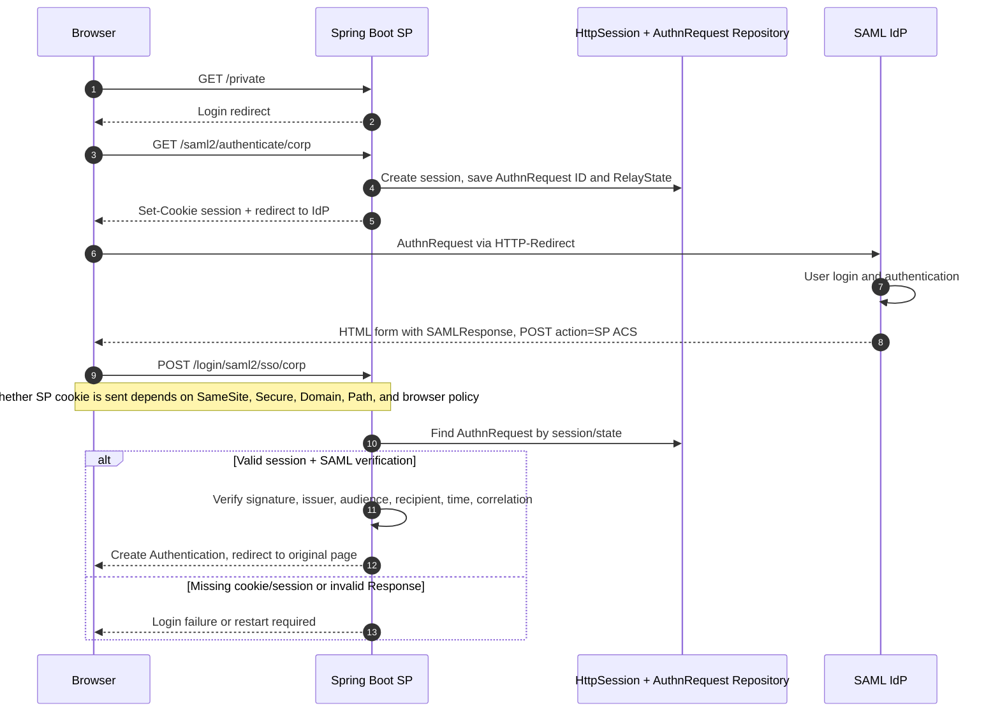

# Secure, HttpOnly, SameSite Cookies and SAML HTTP-POST Responses

## 1. Why Can a Session Cookie Break SAML SSO Even When SAMLResponse Is Valid?

In Spring Security SAML 2.0 Web Browser SSO, the Spring Boot application is the **Service Provider (SP)** or *Relying Party*, while the identity system is the **Identity Provider (IdP)** or *Asserting Party*. A common SP-initiated flow begins with the application creating an `AuthnRequest`, redirecting the browser to the IdP, and receiving a `SAMLResponse` back at the **Assertion Consumer Service (ACS)** via the **HTTP-POST binding**.

If the application stores the pending request in `HttpSession`, the session cookie must travel with the browser back to the SP so it can locate the matching request. However, the callback from the IdP is a **form POST originating from another website**, so the browser's `SameSite` cookie mechanism may **omit the SP cookie**. As a result, the browser successfully logs in at the IdP, the SAMLResponse XML looks valid, yet the SP loses correlation state; many systems send the user back to the login page or report an `InResponseTo`/RelayState mismatch.

This problem is not solved merely by "verifying the SAML signature". **Cookies, HTTP sessions, CSRF, and SAML validation protect different boundaries**; each layer must be handled properly.

### Learning Objectives

After this article, learners can:

1. Explain accurately the effects of `Secure`, `HttpOnly`, `SameSite=Strict/Lax/None`, `Domain`, and `Path` on session cookies.
2. Distinguish **same-origin** and **schemeful same-site**, predicting whether a SAML HTTP-POST callback carries cookies.
3. Understand why the default `HttpSessionSaml2AuthenticationRequestRepository` requires the browser to send the session cookie when delivering `SAMLResponse`.
4. Configure session cookies with `server.servlet.session.cookie.*` in Spring Boot 3.x, and know when to configure Spring Session's `DefaultCookieSerializer`.
5. Properly handle HTTPS reverse proxies, session stores, SameSite, CSRF, and request correlation without disabling security checks.
6. Debug with browser DevTools and negative tests; identify cookie issues before altering SAML validators or IdP metadata.

This lesson uses Java 17+, Spring Boot 3.x, and Spring Security 6.x; hostname examples are purely illustrative. Many API details are equivalent in newer Spring Security releases, though you should pin the specific release when implementing.

## 2. The SAML HTTP-POST Flow Viewed Through Browser and Cookies

Suppose the SP is at **`https://app.sp-example.test`** and the IdP is at **`https://login.idp-example.test`**. These are two different sites. The SP has registration ID `corp` and uses the default ACS:

```text
SP public host: https://app.sp-example.test
IdP public host: https://login.idp-example.test
SP start login: /saml2/authenticate/corp
SP ACS: /login/saml2/sso/corp
```

The following diagram separates the initiating request, where AuthnRequest is stored, and the callback:



Important point: the browser **does not need to send the IdP's cookie to the SP**. The browser needs to send **the SP's session cookie** that the SP set before redirecting to the IdP. The IdP cookie is typically sent only when the browser communicates with the IdP; both sides have separate sessions.

### Two Different Messages

- `SAMLRequest`: contains the authentication request created by the SP, usually sent to the IdP via HTTP-Redirect binding.
- `SAMLResponse`: contains the response issued by the IdP, usually embedded in an HTML form that the browser POSTs to the ACS.

**HTTP-POST binding** here is a standard HTML form POST, not a default `fetch()` AJAX call and not a server-to-server HTTP webhook from the IdP. The IdP sends HTML containing a form to the browser; the browser itself decides whether to send matching SP cookies when submitting to the SP.

## 3. Set-Cookie and Cookie: Two Directions of Exchange

The server creates a cookie with a response header:

```http
HTTP/1.1 302 Found
Location: https://login.idp-example.test/saml/sso?SAMLRequest=...
Set-Cookie: JSESSIONID=opaque-session-id; Path=/; Secure; HttpOnly; SameSite=None
```

This is a **header illustration**, not a usable session value. Later, if the browser decides the cookie applies, it sends it on requests to the SP:

```http
POST /login/saml2/sso/corp HTTP/1.1
Host: app.sp-example.test
Cookie: JSESSIONID=opaque-session-id
Content-Type: application/x-www-form-urlencoded

SAMLResponse=BASE64_ENCODED_XML&RelayState=OPAQUE_STATE
```

The attributes `Secure`, `HttpOnly`, `SameSite`, `Domain`, and `Path` **do not reappear in the `Cookie` header**; they are rules the browser stores after receiving `Set-Cookie`. Therefore, reading `Cookie: JSESSIONID=...` in server logs **cannot tell you** which SameSite/HttpOnly attributes were set. To inspect them, examine the **response `Set-Cookie`** and the browser's Application/Storage Cookies tab.

Conversely, `SAMLResponse`/`RelayState` are **form fields**. Never use them to replace the session cookie; never log them in production logs or issue trackers because they may contain identity data and transaction correlation details.

## 4. The Secure Attribute: Restricting Cookies to HTTPS

`Secure` requires the browser to send the cookie only over HTTPS connections, with certain browser-supported localhost exceptions. It does not **upgrade** an HTTP page to HTTPS and does not replace HSTS, TLS certificates, proxy configuration, or SAML XML Signatures.

Example:

```http
Set-Cookie: JSESSIONID=opaque; Secure; HttpOnly; Path=/; SameSite=None
```

In production:

- The public SP URL and ACS must use **HTTPS**, not HTTP.
- The browser must see HTTPS on the SP URL. Even if the proxy connects to Spring Boot over internal HTTP, response cookies sent to the browser must still carry `Secure`.
- With `SameSite=None`, modern browsers require `Secure`; a cookie lacking it is usually **rejected from storage** or ignored.
- If `Secure=true` in a local `http://127.0.0.1:8080` environment, behavior may vary by localhost exceptions/browser. **Do not** treat localhost results as proof that production config is right; prefer local HTTPS or a dedicated dev profile.

`Secure` only restricts cookie transport by scheme. If the application has XSS, an attacker can issue requests within the same origin; Secure does not replace CSRF protection, HttpOnly, Content Security Policy, or input/output encoding.

## 5. The HttpOnly Attribute: Preventing JavaScript from Reading Session Cookies

`HttpOnly` prevents JavaScript from reading or modifying the cookie via `document.cookie`. Example:

```http
Set-Cookie: JSESSIONID=opaque; Path=/; Secure; HttpOnly; SameSite=None
```

When the browser holds such a cookie:

- `document.cookie` does not display `JSESSIONID`.
- The browser **still automatically attaches the cookie** to eligible requests from navigation, forms, or `fetch()` (if credentials/origin policies permit).
- `HttpOnly` **does not block** sending the cookie on a SAML HTTP-POST callback. Thus, there is no need to remove HttpOnly to "help the IdP return SAMLResponse".
- HttpOnly reduces the risk of XSS stealing the session ID, though XSS can still perform actions from the same-origin context; do not treat it as comprehensive XSS defense.

A common mistake: frontend code says "JSESSIONID is missing from document.cookie" and concludes no session exists. With HttpOnly, **this is the intended behavior**. Check DevTools → Application → Cookies and Network → Request Headers without sharing cookie values.

## 6. SameSite: Deciding Whether a Cookie Accompanies Cross-Site Requests

`SameSite` is an attribute the server sends in `Set-Cookie` so the browser decides whether to attach the cookie to requests originating from a **different site**.

| SameSite | Behavior on same-site requests | Cross-site top-level GET navigation | Cross-site top-level POST, e.g. SAML HTTP-POST |
| --- | --- | --- | --- |
| **Strict** | Sends cookie if other conditions match | Usually **not sent** | **Not sent** |
| Explicit **Lax** | Sends cookie | **May send** because top-level navigation uses a safe method | **Not sent** because POST is not a safe method |
| **None; Secure** | Sends cookie | May send | **May send** if HTTPS/Domain/Path/browser policy all allow |
| SameSite omitted | Browser applies its own default | Usually behaves like Lax | May have a "Lax-allowing-unsafe" exception for newly created cookies in some browsers; **must not be relied upon** |

The table describes modern browsers for true **cross-site** cases, excluding additional cookie blocks from privacy settings/enterprise policies. Browser policies evolve across versions; test target browsers.

**Two points to remember:**

1. **Explicit `SameSite=Lax` differs from omitting `SameSite`**. Chromium and some browsers have a looser default exception for newly created cookies within a short window (e.g., two minutes) when the server **omits SameSite**. That is not a guarantee for explicit `SameSite=Lax` and is not a recommended SAML operating practice.
2. `SameSite=None` means **allowing cookies to be sent in cross-site contexts** when other conditions hold; the word "None" **does not mean disabling cookies**. Browsers can still block them due to domain/path/HTTPS, third-party cookie policies, partitioning, or user cookie settings.

Do not rely on SSO "sometimes working within the first two minutes" to conclude cookie configuration is sound: users taking longer on MFA, switching tabs, or using another browser can make the flow fail abruptly.

## 7. Same-Origin Does Not Mean Same-Site

**Origin** consists of `scheme + host + port`. **Site** in modern cookies is typically based on **scheme + registrable domain (eTLD+1)**; subdomains on the same site can be **cross-origin**.

Examples:

| A → B | Same-origin? | Same-site? | Notes |
| --- | --- | --- | --- |
| `https://app.example.test` → `https://app.example.test` | Yes | Yes | Same origin/site |
| `https://login.example.test` → `https://app.example.test` | No | Yes | Different subdomains but same scheme and registrable domain |
| `https://login.idp-example.test` → `https://app.sp-example.test` | No | No | Two different registrable domains |
| `http://app.example.test` → `https://app.example.test` | No | No in schemeful same-site | Differing only in scheme can still be cross-site |
| `https://app.example.test:8443` → `https://app.example.test` | No (different port) | Usually yes (port does not define site) | Cookies do not scope by port the way origins do |

SAML IdPs and SPs are often on two different domains, yet **not every SAML callback is cross-site**. If `login.example.test` and `app.example.test` are both HTTPS, they can be same-site even though they are cross-origin. `SameSite=Lax` will not necessarily block POST in that case. Therefore, identify the **actual public hosts and schemes** of both sides rather than assuming from "IdP differs from SP".

**Cross-origin CORS** is a separate mechanism: a top-level navigating HTML form POST is generally not governed by browser CORS like an AJAX `fetch()`. Do not add `Access-Control-Allow-Origin: *` to fix SAML HTTP-POST callback failures. CORS does not cause Lax cookies to be sent on cross-site POSTs.

## 8. Why Does HTTP-POST Binding Expose SameSite Issues So Easily?

The IdP may return an HTML page to the browser containing a form:

```html
<form method="post" action="https://app.sp-example.test/login/saml2/sso/corp">
  <input type="hidden" name="SAMLResponse" value="BASE64_ENCODED_SAML"/>
  <input type="hidden" name="RelayState" value="OPAQUE_STATE"/>
  <noscript><button type="submit">Continue</button></noscript>
</form>
<script>document.forms[0].submit();</script>
```

The HTML above is a **binding illustration**, not a valid SAML message. The browser is currently displaying a page at the **IdP's site**, and then submits a **POST** form to the **SP's site**. If this is a cross-site POST, `SameSite=Lax`/`Strict` SP cookies are normally withheld even though the user is actively logging in.

On some systems, the IdP sends AuthnRequest/Response using a different binding. **HTTP-Redirect binding** uses GET and has different cookie rules; do not conclude from a working Redirect/GET test that HTTP-POST binding will also work. Some SAML profiles use Artifact binding, POSTing an artifact followed by server-to-server retrieval; if used, it requires its own design rather than treating it as a simple cookie flag change.

**Base64 is not encryption.** `SAMLResponse` may expose PII inside the browser before the form submits. HTTPS protects transport, XML Signature protects integrity/issuer of signed elements, and SAML encryption hides sensitive attributes from the browser. Cookie flags do not replace those functions.

## 9. Session Cookies and HttpSessionSaml2AuthenticationRequestRepository

Spring Security SAML2 Servlet uses **`HttpSessionSaml2AuthenticationRequestRepository`** by default to store `AbstractSaml2AuthenticationRequest`. This serves several purposes:

- Retaining request ID/registration/RelayState or enough data to resolve the callback.
- Binding the browser session that initiated SSO to the incoming response.
- Supporting defense-in-depth against **login fixation**/login CSRF in SP-initiated login.
- Removing or consuming the transaction upon receiving the response per framework lifecycle.

Typical flow:

```text
GET /saml2/authenticate/corp:
    browser has or receives the SP session cookie
    SP stores AuthnRequest in this session's HttpSession
    SP sends browser to IdP

POST /login/saml2/sso/corp:
    browser returns with SAMLResponse
    SP inspects session cookie to locate HttpSession
    Spring Security retrieves saved AuthnRequest
    validates SAML Response and correlates InResponseTo/RelayState
    success => Authentication; failure => no login created
```

If the callback **lacks the SP cookie**, the framework may see a **new session or no session**, failing to retrieve the pending request. Do not "fix" this by accepting a validly signed SAML Response while **skipping `InResponseTo`/request correlation** when policy allows only SP-initiated SSO.

### Different Repositories Are Not the Same

- `Saml2AuthenticationRequestRepository`: pending AuthnRequest **before login**.
- `SecurityContextRepository`: holds `Authentication` **after login**.
- `RelyingPartyRegistrationRepository`: trust config/IdP metadata, keys, ACS, and Entity ID; does not hold AuthnRequest.
- `RequestCache`: saved return URL after login; does not hold SAML AuthnRequest.

A failure losing `AuthnRequest` is not the same as "authenticated but subsequent request forgot login". Both can involve cookies/sessions, yet you must pinpoint where state was lost.

## 10. Failure Symptoms When Cookies Are Blocked at Callback

A real-world scenario:

1. SP handles `GET /private`, redirects to `/saml2/authenticate/corp`.
2. Server returns `Set-Cookie: JSESSIONID=...; SameSite=Lax; Secure; HttpOnly` and saves the request in session.
3. Browser navigates to a cross-site IdP; user enters password/MFA.
4. IdP auto-POSTs the `SAMLResponse` form back to the SP ACS.
5. Browser **omits `JSESSIONID`** due to explicit `SameSite=Lax` and the cross-site POST method.
6. SP cannot find the original session/pending AuthnRequest.
7. Authentication fails, potentially logging a correlation error or redirecting back to the IdP.

Symptoms:

- Browser Network shows POST to the right ACS, carrying `SAMLResponse`.
- POST request headers **lack the SP session cookie**.
- DevTools may mark the cookie "excluded" with reason `SameSite=Lax`/`Strict`.
- Server creates a new session or cannot find old state, causing a correlation error.
- Retrying quickly after login may behave inconsistently if the cookie **omits SameSite** and a browser applies a short-lived exception.

**A dropped cookie is not guaranteed to be the only cause.** If the browser does send the cookie, check session timeout, invalidation, load balancer, Spring Session backend, reverse proxy, cookie name/path/domain, and the AuthnRequest repository.

## 11. Rules for Choosing SameSite for SAML Sessions

No single setting fits every topology. Choose based on the actual redirect/POST topology, CSRF exposure, and supported browsers.

| Topology | Practical recommendation |
| --- | --- |
| SP/IdP share a schemeful site; HTTP-POST login sends session cookie | May keep `Lax` if end-to-end tests confirm |
| SP/IdP **cross-site**, POST callback needs session-bound AuthnRequest | Consider `SameSite=None; Secure; HttpOnly` for the **required session cookie**, paired with CSRF and SAML validation |
| Application refuses to send session cookies cross-site | Requires a security-reviewed separate AuthnRequest storage/correlation architecture without dropping checks |
| Iframe/third-party embedded login | Faces additional third-party cookie/partitioning limits; prefer top-level login whenever possible |
| SP with multiple domains/tenants | Align public hosts, cookie Domain/Path, routing, and registrations per origin |
| `SameSite=Strict` mandated by organizational policy | Requires an alternative to session request lookup; assess login fixation and IdP-initiated options |

**When `None` is needed**, never disable `HttpOnly` or `Secure`. Keeping the session cookie at `SameSite=None` makes extra CSRF defenses, Origin/Referer checks where appropriate, anti-CSRF tokens on business endpoints, and CSP/XSS defenses especially critical.

An advanced option is separating the authentication handshake cookie from the business session cookie, though that demands a concrete cookie/repository architecture and threat model; do not invent an unsigned "RelayState cookie" and treat it as equivalent to session-bound validation.

## 12. Spring Boot 3.x: Configuring Session Cookies in application.yml

Spring Boot provides `server.servlet.session.cookie.same-site` alongside `secure`/`http-only`. Example for an **HTTPS production environment with cross-site SP/IdP and HTTP-POST binding**:

```yaml
server:
  forward-headers-strategy: framework
  servlet:
    session:
      timeout: 20m
      cookie:
        name: JSESSIONID
        secure: true
        http-only: true
        same-site: "none"
        path: "/"

spring:
  security:
    saml2:
      relyingparty:
        registration:
          corp:
            assertingparty:
              metadata-uri: "${SAML_IDP_METADATA_URI}"
```

Effects of this configuration:

- `cookie.secure: true`: session cookie must carry `Secure`.
- `cookie.http-only: true`: prevents JavaScript from reading the session ID.
- `cookie.same-site: "none"`: lets the browser send the cookie on cross-site POSTs if other conditions hold.
- `cookie.path: "/"`: cookie applies to both the login initiation endpoint and the ACS under root. For apps deployed under a context path, consider the narrowest matching scope.
- `session.timeout: 20m`: **example** session timeout; must cover real-world MFA/login duration without violating security policy.
- `forward-headers-strategy: framework`: allows the app to recognize the public HTTPS origin from a **trusted proxy**; use only when the reverse proxy strips/overwrites forwarded headers from the Internet.
- `SAML_IDP_METADATA_URI`: a trusted configured IdP metadata location, never supplied arbitrarily by HTTP users.

**Do not treat this YAML snippet as a complete SAML config for every IdP.** SP Entity ID, public ACS URL, certificate verification, AuthnRequest signing if required by the IdP, and metadata providers must all be accurate. The example URL `https://login.idp-example.test/metadata` cannot perform real logins.

Spring Boot 3.5 documentation confirms `server.servlet.session.cookie.same-site` is supported in auto-configured Tomcat, Jetty, and Undertow, and also applies to Spring Session's auto-configured servlet repository. If the application adds its own `CookieSerializer` or custom container/session configuration, **inspect the actual `Set-Cookie` header** to verify which value wins, rather than assuming YAML always governs.

### Separating Production and Development

A safe setup places **production cookie** values in the official environment profile:

```yaml
# application-prod.yml: example for public HTTPS.
server:
  servlet:
    session:
      cookie:
        secure: true
        http-only: true
        same-site: "none"
```

If development runs over plain HTTP, `Secure` can prevent cookies from being sent. Prefer local HTTPS (e.g., a reverse proxy or valid local certificate). If choosing a temporary alternative for debugging, restrict it **strictly to the dev profile** and never commit weakened settings to production. Cross-site SAML callback testing should run over public HTTPS or test domains reflecting real schemeful-site boundaries, not just localhost.

## 13. Complete Spring Boot Servlet Example to Observe SAML Sessions

Spring Boot 3.x/Spring Security 6.x project, Java 17+. In a project's `build.gradle` that **already includes compatible Java/Spring Boot plugins and dependency management**, add:

```groovy
repositories {
    mavenCentral()
    // Some OpenSAML artifacts require the Shibboleth release repository.
    maven { url "https://build.shibboleth.net/maven/releases/" }
}

dependencies {
    implementation "org.springframework.boot:spring-boot-starter-web"
    implementation "org.springframework.boot:spring-boot-starter-security"
    implementation "org.springframework.security:spring-security-saml2-service-provider"
}
```

This is a **Gradle snippet**, not a standalone `build.gradle`. Do not force arbitrary OpenSAML versions; use the version compatible with your Spring Security release.

Save as `src/main/java/demo/cookies/SamlCookieApplication.java`:

```java
package demo.cookies;

import java.util.Map;

import org.springframework.boot.SpringApplication;
import org.springframework.boot.autoconfigure.SpringBootApplication;
import org.springframework.context.annotation.Bean;
import org.springframework.security.config.Customizer;
import org.springframework.security.config.annotation.web.builders.HttpSecurity;
import org.springframework.security.core.annotation.AuthenticationPrincipal;
import org.springframework.security.saml2.provider.service.authentication.Saml2AuthenticatedPrincipal;
import org.springframework.security.web.SecurityFilterChain;
import org.springframework.web.bind.annotation.GetMapping;
import org.springframework.web.bind.annotation.RestController;

@SpringBootApplication
@RestController
public class SamlCookieApplication {

    public static void main(String[] args) {
        SpringApplication.run(SamlCookieApplication.class, args);
    }

    @Bean
    SecurityFilterChain securityFilterChain(HttpSecurity http) throws Exception {
        return http
                .authorizeHttpRequests(auth -> auth
                        .requestMatchers("/", "/error").permitAll()
                        .anyRequest().authenticated())
                .saml2Login(Customizer.withDefaults())
                .build();
    }

    @GetMapping("/")
    public String home() {
        return "SAML cookie demo: open /private";
    }

    @GetMapping("/private")
    public Map<String, String> privateEndpoint(
            @AuthenticationPrincipal Saml2AuthenticatedPrincipal user) {
        return Map.of(
                "registration", user.getRelyingPartyRegistrationId(),
                "subject", user.getName());
    }
}
```

The code intentionally **has no controller handling `/login/saml2/sso/corp`**. Spring Security registers `Saml2WebSsoAuthenticationFilter` to handle the ACS. The session cookie is not set manually by a controller, but written by the servlet container or Spring Session per configuration.

To run in a Gradle project with a wrapper, IdP sandbox, and corresponding public HTTPS/metadata/ACS:

```bash
SAML_IDP_METADATA_URI=https://login.idp-example.test/metadata ./gradlew bootRun
```

The address `login.idp-example.test` is a placeholder, so there is no deterministic login stdout. When a real IdP verifies successfully, `GET /private` returns JSON containing `registration` and `subject` for the real user. Protect or remove demo endpoints printing NameID before production since that can be identifying data.

If an HTTP-only cookie is set, not seeing it in `document.cookie` is **by design**; observe response headers and browser cookie storage directly.

### Why Should You Never Set Session Cookies Manually in a Controller?

Do not call:

```java
// Anti-pattern: do not do this in a real application.
response.addHeader("Set-Cookie",
        "JSESSIONID=hard-coded-id; SameSite=None; Secure");
```

This snippet has no class/imports and is not meant to be run. It can create a cookie conflicting with the container, omit HttpOnly, mismatch the session ID, or collide with SessionRepository; nor does it create a server-side session. **Let the container/Spring Session manage the session ID**, setting attributes through official mechanisms.

## 14. Using Spring Session: Who Writes the Cookie and How to Customize

When using Spring Session (e.g., Redis-backed sessions), the application may see a session cookie named `SESSION` instead of `JSESSIONID` depending on configuration. `Spring Session DefaultCookieSerializer` provides `sameSite`, `useSecureCookie`, `useHttpOnlyCookie`, `cookieName`, and `cookiePath`. By default, Spring Session documentation describes `SameSite=Lax` unless configured otherwise.

If a project already uses Spring Session and needs to customize the serializer, an illustrative bean (do not use alongside another serializer):

```java
package demo.cookies;

import org.springframework.context.annotation.Bean;
import org.springframework.context.annotation.Configuration;
import org.springframework.session.web.http.CookieSerializer;
import org.springframework.session.web.http.DefaultCookieSerializer;

@Configuration
public class SessionCookieConfiguration {

    @Bean
    CookieSerializer cookieSerializer() {
        DefaultCookieSerializer serializer = new DefaultCookieSerializer();
        serializer.setCookieName("SESSION");
        serializer.setCookiePath("/");
        serializer.setUseSecureCookie(true);
        serializer.setUseHttpOnlyCookie(true);
        serializer.setSameSite("None");
        return serializer;
    }
}
```

The class above **compiles once Spring Session is added to the project**. It **does not automatically enable Redis or replace the HTTP session store**; the application still needs the right dependencies/Redis connection and `SessionRepository`. If using only the default Servlet container session, use `server.servlet.session.cookie.*` from section 12—do not add Spring Session just to change SameSite.

**Duplicate configuration warning:** Spring Boot supports configuring SameSite for session cookies, including auto-configured Spring Session. However, a custom `CookieSerializer` can override part of that behavior. Do not guess cookie names or SameSite values; inspect the actual `Set-Cookie` on SP responses and identify which component writes it.

### Spring Session Errors Unrelated to Cookie Flags

- Redis/session store lost connection or keys hit TTL prematurely.
- Pods use incompatible serialization.
- Session ID changed/invalidated during a login step while the application stored state in the wrong lifecycle.
- Session keyspace/namespace collides across environments.
- Cookie named `SESSION` differs from load balancer/proxy configuration.

Changing SameSite to None **does not** fix backend issues like these. Verify both that the cookie is sent **and** that the server can locate the right data in the session store.

## 15. Multi-Replica: Even a Valid Cookie Can Lose AuthnRequest

Topology:

```text
Browser -- HTTPS --> Load Balancer
                          |
                 +--------+--------+
                 |                 |
              SP pod A          SP pod B
                 |                 |
                 +---- Session ----+
                       Store?
```

If the SP initiates `AuthnRequest` on pod A, and the SAMLResponse POST callback is routed by the load balancer to pod B while `HttpSession` lives only in pod A's RAM, then even though the browser **sent the right cookie**, pod B cannot find the request.

Options:

1. **Spring Session / shared session store** across all replicas: usually suitable for session-bound SSO, preserving correlation with the browser session.
2. **Sticky sessions**: pins the browser to one pod during login, but note that rolling deployments, pod restarts, or failover can still drop state.
3. **Custom SAML repository with distributed backend**: requires checking security tradeoffs, TTL/consume-once, and correlation, rather than picking Redis out of habit.

To distinguish causes, check:

- Does the browser's POST ACS carry `SESSION`/`JSESSIONID`?
- Does that session ID exist in the right store/namespace?
- Is the pod receiving the callback connected to the same session store?
- Was AuthnRequest written to the session before redirecting the browser to the IdP?
- Did session timeout/long MFA or multi-tab login alter the request state?

If the cookie is present on the network request yet the repository loads null, the issue is not necessarily `SameSite`.

## 16. Reverse Proxies, TLS Termination, and Forwarded Headers

A common ingress terminating TLS:

```text
Browser --- HTTPS ---> https://app.sp-example.test
                              |
                        Trusted proxy
                              |
                       HTTP internal hop
                              |
                        Spring Boot :8080
```

If Spring Boot sees only the internal request `http://app-service:8080`, `request.isSecure()` and the derived base URL can be wrong. This affects:

- Whether `Secure` is set on cookies if inferred from the request.
- The public `{baseUrl}` value used in ACS/metadata/redirects.
- `Destination`, `Recipient`, and URL verification of the SAML Response.
- HTTP↔HTTPS redirects and callback paths behind ingress.

Sample configuration:

```yaml
server:
  forward-headers-strategy: framework
  servlet:
    session:
      cookie:
        secure: true
        http-only: true
        same-site: "none"
```

`forward-headers-strategy: framework` should be used only when the proxy **strips or overwrites** `Forwarded`, `X-Forwarded-Proto`, `X-Forwarded-Host`, and similar headers from Internet clients. If the backend directly trusts attacker-supplied headers, host-header poisoning or corrupted metadata URLs can occur. Never expose a backend publicly if it trusts forwarded headers.

**Enabling Secure does not fix a wrong ACS URL.** Separately verify that SP metadata publishes the public HTTPS ACS, the IdP registers the exact URL, ingress forwards POSTs to the exact path, and `Destination`/`Recipient` validators remain enabled.

## 17. Domain, Path, Host-Only Cookies, and Cookie Names

`SameSite=None` does not ensure a cookie is sent if `Domain` or `Path` mismatches.

### 17.1. Domain

If the response sets:

```http
Set-Cookie: JSESSIONID=opaque; Path=/; Secure; HttpOnly; SameSite=None
```

without `Domain`, the cookie is **host-only**, sent solely to the host that set it (e.g., `app.sp-example.test`). This is usually the best configuration for an SP's session.

Setting `Domain=sp-example.test` allows the cookie to be sent to matching `*.sp-example.test` subdomains. That broader scope increases session fixation/cookie injection risk from less-trusted subdomains. **Never widen Domain just to "share cookies" when the SAML IdP is on another domain**: an SP cannot arbitrarily set cookies for the IdP's domain, nor does it need to.

### 17.2. Path

A cookie with `Path=/app` is sent to `/app/...`, not to `/login/saml2/sso/corp` at root if paths do not match. For apps running under context path `/portal`, the public ACS path may be `/portal/login/saml2/sso/corp`, and the cookie Path should match that context.

To debug:

- Did the network request to `/saml2/authenticate/corp` carry a cookie?
- Which host and path did the server return `Set-Cookie` for?
- Is the callback URL on the same host and within the cookie's path?
- Is there an older cookie with the same name but a different Domain/Path?
- Did the load balancer rewrite routes before reaching Spring, causing cookie path and request path to diverge?

**Path is not a strong application-isolation security boundary**; do not rely on it instead of separating hosts and session namespaces.

### 17.3. Cookie Prefixes

For single-host cookies, browsers support the **`__Host-`** prefix requiring `Secure`, `Path=/`, and **no Domain**. The **`__Secure-`** prefix requires `Secure` from HTTPS. These act as defense-in-depth against certain cookie scoping/overwrite flaws and do not replace SameSite/CSRF.

Do not rename the session cookie to `__Host-JSESSIONID` without aligning Spring Session/container config, proxies, and logout tests. Prefixes only work if the browser and every cookie-writing component obey the rules.

## 18. SameSite=None Does Not Replace CSRF Protection

With `SameSite=None`, browsers can send session cookies on **more cross-site POSTs**. This is necessary for certain SAML HTTP-POST callbacks, yet it also makes cookie-session business endpoints more exposed to cross-site requests.

Distinguish clearly:

1. **SAML ACS** is a protocol endpoint receiving an HTML form POST from the IdP. The IdP **does not have the SP's CSRF token**. Spring Security SAML2 must handle the ACS per SAML flow, normally via properly configured matchers/CSRF exclusions for protocol routes. Not using a traditional web form CSRF token at the ACS must be compensated by **SAML signature, issuer, audience, destination, subject confirmation, request correlation, timestamps, and replay policies**.
2. **Business APIs/forms** like `POST /api/orders/approve` still require CSRF tokens when relying on browser session cookies, even with SAML SSO enabled.
3. **Logout** also faces logout CSRF risk: Spring Security requires POST/CSRF tokens by default for local logout when CSRF protection is enabled.

If you change the ACS processing URL to `/saml/acs/corp`, verify that the filter and CSRF request matchers align. Do not merely change `RelyingPartyRegistration.assertionConsumerServiceLocation` and assume filter and CSRF rules update everywhere automatically.

### Example Exception Only for a Custom ACS (When Truly Needed)

A DSL snippet solely to illustrate scope, **not a mandatory config for the default flow**:

```java
.csrf(csrf -> csrf
        .ignoringRequestMatchers("/saml/acs/**"))
```

This is an **addition to `HttpSecurity`** after properly configuring `saml2Login.loginProcessingUrl("/saml/acs/{registrationId}")`. It merely illustrates scoping the exception precisely to the protocol endpoint. When Spring Security already configures the appropriate SAML CSRF exception, do not add duplicate rules; check your actual version and endpoints. Never put `/api/**` in the ignore scope.

**Severe mistake:**

```java
// Do not use just to work around ACS 403:
.csrf(csrf -> csrf.disable())
```

Disabling CSRF globally to make SAML callbacks work exposes state-changing actions using session cookies, especially under `SameSite=None`.

## 19. Session Fixation, Login CSRF, and Risks of Dropping HttpSession

Some teams choose to keep `SameSite=Strict`/`Lax` for security policy and solve callback failures by **switching repositories**:

- `HttpSessionSaml2AuthenticationRequestRepository`: looks up the request by the transacting browser's session.
- `CacheSaml2AuthenticationRequestRepository`: can look up by `RelayState`/transaction without relying on a session cookie like the session-bound approach; supported in newer Spring Security versions.

Spring Security docs highlight **the security benefit of storing AuthnRequest in HttpSession**, specifically binding the response to the exact browser that initiated login. If an attacker feeds their own valid SAML Response to a victim, session-bound correlation blocks the victim from inadvertently logging into the attacker's account—a form of **login fixation/login CSRF**.

With a cache repo looking up by state/ID without browser binding, the SP knows an AuthnRequest once existed yet **cannot prove the callback browser is the browser that initiated the request**. Therefore:

- Do not treat switching from session to cache as an **equivalent security replacement**.
- If using a cache, require high-entropy state, TTL, one-time consume/replay protection, issuer+registration checks, and browser-binding measures per your threat model.
- In-memory local caches **do not automatically** support multiple replicas; you need a distributed backend and proper atomic operations.
- Do not disable `InResponseTo`, signatures, destination, audience, or unsolicited-response policies just to "get SSO working".

If the organization permits only SP-initiated login, **a lost AuthnRequest must fail closed**, rather than falling back to IdP-initiated/unsolicited login.

## 20. Be Careful with Iframes, Third-Party Cookies, and CHIPS

Many traditional SAML logins use **top-level browser navigation**: the browser leaves the SP, visits the IdP, and POSTs back to the SP. This differs from embedding the IdP inside an `<iframe>`.

In iframe/embedded flows, browsers may additionally enforce:

- Third-party cookie blocking independent of SameSite.
- Privacy/enterprise tracking-protection policies.
- Storage partitioning or `Partitioned` cookies (CHIPS) depending on browser.
- CSP `frame-ancestors` and `X-Frame-Options` blocking login embedding.
- IdP policies prohibiting login inside iframes or requiring top-level interaction.

**`SameSite=None; Secure` does not guarantee third-party cookies always work inside an iframe.** Partitioned cookies do not automatically fix SAML AuthnRequest correlation if the top-level site changes across steps or cookie jars are partitioned. When possible, **top-level SAML login** is simpler and less dependent on third-party cookies.

Do not change `frame-ancestors` to `*` just to enable iframe login, as that increases clickjacking risk; any solution must be evaluated against the architecture and the IdP's policies.

## 21. Diagnosing with Chrome/Edge/Firefox DevTools

### Step 1: Identify Both Real Sites

Record (without sharing secrets):

- Public SP host/scheme when initiating `AuthnRequest`.
- IdP host/scheme where the browser receives the HTML form.
- ACS host/scheme/path in form action and metadata.
- Whether a context path or reverse proxy rewrite exists.

If the two origins differ yet share a site, `Lax` may still work; do not switch to `None` out of habit before checking.

### Step 2: Inspect Set-Cookie at Initiation

In the Network tab, find the SP response that creates/maintains the session before redirecting to the IdP. Check **Response Headers**:

```http
Set-Cookie: JSESSIONID=<redacted>; Path=/; Secure; HttpOnly; SameSite=Lax
```

The value above is redacted for illustration. Record attributes **without pasting the session ID** into public tickets. Check whether the browser flags the cookie as **blocked/rejected** immediately upon setting, e.g., `SameSite=None` missing Secure or an invalid Domain.

### Step 3: Inspect the POST ACS

In Network, filter `/login/saml2/sso/corp` (or custom ACS) and verify:

- Method is POST.
- Request URL matches the registered public HTTPS ACS.
- Request carries form field `SAMLResponse`, and possibly `RelayState`.
- Whether the browser sent the **SP session cookie** or marked it **Excluded** due to SameSite/Path/Domain/Secure.
- What the HTTP status is; whether there is a redirect loop, 404/405/403.
- If the request carries the cookie, whether the SP server resolves the session.

**Do not upload HAR files containing raw SAMLResponse, cookies, authorization headers, and NameID** to external websites. Browser HARs must be scrubbed/redacted before sharing internally.

### Step 4: Cross-Check Server State

If the callback lacks the cookie, check SameSite/HTTPS/cookie scope first.

If the callback carries the cookie yet authentication fails, check:

- Session expired or invalidated.
- Session store/Redis unavailable.
- Pod A created the session, Pod B cannot see it.
- Custom `Saml2AuthenticationRequestRepository` not using the same store.
- Multi-tab login overwriting pending requests.
- Genuine `InResponseTo`/issuer/audience/destination/replay validation failures.

**Do not conclude from a single HTTP 302** that SAML login succeeded: a 302 can also redirect to `login?error`. Test a protected resource after the callback and inspect the actual `Authentication`.

## 22. Cookie and Browser Test Matrix

| Test | Setup | Observed/Expected Outcome |
| --- | --- | --- |
| A | Cross-site IdP/SP, explicit `SameSite=Lax`, HTTP-POST ACS | SP cookie typically not sent; request state may be missing |
| B | Cross-site, `SameSite=Strict`, HTTP-POST ACS | SP cookie not sent |
| C | Cross-site, `SameSite=None; Secure; HttpOnly`, HTTPS | Cookie **can** be sent if Domain/Path/privacy/session match |
| D | `SameSite=None` without Secure | Modern browsers normally reject setting the cookie |
| E | SameSite=Lax, IdP and SP truly on same schemeful site | POST can carry cookie because it is same-site |
| F | Cross-site but IdP uses GET redirect to a valid endpoint | Lax cookie may be sent on top-level safe navigation; **differs from SAML HTTP-POST** |
| G | Cookie present on ACS request but another pod cannot read session | Still fails; needs shared session/sticky routing |
| H | Cookie missing due to `Path=/portal`, ACS outside `/portal` | Still fails even with SameSite=None |
| I | Cookie secure but public SP request is HTTP | Browser omits cookie absent special exceptions |
| J | `SameSite=None`, business API POST lacks CSRF token | CSRF filter blocks per policy; do not drop CSRF because of SAML |
| K | `HttpOnly` enabled; JavaScript reads `document.cookie` | Session cookie hidden; browser can still send it over the network |
| L | IdP/SP uses iframe instead of top-level navigation | May be blocked by third-party cookie/frame policies |
| M | Callback has no matching AuthnRequest | Fails closed per SP-initiated policy |
| N | Callback has state but wrong signature/issuer/audience | SAML validation rejects; valid cookie cannot "save" it |
| O | Same user logs in across two tabs, callbacks arrive out of order | No cross-transaction mixup; behavior depends on repository/version |
| P | Session cookie changes ID after successful login | Likely session fixation protection; distinguish from losing session before callback |

Cookie tests must run on target browsers because Safari/Firefox/Chromium or enterprise privacy policies may differ. Do not use a single browser version as proof all users can log in.

## 23. Standalone Java 17: Simulating SameSite Logic for a POST Callback

To internalize the logic **without depending on a real IdP**, the following Java program models a specific case: a **cross-site top-level HTTP-POST** to the SP, explicitly configured cookie, considering only `SameSite` and HTTPS/`Secure`. It **is not a browser engine**, so it intentionally omits Domain/Path, ITP, cookie partitioning, omitted-SameSite exceptions, and session stores.

Save as `SameSitePostDemo.java`:

```java
public final class SameSitePostDemo {

    enum SameSite { STRICT, LAX, NONE }

    static boolean sendsOnCrossSitePost(
            SameSite sameSite, boolean secureFlag, boolean https) {
        // Model simplified: modern SameSite=None requires Secure.
        return sameSite == SameSite.NONE && secureFlag && https;
    }

    public static void main(String[] args) {
        System.out.println("Strict=" +
                sendsOnCrossSitePost(SameSite.STRICT, true, true));
        System.out.println("Lax=" +
                sendsOnCrossSitePost(SameSite.LAX, true, true));
        System.out.println("NoneSecureHttps=" +
                sendsOnCrossSitePost(SameSite.NONE, true, true));
        System.out.println("NoneWithoutSecure=" +
                sendsOnCrossSitePost(SameSite.NONE, false, true));
        System.out.println("NoneOverHttp=" +
                sendsOnCrossSitePost(SameSite.NONE, true, false));
    }
}
```

Compile/run on Java 17+:

```bash
javac SameSitePostDemo.java
java SameSitePostDemo
```

Exact stdout:

```text
Strict=false
Lax=false
NoneSecureHttps=true
NoneWithoutSecure=false
NoneOverHttp=false
```

The demo illustrates the **explicit SameSite** rule for **cross-site POST** and the `Secure` requirement. It does **not** guarantee the browser will send the cookie in every environment when the result is `true`: Domain/Path/expiry/privacy policies still apply. `HttpOnly` does not participate in deciding whether a cookie is sent on a POST, so there is no HttpOnly parameter in the method.

## 24. Anti-Patterns to Avoid

| Anti-pattern | Why it is wrong | How to handle |
| --- | --- | --- |
| Removing `HttpOnly` so SAMLResponse sends cookies | HttpOnly does not stop browsers from sending cookies | Keep HttpOnly and debug SameSite/Domain/Path |
| Setting `SameSite=None` without `Secure` | Browsers usually reject the cookie | Use HTTPS and Secure |
| Disabling `csrf` app-wide because ACS gets 403 | Opens CSRF risk on business forms/APIs | Configure narrow CSRF matchers, keep SAML validators |
| Dropping `InResponseTo`/RelayState check when session is lost | Opens login fixation/unsolicited login | Fix cookie/session or design a dedicated flow |
| Keeping `Saml2AuthenticationRequestRepository` in a static pod Map | State lost when callback hits another pod | Vetted shared session/cache |
| Using email from SAMLResponse as session ID | Identity data is not a session secret | Let container/Spring Session generate session IDs |
| Setting `Domain=.example.test` across unnecessary subdomains | Expands cookie overwrite/injection risk | Host-only cookie is default and preferred |
| Assuming cross-origin means cross-site | Confuses shared eTLD+1 and scheme | Determine schemeful site |
| Relying on the under-two-minute cookie exception | Unstable and browser-specific | Set explicit policy and test full MFA duration |
| Switching to HTTP dev and concluding Secure cookies are broken | HTTPS requirement is a security feature | Test local/prod-like HTTPS |
| Disabling Destination/Recipient validation when ACS differs from public host | Masks proxy/IdP metadata errors | Fix forwarded headers and metadata |
| Logging raw SAMLResponse/cookies for debugging | Leaks PII and replayable/hijackable state | Redact and log failure categories |
| Enabling SameSite=None and treating it as anti-CSRF | None allows cross-site cookies | Separate CSRF tokens and session security |
| Using `fetch` CORS config to fix HTML form SAML POST | Wrong protocol layer | Debug cookies and form navigation |
| Using invalid `__Host-` prefix with Domain | Browser may reject the cookie | Require Secure, Path=/, no Domain |
| Treating browser cookie presence as proof SAML is valid | Session is one layer; messages can be forged | Validate signature/issuer/audience/correlation/replay |

## 25. Secure Deployment Checklist

- [ ] SP/IdP public schemes and registrable domains are classified as same-site or cross-site.
- [ ] Whether login uses HTTP-POST or Redirect/Artifact binding is confirmed from IdP metadata and browser traces.
- [ ] The exact session cookie name written by the container or Spring Session is identified.
- [ ] Session cookies have `Secure` and `HttpOnly`; `SameSite` is set **explicitly** per threat model.
- [ ] For cross-site SAML HTTP-POST needing a session, `SameSite=None; Secure` is evaluated and tested in practice.
- [ ] Cookie `Domain` uses the narrowest scope, and `Path` covers both login initiation and ACS.
- [ ] Public SP/ACS run over HTTPS; reverse proxy forwarded headers are trusted within proper scope.
- [ ] `HttpSessionSaml2AuthenticationRequestRepository`/request state persists from AuthnRequest through callback.
- [ ] Multi-replica setups use shared sessions or safe state mechanisms; no blind reliance on sticky sessions.
- [ ] Session timeout covers realistic MFA/login times without being excessively long.
- [ ] SAML validation preserves signature, issuer, recipient, destination, audience, timestamps, correlation, and replay defense.
- [ ] IdP-initiated login has its own explicit policy; unsolicited responses are not accepted on lost sessions.
- [ ] CSRF remains enabled for business APIs/forms; SAML ACS uses narrow protocol handling.
- [ ] App-wide CSRF is not disabled when `SameSite=None`.
- [ ] Cookie prefixes/partitioning/iframe restrictions are applied only after verifying browser support.
- [ ] Browser DevTools confirms Set-Cookie and POST ACS Cookie headers, with sensitive data redacted.
- [ ] Negative tests cover SameSite=Lax/Strict/None, missing Secure, wrong Path, expired sessions, and multi-pod routing.
- [ ] SAMLResponse, RelayState, session cookies, NameID, private keys, or ID Tokens are never logged.
- [ ] Actual authenticated sessions are verified after login, rather than checking only HTTP 302.
- [ ] Operations docs identify which component writes cookies, where sessions live, and IdP/SP admin responsibilities.

## 26. Self-Check Questions

**1. Why does a SAMLResponse HTTP-POST differ from an HTTP GET redirect regarding cookies?**  
Because `SameSite=Lax` permits cookies on certain top-level cross-site GETs (safe navigation), yet typically **withholds** cookies on cross-site POSTs. HTTP-POST binding exposes this difference immediately.

**2. Does `HttpOnly` block the browser from sending the session cookie to the ACS?**  
No. It prevents JavaScript from accessing `document.cookie`, while the browser still sends the cookie whenever the request meets cookie rules.

**3. Does `SameSite=None` mean disabling cookies?**  
No. It allows cookies in cross-site contexts and generally must be paired with `Secure` and HTTPS.

**4. If the cookie is still not sent despite SameSite=None; Secure, what should you check next?**  
Domain/Path, expiry, browser privacy policies, blocked/rejected reasons, iframe/partitioning, and public HTTPS scheme.

**5. What error can a POST ACS with a valid `SAMLResponse` but no session cookie cause?**  
`HttpSessionSaml2AuthenticationRequestRepository` may fail to find the saved AuthnRequest, causing SP-initiated correlation to fail.

**6. Can `InResponseTo` be skipped if the IdP signature is valid?**  
Not for SP-initiated SSO. The signature proves the IdP, whereas correlation proves the response belongs to the initiating transaction/browser; skipping it risks login fixation/session confusion.

**7. Are `login.example.test` and `app.example.test` both over HTTPS considered cross-site?**  
Not necessarily; if they share a registrable domain and scheme, they can be **same-site** despite being cross-origin.

**8. Which property sets SameSite on session cookies in Spring Boot?**  
`server.servlet.session.cookie.same-site`, such as `"none"`, paired with `secure: true` and `http-only: true` per policy.

**9. When using Spring Session, where can SameSite be customized?**  
Through auto-configured Boot session properties or a consistently configured `DefaultCookieSerializer#setSameSite(...)`; inspect actual `Set-Cookie` headers to see which component applies.

**10. The cookie is present on the POST yet AuthnRequest is still lost on Kubernetes?**  
The request may have created the session on pod A while the callback hit pod B without a shared session or repository; do not blame every failure on SameSite.

**11. If SameSite=None is set, do business POSTs still need CSRF tokens?**  
Yes, especially because browsers send session cookies cross-site. Protocol exceptions for SAML endpoints do not replace CSRF protection on business APIs.

**12. Does seeing only an HTTP 302 after ACS prove login succeeded?**  
No. Check whether the redirect goes to success or error, and access a protected resource to verify `Authentication`.

## 27. Official References

- [Spring Security – SAML 2.0 Login Overview](https://docs.spring.io/spring-security/reference/servlet/saml2/login/overview.html): Web Browser SSO, `AuthnRequest`, and HTTP-POST `SAMLResponse` callbacks.
- [Spring Security – Producing AuthnRequests](https://docs.spring.io/spring-security/reference/servlet/saml2/login/authentication-requests.html): default `HttpSessionSaml2AuthenticationRequestRepository`, cache options, and login fixation tradeoffs.
- [Spring Security – Authenticating SAML Responses](https://docs.spring.io/spring-security/reference/servlet/saml2/login/authentication.html): receiving SAMLResponse, authentication providers, signature/validation.
- [Spring Boot 3.5 – SameSite Cookies](https://docs.spring.io/spring-boot/3.5/reference/web/servlet.html): `server.servlet.session.cookie.same-site`, servlet container/Spring Session support, and cookie configuration.
- [Spring Boot 3.5 – Common Application Properties](https://docs.spring.io/spring-boot/3.5/appendix/application-properties/): `server.servlet.session.cookie.secure`, `http-only`, `same-site`, `path`, `domain`.
- [Spring Session – Custom Cookie](https://docs.spring.io/spring-session/reference/guides/java-custom-cookie.html): `DefaultCookieSerializer`, cookie name, `SameSite`/`Secure`/`HttpOnly`, and cookie scope.
- [Spring Security – CSRF Protection](https://docs.spring.io/spring-security/reference/servlet/exploits/csrf.html): CSRF for browser sessions, login/logout, and configuring protection scopes.
- [MDN – Set-Cookie](https://developer.mozilla.org/en-US/docs/Web/HTTP/Reference/Headers/Set-Cookie): semantics of Secure, HttpOnly, SameSite, Domain, Path, Lax-allowing-unsafe.
- [MDN – Using HTTP Cookies](https://developer.mozilla.org/en-US/docs/Web/HTTP/Guides/Cookies): schemeful same-site, scope, and browser restrictions.
- [MDN – Secure Cookie Configuration](https://developer.mozilla.org/en-US/docs/Web/Security/Practical_implementation_guides/Cookies): session cookie protection principles and host-only prefixes.
- [OWASP – Session Management Cheat Sheet](https://cheatsheetseries.owasp.org/cheatsheets/Session_Management_Cheat_Sheet.html): session IDs, cookie flags, fixation, and lifecycle.
- [OWASP – Cross-Site Request Forgery Prevention Cheat Sheet](https://cheatsheetseries.owasp.org/cheatsheets/Cross-Site_Request_Forgery_Prevention_Cheat_Sheet.html): CSRF tokens, SameSite as defense-in-depth, and safe method behavior.
- [OASIS – SAML 2.0 Bindings](https://docs.oasis-open.org/security/saml/v2.0/saml-bindings-2.0-os.pdf): HTTP-POST binding, browser relay, and Base64 encoding.
