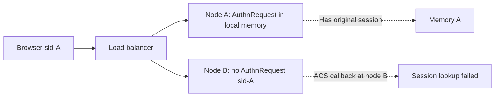
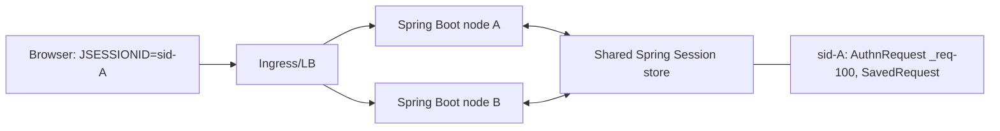

# Session Loss Upon Returning from the IdP and Impact on Stored AuthnRequest

## Learning Objectives

After this lesson, you can:

1. Accurately trace the **SP-initiated SAML2 Web Browser SSO** flow from when the application issues `AuthnRequest` to when it receives `SAMLResponse` at the **Assertion Consumer Service (ACS)**.
2. Distinguish **stored AuthnRequest**, **SavedRequest of the protected page**, **SP HTTP session**, **IdP SSO session**, and **post-login SecurityContext**.
3. Explain why the SP session cookie might **not be sent by the browser with the POST from the IdP to the ACS**, especially due to `SameSite=Lax`/`Strict`, `Secure`, `Domain`, `Path`, and browser behavior.
4. Recognize the impact when the old session is not found: lost `Saml2AuthenticationRequestRepository` state, inability to prove the response belongs to the right AuthnRequest, `InResponseTo`/`RelayState` errors, or the risk of accepting an unsolicited response against policy.
5. Diagnose causes across the browser, reverse proxy, load balancer, session store, expiration times, multiple tabs, and Spring Security configuration.
6. Configure a secure Spring Boot 3/Spring Security 6 example for SAML2, using proper session cookies and preserving **request correlation**; distinguish this from a cache-based repository approach with its security tradeoffs.
7. Test with redacted DevTools/traces and a standalone Java 17+ program showing that **losing session binding must fail closed**.

## 1. Typical Issue: IdP Reports Success Yet SP Still Does Not Log In

A user opens `https://portal.example.org/reports` without an application session. Spring Security redirects the browser to the IdP `https://login.partner.example/sso`. The user logs in, the IdP returns a validly signed SAMLResponse, yet the application shows "Authentication failed", loops on login, or prompts for login again.

A major root cause is: **when issuing `AuthnRequest`, the SP stored the transaction details in an `HttpSession`; when the browser POSTs `SAMLResponse` to the ACS, the cookie pointing to that session is not sent or the server-side session is gone.** Consequently, the SP cannot read back the AuthnRequest it issued.

This differs from "the IdP forgot the user" or "corrupted SAML XML". The user may still have a **valid IdP SSO session**, and the IdP may sign the response properly, yet **the SP lacks state to tie the response to the right browser's request**.

**Key point:** a validly signed SAMLResponse **does not automatically mean** it is the response to the login initiated by the current browser. Request correlation also defends against **login CSRF**, **login fixation**, and cross-transaction/cross-IdP confusion.

### 1.1. Four State Types to Distinguish

| State | Usually stored where? | Purpose | What happens if lost? |
| --- | --- | --- | --- |
| **Pre-login SP `HttpSession`** | SP server/session store, browser holds session ID cookie | Links the browser to temporary login transaction data | SP may fail to find AuthnRequest and saved request |
| **`Saml2AuthenticationRequestRepository`** | Default `HttpSessionSaml2AuthenticationRequestRepository` | Stores `AbstractSaml2AuthenticationRequest` for lookup when ACS receives response | Cannot match the issued request against the browser |
| **`RequestCache` / SavedRequest** | Typically `HttpSessionRequestCache` in the SP session | Remembers initial URL such as `/reports` to return to after login | May lose desired redirect path, **not necessarily** a SAML authentication failure |
| **Post-login `SecurityContext`** | Usually stored in the application session | Persists `Saml2Authentication` across HTTP requests | Browser may appear anonymous on the next request |
| **IdP SSO session** | Cookie/session on the IdP's domain | Remembers the user authenticated at the IdP | May cause the IdP to prompt again or conversely auto-login very fast |
| **`RelayState`** | SAML binding parameter; may be used by SP to correlate state | Correlates the flow as designed by the library | A returned RelayState value **does not replace** request/session and signature checks |

**AuthnRequest** and **SavedRequest** may both live in the same HttpSession, yet carry **completely different meanings**: the first protects the **SAML authentication** transaction, while the second improves the UX of returning to the opened page.

## 2. Standard Path of an SP-Initiated Login

Assumptions:

- SP/RP: `https://portal.example.org`.
- Spring Security SAML registration: `registrationId=company`.
- IdP/AP: `https://idp.company-id.example/sso`.
- Protected resource: `GET /reports`.
- AuthnRequest initiation endpoint: `GET /saml2/authenticate/company`.
- ACS: `POST /login/saml2/sso/company`.
- Browser was already issued SP session ID `sid-A` before redirecting to the IdP.

```mermaid
sequenceDiagram
    actor User as User
    participant Browser as Browser
    participant SP as SP/Spring Security
    participant Store as Session Store
    participant IdP as IdP
    User->>Browser: Open /reports
    Browser->>SP: GET /reports (anonymous)
    SP-->>Browser: 302 to /saml2/authenticate/company
    Browser->>SP: GET /saml2/authenticate/company
    SP->>SP: Create AuthnRequest ID=_req-100 and RelayState
    SP->>Store: Save AuthnRequest under HttpSession sid-A
    SP-->>Browser: Set-Cookie sid-A; redirect to IdP
    Browser->>IdP: SAMLRequest, RelayState
    IdP->>User: Authenticate or use IdP SSO session
    User->>IdP: Complete login
    IdP-->>Browser: HTML form with Base64 SAMLResponse
    Browser->>SP: POST ACS + SAMLResponse + RelayState + cookie sid-A
    SP->>Store: Using sid-A, retrieve AuthnRequest _req-100
    Store-->>SP: Saved AuthnRequest
    SP->>SP: Verify signature, issuer, conditions, InResponseTo
    SP->>SP: Create Authentication and application session
    SP-->>Browser: 302 back to /reports (if SavedRequest exists)
    Browser->>SP: GET /reports + app cookie
    SP-->>Browser: 200 if authentication and permissions are valid
```

The actual flow depends on binding/profile and version. Typically **AuthnRequest travels via HTTP-Redirect** and **SAMLResponse travels via an HTTP-POST form**. The IdP may include login, MFA, captcha, internal redirects, or consent. The browser does not need to understand SAML signatures; that is the SP's responsibility.

### 2.1. Session ID at Two Points in Time

**Before redirecting to the IdP:**

```http
GET /saml2/authenticate/company HTTP/1.1
Host: portal.example.org
Cookie: JSESSIONID=sid-A
```

The SP stores `AuthnRequest(_req-100)` in session `sid-A`. The response from the SP to the browser may include `Set-Cookie` if the session was just created:

```http
HTTP/1.1 302 Found
Set-Cookie: JSESSIONID=sid-A; Path=/; Secure; HttpOnly; SameSite=None
Location: https://idp.company-id.example/sso?SAMLRequest=...&RelayState=...
```

The values `sid-A`, `_req-100`, and URLs are **illustrative fixtures**, not real cookies or transactions. `SameSite=None` is merely an example choice for architectures needing cookies on cross-site POSTs; **it is not a mandatory recommendation for every application**.

**When the IdP returns to the ACS:**

```http
POST /login/saml2/sso/company HTTP/1.1
Host: portal.example.org
Content-Type: application/x-www-form-urlencoded
Cookie: JSESSIONID=sid-A

SAMLResponse=BASE64_XML&RelayState=opaque-value
```

The SP must identify session `sid-A`, read request ID `_req-100` from the repository, and compare it against `InResponseTo`/conditions in the response. It must also verify **signature, issuer, audience, recipient, destination, time conditions**, and other SAML conditions; not just compare the request ID.

## 3. Where Does Spring Security Store AuthnRequest?

In Spring Security SAML2 Servlet, two notable components are:

- `Saml2WebSsoAuthenticationRequestFilter`: handles the AuthnRequest initiation endpoint (`/saml2/authenticate/{registrationId}`); builds, signs when needed, encodes, and dispatches the request to the IdP.
- `Saml2WebSsoAuthenticationFilter`: receives SAMLResponse at the ACS (`/login/saml2/sso/{registrationId}`), handing the request to the authentication converter/manager.

Between them sits **`Saml2AuthenticationRequestRepository<AbstractSaml2AuthenticationRequest>`**.

Spring Security defaults to **`HttpSessionSaml2AuthenticationRequestRepository`** to store `AbstractSaml2AuthenticationRequest` in the browser's `HttpSession`. When the ACS receives the callback, `Saml2AuthenticationTokenConverter`/the SAML filter uses the repository to **load/remove** the saved request per flow.

### 3.1. Information Needed for Correlation When the Response Returns

An `AbstractSaml2AuthenticationRequest` holds fields such as:

- **`getId()`**: ID of the issued AuthnRequest, e.g. `_req-100`.
- **`getRelayState()`**: opaque state tied to the request per binding.
- **`getRelyingPartyRegistrationId()`**: corresponding registration, e.g. `company`.
- **`getAuthenticationRequestUri()`**: IdP endpoint receiving the request.
- **`getBinding()`**: binding used to send the request, e.g. Redirect or POST.
- **`getSamlRequest()`**: binding-encoded AuthnRequest payload.

Not every item needs to be controlled by business code; the framework uses that data to ensure the response is processed in the **right trust context**. Most importantly during troubleshooting, **the request saved before going to the IdP must still be retrievable when returning**.

### 3.2. Why Not Rely Solely on `InResponseTo` or `RelayState`?

Suppose an attacker initiates login on their own machine, obtains AuthnRequest `_req-attacker`, and sends the corresponding SAMLResponse to the victim's browser. If the SP simply looks up a global request store by `InResponseTo` or `RelayState` without binding to the right browser/session, it can tell "the app created this request", yet **cannot tell the request was created for the current browser**.

A **session-bound repository** makes this binding natural: the request is looked up inside **the SP session of the browser receiving the response**. If the session is missing, we should not search across all other sessions and attach the result to the browser. An independent cache store can have value in specialized architectures, but you must understand **login fixation tradeoffs** and design extra security constraints.

### 3.3. If AuthnRequest Vanishes, Does Spring Security Always Throw an Error?

**Do not assert a single fixed message or HTTP status.** The outcome depends on the Spring Security/OpenSAML version, repository configuration, response validators, and support policy for **IdP-initiated/unsolicited responses**.

Possible outcomes:

1. The converter/provider cannot find the request or correlation is invalid, so **authentication fails**.
2. An integration allowing unsolicited responses may take another branch and **skip standard SP-initiated `InResponseTo` checking**; this is a security concern requiring review, not something to treat lightly as a valid fix.
3. If the response is still accepted yet **SavedRequest is lost**, the user may land on a default page instead of `/reports`.
4. If `SecurityContext` is not persisted after login, the subsequent GET remains anonymous and may cause a **login loop**.

Therefore, inspect all of **repository state**, **validation outcome**, **cookie/session ID**, and **navigation handlers**. Do not jump from one error screen straight to concluding a signature error or lost cookie.

## 4. When Cookies Are Omitted on Cross-Site POST

This is the most common cause for SAML2 SSO using HTTP-POST binding across two different **sites**.

### 4.1. How Does `SameSite` Work?

A cookie's `SameSite` attribute controls whether the browser sends it when a request originates from a cross-site context. Site does not mean origin; modern policies typically evaluate **scheme and registrable domain**. Two hostnames may differ in origin yet still be same-site; conversely, an IdP on another domain may be cross-site.

| Cookie | Cross-site **top-level GET** | Cross-site **POST** IdP → ACS | Meaning for SAML |
| --- | --- | --- | --- |
| `SameSite=Strict` | Usually **not sent** when navigating from another site | **Not sent** | Can lose session when leaving IdP and returning to SP |
| `SameSite=Lax` | Usually sent on top-level navigation using safe methods | Usually **not sent** | SP receives POST ACS without the session cookie |
| `SameSite=None; Secure` | May be sent if cookie/browser policy permits | May be sent if cookie/browser policy permits | Often suitable when session must persist across cross-site POST, but expands cross-site surface and requires CSRF review |
| `SameSite` omitted | Depends on browser and default policy | **Unstable**, many browsers default to Lax | Do not rely on defaults or assume all browsers behave alike |

**Important exception:** some browsers apply a relaxed default Lax rule for certain POSTs **shortly after a cookie is newly created** (e.g., a very brief window). This is **not a stable contract**. Fast logins may happen to work while slower MFA users fail. Do not design around that timing exception.

### 4.2. Illustrating Cookie Loss at the ACS

```mermaid
sequenceDiagram
    participant Browser as Browser
    participant SP as SP
    participant Store as Session Store
    participant IdP as IdP
    Browser->>SP: GET /saml2/authenticate/company
    SP->>Store: Save AuthnRequest _req-100 in sid-A
    SP-->>Browser: Set-Cookie sid-A; SameSite=Lax; redirect
    Browser->>IdP: AuthnRequest
    IdP-->>Browser: HTTP-POST form to ACS
    Note over Browser,SP: Cross-site POST: SameSite=Lax cookie may be dropped
    Browser->>SP: POST ACS + SAMLResponse (WITHOUT sid-A)
    SP->>Store: Cannot retrieve original session
    Store-->>SP: No AuthnRequest _req-100 in current session
    SP-->>Browser: Login failure/handling per policy
```

The browser may store cookie `sid-A` in its cookie jar **yet deliberately withhold** it on a specific POST request. Thus distinguish among:

- "Cookie does not exist in the browser."
- "Cookie exists but was withheld due to SameSite/Secure/Domain/Path/policy."
- "Cookie was sent yet the SP no longer has the corresponding session."
- "Right session still exists yet the request repository lost/already removed AuthnRequest."

Diagnose each case individually rather than calling everything "broken cookies".

### 4.3. `Secure`, `HttpOnly`, `Domain`, `Path`, and HTTPS

| Attribute | If misconfigured | How to verify |
| --- | --- | --- |
| **`Secure`** | Secure cookies do not travel over HTTP; `SameSite=None` usually requires `Secure` to be accepted by browsers | Entire public SSO flow must run over HTTPS; proxy must report external scheme accurately |
| **`Domain`** | Host-only/Domain cookie mismatches ACS hostname | Compare exact public host of the cookie-issuing endpoint and ACS host |
| **`Path`** | Cookie issued at `/portal` may not be sent to `/login/saml2/sso/company` if ACS path is outside | Compare cookie Path with external request path/context path |
| **`HttpOnly`** | Does not affect browser sending cookies over HTTP; limits JavaScript reading cookies | Keep `HttpOnly` on session cookies; do not remove it to "fix SAML" |
| **Expires/Max-Age** | Cookie expired or cleared before callback | Check creation/expiration timestamps and browser storage |
| **SameSite** | Cookie blocked on cross-site POST even while valid | Inspect ACS request, "Cookies" tab, and blocked/excluded reasons in DevTools |

**If IdP and SP are two subdomains of the same registrable domain with the same scheme**, some requests may be treated as same-site despite being cross-origin. Therefore, do not conclude SameSite will block solely from "different hostnames". Rely on **actual site context and browser evidence**.

## 5. Other Causes of Session Loss Besides SameSite

### 5.1. Session Expires Before the IdP Returns

The user pauses for a long time at the IdP page to enter MFA, wait for approval, or complete SSO. If the SP session timeout is short, the `HttpSession` holding AuthnRequest may expire before the callback.

Symptoms:

- Fast logins succeed; slow logins/MFA fail consistently.
- Browser sends the cookie properly yet the server assigns a new session/cannot find AuthnRequest.
- Session store logs show expiration during the IdP login window.

Fixes:

- Configure session timeout accounting for realistic authentication duration, **without making it infinite**.
- Consider a dedicated repository with a short, security-appropriate TTL if architecture demands it.
- Upon expiration, **initiate a new AuthnRequest** rather than reusing an old SAMLResponse or skipping state checks.
- Synchronize server/IdP clocks; clock skew also causes SAML `NotBefore`/`NotOnOrAfter` errors independent of session expiry.

### 5.2. Load Balancing and Multiple Instances

`sid-A` is created by node **A** and kept in memory. When the browser POSTs to the ACS, the load balancer routes to node **B**. B sees cookie `sid-A` yet **has no session data**.



Solutions:

- Use a **shared session store** (such as Spring Session Redis/JDBC) so both A and B see state, with consistent serialization/version/TTL configuration.
- If temporarily using **sticky sessions**, verify callbacks return to the same node; sticky routing can still break on rolling deployments, affinity cookie expiration, or node death.
- Synchronize cookie name/path/secure/keys across replicas; do not give instances arbitrary differing context paths.
- During rolling deployments, maintain compatibility for request data structures in sessions or plan draining for in-flight logins.
- Note that **using Redis for sessions does not fix a browser failing to send cookies**. Both cookie transport and session distribution must be solved.

### 5.3. Restarts, Redeploys, and Session Eviction

- In-memory Tomcat/Jetty sessions may vanish on restart depending on setup.
- Redis/JDBC TTL or cache eviction can delete the session before the IdP responds.
- Changing session namespaces/serialization on deploy can render old sessions unreadable.
- Unreachable stores or split clusters can prevent callbacks from locating requests.

Remediation: monitor session creation/expiry, store health, replication, TTL, release rollouts, and in-flight SSO request counts. Never work around this by accepting any response lacking a matching request.

### 5.4. Browser Deletes or Isolates Cookies

- User clears cookies, uses another incognito window, switches profiles/browsers, or blocks cookies.
- Browser privacy/enterprise policies block cookies in certain contexts.
- Applications opening SSO inside iframes/popups may face different cookie policies than top-level navigation.
- ACS uses a different hostname than `portal.example.org` (e.g. `sso.portal.example.org`) where host-only cookies do not apply.

A login initiated in browser/profile A and finished in browser/profile B **must not** automatically attach the result to session B. This is a security boundary, not a bug to bypass.

### 5.5. Session Fixation Protection and Session ID Rotation

Spring Security may **rotate the session ID after successful authentication** to prevent session fixation. This is normal security behavior. Do not conclude "session lost" merely because pre-login cookie `sid-A` and post-login cookie `sid-B` differ.

Compare in sequence:

1. At the **time of issuing AuthnRequest**, which session existed?
2. At the **time of POST ACS before authentication**, could the server read the stored session/request?
3. Only after SAML authentication succeeded, was the session ID rotated and did the security context exist on the next request?

If the ID changes **before** correlation state is read, find the exact cause (filter/custom code/session strategy) instead of disabling session fixation protection altogether.

### 5.6. Multiple Tabs, Multiple Login Flows, and Overwritten Requests

A user opens two tabs simultaneously, picks two IdPs, or clicks login repeatedly. A request repository implementation may store/match one or multiple transactions depending on version; do not assume every session repository design holds unlimited parallel AuthnRequests.

Risks:

- A new AuthnRequest overwrites an older request in the same session.
- The response from tab A returns after tab B issued a request.
- `InResponseTo` points to A's ID while the repository holds B's data.
- User resubmits an old POST form after the request was already consumed/removed.

Test concurrency on your exact repository/library version. If the product must support parallel logins, design **state keyed by opaque IDs** with transaction isolation, safe browser binding, TTL, and one-time consumption; never drop request correlation.

## 6. RelayState, InResponseTo, and AuthnRequest: How Do They Relate?

### 6.1. Three Values with Distinct Functions

| Value | Created/set by | Purpose | Must not be inferred |
| --- | --- | --- | --- |
| **`AuthnRequest.ID`** | Created by SP when issuing login request | Identifies the SP-sent request | Does not prove the current browser created the request by ID alone |
| **`Response.InResponseTo`** or SubjectConfirmationData.InResponseTo | Returned by IdP matching request | Links SAMLResponse/Assertion to the original request | Does not replace session binding/signatures/trust |
| **`RelayState`** | Issued by SP per binding, echoed back by IdP when applicable | Opaque state; can help libraries locate the transaction | Not a credential or inherently trusted redirect URL |
| **`JSESSIONID`** | Cookie issued to browser by Container/SP | Locates the browser's `HttpSession`/saved request | Does not prove user is logged in or IdP response is valid |

**A response with matching `InResponseTo` but without binding to a valid session/request is still insufficient.** An attacker could create a transaction in another browser. Conversely, a session holding an AuthnRequest must still reject a SAMLResponse with the wrong issuer/audience/signature.

### 6.2. What Happens If You Check Only One Field?

- **Only `RelayState` matches:** an attacker may craft/copy opaque state in some models; does not prove assertion trust.
- **Only XML signature is valid:** the IdP may have signed an assertion intended for another SP or browser; still requires audience, recipient, timestamps, and request correlation.
- **Only `InResponseTo` matches a request in a global cache:** proves the app issued a request, not that **the browser submitting the response owns that transaction**.
- **Only a session cookie is present:** the cookie only locates state; it does not verify the IdP, SAMLResponse, status, or permissions.
- **Only the user already has an IdP SSO cookie:** the SP must still validate the response and create a local session.

### 6.3. IdP-Initiated SSO Is Not a "Fix" for Lost Sessions

In **IdP-initiated/unsolicited SAML SSO**, a response can arrive without a recently SP-issued AuthnRequest. This flow type has its **own design and threat model**, and is generally harder to bind to browser login intent than SP-initiated SSO.

Do not enable unsolicited responses or disable `InResponseTo`/request validators just because SameSite is blocking cookies. If the architecture requires IdP-initiated SSO, obtain threat-model sign-off, login CSRF controls, issuer/audience/recipient validation, and dedicated policies.

## 7. Spring Boot 3 + Spring Security 6 Example: Preserving Sessions Across Cross-Site POST

This is a **Spring MVC/Servlet integration pattern** using Java 17+, one IdP, and HTTP-POST SAMLResponse. It is not a turnkey app you can simply copy and log in with: it requires a real IdP, vetted certificates, accurate SP entityId/ACS, and matching libraries.

### 7.1. Dependencies

In `build.gradle` of a project already using the Spring Boot 3.x plugin/BOM:

```groovy
dependencies {
    implementation 'org.springframework.boot:spring-boot-starter-web'
    implementation 'org.springframework.boot:spring-boot-starter-security'
    implementation 'org.springframework.security:spring-security-saml2-service-provider'

    testImplementation 'org.springframework.boot:spring-boot-starter-test'
    testImplementation 'org.springframework.security:spring-security-test'
}
```

OpenSAML is an underlying dependency of Spring Security SAML2. Ensure compatible repositories and BOM-aligned versions; do not manually force a different OpenSAML version just to fix session/cookie issues.

### 7.2. `application.yml`

Example for an environment **requiring the session cookie on cross-site ACS POST** with CSRF risk assessed:

```yaml
server:
  servlet:
    session:
      timeout: 20m
      cookie:
        http-only: true
        secure: true
        same-site: none

spring:
  security:
    saml2:
      relyingparty:
        registration:
          company:
            entity-id: "https://portal.example.org/saml2/service-provider-metadata/company"
            acs:
              location: "https://portal.example.org/login/saml2/sso/company"
            assertingparty:
              entity-id: "https://idp.company-id.example/saml"
              verification:
                credentials:
                  - certificate-location: "classpath:idp-signing.crt"
              singlesignon:
                url: "https://idp.company-id.example/sso"
                sign-request: false
```

**Explanation of key values:**

1. `server.servlet.session.cookie.same-site: none` instructs the server to set `SameSite=None` so browsers can send the cookie on cross-site POSTs **when browser policy allows**; it has no effect if browsers block cookies under other policies.
2. `secure: true` satisfies the `SameSite=None; Secure` requirement and requires **public HTTPS**. Never drop `Secure` to test production over HTTP.
3. `http-only: true` prevents page JavaScript from reading the session cookie; it does not stop the cookie from being sent in HTTP requests.
4. `timeout: 20m` is strictly an **example value**; balance IdP/MFA duration against organizational session policy. Never set it to infinite.
5. `company` is Spring Security's registration ID. Registration-level `entity-id` is the **SP entity ID**, whereas `assertingparty.entity-id` is the **IdP issuer**.
6. `verification.credentials` holds the **vetted IdP public signing certificate**, never a private key.
7. `sign-request: false` is appropriate only when the IdP permits unsigned AuthnRequests. If the IdP requires signed requests, configure SP signing credentials and set `true`.
8. `acs.location` must be the real **public HTTPS URL** where the IdP POSTs responses. Behind proxies/ingress, align external host, scheme, context path, and forwarded headers from **trusted proxies**.
9. When using Spring Session or container-managed cookies, inspect the **actual `Set-Cookie`** header; do not assume one property applies uniformly to every app server/cookie generator.

**Security note:** `SameSite=None` increases cookie participation in cross-site requests. **Never disable CSRF protection globally.** State-changing endpoints outside the SAML ACS still require CSRF tokens/appropriate controls. For the ACS, preserve signature and request correlation instead of trusting Cookie/RelayState alone.

### 7.3. Java `SecurityFilterChain`

File `src/main/java/com/example/saml/SecurityConfiguration.java`:

```java
package com.example.saml;

import org.springframework.context.annotation.Bean;
import org.springframework.context.annotation.Configuration;
import org.springframework.security.config.Customizer;
import org.springframework.security.config.annotation.web.builders.HttpSecurity;
import org.springframework.security.web.SecurityFilterChain;

@Configuration
public class SecurityConfiguration {

    @Bean
    SecurityFilterChain filterChain(HttpSecurity http) throws Exception {
        return http
                .authorizeHttpRequests(auth -> auth
                        .requestMatchers("/", "/error").permitAll()
                        .anyRequest().authenticated()
                )
                .saml2Login(Customizer.withDefaults())
                .build();
    }
}
```

Spring Security SAML2 sets up filters to issue requests and process SAMLResponses, including **the default HttpSession-based AuthnRequest repository**. Do not write a custom controller to parse `SAMLResponse` and take `NameID` as a username; that bypasses SAML verification.

### 7.4. Explicitly Declaring the Session-Based Repository (Optional)

To make the architecture explicit, you can declare the bean per Spring Security 6.x:

```java
package com.example.saml;

import org.springframework.context.annotation.Bean;
import org.springframework.context.annotation.Configuration;
import org.springframework.security.saml2.provider.service.authentication.AbstractSaml2AuthenticationRequest;
import org.springframework.security.saml2.provider.service.web.HttpSessionSaml2AuthenticationRequestRepository;
import org.springframework.security.saml2.provider.service.web.Saml2AuthenticationRequestRepository;

@Configuration
public class SamlRequestRepositoryConfiguration {

    @Bean
    Saml2AuthenticationRequestRepository<AbstractSaml2AuthenticationRequest>
            authenticationRequestRepository() {
        return new HttpSessionSaml2AuthenticationRequestRepository();
    }
}
```

This bean is **usually equivalent to the default**, merely making the repository visible without **automatically fixing** browser-blocked cookies or unsynchronized session stores. Spring Security uses the repository to save and load/remove requests; the application must ensure the browser can send the cookie back and the server still holds the session.

When upgrading versions, verify the API/DSL of your current Spring Security release. Do not declare conflicting repository beans causing the request-issuing filter to save into repository A while the ACS converter reads from repository B.

### 7.5. Sample Controller

File `src/main/java/com/example/saml/SamlDemoApplication.java`:

```java
package com.example.saml;

import org.springframework.boot.SpringApplication;
import org.springframework.boot.autoconfigure.SpringBootApplication;

@SpringBootApplication
public class SamlDemoApplication {
    public static void main(String[] args) {
        SpringApplication.run(SamlDemoApplication.class, args);
    }
}
```

File `src/main/java/com/example/saml/ReportsController.java`:

```java
package com.example.saml;

import org.springframework.security.core.Authentication;
import org.springframework.web.bind.annotation.GetMapping;
import org.springframework.web.bind.annotation.RestController;

@RestController
public class ReportsController {

    @GetMapping("/")
    String home() {
        return "Public";
    }

    @GetMapping("/reports")
    String reports(Authentication authentication) {
        return "Reports for " + authentication.getName();
    }
}
```

Assuming a real IdP issues a valid SAMLResponse with NameID `u-42`, the browser keeps the session, and the user is authorized, `GET /reports` can return:

```text
Reports for u-42
```

That is a **conditional illustrative output**, not a fixed output without a real IdP/certificate/registration. Spring Security must authenticate the SAMLResponse before the controller runs.

## 8. Placing Spring Session in a Multi-Node Cluster

When the browser **sends the right cookie**, yet the ACS may hit a different node, `HttpSession` must be shared.

### 8.1. Multi-Node Diagram with Shared Store



Spring Session can persist HTTP sessions in Redis or JDBC depending on setup. A valid flow must ensure:

- Node A saves the AuthnRequest in the shared session.
- Node B receives the ACS POST with the **same session cookie ID**.
- Node B reads the AuthnRequest from the store without losing it to TTL/serialization issues.
- After authentication, session state/security context is persisted properly and visible across all nodes.

If the request arrives at B **without a cookie**, the shared store will not know which session to look up; there is no magic automatic lookup by `RelayState`.

### 8.2. Reference Dependencies for Redis

In `build.gradle` (with compatible Boot BOM/Redis):

```groovy
dependencies {
    implementation 'org.springframework.session:spring-session-data-redis'
    implementation 'org.springframework.boot:spring-boot-starter-data-redis'
}
```

This is an **addition** to the dependencies in section 7.1. A Redis service, connection config, connection security, and compatible serialization/session namespaces are needed. Never store sensitive login state in Redis without ACLs, TLS, or internal access controls.

In `application.yml`, set Redis parameters matching the environment:

```yaml
spring:
  data:
    redis:
      host: "redis.internal.example"
      port: 6379
  session:
    timeout: 20m
```

This is solely a **deployment example**; production Redis requires authentication, TLS, and proper secret management. Verify your Spring Boot 3 minor version's auto-config/properties. Session TTL and `server.servlet.session.timeout` must be evaluated together per setup; do not assume one always overrides the other.

### 8.3. Store Issues That Adding Redis Cannot Cure

- Browser omits `JSESSIONID` due to SameSite/Domain/Path.
- IdP POSTs to an ACS hostname different from the host that issued the cookie.
- AuthnRequest repository uses a different store than the session store.
- Session expires/evicts before the IdP finishes login.
- Request-issuing version and response-receiving version use **different serialized data structure versions**.
- App creates two sessions for the same browser due to redirects across different hostnames or context paths.
- Proxy strips cookie headers or routes to a different application with a different repository.

Check each step before blaming Redis or the IdP.

## 9. Cache-Based AuthnRequest Repository: Choose Only After Security Review

Some architectures mandate `SameSite=Strict` for the application, or browsers routinely omit session cookies on the ACS. Spring Security 6.5+ includes **`CacheSaml2AuthenticationRequestRepository`**, which stores AuthnRequests in a cache instead of relying directly on the browser session.

### 9.1. Illustrative Config, Not Default Recommendation

```java
package com.example.saml;

import org.springframework.context.annotation.Bean;
import org.springframework.context.annotation.Configuration;
import org.springframework.security.saml2.provider.service.authentication.AbstractSaml2AuthenticationRequest;
import org.springframework.security.saml2.provider.service.web.CacheSaml2AuthenticationRequestRepository;
import org.springframework.security.saml2.provider.service.web.Saml2AuthenticationRequestRepository;

@Configuration
public class AlternativeRequestRepositoryConfiguration {

    @Bean
    Saml2AuthenticationRequestRepository<AbstractSaml2AuthenticationRequest>
            authenticationRequestRepository() {
        return new CacheSaml2AuthenticationRequestRepository();
    }
}
```

**Choose only one of the two repository configurations** (section 7.4 or 9.1), never enable both. This is a Spring Security 6.5+ API example and is unsuitable if your project runs an older version lacking this class.

**Critical warning:** a cache repository can locate requests when the browser session does not reach the ACS, yet carries a **login fixation tradeoff**. When looking up a request via a browser-submitted `RelayState`/`InResponseTo`, the server knows "the app created a request" but **cannot be certain that request belongs to the POSTing browser**. Spring Security documentation explicitly warns about this difference compared to session-based binding.

Therefore:

- Do not swap repositories as a way to "bypass state checks".
- Threat-model login CSRF, session mix-up, attacker-initiated login, replay, and multiple tabs.
- If building a custom cache, require **opaque, unguessable, one-time state**, bounded TTL, appropriate signing/binding of data, and browser-intent protections; a hard-to-guess state **does not by itself solve** missing binding between the victim's browser and the issued request.
- Consider architectures that genuinely bind the browser, such as a flow with an appropriate same-site confirmation/handshake step without weakening SAML validation.
- Keep validating cipher suites, verification certs, issuer, audience, recipient, timestamps, and `InResponseTo` as normal.
- Never turn `RelayState` into a user-supplied redirect URL; avoid open redirects.
- Never treat "manual login test succeeded" as sufficient proof of login fixation resistance.

**Prioritize checking cookies/sessions and the real environment before switching repositories.** A cache that finds requests while losing browser binding is not a free security improvement.

## 10. Standalone Java 17+ Example: Simulating Session-Based Correlation

This is a **pure Java logic exercise** with no Spring dependencies and **no SAML cryptographic verification**. Its purpose is to demonstrate why the original session is needed to correlate responses with issued AuthnRequests. The program uses hardcoded fixture IDs for deterministic stdout; **never use fixed UUIDs/IDs like this in real SSO**.

File `SessionCorrelationDemo.java`:

```java
import java.util.Map;

public final class SessionCorrelationDemo {

    record PendingRequest(String requestId,
                          String relayState,
                          String registrationId) {}

    static boolean belongsToBrowserSession(
            Map<String, PendingRequest> pendingBySession,
            String browserSessionId,
            String inResponseTo,
            String relayState,
            String registrationId) {

        if (pendingBySession == null || browserSessionId == null) {
            return false;
        }
        PendingRequest pending =
                pendingBySession.get(browserSessionId);
        if (pending == null) {
            return false;
        }

        return pending.requestId().equals(inResponseTo)
                && pending.relayState().equals(relayState)
                && pending.registrationId().equals(registrationId);
    }

    public static void main(String[] args) {
        Map<String, PendingRequest> requests = Map.of(
                "sid-A", new PendingRequest(
                        "_req-100", "opaque-A", "company"));

        System.out.println("Same session: "
                + belongsToBrowserSession(
                        requests, "sid-A",
                        "_req-100", "opaque-A", "company"));

        System.out.println("Missing cookie: "
                + belongsToBrowserSession(
                        requests, null,
                        "_req-100", "opaque-A", "company"));

        System.out.println("Different session: "
                + belongsToBrowserSession(
                        requests, "sid-B",
                        "_req-100", "opaque-A", "company"));

        System.out.println("Wrong request ID: "
                + belongsToBrowserSession(
                        requests, "sid-A",
                        "_req-ATTACKER", "opaque-A", "company"));

        System.out.println("Wrong RelayState: "
                + belongsToBrowserSession(
                        requests, "sid-A",
                        "_req-100", "opaque-OTHER", "company"));

        System.out.println("Wrong registration: "
                + belongsToBrowserSession(
                        requests, "sid-A",
                        "_req-100", "opaque-A", "partner"));
    }
}
```

Compile and run with JDK 17 or later:

```bash
javac SessionCorrelationDemo.java
java SessionCorrelationDemo
```

**Exact stdout:**

```text
Same session: true
Missing cookie: false
Different session: false
Wrong request ID: false
Wrong RelayState: false
Wrong registration: false
```

Meaning:

- Session `sid-A` holds the matching AuthnRequest → correlation model returns `true`.
- Browser omits the cookie or sends `sid-B` → cannot find the original request → **fail closed**.
- Even with the right session, if `InResponseTo`, `RelayState`, or registration mismatches → **fail closed**.
- In real applications, **the session cookie ID is not a secret to log or expose to browser JavaScript**; the demo uses placeholder strings solely to illustrate state lookup.
- Returning `true` in the example is **not sufficient to log in**: you still need SAML Signature, trust certificates, issuer, audience, recipient, time conditions, decryption, and anti-replay validation from OpenSAML/Spring Security.
- Never use this `Map` in place of Spring Security's repository; real sessions need stores/TTL/session strategies, unpredictable request IDs, and one-time consumption.

### 10.1. Variant Simulating Lost SavedRequest Without Losing AuthnRequest

Suppose the SP still has the AuthnRequest in the session and validates the response successfully, yet `HttpSessionRequestCache` no longer holds `/reports`. In that case, the success handler may route the user to a **default target URL** like `/dashboard` instead of raising an authentication error.

Therefore, do not attribute every symptom of "did not return to /reports after login" to a lost `AuthnRequest`. Inspect **saved requests** and the **request repository** separately.

## 11. Ordered Diagnostic Workflow Using Browser and Server Logs

### 11.1. Browser DevTools Side

Open DevTools → Network, enable **Preserve log**, and perform a login **in a test environment with dummy data and proper permissions**.

Observe the sequence:

```text
GET /reports
GET /saml2/authenticate/company
302 IdP SSO?SAMLRequest=...&RelayState=...
IdP login/MFA
POST /login/saml2/sso/company
GET /reports (if succeeded)
or /login?error (if failed)
```

Across the relevant requests/responses, check:

1. **SP response when issuing AuthnRequest**: is there a `Set-Cookie`? What are cookie name, `Domain`, `Path`, `Secure`, `HttpOnly`, `SameSite`, and expiry?
2. **Browser cookie store** after redirect: does the SP cookie exist or did the browser reject it? Is there a "blocked reason"?
3. **POST request to ACS**: does the Cookies tab send the **right session cookie**? If not, does the browser log a reason for `SameSite`, domain/path, secure, expiry, or storage policy?
4. **Host and scheme** at step (1) and ACS: do they share the designed public URL? Are there redirects over HTTP, internal hosts, or another subdomain?
5. **Elapsed time** between issuing AuthnRequest and ACS; did it exceed TTL?
6. **Multiple tabs**: did another `GET /saml2/authenticate/...` happen between the two steps?

**Do not capture/share raw `SAMLResponse`, session cookies, NameID, signed Assertions, or tokens in tickets**. You may share screenshots with sensitive fields masked, noting **"cookie present/absent"** instead of real values.

### 11.2. Spring Security/Server Side

In a controlled environment:

- Log the HTTP request correlation ID, `registrationId`, endpoint name, and failure category.
- Log **session-present?**, **session-store hit/miss?**, **AuthnRequest-found?**, and **expected request ID present?** using pseudonyms or redacted hashes/identifiers.
- Log `InResponseTo matched?` without dumping the entire XML assertion.
- Log node ID/zone, session store/TTL events, and rolling deployment version when running multiple replicas.
- If a fresh session is created right at the ACS, determine **why the original session was not used**; do not treat the new session as proof the user never initiated login.
- If the provider rejects signature, issuer, audience, or conditions **while the session is intact**, diagnose at the SAML trust layer rather than tweaking SameSite.

**Enable DEBUG selectively:** `org.springframework.security` and SAML/OpenSAML packages can pinpoint failure spots. Avoid leaving debug-level logging on in production as it risks exposing messages/PII; check the logging configuration of your actual version.

### 11.3. Minimal Telemetry

Useful metrics:

- `saml_authnrequest_created_total{registrationId}`.
- `saml_response_received_total{registrationId}`.
- `saml_request_repository_miss_total{registrationId}`.
- `saml_login_failure_total{reason,registrationId}` (reason as a **coarse category**, not exception messages containing PII).
- Latency from request issuance to callback; broken down by MFA.
- Session expiration/eviction and node distribution.
- Rate of ACS POST callbacks **without a session cookie** in redacted logs.

Never put user IDs, session IDs, raw RelayState, or SAMLResponses in metric labels: high cardinality and data leakage.

## 12. Symptom and Remediation Matrix

| Symptom | Likelihood | Inspection / Fix |
| --- | --- | --- |
| Fast logins work, long MFA fails consistently | Short session TTL or unstable default Lax exception | Measure duration; check TTL, Set-Cookie, and explicit SameSite |
| Browser holds cookie yet ACS POST omits it | `SameSite=Lax/Strict` on cross-site POST | Check DevTools blocked/excluded reason; consider `None; Secure` or another safe state design |
| ACS request sends cookie yet server finds no session | Different node/Redis TTL/rolling deploy | Check store hit/miss, node IDs, serialization, and TTL |
| ACS has session yet lacks AuthnRequest | Request expired/removed/overwritten, multi-tab, wrong repository | Compare request ID/RelayState and parallel request behavior by version |
| After login redirects to dashboard instead of reports | `SavedRequest` lost, success handler uses default | Inspect `HttpSessionRequestCache` and success handler; do not blame signatures |
| After login loops back to IdP | SecurityContext not persisted or session cookie lost on next request | Check auth success, session rotation/cookies, `SecurityContextRepository` |
| IdP reports success yet SP fails on issuer/audience | Wrong registration, trust cert, SP entity ID, or metadata | Cross-check IdP/SP config; do not drop signature/conditions |
| `InResponseTo` mismatch | Request belongs to another session or tab/flow, session lost | Inspect repo, browser binding, multi-tab; do not auto-accept unsolicited |
| POST ACS returns 404/405/403 | Wrong ACS path/method, ingress, chain routing, or custom CSRF | Check metadata, filter chain, proxy; do not disable CSRF globally |
| Cross-origin yet same-site so cookie still sends | Schemeful same-site, matching registrable domain | Do not guess from hostnames; verify in real DevTools |
| Browser rejects `SameSite=None` cookie | Missing `Secure` or HTTPS/Domain/Path/policy | Use HTTPS, inspect actual `Set-Cookie` header |
| Node A and B behave differently | Unsynchronized session/cert/registration config | Use shared store, align configs and rolling upgrades |
| Only one tab fails | Old request overwritten/consumed in same session | Check repository behavior and multi-tab concurrency |
| Session ID changes right after login | Legitimate session fixation protection | Inspect rotation point, security context, and session migration before calling it a bug |

## 13. Practical Testing and Negative Tests

### 13.1. Positive Flow

- Browser sends a request to `/saml2/authenticate/company`.
- SP creates and stores AuthnRequest ID/RelayState in the session.
- Browser navigates to the IdP via Redirect; IdP authenticates and signs Response/Assertion.
- Browser POSTs to the ACS **with the right cookie if required by the repository**.
- SP retrieves the request, correlation matches, and SAML signature/issuer/audience/time/recipient are valid.
- Spring Security creates `Saml2Authentication` and persists `SecurityContext`; browser returns to `/reports` or a valid target and can reload with the app session.

### 13.2. Negative Flow

| Case | Expected Outcome |
| --- | --- |
| Browser intentionally omits session cookie in ACS POST | Under session-bound SP-initiated policy, **reject response** when required browser binding is missing |
| Browser sends browser B's session cookie, yet response came from A's request | **Reject** because it does not belong to browser B's transaction |
| `RelayState` altered or does not match saved request | Reject/deny flow per repository policy |
| `InResponseTo` does not equal saved request ID | Reject |
| AuthnRequest already consumed; old SAMLResponse replayed | Do not reuse response as a fresh login |
| IdP Response signed by untrusted certificate | Reject; never skip verification |
| Response has valid signature yet wrong audience/recipient | Reject |
| Response expired | Reject |
| AuthnRequest expired after long MFA wait | Require initiating a **new login request**; do not "cheat" timestamps |
| Callback hits a node without the session | With unshared stores, expected to fail; fix infrastructure rather than dropping state |
| User authentication succeeds yet lacks `ROLE_ADMIN` | 403 authorization; not a cookie bug |
| SameSite restrictions relaxed without CSRF controls | Rated as **failing security requirements**; do not declare the bug safely fixed |

### 13.3. Separating Three Tests to Pinpoint Failures

1. **Session continuity test:** are the pre-IdP cookie and session holding the request visible at the ACS?
2. **SAML correlation and trust test:** are request ID, RelayState, registration, issuer, audience, signature, recipient, and validity timestamps all valid?
3. **Post-auth session test:** after successful authentication, does the browser send the new/rotated session cookie and does `SecurityContext` exist on the next GET?

If all three simply log "login failure" without classification, operations teams easily tweak the wrong layer. Emit PII-free reason codes such as `MISSING_SESSION_COOKIE`, `AUTHN_REQUEST_NOT_FOUND`, `IN_RESPONSE_TO_MISMATCH`, `SIGNATURE_VALIDATION_FAILED`, `SECURITY_CONTEXT_NOT_PERSISTED`.

### 13.4. Building the Test Project

For a Spring Boot project with Gradle Wrapper:

```bash
./gradlew dependencyInsight --configuration runtimeClasspath --dependency spring-security-saml2-service-provider
./gradlew compileJava
./gradlew test
```

On Windows, substitute `.\gradlew.bat`. A passing build **does not prove** SAML sessions work in browsers with real cookie rules. The `example.org` URLs in this article are illustrative placeholders and cannot perform end-to-end login without a real IdP and proper registration.

## 14. How Not to "Fix" This

| Anti-pattern | Why is it wrong? | Better alternative |
| --- | --- | --- |
| Skipping all `InResponseTo` checks on lost cookies | Opens mix-up/login CSRF/fixation | Restore browser-session binding or design a reviewed flow |
| Trusting arbitrary `RelayState` as login proof | State alone does not prove the right browser issued it | Opaque one-time state + trust + browser intent protection |
| Pulling requests from a global map by ID without browser binding | Attacker can start a transaction in their browser and feed the response to a victim | Keep session-bound request repository or strictly threat-model cache flows |
| Disabling CSRF protection globally | Non-SAML form POSTs can be forged | Use ACS-compatible CSRF strategy only, keep protection on app actions |
| Setting cookie `SameSite=None` without `Secure` | Browsers may reject cookies and expose non-HTTPS transmission risks | HTTPS and `Secure`, verify actual Set-Cookie |
| Increasing session timeout indefinitely | Keeps state/sessions too long; replay/resource bloat risks | Bounded TTL and clean re-login upon expiry |
| Adding Redis while ACS still receives no cookie | Cannot know which Redis session to query | Fix cookie/host/path or another browser-binding solution |
| Reusing a failed SAMLResponse | Response may be expired/consumed/replayed | Issue a new AuthnRequest; IdP generates a fresh Response |
| Disabling session fixation protection | Weakens session ID defenses at authentication | Distinguish post-login rotation from pre-callback state loss |
| Logging raw `JSESSIONID`, `RelayState`, `SAMLResponse` | Leaks sessions/authentication proof/PII | Log state presence/hashed ID/correlation, mask sensitive values |
| Changing ACS without updating IdP metadata | Destination/Recipient mismatch | Align public ACS/registration/proxy |
| Picking wrong registration with multiple IdPs | Issuer/cert mismatches or tenant mix-up | Bind request, response, and trusted IdP |
| Relying solely on "IdP just logged in successfully" | Ignores SP session/correlation | Verify browser, repository, and SAML validation together |

## 15. Self-Check Questions

**1. Browser logged in successfully at the IdP yet the SP cannot find AuthnRequest in the session. Is the IdP necessarily at fault?**

No. The IdP may have issued a valid Response while the SP lost the session/cookie or request repository state. Check each layer; a response must not be accepted as an SP-initiated flow if required correlation policy fails.

**2. How does `SavedRequest` differ from `AuthnRequest`?**

`SavedRequest` remembers the original URL for post-login redirection; `AuthnRequest` is the SAML request sent to the IdP to correlate responses and protect the authentication transaction.

**3. Why does `SameSite=Lax` often cause issues for SAML HTTP-POST binding?**

Cross-site top-level POST is not a safe navigation method where Lax normally allows cookies; the browser may withhold the SP session cookie on the ACS request even when the cookie is stored.

**4. When using `SameSite=None`, why are `Secure` and CSRF controls still needed?**

Browsers generally require `Secure` for `SameSite=None` cookies. Allowing cookies cross-site expands the forged-request surface; state-changing endpoints and the SAML ACS must retain appropriate CSRF/state validation.

**5. A user taking long MFA fails consistently while fast logins succeed. What should you check?**

Session timeout/TTL, browser SameSite defaults and POST timing exceptions, IdP MFA duration, session-store expiration, and clock skew.

**6. With two pods, cookie `sid-A` is sent properly yet the response landing on node B cannot find the request. How do you fix it?**

Use a shared session store or controlled routing, and verify TTL/config/serialization. Also ensure AuthnRequests are written/read from the same repository and session ID.

**7. Should you immediately switch to a cache repository if the session cookie fails to reach the ACS?**

Not by default. Cache repositories carry security tradeoffs because state-based lookup does not inherently prove the current browser initiated login. You must threat-model and guard against login fixation/CSRF/replay.

**8. Why is `InResponseTo` matching a request in a global cache not enough?**

Because that request could have been created by an attacker in a different browser. Beyond signatures/trust, the SP needs a way to bind the response to the right browser/login intent.

**9. Does a session ID change after SAML login always mean session loss?**

No. Spring Security may rotate the session ID to prevent fixation. Inspect state when the ACS receives the response and check the security context after authentication.

**10. Authentication PASSED yet the user does not return to `/reports`. Where could the problem be?**

`SavedRequest` was lost or the success handler used a default target; or post-auth session failed to persist. Not necessarily a wrong AuthnRequest or SAML signature.

**11. If a SAMLResponse request was already submitted, should users be able to hit Refresh to reuse the old form?**

Do not reuse it as a new login session. State may already be consumed, responses are short-lived, and replay defenses apply. Initiate a fresh login flow when needed.

**12. What is the most reliable diagnostic signal distinguishing "browser blocked cookie" from "server lost session"?**

At the ACS, if **the cookie is absent from the request** and DevTools explicitly marks it excluded due to SameSite/Domain/Path, it is a browser-side issue. If **the cookie is present** yet the server/session store cannot find the ID, check store TTL, node routing, restarts, and serialization.

## Key Takeaways

**In SP-initiated SAML2 SSO, AuthnRequest is stored before leaving the SP and must be securely correlated with the response when the browser returns to the ACS.** Spring Security defaults to **HttpSessionSaml2AuthenticationRequestRepository**; therefore, **the browser session cookie and session store are part of transaction security**, not merely for keeping the user logged in afterward.

Path to remember:

**SP saves AuthnRequest with session → Browser visits IdP → IdP POSTs SAMLResponse → Browser resends session cookie (when needed) → SP retrieves AuthnRequest → matches `InResponseTo`/state + verifies signature/issuer/audience/time → creates authentication.**

When a callback loses its session, check **SameSite + Secure + Domain + Path + public ACS URL + TTL + load balancing + session store** first before considering custom repositories. **Never resolve it by skipping request correlation checks or accepting unapproved unsolicited responses.**

### References

- [Spring Security 6.5 – Producing AuthnRequests and AuthnRequest Repository](https://docs.spring.io/spring-security/reference/6.5/servlet/saml2/login/authentication-requests.html)
- [Spring Security 6.5 – Authenticating SAML Responses](https://docs.spring.io/spring-security/reference/6.5/servlet/saml2/login/authentication.html)
- [Spring Security – SAML2 Login Overview](https://docs.spring.io/spring-security/reference/6.5/servlet/saml2/login/overview.html)
- [Spring Security 6.5 – CacheSaml2AuthenticationRequestRepository API](https://docs.spring.io/spring-security/site/docs/6.5.2/api/org/springframework/security/saml2/provider/service/web/CacheSaml2AuthenticationRequestRepository.html)
- [Spring Security 6.5 – Authentication Persistence and Session Management](https://docs.spring.io/spring-security/reference/6.5/servlet/authentication/session-management.html)
- [Spring Boot 3.5 – SameSite Cookie configuration](https://docs.spring.io/spring-boot/3.5/reference/web/servlet.html)
- [MDN – Set-Cookie and SameSite](https://developer.mozilla.org/en-US/docs/Web/HTTP/Reference/Headers/Set-Cookie)
- [OWASP – Session Management Cheat Sheet](https://cheatsheetseries.owasp.org/cheatsheets/Session_Management_Cheat_Sheet.html)
