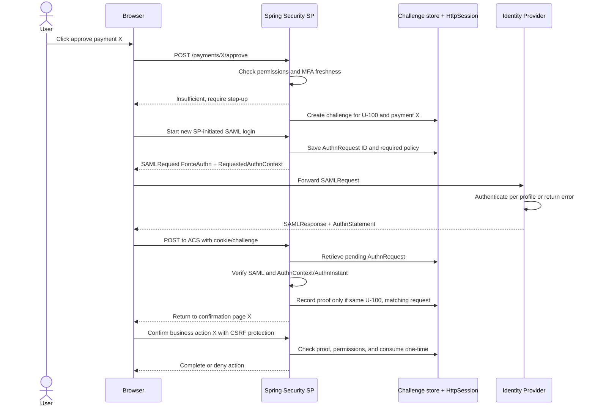

# Requiring Reauthentication and Enforcing Step-Up Authentication Conditions at the IdP

**Topic:** Spring Security – federation → Sessions and browsers.

A user who successfully logs into a Service Provider (SP) application via SAML2 is not necessarily permitted to immediately transfer money, approve payroll, rotate API keys, delete data, or exercise admin privileges. Sensitive operations may require **reauthentication at the Identity Provider (IdP)**, **multi-factor authentication (MFA)**, **freshly minted evidence**, or all three conditions.

SAML 2.0 provides fields for the SP to express these requests. However, **sending a request is not proof the IdP fulfilled it**: the SP must verify `SAMLResponse`, check `AuthnContext`, `AuthnInstant` timing, exact user, exact transaction, exact tenant, and business permissions before executing the action.

This lesson applies to Spring Security Servlet/MVC, Java 17+, and Spring Security 7/OpenSAML 5. API differences between Spring Security 6 and 7 must be checked against your deployed version. The `example.com` domain is illustrative data, not a real IdP.

## 1. Distinguishing Reauthentication, MFA, Freshness, and Authorization

| Concept | Meaning | Evidence or Mechanism |
| --- | --- | --- |
| Reauthentication | User must perform a new authentication event rather than reusing an old IdP security context | `AuthnRequest ForceAuthn="true"`; verify IdP outcome and `AuthnInstant` |
| Step-up authentication | Satisfying a stronger authentication requirement than before | `RequestedAuthnContext` in request, `AuthnContextClassRef` in assertion |
| Freshness | Authentication event falls within an allowed window, or after challenge creation | `AuthnStatement@AuthnInstant` compared against server UTC time |
| Subject continuity | Post-step-up user is the same identity as the original SP user | Verified Issuer and NameID → internal user ID |
| Transaction binding | Evidence belongs to the exact action requesting authorization | AuthnRequest ID, `InResponseTo`, session-bound challenge, resource ID |
| Authorization | User is allowed to perform the business operation at confirmation time | Roles, tenant membership, resource permissions, transaction state |

**Do not conflate:**
- `ForceAuthn=true` **does not mean** MFA; the IdP may re-authenticate with a single factor unless the contract requires otherwise.
- `RequestedAuthnContext` **does not force the event to be recent**, because the IdP may reuse an already strong security context from the existing session depending on its handling.
- A fresh `SAMLResponse@IssueInstant` **does not mean** a fresh `AuthnInstant`.
- The IdP's `SessionIndex` is not Spring's `JSESSIONID` or proof of MFA.
- A user passing MFA **does not automatically gain extra roles** in the application.

## 2. Role of `ForceAuthn` in SAML 2.0

In `samlp:AuthnRequest`, the `ForceAuthn` attribute tells the IdP the SP requires the IdP to directly re-authenticate the presenter instead of relying on an old authentication context:

```xml
<samlp:AuthnRequest
    xmlns:samlp="urn:oasis:names:tc:SAML:2.0:protocol"
    xmlns:saml="urn:oasis:names:tc:SAML:2.0:assertion"
    ID="_stepup-req42"
    Version="2.0"
    IssueInstant="2026-11-07T03:00:00Z"
    Destination="https://idp.partner.example/sso"
    AssertionConsumerServiceURL="https://portal.example.com/login/saml2/sso/partner-a"
    ForceAuthn="true"
    IsPassive="false">
  <saml:Issuer>https://portal.example.com/saml2/sp/partner-a</saml:Issuer>
</samlp:AuthnRequest>
```

This is abbreviated XML illustrating only the fields, not a signed AuthnRequest ready to run directly. In a real system, the SP must generate a unique ID, sign the request if required by the IdP, and save the pending request to correlate the callback.

**`ForceAuthn` asks for fresh authentication without specifying a particular factor.** It can be appropriate when a user must reconfirm identity before a high-risk operation. Whether a real IdP displays a login screen or which factor it uses depends on IdP capabilities and agreed policies. The SP must inspect the returned timestamp and context, not merely whether the browser redirected.

### Does `IsPassive` Differ from `ForceAuthn`?

`IsPassive=true` asks the IdP to process **without visible user interaction**. It is not a way to request MFA; for interactive step-up, leave it `false` or omit it. Configuring both `ForceAuthn=true` and `IsPassive=true` can leave the IdP unable to satisfy both and return an error.

**Do not enable `ForceAuthn` for every login** in production if only certain operations require reauthentication. That breaks the SSO experience, creates loops, and increases authentication-fatigue risk. Trigger it per action/tenant and SP session policy.

## 3. `RequestedAuthnContext` to Request an Authentication Level

`RequestedAuthnContext` is a **standard** child element of `AuthnRequest`, not a custom extension. The SP can send an `AuthnContextClassRef` identifying an authentication method or assurance profile understood by the IdP.

Example requesting REFEDS MFA:

```xml
<samlp:RequestedAuthnContext
    xmlns:samlp="urn:oasis:names:tc:SAML:2.0:protocol"
    xmlns:saml="urn:oasis:names:tc:SAML:2.0:assertion"
    Comparison="exact">
  <saml:AuthnContextClassRef>https://refeds.org/profile/mfa</saml:AuthnContextClassRef>
</samlp:RequestedAuthnContext>
```

`https://refeds.org/profile/mfa` is the URI in the REFEDS MFA Profile; in SAML, the URI goes inside `AuthnContextClassRef`. When the IdP asserts it performed authentication matching that profile, it can include the corresponding URI in `AuthnStatement/AuthnContext` within the assertion. **The SP must verify the Assertion before trusting the claim.**

REFEDS MFA indicates an agreed MFA profile; it **does not by default** guarantee phishing-resistant MFA, real-world identity proofing levels, or every compliance standard. If business rules require FIDO2/hardware-bound assurance, both sides must define stricter profiles/claims/policies.

### What Does `Comparison` Mean?

| Value | Meaning | Recommendation |
| --- | --- | --- |
| `exact` | Returned context must match the requested class/declaration exactly | Usually fits a specific REFEDS MFA URI |
| `minimum` | Equal to or stronger per comparison ordering supported by the IdP | Do not assume every context has a universal ordering |
| `maximum` | Not exceeding the specified level per comparison semantics | Rarely used for step-up |
| `better` | Stronger than the specified level per comparison ordering | Requires IdP-defined comparison semantics |

**Never treat authn context URIs as a default numeric scale.** For a "mandatory MFA" policy, it is best to request an agreed profile, check the URI emitted by the IdP, and reject any context outside an allowlist. If the IdP cannot satisfy it, it may return `NoAuthnContext` or a vendor-specific error; the SP must **fail closed**, never accepting password-only instead.

### Must `ForceAuthn` and `RequestedAuthnContext` Always Be Used Together?

Not every flow needs both:
- Normal pages: a valid SAML login suffices if policy allows.
- Requiring password re-entry or direct authentication: `ForceAuthn=true`; do not assume MFA automatically.
- Requiring MFA without necessarily being brand new: `RequestedAuthnContext` + `AuthnInstant` and a freshness policy may accept a recent prior event.
- Transactions needing **MFA performed freshly after the request**: `ForceAuthn=true` **and** `RequestedAuthnContext`, then the SP verifies `AuthnInstant` is after the challenge and near the present.

The final choice must rest on **business policy**, the IdP contract, and verified evidence—not on "the IdP screen opened".

## 4. Step-Up Flow for a Sensitive Action

Suppose a user is logged into the SP as internal user `U-100` and wants to approve payment X. Business permissions may exist, yet MFA evidence is not fresh enough.



**Never execute the payment directly inside the ACS callback.** The callback verifies authentication; the business action needs a separate request or transaction confirmation protocol designed against CSRF/replay and payment tampering.

### 4.1. Challenges Must Live on the Server

A server-side object may contain:

```text
StepUpChallenge {
  challengeId              = random nonce, one-time
  originalInternalUserId   = U-100
  trustedIssuer            = IdP issuer per registration
  registrationId           = partner-a
  samlRequestId            = SP-generated AuthnRequest ID
  requiredContext          = https://refeds.org/profile/mfa
  issuedAt                 = UTC instant
  expiresAt                = issuedAt + 5 minutes
  action                   = APPROVE_PAYMENT
  resourceId               = X
  resourceVersion          = 7
  consumed                 = false
}
```

The values above are a structural template, not real metadata or messages. In production you must:
- Bind to the **browser session that initiated the challenge**, avoiding relying on a copyable `RelayState` as sole proof.
- Never put monetary amounts, user permissions, tokens, or PII directly into RelayState, redirect URLs, or logs.
- Generate strong nonces, short TTLs, and atomic one-time consumption.
- Store `originalInternalUserId` and trusted issuer/registration so someone else's MFA is never attached to the old account.
- Scope the proof to one action/resource/version; re-check permissions and resource state before execution.
- On logout, user switch, or tenant switch, clear related challenges/proofs.
- When already authenticated at the SP, **do not expect `.authenticated()` to initiate SAML automatically**; the application needs a dedicated route/policy to trigger reauthentication.

### 4.2. Same User or Account Switched at the IdP?

During step-up, the IdP may show an account chooser and the user may log in as a different user. The SAMLResponse may have a valid signature, match the MFA profile, and be fresh, yet **fail to satisfy the original user's challenge**. Verify that the external subject (Issuer, NameID, and matching scope) maps to the exact same internal user. Account switching must go through a separate flow rather than silently counting as a successful step-up.

## 5. Reading Returned Evidence: `AuthnStatement`

A verified Assertion may contain:

```xml
<saml:AuthnStatement
    xmlns:saml="urn:oasis:names:tc:SAML:2.0:assertion"
    AuthnInstant="2026-11-07T03:00:17Z"
    SessionIndex="_idp-session-74">
  <saml:AuthnContext>
    <saml:AuthnContextClassRef>https://refeds.org/profile/mfa</saml:AuthnContextClassRef>
  </saml:AuthnContext>
</saml:AuthnStatement>
```

This is an **XML fragment**, not a complete signed/conditioned assertion. Use only data from an Assertion that Spring Security/OpenSAML already accepted after verifying signature, issuer, audience, recipient, validity period, subject confirmation, request correlation, and replay per policy.

| Field | Exact Meaning |
| --- | --- |
| `AuthnContextClassRef` | Authentication type/profile the IdP asserts was achieved |
| `AuthnInstant` | Timestamp when the IdP asserts authentication occurred |
| `SessionIndex` | IdP authentication session identifier; may support SAML Single Logout |
| `Response@IssueInstant` | Response creation timestamp; **does not reflect MFA freshness** |
| `Assertion@IssueInstant` | Assertion issuance timestamp; does not prove the user just interacted |
| `Conditions/NotOnOrAfter` | Assertion validity deadline; does not make authentication fresh |
| `InResponseTo` | Matches pending SP-initiated AuthnRequest; does not replace context/freshness |

### 5.1. Freshness Must Be Checked Using Absolute Time

Policy example: payment X requires MFA **after** the SP created the challenge at `10:11:00Z`, within the **last 5 minutes**. Assertions with:
- `AuthnInstant=10:12:00Z` and valid MFA context: can satisfy the time check.
- `AuthnInstant=10:05:00Z` even if `Response@IssueInstant=10:15:00Z`: **not fresh enough**.
- `AuthnInstant=10:16:30Z` while SP clock is `10:15:00Z`: too far in the future beyond clock skew → reject.
- Missing `AuthnInstant`: insufficient basis to confirm freshness → reject per step-up policy.

Compare using `java.time.Instant`/UTC, never string dates or local timezones. Allow small clock skew per IdP/NTP agreement, without loosening indefinitely to "fix" clock drift.

**Trust boundary:** `AuthnInstant` is IdP-asserted information. The SP does not directly observe the factor the user entered. Therefore, the IdP contract must define how `AuthnInstant` updates after `ForceAuthn`/MFA, "remember device", and authentication-event reuse.

## 6. Spring Security: Customizing AuthnRequest with OpenSAML 5

Spring Security Servlet provides `OpenSaml5AuthenticationRequestResolver` and the `setAuthnRequestCustomizer(...)` callback. You can use the OpenSAML object model to set `ForceAuthn` and `RequestedAuthnContext` **before** the framework serializes/encodes/signs the request.

### 6.1. Configuration Sample Strictly for a Step-Up Sandbox

`StepUpRequestConfig.java` (a class inside a Spring Boot/Security 7 project, not standalone `javac`-compilable):

```java
package com.example.saml;

import org.opensaml.saml.saml2.core.AuthnContextClassRef;
import org.opensaml.saml.saml2.core.AuthnContextComparisonTypeEnumeration;
import org.opensaml.saml.saml2.core.RequestedAuthnContext;
import org.opensaml.saml.saml2.core.impl.AuthnContextClassRefBuilder;
import org.opensaml.saml.saml2.core.impl.RequestedAuthnContextBuilder;
import org.springframework.context.annotation.Bean;
import org.springframework.context.annotation.Configuration;
import org.springframework.security.saml2.provider.service.registration
        .RelyingPartyRegistrationRepository;
import org.springframework.security.saml2.provider.service.web
        .DefaultRelyingPartyRegistrationResolver;
import org.springframework.security.saml2.provider.service.web
        .RelyingPartyRegistrationResolver;
import org.springframework.security.saml2.provider.service.web.authentication
        .OpenSaml5AuthenticationRequestResolver;
import org.springframework.security.saml2.provider.service.web.authentication
        .Saml2AuthenticationRequestResolver;

@Configuration
public class StepUpRequestConfig {
    private static final String MFA =
            "https://refeds.org/profile/mfa";

    @Bean
    Saml2AuthenticationRequestResolver authenticationRequestResolver(
            RelyingPartyRegistrationRepository registrations) {
        RelyingPartyRegistrationResolver partyResolver =
                new DefaultRelyingPartyRegistrationResolver(registrations);
        OpenSaml5AuthenticationRequestResolver resolver =
                new OpenSaml5AuthenticationRequestResolver(partyResolver);

        resolver.setAuthnRequestCustomizer(context -> {
            var request = context.getAuthnRequest();
            request.setForceAuthn(true);
            request.setIsPassive(false);

            RequestedAuthnContext required =
                    new RequestedAuthnContextBuilder().buildObject();
            required.setComparison(
                    AuthnContextComparisonTypeEnumeration.EXACT);
            AuthnContextClassRef ref =
                    new AuthnContextClassRefBuilder().buildObject();
            ref.setURI(MFA);
            required.getAuthnContextClassRefs().add(ref);
            request.setRequestedAuthnContext(required);
        });
        return resolver;
    }
}
```

The code above **enables ForceAuthn and MFA on every AuthnRequest created by this resolver**. Use it to verify IdP sandbox compatibility; **do not deploy it globally for every normal login**. Production needs a way to separate step-up initiation routes and server-controlled policy, customizing requests only for permitted challenges while keeping request ID/issuer/ACS/destination and framework pending-request storage. Never trust `?forceAuthn=true` or `?acr=admin` from clients as policy input.

### 6.2. Wiring the Resolver into the SAML Login DSL

`SecurityConfig.java`:

```java
package com.example.saml;

import org.springframework.context.annotation.Bean;
import org.springframework.context.annotation.Configuration;
import org.springframework.security.config.annotation.web.builders.HttpSecurity;
import org.springframework.security.saml2.provider.service.web.authentication
        .Saml2AuthenticationRequestResolver;
import org.springframework.security.web.SecurityFilterChain;

@Configuration
public class SecurityConfig {
    @Bean
    SecurityFilterChain securityFilterChain(
            HttpSecurity http,
            Saml2AuthenticationRequestResolver resolver)
            throws Exception {
        http.authorizeHttpRequests(auth -> auth
                    .requestMatchers("/", "/error").permitAll()
                    .anyRequest().authenticated())
                .saml2Login(saml2 ->
                    saml2.authenticationRequestResolver(resolver));
        return http.build();
    }
}
```

`saml2Login` handles the flow; the default request-initiation endpoint is usually `GET /saml2/authenticate/{registrationId}` and the ACS is `POST /login/saml2/sso/{registrationId}`. If the IdP requires signing `AuthnRequest`, configure matching signing credentials and verify the HTTP Redirect/POST binding. **Never mutate XML after signing** or disable signature validation just to force the IdP to accept an MFA context.

### 6.3. Illustrative Maven Dependencies

In a Spring Boot 4.1.x project with compatible parent/BOM, required dependencies:

```xml
<dependencies>
  <dependency>
    <groupId>org.springframework.boot</groupId>
    <artifactId>spring-boot-starter-webmvc</artifactId>
  </dependency>
  <dependency>
    <groupId>org.springframework.boot</groupId>
    <artifactId>spring-boot-starter-security</artifactId>
  </dependency>
  <dependency>
    <groupId>org.springframework.boot</groupId>
    <artifactId>spring-boot-starter-security-saml2</artifactId>
  </dependency>
</dependencies>
```

This is only a POM fragment; you need `spring-boot-starter-parent`, Java 17+, plugins, `@SpringBootApplication`, and real IdP metadata. OpenSAML may require the Shibboleth Releases repository/internal mirror per Spring Security docs. For Boot 3.x/Security 6.x, starter names and OpenSAML generations differ; do not mix major versions.

Illustrative `application.yml`:

```yaml
spring:
  security:
    saml2:
      relyingparty:
        registration:
          partner-a:
            assertingparty:
              metadata-uri: https://idp.partner.example/metadata.xml
```

The sample URL cannot perform real logins. You need IdP metadata/certificates, public SP entity ID/ACS, and an agreement supporting `ForceAuthn`/context. Passing builds confirm compilation only—**not that the IdP actually performed MFA**.

## 7. Verifying Outcomes at the SP: Mandatory Step

In Spring Security 7, `Saml2AuthenticationTokenConverter` and `OpenSaml5AuthenticationProvider` validate the SAML Response/Assertion. Customizing `AuthnRequest` **does not automatically enforce the application's own MFA/freshness policies**.

Upon receiving the response, a strict step-up policy requires:
1. **Standard SAML verification**: signature, trusted IdP Issuer, destination, audience, recipient, subject confirmation, assertion timestamps, and anti-replay.
2. **Correlation**: response `InResponseTo` matches the pending request saved by the SP in the **exact session/browser**; no unsolicited fallback if missing.
3. **Original user**: mapped NameID/Issuer must match the original user; never let an IdP account switch grant MFA to the old user.
4. **Context**: extract `AuthnContextClassRef` from the **verified** Assertion and check the URI is in the IdP and action allowlist.
5. **Freshness**: check `AuthnInstant`, age threshold, and challenge timestamp, bounding future skew within clock skew.
6. **Challenge validity**: unexpired, right action/resource, unconsumed, right tenant and registration.
7. **Proof**: create a short-lived server-side marker bound to user, action, resource, level, and expiresAt; never grant a permanent role.
8. **Business authorization**: at execution time, re-check permissions, resource, CSRF, idempotency, and atomically consume the proof.

**Safe customization:** you can add an `AssertionValidator` to `OpenSaml5AuthenticationProvider` per Spring Security docs; **keep the default validators**. Alternatively, extract evidence after verification via a trusted converter/success flow and enforce the policy. Never manually parse raw `SAMLResponse` in a controller and trust an unverified `AuthnContext`.

### 7.1. Why Not Use a Boolean in the Session?

`session.setAttribute("MFA_DONE", true)` carries no user, timestamp, issuer, request ID, tenant, action, or TTL. It can be reused across user switches, resource changes, or overly long-lived sessions.

The proof should have a structure like:

```text
VerifiedStepUp {
  originalUserId
  trustedIssuer
  subjectKey
  registrationId
  challengeId
  authnContextUri
  authnInstant
  verifiedAt
  expiresAt
  action
  resourceId
  resourceVersion
  consumed
}
```

This data stays on the server, is cleared on logout/tenant switch/user switch, and is consumed per exact action. Across multiple pods, use shared storage and atomic compare-and-consume.

## 8. Standalone Java 17: Checking Freshness and User Identity

The following program uses only JDK 17+, simulating the verification algorithm **on evidence already verified by the SAML layer**. It does not sign/parse SAML and lacks real cookies or anti-replay; never use it as a production authentication provider.

`StepUpPolicyDemo.java`:

```java
import java.time.Duration;
import java.time.Instant;
import java.util.Objects;

public class StepUpPolicyDemo {
    private static final String MFA = "https://refeds.org/profile/mfa";
    private static final Duration MAX_AGE = Duration.ofMinutes(5);
    private static final Duration SKEW = Duration.ofSeconds(30);

    record Challenge(String issuer, String userId,
                     String requestId, Instant issuedAt) {}

    record Evidence(String issuer, String userId,
                    String requestId, String context,
                    Instant authnInstant) {}

    static boolean accept(Challenge c, Evidence e, Instant now) {
        if (c == null || e == null || c.issuedAt() == null
                || e.authnInstant() == null) {
            return false;
        }
        if (!Objects.equals(c.issuer(), e.issuer())
                || !Objects.equals(c.userId(), e.userId())
                || !Objects.equals(c.requestId(), e.requestId())
                || !MFA.equals(e.context())) {
            return false;
        }
        Instant minTime = now.minus(MAX_AGE);
        Instant challengeMin = c.issuedAt().minus(SKEW);
        Instant maxTime = now.plus(SKEW);

        return !e.authnInstant().isBefore(minTime)
                && !e.authnInstant().isBefore(challengeMin)
                && !e.authnInstant().isAfter(maxTime);
    }

    public static void main(String[] args) {
        Instant now = Instant.parse("2026-11-07T10:15:00Z");
        Challenge challenge = new Challenge(
                "idp-A", "user-100", "_r42",
                Instant.parse("2026-11-07T10:11:00Z"));

        Evidence valid = new Evidence(
                "idp-A", "user-100", "_r42", MFA,
                Instant.parse("2026-11-07T10:12:00Z"));
        Evidence old = new Evidence(
                "idp-A", "user-100", "_r42", MFA,
                Instant.parse("2026-11-07T10:05:00Z"));
        Evidence weak = new Evidence(
                "idp-A", "user-100", "_r42", "password",
                Instant.parse("2026-11-07T10:12:00Z"));
        Evidence otherUser = new Evidence(
                "idp-A", "user-999", "_r42", MFA,
                Instant.parse("2026-11-07T10:12:00Z"));
        Evidence wrongRequest = new Evidence(
                "idp-A", "user-100", "_other", MFA,
                Instant.parse("2026-11-07T10:12:00Z"));

        System.out.println("Valid MFA: " + accept(challenge, valid, now));
        System.out.println("Old MFA: " + accept(challenge, old, now));
        System.out.println("Weak MFA: " + accept(challenge, weak, now));
        System.out.println("Other user: " + accept(challenge, otherUser, now));
        System.out.println("Wrong request: "
                + accept(challenge, wrongRequest, now));
    }
}
```

Run from the directory containing the file:

```bash
javac StepUpPolicyDemo.java
java StepUpPolicyDemo
```

**Exact stdout:**

```text
Valid MFA: true
Old MFA: false
Weak MFA: false
Other user: false
Wrong request: false
```

Explanation: the valid case meets both the MFA context and timing; `old` exceeds the threshold, `weak` lacks the context, `otherUser` mismatches the account, and `wrongRequest` mismatches the challenge. The example **assumes `Evidence` was already verified and `Challenge` was session-bound**: an attacker must never forge `Evidence` or alter request IDs. Production must validate XML signatures, issuer/audience/recipient, request repository, replay, one-time consumption, and business permissions outside this function.

## 9. Sessions and Browsers: Do Not Lose the Pending Request

Spring Security defaults to storing `AuthnRequest` in `HttpSessionSaml2AuthenticationRequestRepository`. When the IdP POSTs the response to the ACS, the browser must send the right session cookie so the SP locates the request; thus reauthentication can fail **before** context validation if:
- `SameSite=Lax/Strict` blocks the cookie on cross-site POSTs (browser/site dependent).
- Cookie `Secure`/`Domain`/`Path` is wrong or a reverse proxy changes the host.
- The pre-auth/session challenge timed out.
- The callback hits another pod while the session store lives only on the first pod.
- Multiple tabs emit multiple requests and the repository does not handle concurrency as the app expects.

If cross-site POST cookies are needed, evaluate `SameSite=None; Secure` alongside organizational CSRF/cookie policies and test in real browsers. Never disable CSRF app-wide. In clusters, use Spring Session Redis to share `HttpSession` while keeping browser binding.

**Do not switch to a `RelayState`-keyed cache and assume it is automatically safe**: a cache relying solely on browser-supplied request IDs can lose the natural login-fixation defense of a session-bound repository. If customization is unavoidable, enforce threat modeling and one-time nonces/browser binding.

**Session fixation:** after a successful login, Spring Security may rotate the session ID per policy. Challenges/proofs must continue belonging strictly to the original user/session without leaking to another account. Never manually delete `HttpSession` before the callback, as that drops the pending `AuthnRequest`.

## 10. IdP Contract Before Enabling Step-Up

| Item | Must Confirm with the IdP |
| --- | --- |
| `ForceAuthn` | Is it supported, does it enforce genuine reauthentication, and how does it handle remembered sessions? |
| `RequestedAuthnContext` | Does it support `Comparison="exact"` and which assurance URIs? |
| REFEDS MFA | Does it conform to the matching profile? Does it emit the right `AuthnContextClassRef` after MFA? |
| `AuthnInstant` | When the user re-authenticates, does the timestamp update properly? |
| MFA remember-device | How long may the IdP reuse proof, and is it clearly indicated in the assertion? |
| Subject | Are NameID/Issuer consistent when the IdP enables an account chooser? |
| Failure | Does the IdP return `NoAuthnContext`/`AuthnFailed`/vendor errors when unmet? |
| Request signature | Does the IdP require signed AuthnRequests? Which SP public certs are trusted? |
| Response signature | Does the SP verify the exact IdP certificates/trust anchors? |
| Time sync | What is the maximum allowed clock skew between SP and IdP? |
| Testing | Is there a sandbox to simulate MFA pass/fail, stale context, and account switching? |

Some IdPs understand `ForceAuthn` yet reject REFEDS MFA URIs; others support vendor-specific URIs or silently ignore parts of the request. Therefore inspect the **actual sent request XML** and the **actual verified response Assertion**, not merely whether an "MFA screen appeared".

## 11. Mandatory Test Matrix

| Test Case | Expectation |
| --- | --- |
| `ForceAuthn=true` + valid MFA context + fresh `AuthnInstant` | Can PASS after all SAML/identity/authorization checks |
| `ForceAuthn=true` yet IdP used password only | **FAIL** if the action requires MFA |
| `RequestedAuthnContext=MFA` yet `AuthnInstant` too old | **FAIL** if freshness is required |
| Fresh Response, stale `AuthnInstant` | **FAIL**; `IssueInstant` does not replace freshness |
| MFA context URI outside allowlist | **FAIL**; never assume it is stronger |
| IdP cannot satisfy and returns `NoAuthnContext` | Guide the user; never downgrade |
| Invalid SAML signature | **FAIL** before MFA policy checks |
| Wrong `InResponseTo` or missing pending request | **FAIL**; no unsolicited fallback |
| User at IdP differs from original SP user | **FAIL**; no silent account switching |
| Issuer/registration/tenant differs from challenge | **FAIL** absent explicit trust policy |
| Challenge expired or already consumed | **FAIL**; deny re-execution |
| MFA succeeded yet role was revoked | **FAIL** authorization |
| Payment/resource changed during MFA | Check version; require re-confirmation |
| Browser drops cookie on ACS POST | Fail safely; never drop correlation |
| Two tabs run step-up for different actions | Do not mix requests/proofs; handle concurrency |
| Callback hits another pod | PASS only when session store and challenge align |
| Logout occurs during MFA | Never resurrect old sessions/proofs |
| IdP remember-device fails to refresh `AuthnInstant` | SP rejects if freshness policy requires |
| IdP clock runs too far ahead | Reject beyond bounded skew |
| Browser retries payment | Protected by one-time proof and idempotency |
| Audit logs | Never store raw SAMLResponse/cookies/secrets; include masked correlation |

**Never rely solely on `@WithMockUser` to prove step-up.** Pure Java unit tests verify timing logic; integration tests require signed SAML Assertions/IdP test fixtures; browser E2E tests must cover SameSite cookies, POST callbacks, negative paths, and multi-tab flows. Only after thorough verification should sensitive actions be allowed.

## 12. Real-World Scenarios

**Approving a large invoice:** An accountant logged in an hour ago. The SP requests MFA reauthentication per the IdP contract and verifies `AuthnInstant` is after the challenge and within 5 minutes. After callback, the accountant must confirm the exact invoice/recipient; the service re-checks the `APPROVER` role and logs an audit entry.

**Changing recovery email:** A user holds a valid SP session, yet recovery email is a sensitive resource. The SP requires step-up, verifies the same external identity, and prevents someone else from logging in at the IdP and altering the original user's details.

**Normal report viewing:** No need for `ForceAuthn` on every read when the session and permissions remain valid. Enabling it app-wide by default causes loops and degrades UX.

**MFA without permission:** A user who just passed MFA still gets no access to another tenant. Authentication assurance does not alter authorization.

**IdP changes MFA profile:** If a provider migrates from the REFEDS MFA URI to a vendor-specific context, update the contract, tests, and allowlist; never treat any value containing the word "MFA" as equivalent.

## 13. Common Misconceptions

1. **`ForceAuthn=true` equals MFA.** No; it is a request for direct re-authentication.
2. **Having `RequestedAuthnContext` present is enough.** No; you must inspect the outcome.
3. **A freshly issued Response means MFA just happened.** No; check `AuthnInstant`.
4. **`SessionIndex` is a timestamp.** No; it is a SAML session index.
5. **Passing MFA grants admin roles.** No; business permissions are a separate layer.
6. **Clients can send `ForceAuthn` via browser query params.** Never take untrusted input as security policy.
7. **When the request is missing, treat it as IdP-initiated.** Never allow bypassing step-up.
8. **Same email means same account after reauth.** No; use verified Issuer/NameID and internal user mapping.
9. **You can store `MFA_DONE=true` permanently in the session.** No; lacks scope, TTL, subject, and replay defense.
10. **Accept any IdP `AuthnContextClassRef` string.** Accept only contract-approved URIs.
11. **Disable signatures/CSRF because the IdP returned an error.** No; fix trust, binding, cookies, and ACS properly.
12. **One passing login test is enough testing.** No; test failures, wrong subjects, stale times, multiple tabs, multi-node, and transaction replay.

## 14. Implementation Checklist

**Design**
- [ ] Policies define which actions require reauthentication, MFA level, and freshness threshold.
- [ ] IdP confirms semantics for `ForceAuthn`, `RequestedAuthnContext`, `AuthnInstant`, and error behavior.
- [ ] Challenges live server-side and bind user/issuer/session/request ID/action/TTL.
- [ ] Step-up triggers via a new SP-initiated AuthnRequest; never depend on an entry point meant only for unauthenticated users.
- [ ] Roles are never auto-granted and business operations never execute directly inside the ACS callback.

**Security**
- [ ] SAML validation preserves signature, issuer, audience, recipient, time, correlation, and replay checks.
- [ ] Context is extracted from the verified assertion and must belong to the allowlist.
- [ ] `AuthnInstant` is checked for both freshness and challenge timing with small clock skew.
- [ ] Post-step-up external subject matches the original internal user/tenant.
- [ ] Proofs carry TTL, action/resource scope, and one-time consumption; logout or account switching invalidates proofs.
- [ ] Business requests enforce CSRF protection, idempotency, and fresh authorization.

**Operations**
- [ ] IdP sandbox tested real MFA/reauthentication, not merely Spring compilation.
- [ ] Cookies/ACS/SameSite, request repository, and Spring Session Redis/cluster are tested.
- [ ] Negative tests cover `NoAuthnContext`, stale MFA, wrong user/request, replay, and time skew.
- [ ] Logs contain only correlation IDs/error categories, never raw assertions, session IDs, or sensitive factor details.

## 15. Official Sources

1. [Spring Security – Producing AuthnRequests](https://docs.spring.io/spring-security/reference/servlet/saml2/login/authentication-requests.html): `OpenSaml5AuthenticationRequestResolver`, `setAuthnRequestCustomizer`, `ForceAuthn`, and request repositories.
2. [Spring Security – Authenticating SAML Responses](https://docs.spring.io/spring-security/reference/servlet/saml2/login/authentication.html): `OpenSaml5AuthenticationProvider` and extending Assertion validation.
3. [Spring Security – SAML2 Login Overview](https://docs.spring.io/spring-security/reference/servlet/saml2/login/overview.html): SP-initiated flow and ACS.
4. [OASIS – SAML 2.0 Core](https://docs.oasis-open.org/security/saml/v2.0/saml-core-2.0-os.pdf): `ForceAuthn`, `IsPassive`, `RequestedAuthnContext`, `AuthnStatement`, and `AuthnInstant`.
5. [OASIS – SAML 2.0 Profiles](https://docs.oasis-open.org/security/saml/v2.0/saml-profiles-2.0-os.pdf): Web Browser SSO and request–response correlation.
6. [REFEDS MFA Profile](https://refeds.org/profile/mfa): MFA profile and `AuthnContextClassRef` URI.
7. [REFEDS – How to request authentication contexts](https://wiki.refeds.org/display/ASS/How+to+request+authentication+contexts): requested context XML, outcomes, and `NoAuthnContext`.
8. [OpenSAML 5 – RequestedAuthnContext JavaDoc](https://shibboleth.net/api/java-opensaml/5.2.3/org/opensaml/saml/saml2/core/RequestedAuthnContext.html): classes and builder/ref methods.
9. [OWASP – SAML Security Cheat Sheet](https://cheatsheetseries.owasp.org/cheatsheets/SAML_Security_Cheat_Sheet): signatures, replay, RelayState, and login CSRF.
10. [OWASP – Authentication Cheat Sheet](https://cheatsheetseries.owasp.org/cheatsheets/Authentication_Cheat_Sheet/): reauthentication for high-risk operations.

**Conclusion:** `ForceAuthn` asks the IdP to re-authenticate; `RequestedAuthnContext` asks for an authentication level; `AuthnInstant` tells when the IdP claims authentication happened. Sensitive actions must execute only after the SP verifies SAML, matching subject, matching challenge, sufficient MFA, sufficient freshness, and business authorization.