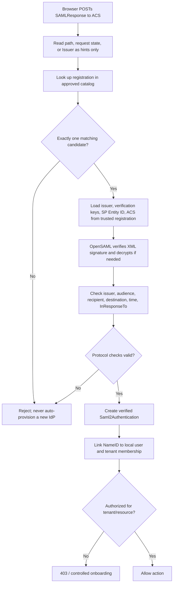
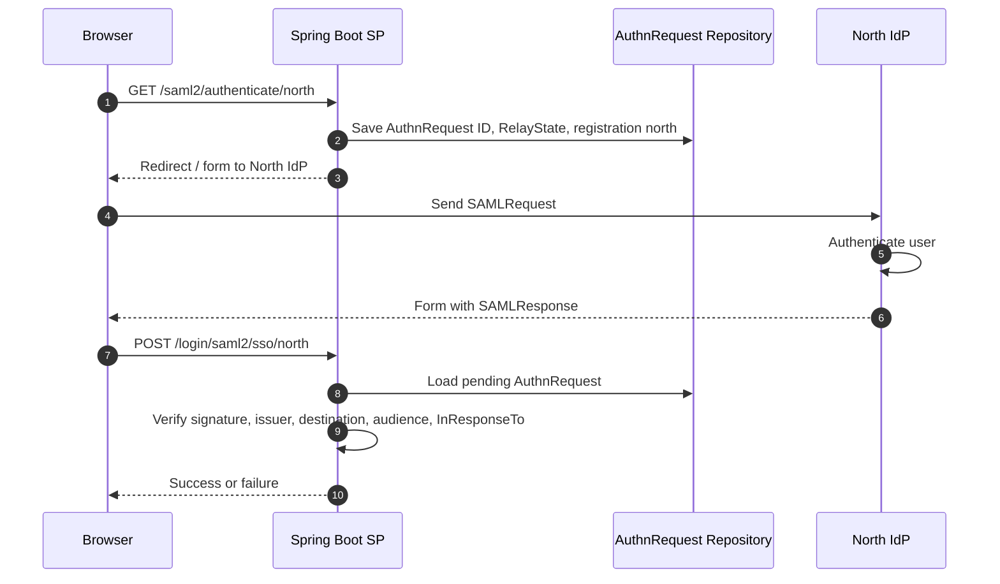

# Identifying the IdP from Unverified Input Without Self-Establishing Trust

## 1. Problem and Objectives

In Spring Security SAML 2.0 federation, a Service Provider (SP) may serve multiple organizations or tenants, each using an Identity Provider (IdP). When the browser posts a `SAMLResponse` to the Assertion Consumer Service (ACS), the SP must select the right `RelyingPartyRegistration` to obtain the certificate, IdP entity ID, SP entity ID, ACS, and validation rules.

An apparent paradox arises: to verify the signature, the application must know the IdP; yet the information used to guess the IdP may live **inside the very message whose signature has not yet been verified**—such as `<saml:Issuer>`, `registrationId` in the callback URL, `RelayState`, or a tenant parameter.

**Central principle: unverified information may only be used to select a pre-approved configuration candidate. Selecting a candidate does not establish trust, does not prove the issuer, and does not authenticate the user.** After selection, Spring Security/OpenSAML must still verify the signature using the pre-configured certificate, issuer, audience, destination, recipient, validity window, request correlation, and applicable conditions.

Practical objectives:

1. Distinguish **candidate selection**, **trust configuration**, **SAML validation**, and **tenant authorization**.
2. Understand hint sources: `Issuer`, `registrationId`, saved AuthnRequest, tenant/host/email domain, and `RelayState`.
3. Use a repository holding admin-approved `RelyingPartyRegistration` instances, never fetching metadata/keys dynamically from browser input.
4. Handle missing issuers, issuers shared across multiple registrations, and signature/ACS/tenant mismatches fail-closed.
5. Design SP-initiated SSO for multiple IdPs with Spring Boot 3.x/Java 17 examples and tests.
6. Recognize the analogous issue in OIDC/OAuth 2.0: **authorization-server mix-up**.

This lesson belongs to **Multiple IdPs and Tenants**. The `example.test` hostnames, IDs, and certificate paths below are examples only and do not represent live IdPs.

## 2. Two Distinct Decisions: Picking a Candidate vs. Accepting an Identity

Consider two IdPs the organization has agreed to integrate:

```text
RelyingPartyRegistration north:
  IdP Entity ID: https://north-idp.example.test/entity
  IdP trusted certificate: north-signing.crt
  SP Entity ID: https://app.example.test/saml2/service-provider-metadata/north
  SP ACS: https://app.example.test/login/saml2/sso/north

RelyingPartyRegistration south:
  IdP Entity ID: https://south-idp.example.test/entity
  IdP trusted certificate: south-signing.crt
  SP Entity ID: https://app.example.test/saml2/service-provider-metadata/south
  SP ACS: https://app.example.test/login/saml2/sso/south
```

If the browser POSTs to `/login/saml2/sso/north`, the SP can **select** registration `north`. If the XML contains `Issuer=https://north-idp.example.test/entity`, that can also serve as **a lookup hint**.

However, an attacker can alter both the URL and the XML. Only a **signature verified against the approved `north-signing.crt`** and accompanying SAML conditions can make the Response trustworthy. If the signature was created by another key, even if the Issuer claims to be North, authentication must fail.

Distinguish four states:

| State | Meaning | Is Login Allowed Yet? |
| --- | --- | --- |
| `candidateFound` | Found a plausible registration from the allowlist | **Not yet** |
| `signatureValidated` | The message/assertion used to build the principal has a valid signature from a trusted key | **Not sufficient** |
| `samlAuthenticationSucceeded` | All required SAML checks passed | May create an authenticated session |
| `tenantAuthorized` | Verified identity is permitted to enter the specific tenant and resource | Only when application policy agrees |

An **attacker's self-signed certificate can validly verify the attacker's own signature**, which does not make it eligible as a tenant trust anchor. "Verification succeeded using a certificate taken right from the response" does not prove the organization approved that IdP.

## 3. Safe Flow: Hint → Catalog → Verification → Authorization



The diagram illustrates separation of responsibilities and does not dictate internal ordering across every OpenSAML release. Nevertheless, all business permissions must be evaluated **after** authentication—never taken from HTTP queries or unverified XML.

Critical fail-closed points:

- No approved registration found ⇒ reject.
- Multiple matching registrations without enough distinguishing context ⇒ reject or require restarting login with an explicit registration.
- Matching Issuer text yet invalid signature ⇒ reject.
- Valid IdP signature yet audience/recipient belongs to another SP or tenant ⇒ reject.
- Valid SAML yet user lacks local account/link/tenant membership ⇒ deny resource access.

## 4. Which Data May Act as Hints, and Which Must Not Be Trusted?

| Input | Can Be Used for Initial Selection | Must Never Be Used Directly To |
| --- | --- | --- |
| `/login/saml2/sso/{registrationId}` | Look up an existing registration name | Conclude which IdP signed the response |
| `Response/Issuer` | Look up IdP Entity ID in allowlist if unique | Auto-add an issuer or trust an attached key |
| Server-saved `AuthnRequest` | Restore the registration and SP-created transaction | Skip signature or audience checks |
| `RelayState` | Correlate protected request state | Pick arbitrary roles, tenants, or redirect URLs |
| `InResponseTo` | Match against saved request ID | Check only the ID string and treat as authenticated |
| `?tenant=north` | Let UI choose an IdP from allowlist | Grant tenant North permissions |
| User-entered email domain | Suggest an IdP on the discovery page | Auto-link internal accounts |
| `Host`/`Forwarded` | Route once normalized by proxy per allowlist | Verify identity or elevate privileges |
| `KeyInfo` in SAML XML | May help locate a **pinned** key per profile | Trust a new certificate embedded in the response |
| NameID/SAML attributes | Post-validation, look up local identity link | Auto-link by email or grant unconditional admin rights |

**Authentication is not authorization.** Even a valid IdP and valid SAML Response are not enough for a user to read all documents of a tenant they picked in the URL.

## 5. Spring Security Components Involved

In Spring Security Servlet:

- `Saml2WebSsoAuthenticationRequestFilter` creates an `AuthnRequest` when the browser hits `/saml2/authenticate/{registrationId}`.
- `Saml2AuthenticationRequestResolver` picks a registration to build and dispatch the request to the IdP.
- `Saml2AuthenticationRequestRepository` stores pending AuthnRequests; typically defaults to `HttpSessionSaml2AuthenticationRequestRepository`.
- `Saml2WebSsoAuthenticationFilter` receives `SAMLResponse` at the ACS.
- `Saml2AuthenticationTokenConverter` builds the authentication token and resolves `RelyingPartyRegistration`.
- `RelyingPartyRegistrationRepository` stores provisioned partners/credentials.
- The OpenSAML authentication provider verifies the response and assertion before constructing `Saml2Authentication`.
- `Saml2AuthenticatedPrincipal` exists only as the principal of a successful SAML authentication; `getRelyingPartyRegistrationId()` returns the corresponding registration.

Two useful repository methods in Spring Security 6.x:

```java
RelyingPartyRegistration findByRegistrationId(String registrationId);

RelyingPartyRegistration findUniqueByAssertingPartyEntityId(String entityId);
```

These are **API method signatures** (not a standalone Java class). The second method applies only when an issuer uniquely matches one registration; if non-unique, the outcome must never turn into an arbitrary choice.

Spring Security docs note that the converter can resolve a registration from the associated AuthnRequest, `registrationId` in the URL, and—failing those—`Response/Issuer`. **Looking up by Issuer here does not mean the framework trusts the Issuer.** The converter only needs a candidate so the provider knows which verification key to apply.

## 6. Issuer Lookup: Used as a Lookup Key, Not a Trust Anchor

A SAML Response includes a section such as:

```xml
<samlp:Response
    xmlns:samlp="urn:oasis:names:tc:SAML:2.0:protocol"
    xmlns:saml="urn:oasis:names:tc:SAML:2.0:assertion"
    ID="_response-1" Version="2.0"
    IssueInstant="2026-11-07T03:00:00Z"
    Destination="https://app.example.test/login/saml2/sso/north">
  <saml:Issuer>https://north-idp.example.test/entity</saml:Issuer>
  <!-- Status, assertion, signatures omitted -->
</samlp:Response>
```

This is illustrative XML only, not a valid login Response. Before signature verification, an attacker can easily alter `Issuer`.

**Architecturally sound approach:**

```text
untrustedIssuer = safeParseIssuer(request)
candidate = approvedRepository.findUniqueByAssertingPartyEntityId(untrustedIssuer)
if candidate == null:
    reject
else:
    validateSamlResponseWithApprovedRegistration(candidate)
```

This is pseudocode; **do not hand-roll an XML parser** when Spring Security/OpenSAML provides an appropriate converter. Any preliminary parser, if genuinely needed, must enforce size limits, block XXE/DTD/external entities, guard against signature wrapping, and never fetch external resources from XML.

**Broken approach:**

```text
untrustedIssuer = parseIssuerFromBrowser()
metadata = httpGet(untrustedIssuer + "/metadata")
certificate = metadata.signingKey
trustStore.add(certificate)
acceptResponseWith(certificate)
```

That is **self-provisioning trust**, paired with SSRF risk: an attacker can supply an internal address or their own metadata endpoint. **HTTPS only protects the transport**, not whether that IdP is authorized to authenticate this tenant.

If the server supports metadata refresh, it must refresh only from **pre-approved endpoints** with explicit issuer/cert/rotation policies—never run arbitrary discovery on each login POST.

## 7. Path `registrationId` Helps Route, Not Prove Identity

With two registrations, keep URLs explicit:

```text
GET  /saml2/authenticate/north
POST /login/saml2/sso/north

GET  /saml2/authenticate/south
POST /login/saml2/sso/south
```

A browser can change `north` to `south` in the URL. If IdP North's Response is sent to ACS South, Spring Security may pick registration South to **attempt** verification, yet must reject when signature, issuer, audience, or destination/recipient fail to match.

`registrationId` is a **configuration identifier**, not a secret. Do not obscure it with random strings as a substitute for protocol checks.

### ACS URL and SP Entity ID Are Different

`/login/saml2/sso/north` is the HTTP path receiving the response. The SP Entity ID might be `https://app.example.test/saml2/service-provider-metadata/north`. The Assertion's `AudienceRestriction` must target the matching SP Entity ID, whereas `Destination` and `SubjectConfirmationData@Recipient` generally must match the ACS.

If the IdP has the wrong ACS or SP Entity ID registered, **fix the metadata/IdP config**—never disable validators just to "make login work."

## 8. SP-Initiated SSO: Prefer Stored AuthnRequest Context

In SP-initiated SSO, the SP already knows which registration it selected before sending the browser to the IdP:



An `HttpSession`-backed repository binds the pending request to the initiating browser session, preventing classes of **login fixation/login CSRF**. `InResponseTo` and `RelayState` must correlate with the stored request/transaction per policy.

Do not treat a long `RelayState` string as "cryptographic proof" if it can be guessed, replayed, or detached from the browser. If using a cache repository instead of sessions, evaluate entropy, TTL, one-time consumption, browser binding, and replay protection.

### `SameSite` and HTTP-POST Callbacks

IdPs commonly return the browser to the SP via a **cross-site POST**. If the SP session cookie uses `SameSite=Lax` or `Strict` across different sites, the cookie may be omitted and the repository will not find the AuthnRequest.

Fix cookie/session/ingress settings and verify multi-replica behavior first. **Never automatically treat a session-less response as valid IdP-initiated login** simply because issuer lookup can find a candidate.

## 9. IdP-Initiated SSO: When There Is No Initial AuthnRequest

In IdP-initiated or unsolicited SSO, the browser may post a Response to the ACS without the SP having created an AuthnRequest for that flow. Consequently:

- There is no SP-created request state as the initial registration source.
- `InResponseTo` may be absent.
- Issuer or ACS URL may be the remaining hints to locate a candidate.
- Signature, issuer, audience, destination/recipient, time, replay, and tenant policies remain mandatory.
- Login CSRF and session confusion require additional policy controls.

If the organization only needs SP-initiated SSO, enforce **fail-closed** rejection on unsolicited responses matching your framework version and validators. If IdP-initiated SSO is required, approve it per IdP/tenant, define replay/login-CSRF defenses, and control user session switching.

**Never let missing session state silently trigger a "permissive mode,"** because an attacker can deliberately strip correlation state.

## 10. One Issuer Used Across Multiple Registrations: Ambiguity Must Not Be Guessed

Two registrations may share the same IdP Entity ID while differing in SP Entity ID, ACS, or tenant:

```text
north:
  IdP Issuer = https://central-idp.example.test/entity
  SP Entity ID = https://app.example.test/sp/north
south:
  IdP Issuer = https://central-idp.example.test/entity
  SP Entity ID = https://app.example.test/sp/south
```

With only `Issuer=https://central-idp.example.test/entity`, a unique registration cannot be determined. Therefore:

1. For SP-initiated flows, use the registration stored with the AuthnRequest.
2. Prefer ACS paths with `{registrationId}` if the metadata contract allows.
3. Verify the assertion's audience/recipient/destination against the selected registration.
4. If a shared ACS is required, build a dedicated resolver backed by trusted state and properly verified fields.
5. If a single registration cannot be resolved unambiguously, **reject** instead of picking the first item in a list.

Even if both registrations share the same IdP certificate, **a valid signature does not mean tenant-authorized**. The shared IdP could sign an assertion for SP South; that assertion must never be accepted for SP North if audience/recipient/transaction do not match.

## 11. Tenant Picker and Email Domain Are UX Hints Only

An SSO discovery page might ask:

```text
Select organization: north / south
Or enter email to suggest signing in at the corresponding IdP.
```

A user can pick `north` even without belonging to North. That is **harmless** as long as selection only routes to a pre-provisioned IdP; the IdP must still authenticate the user, and the SP must still verify local tenant membership post-authentication.

Do not:

- Treat `?tenant=north` as permission to use tenant North.
- Build a metadata URL by concatenating `https://` + tenant name.
- Auto-link a North admin account just because the email in the assertion has domain `north.example.test`.
- Let `groups=admins` from an arbitrary IdP grant local `ROLE_ADMIN` without an approved mapping.

For OIDC, the identity link key is typically **`(verified iss, sub)`**; for SAML, use a trusted IdP/registration and persistent NameID/qualifiers per profile. Emails can change, collide across tenants, or be reassigned.

## 12. Host-Based Tenant Routing Does Not Create Trust Either

A service may be accessed at:

```text
https://north.app.example.test/
https://south.app.example.test/
```

Yet `Host` and `X-Forwarded-Host` are request inputs. If the reverse proxy fails to strip/overwrite client-sent headers from the Internet, an attacker can make the app pick the wrong tenant/registration or generate a wrong `{baseUrl}` for ACS/metadata.

Safe practices:

1. Ingress accepts only **registered public hostnames**.
2. Proxy strips/overwrites client-sent `Forwarded`, `X-Forwarded-Host`, and `X-Forwarded-Proto` before forwarding to the app.
3. App maps the normalized host against an **admin-managed tenant allowlist**.
4. Post-authentication, still verify **local identity link/tenant membership**.
5. Avoid domain checks via string concatenation or unanchored suffix matching; beware of IDNA/punycode edge cases.
6. Keep SP Entity ID, ACS URL, and metadata aligned with IdP config.

`server.forward-headers-strategy: framework` in Spring Boot helps behind a proxy, **only when used with a trusted proxy**. It does not turn user headers into identity proof.

## 13. Provision IdPs Ahead of Time, Never During Callback

**Onboarding an IdP is a trust-configuration change** that must be governed independently of login.

The workflow should cover:

1. Confirm the tenant/organization and authorized approver for the IdP.
2. Fetch metadata from a verified source and check Entity ID and SSO endpoint.
3. Configure certificate verification/trust anchors and key rotation policy.
4. Register SP Entity ID, ACS URL, and SP signing credentials if the IdP requires them.
5. Assign a stable, unique `registrationId`; never generate random IDs per restart.
6. Run positive/negative SAML tests against a sandbox.
7. Activate the registration in the approved catalog and record an audit trail.
8. When disabling an IdP, never fall back to another IdP or an old certificate.
9. If metadata refresh is required, refresh only from **approved locations** and validate certificate/entity-ID changes per policy.

Conversely, **trust on first use** for an Issuer/certificate inside a callback is dangerous: the very first metadata seen could come from the attacker. A newly appearing HTTPS metadata endpoint is no reason to trust that issuer.

### SSRF and Remote Metadata

Never let users pass `metadataUrl`, `issuer`, `jku`, `x5u`, or an arbitrary HTTP URL for the server to fetch and trust as an IdP. Internal addresses like `169.254.169.254`, loopback, or private ranges can be abused to exfiltrate cloud/network data. Metadata provisioning may be automated **only after approval, allowlisting, and network controls**—never triggered dynamically from an unverified `SAMLResponse`.

## 14. Spring Boot 3.x Example Configuring Two Approved IdPs

For Spring Boot 3.x/Spring Security 6.x Servlet, an example `application.yml`:

```yaml
spring:
  security:
    saml2:
      relyingparty:
        registration:
          north:
            entity-id: "https://app.example.test/saml2/service-provider-metadata/north"
            acs:
              location: "https://app.example.test/login/saml2/sso/north"
            assertingparty:
              metadata-uri: "${NORTH_IDP_METADATA_URI}"
          south:
            entity-id: "https://app.example.test/saml2/service-provider-metadata/south"
            acs:
              location: "https://app.example.test/login/saml2/sso/south"
            assertingparty:
              metadata-uri: "${SOUTH_IDP_METADATA_URI}"
```

Both `NORTH_IDP_METADATA_URI` and `SOUTH_IDP_METADATA_URI` must be **pre-provisioned** by administrators/deployment tooling—never read from `?issuer=...` or callback XML content. Each IdP may require SP signing keys and ACS setup in its own dashboard.

This config registers two **pre-trusted partners**. It does not guarantee the right certificate if an attacker controls those environment variables. Deployment governance, secret/config management, network controls, and auditing are all part of the trust chain.

In a Spring Boot project's `build.gradle` with the Java/Boot plugins and matching dependency management:

```groovy
repositories {
    mavenCentral()
    // Add the Shibboleth repository when required by the OpenSAML version combination.
    maven { url "https://build.shibboleth.net/maven/releases/" }
}

dependencies {
    implementation "org.springframework.boot:spring-boot-starter-web"
    implementation "org.springframework.boot:spring-boot-starter-security"
    implementation "org.springframework.security:spring-security-saml2-service-provider"
}
```

This is a **build-file snippet**, not a complete file; it requires Java 17+, matching Spring Boot 3.x/Spring Security 6.x, and a real IdP for end-to-end testing.

## 15. Java 17/Spring Boot: Allowlist Tenant Selection, Post-Login Authorization

The following class uses **the two provisioned registrations** from YAML. Users can choose a tenant but **cannot** supply arbitrary metadata/certificates. SAML authentication continues to run through standard Spring Security filters/providers.

Save at `src/main/java/demo/multiidp/MultiIdpApplication.java`:

```java
package demo.multiidp;

import java.net.URI;
import java.util.Map;

import org.springframework.boot.SpringApplication;
import org.springframework.boot.autoconfigure.SpringBootApplication;
import org.springframework.context.annotation.Bean;
import org.springframework.http.HttpStatus;
import org.springframework.http.ResponseEntity;
import org.springframework.security.config.Customizer;
import org.springframework.security.config.annotation.web.builders.HttpSecurity;
import org.springframework.security.core.annotation.AuthenticationPrincipal;
import org.springframework.security.saml2.provider.service.authentication.Saml2AuthenticatedPrincipal;
import org.springframework.security.web.SecurityFilterChain;
import org.springframework.web.bind.annotation.GetMapping;
import org.springframework.web.bind.annotation.PathVariable;
import org.springframework.web.bind.annotation.RestController;
import org.springframework.web.server.ResponseStatusException;

@SpringBootApplication
@RestController
public class MultiIdpApplication {

    // Routing only; NOT proof that the user belongs to the tenant.
    private static final Map<String, String> APPROVED = Map.of(
            "north", "north",
            "south", "south");

    public static void main(String[] args) {
        SpringApplication.run(MultiIdpApplication.class, args);
    }

    @Bean
    SecurityFilterChain security(HttpSecurity http) throws Exception {
        return http
                .authorizeHttpRequests(auth -> auth
                        .requestMatchers("/", "/start/**", "/error").permitAll()
                        .anyRequest().authenticated())
                .saml2Login(Customizer.withDefaults())
                .saml2Metadata(Customizer.withDefaults())
                .build();
    }

    @GetMapping("/")
    public String index() {
        return "Open /start/north or /start/south";
    }

    @GetMapping("/start/{tenant}")
    public ResponseEntity<Void> start(@PathVariable String tenant) {
        String registrationId = APPROVED.get(tenant);
        if (registrationId == null) {
            throw new ResponseStatusException(HttpStatus.NOT_FOUND);
        }
        // Redirect to Spring Security's SAML AuthnRequest generator.
        return ResponseEntity.status(HttpStatus.SEE_OTHER)
                .location(URI.create("/saml2/authenticate/" + registrationId))
                .build();
    }

    @GetMapping("/tenant/{tenant}/home")
    public Map<String, String> home(
            @PathVariable String tenant,
            @AuthenticationPrincipal Saml2AuthenticatedPrincipal principal) {
        String expected = APPROVED.get(tenant);
        if (expected == null || principal == null
                || !expected.equals(
                        principal.getRelyingPartyRegistrationId())) {
            throw new ResponseStatusException(HttpStatus.FORBIDDEN);
        }
        // Production: also verify local identity link, active user,
        // tenant membership, and per-object permissions.
        return Map.of("tenant", tenant, "status", "authenticated");
    }
}
```

### What Is Protected in the Code?

- `APPROVED` only allows selecting `north` or `south`.
- `/start/{tenant}` is an **IdP hint route**; it does not authenticate the user.
- `/saml2/authenticate/{registrationId}` is the **framework endpoint** used to generate the AuthnRequest.
- `/login/saml2/sso/{registrationId}` is the ACS handled by `Saml2WebSsoAuthenticationFilter`; there is no custom XML-parsing controller.
- `/tenant/{tenant}/home` consumes `Saml2AuthenticatedPrincipal` **only after provider verification**, then compares the registration against the requested tenant.
- No `metadataUrl` input is accepted from the browser.
- If a South user tries `/tenant/north/home`, the demo returns 403.

**Important limitation:** the 1 tenant ↔ 1 IdP mapping is a simplification. When one IdP serves multiple tenants or one tenant links multiple IdPs, dedicated identity links and local authorization are required; the right registration does not grant all permissions by itself. Likewise, `Map.of` in the demo does not replace a production onboarding/ACL system.

### Execution and Output

In a Gradle project with the wrapper and two real metadata URLs provided by an administrator:

```bash
NORTH_IDP_METADATA_URI=https://north-idp.example.test/metadata \
SOUTH_IDP_METADATA_URI=https://south-idp.example.test/metadata \
./gradlew bootRun
```

The `example.test` domains are illustrative only; no real IdPs run at those URLs. Once IdP/ACS/certificate configuration is complete, a valid North login followed by `GET /tenant/north/home` returns:

```json
{"tenant":"north","status":"authenticated"}
```

This result **depends on successful SAML authentication**, rather than being fixed stdout from `bootRun`. If the app uses a non-root servlet context path, adjust the relative redirect path in `/start/{tenant}` accordingly without accepting an arbitrary base URL from the browser.

## 16. Standalone Java 17: Finding a Unique Candidate Without Creating Authentication

The example below simulates **lookup inside an approved catalog** only and runs on JDK 17. Two registrations share IdP North to demonstrate a non-unique issuer.

Save at `IssuerLookupDemo.java`:

```java
import java.util.List;
import java.util.Optional;

public final class IssuerLookupDemo {

    record Registration(String id, String idpEntityId) { }

    private static final List<Registration> APPROVED = List.of(
            new Registration("north", "https://north.example.test/entity"),
            new Registration("south", "https://south.example.test/entity"),
            new Registration("north-secondary", "https://north.example.test/entity")
    );

    static Optional<Registration> chooseCandidate(String unverifiedIssuer) {
        if (unverifiedIssuer == null) {
            return Optional.empty();
        }

        List<Registration> matches = APPROVED.stream()
                .filter(r -> r.idpEntityId().equals(unverifiedIssuer))
                .toList();

        return matches.size() == 1
                ? Optional.of(matches.get(0))
                : Optional.empty();
    }

    public static void main(String[] args) {
        System.out.println("south=" + chooseCandidate(
                "https://south.example.test/entity")
                .map(Registration::id).orElse("none"));
        System.out.println("unknown=" + chooseCandidate(
                "https://attacker.example.test/entity")
                .map(Registration::id).orElse("none"));
        System.out.println("ambiguous=" + chooseCandidate(
                "https://north.example.test/entity")
                .map(Registration::id).orElse("none"));
        System.out.println("authenticated=false");
    }
}
```

Run:

```bash
javac IssuerLookupDemo.java
java IssuerLookupDemo
```

Exact stdout:

```text
south=south
unknown=none
ambiguous=none
authenticated=false
```

`south=south` only means a single candidate exists in the catalog. `authenticated=false` emphasizes: **no signature or assertion has been verified yet**. This is not a SAML library; production must let Spring Security/OpenSAML verify everything using trusted verification credentials.

## 17. When Is a Custom `AuthenticationConverter` Needed?

Most applications only need multiple `RelyingPartyRegistration` entries and ACS URLs containing `registrationId`. Consider a custom converter only when:

- The IdP requires a shared ACS without a registration ID.
- One IdP issuer appears in multiple registrations and request state/callback must disambiguate them.
- Artifact binding or a complex federation broker is used.
- Multi-tenant routing must combine protected server-side state with registration lookup.

Spring Security supports swapping the converter in the DSL:

```java
.saml2Login(saml -> saml
        .authenticationConverter(customAuthenticationConverter))
```

This is a **configuration snippet** requiring a `customAuthenticationConverter` bean implementing `AuthenticationConverter` per contract; do not add it to Section 15's example unnecessarily. `Saml2AuthenticationTokenConverter` provides constructors taking `RelyingPartyRegistrationResolver` and integrates with `Saml2AuthenticationRequestRepository`.

A custom converter must still:

1. Select only an **existing registration**.
2. Preserve request-state/registration correlation.
3. Never dynamically fetch metadata from a browser-sent Issuer.
4. Never return an authenticated `Authentication` merely because a registration was chosen.
5. Let the OpenSAML provider verify signature, issuer, audience, destination, recipient, and timestamps.
6. Fail closed if the candidate is ambiguous or missing.

## 18. SAML Verification: Checks Beyond the Signature

Even with a valid signature under the right IdP key, the SP must verify:

1. **Issuer** of the Response/Assertion matches the IdP Entity ID.
2. **Destination** of the Response matches the ACS per profile.
3. **Recipient** in `SubjectConfirmationData` matches the endpoint receiving the assertion.
4. **`AudienceRestriction`** targets the registered SP Entity ID, not a browser-declared tenant string.
5. **`NotBefore` / `NotOnOrAfter`** and subject confirmation validity windows.
6. **`InResponseTo`** / request correlation with the SP-initiated flow.
7. **Replay** prevention where applicable.
8. The **exact assertion used to build the principal** lies inside the validly signed scope, defeating XML Signature Wrapping.
9. **`EncryptedAssertion`**, if present, must be decrypted with the right SP private key; successful decryption never bypasses signature checks.
10. **Tenant and local user** permissions must be evaluated separately after authentication succeeds.

Never fix lost correlation by dropping `InResponseTo`, and never fix audience mismatches by accepting all audiences. Such errors usually indicate misconfigured ACS/metadata/registration/proxy settings or an attacker replaying a message from another tenant.

## 19. OIDC/OAuth 2.0 Mix-Up: The Same Lesson

In OAuth2/OIDC Login with multiple Authorization Servers, an attacker can confuse the client about which server issued the authorization response, causing an authorization code or token to be sent to another server's endpoint. This is **authorization-server mix-up**.

Per RFC 9700 (OAuth 2.0 Security Best Current Practice), clients connected to multiple authorization servers need mix-up defenses: issuer identification per **RFC 9207**, or another RFC-approved option such as distinct redirect URIs where appropriate.

Corresponding principles:

- Store the chosen issuer/client registration with the **authorization request/state**; reconcile the issuer on callback.
- Never use `iss` from an authorization response or ID Token to dynamically create a new client registration.
- Verify the ID Token signature with keys from the **configured issuer**, then check issuer, audience, nonce, and timestamps.
- Never trust `kid`, `jku`, or `x5u` in a JWT header to fetch JWKS from an arbitrary domain.
- Base identity links on `(verified iss, sub)`, never email.

**Do not mix protocols:** SAML uses `SAMLResponse`/XML Signature/`RelyingPartyRegistration`, while OIDC uses ID Token/JWS/JWKS/client registrations. They are two instances of the same **trust-boundary principle**, not interchangeable tokens across protocols.

## 20. Identity Linking and Tenant Authorization Remain Separate Steps

After successful SAML authentication, the principal provides `Saml2AuthenticatedPrincipal#getName()` (typically NameID) and `getRelyingPartyRegistrationId()`. However, NameID has multiple formats, including transient. Never treat NameID as a durable key unless the IdP guarantees a persistent format.

Typical data model:

```text
verified SAML principal
  -> trusted IdP / registration
  -> stable external subject (NameID + qualifiers as required)
  -> external_identity_link
  -> local_user_id + local_tenant_memberships
  -> resource ACL and business roles
  -> allow or deny
```

Constraints:

- Each registration is authorized to authenticate only agreed-upon identities/tenants.
- A user may hold multiple linked identities, yet linking/unlinking requires approval/auditing.
- Email is insufficient as an automatic link key across IdPs.
- Role/group claims from an IdP may be mapped only when the organization delegates that group to the IdP under a tenant-specific policy.
- Resource APIs must check ownership/ACLs to prevent IDOR/BOLA, not merely `authenticated()`.

**A valid SAML issuer does not mean every business claim is trusted unconditionally.** Authentication-layer trust and authorization-layer trust have distinct scopes.

## 21. Negative Tests for Candidate Selection and Trust

| Scenario | Expected Outcome |
| --- | --- |
| Issuer not in approved catalog | Reject; never fetch metadata from Issuer |
| Valid Issuer North yet signed with attacker key | Signature failure |
| North Response POSTed to South ACS | Reject on issuer/key/audience/recipient/correlation mismatch |
| Two registrations share Issuer, no request state | Reject ambiguity; never pick randomly |
| Browser chooses `/start/evil` | 404/deny; no registration created |
| Query `?metadataUrl=http://127.0.0.1` | Never fetched; SSRF prevented |
| `KeyInfo` embeds attacker certificate | Never trust unknown certificate |
| Assertion carries another tenant's audience | Reject |
| Destination/Recipient differs from ACS | Reject |
| Wrong `InResponseTo` or expired AuthnRequest | Reject per SP-initiated policy |
| Browser callback missing session cookie due to `SameSite` | Investigate session; never downgrade to unsolicited |
| `SAMLResponse` replay | Reject per replay policy |
| Signed Response contains unsigned Assertion outside signed scope | XML Signature Wrapping blocked |
| Spoofed `Host`/`Forwarded` header | Never alters trusted tenant/ACS |
| Authenticated via South IdP, accesses `/tenant/north/home` | 403 per demo's strict mapping |
| Same email as North admin from another IdP | No auto-link |
| Revoked registration | Never falls back to another IdP |
| OIDC response issuer differs from authorization request issuer | Mix-up blocked |
| JWT `jku` points to unknown URL | Never fetch remote key from token header |
| Disallowed IdP-initiated SSO | Fail closed |

Test with sandbox IdPs and test certificates; never put production `SAMLResponse`s or cookies in issue trackers. Checking HTTP 302 alone does not prove authentication success: that redirect could point to an error page.

## 22. Observability and Error Handling

| Symptom | Possible Cause | Remediation |
| --- | --- | --- |
| `No RelyingPartyRegistration` | Unknown `registrationId`, issuer not in allowlist | Inspect provisioned config; never create trust from request |
| Non-unique Issuer | One IdP across multiple registrations | Use explicit state/path or fail closed |
| Invalid signature | Wrong verification cert, key rotation, attacker key | Verify trusted metadata/cert |
| Invalid issuer | Response claims different IdP than candidate | Keep issuer validation; inspect registration |
| Audience invalid | Wrong SP Entity ID | Fix IdP config/metadata |
| Invalid Destination/Recipient | Wrong ACS, proxy mismatch, wrong callback path | Check public HTTPS URL and trusted proxy |
| Missing `InResponseTo` | `SameSite` cookie/session/replica/unsolicited policy | Inspect AuthnRequest repository and browser POST |
| Valid SAML yet 403 | Local user unlinked or missing tenant membership | Check post-login authorization |
| HTTP callback triggers unexpected outbound fetch | Unsafe custom discovery | Remove dynamic fetch; pre-provision metadata |
| OIDC code sent to wrong token endpoint | AS mix-up | Bind issuer and state per RFC 9700 |

Safe logs can capture the candidate `registrationId`, lookup status (found/unknown/ambiguous), failure category (signature/issuer/audience), local tenant authorization result, and an internal correlation ID.

**Never log** raw `SAMLResponse`, `SAMLRequest`, `RelayState`, `NameID`, `JSESSIONID` cookies, private keys, or confidential certificates. Never use an unverified Issuer as an unbounded-cardinality metric label. Distinguish **candidate lookup succeeded** metrics from **authentication succeeded** metrics.

## 23. Deployment Checklist

- [ ] Every IdP/SP pair has an approved registration and trust anchor.
- [ ] Trust store is never created or mutated while handling a SAML callback.
- [ ] Issuer metadata, certificates, and JWK/JWKS URLs are never fetched from unverified inputs.
- [ ] Use stable `registrationId`s; unknown/revoked registrations fail closed.
- [ ] XML `Issuer` is used solely to pick a candidate from the approved catalog.
- [ ] Ambiguous Issuer lookups never pick a registration arbitrarily.
- [ ] AuthnRequest state is persisted and correlated with the browser for SP-initiated flows.
- [ ] Session cookies, `SameSite`, multi-replica state, and ACS routing are tested.
- [ ] SAML XML signature is verified against the provisioned IdP certificate with Signature Wrapping protections.
- [ ] Issuer, Recipient, Destination, Audience, clock skew, subject confirmation, and replay checks are enforced.
- [ ] IdP-initiated SSO has an explicit policy; never fall back when session state is missing.
- [ ] `Host`/`Forwarded` headers are trusted only from controlled reverse proxies.
- [ ] Local identity links, tenant membership, and object ACLs govern business permissions.
- [ ] Never auto-link by email, transient `NameID`, or unauthorized groups.
- [ ] SP Entity ID, ACS, and metadata match each tenant; never share audiences casually.
- [ ] IdP onboarding and key rotation require approval and auditing.
- [ ] Multi-provider OIDC clients are protected against authorization-server mix-up.
- [ ] Negative tests for spoofed issuers, bad signatures, ambiguous issuers, cross-tenant access, SSRF, and replay have passed.

## 24. Self-Assessment Questions

**1. Is it wrong to use `Issuer` to pick a registration before verifying the signature?**  
Not necessarily. Using `Issuer` as a **lookup hint within the approved allowlist** is acceptable, as long as you never trust self-asserted issuers or new keys.

**2. Does `/saml2/sso/north` prove the Response was issued by North IdP?**  
No. The URL path only hints at a registration; signature verification and all mandatory checks are still required.

**3. Why must metadata never be fetched from the `Issuer` inside a `SAMLResponse`?**  
Because an attacker can self-assert the IdP; dynamic fetching introduces SSRF and self-established trust.

**4. What should you do if two registrations share the same `Issuer`?**  
Use controlled AuthnRequest state/ACS paths or a trusted resolver; if ambiguity remains, reject.

**5. Is a valid signature from a shared IdP enough for tenant North?**  
No. You still need matching audience/recipient/destination/transaction and local tenant authorization.

**6. Does `RelayState` prove the user owns that tenant?**  
No. It travels through the browser and must be bound to a server-side transaction.

**7. When the session cookie is lost on an HTTP-POST callback, may `InResponseTo` be skipped?**  
Not automatically. Fix cookie/session handling or enforce a dedicated IdP-initiated policy instead of downgrading security.

**8. Can the request's `Host` header decide the tenant?**  
Only as a routing hint after proxy normalization/allowlisting; it never grants permissions to a principal.

**9. Is successful SAML login enough for every tenant API?**  
No. You need a linked local account, tenant membership, resource ACLs, and current active status.

**10. What attack must multi-provider OIDC clients prevent?**  
Authorization-server mix-up; RFC 9700 and RFC 9207 describe issuer identification and binding to authorization requests.

## 25. References

- [Spring Security – SAML 2.0 Login Overview](https://docs.spring.io/spring-security/reference/servlet/saml2/login/overview.html): multiple relying parties, registration resolution, request/response pipeline.
- [Spring Security – Authenticating SAML Responses](https://docs.spring.io/spring-security/reference/servlet/saml2/login/authentication.html): lookup from request/Issuer and `AuthenticationConverter`.
- [Spring Security 6.5 – RelyingPartyRegistrationRepository API](https://docs.spring.io/spring-security/reference/6.5/api/java/org/springframework/security/saml2/provider/service/registration/RelyingPartyRegistrationRepository.html): `findByRegistrationId` and `findUniqueByAssertingPartyEntityId`.
- [Spring Security – Producing AuthnRequests](https://docs.spring.io/spring-security/reference/servlet/saml2/login/authentication-requests.html): `Saml2AuthenticationRequestRepository` and session binding.
- [Spring Boot 3.5 – SAML2 Relying Party Configuration](https://docs.spring.io/spring-boot/3.5/reference/web/spring-security.html): multiple registrations and IdP metadata.
- [Spring Security – SAML 2.0 Metadata](https://docs.spring.io/spring-security/reference/servlet/saml2/metadata.html): SP Entity ID/ACS.
- [OASIS – SAML 2.0 Core](https://docs.oasis-open.org/security/saml/v2.0/saml-core-2.0-os.pdf): Issuer, Conditions, SubjectConfirmation, AudienceRestriction, and InResponseTo.
- [OASIS – SAML 2.0 Metadata](https://docs.oasis-open.org/security/saml/v2.0/saml-metadata-2.0-os.pdf): Identity Provider descriptors and trust keys.
- [OWASP – SAML Security Cheat Sheet](https://cheatsheetseries.owasp.org/cheatsheets/SAML_Security_Cheat_Sheet.html): XML Signature Wrapping, replay, trusted metadata/certificates.
- [RFC 9700 – OAuth 2.0 Security Best Current Practice](https://www.rfc-editor.org/rfc/rfc9700.html): preventing authorization-server mix-up.
- [RFC 9207 – OAuth 2.0 Authorization Server Issuer Identification](https://www.rfc-editor.org/rfc/rfc9207.html): issuer response parameter `iss`.
- [OpenID Connect Core 1.0](https://openid.net/specs/openid-connect-core-1_0.html): token validation and `(iss, sub)` identity.
