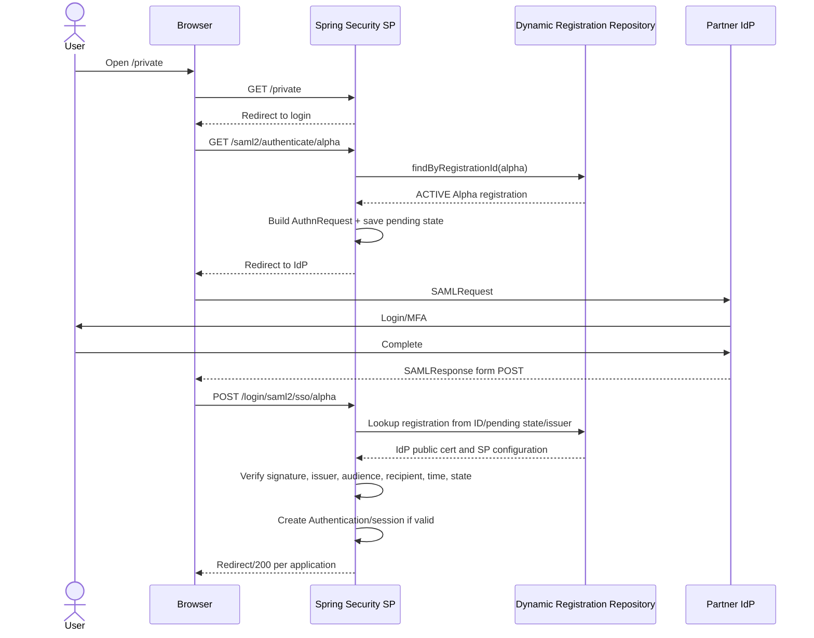
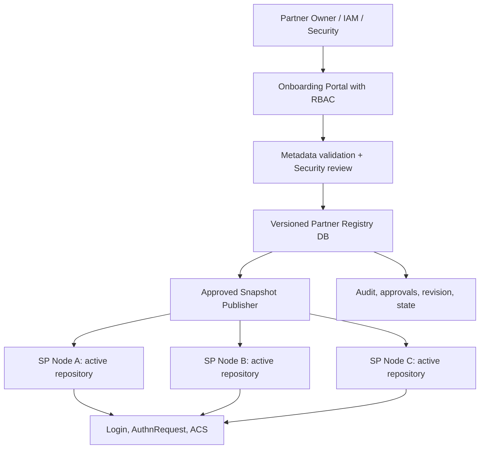

# Dynamic Registration Store and Partner Onboarding/Offboarding Workflows

## Learning Objectives

After this lesson, you will be able to:

1. Explain the roles of `RelyingPartyRegistration`, `RelyingPartyRegistrationRepository`, and `IterableRelyingPartyRegistrationRepository` in multi-IdP/multi-tenant Spring Security SAML2.
2. Contrast static `application.yml` declarations with a **dynamic registration store** backed by a database, approval workflow, cache, and runtime snapshots.
3. Design a safe partner onboarding workflow from DRAFT to ACTIVE: verifying organization, metadata, issuer, certificate, endpoints, tenant, identity, and permissions.
4. Design both planned and emergency partner offboarding workflows: blocking new logins, handling in-flight AuthnRequests, revoking trust, invalidating sessions/permissions, and preserving audits.
5. Write a Spring Security 6.4+/Java 17+ example for a repository updated via **atomic immutable snapshots**, and explain its limits in a multi-node environment.
6. Run a standalone Java 17+ program demonstrating how partner state transitions update the ACTIVE list without leaving half-mutated data.
7. Test duplicate issuers, certificate rollover, metadata URL SSRF, identity/tenant mix-ups, and lingering sessions after offboarding.

## 1. Context: Multiple IdPs and Tenants in One Application

A B2B application `https://portal.example.org` may serve multiple enterprises. Each enterprise manages identities through its own IdP; the application acts as the **Service Provider (SP) / Relying Party (RP)** and accepts `SAMLResponse`s only after full verification.

| Partner | Internal Tenant | IdP Issuer | Registration ID |
| --- | --- | --- | --- |
| Alpha | `tenant-alpha` | `https://idp.alpha.example/saml` | `alpha` |
| Beta | `tenant-beta` | `https://idp.beta.example/saml` | `beta` |
| Gamma under review | `tenant-gamma` | `https://idp.gamma.example/saml` | `gamma` not yet ACTIVE |

With a few static partners, you can use `spring.security.saml2.relyingparty.registration` in YAML. When you regularly need to **add, retire, emergency-suspend, update metadata, or rotate certificates**, you need a workflow to change configuration at runtime without rebuilding the app. This is the **dynamic registration store** problem.

Dynamic **does not mean** a user can register an arbitrary issuer/metadata URL and expect the app to trust that IdP. A dynamic store is a mechanism to **distribute already-approved configurations**, never a way to bypass trust controls.

### 1.1. Easily Confused Identifiers

| Concept | Who Establishes It? | Purpose |
| --- | --- | --- |
| `registrationId` | SP, e.g., `alpha` | Looks up an internal RP–IdP config; typically appears in login initiation and ACS URLs |
| IdP `entityId` / `Issuer` | IdP, approved by SP | Identifies the trusted **Assertion issuer** |
| SP `entityId` | SP, registered with partner | Identifies the **audience** for which the SAML Assertion is issued |
| ACS URL | SP, registered at IdP | Endpoint where the browser POSTs `SAMLResponse` for SP verification |
| Tenant ID | Application system | Local scope of data, users, and authorization |
| IdP signing certificate | Public cert issued by IdP, vetted by SP | Used by SP to verify `SAMLResponse`/Assertion signatures |
| SP signing/decryption private key | Owned by SP, stored in KMS/secret manager | Signs AuthnRequests when required / decrypts `EncryptedAssertion`s |
| Subject/NameID | Asserted by IdP after authentication | User identifier; must be namespaced by issuer/registration |

**Registration ID is not synonymous with Tenant ID.** One IdP can serve multiple tenants; one tenant can also have multiple IdPs. Mappings must be declared, approved, and enforced in the application. Never merge accounts or transfer permissions simply because emails or group names match across two IdPs.

## 2. Spring Security SAML2 APIs

Spring Security uses `RelyingPartyRegistration` to model a link between SP and IdP, including SP entity ID, ACS, signing/decryption credentials, IdP issuer, SSO URL, bindings, and IdP public verification certificates.

**Key APIs:**

- `RelyingPartyRegistrationRepository.findByRegistrationId(id)`: returns the config for the local ID or `null` if absent.
- `RelyingPartyRegistrationRepository.findUniqueByAssertingPartyEntityId(entityId)`: looks up by IdP issuer **if unique**. If one IdP issuer serves multiple registrations, never pick the first record arbitrarily.
- `IterableRelyingPartyRegistrationRepository`: adds `iterator()`; starting in Spring Security 6.4, enables components such as the default login page or metadata endpoints to enumerate registrations.
- `InMemoryRelyingPartyRegistrationRepository`: in-memory list; simple, though usually suitable only for rarely changing configs unless paired with a publishing layer.
- `CachingRelyingPartyRegistrationRepository`: caches a delegate and rebuilds from source on cache eviction; useful for metadata refresh, yet **not** an approval system or instant trust revocation mechanism.
- `RelyingPartyRegistrations.fromMetadata(InputStream)`: creates a registration builder from existing IdP metadata XML. **It does not verify for you that the metadata source is an approved partner.**

Common URLs:

```text
GET  /saml2/authenticate/alpha
POST /login/saml2/sso/alpha
GET  /saml2/metadata/alpha
GET  /saml2/service-provider-metadata/alpha
```

The first endpoint builds the AuthnRequest. The second is the ACS receiving `SAMLResponse`. Metadata endpoints share SP details and can be enabled via `saml2Metadata()`. Exact ordering, URLs, and support depend on your version and custom configuration.

### 2.1. How a `SAMLResponse` Is Processed



**Never take a certificate from `SAMLResponse` XML as a trust source.** The issuer inside the response may be used to look up **within the approved list**, never to dynamically insert an unknown IdP into the repository.

## 3. Separating the Control Plane from the Data Plane

A secure dynamic store has **two parts**:

The **Control plane** governs partner relationships. It holds records, verified metadata snapshots, cert fingerprints, approvals, edit history, lifecycle state, and revisions. It can integrate with IAM, KMS, and partner operations teams.

The **Data plane** consists of the Spring Boot instances serving live traffic, reading only **ACTIVE** `RelyingPartyRegistration` snapshots. The data plane must never expose an unrestricted browser-facing endpoint to fetch metadata and establish trust mid-login.



**Benefit:** an unapproved metadata mistake never touches runtime; new configs can be reviewed and tested before publishing. **Trade-off:** you must synchronize snapshots across all nodes and independently revoke sessions/tokens when retiring a partner.

### 3.1. Recommended Data Model

| Field | Meaning | Security Requirement |
| --- | --- | --- |
| `partnerId` | Internal business identity | Never alter arbitrarily or reuse carelessly |
| `tenantId` | Application tenant being served | Verify ownership and mapping |
| `registrationId` | Local key for Spring Security | Unique, stable; never regenerate a UUID on every refresh |
| `protocol` | `SAML2` (OIDC may live in another subsystem) | Never substitute an OIDC registration for a SAML registration |
| `idpEntityId` | IdP SAML Issuer | Matches contract and verified metadata |
| `idpSsoLocation` | IdP SSO endpoint | HTTPS/trust/host allowlist |
| `metadataSource` | Safely fetched URL or XML | Provenance, metadata digest, no SSRF |
| `verificationCerts` | IdP public signing certificates | Fingerprints, usages, and key rotation policy |
| `spEntityId` / `acsLocation` | SP public identity and callback | Matches partner configuration |
| `spSigningKeyRef` / `spDecryptionKeyRef` | References to SP private keys | KMS/secret manager; never store public PEMs as private keys |
| `status` | DRAFT, APPROVED, ACTIVE, ... | State transitions require authorization and audit |
| `revision` | Monotonic configuration version | Never let stale events overwrite newer revisions |
| `approvedBy` / `approvedAt` | Approval provenance | Separation of duties |
| `activatedAt` / `disabledAt` | Effective timestamps | Stored in UTC for in-flight handling and incident forensics |
| `partnerContact` | Operational contact | Channel to confirm cert changes/outages |

You do not need to serialize Java `RelyingPartyRegistration` objects directly into the DB. Store metadata/approved fields/secret references and construct Java objects on publish, tracking versions and hashes for reconciliation.

## 4. Partner State Machine

```mermaid
stateDiagram-v2
    [*] --> DRAFT: Create record
    DRAFT --> VALIDATING: Collect metadata and evidence
    VALIDATING --> DRAFT: Rejected; changes requested
    VALIDATING --> APPROVED: Business + Security/IAM approve
    APPROVED --> ACTIVE: Publish + test + confirm
    ACTIVE --> DRAINING: Planned offboarding
    DRAINING --> RETIRED: Grace ends and access revoked
    ACTIVE --> SUSPENDED: Incident / loss of trust
    SUSPENDED --> APPROVED: Re-review + new keys
    SUSPENDED --> RETIRED: Terminate partnership
    RETIRED --> [*]: Retain audit per policy
```



| State | Allow New Logins? | In Serving SAML Repository? | ACS Behavior |
| --- | --- | --- | --- |
| **DRAFT** | No | No | Rejected |
| **VALIDATING** | No | No | Rejected |
| **APPROVED** | Not in production before publish | Not yet | Rejected |
| **ACTIVE** | Yes, per tenant policy | Yes | Full verification |
| **DRAINING** | **No** | Depends on reviewed gating mechanism | May process only pending flows issued before cutoff |
| **SUSPENDED** | No | Trust removed / emergency block | Rejected |
| **RETIRED** | No | No | Rejected |

**Distinguishing DRAINING and SUSPENDED:**

- Planned **DRAINING** may allow **already-issued AuthnRequests** to finish during a brief grace period while blocking new login starts, checking pending state/browser sessions, and rejecting unsolicited responses. **A plain repository does not natively enforce different policies for outbound vs. inbound**; you need a dedicated, reviewed enforcement layer.
- **SUSPENDED** due to key compromise or lost IdP trust must **immediately stop accepting signatures/callbacks**, even for in-flight responses. Security takes precedence over login completion.

Never move a partner from DRAFT → ACTIVE merely because XML metadata parsed cleanly. Every state transition needs actor identity, approval, revision, and an audit entry.

## 5. Safe Partner Onboarding Workflow

### 5.1. Step 1 – Establish Contract and Permission Boundaries

Business, IAM, and Security teams clarify:

1. Legal organization name, relationship owner, technical/security contacts, and incident process.
2. Served tenant(s); which IdP is authorized to assert identities for which tenant.
3. Provisioning/deprovisioning plan, stable subjects, account linking, and locked-user policy.
4. Application roles (`viewer`/`editor`/`admin`) and approved group/claim mappings. Never auto-grant admin from a group display name.
5. MFA requirements, `AuthnContext`, session timeout, logout/SLO if implemented, and emergency stop-trust procedure.
6. Key rotation schedule, notice windows for endpoint/certificate changes, and partner support for expiring certificates.
7. Sandbox/staging environments, test identities, and formal go-live criteria.

Output is a **DRAFT** record, not yet visible in runtime lists or the login picker.

### 5.2. Step 2 – Collect IdP Metadata and Certificates

SAML IdP metadata typically contains `entityID`, `IDPSSODescriptor`, `SingleSignOnService`, `KeyDescriptor` with public verification certificates, and optionally `SingleLogoutService` and metadata validity hints. Treat this as **untrusted input to be vetted**, not a self-proving security guarantee.

Verify at minimum:

- IdP issuer/entity ID matches the agreed documentation and environment.
- SSO endpoint uses HTTPS with a supported binding (usually Redirect or POST).
- X.509 signing certs and fingerprints exchanged over a verified channel.
- Metadata validity/signature per profile/contract; certificate rollover plan.
- Metadata containing **multiple `IDPSSODescriptor`s** must never be blindly imported in bulk.
- Additional IdP endpoints (SLO, Artifact, SOAP) enabled only if actually used and security-reviewed.

**Never place SP or IdP private keys in public metadata.** Public certificates can be exchanged; private signing/decryption keys must stay securely with their owners.

### 5.3. Step 3 – Prevent SSRF When Fetching Metadata

An admin API accepting `metadataUrl` can cause Server-Side Request Forgery if the system fetches arbitrary URLs. Never write:

```java
// Anti-pattern: browser-controlled URL/registrationId.
String url = request.getParameter("metadataUrl");
RelyingPartyRegistration r = RelyingPartyRegistrations
    .fromMetadataLocation(url)
    .registrationId(request.getParameter("registrationId"))
    .build();
```

Safe workflow:

1. Metadata URL belongs to a host/scheme allowlist **verified directly with the partner**.
2. Require HTTPS, verify TLS hostnames, and control redirects; block redirects to disallowed hosts/IPs.
3. Block localhost/loopback/link-local/private subnets, cloud metadata IPs, and `file:`, `jar:`, `ftp:` schemes; check DNS resolution, IPv6, and DNS rebinding.
4. Enforce response size limits, timeouts, and redirect caps; block infinite XML/entity expansion.
5. For uploaded XML, store immutable revisions and hashes, and validate XML/namespaces/metadata signatures/trust before building.
6. Verify the IdP issuer matches the contract source; **never read an issuer from XML and treat that IdP as self-approved**.
7. Publish cert fingerprints/metadata digests so security owners can verify out-of-band.

**Using `RelyingPartyRegistrations.fromMetadata(InputStream)` with metadata already downloaded/vetted in an internal store** decouples network fetches from runtime callbacks. Still, this method **does not replace provenance, issuer, and trust verification**.

### 5.4. Step 4 – Register SP Metadata at the IdP

| SP Value | Example |
| --- | --- |
| SP entity ID | `https://portal.example.org/saml2/service-provider-metadata/alpha` |
| ACS | `https://portal.example.org/login/saml2/sso/alpha` |
| ACS binding | Typically HTTP-POST |
| AuthnRequest signing | Yes/no per IdP policy; if yes, send only the public signing certificate |
| Assertion encryption | If enabled, send the SP public encryption certificate |
| NameID / Attributes | Profile contract and stable identifier |
| SLO endpoint | Only if both sides support and have tested it |

Reverse proxies must preserve the external HTTPS host, port, scheme, and path. Partners must register the **public ACS URL**, never an internal container address or local port.

### 5.5. Step 5 – Interoperability Tests

Verify before production:

- SP-initiated redirect, IdP login/MFA, and ACS POST.
- `SAMLResponse`/Assertion signature from the right IdP cert and matching issuer.
- `AudienceRestriction`, `Recipient`, `Destination`, timestamps, and `InResponseTo`/session binding.
- Assertion encryption/decryption if configured.
- `SameSite`/HTTPS session cookies, multi-tab flows, and load balancing.
- Disabled users, unknown subjects, account linking, and tenant isolation.
- IdP Beta attempting to log into ACS Alpha → must fail; unknown issuer → must fail.
- Group/role claims never escalate into admin permissions on another tenant.
- Failure UX, retries, and logout/SLO if agreed.
- Key rollover and offboarding tests confirming old certs are rejected.

Passing technical checks **does not replace** business-owner sign-off. Formal sign-off typically involves both the partner/tenant owner and the security/IAM owner.

### 5.6. Step 6 – Publish and Activate (`ACTIVE`)

After approval, the publisher:

1. Reads the entire ACTIVE config set at **one consistent revision**.
2. Revalidates metadata/issuers, cert fingerprints, ACS URLs, tenant mappings, and key references.
3. Builds a `RelyingPartyRegistration` for each approved record.
4. Builds an immutable snapshot; checks ID uniqueness, issuer ambiguity, and dependencies.
5. Publishes atomically to every node; reports revision/digest and waits for ACK/readiness.
6. Tests `/saml2/authenticate/alpha`, metadata, and ACS with positive/negative cases.
7. Exposes the new login option only after all required nodes are updated and policy permits.

If one node still holds an old snapshot, users may hit 404s, redirect to the wrong IdP, or—worse—continue trusting a revoked certificate.

## 6. Two Architectures for a Dynamic Registration Store

### 6.1. Atomic Immutable Snapshot

The control plane validates the entire dataset and the data plane swaps the whole map at once:

```text
DB state revision 52
  -> validate all effective registrations
  -> create Map<registrationId, RelyingPartyRegistration>
  -> verify uniqueness, issuer/ACS/cert/tenant
  -> make immutable copy
  -> AtomicReference.set(newSnapshot) on each instance
  -> check revision and readiness
```

**Pros:** fast lookups, zero DB queries per request, readers never see a half-updated map, easy to retain last-known-good. **Cons:** `AtomicReference` synchronizes **only inside one JVM**, not across all replicas. You need pub/sub, reconciliation, and monotonic version checks.

### 6.2. Cached Repository

Spring Security offers `CachingRelyingPartyRegistrationRepository`, using a delegate, cache, and eviction to refresh configs. Good for scheduled metadata refreshes.

**Additional gaps to solve:**

- Verify metadata provenance, approvals, and tenant mappings; caching does none of these.
- Cache TTL/invalidation; waiting for TTL expiry is unacceptable for **emergency suspension**.
- Multi-node deployments need synchronized invalidation/versioning so no node continues trusting a compromised signing key.
- If a cache miss triggers a runtime network metadata fetch, guard against latency, SSRF, and IdP outages breaking logins unexpectedly.
- Never serve a "last known good" snapshot of a **compromised issuer** during an emergency; maintain a deny/kill switch.

| Aspect | Snapshot | Cached Delegate |
| --- | --- | --- |
| Lookup | In-memory immutable map | Cache lookup |
| Publish | Explicit swap | Cache expiry/invalidation |
| Audit | Explicit revision/digest | Requires logging revisions/evictions |
| Emergency stop | Block/publish and verify all nodes | Risk of stale entries until eviction |
| Multi-node | Needs distribution/ACK | Needs cache consistency/invalidation |
| Approval workflow | Must be built separately | Must also be built separately |

## 7. Spring Security 6: Custom Repository Using Immutable Snapshots

The following example applies to **Spring Security 6.4+**, Java 17+, and a compatible Spring Boot 3 project. **It is not a standalone Java program**: it requires `spring-security-saml2-service-provider`, a Servlet web app, real IdPs, and valid metadata/certs.

### 7.1. Dependencies

In a project `build.gradle` with the Spring Boot plugin and dependency management:

```groovy
dependencies {
    implementation 'org.springframework.boot:spring-boot-starter-web'
    implementation 'org.springframework.boot:spring-boot-starter-security'
    implementation 'org.springframework.security:spring-security-saml2-service-provider'

    testImplementation 'org.springframework.boot:spring-boot-starter-test'
    testImplementation 'org.springframework.security:spring-security-test'
}
```

Do not manually force OpenSAML/Spring Security versions out of sync with the BOM to avoid API/runtime errors.

### 7.2. `DynamicPartnerRegistrations.java`

```java
package com.example.federation;

import java.util.Collection;
import java.util.HashMap;
import java.util.Iterator;
import java.util.Map;
import java.util.concurrent.atomic.AtomicReference;
import org.springframework.security.saml2.provider.service.registration.IterableRelyingPartyRegistrationRepository;
import org.springframework.security.saml2.provider.service.registration.RelyingPartyRegistration;

public final class DynamicPartnerRegistrations
        implements IterableRelyingPartyRegistrationRepository {

    private final AtomicReference<Map<String, RelyingPartyRegistration>>
            current = new AtomicReference<>(Map.of());

    @Override
    public RelyingPartyRegistration findByRegistrationId(String id) {
        return id == null ? null : current.get().get(id);
    }

    @Override
    public RelyingPartyRegistration findUniqueByAssertingPartyEntityId(
            String entityId) {
        if (entityId == null) return null;
        RelyingPartyRegistration unique = null;
        for (RelyingPartyRegistration r : current.get().values()) {
            if (entityId.equals(
                    r.getAssertingPartyMetadata().getEntityId())) {
                // Multiple registrations share this issuer => do not guess.
                if (unique != null) return null;
                unique = r;
            }
        }
        return unique;
    }

    @Override
    public Iterator<RelyingPartyRegistration> iterator() {
        return current.get().values().iterator();
    }

    // Only an internal approved publisher may invoke this method.
    public void publishApproved(
            Collection<RelyingPartyRegistration> approved) {
        Map<String, RelyingPartyRegistration> next = new HashMap<>();

        for (RelyingPartyRegistration r : approved) {
            if (r == null || r.getRegistrationId() == null
                    || r.getRegistrationId().isBlank()
                    || r.getAssertingPartyMetadata() == null
                    || r.getAssertingPartyMetadata().getEntityId() == null
                    || r.getAssertingPartyMetadata()
                        .getVerificationX509Credentials().isEmpty()) {
                throw new IllegalArgumentException(
                        "Unvalidated registration");
            }
            if (next.putIfAbsent(r.getRegistrationId(), r) != null) {
                throw new IllegalArgumentException(
                        "Duplicate registration ID: " + r.getRegistrationId());
            }
        }

        // Swap only after the entire collection validates and builds cleanly.
        current.set(Map.copyOf(next));
    }

    public int size() {
        return current.get().size();
    }
}
```

**Explanation:**

- `findByRegistrationId` queries only ACTIVE registrations; it never calls an IdP or fetches metadata from browser input.
- `findUniqueByAssertingPartyEntityId` returns `null` when multiple registrations share an issuer. In that case the app needs a separate secure resolver/pending request state; never pick arbitrarily.
- `iterator()` lets metadata and login-page components enumerate the snapshot.
- `Map.copyOf` guarantees an immutable map; `AtomicReference` ensures readers see either the complete old snapshot or the complete new snapshot.
- `publishApproved` checks minimal structural invariants and **is not a full approval workflow**: issuer ownership, fingerprints, ACS, secret sources, tenants, and metadata validity must be verified **beforehand**.
- If any record fails validation while building the collection, `current.set` is never called; the old snapshot remains intact. Never let one broken partner cause the publisher to silently publish a partial set.
- This demo omits revision checking and multi-JVM synchronization; production must add publisher versioning and consistency gates.

### 7.3. `FederationSecurityConfiguration.java`

```java
package com.example.federation;

import org.springframework.context.annotation.Bean;
import org.springframework.context.annotation.Configuration;
import org.springframework.security.config.Customizer;
import org.springframework.security.config.annotation.web.builders.HttpSecurity;
import org.springframework.security.web.SecurityFilterChain;

@Configuration
public class FederationSecurityConfiguration {

    @Bean
    DynamicPartnerRegistrations relyingPartyRegistrationRepository() {
        return new DynamicPartnerRegistrations();
    }

    @Bean
    SecurityFilterChain securityFilterChain(HttpSecurity http)
            throws Exception {
        return http
                .authorizeHttpRequests(auth -> auth
                        .requestMatchers("/", "/error").permitAll()
                        .anyRequest().authenticated()
                )
                .saml2Login(Customizer.withDefaults())
                .saml2Metadata(Customizer.withDefaults())
                .build();
    }
}
```

The bean returns `DynamicPartnerRegistrations`, implementing the repository interface so Spring Security can wire it into the SAML filter chain. `saml2Metadata()` publishes SP metadata when required.

**Prerequisite before accepting traffic:** a freshly created repo is **empty**. A bootstrapper/publisher must read the **approved ACTIVE snapshot** from the DB or internal store, build registrations, and call `publishApproved` before readiness passes. Without real records and real IdPs, the Java config alone cannot complete SAML login.

### 7.4. Building from Vetted Metadata XML

Internal helper example `ApprovedMetadataBuilder.java`:

```java
package com.example.federation;

import java.io.ByteArrayInputStream;
import java.nio.charset.StandardCharsets;
import org.springframework.security.saml2.provider.service.registration.RelyingPartyRegistration;
import org.springframework.security.saml2.provider.service.registration.RelyingPartyRegistrations;

public final class ApprovedMetadataBuilder {
    private ApprovedMetadataBuilder() {}

    public static RelyingPartyRegistration build(
            String registrationId, String approvedMetadataXml) throws Exception {
        byte[] bytes =
                approvedMetadataXml.getBytes(StandardCharsets.UTF_8);
        try (ByteArrayInputStream source = new ByteArrayInputStream(bytes)) {
            return RelyingPartyRegistrations.fromMetadata(source)
                    .registrationId(registrationId)
                    .entityId(
                        "https://portal.example.org/saml2/service-provider-metadata/"
                        + registrationId)
                    .assertionConsumerServiceLocation(
                        "https://portal.example.org/login/saml2/sso/"
                        + registrationId)
                    .build();
        }
    }
}
```

**Never invoke from a public request with unvetted raw XML.** `approvedMetadataXml` must come from an **approved version** in a trusted store. If the metadata contains multiple IdP descriptors, use the collection method and select the exact issuer per contract rather than picking arbitrarily. If a partner requires signed AuthnRequests or `EncryptedAssertion`s, attach **SP signing/decryption credentials** from the secret manager in the builder. The fixed domain is illustrative only; production URLs must match the real ACS/entity ID.

### 7.5. Safe Publisher Pseudocode

```text
onApprovedRevision(r):
    if r <= currentPublishedRevision: ignore stale event
    records = db.readConsistentSnapshot(revision=r)
    verify every record is APPROVED and effectively ACTIVE
    validate unique registration IDs
    for each partner:
        read approved metadata XML by immutable digest
        validate issuer, cert fingerprints, tenant, SP ACS
        build registration with SP credentials from secret manager
    atomic publish full map
    record node ID, revision, digest and ACK to control plane
    mark ready only when required revision reached
```

This is **architectural pseudocode**, not a built-in Spring Security API. In the sample code, `publishApproved` only swaps the map without version gating. Operators must add **optimistic locking / monotonic revisions**, node synchronization, and post-publish verification.

## 8. IdP Picker Page and Registration Resolution

When the repository implements `Iterable`, Spring Security can use the registrations to render a **generated login page** under matching configuration conditions. For multi-tenant apps, a custom login page can verify the tenant server-side and display only **ACTIVE, allowed IdPs**:

```text
GET /login?tenant=tenant-alpha
  "Sign in with Alpha" -> /saml2/authenticate/alpha

GET /login?tenant=tenant-beta
  "Sign in with Beta"  -> /saml2/authenticate/beta
```

These are example URLs only. `tenant` in the query string **does not grant permissions**; the app must use the approved tenant→registration mapping in the DB and re-verify the tenant post-authentication. Never let the browser set `issuer`, `verificationCertificate`, or `metadataUrl` to establish trust.

If partner Beta is suspended, you need **all three**: hide the link, prevent `/saml2/authenticate/beta` from starting new logins, and reject Beta `SAMLResponse`s/issuers in trust policy. Hiding the link alone does not stop users from typing the URL directly.

### 8.1. Issuer Ambiguity

When two registrations share one IdP issuer, `findUniqueByAssertingPartyEntityId` in the demo returns `null` to prevent picking the wrong tenant. For SP-initiated flows, pending `AuthnRequest`/session state and the URL `registrationId` can disambiguate. If still ambiguous, the app **fails closed** rather than relying on iteration order.

A partner changing its issuer is an **identity migration**, not a trivial string tweak: it can impact subject namespaces and linked accounts/permissions. Establish dedicated migration and audit procedures.

### 8.2. Public Metadata Scope

SP metadata endpoints can expose entity IDs, ACS URLs, public certificates, and the list of registrations. If tenant enumeration is sensitive, design appropriate access/discovery controls. Public certificates are not private keys. **Never expose private keys, client secrets, or raw `SAMLResponse`s** via metadata or logs.

## 9. Updating Certificates, Endpoints, and Metadata

### 9.1. Planned IdP Signing Key Rollover

Execute as follows:

1. Receive the new cert from the partner over a verified channel.
2. Verify issuer, metadata signature/trust, fingerprint, key usage, and algorithm.
3. Build a new revision containing the new cert (and the old cert if within an **approved overlap window**).
4. Publish atomically, test logins signed with the new cert, and verify signing policy.
5. After the window expires, remove the old cert from all nodes and run a negative test.

**Crucial difference:** if a private key is **compromised**, never keep the old cert in trust for an overlap window. That requires emergency stop-trust: block immediately, issue fresh keys from a clean environment, and audit/revoke affected sessions.

### 9.2. Changing SSO URLs or ACS

Changing an IdP SSO URL requires verifying the HTTPS hostname, metadata, and partner confirmation. Changing an ACS/SP entity ID requires the partner IdP to update its registration; in-flight responses may hit the old URL and fail with `Destination`/`Recipient` mismatches. When an issuer changes, evaluate account linking and stable subjects; never carry permissions over automatically.

### 9.3. Refresh Does Not Mean Accepting Any New Metadata Blindly

If a partner metadata endpoint updates certs/URLs on its own, periodic polling needs strict guardrails:

- Metadata fetch/provenance is valid, and certificate trust still matches the issuer.
- Unexpected signing certificate changes or unexpected host changes must pause for approval, especially for high-risk partners.
- Monitor signed metadata, certificate fingerprints, expiry dates, and rotation schedules.
- Scheduled cache eviction never replaces **emergency suspension** controls.

## 10. Planned Partner Offboarding Workflow

Plan jointly with the partner: cutoff time, data retention, SLO expectations, provisioning/deprovisioning, API keys, user sessions, and tenant ownership.

### 10.1. Operational Sequence

1. Business owner confirms partnership termination and the scope of access to block.
2. Set state to `DRAINING` if there is a business need to let in-flight AuthnRequests finish; **block new logins**.
3. If using a grace window, accept callbacks **only for requests issued before cutoff** with valid `InResponseTo`/session binding, signature/issuer/audience/timestamps, and within a very short window; never enable unsolicited responses to "let stragglers through."
4. Set state to `RETIRED`, remove the registration/cert from runtime trust, and remove from the login picker and metadata per policy.
5. Revoke SP/RP sessions of affected users, API tokens/refresh tokens/grants, and local privileged entitlements.
6. Disable or adjust account links, SCIM provisioning, and tenant data permissions per contract.
7. Confirm all replicas, caches, and the partner have stopped trusting/routing.
8. Audit timestamps, owner, revision, negative test results, and data retained/deleted per policy.

**Never equate deleting a registration from the repository with automatic logout.** Application sessions may already hold `Saml2Authentication` inside `HttpSession` without re-verifying a `SAMLResponse` on every request.

### 10.2. One Repository Does Not Provide Automatic Draining

The default repository has no concept of "block new outbound AuthnRequests while still verifying only pre-cutoff in-flight responses." Implementing `DRAINING` requires a **dedicated initiation gate**, preserved request correlation, and callback policy; test IdP-initiated responses and replay. If pending responses do not need support, rejecting immediately after cutoff is simpler and safer.

### 10.3. Emergency Suspension Upon Loss of Trust

If the IdP is compromised or its private signing key leaks:

- Set `SUSPENDED` and remove trust in the certificate/registration immediately across all SP nodes.
- Halt both inbound ACS authentication and outbound AuthnRequests for that partner.
- Revoke affected sessions/tokens/grants and engage a tenant-level deny/kill switch.
- Coordinate out-of-band with the partner to rotate certs/keys, verifying old signatures **FAIL** and new signatures **PASS** after re-approval.
- Never roll back to a snapshot containing the compromised key just to reduce downtime.
- Log any stale or unverified endpoints; never declare completion when only a subset of nodes has updated.

## 11. Stale Sessions and Permissions After a Partner Is Retired

| Component | After Removing Registration | Additional Action Needed |
| --- | --- | --- |
| New SAML login | Typically fails to find registration to build/verify | Verify every filter/flow/replica truly rejects |
| Pending AuthnRequest | May remain in `HttpSession` or repository | Decide on explicit reject vs. controlled draining |
| Authenticated SP `HttpSession` | **May remain valid** | Session invalidation, tenant deny, authorization recheck |
| IdP SSO session | Not automatically deleted | Coordinate IdP logout per contract |
| JWT/API access token | Not automatically revoked | Check every resource server and token type |
| Local group/role/privileged grant | Still stored in DB/cache | Revoke/disable per tenant and account |
| SCIM/provisioned user | Local account still exists | Deprovision/disable per business/legal policy |
| Audit/contract data | May still require retention | Retain or purge per compliance rules |

**Application enforcement:** on sensitive actions, verify `isAuthenticated`, registration ID belongs to an approved tenant, partner is ACTIVE, local account is ACTIVE, permissions remain valid for the action/resource, and session is not revoked. Never rely on UI hiding or email matching.

To revoke by issuer/tenant, maintain a **session index** mapping `(registrationId, stable subject, tenantId, createdAt)` to session IDs in a protected store. With Spring Session, verify cluster-wide enforcement; clearing a cookie in an admin's browser does not revoke user sessions. Without a complete index, use broader revocation or a centralized deny flag.

## 12. Multi-Node Deployments and Snapshot Consistency

An `AtomicReference` swaps the map in **one JVM process only**. With 4 pods, you can hit:

```text
Control plane revision 44: Beta suspended
  node-A: rev 44 -> Beta denied
  node-B: rev 44 -> Beta denied
  node-C: rev 43 -> Beta still trusted  [STALE]
  node-D: rev 44 -> Beta denied
```

During **onboarding**, node C may return errors because the registration is missing. During **emergency offboarding**, node C may keep trusting a compromised IdP: pull that node out of rotation or enforce a shared **deny control**.

Mitigations:

- Monotonic revisions and optimistic locking: stale events never overwrite newer versions.
- Atomic publish from immutable snapshots; validate the full set before swapping.
- Pub/sub updates + periodic reconciliation + per-node ACKs.
- Readiness gating by revision/digest, especially after suspension/key compromise.
- Shared session store when browsers can land on another node; note that session distribution **does not replace** snapshot distribution.
- Confirmed cache invalidation, not passive TTL waiting.
- Use last-known-good only if **still safe to trust**; never pull a compromised key from an old snapshot for rollback.
- Audit editor, metadata source, revision, cert fingerprints, and activation timestamps.
- Track metrics for ACTIVE count, stale nodes, lookup misses, signature failures, and publish failures; never log tokens, `SAMLResponse`s, session IDs, or private keys.

## 13. Standalone Java 17+: Simulating Lifecycle and Snapshots

The program below **uses no Spring and verifies no SAML**. It tests ACTIVE-state filtering logic when onboarding/suspending partners. Never use demo fixtures as a real authentication backend.

**File `PartnerLifecycleDemo.java`:**

```java
import java.util.HashMap;
import java.util.Map;
import java.util.concurrent.atomic.AtomicReference;

public final class PartnerLifecycleDemo {
    enum State {
        DRAFT, VALIDATING, APPROVED, ACTIVE, SUSPENDED, RETIRED
    }

    record Partner(String id, String tenant, State state) {}

    static final class Registry {
        private final AtomicReference<Map<String, Partner>>
                active = new AtomicReference<>(Map.of());

        void publish(Map<String, Partner> approvedRecords) {
            Map<String, Partner> next = new HashMap<>();
            for (Partner p : approvedRecords.values()) {
                if (p.state() == State.ACTIVE) {
                    next.put(p.id(), p);
                }
            }
            active.set(Map.copyOf(next));
        }

        boolean canStartLogin(String id) {
            return active.get().containsKey(id);
        }

        int count() {
            return active.get().size();
        }
    }

    public static void main(String[] args) {
        Registry registry = new Registry();
        Map<String, Partner> partners = new HashMap<>();

        partners.put("alpha",
                new Partner("alpha", "tenant-alpha", State.ACTIVE));
        partners.put("beta",
                new Partner("beta", "tenant-beta", State.DRAFT));
        registry.publish(partners);

        System.out.println("Initially active: " + registry.count());
        System.out.println("Alpha login: "
                + registry.canStartLogin("alpha"));
        System.out.println("Beta login: "
                + registry.canStartLogin("beta"));

        // Assume Beta passed verification, approval, and testing.
        partners.put("beta",
                new Partner("beta", "tenant-beta", State.ACTIVE));
        registry.publish(partners);
        System.out.println("After approval: " + registry.count());

        // Immediately suspend Beta; the new snapshot must remove Beta from the ACTIVE view.
        partners.put("beta",
                new Partner("beta", "tenant-beta", State.SUSPENDED));
        registry.publish(partners);
        System.out.println("Beta after suspend: "
                + registry.canStartLogin("beta"));
        System.out.println("Alpha still active: "
                + registry.canStartLogin("alpha"));
    }
}
```

Compile/run with JDK 17+:

```bash
javac PartnerLifecycleDemo.java
java PartnerLifecycleDemo
```

**Exact stdout:**

```text
Initially active: 1
Alpha login: true
Beta login: false
After approval: 2
Beta after suspend: false
Alpha still active: true
```

**Limitations:** `State.ACTIVE` in the demo is a hard-coded fixture that skips metadata/issuer/cert checks and real approvals. `Registry` neither revokes sessions, grants, or bearer tokens nor synchronizes across nodes. In production, the control plane must enforce publish permissions, revisions, and provenance; the data plane must use Spring Security/OpenSAML for SAML cryptography verification.

## 14. Production Test Matrix

| Scenario | Expected Result |
| --- | --- |
| Empty repository on startup | Never auto-connects to an IdP from browser input; readiness reflects state |
| Add approved Alpha | Lookup by ID works; login goes only to Alpha IdP |
| Beta in DRAFT | Hidden from picker; direct URL does not issue AuthnRequest |
| Beta ACTIVE after approval | Login succeeds with approved metadata/cert/tenant |
| Two registrations with same ID | Publisher rejects rather than overwriting |
| Two registrations share IdP issuer | Unique issuer lookup does not pick randomly; uses request state/registration |
| Metadata URL points to localhost/private IP | Fetch rejected; no SSRF |
| Unknown metadata XML/issuer/cert | Trust not published |
| Beta IdP sends `SAMLResponse` to Alpha ACS | Rejected on mismatch |
| Valid signature, wrong audience | Rejected |
| Expired `SAMLResponse` / wrong `InResponseTo` | Rejected |
| Same email across Alpha and Beta | No automatic account/role merging |
| Beta group named `Admins` | Never auto-grants `ROLE_ADMIN` in tenant Alpha |
| Planned cert rollover | Old/new overlap only within approved window; old rejected afterward |
| Compromised signing key | Old cert removed immediately; old signatures FAIL on every replica |
| Beta SUSPENDED while user holds SP session | Session revoked / authorization denied |
| Stale replica after suspension | Serves no logins; readiness/kill switch fails closed |
| Late-arriving stale revision | Never silently rolls back to old config |
| Retire with pending AuthnRequest | Rejected or handled per approved draining policy |
| Re-onboard Beta | Never restores unauthorized grants or identity links |

### 14.1. Distinguishing Three Test Layers

1. **Repository tests:** `findByRegistrationId`, iterator, and issuer uniqueness reflect the exact snapshot.
2. **SAML integration tests:** signature, issuer, audience, recipient, time, ACS, `RelayState`/`InResponseTo` are verified by Spring Security/OpenSAML.
3. **Lifecycle/authorization tests:** suspend/retire blocks logins **and** stale sessions/grants/tenant data access.

Testing only that "the Beta link disappeared" does not prove safe offboarding.

### 14.2. Build

In a Spring Boot project with the Gradle wrapper:

```bash
./gradlew dependencyInsight --configuration runtimeClasspath --dependency spring-security-saml2-service-provider
./gradlew compileJava
./gradlew test
```

On Windows, use `.\gradlew.bat`. These commands verify configured compilation/tests; they do not replace testing with real IdPs, certificates, ACS URLs, and browser end-to-end flows.

## 15. Mistakes to Avoid

| Mistake | Risk | Correct Approach |
| --- | --- | --- |
| Fetching metadata URL dynamically from login query | SSRF, trust injection | Approved metadata store + allowlist |
| Treating clean XML parsing as partner ACTIVE | Skips organization/certificate/tenant approval | Business + IAM/Security approval |
| Auto-registering issuer from `SAMLResponse` | Attacker adds rogue IdP | Lookup strictly from approved repository |
| Generating random `registrationId` on every refresh | Unstable URLs/ACS and pending logins | Stable ID + controlled migration |
| Mutating a shared `HashMap` in place at runtime | Readers see half-old/half-new config | Immutable snapshot + atomic publication |
| Stale cache after suspension | One node keeps trusting a compromised key | ACKs/readiness/kill switch/invalidation |
| Only hiding the login link | Direct endpoint/ACS remains usable | Revoke trust + block filters and sessions |
| Assuming deleting registration logs everyone out | Existing `HttpSession` remains authenticated | Session revocation + authorization gate |
| Using email as cross-tenant link key | Account/role mix-up | Issuer/registration + stable subject |
| Group display name "Admin" becomes `ROLE_ADMIN` | Privilege escalation | Explicit mapping + local grants |
| Keeping compromised cert in overlap window | Continues accepting forged signatures | Emergency stop-trust |
| Ignoring in-flight logins at cutoff | Callbacks may complete after cutoff | Reviewed reject/draining policy |
| Letting partner swap metadata endpoint freely | IdP impersonation | Owner-verified source + change control |
| Rolling back an unvetted snapshot | Resurrects retired partner | Monotonic revisions and security gates |

## 16. Operations Checklist

### Onboarding

- [ ] Verify organization, tenant, contacts, and business owner.
- [ ] Verify IdP issuer, metadata source, SSO endpoint, and certificate fingerprints.
- [ ] Restrict SSRF, XML size/DTD/entities, HTTP redirects, and network destinations.
- [ ] Register exact SP entity ID/ACS and signing/encryption certificates when required.
- [ ] Define stable subject/account linking, group provenance, MFA, SLO, and session policies.
- [ ] Run positive/negative SAML and tenant tests.
- [ ] Obtain business + security approvals and record revision/audit.
- [ ] Publish atomic snapshot, ACK all nodes, then activate and show login option.

### Planned Offboarding

- [ ] Define cutoff, pending requests, and whether `DRAINING` is used.
- [ ] Block outbound logins and enforce inbound ACS policy.
- [ ] Remove registration/trust at `RETIRED`; sync metadata, caches, and replicas.
- [ ] Revoke scoped SP sessions, tokens, local grants, and provisioned accounts.
- [ ] Test direct URLs, stale callbacks, and tenant permissions post-revocation.
- [ ] Record audit trail and execute data retention/deletion per contract.

### Emergency Suspension

- [ ] Trigger kill switch and remove compromised trust immediately.
- [ ] Do not wait for cache TTLs or honor default rollover overlap.
- [ ] Revoke related sessions/tokens/grants and block tenant authorization.
- [ ] Run negative tests against the old cert on **every node**.
- [ ] Coordinate out-of-band with the partner and restore only after re-approval.

## 17. Self-Check Questions

**1. How does a dynamic registration store differ from static YAML?**

A dynamic store enables **distributing runtime-approved configurations** via DB/config service/snapshots; it does not make an unvetted IdP trustworthy by itself.

**2. Can you take an arbitrary metadata URL from the browser and call `fromMetadataLocation`?**

No. You must prevent SSRF and trust injection; only metadata from vetted partners passing through the control plane may be evaluated.

**3. Why is `IterableRelyingPartyRegistrationRepository` useful?**

It allows enumerating registrations for metadata and login-page use cases; being iterable alone does not ensure approval or caching consistency.

**4. One issuer is shared across two registrations. Should `findUniqueByAssertingPartyEntityId` return the first one?**

No. Return `null` / fail closed when non-unique, or disambiguate via safe request/session state and registration ID.

**5. Why use `AtomicReference<Map<...>>` instead of a mutable global map?**

So every request reads a complete old or new snapshot within one JVM. You still need to distribute revisions to other nodes.

**6. A partner was moved to `SUSPENDED`, yet a user logged in yesterday. Can they still access the app?**

Possibly, if you only deleted the registration: the SP session still holds `Authentication`. You need session revocation or authorization checks on partner status.

**7. Does a Spring Security repository automatically provide `DRAINING`?**

No. Blocking new logins while letting pre-cutoff callbacks finish requires a dedicated initiation gate and security policy; on loss of trust, stop immediately.

**8. How does planned certificate rollover differ from a compromised key?**

Planned rotation can use an approved overlap window; a compromised key must be purged from trust immediately without keeping the old cert to avoid downtime.

**9. If logins with the new cert work on one pod, is emergency offboarding complete?**

Not yet. You must verify the old key is rejected across all replicas and caches, and that affected sessions/grants have been handled.

**10. Why doesn't the `Administrators` group from Beta IdP grant admin rights in tenant Alpha?**

An IdP authentication claim is not an application privilege; you need issuer/tenant mapping, approved group identities, and local permission policies.

## Key Takeaways

**A dynamic registration store is a control plane governing trust relationships.** A registration becomes `ACTIVE` only after metadata, issuer, certs, ACS, and tenant have been verified, approved, and synchronized across nodes. The data plane only looks up **approved** registrations and never trusts a new issuer during a callback.

**Partner onboarding:** DRAFT → VALIDATING → APPROVED → build and test `RelyingPartyRegistration` → publish atomic snapshot to all nodes → ACTIVE.

**Partner offboarding:** block new logins → handle pending requests/cutoff → revoke trust per policy → revoke SP sessions/tokens/grants and tenant access → verify all nodes/caches → RETIRED or SUSPENDED.

**Four principles:** deny by default, stable tenant/subject mapping, atomic/versioned rollouts, and offboarding **both trust and active sessions/authorization**.

### References

- [Spring Security – SAML 2.0 Login Overview](https://docs.spring.io/spring-security/reference/servlet/saml2/login/overview.html)
- [Spring Security 6.5 – RelyingPartyRegistration API](https://www.springframework.org/spring-security/reference/6.5/api/java/org/springframework/security/saml2/provider/service/registration/RelyingPartyRegistration.html)
- [Spring Security 6.5 – RelyingPartyRegistrationRepository API](https://docs.spring.io/spring-security/site/docs/6.5.x/api/org/springframework/security/saml2/provider/service/registration/RelyingPartyRegistrationRepository.html)
- [Spring Security – SAML 2.0 Metadata](https://docs.spring.io/spring-security/reference/servlet/saml2/metadata.html)
- [Spring Security – Authenticating SAML Responses](https://docs.spring.io/spring-security/reference/servlet/saml2/login/authentication.html)
- [OWASP – SSRF Prevention Cheat Sheet](https://cheatsheetseries.owasp.org/cheatsheets/Server_Side_Request_Forgery_Prevention_Cheat_Sheet.html)
- [OWASP – Authorization Cheat Sheet](https://cheatsheetseries.owasp.org/cheatsheets/Authorization_Cheat_Sheet.html)
