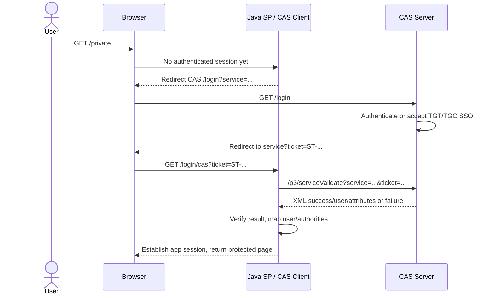

# Choosing the CAS Protocol Version and Compatible Client Libraries

**Module:** Spring Security – federation → CAS Fundamentals.

**Objective:** distinguish the **CAS Protocol** version from the **CAS Server** and **Java CAS Client** versions, choose the right validator/endpoint for service tickets, user attributes, and proxy tickets, and verify compatibility with Java, Spring Security, Spring Boot, and the Servlet API. Includes a decision matrix, SSO diagram, Spring Security/Apereo client samples, a standalone Java 17 program, an upgrade plan, and a security checklist.

**Key principle:** **CAS 1.0, CAS 2.0, and CAS 3.0 are protocol versions, not major version numbers of the CAS Server product**. CAS Server 8.x does not require applications to use “CAS Protocol 8”; Apereo Java CAS Client 4.1.1 likewise does not mean the client speaks only “CAS Protocol 4.1”. The protocol version defines **endpoints, message formats, and proxy/attribute capabilities**; the client/runtime version defines **implementation APIs, security fixes, and binary compatibility**.

For a new Java application using native CAS and needing user attributes, **CAS Protocol 3.0.3** via `/p3/serviceValidate` is the natural choice when the CAS Server/service registration permits it. If only the principal is needed, CAS 2.0's `/serviceValidate` suffices. CAS 1.0 `/validate` is mainly for legacy compatibility. For OIDC/SAML2, you need a separate OIDC/SAML client—you cannot use a CAS3 XML validator to read ID Tokens or SAML Assertions.

## 1. Four Version Layers to Manage Independently

| Layer | Examples | What to Verify |
| --- | --- | --- |
| **CAS Protocol** | 1.0/2.0/3.0, CAS 3.0.3 specification | Validation path, XML/plain text, attributes/proxy |
| **CAS Server** | Apereo CAS Server 7.x/8.x | Enabled modules, service registry, authentication policy, TLS, SSO/SLO |
| **Java CAS Client** | `org.apereo.cas.client:cas-client-core:4.1.1` | Filters, `TicketValidator`, dependencies, security patches |
| **Spring + JVM + Servlet** | Java 17+, Boot 4.1.x, Spring Security 7.1.x, Jakarta Servlet | ABI/API compatibility, classpath, session/filter chain |

Real systems also involve: identity sources, service URLs/public ingress, certificate trust, reverse proxies, CAS ticket registries, logout integration, and application authorization. **A library combination that compiles does not prove CAS login will succeed**, because failures can stem from CAS Server protocol policies or service registration URLs.

### Questions to Answer Before Adding Dependencies

1. Which endpoints does the CAS Server support: `/validate`, `/serviceValidate`, `/p3/serviceValidate`, `/proxyValidate`, `/p3/proxyValidate`?
2. Does the registered service declare `supportedProtocols`? Does it allow `CAS10`, `CAS20`, `CAS30`, or only one?
3. Does the app need only the username or `cas:attributes` such as employee ID, department, group, or affiliation?
4. Is proxy authentication requiring PGTs/proxy tickets needed?
5. Does the app use Spring Security CAS integration or Apereo CAS Servlet filters as its primary authentication entry?
6. Does the runtime use `javax.servlet` or `jakarta.servlet`? Boot 2.x, 3.x, or 4.x? Which JDK?
7. Are CAS tickets standard opaque STs or JWT tickets issued by the CAS Server?
8. Are CAS `renew`, `gateway`, SLO, and MFA assurance required?
9. Which service URL does the CAS Server trust, and how is it routed over HTTPS and proxies?
10. Is there a sandbox environment for end-to-end tests, negative tests, and rollback?

## 2. How Does CAS SSO Work?

Key terms:

- **TGT** – Ticket Granting Ticket: object managed by the CAS Server for the SSO session.
- **TGC** – Ticket Granting Cookie: browser cookie referencing the CAS session to reuse SSO.
- **ST** – Service Ticket: artifact issued for one registered service; normally single-use and short-lived.
- **PT** – Proxy Ticket: ticket for a downstream service when a valid proxy model exists.
- **PGT** – Proxy Granting Ticket: proxy-service credential used to request PTs from the CAS Server.
- **PGTIOU** – identifier used to correlate PGT issuance in responses/callbacks.
- **Service URL** – URL of the service receiving the ticket, which must match at validation.



**Never trust a ticket merely because it appears in the URL.** The CAS client must call the validation endpoint over a trusted HTTPS channel, confirm the ticket was issued for its exact service, and receive a success response before creating `Authentication`/`SecurityContext`.

### 2.1. The Service URL Must Be Consistent

Example:

```text
CAS base URL  : https://sso.example.com/cas
CAS login     : https://sso.example.com/cas/login
App callback  : https://portal.example.com/login/cas
CAS3 validate : https://sso.example.com/cas/p3/serviceValidate
```

Browser leg:

```http
GET /cas/login?service=https%3A%2F%2Fportal.example.com%2Flogin%2Fcas HTTP/1.1
Host: sso.example.com
```

CAS redirect:

```http
GET /login/cas?ticket=ST-example-one-time HTTP/1.1
Host: portal.example.com
```

Client validation:

```http
GET /cas/p3/serviceValidate?service=https%3A%2F%2Fportal.example.com%2Flogin%2Fcas&ticket=ST-example-one-time HTTP/1.1
Host: sso.example.com
```

The values above are **illustrative only**. If the callback is `https://portal.example.com/login/cas` while the validator sends `http://localhost:8080/login/cas`, CAS can reject it because the ticket was not issued for that service. Behind a reverse proxy, enforce a consistent public scheme/host/port/context path and trust forwarded headers only from controlled ingress.

## 3. Comparing CAS Protocol 1.0, 2.0, and 3.0

| Feature | CAS 1.0 | CAS 2.0 | CAS 3.0 |
| --- | --- | --- | --- |
| **Service ticket validation** | `/validate` | `/serviceValidate` | `/p3/serviceValidate` |
| **Response** | Plain text `yes/no` + username on success | XML `cas:serviceResponse` | XML CAS response with `cas:attributes` per spec |
| **Principal** | Yes | Yes | Yes |
| **User attributes** | Not in CAS1 schema | Possible via vendor extensions, not standard CAS3 | **Standard `cas:attributes` per CAS3** |
| **Proxy validation** | No | `/proxyValidate` | `/p3/proxyValidate` |
| **PGT/proxy tickets** | No | `/proxy` and PGT callbacks | Inherits and supports attributes |
| **Use case** | Very old legacy apps | Basic login, CAS2 SSO | Login with attributes or CAS3 proxy/contracts |
| **Prerequisites** | Client/server support CAS1 | Service registry allows CAS20 | Service registry allows CAS30 and matching modules |

According to Apereo documentation, the current CAS specification is **3.0.3**. CAS Server 8.x is a product version; never assume it dropped CAS2 or added “CAS Protocol 8” without inspecting service registrations.

### 3.1. CAS1 Returns Plain Text

Response when ticket is valid:

```text
yes
alice
```

When failed:

```text
no

```

CAS1 parsers do not read XML and have no proxy mechanism under the spec. Pointing a CAS2/3 validator at `/validate` can cause parser errors; never work around it with output string replacement while ignoring semantics.

### 3.2. CAS2 Returns XML

```xml
<cas:serviceResponse xmlns:cas="http://www.yale.edu/tp/cas">
  <cas:authenticationSuccess>
    <cas:user>alice</cas:user>
  </cas:authenticationSuccess>
</cas:serviceResponse>
```

When ticket is invalid:

```xml
<cas:serviceResponse xmlns:cas="http://www.yale.edu/tp/cas">
  <cas:authenticationFailure code="INVALID_TICKET">
    Ticket invalid or already consumed
  </cas:authenticationFailure>
</cas:serviceResponse>
```

CAS 2.0 also includes `/proxyValidate` and `/proxy`. `/serviceValidate` **must not validate proxy tickets as STs** per the specification. One-time STs must never be used as long-lived API access tokens.

### 3.3. CAS3 XML Adds Attributes

```xml
<cas:serviceResponse xmlns:cas="http://www.yale.edu/tp/cas">
  <cas:authenticationSuccess>
    <cas:user>alice</cas:user>
    <cas:attributes>
      <cas:employeeId>opaque-1001</cas:employeeId>
      <cas:department>finance</cas:department>
      <cas:affiliation>staff</cas:affiliation>
      <cas:affiliation>approver</cas:affiliation>
    </cas:attributes>
  </cas:authenticationSuccess>
</cas:serviceResponse>
```

CAS3 `/p3/serviceValidate` provides a structured attribute release contract. Some CAS Servers may return attributes as extensions on `/serviceValidate`, **but that does not replace verifying the standard protocol version**; which client receives which fields must still be tested against the real server. An attribute can be multi-valued, missing, or typed differently; never turn all attributes into `ROLE_*`.

### 3.4. Proxy Authentication Differs from Service Login

If App A must call Backend B on the user's behalf via CAS:
1. App A validates the ST at CAS and supplies an HTTPS `pgtUrl` within an allowed flow.
2. CAS checks the callback URL/TLS and delivers the PGT via the callback, tied to PGTIOU.
3. App A uses the PGT to request a PT for `targetService` B via `/proxy`.
4. B validates the PT using `/proxyValidate` (CAS2) or `/p3/proxyValidate` (CAS3).
5. B checks the allowed **proxy chain**, not just the username.

If the app does not need delegation, keep proxying disabled. Never configure `acceptAnyProxy=true` in production without explicit trust/allowlists; constrain `pgtUrl`, `targetService`, and chains. CAS1 has no proxy validation.

## 4. Choosing a Protocol by Real Requirements

| Requirement | Choice | Reference Java Validator / Filter |
| --- | --- | --- |
| Legacy app supporting only `/validate` | CAS1, with migration plan | `Cas10TicketValidationFilter` |
| Web app needing only username, CAS2 service | CAS2 | `Cas20ServiceTicketValidator` or CAS20 validation filter |
| Web app needing attributes | **CAS3** | `Cas30ServiceTicketValidator` or `Cas30ProxyReceivingTicketValidationFilter` |
| App needing PT/PGT without attrs | CAS2 proxy | `Cas20ProxyTicketValidator` |
| PT/PGT with attributes | CAS3 proxy | `Cas30ProxyTicketValidator` and `/p3/proxyValidate` |
| OAuth2 access tokens / OIDC ID Tokens | **CAS OIDC/OAuth2 module**, not CAS ticket validator | `oauth2Login`/resource server per OAuth2 |
| SAML2 `AuthnRequest`/Assertion | **CAS SAML2 module** | Spring Security `saml2Login`, SP metadata, and Assertion validation |
| SAML 1.1 flow from CAS | Separate SAML 1.1 | `Saml11TicketValidationFilter` and matching dependencies |

**CAS3 is not SAML3.** A CAS Server can offer native CAS, SAML1, SAML2, OAuth2, and OIDC as distinct modules/protocols. Never feed OAuth2 JSON or SAML Assertions into a CAS3 XML parser.

### 4.1. Service Registry Can Restrict CAS Protocols

Apereo CAS lets a registered service declare `supportedProtocols`, including `CAS10`, `CAS20`, `CAS30`, and `SAML1`. If a service permits only `CAS20`, a request to `/p3/serviceValidate` may be rejected even when the CAS Server supports CAS3.

Service registry config idea (JSON snippet—verify exact server schema):

```json
{
  "@class": "org.apereo.cas.services.CasRegisteredService",
  "serviceId": "^https://portal\\.example\\.com/login/cas$",
  "name": "Portal CAS3",
  "id": 120,
  "supportedProtocols": [
    "java.util.HashSet",
    ["CAS30"]
  ]
}
```

Never copy straight into production without validating the service registry. Service regexes must be exact, avoiding `^https://.*` that allows unintended hosts. During a CAS2→CAS3 migration, update `supportedProtocols` only after checking all clients; never disable `CAS20` before un-upgraded apps have transitioned.

## 5. Matrix of Java Clients, Spring Security, and Servlet Namespaces

As of **2026-11-07**:
- Spring Security **7.1.2** was published as a stable 7.1 release on 2026-10-23; the `spring-security-cas` module still exists.
- Apereo Java CAS Client **4.1.1** was published to Maven Central (May 2026), containing the `cas-client-core` module.
- Java CAS Client 4.x uses **Jakarta Servlet**; older 3.x clients typically target `javax.servlet`.
- Apereo issued an advisory on **2026-05-27** for deployments using **JWT CAS ticket validation** and recommended client **4.1.1**.

### 5.1. Selecting Dependency Lines by Runtime

| Application | Servlet API | Java CAS Client to Evaluate | Spring Security CAS Module | Notes |
| --- | --- | --- | --- | --- |
| Legacy Java EE / Boot 2.x | `javax.servlet` | Matching Client 3.x | Security major matching Boot 2.x | Plan migration; never drop Jakarta JARs in directly |
| Boot 3.x / Security 6.x | `jakarta.servlet` | Tested Client 4.x | `spring-security-cas` **6.x** | Verify JDK 17, Servlet 6, transitive deps |
| Boot 4.x / Security 7.x | `jakarta.servlet` | Client 4.1.1 or approved patched version | `spring-security-cas` **7.x** | Do not copy Security 3 config; inspect current tokens/providers |
| Servlet app without Spring Security CAS | Per container (`javax` or `jakarta`) | Matching Apereo CAS client | May omit `spring-security-cas` | Single validation filter layer; app manages sessions/logout |

**This is version-selection guidance, not a blanket compatibility guarantee for every patch**. Always inspect the dependency tree, compile, and run browser SSO tests against a real CAS Server. Avoid upgrading server major, framework major, client major, and protocol simultaneously without an isolated rollback plan.

### 5.2. Why Not Mix `javax.servlet` and `jakarta.servlet`?

```java
// Java EE / some legacy libraries:
javax.servlet.http.HttpServletRequest

// Spring Boot 3/4 - Jakarta Servlet:
jakarta.servlet.http.HttpServletRequest
```

The two types live in **two different packages** and are binary-incompatible. Using a Java CAS Client 3.x `javax` release on Boot 4 Jakarta causes `ClassNotFoundException`, `NoClassDefFoundError`, and cast/filter registration failures. Placing both Servlet APIs on the runtime classpath does not resolve the underlying ABI conflict; use a migrated client version or align the runtime/framework.

### 5.3. Selecting the Exact Maven Artifact

`org.apereo.cas.client:cas-client` is the parent/aggregator **POM**, not necessarily the runtime filter JAR. The module implementing validation and Servlet filters is:

```xml
<dependency>
  <groupId>org.apereo.cas.client</groupId>
  <artifactId>cas-client-core</artifactId>
  <version>4.1.1</version>
</dependency>
```

Spring Security CAS integration:

```xml
<dependency>
  <groupId>org.springframework.security</groupId>
  <artifactId>spring-security-cas</artifactId>
</dependency>
```

When using the Spring Boot BOM, never pin `spring-security-cas` to a different major version than `spring-security-web` or `spring-security-core`. The Apereo client may be pulled transitively; inspect effective versions, dependency convergence, and CVEs via SBOM.

**Never add `cas-client-support-saml` merely because CAS3 returns XML.** CAS3 XML responses are native CAS, not SAML 1.1; add the SAML module only when explicitly choosing the separate SAML protocol.

## 6. Spring Security CAS and Apereo CAS Client: Two Different Models

### 6.1. Approach A – Spring Security Owns Authentication

```text
SecurityFilterChain
  ├─ ExceptionTranslationFilter
  ├─ CasAuthenticationEntryPoint → CAS /login?service=...
  ├─ CasAuthenticationFilter receives ?ticket=ST-...
  ├─ AuthenticationManager → CasAuthenticationProvider
  ├─ Apereo Cas20/Cas30ServiceTicketValidator
  ├─ HTTPS CAS /serviceValidate or /p3/serviceValidate
  └─ UserDetails/GrantedAuthorities → SecurityContext/HttpSession
```

Spring Security 7 classes:
- `org.springframework.security.cas.ServiceProperties`
- `org.springframework.security.cas.web.CasAuthenticationEntryPoint`
- `org.springframework.security.cas.web.CasAuthenticationFilter`
- `org.springframework.security.cas.authentication.CasAuthenticationProvider`
- `org.springframework.security.cas.authentication.CasServiceTicketAuthenticationToken`

**Warning about legacy code:** Spring Security's CAS page still contains historical sections referencing Spring Security 3.x, CAS Server 3.4, XML namespace config, and `UsernamePasswordAuthenticationToken`. In Security 7, `CasAuthenticationProvider` Javadoc describes `CasServiceTicketAuthenticationToken`; therefore never copy samples from older branches into Boot 4 without compiling and integration testing.

#### 6.1.1. Beans Selecting the CAS3 Validator

Java snippet inside a Spring Boot 4 / Security 7 project (component configuration only, **not a standalone runnable app**):

```java
import org.apereo.cas.client.validation.Cas30ServiceTicketValidator;
import org.apereo.cas.client.validation.TicketValidator;
import org.springframework.context.annotation.Bean;
import org.springframework.context.annotation.Configuration;
import org.springframework.security.cas.ServiceProperties;
import org.springframework.security.cas.authentication.CasAuthenticationProvider;
import org.springframework.security.core.userdetails.UserDetailsService;

@Configuration
public class CasBeans {
    @Bean
    ServiceProperties serviceProperties() {
        ServiceProperties p = new ServiceProperties();
        p.setService("https://portal.example.com/login/cas");
        p.setSendRenew(false);
        return p;
    }

    @Bean
    TicketValidator ticketValidator() {
        // Constructor takes the CAS server base URL, not the full /p3 URL.
        return new Cas30ServiceTicketValidator(
                "https://sso.example.com/cas");
    }

    @Bean
    CasAuthenticationProvider casAuthenticationProvider(
            ServiceProperties properties,
            TicketValidator validator,
            UserDetailsService users) {

        CasAuthenticationProvider p = new CasAuthenticationProvider();
        p.setServiceProperties(properties);
        p.setTicketValidator(validator);
        p.setUserDetailsService(users);
        p.setKey("portal-cas-provider");
        return p;
    }
}
```

**Why the distinction matters:** `Cas30ServiceTicketValidator` selects the appropriate CAS3 endpoint from the base URL; do not set the base URL to `https://sso.example.com/cas/p3/serviceValidate` unless the API explicitly requires it (the example above does not). If only CAS2 is needed:

```java
TicketValidator validator =
    new org.apereo.cas.client.validation.Cas20ServiceTicketValidator(
        "https://sso.example.com/cas");
```

For a complete login flow, you must wire `CasAuthenticationEntryPoint` with `loginUrl`/`ServiceProperties`, `CasAuthenticationFilter` with `AuthenticationManager` and the callback, establish the proper filter chain, session management/SLO, user mapping, and policies. The beans above **do not configure the filter chain by themselves**. Cross-check the Javadoc API of your deployed 7.1.x version, especially the provider's input token type.

### 6.2. Approach B – Apereo Servlet Filters

If a Servlet app does not use Spring Security CAS, `cas-client-core` provides:
- `org.apereo.cas.client.authentication.AuthenticationFilter` to redirect to CAS login.
- `org.apereo.cas.client.validation.Cas10TicketValidationFilter` for CAS1.
- `org.apereo.cas.client.validation.Cas20ProxyReceivingTicketValidationFilter` for CAS2, selectable for service/proxy validators.
- `org.apereo.cas.client.validation.Cas30ProxyReceivingTicketValidationFilter` for CAS3.
- `org.apereo.cas.client.validation.Cas30JsonProxyReceivingTicketValidationFilter` if server/client support JSON CAS3 responses.
- `org.apereo.cas.client.util.HttpServletRequestWrapperFilter` to expose principal/attributes to the servlet layer.
- Corresponding SLO filters/listeners when implementing cross-app logout.

Illustrative `web.xml` snippet for a Servlet app using CAS3:

```xml
<filter>
  <filter-name>CAS Validation</filter-name>
  <filter-class>
    org.apereo.cas.client.validation.Cas30ProxyReceivingTicketValidationFilter
  </filter-class>
  <init-param>
    <param-name>casServerUrlPrefix</param-name>
    <param-value>https://sso.example.com/cas</param-value>
  </init-param>
  <init-param>
    <param-name>serverName</param-name>
    <param-value>https://portal.example.com</param-value>
  </init-param>
</filter>
<filter>
  <filter-name>CAS Authentication</filter-name>
  <filter-class>
    org.apereo.cas.client.authentication.AuthenticationFilter
  </filter-class>
  <init-param>
    <param-name>casServerUrlPrefix</param-name>
    <param-value>https://sso.example.com/cas</param-value>
  </init-param>
  <init-param>
    <param-name>serverName</param-name>
    <param-value>https://portal.example.com</param-value>
  </init-param>
</filter>
<filter-mapping>
  <filter-name>CAS Validation</filter-name>
  <url-pattern>/*</url-pattern>
</filter-mapping>
<filter-mapping>
  <filter-name>CAS Authentication</filter-name>
  <url-pattern>/*</url-pattern>
</filter-mapping>
```

**This is only a configuration fragment**, not a complete `web.xml`: you must wrap it in the container's Jakarta Servlet `web-app` namespace and configure public routes, wrappers, logout, sessions, roles, filter ordering, and redirect-loop tests. Per the Apereo README, with proxy validation filters pay close attention to placing validation before authentication.

**Never use both an Apereo CAS validation filter and Spring Security's `CasAuthenticationFilter` simultaneously to validate the same ST** unless the design explicitly handles one-time tokens. The first filter consumes the ST and the second receives `INVALID_TICKET`.

### 6.3. Apereo's Spring Boot Support Module

Apereo provides `cas-client-support-springboot`, offering auto-configuration/filters and properties like `cas.validation-type=CAS3`, `CAS`, or `SAML` depending on version. This is not `spring-security-cas`; never drop both starters into one project without deciding which one creates `Authentication` and which handles SLO/roles.

Verify that the Apereo springboot support module supports **Spring Boot 4.x**, Spring Framework 7.x, and your container's Jakarta Servlet version. Core client Jakarta support **does not automatically guarantee** every add-on module's auto-config or beans are compatible.

## 7. Reference POM for Boot 4.1.x + Security 7.x

`pom.xml` (Maven dependencies to build out the app; omits full CAS app `main`/security filter chain):

```xml
<?xml version="1.0" encoding="UTF-8"?>
<project xmlns="http://maven.apache.org/POM/4.0.0"
         xmlns:xsi="http://www.w3.org/2001/XMLSchema-instance"
         xsi:schemaLocation="http://maven.apache.org/POM/4.0.0
             https://maven.apache.org/xsd/maven-4.0.0.xsd">
  <modelVersion>4.0.0</modelVersion>
  <parent>
    <groupId>org.springframework.boot</groupId>
    <artifactId>spring-boot-starter-parent</artifactId>
    <version>4.1.2</version>
    <relativePath/>
  </parent>
  <groupId>com.example</groupId>
  <artifactId>portal-cas-client</artifactId>
  <version>1.0.0</version>
  <properties><java.version>17</java.version></properties>
  <dependencies>
    <dependency>
      <groupId>org.springframework.boot</groupId>
      <artifactId>spring-boot-starter-webmvc</artifactId>
    </dependency>
    <dependency>
      <groupId>org.springframework.boot</groupId>
      <artifactId>spring-boot-starter-security</artifactId>
    </dependency>
    <dependency>
      <groupId>org.springframework.security</groupId>
      <artifactId>spring-security-cas</artifactId>
    </dependency>
    <dependency>
      <groupId>org.apereo.cas.client</groupId>
      <artifactId>cas-client-core</artifactId>
      <version>4.1.1</version>
    </dependency>
    <dependency>
      <groupId>org.springframework.boot</groupId>
      <artifactId>spring-boot-starter-test</artifactId>
      <scope>test</scope>
    </dependency>
  </dependencies>
</project>
```

The Spring Boot BOM manages Spring Security modules; **never pin `spring-security-cas` separately to 6.x while the other modules are 7.x**. Apereo Client 4.1.1 is an illustrative published version; manage patches, SBOM, and transitive dependencies per security policy. CAS URLs and registered services must be configured separately. Once `main` and the filter chain are complete:

```bash
mvn dependency:tree
mvn -DskipTests compile
mvn test
```

To filter by dependency group:

```bash
mvn dependency:tree -Dincludes=org.springframework.security,org.apereo.cas.client
```

Verify no legacy `javax.servlet` JARs remain in a Jakarta app and no two different major versions of CAS clients coexist; `NoSuchMethodError`/`NoClassDefFoundError` typically indicate such conflicts. Only an integration SSO run verifies real CAS protocol behavior.

## 8. Standalone Java 17: Making Protocol Version Decisions

This example does not create sessions or validate CAS tickets. It only illustrates selecting an endpoint based on **admin-verified CAS Server capabilities**, rejecting requests that exceed capabilities rather than silently downgrading.

File `CasProtocolDecisionDemo.java`:

```java
public class CasProtocolDecisionDemo {
    enum Protocol {
        CAS10("/validate", "/validate"),
        CAS20("/serviceValidate", "/proxyValidate"),
        CAS30("/p3/serviceValidate", "/p3/proxyValidate");

        private final String serviceEndpoint;
        private final String proxyEndpoint;

        Protocol(String serviceEndpoint, String proxyEndpoint) {
            this.serviceEndpoint = serviceEndpoint;
            this.proxyEndpoint = proxyEndpoint;
        }

        String endpoint(boolean proxy) {
            if (proxy && this == CAS10) {
                throw new IllegalArgumentException(
                        "CAS1 does not support proxy tickets");
            }
            return proxy ? proxyEndpoint : serviceEndpoint;
        }
    }

    record Capability(boolean cas10, boolean cas20, boolean cas30) {}
    record Need(boolean attributes, boolean proxy) {}

    static Protocol choose(Capability server, Need need) {
        if (need.attributes()) {
            if (!server.cas30()) {
                throw new IllegalStateException(
                        "Attributes require CAS3");
            }
            return Protocol.CAS30;
        }
        if (server.cas20()) {
            return Protocol.CAS20;
        }
        if (server.cas30()) {
            return Protocol.CAS30;
        }
        if (server.cas10() && !need.proxy()) {
            return Protocol.CAS10;
        }
        throw new IllegalStateException(
                "No compatible CAS protocol");
    }

    public static void main(String[] args) {
        Capability modern = new Capability(true, true, true);
        Capability legacy = new Capability(true, false, false);

        Protocol basic = choose(
                modern, new Need(false, false));
        Protocol attrs = choose(
                modern, new Need(true, false));
        Protocol proxy = choose(
                modern, new Need(true, true));
        Protocol old = choose(
                legacy, new Need(false, false));

        System.out.println("Basic: " + basic + " "
                + basic.endpoint(false));
        System.out.println("Attributes: " + attrs + " "
                + attrs.endpoint(false));
        System.out.println("Proxy with attributes: " + proxy + " "
                + proxy.endpoint(true));
        System.out.println("Legacy: " + old + " "
                + old.endpoint(false));

        try {
            choose(legacy, new Need(true, false));
        }
        catch (IllegalStateException ex) {
            System.out.println("Unsupported: " + ex.getMessage());
        }
    }
}
```

Run command:

```bash
javac CasProtocolDecisionDemo.java
java CasProtocolDecisionDemo
```

**Exact stdout on JDK 17+:**

```text
Basic: CAS20 /serviceValidate
Attributes: CAS30 /p3/serviceValidate
Proxy with attributes: CAS30 /p3/proxyValidate
Legacy: CAS10 /validate
Unsupported: Attributes require CAS3
```

Explanation: an app needing attributes selects CAS3; needing proxy with attrs selects `/p3/proxyValidate`; a CAS1-only legacy server can validate the principal but cannot satisfy attributes. When no compatible version exists, the outcome is a controlled error—**never downgrade the protocol and fabricate permission claims**.

The demo tests only protocol-selection policy; it **does not** send HTTP requests, check SSL, consume STs, parse XML, grant permissions, or deploy CAS. Never use `choose` as an actual CAS validator.

## 9. The Security Contract Matters More Than Version Numbers

### 9.1. Tickets Must Be Validated Against the Service URL

The CAS Server issues an ST for a specific URL. When the client validates, `service` must be properly encoded and match the registered service. Never “quick-fix” `INVALID_SERVICE` with a `.*` regex in the CAS registry. Common causes of drift:
- Browser receives callback `https://portal.example.com/login/cas` while backend sends `http://localhost:8080/login/cas`.
- Proxy alters scheme/port/host, `/portal` context path, or trailing slash.
- Service URL contains query parameters sorted/encoded differently than during ST issuance.
- Load balancer serves multiple domains while the CAS service registry permits only one domain.
- CAS client configured with `serverName` or `service` mismatching the environment.

Proper fix: lock down the **public canonical service URL**, configure the reverse proxy accurately, register the service on the CAS Server, and test both redirect and validation with the exact same URL.

### 9.2. One-Time Tickets and Duplicate Filters

An ST is a **single-use opaque artifact**; never store `ST-...` as a bearer credential in a database or long-lived session. If a system enables both Apereo `Cas30ProxyReceivingTicketValidationFilter` and Spring `CasAuthenticationFilter` on one callback, the first filter consumes the ST and the second gets `INVALID_TICKET`. Assign **exactly one component to handle ticket validation**. Upon success, the app establishes a secure local authenticated session/`SecurityContext`.

CAS Server TGC/TGT and the app's `HttpSession` are **two separate sessions**. Having an SSO TGC does not mean the app has validated a ticket; invalidating the local session does not automatically log out the CAS Server.

### 9.3. TLS and Parsers

- Use HTTPS for CAS login and back-channel validation, verifying hostname and certificate chain.
- Never use a trust-all `TrustManager` or disable TLS verification to “fix dev”.
- The XML parser must be namespace-aware, harden against XXE/DTD, and limit response size/timeouts.
- Never trust user-supplied endpoint/callback/`service` URLs.
- Never log STs, TGT/TGCs, PGTs, session cookies, or raw attributes containing PII.
- Proxy callback `pgtUrl` requires TLS/trust verification and `allowedProxyChains`.
- Fail closed on CAS Server timeouts/502s or unvalidated tickets.
- Maintain CSRF protection for business POSTs, session fixation protection on login, `Secure`/`HttpOnly` cookies, and `SameSite` compatible with browser SSO.

### 9.4. Authentication Is Not Automatically Authorization

A CAS response containing `<cas:user>alice</cas:user>` proves only a principal under the configured CAS Server authority—**it does not automatically grant admin privileges**. With `cas:attributes`, enforce allowlist mapping scoped to namespace, service/tenant, and `UserDetails`:
- Usernames/emails can change or collide across multiple identity sources.
- Tenant A's `approver` group is not Tenant B's admin role.
- External identities must link to an internal user ID with status `ACTIVE`.
- Attribute changes/revocations may require synchronization, token/session timeouts, and permission re-checks.
- Never auto-create accounts or roles solely because the CAS Server returned XML success.

## 10. CAS `renew`, `gateway`, SLO, and Proxying

### 10.1. `renew=true` Does Not Mean MFA

The CAS spec allows `renew=true` to require direct authentication rather than reusing an SSO security context. In Spring Security, `ServiceProperties.setSendRenew(true)` can enable this for sensitive services. However, it **does not by itself require multi-factor authentication**: MFA/assurance requires CAS authentication policies and real evidence. Never enable `renew` application-wide if only specific transactions need reauth.

### 10.2. `gateway=true` Is Passive SSO Probing

With `gateway=true`, CAS attempts non-interactive SSO. If no suitable session exists, CAS may return to `service` without a `ticket`. The application must treat “no ticket” as unauthenticated while avoiding redirect loops. The CAS spec states `renew` and `gateway` are incompatible—never enable both arbitrarily.

### 10.3. Single Logout

CAS `/logout` can destroy CAS-side TGT/TGCs; SLO messages require clients to receive them and invalidate matching `HttpSession`s per mappings. Local logout in Spring does not guarantee CAS and other applications are logged out. Depending on CAS Server/client, SLO can travel over back-channel or browser flows; deploy matching filters/listeners/session stores. Always test multi-tab browsers, clusters, session expiration, and post-logout callbacks.

### 10.4. Proxy Tickets: Only When Genuine Delegation Exists

If App A calls Backend B on behalf of the user, you need PGTs, `/proxy`, PTs, `/proxyValidate`, an HTTPS callback URL, and allowlisted proxy chains. If merely rendering web pages for the user, this adds unnecessary complexity. Never enable `acceptAnyProxy=true` in production without a security review.

## 11. JWT CAS Tickets and the 2026 Advisory

Some CAS Servers offer **JWT-formatted tickets**, distinct from the default opaque STs. On **2026-05-27**, Apereo disclosed a Java CAS Client vulnerability concerning **JWT-formatted CAS ticket verification** and recommended **Java CAS Client 4.1.1**. Apereo described the scope as deployments with JWT ticket validation enabled; do not assume every opaque CAS1/2/3 ST application is affected by the same flaw.

If deploying JWT CAS tickets:
1. Explicitly verify the `CasJWTTicketValidationFilter` or JWT validator in use.
2. Validate `iss`/`aud`/`exp`/`jti` and signatures/encryption/algorithms per library/advisory guidance.
3. Run the patched client release and audit transitives/SBOM.
4. Test tampered tokens, wrong audience/issuer, expiration, untrusted keys, replay, and path downgrades.
5. Never simply `Base64.decode` the payload and treat the user as authenticated.
6. Protect encryption/signing secrets in an HSM/secret manager with planned key rotation.

**A JWT CAS ticket is not an OIDC ID Token.** If the application needs OIDC login or OAuth2 APIs, use the CAS OIDC module with standard `oauth2Login`/resource server—never use a CAS JWT ticket validator as a wholesale replacement for OIDC.

## 12. Zero-Downtime Migration Plans

### Scenario A – CAS2 → CAS3 to Obtain Attributes

1. Verify the CAS Server exposes `/p3/serviceValidate` and the registered service permits `CAS30`.
2. Define required attributes, types/multi-values, release policies, and authority sources.
3. In staging, switch `Cas20ServiceTicketValidator` to `Cas30ServiceTicketValidator` or switch the corresponding validation filter.
4. Log in and verify XML response decoding under CAS3; never parse raw responses in controllers.
5. Verify user mapping, tenant authorization, and negative tests when attributes are missing.
6. Canary one tenant/app, monitoring authentication successes and errors.
7. Only after all clients have upgraded should you consider restricting `CAS20` in the service registry.
8. Keep an endpoint/validator rollback ready if CAS3 responses deviate from contract.

### Scenario B – CAS Server 7.x → 8.x

1. Verify native CAS protocol modules and endpoints remain intact.
2. Audit service registries, `serviceId` regexes, `supportedProtocols`, and SSL.
3. Test CAS tickets, TGC, `renew`/`gateway`, and SLO/proxy if used.
4. Run existing clients through a sandbox against the new CAS Server.
5. Upgrade the Java client only if required for security patches/compatibility or under a separate plan.
6. Avoid combining a server major upgrade with a Spring Boot/Servlet namespace migration in one step if preventable.

### Scenario C – Java CAS Client 3.x → 4.x

1. Confirm the runtime has already moved from `javax.servlet` to `jakarta.servlet`.
2. Upgrade `cas-client-core` and tested support modules; eliminate classpath conflicts.
3. Check filters/params, handlers/wrappers, and SLO registration.
4. Review `CasAuthenticationProvider` for the Spring Security version, tokens, and user mapping.
5. Test one-time STs, XML attributes, proxying, SLO, and sessions.
6. Track CVE advisories and pin a safe client release.
7. Prepare rollback for *both app and runtime*; never drop `javax` JARs back into a Jakarta container.

### Scenario D – From Native CAS to OIDC

If a project needs modern federation across apps/APIs with scopes/audiences and JWT/JWKS, you may choose CAS OIDC Provider over native CAS. This is a **protocol migration**, not just swapping `Cas30ServiceTicketValidator` for another parser. You must:
- Register OIDC clients, redirect URIs, PKCE, and discovery/JWKS.
- Map `CAS principal` to a stable OIDC `sub` and internal user ID.
- Design token lifetimes/scopes/audiences/revocation.
- Test issuer/audience/nonce, sessions/logout, and account linking.
- Use canaries and rollback; never accept a CAS ST as an OAuth2 access token.

## 13. Common Errors Table

| Symptom | Cause | Resolution |
| --- | --- | --- |
| `INVALID_SERVICE` | CAS `service` differs from callback URL | Compare HTTPS host/path/encoding, ingress, and registered service |
| `INVALID_TICKET` right after callback | ST reused, two filters, expired | Keep one validation owner; respect one-time lifecycle |
| CAS1 response XML parser fails | CAS1 `/validate` returns plain text | Use CAS1 validator or migrate protocol |
| CAS3 missing attributes | Calling `/serviceValidate`, or server withholds attrs | Use `/p3/serviceValidate` and CAS30 policy |
| `/p3/serviceValidate` blocked | Service registry permits only `CAS20` | Update `supportedProtocols` carefully |
| Multi-valued attribute drops values | Mapper expects only `String` | Map as list properly; test multi-valued attrs |
| Proxy ticket rejected | Using `serviceValidate` instead of `proxyValidate` | Select proper validator and allowed proxy chain |
| PGT callback fails | Wrong URL/TLS/trust/return status | Use HTTPS, verify reachability and PGTIOU |
| `ClassNotFoundException javax.servlet` | Legacy Java EE client on Jakarta runtime | Upgrade to client 4.x and remove old JARs |
| `ClassNotFoundException jakarta.servlet` | Jakarta client on legacy Java EE container | Align runtime or matching client version |
| `NoSuchMethodError` Spring Security CAS | Major/transitive module mismatch | Align BOM, dependency tree, compile/test |
| Filter redirect loop | Wrong matcher/public route/cookie | Audit filter chain, service URL, sessions |
| CAS login PASSES yet roles missing | Incomplete attribute release/mapping | Inspect CAS3 response and authority mapping |
| User hits wrong tenant despite matching username | External identity not namespaced | Map issuer/subject + tenant membership |
| SLO leaves sessions alive | Missing listener/filter/session mapping | Test local vs. CAS logout separately |
| TLS validation fails | Truststore/hostname mismatch | Configure proper CA trust; never disable SSL |
| JWT ticket rejected | Mismatched claims/key/patch | Check advisory/client 4.1.1+ and trust |
| Browser has ST yet app returns 401 | Ticket not validly consumed or `SecurityContext` not saved | Check provider, validation, and session persistence |
| Gateway returns without ticket | No valid CAS SSO session | Handle anonymous cleanly; avoid redirect loops |
| `renew=true` lacks MFA | `renew` only forces reauthentication | Add MFA/assurance policy on CAS |

**Safe logging:** record timestamps, service registration, protocol/validator, error codes, and masked correlation IDs. Never log raw ST/PT/PGT/TGC values, passwords, private keys, or sensitive attributes.

## 14. Pre-Release Test Matrix

| Test Case | Expectation |
| --- | --- |
| CAS1 `/validate` success | CAS1 client parses plain-text user |
| CAS2 `/serviceValidate` success | CAS2 client parses XML username |
| CAS3 `/p3/serviceValidate` success | CAS3 client receives username and attributes |
| CAS3 multi-valued attrs | No lost values or mixed privileges |
| CAS3 disallowed | Fails per service policy |
| CAS2 client hits CAS1 endpoint | Parser does not silently accept |
| ST with service URL mismatch | Fails; creates no `SecurityContext` |
| Reused ST | Second validation fails |
| Expired/forged ticket | Fails closed |
| ST from another CAS Server | Not accepted arbitrarily |
| PT sent to service validator | Fails per spec |
| PT sent to proxy validator | Accepted only if proxy chain is allowed |
| Invalid TLS on PGT callback | Fails; never issues PGT arbitrarily |
| `renew` | Enforces reauthentication per CAS policy |
| `gateway` without TGC | Returns without ticket; remains anonymous |
| Session fixation | Rotates session ID after login per framework policy |
| SLO | App session invalidated accurately |
| Jakarta Boot 4 + CAS client 4.x | Zero classpath namespace errors |
| Same major across Security CAS/core/web | Zero ABI mismatches |
| Two validation filters | Test catches double-consumption |
| Wrong admin mapping from CAS3 attrs | Denied if mapping is not authorized |
| Identical username across tenants | Accounts never auto-merged |
| CAS Server outage | Unvalidated tickets never accepted |
| Broken TLS trust | Fails closed |
| Reverse proxy public callback | Exact service URL preserved |
| Invalid claims on JWT CAS ticket | Rejected by patched client |
| Dependency scan | Zero vulnerable legacy versions |
| Logger | Zero leaks of tickets, session cookies, or PII |
| CAS2→CAS3 canary | Stable login, verified rollback |

Unit tests on protocol selection verify policy; integration tests must hit a real sandbox CAS Server with a valid service registry; browser E2E tests must cover TGC/local sessions/SLO/proxying. **`@WithMockUser` creates only test `Authentication`** and does not prove CAS ticket validation.

## 15. Client Library Selection Checklist

**Requirements and Contract**
- [ ] Distinguished CAS Server version from CAS Protocol version.
- [ ] Confirmed endpoints and `supportedProtocols` for the specific service.
- [ ] Determined username-only vs. attributes/proxy/JWT tickets.
- [ ] Selected validator/filter matching CAS1/2/3.
- [ ] Service URL and CAS registered service match the HTTPS public path.
- [ ] CAS Server attribute release/multi-value schema explicitly defined.

**Runtime**
- [ ] JDK/Boot/Framework/Security major versions aligned.
- [ ] Strictly `javax.servlet` or `jakarta.servlet`, never mixed.
- [ ] `spring-security-cas` aligned with Spring Security BOM.
- [ ] `cas-client-core` runtime JAR at an approved version.
- [ ] Dependency tree/SBOM and security advisories reviewed.
- [ ] Only one filter/provider stack consumes the ST.
- [ ] Never use Security 3.x docs as compile-ready APIs for 7.x.

**Security and Operations**
- [ ] HTTPS CAS login/validation with proper TLS trust and hostname checks.
- [ ] Never accept arbitrary service URLs, proxy chains, or JWT issuers.
- [ ] Hardened XML parsing, one-time tickets, timeouts/replay protection/fail closed.
- [ ] Principal/attributes mapped reliably to internal users/roles/tenants.
- [ ] `Secure`/`HttpOnly` cookies, session fixation, and SLO tested.
- [ ] Protocol migration, rollback, and CAS Server outage tested.
- [ ] Never log tickets, cookies, secrets, or sensitive raw attributes.

## 16. Self-Check Questions

**Does CAS Server 8.x require CAS Protocol 8?**  
No. CAS Server is the software version; CAS Protocol 1/2/3 defines the wire contract. Apereo publishes CAS 3.0.3 as the current specification.

**Why shouldn't a CAS3 validator point at `/validate`?**  
CAS1 returns plain text, whereas a CAS3 parser expects an XML response matching the CAS schema. Select the matching endpoint/validator and service policy.

**If only the username is needed, is CAS3 mandatory?**  
No. CAS2 remains appropriate for basic service logins if supported by the server and no attributes are needed. CAS3 also works, provided the contract matches.

**Is CAS3 the same as SAML3 or OIDC?**  
No. CAS3 is native CAS. OIDC/SAML are separate modules/protocols on the CAS Server.

**Does adding `cas-client-core` automatically give Spring Security CAS SSO?**  
No. You must configure the filter, entry point, authentication provider/manager, service properties, and sessions/authorities—or use the appropriate Apereo Servlet integration.

**Why pay attention to 4.1.1 in 2026?**  
Apereo recommended this release to patch a security vulnerability in **JWT service ticket validation**; review the advisory's exact scope rather than assuming all opaque CAS tickets are affected.

## 17. Official Sources

1. [Apereo CAS – CAS Protocol](https://apereo.github.io/cas/8.0.x/protocol/CAS-Protocol.html): CAS 3.0.3, TGT/TGC/ST, and other protocols.
2. [Apereo – CAS Protocol Specification](https://apereo.github.io/cas/development/protocol/CAS-Protocol-Specification.html): CAS1/2/3 endpoints, `service`, `renew`/`gateway`, and proxying.
3. [Apereo – Configuring Service Protocols](https://apereo.github.io/cas/development/services/Configuring-Service-Supported-Protocols.html): `supportedProtocols`, `CAS10`/`CAS20`/`CAS30`.
4. [Apereo Java CAS Client README](https://github.com/apereo/java-cas-client): CAS filters, CAS3 validators, SAML, Spring Boot support, and Jakarta.
5. [Maven Central – `cas-client-core` 4.1.1](https://central.sonatype.com/artifact/org.apereo.cas.client/cas-client-core/4.1.1): GA artifact and POM.
6. [Spring Security – CAS Authentication](https://docs.spring.io/spring-security/reference/servlet/authentication/cas.html): CAS filter/provider/entry point (some snippets are historical).
7. [Spring Security 7.1 JavaDoc – `CasAuthenticationProvider`](https://docs.spring.io/spring-security/reference/api/java/org/springframework/security/cas/authentication/CasAuthenticationProvider.html): current token types and setters.
8. [Spring Security 7.1 JavaDoc – `ServiceProperties`](https://docs.spring.io/spring-security/reference/api/java/org/springframework/security/cas/ServiceProperties.html): `service` URL and `sendRenew`.
9. [Spring Security release 7.1.2, 2026-10-23](https://spring.io/blog/2026/10/23/spring-security-maintenance-releases/): stable release reference.
10. [Apereo – Java CAS Client JWT Vulnerability Disclosure 2026-05-27](https://www.apereo.org/news/2026/java-cas-client-jwt-vulnerability-disclosure): 4.1.1 patch and JWT scope.
11. [Jakarta Servlet Specifications](https://jakarta.ee/specifications/servlet/): Servlet API and Jakarta EE versions.

**Conclusion:** lock down the **CAS protocol contract** (CAS1/2/3, XML/plain text, user attributes, PT/PGT, registered service) first, then choose the **matching validator and Java client**, and finally verify **Spring Security major, Servlet namespace, JDK, BOM, security patches, and CAS Server capabilities**. A newer library version never substitutes for enforcing one-time tickets, exact service URLs, TLS, user mapping, sessions, and authorization.