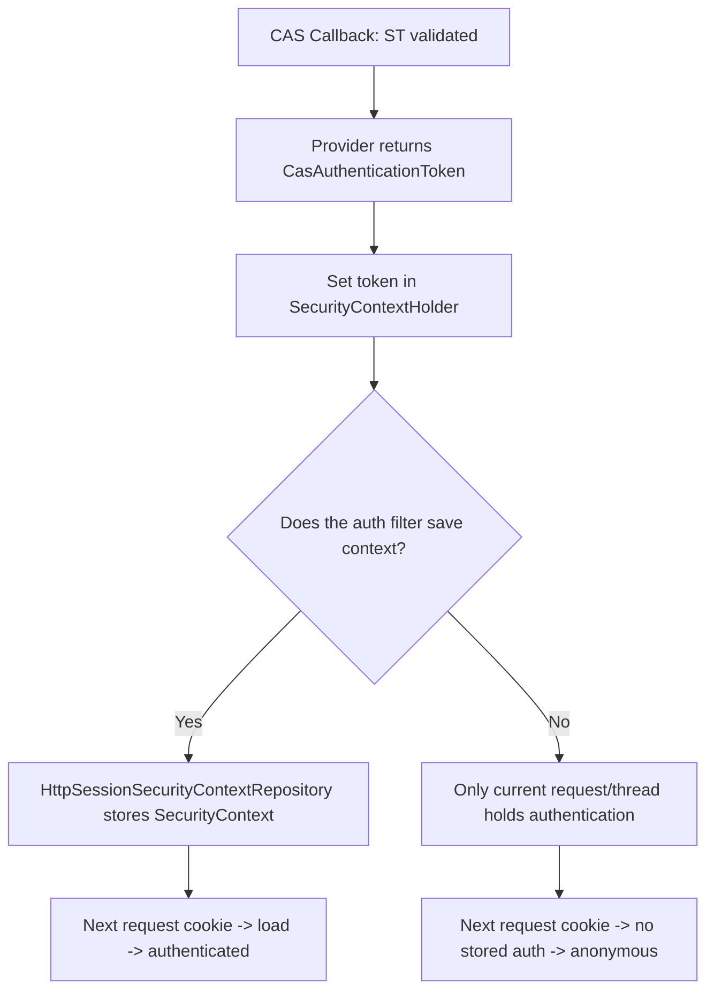

# CasAuthenticationToken and Persisting Context in the Application Session

## Learning Objectives

After completing this lesson, you will be able to:

1. Explain the path of a **CAS Service Ticket** from the browser through `CasAuthenticationFilter`, `AuthenticationManager`, and `CasAuthenticationProvider` to an **authenticated `CasAuthenticationToken`**.
2. Distinguish the **unauthenticated input token**, **post-validation `CasAuthenticationToken`**, **`SecurityContext`**, **`SecurityContextHolder`**, **`SecurityContextRepository`**, the application's **`HttpSession`**, and the SSO/TGT session on the CAS Server.
3. Understand the data held by `CasAuthenticationToken`: principal, authorities, credentials/ticket, `UserDetails`, CAS `Assertion`, authenticated state, and provider key hash; avoid logging or exposing sensitive data.
4. Explain why merely setting `Authentication` in `SecurityContextHolder` is **insufficient** to persist login across multiple HTTP requests. In Spring Security 6, `SecurityContextRepository.saveContext(...)` and the authentication filter itself must be configured properly.
5. Configure **Spring Boot 3 / Spring Security 6 / Java 17+** for stateful CAS browser SSO, session fixation protection, `SecurityContext` persistence/restoration, and service-method authorization checks.
6. Diagnose bugs where **CAS login succeeds yet the next request is still anonymous**, sessions vanish after restart/LB, cookies are not returned, context is not saved, logout fails to revoke sessions, and user authorities are wrong.
7. Test across two requests, logout, session expiry, CSRF, tenant permissions, multiple nodes, concurrent access, and the difference between stateful browser SSO and proxy tickets / stateless ticket caches.
8. Run a **standalone Java 17+ demo** simulating request-scoped context and session persistence with deterministic stdout, while recognizing that the demo **is not a CAS ticket validator**.

## 1. CAS Authenticates Centrally; the Application Maintains Its Own Session

In CAS (Central Authentication Service), the **CAS Server** is responsible for authenticating users and issuing **Service Tickets (ST)** to applications permitted to participate in SSO. The Spring Security application is the **CAS Client/Service**: it receives the ticket, validates it against the CAS Server, and creates a local `Authentication`.

Example:

- CAS Server: `https://sso.example.org/cas`.
- Application: `https://portal.example.org`.
- CAS service URL/callback: `https://portal.example.org/login/cas`.
- Browser opens `/reports` while unauthenticated.
- CAS issues an ST for the exact registered service; browser returns to `/login/cas?ticket=ST-...`.
- Spring CAS integration **never trusts an ST string merely because it starts with `ST-`**. The provider uses a ticket validator to call `https://sso.example.org/cas/serviceValidate` over HTTPS with the matching service.
- Only when CAS confirms the ST is valid does the provider create an authenticated `CasAuthenticationToken` and Spring Security allow the app to use it.

**An ST is normally single-use and bound to one specific service URL.** Never "store the ST in a cookie to authenticate subsequent requests." In a stateful browser app, the initial CAS login establishes the app's own **`SecurityContext`/`HttpSession`**; subsequent requests send the **session cookie** rather than revalidating the old ST.

### 1.1. State Types Not to Confuse

| Component | Where Managed | What It Does | What NOT to Infer |
| --- | --- | --- | --- |
| **CAS Service Ticket** | Issued by CAS Server, carried by browser to client | Proves login for one service once validated; short-lived and single-use | Not an app session ID; never reuse on every HTTP request |
| **CAS TGT / TGC** | CAS Server/session/CAS-domain cookie | Enables CAS SSO to issue new STs per policy | Does not automatically create a `SecurityContext` in the app |
| **`CasAuthenticationToken`** | Spring Security app after ticket validation | Represents the authenticated user with authorities/assertion | Not automatically persisted across requests or granting admin rights |
| **`SecurityContext`** | Per-request, and optionally in session repository | Holds the active `Authentication` | Not synonymous with a CAS ticket or TGT |
| **`SecurityContextHolder`** | Defaults to ThreadLocal per request/thread | Gives server code access to the current context | Not a global session store; does not survive across requests by itself |
| **`SecurityContextRepository`** | Spring Security, optionally backed by `HttpSession` | Loads/saves context across requests | Does not verify CAS signatures or tickets |
| **`HttpSession` + cookie** | App server/session store; cookie holds ID only | Links the browser to the persisted context | Does not prove the IdP/CAS session is still alive or that the user holds all rights |
| **`StatelessTicketCache`** | CAS integration for specific proxy/stateless flows | Caches ticket validation results for a different model | Not equivalent to app `HttpSession`; never enable by default for browser SSO |

In operations, a fault at any layer can produce the exact same symptom: "CAS logged in, yet the app redirects right back to CAS." Therefore diagnose **ST validation**, **token creation**, **context saving**, **session cookies**, and **authorization** as distinct steps.

## 2. Complete Authentication and Context-Persistence Flow

```mermaid
sequenceDiagram
    actor U as User
    participant B as Browser
    participant APP as Spring Security App
    participant CAS as CAS Server
    participant S as App Session Store
    U->>B: Access GET /reports
    B->>APP: GET /reports (unauthenticated)
    APP-->>B: 302 to CAS /login?service=...
    B->>CAS: GET /cas/login?service=...
    CAS->>U: Login or reuse TGT/SSO session
    U->>CAS: Authentication succeeds
    CAS-->>B: Redirect /login/cas?ticket=ST-...
    B->>APP: GET /login/cas?ticket=ST-...
    APP->>APP: CasAuthenticationFilter builds ticket auth request
    APP->>CAS: /serviceValidate?ticket=ST-...&service=...
    CAS-->>APP: CAS authenticationSuccess(user)
    APP->>APP: CasAuthenticationProvider loads UserDetails/authorities
    APP->>APP: Returns CasAuthenticationToken (authenticated)
    APP->>APP: SessionAuthenticationStrategy prevents fixation
    APP->>APP: Creates SecurityContext and sets Authentication
    APP->>S: SecurityContextRepository.saveContext(...)
    APP-->>B: Set-Cookie app session; 302 /reports
    B->>APP: GET /reports + session cookie
    APP->>S: SecurityContextRepository.loadDeferredContext(...)
    S-->>APP: SecurityContext holding CasAuthenticationToken
    APP->>APP: SecurityContextHolder used during request
    APP-->>B: 200 /reports if authorized
```

This is the **target flow for a stateful configuration**. Exact request token class names and how the filter persists context depend on the Spring Security release and custom setup. Specifically in **Spring Security 6**, a manually instantiated `CasAuthenticationFilter` **will not persist context automatically** unless configured with an appropriate `SecurityContextRepository`.

### 2.1. Two Distinct Request Passes

**Request A — Callback Receiving the ST:**

1. CAS `CasAuthenticationFilter` intercepts `/login/cas`.
2. The filter extracts `ticket` and creates an unauthenticated **authentication request token** (`CasServiceTicketAuthenticationToken` in the Spring Security CAS 6.5 API), using the stateful CAS principal marker.
3. `AuthenticationManager`/`CasAuthenticationProvider` verifies the ticket with the CAS server via a `TicketValidator` matching the service URL; CAS may reject the ticket for wrong service, expiration, or prior consumption.
4. The provider calls `AuthenticationUserDetailsService` to obtain application-permitted user details and roles.
5. The provider produces a **successful `CasAuthenticationToken`**, containing the authenticated principal and authorities.
6. The filter runs `SessionAuthenticationStrategy`, populates the context, and saves it via `SecurityContextRepository`.
7. The browser receives the redirect and the proper session cookie.

**Request B — Accessing a Protected Resource After Login:**

1. The browser sends the app session cookie, not the old ST.
2. `SecurityContextHolderFilter` uses the repository to load the security context from the session (if present).
3. `SecurityContextHolder.getContext().getAuthentication()` reflects a valid authentication within the **current request/thread**.
4. `AuthorizationFilter` and method security enforce authorities, tenant, and resource permissions.
5. After the request completes, the thread-local context is cleared by the filter chain; the **session store**, not thread-local storage, preserves state for the next request.

**Key takeaway:** producing an authenticated token and persisting it are **two separate steps**. CAS validation can succeed and yield a valid token in Request A, yet Request B remains anonymous if the app never saved the context.

## 3. What Is `CasAuthenticationToken`?

In Spring Security CAS (6.5 API), `org.springframework.security.cas.authentication.CasAuthenticationToken` is a Spring `Authentication` implementation extending `AbstractAuthenticationToken`. It is neither the raw Service Ticket string nor a JWT format.

Key members:

| API / Concept | Meaning | Security Note |
| --- | --- | --- |
| `isAuthenticated()` | Token has been authenticated by the provider | Never manually set to `true` on an unvalidated request token |
| `getName()` | Principal name from Spring Security's viewpoint | May not be a stable user ID across all tenants |
| `getPrincipal()` | Usually the mapped user's `UserDetails` | Never trust email/display name alone to merge users |
| `getUserDetails()` | User data from `UserDetailsService` | App-enforced: disabled, expired, locked, and authorities |
| `getAuthorities()` | Application `GrantedAuthority` instances | Never infer admin solely from CAS SSO or arbitrary attributes |
| `getCredentials()` | Ticket-related credential (may be ST/PT or cleared depending on lifecycle) | **Never log or serialize into JSON responses**; risks leaking tickets |
| `getAssertion()` | CAS client `Assertion` returned by server upon ticket validation | May hold attributes, identity, and proxy details; sensitive data |
| `getKeyHash()` | Hash of the provider key used to verify consistent token origin | **Not a cryptographic signature**; never use as auth proof |
| `getDetails()` | Web/request details depending on filter | Not automatically trustworthy proof of client IP |
| `eraseCredentials()` | Standard hook to clear credentials where possible | Do not assume all nested objects or `Assertion` are wiped clean |

### 3.1. Authentication Request Token vs. Authenticated Token

```text
Browser:
  ?ticket=ST-opaque-value
       |
       v
CasAuthenticationFilter
  CasServiceTicketAuthenticationToken (unauthenticated)
       |
       v
AuthenticationManager / CasAuthenticationProvider
  TicketValidator + CAS /serviceValidate
  Load UserDetails/approved authorities
       |
       v
CasAuthenticationToken (authenticated)
       |
       v
SecurityContextHolder + SecurityContextRepository
```

Do not take a class name from an **older** doc and assume every version creates `UsernamePasswordAuthenticationToken` on callback. Some historical Spring Security descriptions mention the older class, whereas **the `CasAuthenticationFilter` 6.5 API explicitly specifies `CasServiceTicketAuthenticationToken`**. When studying or implementing, always verify against your exact library version.

### 3.2. The Token Does Not Grant Application Roles by Itself

The CAS Server may authenticate principal `alice`, while permission to read reports or administer users belongs to the application. For example:

```text
CAS validation:
  username = alice
  status   = SUCCESS

Portal UserDetailsService:
  user     = alice
  active   = true
  roles    = [REPORT_READ]

Spring CasAuthenticationToken:
  authenticated = true
  authorities   = [REPORT_READ, ...possible framework details]

GET /reports    -> 200 if REPORT_READ is permitted
GET /admin      -> 403 if lacking admin permission
```

The `...possible framework details` note simply indicates additional library/version-dependent authorities may exist; **this is not fixed stdout**. Separate identity (who logged in) from authorization (what they may do). Never map CAS attributes like `group=Administrators` to `ROLE_ADMIN` via `contains("admin")`.

### 3.3. Never Instantiate `CasAuthenticationToken` Manually to "Quick-Login"

The token constructor may be public so the framework can build objects, but **an instance constructed manually with `new` is not proof that CAS authenticated the user**. A filter must only accept results from `AuthenticationManager`/`CasAuthenticationProvider`, backed by ticket validation and approved trust configuration.

In tests, you may construct a mock `Authentication` to test the **repository**, provided it is clearly a test fixture and not CAS authentication. In production, never establish a session when a controller receives `{"username":"alice","authenticated":true}` and constructs a `CasAuthenticationToken` directly.

## 4. `SecurityContextHolder` Is Not a Session Store

`SecurityContextHolder` provides access to the current `SecurityContext` in Spring Security. For standard Servlet requests, Spring Security uses `MODE_THREADLOCAL`: each request runs on its own or a pooled thread, and the context is populated and cleared strictly per filter lifecycle.

**Different operations:**

```java
// Explanatory snippet: runs in code that ALREADY holds a valid
// Authentication from AuthenticationManager, never from user input.
SecurityContext context = SecurityContextHolder.createEmptyContext();
context.setAuthentication(authentication);
SecurityContextHolder.setContext(context);

// THE LINES ABOVE DO NOT GUARANTEE PERSISTENCE FOR THE NEXT REQUEST!
// For custom mechanisms, SecurityContextRepository.saveContext(...) is needed.
```

`SecurityContextHolder.getContext()` can return an empty context. Once the request finishes, the filter chain clears the thread-local. Without saving the context to `SecurityContextRepository` and returning a matching session cookie to the browser, the next `GET` has no proof of authentication.

### 4.1. `SecurityContextRepository` Bridges to the Application Session

Key implementations:

- `HttpSessionSecurityContextRepository`: stores/loads context in `HttpSession`. Default session attribute key is `SPRING_SECURITY_CONTEXT`.
- `RequestAttributeSecurityContextRepository`: holds context in request attributes, helping across dispatches within the same request; **does not replace sessions** across separate HTTP requests.
- `DelegatingSecurityContextRepository`: delegates across multiple repositories, typically combining request attributes and `HttpSession`.
- `NullSecurityContextRepository`: does not persist context; suits stateless flows, **not** stateful browser CAS SSO sessions unless the architecture deliberately re-authenticates another way.

**The session ID is a browser cookie; `SecurityContext` lives server-side.** Never stuff a raw `CasAuthenticationToken` or CAS `Assertion` into a homegrown cookie/JWT to avoid session management without a complete security design.

### 4.2. Spring Security 6 and the Explicit-Save Rule

In Spring Security 6, `SecurityContextHolderFilter` is the default mechanism for loading context; it **does not automatically save every change** back to the repository at the end of the request. For custom authentication mechanisms, the filter or controller must call `SecurityContextRepository.saveContext(context, request, response)`, or use an authentication filter configured with a repository.

`AbstractAuthenticationProcessingFilter` (superclass of `CasAuthenticationFilter`) provides:

```java
filter.setSecurityContextRepository(securityContextRepository);
filter.setSessionAuthenticationStrategy(sessionAuthenticationStrategy);
```

Per the Spring Security 6.5 API, if you do not set a repository on a manually instantiated `AbstractAuthenticationProcessingFilter`, by default it **does not persist `SecurityContext` on authentication success**. This causes the classic bug: "CAS login succeeds on callback, yet the next request is anonymous."

Configuring `http.securityContext(context -> context.securityContextRepository(repo))` only tells the filter chain how to load context; with a manually wired CAS filter, **you must also ensure the filter itself uses the right repository**. The example below wires the **same repository in both places**.

### 4.3. `SecurityContextPersistenceFilter` and `requireExplicitSave`

Some legacy systems rely on `SecurityContextPersistenceFilter`, which could auto-save context at request completion. In Spring Security 6, `requireExplicitSave(true)` is the recommended model; setting `false` exists mainly for migrating legacy code. **Never place both `SecurityContextPersistenceFilter` and `SecurityContextHolderFilter` in the same chain.**

Do not "disable explicit save" as your first workaround when a CAS filter fails to persist. The clean fix is configuring the proper `SecurityContextRepository` on the authentication filter and testing session persistence across two requests.

## 5. Distinguishing Stateful CAS Browser Login from Stateless Proxy Tickets

A session-based web application typically requires:

- Browser uses the CAS Service Ticket once to produce `CasAuthenticationToken`.
- The token is persisted in the app session's `SecurityContext`.
- Subsequent browser requests send the session cookie; **never resend the ST**.

In stateless API / proxy-ticket systems, Spring Security CAS uses different components:

- `CasServiceTicketAuthenticationToken.CAS_STATEFUL_IDENTIFIER` normally represents a ticket arriving at the **service callback**.
- `CAS_STATELESS_IDENTIFIER` applies to certain proxy/remoting flows.
- `StatelessTicketCache` can cache results for a proxy ticket in specific configurations, since the CAS Ticket Validator cannot keep revalidating the same ST.
- `ServiceProperties.authenticateAllArtifacts` and `ServiceAuthenticationDetailsSource` support flows receiving artifacts on URLs other than the callback.

**Never use `StatelessTicketCache` as a substitute for `HttpSessionSecurityContextRepository` in browser SSO.** Ticket-keyed caching and browser sessions are separate mechanisms with different semantics, TTLs, revocation, and attack surfaces. Specifically, never enable `authenticateAllArtifacts=true` or accept-any-proxy unless your app has a vetted proxy-ticket requirement.

## 6. Spring Boot 3 / Spring Security 6 Example: Saving `CasAuthenticationToken` in Session

This example targets **Java 17+, Spring Boot 3, Spring Security 6.5 Servlet**. The Java files below belong inside **a Spring Boot project** and cannot be compiled standalone with `javac`. End-to-end execution requires a **real CAS Server**, a registered CAS service on that server, valid HTTPS certificates, a Jakarta-compatible CAS Client library, and users present in the application's data source.

The `example.org` addresses and `alice` account are illustrative only and do not represent a live production system.

### 6.1. Gradle Dependencies

In a project with the Spring Boot plugin and BOM/dependency management:

```groovy
dependencies {
    implementation 'org.springframework.boot:spring-boot-starter-web'
    implementation 'org.springframework.boot:spring-boot-starter-security'
    implementation 'org.springframework.security:spring-security-cas'
    implementation 'org.apereo.cas.client:cas-client-core'

    testImplementation 'org.springframework.boot:spring-boot-starter-test'
    testImplementation 'org.springframework.security:spring-security-test'
}
```

Versions must be governed by the appropriate BOM/dependency management or tested pins, especially for Jakarta `jakarta.servlet` CAS Client compatibility on Spring Boot 3. Older CAS Client versions use `javax.servlet`, causing runtime failures on Jakarta Servlet. Avoid registering two CAS authentication filters simultaneously (Spring Security filter plus CAS Client servlet filter) so requests do not double-authenticate.

### 6.2. `application.yml`: HTTPS and Session Cookie

File `src/main/resources/application.yml`:

```yaml
server:
  servlet:
    session:
      timeout: 20m
      cookie:
        http-only: true
        secure: true
        same-site: lax
```

**Explanation:**

- `timeout: 20m` is a **demo value**; tune it against security policy, session volume, and login/MFA duration.
- `secure: true` requires public HTTPS and prevents sending the session cookie over HTTP.
- `http-only: true` reduces the risk of JavaScript reading the session cookie.
- `same-site: lax` generally works with CAS native protocol callbacks that arrive via **top-level GET redirects** from the CAS Server to the app; for iframes, cross-site POSTs, or stricter browser/enterprise policies, test in practice. Do not assume `Lax` suffices for every custom CAS flow.
- Keep CSRF protection enabled for application forms/actions; the CAS callback using GET with a ticket does not make state-changing GETs safe.
- At the reverse proxy, configure external URLs and forwarded headers per trusted ingress; never trust arbitrary client-supplied `X-Forwarded-*` headers.

### 6.3. `ServiceProperties` and `CasAuthenticationEntryPoint`

File `src/main/java/com/example/cas/ServiceCasConfig.java`:

```java
package com.example.cas;

import org.springframework.context.annotation.Bean;
import org.springframework.context.annotation.Configuration;
import org.springframework.security.cas.ServiceProperties;
import org.springframework.security.cas.web.CasAuthenticationEntryPoint;

@Configuration
public class ServiceCasConfig {
    static final String CAS_BASE = "https://sso.example.org/cas";
    static final String SERVICE_URL =
            "https://portal.example.org/login/cas";

    @Bean
    ServiceProperties serviceProperties() {
        ServiceProperties props = new ServiceProperties();
        props.setService(SERVICE_URL);
        props.setSendRenew(false);
        return props;
    }

    @Bean
    CasAuthenticationEntryPoint casAuthenticationEntryPoint(
            ServiceProperties props) {
        CasAuthenticationEntryPoint entry =
                new CasAuthenticationEntryPoint();
        entry.setLoginUrl(CAS_BASE + "/login");
        entry.setServiceProperties(props);
        return entry;
    }
}
```

`ServiceProperties.service` must be the **canonical public callback URL** and match the URL used when CAS issues and validates the ST. The CAS Server must permit this URL in its **Service Registry**. `sendRenew(false)` allows reusing an active CAS SSO session per policy without prompting for primary credentials every time; sensitive areas may need `renew=true` and an approved step-up flow.

### 6.4. `UserDetailsService`: Local Permissions After CAS Validation

File `src/main/java/com/example/cas/PortalUsers.java`:

```java
package com.example.cas;

import org.springframework.context.annotation.Bean;
import org.springframework.context.annotation.Configuration;
import org.springframework.security.core.userdetails.User;
import org.springframework.security.core.userdetails.UserDetailsService;
import org.springframework.security.core.userdetails.UsernameNotFoundException;

@Configuration
public class PortalUsers {

    @Bean
    UserDetailsService userDetailsService() {
        // DEMO ONLY. Production must load user, status, and permissions
        // from an approved internal IAM/DB source.
        return username -> {
            if (!"alice".equals(username)) {
                throw new UsernameNotFoundException("Unknown CAS user");
            }
            return User.withUsername(username)
                    // Never use this password field for CAS ticket auth.
                    .password("{noop}unused-in-cas-demo")
                    .authorities("REPORT_READ")
                    .build();
        };
    }
}
```

Here `alice` is merely a fixture. Production must map a stable CAS principal to a local account in the exact realm/tenant, check locked/disabled/expired flags, load roles from an entitlement store, and never auto-convert arbitrary group claims into `ROLE_ADMIN`. `{noop}` in this example solely lets `User` construct validly; **never use plaintext passwords or `NoOpPasswordEncoder` to authenticate real passwords**. CAS password authentication happens on the CAS Server.

### 6.5. Sharing One `SecurityContextRepository` Between the Chain and CAS Filter

File `src/main/java/com/example/cas/CasSecurityConfiguration.java`:

```java
package com.example.cas;

import org.apereo.cas.client.validation.Cas20ServiceTicketValidator;

import org.springframework.context.annotation.Bean;
import org.springframework.context.annotation.Configuration;
import org.springframework.security.authentication.AuthenticationManager;
import org.springframework.security.authentication.ProviderManager;
import org.springframework.security.cas.ServiceProperties;
import org.springframework.security.cas.authentication.CasAuthenticationProvider;
import org.springframework.security.cas.web.CasAuthenticationEntryPoint;
import org.springframework.security.cas.web.CasAuthenticationFilter;
import org.springframework.security.config.annotation.method.configuration.EnableMethodSecurity;
import org.springframework.security.config.annotation.web.builders.HttpSecurity;
import org.springframework.security.config.http.SessionCreationPolicy;
import org.springframework.security.core.userdetails.UserDetailsByNameServiceWrapper;
import org.springframework.security.core.userdetails.UserDetailsService;
import org.springframework.security.web.SecurityFilterChain;
import org.springframework.security.web.authentication.session.ChangeSessionIdAuthenticationStrategy;
import org.springframework.security.web.context.DelegatingSecurityContextRepository;
import org.springframework.security.web.context.HttpSessionSecurityContextRepository;
import org.springframework.security.web.context.RequestAttributeSecurityContextRepository;
import org.springframework.security.web.context.SecurityContextRepository;

@Configuration
@EnableMethodSecurity
public class CasSecurityConfiguration {

    @Bean
    SecurityContextRepository securityContextRepository() {
        return new DelegatingSecurityContextRepository(
                new RequestAttributeSecurityContextRepository(),
                new HttpSessionSecurityContextRepository());
    }

    @Bean
    CasAuthenticationProvider casAuthenticationProvider(
            ServiceProperties props,
            UserDetailsService users) {
        CasAuthenticationProvider provider = new CasAuthenticationProvider();
        provider.setKey("portal-cas-provider");
        provider.setServiceProperties(props);
        provider.setTicketValidator(
                new Cas20ServiceTicketValidator(ServiceCasConfig.CAS_BASE));
        provider.setAuthenticationUserDetailsService(
                new UserDetailsByNameServiceWrapper<>(users));
        return provider;
    }

    @Bean
    AuthenticationManager casAuthenticationManager(
            CasAuthenticationProvider provider) {
        return new ProviderManager(provider);
    }

    @Bean
    SecurityFilterChain casWebChain(
            HttpSecurity http,
            CasAuthenticationEntryPoint entry,
            AuthenticationManager casAuthenticationManager,
            ServiceProperties props,
            SecurityContextRepository contextRepo) throws Exception {

        CasAuthenticationFilter casFilter = new CasAuthenticationFilter();
        casFilter.setFilterProcessesUrl("/login/cas");
        casFilter.setServiceProperties(props);
        casFilter.setAuthenticationManager(casAuthenticationManager);

        // CRITICAL in Spring Security 6 for a manually created filter:
        // Persist the SecurityContext containing CasAuthenticationToken.
        casFilter.setSecurityContextRepository(contextRepo);

        // Custom authentication filters must configure their own session strategy.
        // Prevents session fixation after the ticket is validated.
        casFilter.setSessionAuthenticationStrategy(
                new ChangeSessionIdAuthenticationStrategy());

        http.authorizeHttpRequests(auth -> auth
                    .requestMatchers("/", "/error").permitAll()
                    .anyRequest().authenticated())
                .exceptionHandling(errors ->
                    errors.authenticationEntryPoint(entry))
                .sessionManagement(session ->
                    session.sessionCreationPolicy(SessionCreationPolicy.IF_REQUIRED))
                .securityContext(context ->
                    context.securityContextRepository(contextRepo))
                .addFilterAt(casFilter, CasAuthenticationFilter.class)
                .logout(logout -> logout
                    .invalidateHttpSession(true)
                    .clearAuthentication(true)
                    .deleteCookies("JSESSIONID"));

        return http.build();
    }
}
```

**How the pieces fit together:**

1. `CasAuthenticationProvider` creates `CasAuthenticationToken` only after `Cas20ServiceTicketValidator` calls the CAS Server to verify the ST and the local `UserDetailsService` accepts the user.
2. `CasAuthenticationFilter` extracts the ticket from the `/login/cas` callback; `setServiceProperties` ensures the validation service URL aligns with CAS.
3. `setSecurityContextRepository(contextRepo)` causes the CAS filter to save the context on success. If omitted, a **manually created filter** may only populate the holder during the callback without persisting it.
4. `http.securityContext(...contextRepo)` makes the filter chain on the **subsequent request** load from that same repository.
5. `ChangeSessionIdAuthenticationStrategy` rotates the session ID on authentication success to prevent session fixation. This is configured explicitly for the custom CAS filter; do not assume every custom filter inherits DSL session strategies automatically.
6. `SessionCreationPolicy.IF_REQUIRED` permits sessions as needed. Setting `STATELESS` in a stateful browser flow prevents subsequent requests from loading authentication from the session.
7. `logout()` clears the local app context/session per framework rules; **it does not delete the CAS TGT/TGC on the CAS Server** and does not log out sibling SSO applications.
8. The filter is created **locally inside the `SecurityFilterChain` method**, preventing Spring Boot from also auto-registering it as a standalone Servlet Filter. If adding a CAS Client SLO filter, register it separately per Jakarta/version guidance.
9. `CSRF` is not disabled globally. State-changing requests must retain CSRF protection.
10. `AuthenticationManager` holds only the CAS provider for this flow. If the app uses multiple authentication schemes, arrange providers and filter chains with exact ordering and path matchers.

**Example limitations:** this code illustrates only the core app wiring. Running end-to-end requires a Spring Boot main class, a public HTTPS endpoint, a real CAS Server, a registered CAS service, TLS trust, JDK/Gradle dependency resolution, user provisioning, and a Servlet runtime. You cannot copy a single file and run `javac CasSecurityConfiguration.java`.

### 6.6. Spring Boot Main Class

File `src/main/java/com/example/cas/CasApplication.java`:

```java
package com.example.cas;

import org.springframework.boot.SpringApplication;
import org.springframework.boot.autoconfigure.SpringBootApplication;

@SpringBootApplication
public class CasApplication {
    public static void main(String[] args) {
        SpringApplication.run(CasApplication.class, args);
    }
}
```

Because `CasApplication` resides in `com.example.cas`, it component-scans classes in the same package. Run the app behind HTTPS (directly or via trusted ingress) with the right public `ServiceProperties` URL and a CAS Server supporting ticket validation before testing the browser flow.

## 7. Reading `CasAuthenticationToken` in a Controller and Enforcing Permissions

### 7.1. Controller Exposes Only Non-Sensitive Details

File `src/main/java/com/example/cas/WhoAmIController.java`:

```java
package com.example.cas;

import java.util.Map;
import org.springframework.security.cas.authentication.CasAuthenticationToken;
import org.springframework.security.core.Authentication;
import org.springframework.web.bind.annotation.GetMapping;
import org.springframework.web.bind.annotation.RestController;

@RestController
public class WhoAmIController {

    @GetMapping("/")
    public String home() {
        return "Public home";
    }

    @GetMapping("/me")
    public Map<String, Object> me(Authentication authentication) {
        boolean cas = authentication instanceof CasAuthenticationToken;
        return Map.of(
                "principalName", authentication.getName(),
                "authenticated", authentication.isAuthenticated(),
                "casToken", cas);
    }
}
```

Assuming CAS validated `alice`, Spring Security persisted `SecurityContext`, and the browser sends the app session cookie, an **illustrative conditional response** is:

```json
{
  "principalName": "alice",
  "authenticated": true,
  "casToken": true
}
```

**Never return** `authentication.toString()`, `getCredentials()`, `getAssertion()`, raw ST/TGT, user password hashes, or full authorities/PII in public APIs. Protect `/me` as an endpoint restricted to authenticated users. If multiple login mechanisms exist, `casToken=false` can be valid for another flow—do not treat it automatically as an authentication failure.

### 7.2. Service Method Enforcing Real Permissions

File `src/main/java/com/example/cas/ReportService.java`:

```java
package com.example.cas;

import org.springframework.security.access.prepost.PreAuthorize;
import org.springframework.stereotype.Service;

@Service
public class ReportService {

    @PreAuthorize("hasAuthority('REPORT_READ')")
    public String readReport(String tenantId) {
        return "Report access for " + tenantId;
    }
}
```

File `src/main/java/com/example/cas/ReportController.java`:

```java
package com.example.cas;

import org.springframework.web.bind.annotation.GetMapping;
import org.springframework.web.bind.annotation.PathVariable;
import org.springframework.web.bind.annotation.RestController;

@RestController
public class ReportController {
    private final ReportService reports;

    public ReportController(ReportService reports) {
        this.reports = reports;
    }

    @GetMapping("/tenants/{tenantId}/reports")
    public String report(@PathVariable String tenantId) {
        return reports.readReport(tenantId);
    }
}
```

**Tenant warning:** `@PreAuthorize("hasAuthority('REPORT_READ')")` only checks report-read permission at a **general** level. In a multi-tenant product, this is **insufficient** because user `alice` could change `tenantId` in the URL. Add a server-side policy checking `(authenticated subject, tenantId, action)` against local authorization data, such as `@PreAuthorize("@reportPolicy.canRead(authentication, #p0)")` with a tested bean. **Never copy this demo verbatim into a multi-tenant product while omitting object/tenant authorization.**

### 7.3. How a Post-Login Request Reads the Token

In controllers, Spring Security injects the `Authentication authentication` parameter from the current context. Alternatively in server-side code:

```java
// Code in a service/filter running inside an already-protected request.
Authentication authentication =
        SecurityContextHolder.getContext().getAuthentication();

if (authentication instanceof CasAuthenticationToken cas
        && cas.isAuthenticated()) {
    String name = cas.getName();
    // Use name only after mapping through account/tenant policy.
}
```

The snippet requires importing `org.springframework.security.core.Authentication`, `org.springframework.security.core.context.SecurityContextHolder`, and `org.springframework.security.cas.authentication.CasAuthenticationToken`. It is an excerpt, not a standalone file.

**Never store the most recent user's `CasAuthenticationToken` in a static/global variable.** Every request must receive its own context, and authorization must never depend on a stale token left on a thread due to improper lifecycle cleanup.

## 8. How Is the HTTP Session Created and Restored?

### 8.1. After the Callback

Example:

```http
GET /login/cas?ticket=ST-EXAMPLE HTTP/1.1
Host: portal.example.org
```

After CAS validation and persisting `SecurityContext`, a valid response may look like:

```http
HTTP/1.1 302 Found
Set-Cookie: JSESSIONID=opaque-session-id; Path=/; Secure; HttpOnly; SameSite=Lax
Location: /reports
```

The values `ST-EXAMPLE` and `opaque-session-id` are **fixtures**, not real STs or cookies. If a session already existed prior to login, Spring Security can **rotate the session ID** instead of creating a completely new session.

On the next request:

```http
GET /reports HTTP/1.1
Host: portal.example.org
Cookie: JSESSIONID=opaque-session-id
```

The server retrieves the `HttpSession` matching the cookie, and `SecurityContextRepository` reads the `SPRING_SECURITY_CONTEXT` entry. If the context holds `CasAuthenticationToken` with valid permissions, the request passes authorization checks.

### 8.2. Who Decides Authenticated State on the Next Request?

Not the CAS Server—it is normally **not called again** on every web request. It is the Spring Security app reading its persisted context. The CAS TGT might already be logged out while the app session still exists if no **Single Logout callback** or revocation mechanism is active.

**This is normal stateful design**, as well as a revocation concern to manage. When business rules require "a user disabled in CAS must lose access immediately," implement session invalidation, entitlement rechecks, or short TTLs accordingly; never assume CAS automatically pushes status updates to every SP.

### 8.3. Session Fixation and `JSESSIONID` Rotation

Before login, the user holds `JSESSIONID=A`. After CAS validation, `ChangeSessionIdAuthenticationStrategy` rotates it to `JSESSIONID=B` to prevent an attacker from fixating a session ID beforehand. **`A != B` is not a lost-session bug** when the context and required session attributes are preserved by the strategy.

If you wire a custom filter and forget the session strategy, the app can miss fixation protection. Conversely, never disable this security strategy just because a debugger shows the cookie value changing.

## 9. Cookies, TTLs, and Infrastructure Issues That Make Tokens "Disappear"

| Symptom | Possible Cause | How to Check |
| --- | --- | --- |
| Callback has `CasAuthenticationToken` yet subsequent GET is anonymous | `saveContext` never ran or CAS filter uses `NullSecurityContextRepository` | Log save/load state without leaking tokens; inspect filter/repo |
| Browser does not send app session cookie | Wrong `Secure`/`Domain`/`Path`/`SameSite`/expiry, or HTTP vs. HTTPS mismatch | Inspect DevTools Cookies/Network and exclusion reasons |
| Cookie sent yet server finds no session | Session timeout, restart, local-memory on another node, Redis/JDBC failure | Check session store hit/miss, LB node, TTL |
| Authenticated on node A yet anonymous on node B | Two nodes use separate in-memory `HttpSession` stores | Spring Session shared Redis/JDBC, temporary stickiness, or central store |
| Session ID changes after CAS | Session fixation protection | Verify context survives rotation; do not treat ID change as a bug |
| Login lost after refreshing a few seconds later | Session store persistence, cookie path, or wrong success-redirect host | Compare `Set-Cookie` and `Cookie` on the next request |
| Login succeeds yet `/admin` returns 403 | Missing admin role | Check authorities/tenant policy; **never relax CAS trust blindly** |
| Session expires and CAS login returns very quickly | CAS SSO/TGT still valid | Normal SSO behavior, not the app reusing an ST |
| App logout then revisiting `/reports` logs right back in | CAS TGT not logged out | Configure CAS Single Logout or reauth when required |
| CAS Server logged out yet app still works | App session not invalidated | SLO propagation, session revocation, and server-side authz checks |
| Token missing inside async task | `ThreadLocal` does not propagate to executor threads automatically | Use `DelegatingSecurityContextExecutor`/TaskDecorator with cleanup |
| Users see each other's context | Mismanaged static/global `ThreadLocal` | Never share context manually; let Spring filters create/clear per request |

### 9.1. CAS Callback Is GET: `SameSite` Differs from SAML POST

In the CAS native protocol, tickets typically arrive via a **top-level GET redirect** to `/login/cas`. `SameSite=Lax` generally allows cookies on top-level cross-site GETs under modern browser rules. For cross-site SAML2 HTTP-POST callbacks, `Lax` can block cookies completely differently.

Still verify:
- Does CAS use an iframe/embedded login or a custom POST callback?
- Do browser enterprise/privacy policies block the cookie?
- Do cookie host/path match the external callback and protected endpoints?
- Does SSL termination / reverse proxy alter the public scheme/host or redirect across domains?

Never "fix" app session issues by setting `SameSite=None` on every cookie unnecessarily; that expands cross-site request exposure and requires CSRF review.

### 9.2. Spring Session Across Multiple Nodes

If scaling across multiple Spring Boot pods, use a shared session store so `JSESSIONID` works on every node:

```groovy
dependencies {
    implementation 'org.springframework.session:spring-session-data-redis'
    implementation 'org.springframework.boot:spring-boot-starter-data-redis'
}
```

Configure Redis TLS/auth/ACL and TTL per infrastructure standards. **Spring Session replaces where `HttpSession` is stored, not the CAS ticket validator.** A context written by one node after callback must deserialize cleanly on another node. Avoid breaking serialization/class compatibility for `CasAuthenticationToken`/`Assertion` during rolling deploys without a migration plan.

**Securing the session store:** any persisted `SecurityContext` copy can hold sensitive principals, attributes, or credentials. Restrict Redis/JDBC/KMS permissions, encrypt transport/storage per policy, and keep raw contexts out of logs and backups. Switching session stores will not fix a session cookie blocked by the browser.

## 10. Manual `SecurityContext`: Why You Must Save, Not Just Set

Some applications use custom filters or controllers for another authentication mechanism. General Spring Security 6 rule:

```java
// Snippet ONLY valid AFTER AuthenticationManager has genuinely
// validated credentials/ticket. Never use user input as Authentication.
Authentication authenticated = authenticationManager.authenticate(input);

SecurityContext context = SecurityContextHolder.createEmptyContext();
context.setAuthentication(authenticated);
SecurityContextHolder.setContext(context);

// Requires Servlet request/response:
securityContextRepository.saveContext(context, request, response);
```

In this snippet, `input`, `request`, `response`, and `repository` are variables prepared inside a filter or controller; it is **not** a standalone Java file. Once using `CasAuthenticationFilter` configured with `setSecurityContextRepository`, **do not rewrite the whole flow as a `/login/cas` controller parsing tickets/XML manually**: let the filter/library handle validation, anti-replay, and persistence.

### 10.1. Timeline When Forgetting to Save



Success during the callback is not enough to prove session persistence. Post-redirect tests must send **a second HTTP request** with the cookie and assert that the backend reloads the context.

### 10.2. Why Not Save Context in a Local Variable or Static Map?

Storing `SecurityContext context` in a controller field or static variable only tracks object/instance lifetimes; it has no awareness of which browser is calling. Using `ThreadLocal` directly without proper cleanup can leak context across pooled threads to other users. **You need a properly designed repository/session index** with a Spring-managed lifecycle.

### 10.3. Repository Using `RequestAttribute` + `HttpSession`

`DelegatingSecurityContextRepository` in Section 6 serves two layers:

- `RequestAttributeSecurityContextRepository` preserves context within the same request even across internal dispatches.
- `HttpSessionSecurityContextRepository` preserves context across **subsequent** requests carrying the same app session cookie.

Using `RequestAttributeSecurityContextRepository` alone will not retain authentication across a new HTTP request. Using `NullSecurityContextRepository` produces the same loss even when CAS validation succeeds on the callback.

## 11. Standalone Java 17+: Simulating Request-Scoped Context and Session Persistence

This example **uses neither Spring nor CAS**; it simulates only the key semantics: authentication in one request must be **explicitly saved to the session store** so the next request can reload it. It creates no Service Ticket, contacts no CAS server, and models neither cryptographic security nor the full Spring lifecycle.

File `CasSessionContextDemo.java`:

```java
import java.util.HashMap;
import java.util.Map;
import java.util.Set;

public final class CasSessionContextDemo {
    record Identity(String name, Set<String> authorities) {}

    // Simulates the default thread-bound SecurityContextHolder.
    private static final ThreadLocal<Identity> REQUEST_CONTEXT =
            new ThreadLocal<>();

    // Simulates HttpSessionSecurityContextRepository:
    // Key is a dummy session ID, NOT encrypted or security-hardened.
    private static final Map<String, Identity> SESSIONS =
            new HashMap<>();

    static void startRequest(String sessionId) {
        REQUEST_CONTEXT.remove();
        Identity persisted = SESSIONS.get(sessionId);
        if (persisted != null) {
            REQUEST_CONTEXT.set(persisted);
        }
    }

    static void setAuthenticatedForCurrentRequest(Identity validated) {
        // In real CAS, validated must come from CasAuthenticationProvider
        // after TicketValidator; never build from browser queries/headers.
        REQUEST_CONTEXT.set(validated);
    }

    static void saveCurrentRequestToSession(String sessionId) {
        Identity current = REQUEST_CONTEXT.get();
        if (current == null) {
            throw new IllegalStateException("No authenticated identity");
        }
        SESSIONS.put(sessionId, current);
    }

    static String currentName() {
        Identity current = REQUEST_CONTEXT.get();
        return current == null ? "anonymous" : current.name();
    }

    static void endRequest() {
        REQUEST_CONTEXT.remove();
    }

    public static void main(String[] args) {
        String browserA = "sid-A";
        Identity alice = new Identity("alice", Set.of("REPORT_READ"));

        startRequest(browserA);
        System.out.println("Before login: " + currentName());
        setAuthenticatedForCurrentRequest(alice);
        System.out.println("Callback authenticated: " + currentName());
        endRequest();

        // No save: the next request has no authentication.
        startRequest(browserA);
        System.out.println("Next request without save: " + currentName());
        endRequest();

        startRequest(browserA);
        setAuthenticatedForCurrentRequest(alice);
        saveCurrentRequestToSession(browserA);
        endRequest();

        startRequest(browserA);
        System.out.println("Next request after save: " + currentName());
        endRequest();

        startRequest("sid-B");
        System.out.println("Other session: " + currentName());
        endRequest();

        SESSIONS.remove(browserA);
        startRequest(browserA);
        System.out.println("After revocation: " + currentName());
        endRequest();
    }
}
```

Compile and run on JDK 17+:

```bash
javac CasSessionContextDemo.java
java CasSessionContextDemo
```

**Exact stdout:**

```text
Before login: anonymous
Callback authenticated: alice
Next request without save: anonymous
Next request after save: alice
Other session: anonymous
After revocation: anonymous
```

Explanation:

- `Callback authenticated: alice` shows identity only inside the **callback request**, without proving persistence.
- `Next request without save: anonymous` shows that `ThreadLocal` was cleared and no entry existed in the session store.
- `Next request after save: alice` shows the repository reloading state on the subsequent request.
- `Other session: anonymous` illustrates session isolation: `sid-B` does not inherit `sid-A`'s context.
- `After revocation: anonymous` simulates deleting the local entry so subsequent requests lose access.
- `ThreadLocal` and `HashMap` **must never replace Spring Security in production**; this is solely a learning model, not thread-safe and lacking expiry, CSRF, and ticket validation.
- In a real app, never log or expose session IDs, and never let the browser pick a session ID like a demo string. A real CAS `CasAuthenticationToken` is created only after ST validation.

## 12. Logout: Clearing App `SecurityContext` Differs from CAS Server Logout

### 12.1. Three Distinct Actions

| Action | Direct Effect | What Is Not Guaranteed |
| --- | --- | --- |
| **Local logout** at Portal | Clears `Authentication`, invalidates app `HttpSession` and cookie per config | That the CAS TGT/TGC was destroyed |
| **CAS Server logout** | Ends the CAS SSO session/TGT per server policy | That every Spring app session was invalidated |
| **CAS Single Logout (SLO)** | CAS sends logout notifications to participating services, each handling per integration | That every partner/instance/session store succeeded |
| **Account disable / permission revoke** | Changes user status or entitlements | That existing sessions are purged without a trigger/index |

**Local logout** in the example's `HttpSecurity.logout(...)` invalidates the session when the browser calls the app's logout endpoint. If the user then visits `/reports`, the CAS Server may still hold a TGT and **issue a fresh ST without asking for a password**. That is expected SSO behavior, not a failure to delete the app session.

**CAS SLO** can use a properly configured Apereo CAS client `SingleSignOutFilter` and listener to locate and invalidate app sessions, though Jakarta Servlet/version support, shared stores, and callback paths must be tested in practice. Do not paste an SLO filter into the sample without verifying ordering and server topology.

### 12.2. Emergency Revocation When an Account Is Locked

For a disabled employee or offboarded partner:

1. Block issuing new CAS STs for the account/service per CAS policy where applicable.
2. Revoke associated app sessions via the session store/index rather than waiting for the user to log out.
3. Check API access tokens, refresh tokens, and remember-me cookies outside CAS if present.
4. Enforce authorization against current local account/tenant state on sensitive operations.
5. If CAS SLO is supported, verify every service received and processed logout; monitor failures.
6. Check active WebSockets, background tasks, and long-running transactions when revocation must be immediate.

**Never guarantee "logout everywhere" from a single line clearing `SecurityContextHolder`.** That affects only the current thread/request holder unless paired with repository/session revocation.

### 12.3. Clearing the Holder Alone Does Not Revoke a Session

`SecurityContextHolder.clearContext()` primarily clears the current thread's context. If `HttpSession` still holds the saved context, the next request can reload authentication. Use Spring Security `LogoutHandler` properly or remove/deny the session in the store. For custom logout logic, clear **and persist the empty state / delete the session** in the right repository.

## 13. Session Security and Data Scope Inside `CasAuthenticationToken`

### 13.1. Never Confuse Authenticated with Authorized

`CasAuthenticationToken.isAuthenticated() == true` means Spring Security authenticated the principal through the CAS flow. Access still depends on:

- Vetted `GrantedAuthority` values from `UserDetailsService`;
- Active/unlocked/unexpired account status;
- Specific permissions/actions such as `REPORT_READ` or `USER_MANAGE`;
- Tenant and resource ownership;
- MFA/reauthentication freshness where required;
- Non-revoked local session status, not merely whether CAS SSO is still active.

If `getAssertion().getPrincipal().getAttributes()` contains `groups=["Administrators"]`, never auto-grant `ROLE_ADMIN`. CAS Server claims do not replace the application's authorization policy.

### 13.2. Never Treat Session as an Unbounded Secret or Dump All Attributes

`SecurityContext` can retain the principal and nested CAS `Assertion`. Across multiple nodes using Redis/JDBC replication, this data is serialized to stores and backups. Therefore:

- Limit authorities and attributes stored in context; carry only what is needed for authn/authz.
- Avoid storing raw STs, passwords, TGTs, or full directory records in the session.
- Apply proper TLS, ACLs, secret management, and retention on the session store; keep raw contexts out of logs/backups.
- Never call `authentication.toString()` in production logs without guaranteed redaction; many implementations expose principal/attributes.
- Review how long tickets/credentials are retained; Spring's `eraseCredentials` mechanism does not guarantee every nested assertion field is sanitized for serialization.
- If group/entitlement changes frequently, recheck at the authorization service rather than relying solely on stale session snapshots.

### 13.3. Session Fixation, CSRF, and Cookies

For browser SSO, enforce:

- Session ID rotation upon authentication as configured.
- `Secure`, `HttpOnly`, and `SameSite` suited to the browser flow; public HTTPS.
- Never transmit `JSESSIONID` in URLs or share it with third-party domains.
- CSRF protection on state-changing operations; never use GET to mutate sensitive data.
- Idle session timeouts and concurrency limits aligned with business/security policy.
- Never enable `SessionCreationPolicy.STATELESS` on an app that relies on persisted session context unless deliberately redesigning authentication.
- For high-risk actions, require CAS `renew`/step-up plus local policy rather than trusting a hours-old login.

## 14. `SecurityContext` in Async, Thread Pools, and Background Jobs

`SecurityContextHolder` binds to a **thread**, not "all work belonging to a user." When a servlet thread delegates work to `@Async` or an executor, worker threads either lack context or inherit stale context if copied carelessly without cleanup.

Spring Security provides `DelegatingSecurityContextRunnable`, `DelegatingSecurityContextExecutor`, and integration helpers to propagate context safely. Still evaluate:

1. Which jobs truly need the **caller's identity** for authorization? Not every job needs the full `CasAuthenticationToken`.
2. If the HTTP request finishes before the job runs, the account may be revoked in the meantime; check authorization at execution time.
3. Never use `MODE_INHERITABLETHREADLOCAL` indiscriminately with thread pools; reused threads can retain another user's context if not cleared properly.
4. Never copy `CasAuthenticationToken` or raw CAS `Assertion` objects into message queues or logs; pass minimal correlation/tenant IDs and scoped task grants where possible.
5. In reactive/WebFlux stacks, context propagation differs from Servlet `ThreadLocal`; this lesson focuses on **Servlet Spring Security CAS**.

## 15. Integration Testing and Persistence Verification

### 15.1. Functional Matrix

| Scenario | Expected Result |
| --- | --- |
| Anonymous visit to `/reports` | Redirects to CAS login with registered canonical `service` |
| CAS returns valid ST for matching service | Provider returns authenticated `CasAuthenticationToken` |
| Fake/expired/already-validated ST | Authentication FAILS, no `SecurityContext` persisted |
| ST issued for service A validated with service B | FAILS due to ticket-to-service binding |
| Valid CAS user yet local account disabled | Denied per `UserDetailsService`/local policy |
| User lacks `REPORT_READ` | `/reports` returns 403 after authentication |
| Callback succeeds then fresh GET with cookie | Session repository reloads authenticated principal |
| Callback succeeds yet filter skips saving context | Fresh GET is anonymous; test must catch it |
| Custom controller sets `SecurityContextHolder` only | Lost on next request without `saveContext` |
| Browser omits cookie on fresh GET | Session/context not restored |
| App restarts with in-memory sessions | Context lost; shared store or re-login required |
| Callback on node A, GET on node B with local memory | Anonymous on node B without shared sessions |
| CAS Server logs out without revoking app session | App stays authenticated until SLO/session policy acts |
| Local app logout while CAS TGT active | App session cleared; next visit can fast-SSO again |
| Session fixation strategy active | Session ID rotates after CAS authentication |
| User A session cookie cannot read User B context | Isolation preserved; no global/static token |
| Tenant A user requests Tenant B report | 403 without Tenant B entitlement |
| `CasAuthenticationToken` credentials logged | Security review fails; never log ST/Assertion/PII |
| `StatelessTicketCache` enabled unintentionally | Flagged because it is not a session repo and widens attack surface |
| App sets `STATELESS` yet expects session login | Test fails; architecture/config contradiction |

### 15.2. The Most Important Test: Two Separate HTTP Requests

A proper browser integration test must:

1. Trigger CAS callback at `/login/cas?ticket=ST-NEW` with a CAS test server/fixture returning a trusted ticket validation response.
2. Let the CAS authentication filter run through success and redirect.
3. Capture the `JSESSIONID` cookie returned by the app, accounting for session fixation ID rotation.
4. Send a **second HTTP request** to `/me` or a protected endpoint carrying that cookie.
5. Assert authentication remains valid with the right principal and no unexpected privilege escalation.
6. Send the same request **without the cookie** -> must not carry the prior user's principal.
7. Log out and replay the revoked cookie -> no authenticated access remains.
8. Route the cookie to another node (if multi-node) and verify the session store reads it.
9. Test single-use CAS tickets: hitting the callback with the same ST a second time must not create a new authentication without a valid session.
10. Test tenant/action authorization separately after authentication.

**Never rely solely on mock `with(user("alice"))` to conclude `CasAuthenticationToken` persistence works.** Mock user helpers bypass the CAS filter/provider and test neither `/serviceValidate` nor custom-filter session saving. They suit authorization unit tests, not end-to-end CAS flow verification.

### 15.3. Checking CAS Token Types Properly

In tests backed by an authorized mock/fake CAS Server validating STs:

- During the callback success, confirm `Authentication` is a `CasAuthenticationToken` from `CasAuthenticationProvider`.
- On the subsequent request, confirm the reloaded context holds the exact same identity and permissions.
- Assert raw STs are neither persisted nor logged, and `getCredentials()` is never echoed in responses.
- When upgrading Spring Security or CAS Client, test serialization/session restoration and `jakarta.servlet`/OpenSAML versions (if SAML is also used) independently.

### 15.4. Build

Using the Spring Boot project's Gradle wrapper:

```bash
./gradlew dependencyInsight --configuration runtimeClasspath --dependency spring-security-cas
./gradlew dependencyInsight --configuration runtimeClasspath --dependency cas-client-core
./gradlew compileJava
./gradlew test
```

On Windows, use `.\gradlew.bat`. A passing build verifies project APIs and compilation, **but does not prove CAS Server service registration, public HTTPS callbacks, and ticket validation** without a real integration environment.

## 16. Layered Diagnosis Instead of Guessing

### 16.1. When CAS Logged In Yet the App Still Redirects to CAS

**Ordered checklist:**

1. On the CAS Server, was the ST issued for the **exact registered Service URL**?
2. Did the browser send `GET /login/cas?ticket=...` to the right `CasAuthenticationFilter`?
3. Did `TicketValidator` call CAS `/serviceValidate` and receive `authenticationSuccess`? (Do not log the ticket.)
4. Did `CasAuthenticationProvider` load `UserDetails` and build `CasAuthenticationToken`?
5. During the callback, does `SecurityContextHolder` hold an authenticated token?
6. **Does the CAS filter call `setSecurityContextRepository(...)`?** Is it the same repository used by the filter chain?
7. Did `SessionAuthenticationStrategy` run, and how was the cookie/session created or rotated?
8. After redirect, did the browser send the cookie with matching domain/path/secure flags?
9. Does the server/session store contain `SPRING_SECURITY_CONTEXT`, and can the loader read it?
10. If the user still gets 403, it may be **authorization**, not lost authentication.

### 16.2. Failure Modes and Fixes Table

| Fault | Symptom | Resolution |
| --- | --- | --- |
| `CasAuthenticationFilter` lacks repository | Callback succeeds, post-redirect request is anonymous | Set the same `SecurityContextRepository` on both CAS filter and `HttpSecurity` |
| `NullSecurityContextRepository` / `STATELESS` | App login is never persisted | Choose a stateful session policy or an explicit stateless design |
| `SecurityContextHolderFilter` read-only | Manually set token vanishes on next request | Call `saveContext` explicitly with request/response |
| Custom filter missing session strategy | Session ID fails to rotate per policy | Set `ChangeSessionIdAuthenticationStrategy` / appropriate session strategy |
| CAS validation failure | No authenticated `CasAuthenticationToken` | Fix ticket, service, HTTPS, or trust; never forge tokens |
| `UserDetailsService` failure | Valid CAS user rejected by app | Fix provisioning, mapping, or local account status |
| Cookie host/path differs from callback | Session lost on next request | Align canonical URL and cookie path/domain |
| LB lacks shared store | Node A authenticated, Node B anonymous | Use Spring Session Redis/JDBC or bounded routing |
| `@PreAuthorize` not enabled | Sensitive endpoint skips expected guard | Add `@EnableMethodSecurity` and invoke through Spring bean/proxy |
| Missing role | Authenticated yet 403 | Check local entitlements; never auto-grant admin |
| CAS logout not propagated | App session survives CAS logout | Implement CAS SLO + app session revocation/expiry |
| Short session timeout | User re-prompts after idle window | Tune TTL per policy; understand CAS TGT SSO separately |
| Incomplete proxy ticket setup | Stateless API auth fails | Check CAS proxy config; never enable accept-any-proxy |
| Raw token logging | ST/assertion/PII leaked | Redact/mask logs; audit only non-sensitive metadata |

### 16.3. Safe Logs and Metrics

Safe to record:

- `cas_ticket_validation_success_total` / `cas_ticket_validation_failure_total` (categorized by generic reason).
- `security_context_save_total` / `security_context_load_miss_total` (never log session IDs).
- Active app session counts per tenant where permitted.
- HTTP status, server-generated request correlation ID, node ID, and store health.
- Session fixation rotation events (without logging old/new `JSESSIONID`).
- User activation/revocation events and authority mapping audits in protected systems.

**Never log** STs, full CAS Assertion XML/attributes, TGTs/TGCs, `JSESSIONID`, usernames/emails in metric labels, or full `CasAuthenticationToken.toString()`. Sensitive authentication logs require dedicated retention and ACLs.

## 17. Common Mistakes

| Anti-Pattern | Why It Is Wrong | Right Approach |
| --- | --- | --- |
| "Seeing `CasAuthenticationToken` on callback means the session is saved" | Token may exist only in the current `ThreadLocal` | Explicit session persistence and a two-request test |
| "`SecurityContextHolder.setContext` automatically persists across HTTP requests" | The holder is not a repository | `SecurityContextRepository.saveContext` or a filter wired with a repository |
| "Spring Security 6 auto-saves context for every custom filter" | `AbstractAuthenticationProcessingFilter` skips saving if no repository is set | Call `setSecurityContextRepository` and test |
| "Send the old ST on every API request" | ST is single-use and service-bound | Use browser app session or a dedicated API token mechanism |
| "CAS TGT is the app `HttpSession`" | They belong to different domains/servers | Manage CAS SSO and app sessions separately |
| "Disabling the CAS service deletes all app sessions" | Existing Spring sessions still hold their tokens | Session revocation/denial and authorization policies |
| "`CasAuthenticationToken.getKeyHash` proves CAS cryptographic signature" | It is only a local provider-key hash | Trust comes from HTTPS CAS ticket validation |
| "Use a static map to hold the latest user" | Leaks data across users and threads | Spring `SecurityContextRepository` and `HttpSession` |
| "Return raw `getAssertion` in JSON" | May expose identity attributes and credentials | Return minimal fields and mask PII |
| "Set `STATELESS` to fix missing sessions" | Contradicts stateful browser login requirements | Choose a stateful session policy or redesign architecture |
| "Disable session fixation protection to keep the old cookie" | Weakens defense against session fixation | Rotate session ID properly and audit app state |
| "CAS user `'admin'` means app permissions are also admin" | Authentication is not authorization | Local approved entitlements and least privilege |
| "MockMvc mock-user tests alone prove CAS integration" | Skips CAS filter, ticket validator, and context saving | Test real callbacks + session persistence across two requests |
| "Adding Redis automatically fixes all cookie issues" | Session cannot load if the browser omits the cookie | Verify cookies/proxy and store independently |

## 18. Production Checklist

### CAS Authentication

- [ ] `ServiceProperties.service` is the public HTTPS callback permitted by the CAS Service Registry.
- [ ] `CasAuthenticationFilter` watches `/login/cas` and extracts ST from query parameters.
- [ ] `CasAuthenticationProvider` uses `TicketValidator` over HTTPS with a trusted CAS Server, rejecting fake/expired/reused STs.
- [ ] User maps via `UserDetailsService`/approved local account without elevating roles from unapproved groups/names.
- [ ] CAS Client and Spring Security versions are Jakarta Servlet-compatible with no double-registered filters.

### Session Persistence

- [ ] `CasAuthenticationFilter.setSecurityContextRepository(...)` is explicitly configured.
- [ ] `HttpSecurity.securityContext(...)` uses the exact same repository per architecture.
- [ ] Custom CAS filter sets a fixation-preventing `SessionAuthenticationStrategy`, such as `ChangeSessionIdAuthenticationStrategy`.
- [ ] `SessionCreationPolicy.IF_REQUIRED` or equivalent stateful policy is set; never `STATELESS` when app sessions are required.
- [ ] Session cookie sets `Secure`, `HttpOnly`, and `SameSite`/`Path`/`Domain` matching the public endpoint.
- [ ] Two-request post-callback test confirms `CasAuthenticationToken` reloads properly.
- [ ] Shared session store, TTL, and serialization tested across all nodes when scaling.
- [ ] Fresh requests without cookies cannot access a prior browser's authenticated identity.

### Authorization, Logout, and Operations

- [ ] Server-side permissions/tenant/action checks enforced, with `@EnableMethodSecurity` active when using `@PreAuthorize`.
- [ ] Session expiry, CAS Single Logout, local logout, and emergency revocation documented and rehearsed separately.
- [ ] CAS STs, Assertions, TGTs, session cookies, and sensitive principal attributes are never logged.
- [ ] Verified session fixation protection, CSRF, async context propagation, and concurrency.
- [ ] Tests cover disabled local users, stale authorization, dropped SLO, suspended partners, and multi-node failover.

## 19. Self-Check Questions

**1. Where is `CasAuthenticationToken` created?**

After CAS ticket validation succeeds and Spring `CasAuthenticationProvider` loads user details and authorities. It is not a raw ST string from the browser and must never be constructed directly from query parameters to skip CAS validation.

**2. How does `CasServiceTicketAuthenticationToken` differ from `CasAuthenticationToken`?**

In Spring Security CAS 6.5, the former is the unauthenticated ST-based request token built by the filter; the latter is the authenticated `Authentication` returned by the provider after CAS validation.

**3. Why might the callback print `authenticated=true` yet the next `GET /me` be anonymous?**

Because the token may only have lived in `SecurityContextHolder` during the callback—either never saved to `HttpSession` via `SecurityContextRepository`, or the session cookie did not return.

**4. In Spring Security 6, why configure `setSecurityContextRepository` on a manually created CAS filter?**

`AbstractAuthenticationProcessingFilter` does not automatically save context on success unless a repository is configured. The filter needs a repository to persist the token for subsequent HTTP requests.

**5. If the app already called `SecurityContextHolder.setContext`, what else is needed to keep login state?**

In custom mechanisms, call `securityContextRepository.saveContext(context, request, response)`. For the CAS filter, configure the filter with the right repository and test across requests.

**6. How does `HttpSessionSecurityContextRepository` differ from `SecurityContextHolder`?**

The repository persists context across HTTP requests via the app session; the holder exposes the current context per request/thread and is cleared when the request ends.

**7. Does CAS Server logout automatically revoke the Portal `HttpSession`?**

Not guaranteed. You must configure and verify CAS Single Logout and/or actively revoke app sessions per policy.

**8. Why can't the same ST value be re-validated on every request?**

An ST is short-lived, service-bound, and single-use. Stateful apps rely on the app session after the first validation instead of replaying STs.

**9. Is `CasAuthenticationToken.getKeyHash` cryptographic signature proof?**

No. It is a local provider-key hash; real trust comes from HTTPS CAS ticket validation and managed configuration.

**10. Why shouldn't `getAssertion()` and `getCredentials()` be written to logs or APIs?**

They may contain sensitive CAS attributes and tickets/credentials, causing data leaks and increasing replay/misuse risks.

**11. Why use `ChangeSessionIdAuthenticationStrategy` on a custom CAS filter?**

To rotate the session ID upon successful authentication, defending against session fixation. In Spring Security 6, custom filters need an explicit session strategy rather than relying on all DSL defaults.

**12. What happens if two pods do not share a session store?**

Node A saves the context, then Node B receives a request with the same cookie but lacks the session -> anonymous / login loop. Use a shared session store or controlled routing.

**13. Is `hasAuthority('REPORT_READ')` sufficient for an endpoint taking `tenantId`?**

Not necessarily. It checks only the general permission; you must also verify the user is authorized for that **specific tenant/resource**.

**14. Is a mock test with `with(user("alice"))` enough to prove the CAS flow works?**

No. It bypasses the CAS filter/provider, ticket validation, and context saving. You need callback tests with a CAS test server/fixture and two requests sharing the app session.

**15. Why is `STATELESS` unsuitable for a browser app expecting CAS login to stay in session?**

Because that policy typically uses `NullSecurityContextRepository`, never persisting users across requests. Use it only when intentionally designing stateless authentication.

## Key Takeaways

**The CAS Server verifies the user and Service Ticket; Spring Security builds `CasAuthenticationToken` representing the logged-in user inside the app; `SecurityContextRepository` is what preserves that token across HTTP requests.**

Chain of responsibility:

**CAS ST -> `CasAuthenticationFilter` -> `CasAuthenticationProvider` + `TicketValidator` -> `CasAuthenticationToken` -> `SecurityContextHolder` -> `SecurityContextRepository.saveContext` -> app `HttpSession` -> next request loads `SecurityContext`.**

Three critical rules:

1. **Authentication != persistence:** a valid token during the callback does not mean the session was saved.
2. **Persistence != authorization:** a reloaded token must still pass local, tenant, and action authorization checks.
3. **CAS SSO != app session:** CAS TGT/TGC, ST, `SecurityContext`, and `HttpSession` have distinct lifecycles and revocation paths.

For a **Spring Security 6 custom CAS filter**, configure the **same `SecurityContextRepository` on both the filter and the chain**, attach a session fixation strategy, secure cookies, and write an integration test with **two separate HTTP requests**. Never work around bugs by reusing STs, skipping ticket validation, disabling fixation protection, or building tokens from browser data.

### References

- [Spring Security 6.5 – CAS Authentication](https://docs.spring.io/spring-security/reference/6.5/servlet/authentication/cas.html)
- [Spring Security 6.5 – CasAuthenticationToken API](https://docs.spring.io/spring-security/reference/6.5/api/java/org/springframework/security/cas/authentication/CasAuthenticationToken.html)
- [Spring Security 6.5 – CasAuthenticationFilter API](https://docs.spring.io/spring-security/reference/6.5/api/java/org/springframework/security/cas/web/CasAuthenticationFilter.html)
- [Spring Security 6.5 – AbstractAuthenticationProcessingFilter API](https://docs.spring.io/spring-security/reference/6.5/api/java/org/springframework/security/web/authentication/AbstractAuthenticationProcessingFilter.html)
- [Spring Security 6.5 – Authentication Persistence and Session Management](https://docs.spring.io/spring-security/reference/6.5/servlet/authentication/session-management.html)
- [Spring Security – Session Management and Logout](https://docs.spring.io/spring-security/reference/6.5/servlet/authentication/logout.html)
- [Spring Session – Reference](https://docs.spring.io/spring-session/reference/)
- [Apereo CAS – Protocol Specification](https://apereo.github.io/cas/development/protocol/CAS-Protocol-Specification.html)
