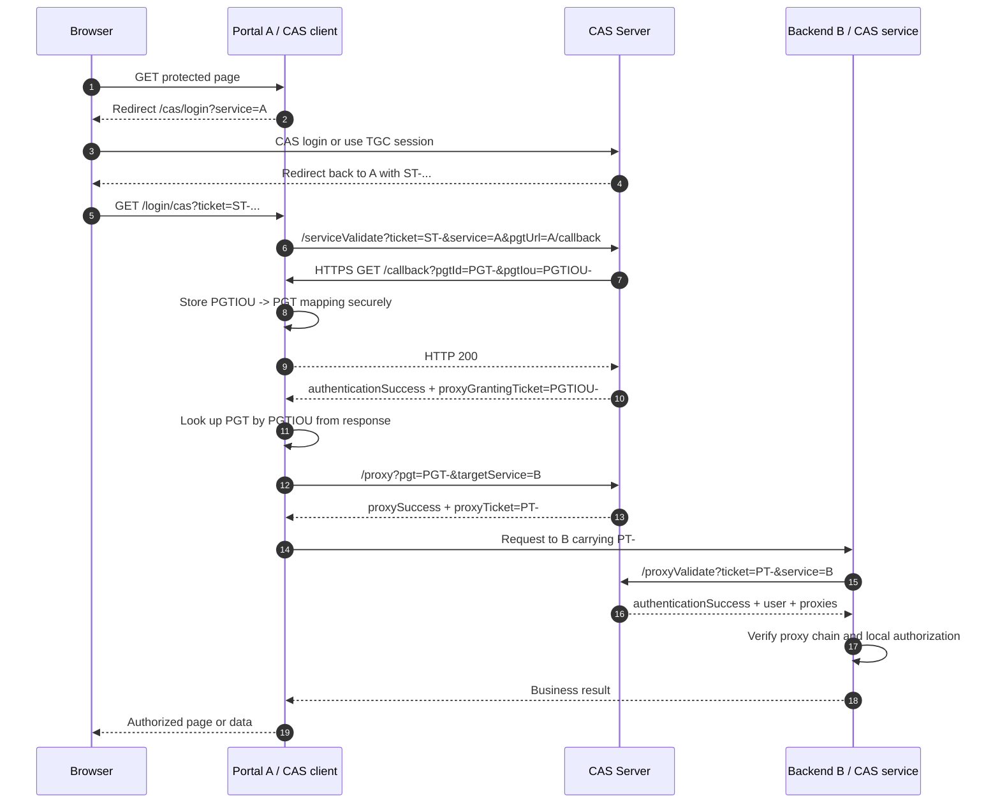

# Proxy Granting Ticket, Proxy Granting Ticket IOU, and Proxy Ticket in CAS

## 1. Problem: Application A Needs to Call Backend B on Behalf of the User

In a **Central Authentication Service (CAS)** system, a browser can log into a web application using a **Service Ticket (ST)**. However, when web application A needs to **call backend B over a server-to-server connection**, the backend cannot see the browser's SSO cookie at CAS. A needs a mechanism to prove to B that it is executing the request in the context of an authenticated CAS user.

**CAS Proxy Authentication** solves this scenario using three core artifacts:

- **Proxy Granting Ticket (PGT):** a secret credential issued by CAS to service A, allowing A to request **Proxy Tickets (PT)** to call permitted backends.
- **Proxy Granting Ticket IOU (PGTIOU):** a correlation handle (*I Owe You*) appearing in the **ticket validation response**; it helps A locate the matching **PGT delivered separately via callback**, and is **not the PGT itself**.
- **Proxy Ticket (PT):** a short-lived credential, normally **validated only once**, issued specifically for a **targetService** so A can call B.

The most important goal is understanding **PGT → PT**, while **PGTIOU merely links the two messages** of the PGT issuance flow. You cannot use PGTIOU to call `/proxy`, must never send the secret PGT to B, and must not confuse a PT with a session cookie or an OAuth access token.

This lesson belongs to the **CAS Proxy** topic of the Spring Security – federation module. It covers the CAS 2.0 protocol, Spring Security CAS client integration, a standalone Java 17 example, secret-protection principles, proxy chains, testing, and troubleshooting scenarios. Hostnames like `example.test` and ticket IDs in this lesson are **mock data**. A real CAS Server and registered services are required for end-to-end execution.

## 2. Comparison Table of Six Ticket and Cookie Types

| Entity | Who Holds or Receives It? | What Is It Used For? | Where Is It Sent? | Characteristics |
| --- | --- | --- | --- | --- |
| **TGT – Ticket Granting Ticket** | Held server-side by CAS | User's SSO session at CAS | Never give raw TGT to apps | CAS session, not equivalent to PGT |
| **TGC – Ticket Granting Cookie** | Held by browser as CAS cookie | Associates browser with TGT at CAS | Browser → CAS domain | SSO cookie, not a PT/PGT |
| **ST – Service Ticket** | Passed by browser to service A | Logs into A once | A validates with CAS `/serviceValidate` | Bound to one `service`; single-use |
| **PGTIOU – Proxy Granting Ticket IOU** | Received by A in validation XML and callback | **Matches real PGT to validation response** | Not used to call backends or request PTs | Opaque correlation handle; cannot derive PGT |
| **PGT – Proxy Granting Ticket** | Received by A via HTTPS callback, kept secret server-side | **Requests one or more PTs** | A → CAS `/proxy` | Reusable credential within lifetime/policy |
| **PT – Proxy Ticket** | Received by A from CAS, sent to backend B | Proves proxy authentication for one target service | A → B, B → CAS `/proxyValidate` | Target-bound, single-use validation at CAS |

Prefixes like `ST-`, `PGTIOU-`, `PGT-`, and `PT-` commonly appear in CAS examples. **A prefix is not proof of ticket validity**; validity must be verified by the CAS server. Never infer or encode business authorization or tenant IDs into ticket strings.

### Common Misconceptions

**Is a PGT a TGT?** No. A TGT is tied to the SSO session at CAS, whereas a PGT is issued to a **proxying service** after ST/PT validation and callback. A PGT grants the service authority to request PTs within CAS policy limits—not a browser cookie.

**Is a PGTIOU a refresh token?** No. It only correlates the two channels carrying the PGT and the validation response. Never use it to refresh sessions or obtain PTs.

**Is a PT an OAuth2 access token?** No. Even though both are presented in a backend request, a PT follows the CAS protocol, is validated at `/proxyValidate`, and is bound to `targetService`. An OAuth access token uses an OAuth2 Resource Server, issuer/scope/audience, or introspection under a different trust contract.

## 3. Overall Flow: Browser → A → CAS → Backend B



This is a **typical transaction**; production code uses SSL/TLS, HTTP clients, CAS libraries, and Spring Security filters. Never implement these steps by letting the browser hold the PGT.

**Two channels appear at PGT issuance time:**

1. **CAS → A callback over HTTPS GET:** carries both `pgtId=PGT-...` and `pgtIou=PGTIOU-...`.
2. **CAS → A validation response:** carries `<cas:proxyGrantingTicket>PGTIOU-...</cas:proxyGrantingTicket>`, and **does not contain the real PGT** in the standard CAS 2.0 callback flow.

The two channels intersect at `PGTIOU`. Without matching both ends, A has no basis to bind the PGT to the ticket validation that just completed.

## 4. Step 1: Browser Uses Service Ticket to Log Into A

A is registered with the CAS server under a `service` identifier, for example:

```text
https://portal.example.test/login/cas
```

When a user requests a protected page, the CAS client redirects the browser to:

```http
GET /cas/login?service=https%3A%2F%2Fportal.example.test%2Flogin%2Fcas
Host: cas.example.test
```

CAS checks login/SSO session and redirects the browser back to A:

```http
HTTP/1.1 302 Found
Location: https://portal.example.test/login/cas?ticket=ST-EXAMPLE-ONCE
```

`ST-EXAMPLE-ONCE` is an illustrative value. An ST is issued for the **requested service URL** and must be validated by CAS. In CAS 2.0, **an ST is valid for a single validation attempt**, and CAS consumes it upon validation. This differs from a PGT—a PGT can be used multiple times to obtain PTs according to policy.

On A, the Spring Security CAS client typically uses `CasAuthenticationFilter` and `CasAuthenticationProvider` to validate the ST. Never create an `Authentication` merely because the URL has a `?ticket=ST-...` query or a plausible-looking prefix.

### Why Must A Request the PGT While Validating the ST?

A cannot obtain a PGT simply by saving the username or a consumed ST. In the standard flow, A **asks CAS to issue a PGT by declaring `pgtUrl` during ST validation**. CAS uses the callback to verify that service A will receive the PGT and returns only the **PGTIOU** in the validation response.

## 5. Step 2: /serviceValidate with pgtUrl

A sends an HTTPS request to CAS:

```http
GET /cas/serviceValidate?service=https%3A%2F%2Fportal.example.test%2Flogin%2Fcas&ticket=ST-EXAMPLE-ONCE&pgtUrl=https%3A%2F%2Fportal.example.test%2Flogin%2Fcas%2Fproxyreceptor
Host: cas.example.test
```

Three parameters to distinguish:

- `service`: the service URL identifier for which the ST was issued, **not backend B's URL**.
- `ticket`: the ST delivered by the browser and presented by A to CAS for validation.
- `pgtUrl`: A's **public HTTPS callback URL**, where A can receive `pgtId` and `pgtIou`.

The `/cas/serviceValidate` path lives on the **CAS server**, not on portal A. `/login/cas/proxyreceptor` is A's callback receiver endpoint, **not a login handler** or CAS's `/proxy` endpoint.

Under the CAS 2.0 protocol, `/serviceValidate` validates only **STs**; validating a **PT** requires `/proxyValidate`. In both cases, if a backend/service also wants a PGT to proxy onward to downstream systems, the `pgtUrl` mechanism can be used at the appropriate validation step.

### HTTPS Callback Is Mandatory

`pgtUrl` must use **HTTPS**, and CAS checks the callback TLS certificate, trust chain, and hostname per the CAS specification/configuration. CAS may also require the callback URL to be permitted in the **service registry** and reachable. Never disable certificate validation or hostname verification just to receive a PGT.

**Protocol note:** per the original CAS Protocol 2.0, a callback failure may result in **no PGT being issued** while ST validation still reports a valid user. Some CAS implementations/policies may fail the entire transaction if the callback fails. Therefore, distinguish **ST login success** from **PGT successfully acquired**, and verify the behavior of your server release.

## 6. Step 3: CAS Callback Delivers Real PGT and PGTIOU

When the validation request includes a valid `pgtUrl`, the CAS server **initiates an HTTP GET** to A's callback, for example:

```http
GET /login/cas/proxyreceptor?pgtId=PGT-SECRET-EXAMPLE&pgtIou=PGTIOU-ABC-EXAMPLE HTTP/1.1
Host: portal.example.test
```

Key points:

- `pgtId` holds the **real PGT**; treat it as a secret credential capable of minting PTs.
- `pgtIou` holds the **IOU code** used to correlate with the validation response.
- CAS uses HTTPS to the callback and checks TLS trust/hostname to protect the PGT during delivery.
- A must **receive and keep the PGT server-side**, never returning `pgtId` to the browser or recording it in application logs or analytics.
- In standard CAS callbacks, an **HTTP 200 OK** response from A signals receipt. CAS may handle HTTP 3xx redirects depending on profile; configure a fixed endpoint with no redirects to reduce ticket leakage risk.

**Caution:** HTTPS to A proves CAS sent the secret to an endpoint with the right TLS identity, but **receiving a GET request at A does not by itself prove the caller is CAS**. Never accept an arbitrary `pgtId`/`pgtIou` sent from the Internet as completed authentication. A must correlate the IOU with a validation response **received over a trusted CAS channel**, and apply inbound callback policies (IP/mTLS/network protection where feasible), TTLs, and abuse protection.

If A's callback runs across multiple replicas, the `PGTIOU → PGT` mapping must be stored long enough and remain accessible wherever the validation response is handled; an in-memory Map on pod A is insufficient if the response is processed by pod B.

## 7. Step 4: CAS Returns PGTIOU in the Validation Response

After CAS accepts the callback, A receives a response from `/serviceValidate`, such as this XML:

```xml
<cas:serviceResponse xmlns:cas="http://www.yale.edu/tp/cas">
  <cas:authenticationSuccess>
    <cas:user>user-123</cas:user>
    <cas:proxyGrantingTicket>PGTIOU-ABC-EXAMPLE</cas:proxyGrantingTicket>
  </cas:authenticationSuccess>
</cas:serviceResponse>
```

This is **illustrative** data and does not contain a real PGT. In standard CAS 2.0:

- `<cas:authenticationSuccess>` indicates CAS successfully validated the ticket and provides the user identity.
- `<cas:proxyGrantingTicket>` contains the **IOU**, not `PGT-...`.
- A uses `PGTIOU-ABC-EXAMPLE` to look up the mapping saved during the callback.
- **Only when the matching PGT is found** does A hold the credential to request PTs.
- If the validation response **lacks PGTIOU**, A may have logged in normally but **has no proxy capability**; investigate the cause.

**Wrong** example:

```text
pgt = xml.authenticationSuccess.proxyGrantingTicket
call /proxy?pgt=pgt
```

Here the `pgt` variable is actually **PGTIOU**, so it is not a valid credential for `/proxy`. Correct approach:

```text
iou = xml.authenticationSuccess.proxyGrantingTicket
pgt = proxyGrantingTicketStorage.retrieveAndVerify(iou)
call /proxy?pgt=pgt&targetService=B
```

This is pseudocode. `retrieveAndVerify` is merely descriptive; the Spring CAS Client has its own storage API handled via the ticket validator and filter.

## 8. Why Does CAS Use Two Channels and an IOU?

If CAS returned the real PGT directly inside the `/serviceValidate` response, any service able to call the validation endpoint and read the response could obtain a credential usable for further proxying. CAS 2.0 uses a **secure callback** to confirm that the **proxying service owns the declared HTTPS endpoint** before handing over the PGT.

PGTIOU connects the two transactions:

```text
Callback channel:              (PGTIOU-X, PGT-X)
                                 |
                                 | correlation key
                                 v
Validation channel:            PGTIOU-X
                                 |
                                 v
A queries storage:             PGT-X
```

PGTIOU is an opaque, high-entropy string generated independently so that **the PGT cannot be deduced** algorithmically in reasonable time. It is not a reversible hash of the PGT, not an account ID, and not a cryptographic proof that self-validates the CAS response.

### Ordering and Concurrency Issues

In the CAS 2.0 flow, CAS sends the callback to A before returning the IOU in the validation response. However, in distributed systems, storage reads/writes, thread scheduling, Redis replication, network proxies, or the timing of A reading the PGT can create races:

- The callback has not finished persisting when the validation response arrives at the application thread.
- The callback is stored on one node while the validation response is handled on another node.
- Two browser logins occur concurrently, and IOUs get cross-wired if code stores a single global PGT variable.
- An old/replayed IOU tries to reference a PGT that was already purged.

Solution: thread-safe (and distributed where needed) storage, exact IOU keying, TTL, one-time consumption/atomic lookup, namespacing by CAS issuer/tenant, and not returning 200 until the callback is durably stored per policy.

## 9. PGT: Longer-Lived Than PT and Authority to Mint Many Proxy Tickets

Once A holds the **real PGT**, it calls CAS `/proxy` to request a PT. A PGT is an opaque capability:

- **Reusable** to request PTs for CAS-permitted target services; it is not a single-use ticket.
- Under the CAS 2.0 specification, a PGT must expire when the associated user's CAS session logs out; verify actual TTL, invalidation, and notification rules against your CAS deployment.
- The PGT must be kept **server-side and protected** like a sensitive credential.
- Never use a PGT as an HTTP session ID, ID Token, API key, or standalone identity proof independent of CAS.
- Never copy a PGT into browser local storage, logs, `RelayState`, or redirect URLs.

**A PGT does not by default permit calling every targetService.** The CAS service registry/proxy authentication policy can restrict which services may obtain a PGT and which target services may be proxied to. Backend B should also validate the **proxy chain** rather than trusting any CAS-verified ticket blindly.

### PGT and Logout

When a user logs out of CAS, the associated PGT must be invalidated per the CAS 2.0 specification. However, application A might still hold a cached copy of the PGT. **Having a PGT string in cache does not prove the credential is still valid**: `/proxy` must verify with CAS, and when CAS rejects it, A should purge its stored copy.

Do not confuse CAS logout with merely clearing A's HTTP session; keeping sessions/PGTs/logout synchronized across multiple apps also depends on Spring Security CAS Single Logout and backend operations.

## 10. Step 5: A Calls /proxy to Request a PT for B

Suppose B is registered with CAS under the service identifier:

```text
https://backend.example.test/api/report
```

A calls CAS `/proxy`:

```http
GET /cas/proxy?pgt=PGT-SECRET-EXAMPLE&targetService=https%3A%2F%2Fbackend.example.test%2Fapi%2Freport HTTP/1.1
Host: cas.example.test
```

This is a **server-to-server protocol call between A and CAS**, not a link for users to click. Both parameters of `/proxy` are required:

- `pgt`: the **secret PGT** A received via callback and correlated by IOU.
- `targetService`: backend B's identifier for which the PT will be issued; it must match the `service` parameter when B validates the PT.

On success, CAS returns:

```xml
<cas:serviceResponse xmlns:cas="http://www.yale.edu/tp/cas">
  <cas:proxySuccess>
    <cas:proxyTicket>PT-BACKEND-ONE-TIME-EXAMPLE</cas:proxyTicket>
  </cas:proxySuccess>
</cas:serviceResponse>
```

An invalid or revoked PGT can result in `<cas:proxyFailure code="BAD_PGT">`. A missing `pgt` or `targetService` can result in `INVALID_REQUEST`. Parse the XML response using a hardened XML parser and handle **proxySuccess/proxyFailure** explicitly—never rely solely on HTTP 200.

### targetService Rules

A PT is issued for **one specific targetService**. If A requested a PT for `https://backend.example.test/api/report`, never try using that PT at `https://payments.example.test/api/pay`. B must validate the PT with the **exact same service identifier**; a mismatch must be rejected by CAS.

Deployments may use non-URL service identifiers, but they must follow a **consistent convention** registered identically across A, B, and CAS. Never construct `targetService` from an arbitrary user-supplied URL, to prevent trust-domain confusion and SSRF.

## 11. Step 6: A Sends the PT to B

A calls backend B, carrying the PT in the manner supported by B's CAS client, typically as the `ticket` query parameter:

```http
GET /api/report?ticket=PT-BACKEND-ONE-TIME-EXAMPLE HTTP/1.1
Host: backend.example.test
```

B does **not** receive the PGT; it receives only the PT. This is a server-to-server request, potentially with no browser session at all. Therefore:

- B uses its CAS client/`CasAuthenticationFilter` or an appropriate ticket interceptor to extract `ticket`.
- B validates the PT with CAS `/proxyValidate`, supplying `service` matching B's exact identifier.
- B reads the user identity and proxy list from the **CAS validation response**.
- B validates the allowed proxy chain and the **user's business permissions** before returning data.

**A PT is a bearer credential at risk of exposure.** Query parameters can show up in access logs, reverse proxies, APM/traces, and URLs. Use HTTPS, scrub tickets from logs, minimize storage/forwarding, shorten TTLs, and never forward PTs in redirects or copy them to the browser. CAS 2.0 passes tickets in query strings for legacy protocol reasons; that is never an excuse to log raw PTs.

**Never forward the PGT to B** or put `pgtId` in B's query string. If B needs to proxy onward to C, B can request **its own PGT** when validating the PT, never reusing A's PGT.

## 12. Step 7: Backend B Validates the PT via /proxyValidate

B calls CAS:

```http
GET /cas/proxyValidate?service=https%3A%2F%2Fbackend.example.test%2Fapi%2Freport&ticket=PT-BACKEND-ONE-TIME-EXAMPLE HTTP/1.1
Host: cas.example.test
```

CAS `/proxyValidate` supports both STs and PTs under the CAS 2.0 specification, whereas `/serviceValidate` supports only STs. When B validates a valid PT, the response looks like:

```xml
<cas:serviceResponse xmlns:cas="http://www.yale.edu/tp/cas">
  <cas:authenticationSuccess>
    <cas:user>user-123</cas:user>
    <cas:proxies>
      <cas:proxy>https://portal.example.test/login/cas/proxyreceptor</cas:proxy>
    </cas:proxies>
  </cas:authenticationSuccess>
</cas:serviceResponse>
```

In this illustrative XML:

- `cas:user` identifies the principal verified by CAS.
- `cas:proxies` lists the **intermediary services** involved in proxy authentication.
- `cas:proxy` typically contains proxying service A's **`pgtUrl`**, **not targetService B**.
- B must compare the chain against B's **proxy allowlist**, rather than trusting every intermediary simply because the CAS server knows them.
- Before executing business logic, B must also check local user/tenant/ACLs.

**Single-use at CAS:** per CAS 2.0, a PT is valid for **a single validation attempt**, consumed whether validation succeeds or fails. A PT cannot be validated multiple times against CAS. If the client needs to make multiple backend calls, A should request a **fresh PT for each call requiring authentication** or use an approved design such as a backend session/cache with its own TTL and revocation policy.

## 13. Proxy Chains and Backend Policy

A PT can traverse multiple proxying services:

```text
Browser → A → B → C

A validates ST, obtains PGT-A, issues PT-for-B.
B validates PT-for-B and requests PGT-B via its pgtUrl.
B issues PT-for-C.
C validates PT-for-C.
```

The CAS 2.0 specification mandates that `<cas:proxies>` places **the proxy closest to the backend first**. For example, C sees:

```xml
<cas:proxies xmlns:cas="http://www.yale.edu/tp/cas">
  <cas:proxy>https://b.example.test/login/cas/proxyreceptor</cas:proxy>
  <cas:proxy>https://a.example.test/login/cas/proxyreceptor</cas:proxy>
</cas:proxies>
```

Here **A was traversed first, then B**; the list displays **B before A**. Do not invert the chain order when writing policy rules.

### Why Must B/C Validate the Chain?

A CAS server may permit multiple registered services to proxy. Yet backend C might allow proxying chains only from A and B, **rejecting** any experimental portal that happens to have proxy permission. Validating the CAS ticket **without inspecting the path** leaves backend access overly dependent on tickets from any authorized proxy.

In Spring Security CAS:

- `CasAuthenticationProvider` provides the `CasProxyDecider` mechanism.
- `RejectProxyTickets` rejects proxied tickets when proxying is not needed.
- `NamedCasProxyDecider` allows configuring a set of accepted proxies.
- `AcceptAnyCasProxy` can be used for testing, but is **not recommended** for sensitive services.

Beyond the proxy chain, always enforce **business authorization**. A CAS-authenticated user does not automatically get to read every record or invoke admin actions on backend B.

## 14. Configuring Spring Security CAS Client to Receive a PGT

Spring Security CAS documentation describes these key components:

| Component | Responsibility |
| --- | --- |
| `CasAuthenticationEntryPoint` | Redirects browser to CAS login with `service` |
| `CasAuthenticationFilter` | Receives ST at login processing URL and PGT callback at proxy receptor |
| `CasAuthenticationProvider` | Validates ST/PT with `TicketValidator` and maps `GrantedAuthority` |
| `Cas20ServiceTicketValidator` | Validates STs; does not cover full proxy validation |
| **`Cas20ProxyTicketValidator`** | Supports `proxyCallbackUrl` configuration and validates CAS Proxy tickets |
| **`ProxyGrantingTicketStorage`** | Stores `PGTIOU → PGT` mappings from callbacks |
| `CasAuthenticationToken` | Spring Security `Authentication` holding the CAS assertion after auth |
| `ServiceProperties` | Defines the CAS client's `service` identifier and validation options |

A **bean XML excerpt** matching examples in the Spring Security CAS documentation might look like:

```xml
<!-- Only the proxy component declarations, not a complete
     Spring Security XML configuration. -->
<bean id="pgtStorage"
      class="org.apereo.cas.client.proxy.ProxyGrantingTicketStorageImpl"/>

<bean id="casProxyTicketValidator"
      class="org.apereo.cas.client.validation.Cas20ProxyTicketValidator">
  <constructor-arg value="https://cas.example.test/cas"/>
  <property name="proxyCallbackUrl"
            value="https://portal.example.test/login/cas/proxyreceptor"/>
  <property name="proxyGrantingTicketStorage" ref="pgtStorage"/>
</bean>

<bean id="casFilter"
      class="org.springframework.security.cas.web.CasAuthenticationFilter">
  <property name="authenticationManager" ref="authenticationManager"/>
  <property name="proxyGrantingTicketStorage" ref="pgtStorage"/>
  <property name="proxyReceptorUrl" value="/login/cas/proxyreceptor"/>
</bean>
```

**You still need to add** `CasAuthenticationProvider` referencing the ticket validator, `ServiceProperties`, entry point, authentication manager, user details service, filter chain, CAS service registry entries, and version-matched dependencies. The XML above **is not a standalone runnable Spring Boot application**.

### Two URLs That Must Stay Synchronized

- `Cas20ProxyTicketValidator.proxyCallbackUrl` = the **full public HTTPS URL** CAS server calls, e.g., `https://portal.example.test/login/cas/proxyreceptor`.
- `CasAuthenticationFilter.proxyReceptorUrl` = the **internal path** where the filter receives callbacks, e.g., `/login/cas/proxyreceptor`.

The proxy receptor path neither replaces the `/login/cas` login processing route nor equals the CAS server's `/cas/proxy`. If a reverse proxy mis-rewrites the public HTTPS URL, CAS callbacks can hit 404 or certificate mismatches.

### Protecting PGT Storage

The in-memory `ProxyGrantingTicketStorageImpl` in examples is **unsuitable for multi-replica production**. Spring Security docs note the need to clean up expired ticket storage. Production requires storage with TTL/cleanup, encryption/key rotation where needed, race protection, minimal log exposure, and shared state across pods.

## 15. Java API: Requesting a Proxy Ticket in Spring Security

After CAS authentication succeeds and the PGT is properly associated with the principal, Spring Security CAS docs illustrate:

```java
CasAuthenticationToken token =
        (CasAuthenticationToken) request.getUserPrincipal();

String targetService =
        "https://backend.example.test/api/report";

String proxyTicket =
        token.getAssertion().getPrincipal()
                .getProxyTicketFor(targetService);
```

This is a **Java snippet inside a CAS-authenticated servlet/service**, requiring imports and `HttpServletRequest`. It will not compile standalone without Spring Security CAS/Apereo CAS Java Client and the proper runtime context.

`getProxyTicketFor(targetService)` uses the capability provided through the CAS assertion/client infrastructure to **request a PT for targetService**. If no PGT exists, the PGT expired, or the callback failed, requesting the PT will fail or yield no usable ticket.

**Mandatory rules when calling:**

1. `targetService` must come from A's **allowlist of B services**; never accept arbitrary URLs from requests.
2. Use HTTPS to CAS and B, with a properly configured truststore.
3. Never log tickets or let tickets leak into redirect URLs sent to the browser.
4. If B requires multiple independent requests, request a fresh PT or use an audited session mechanism; never assume a PT can be re-validated multiple times.
5. Backend B still validates the PT and proxy chain; A cannot self-assert that the user is authenticated at B.

### Backend B Validating the PT

B uses `Cas20ProxyTicketValidator` instead of `Cas20ServiceTicketValidator` when accepting proxy tickets, while setting a policy for allowed proxy chains. Some legacy setups use `acceptAnyProxy=true` for demos; this is **unsafe for sensitive backends**.

B's `ServiceProperties.service` must match the `targetService` used when A requested the PT. For stateless APIs, Spring Security docs also provide `ServiceAuthenticationDetailsSource` to resolve the actual service URL during ticket validation.

## 16. Stateful vs. Stateless CAS Services and Single-Use PT Limits

Browser app A typically has an `HttpSession` and a `CasAuthenticationToken` stored in `SecurityContext`. Backend B may be a **stateless API**, where every HTTP request must authenticate independently.

The CAS protocol requires **each ST/PT to be validated only once at CAS**. However, Spring Security CAS docs describe `StatelessTicketCache`/`SpringCacheBasedTicketCache` to **cache validation results** keyed by PT on the backend, allowing a stateless client to resend the same PT without the backend hitting CAS again.

Distinguish clearly:

- **CAS-level:** the PT is consumed after its first validation and cannot be re-verified at CAS.
- **Application-level cache:** the backend **reuses a cached validation result**, not CAS re-issuing or making “PTs inherently reusable.”
- **Security trade-off:** backend caching widens the acceptance window for a used credential and can outlive CAS logout/revocation. It requires a short TTL, strict binding to service and proxy chain, namespace/cache isolation, invalidation, and replay risk assessment.
- **Easier-to-reason-about safe model:** A requests a fresh PT for each request needing validation, or the backend issues its own policy-governed session rather than caching PTs long-term by default.

Never copy `acceptAnyProxy=true` or a 3600-second cache TTL from old examples into production without risk evaluation. Use `StatelessTicketCache` only when architecture/threat modeling demands it and authorization lifecycles are explicitly defined.

## 17. Standalone Java 17: Correlating PGTIOU with the PGT Callback

The following **standalone Java 17+ program** demonstrates in memory the exact role of PGTIOU: the CAS callback delivers the real PGT alongside the IOU, while the ticket validation response reveals only the IOU; the app **consumes** the entry by IOU to obtain the PGT.

**This is an educational model**, not a CAS client server: it opens no HTTPS endpoint, verifies no tickets, handles no certificates/truststores, and requests no real PTs. The `PGT-...` strings below are test placeholders only.

Save `PgtIouCorrelationDemo.java`:

```java
import java.util.Map;
import java.util.Optional;
import java.util.concurrent.ConcurrentHashMap;

public final class PgtIouCorrelationDemo {

    private final Map<String, String> callbackStore =
            new ConcurrentHashMap<>();

    // Simulates the HTTPS callback made by CAS:
    // CAS sends pgtId (PGT secret) and pgtIou (correlation key).
    void receiveCallback(String pgtIou, String pgtId) {
        if (pgtIou == null || pgtIou.isBlank()
                || pgtId == null || pgtId.isBlank()) {
            throw new IllegalArgumentException("Missing CAS callback data");
        }
        callbackStore.putIfAbsent(pgtIou, pgtId);
    }

    // Simulates the validation response verified by the CAS client.
    // If ticket validation fails, never use the callback PGT.
    Optional<String> consumeAfterValidation(
            String pgtIouFromVerifiedResponse, boolean ticketIsValid) {
        if (pgtIouFromVerifiedResponse == null) {
            return Optional.empty();
        }
        String pgt = callbackStore.remove(pgtIouFromVerifiedResponse);
        return ticketIsValid ? Optional.ofNullable(pgt) : Optional.empty();
    }

    public static void main(String[] args) {
        PgtIouCorrelationDemo demo = new PgtIouCorrelationDemo();

        // Callback arrives before validation response.
        demo.receiveCallback("PGTIOU-A", "PGT-SECRET-A");

        System.out.println("correlated=" +
                demo.consumeAfterValidation("PGTIOU-A", true).isPresent());
        System.out.println("replayedIou=" +
                demo.consumeAfterValidation("PGTIOU-A", true).isPresent());

        demo.receiveCallback("PGTIOU-B", "PGT-SECRET-B");
        System.out.println("wrongIou=" +
                demo.consumeAfterValidation("PGTIOU-C", true).isPresent());
        System.out.println("failedValidation=" +
                demo.consumeAfterValidation("PGTIOU-B", false).isPresent());

        System.out.println("remaining=" + demo.callbackStore.size());
    }
}
```

Run:

```bash
javac PgtIouCorrelationDemo.java
java PgtIouCorrelationDemo
```

**Exact stdout:**

```text
correlated=true
replayedIou=false
wrongIou=false
failedValidation=false
remaining=0
```

Explanation:

- `correlated=true`: the IOU in the verified response matches the callback's IOU; A retrieves the PGT.
- `replayedIou=false`: the entry was already consumed; the same IOU cannot retrieve the PGT again.
- `wrongIou=false`: a mismatched IOU cannot retrieve another PGT.
- `failedValidation=false`: if the ticket is invalid, the callback credential is discarded and unused.
- `remaining=0`: mapping entries were consumed/removed cleanly in the test flow.

**Do not copy this ConcurrentHashMap straight into production.** It lacks TTLs, multi-pod sharing, inbound callback protection, issuer/tenant/session binding, PGT revocation checks, and memory zeroization/encryption. Furthermore, callbacks must originate from an approved CAS flow, which this standalone program cannot verify on its own.

## 18. Why Must PGTIOU Stay Unexposed and Never Act as an Access Ticket?

PGTIOU cannot mint PTs on its own, yet it remains a **sensitive correlation handle**. If an attacker learns an IOU and can send a forged callback with their own `pgtId`, they can try to disrupt correlation or cause denial-of-service. Therefore:

- Do not place PGTIOU in unnecessary URLs, browser local storage, or frontend logs.
- Never use an IOU as a public user ID, API key, or session credential.
- Never expose a public API allowing callers to fetch a PGT for an arbitrary IOU.
- Process valid callbacks first, then bind the IOU to a validation response **verified with trusted CAS**.
- Enforce mapping TTLs and delete upon consumption; monitor duplicate/conflicting IOUs.
- With multiple CAS servers/tenants, namespace mappings by **CAS server identity**, not just the bare IOU string, if multiple trust domains coexist.

PGTIOU is also **not a decodable hash of the PGT**. The CAS specification requires that the PGT cannot be derived from the IOU algorithmically in reasonable time, and both require strong randomness.

## 19. HTTPS Callbacks and Trust Boundaries

### 19.1. CAS Verifies A When Sending the Callback

CAS must call `pgtUrl` over HTTPS and verify the certificate, hostname, chain, and expiration. In environments using a private PKI, the CAS truststore must contain the approved enterprise root/intermediate CAs. Never enable “trust all certificates.”

- `pgtUrl` must belong to the **registered service allowlist** in the CAS deployment.
- The callback must be reachable from CAS on the actual network.
- Reverse proxies must forward `pgtId`/`pgtIou` query parameters accurately to A, while **never logging them**.
- The certificate's public hostname and SAN must match the URL CAS calls; avoid internal pod hostnames unless explicitly designed and registered.
- The callback handler should return 200 only after persisting the data; avoid redirects/404/500.

### 19.2. A Verifies Correlation After the Callback

An HTTP GET to A could arrive from the Internet rather than CAS. Therefore A:

- Must never establish `Authentication` solely from the callback GET.
- Must never accept an IOU supplied by the browser as a credential.
- Uses a PGT only when correlated via an IOU present in a **verified CAS validation response**.
- Restricts callback callers via network policy, mTLS, or infrastructure controls where supported by CAS; this is defense-in-depth alongside the callback protocol.
- Applies size limits, rate limiting, input validation, and storage TTLs to prevent memory exhaustion.
- Never echoes PGT/PGTIOU in response bodies or logs query strings.

Note: TLS **server authentication** from CAS to A lets CAS verify A's identity; it is **not automatically mutual TLS authentication** proving the caller's identity to A. If you want TLS-layer client identification, configure mTLS or a separately protected channel rather than assuming plain HTTPS authenticates both directions.

## 20. CAS Service Registry Policy and Target Services

Proxy authentication extends a special privilege: A can call B with a user's identity. The CAS service registry must evaluate:

1. **Is Service A allowed to log in?** Is A's `service` in registered services?
2. **Is A allowed to request a PGT?** Many CAS deployments require enabling proxy authorization in the registered service policy.
3. **Is callback `pgtUrl` permitted?** Is the HTTPS address approved and matching policy/service registry rules?
4. **Is Backend B allowed to receive PTs?** Is `targetService` a valid service identifier permitted by CAS?
5. **Does B accept A as a proxy?** B checks `cas:proxies` via its proxy decider/allowlist.
6. **Is the user authorized for what B requests?** B must enforce business ACLs/tenant/resource checks rather than treating PGT/PT as “admin.”

**Never build `targetService` by taking a `url` query parameter from the user and passing it directly to `/proxy`**. That turns A into a confused deputy: users can manipulate A into minting PTs for other systems or sending requests to uncontrolled destinations.

A service B configured only for STs using `/serviceValidate` may **not support PTs**. Configure the client to use `/proxyValidate` and a proxy chain policy, and verify actual CAS server endpoints for your version.

## 21. Common Errors and Diagnostics

| Symptom | Likely Cause | Remediation |
| --- | --- | --- |
| User logs into A successfully but cannot call B | A validated ST without receiving PGT | Check `pgtUrl`, callback, and PGTIOU |
| Validation XML lacks `proxyGrantingTicket` | Callback TLS/HTTP failed or A not allowed to proxy | Check redacted CAS logs, registered service, HTTPS callback |
| CAS callback reports invalid certificate | Invalid chain/SAN/CA/expiry | Fix cert/truststore; never trust-all |
| CAS callback returns 404/405 | Proxy receptor path differs from `proxyCallbackUrl` | Align public URL and filter route |
| Callback returns 200 but PGT not found | Storage map/TTL/race/multi-pod issue | Check persistence/cluster/atomic IOU lookup |
| A sends PGTIOU to `/proxy` | Confused IOU with PGT | Look up real PGT via callback mapping |
| `/proxy` returns `BAD_PGT` | Wrong, expired, logged-out, or unissued PGT | Do not retry with IOU; re-login/acquire PGT per policy |
| `/proxy` returns `INVALID_REQUEST` | Missing pgt/targetService | Check parameters and URL encoding |
| B validates PT using `/serviceValidate` | Wrong endpoint | Use `/proxyValidate` |
| PT fails with `INVALID_TICKET` on second use | PT already consumed by CAS | Request fresh PT or use proper session/cache policy |
| PT fails with `INVALID_SERVICE` | `targetService` does not match `service` at validation | Align exact service identifier/encoding |
| B receives valid PT but rejects it | Proxy chain not allowlisted | Check `cas:proxies` and `NamedCasProxyDecider` policy |
| B accepts all proxies | Overly broad `acceptAnyProxy=true` | Configure explicit approved proxy allowlist |
| Multi-replica setup loses PGTs | In-memory storage lives on another pod | Shared storage with TTL/audit |
| User logs out yet A retains PGT | Cache not invalidated | Clear local cache; CAS must reject expired credentials |
| PT appears in access logs | Ticket passed in URL per legacy CAS | Redact query `ticket` and `pgtId`, HTTPS everywhere |
| A wants to call B but B is not CAS-enabled | Backend does not support PTs | Use a mechanism B supports or policy-governed gateway/exchange |
| B resolves right user but wrong tenant | Missing local authorization | Map CAS principal to local identity and ACL |

**Never treat HTTP 200 from `/serviceValidate` or `/proxy` as success on its own.** The CAS protocol returns XML containing `authenticationSuccess`/`authenticationFailure` or `proxySuccess`/`proxyFailure`. Parse the exact element and error code.

## 22. Security Testing Matrix

### A. Happy Path

1. CAS login authenticates the user and issues an ST specifically for A.
2. A sends the ST to `/serviceValidate` along with a valid HTTPS `pgtUrl`.
3. CAS callback delivers PGT + PGTIOU to A; A stores the mapping.
4. Validation response returns `authenticationSuccess` and the same PGTIOU.
5. A correlates the IOU and retrieves the **real PGT**.
6. A calls `/proxy` with targetService B and receives a PT.
7. A sends the PT to B; B calls `/proxyValidate` and inspects the proxy chain.
8. B enforces local ACL/tenant checks and returns data.

### B. Negative Tests

| Test | Expected Outcome |
| --- | --- |
| ST resubmitted after one validation | CAS rejects replay |
| A's `service` does not match ST | `INVALID_SERVICE` and ticket is consumed per spec |
| Callback `pgtUrl` is plain HTTP without TLS | CAS does not issue PGT |
| Callback certificate has wrong hostname/expired | CAS refuses to issue PGT |
| Callback unreachable / HTTP 500 | No PGTIOU/PGT; handled per server release |
| Callback receives PGTIOU-X, validation returns IOU-Y | No PGT retrieved, fail-closed |
| Forged callback with unverified IOU from CAS | Creates no authentication or privileges |
| Attempt to derive PGT from IOU | Infeasible by format or algorithm |
| Use IOU as `/proxy?pgt=...` | CAS rejects PGT |
| PGT from logged-out user session | CAS rejects per lifecycle policy |
| A requests PT for targetService B then calls C | B/C CAS validation fails mismatch |
| Single PT validated twice | Second attempt rejected at CAS |
| B calls `/serviceValidate` with a PT | Invalid endpoint for PT |
| Proxy chain contains unknown service | B rejects even though CAS reports authenticationSuccess |
| A and B share username across different tenants | Local tenant policy still rejects |
| PGT storage lost on restart/pod failover | Never issues PT for wrong user; reports lost capability |
| PGT/PT in HTTP logs | Redaction tests must detect and strip them |
| CAS server ticket endpoint times out | Fail-closed, never synthesize tickets |
| Backend relies solely on Spring web session without validating PT | Never treat self-asserted username as authentication |
| User sends arbitrary `targetService` in query | Cannot request PT outside allowlist |

Tests should run against a **CAS sandbox server with dedicated registered services/certificates**—never use real production STs/PGTs/PTs in captures, issue trackers, or commits. If saving HAR/network logs, redact ticket IDs and cookies.

## 23. Anti-Replay and Lifecycle Management Practices

A CAS proxy design involves three distinct lifecycles:

**ST/PT:** single-use validation at CAS, bound to `service`/`targetService`, short TTL. In CAS 2.0, ticket length and format are opaque; never check for `"PT-"` and grant access. When retrying after a network timeout, the ST/PT may already be consumed, so **acquire a fresh ticket** or build business idempotency rather than assuming a second validation will succeed.

**PGT:** can mint multiple PTs across multiple calls, giving it a larger blast radius than a PT. Store in a server-side secret store/PGT storage with a bounded lifetime tied to the CAS user/session, deleting upon logout or rejection. Never pass PGTs between services outside official CAS mechanisms.

**PGTIOU:** used solely to correlate the callback and validation response, with a very short TTL, consumed/removed immediately to prevent replay. Never use an IOU as a local session key or authorization token. Multi-tenant deployments must namespace by CAS server/registration/trust domain to prevent cross-user mix-ups.

If B caches PT validation results, treat that cache as **B's own authentication mechanism** with independent TTL, scope, revocation, service-bound identity, and auditing; on the app side, it is no longer strictly “single-use PT” even though CAS already consumed the ticket.

## 24. CAS Proxy vs. OAuth2 Token Exchange and SAML Delegation

All three protocol families can satisfy “A calls B on behalf of a user,” but their credentials are not interchangeable:

| Protocol | Initial Credential Held by A | Credential for B | B Validates With |
| --- | --- | --- | --- |
| **CAS Proxy** | PGT after ST/PT validation and HTTPS callback | PT bound to targetService B | CAS `/proxyValidate` |
| **OAuth2 Token Exchange** | Subject token/actor token per AS profile | New access token with `aud`/scope for B | OAuth2 Resource Server/AS issuer/JWKS/introspection |
| **SAML delegation/SSO** | SAML Assertion/Session per SP/IdP protocol | Assertion or profile-specific token | SAML SP validators/IdP trust |
| **Simple session/BFF** | Web session cookie and server-side state | Backend token/session accepted by B | B's own policy |

**A PGT is not an OAuth refresh token**, **a PT is not a JWT access token**, and `PGTIOU` is not SAML `InResponseTo` even though both handle correlation. If backend B only supports OAuth Bearer tokens, deploy an OAuth AS/token exchange or policy-governed gateway—do not put `PT-...` in a `Bearer` header expecting B to understand it.

## 25. Production Deployment Checklist

- [ ] Identified the exact CAS server version and supported `/serviceValidate`, `/proxyValidate`, and `/proxy` endpoints.
- [ ] A and B are registered services with exact service identifiers and HTTPS.
- [ ] A is permitted to request PGTs under the CAS service registry/proxy policy.
- [ ] `pgtUrl` is an allowlisted public HTTPS callback and CAS verifies TLS hostname/certificate.
- [ ] `Cas20ProxyTicketValidator.proxyCallbackUrl` matches A's public callback URL.
- [ ] `CasAuthenticationFilter.proxyReceptorUrl` matches the internal callback route.
- [ ] A uses `ProxyGrantingTicketStorage` with TTL/cleanup, avoiding plain in-memory maps across multiple replicas.
- [ ] `pgtId`/`pgtIou` are shielded from URL/access/proxy/APM logs.
- [ ] A retrieves PGTs **via IOU mapping**, never using an IOU as a PGT.
- [ ] Forged callbacks cannot establish Authentication; A correlates IOUs against verified CAS validation responses.
- [ ] PGTs are stored server-side with bounded TTLs and revoked on logout or CAS rejection.
- [ ] A calls `/proxy` with a real `pgt` and an allowlisted `targetService`.
- [ ] A mints a fresh PT per validation-requiring request or follows an approved cache/session policy.
- [ ] B uses `/proxyValidate` with `service` matching the `targetService` used when requesting the PT.
- [ ] B validates the proxy chain; never sets `acceptAnyProxy=true` on sensitive backends.
- [ ] B maps the CAS user to a local user/tenant and enforces business ACLs/least privilege.
- [ ] `INVALID_TICKET`, `INVALID_SERVICE`, `BAD_PGT`, and network timeouts fail closed.
- [ ] Tests cover ST/PT replay, IOU mismatch, callback TLS failure, logout, cross-tenant, and multi-pod cases.
- [ ] CAS PT/PGT are never confused with OAuth2 access/refresh tokens or SAML Assertions.
- [ ] Logs are redacted and audit records exclude ticket secrets.

## 26. Self-Assessment Questions

**1. Can PGTIOU be used to call CAS `/proxy`?**  
No. `/proxy` requires the real PGT. PGTIOU is only for correlating the callback and validation response.

**2. Over which channel is the real PGT delivered in standard CAS 2.0?**  
CAS makes an HTTPS GET to A's `pgtUrl`, sending `pgtId` along with `pgtIou`.

**3. Why does the `/serviceValidate` response return only PGTIOU?**  
So A can match it with the PGT received over an identity/TLS-verified HTTPS callback, keeping the secret PGT out of the validation response channel.

**4. Can a PGT request multiple PTs?**  
Yes, per CAS 2.0; it is not a single-use ticket and is governed by lifetime and proxy policies.

**5. Can a PT be used for any backend?**  
No. A PT is issued specifically for `targetService`, and B must validate it with that exact `service`.

**6. Can backend B use `/serviceValidate` to validate a PT?**  
No, per CAS 2.0; use `/proxyValidate`.

**7. Can CAS validate the same PT twice?**  
No. A CAS 2.0 PT is valid for a single validation attempt. Backend caching of validation results is a **separate app mechanism** and does not alter CAS rules.

**8. What happens if the callback returns 500 while the ST is valid?**  
Per original CAS 2.0, ST login may succeed **without a PGT**; check the specification/behavior of your current CAS server release.

**9. Why must B inspect `cas:proxies`?**  
To accept only authorized proxying services, in addition to CAS confirming the ticket is valid.

**10. What bug commonly appears when A/B run across multiple replicas?**  
The callback stores the PGT on one node while the validation response is processed on another; shared, thread-safe storage with TTL is needed.

**11. Can `pgtUrl` be plain HTTP?**  
No in CAS 2.0; the callback URL must be HTTPS with certificate/hostname verification.

**12. Do CAS Proxy and OAuth2 Token Exchange use the same tokens?**  
No. CAS uses PGT/PT and `/proxyValidate`; OAuth2 uses access tokens and authorization/resource server policies.

## 27. References

- [Apereo CAS 8.x — CAS Protocol V2 Specification](https://apereo.github.io/cas/8.0.x/protocol/CAS-Protocol-V2-Specification.html): authoritative rules for `/serviceValidate`, `/proxyValidate`, `/proxy`, `pgtUrl`, PGTIOU, and single-use PTs.
- [Apereo CAS — CAS Protocol Specification](https://apereo.github.io/cas/development/protocol/CAS-Protocol-Specification.html): development spec and proxy callback updates; cross-check with your deployed release.
- [Apereo CAS — Proxy Authentication](https://apereo.github.io/cas/development/authentication/Configuring-Proxy-Authentication.html): proxy registration, PGT, callback TLS, and backend use cases.
- [Spring Security — CAS Authentication](https://docs.spring.io/spring-security/reference/servlet/authentication/cas.html): `CasAuthenticationFilter`, `CasAuthenticationProvider`, `Cas20ProxyTicketValidator`, `ProxyGrantingTicketStorage`, `getProxyTicketFor`, `CasProxyDecider`, and stateless ticket cache.
- [Spring Security — CAS Authentication (6.5)](https://docs.spring.io/spring-security/reference/6.5/servlet/authentication/cas.html): reference for Spring Security 6.x projects.
- [CAS Java Client — GitHub](https://github.com/apereo/java-cas-client): Java client/validator/storage and integration examples; check versions/packages against your CAS/Spring BOM.
- [OWASP — Session Management Cheat Sheet](https://cheatsheetseries.owasp.org/cheatsheets/Session_Management_Cheat_Sheet.html): session credentials, cookie protection, timeouts, and logout.
- [OWASP — TLS Cheat Sheet](https://cheatsheetseries.owasp.org/cheatsheets/Transport_Layer_Security_Cheat_Sheet.html): TLS certificate trust, hostname verification, and avoiding trust-all.
- [OWASP API Security — Broken Object Level Authorization](https://owasp.org/API-Security/editions/2023/en/0xa1-broken-object-level-authorization/): backends still require tenant/owner/ACLs after CAS authentication.
