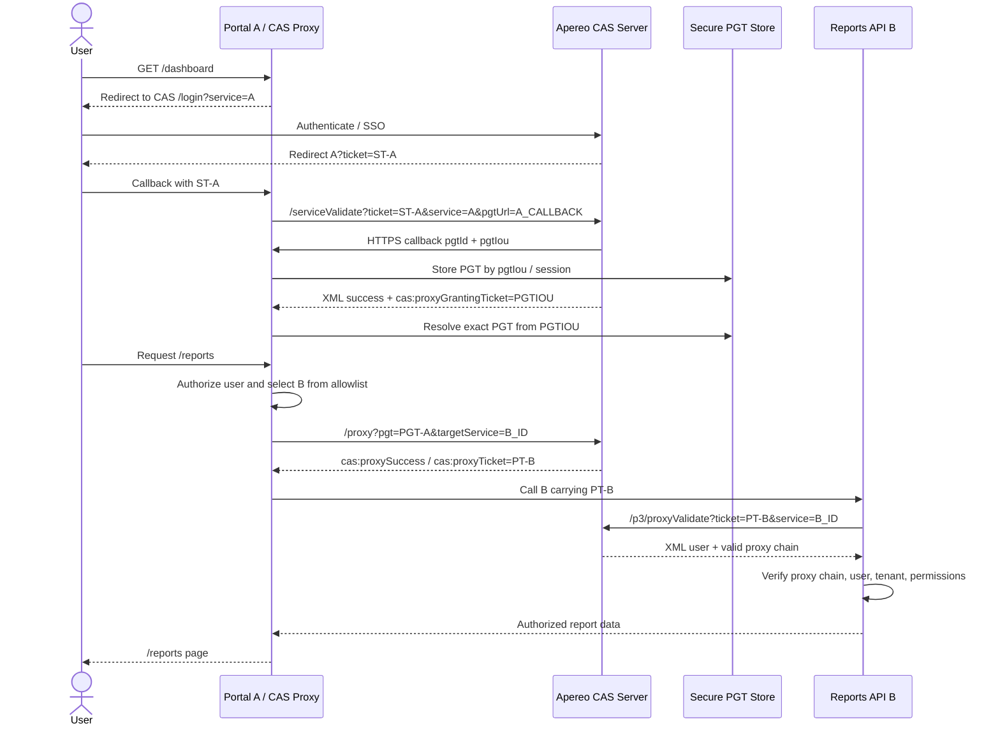

# Obtaining a Proxy Ticket for the Exact Target Service in CAS Proxy

**Module:** Spring Security – federation → CAS Proxy.

**Objective:** understand how a CAS Service A application, after a user logs in, **requests a Proxy Ticket (PT) for the exact target service B** using a Proxy Granting Ticket (PGT); uses the PT for a server-to-server call; ensures service B validates the PT with the exact identifier used when issuing it; and enforces proxy policies, TLS, proxy chains, and ticket lifetimes.

**The most important CAS Protocol rule:** the **`targetService`** parameter when A calls CAS `/proxy` must **match the `service` identifier** that B sends when validating the PT via CAS `/proxyValidate` (CAS 2.0) or `/p3/proxyValidate` (CAS 3.0). **A PT is bound to its target service at issuance**—it is not a generic access token usable against arbitrary URLs/APIs. You also cannot request a PT without a valid PGT, and normal login success must never be treated as proof that a PGT was acquired.

This lesson uses hypothetical `example.com` domains, Java 17+, Apereo CAS, and Spring Security Servlet/Jakarta. The Spring snippets are **integration configuration fragments**, requiring a real CAS Server and registered services. The Java program in the hands-on section simulates only target binding and single-use tickets; it does not replace a CAS client/validator.

## 1. Scenario: Portal A Calls API B on Behalf of the User

Suppose:
- **CAS Server:** `https://sso.example.com/cas`.
- **Application A (portal):** `https://portal.example.com/login/cas` – browser login with CAS.
- **Service B (reports API):** has a registered **CAS service identifier** of `https://reports.example.com/cas-entry`.
- **Business action:** portal A needs to read reports at B on behalf of the logged-in user.
- B does not have the browser's TGC/TGT cookie and must not trust a self-asserted `X-User` header sent by A.

Here A needs **identity delegation via a CAS PT**: CAS issues a short-lived, service-scoped ticket for B to validate. Steps:

1. The user is authenticated by CAS and A receives a **Service Ticket (ST)** for A.
2. A validates the ST with CAS and, **if permitted to proxy**, asks CAS to issue a **PGT**.
3. CAS verifies A's HTTPS `pgtUrl` callback, delivers `pgtId`/`pgtIou`, and A stores the PGT securely.
4. A determines a **valid target service B** based on a server-side allowlist/business policy.
5. A calls CAS `/proxy?pgt=...&targetService=...` to **request a PT for B**.
6. A sends the PT to B via the configured integration protocol/route; **never send the PGT** to B.
7. B calls CAS `/proxyValidate?ticket=PT-...&service=B_ID` to verify the PT and proxy chain.
8. B executes its own authorization for the resource/tenant; the result is returned to A.

### Overall Diagram



In the diagram, the ordering of the **PGT callback** and XML response corresponds to a single ST validation; A must correlate `pgtIou` accurately even when the callback and response are handled on different threads/nodes. Never rely on arrival order to attach user A's PGT to user B.

**Not every CAS service has permission to receive a PGT.** Apereo CAS enforces service-level proxy policies; the server endpoint may be present, yet **proxying is denied by default for unapproved services**. Both A as a proxying service and B as an authorized target must be approved.

## 2. Five Commonly Confused Terms

| Artifact | Where Does It Originate? | What Is It Used For? | Can It Be Sent to B? |
| --- | --- | --- | --- |
| **TGT/TGC** | CAS and browser | User's CAS SSO session | **No** |
| **ST** | Issued by CAS to A via browser | A validates user login with CAS | **Never reuse for B** |
| **PGT** | Issued by CAS to A after ST/PT validation and callback | A requests multiple PTs for permitted backends | **No**; must stay secret on A |
| **PGTIOU** | Sent by CAS in XML response and callback | Links the **right PGT** to the right validation round | **No**; never replaces PGT |
| **PT** | Issued by CAS `/proxy` for `pgt+targetService` | A calls B and B validates with CAS | **Yes**, solely for B, short-lived, single-use |

**Distinguishing PT and PGT lifecycles:** per the CAS 2.0 specification, a **PGT can request multiple PTs**, whereas a **PT is valid for only one ticket validation attempt** (even a failed validation usually consumes the ticket). Never cache the same PT to call B twenty times; if your design requires multiple delegated calls, use the PGT safely to **request a fresh PT** per validation-requiring flow.

**A PT is neither an OAuth2 access token nor an OIDC ID Token.** It contains no JWT `aud`/`scope` claims for an app to verify via JWKS; B validates the PT at the CAS Proxy Validation endpoint under the CAS contract. If API B supports only OAuth2, implement a proper token exchange/authorization flow or an approved gateway—never rename `PT-...` into a Bearer JWT.

## 3. Three URLs / Service Identifiers with Three Distinct Roles

A common mistake is reusing one URL across all variables simply because they all contain the word “service.”

| Concept | Example | Which Operation Uses It? |
| --- | --- | --- |
| **A service URL** | `https://portal.example.com/login/cas` | A receives the ST and validates it with `service=A_ID` |
| **PGT callback URL (pgtUrl)** | `https://portal.example.com/login/cas/proxyreceptor` | CAS calls A to deliver `pgtId`/`pgtIou` when A requests proxying |
| **B target service ID** | `https://reports.example.com/cas-entry` | A requests a PT with `targetService=B_ID` and B validates the PT with `service=B_ID` |

**Never confuse `pgtUrl` with `targetService`.** `pgtUrl` proves **A's endpoint receiving the PGT**, whereas `targetService` identifies **B, which the PT is permitted to access**. Never set the target service to the CAS Server's `/proxy`, and never use A's callback in place of service B.

### 3.1. Target Service Does Not Have to Match Every API URL

Under the CAS 2.0 specification, `targetService` is a **service identifier**, and not every backend is a website; thus it is **not required** to be an HTTP URL. However, when backend B implements URL-based CAS ticket validation, it **must send the exact agreed identifier** in `service`. For example:

```text
A (correct):
  CAS /proxy?targetService=https://reports.example.com/cas-entry
B (correct):
  CAS /p3/proxyValidate?service=https://reports.example.com/cas-entry

Actual business call to B:
  GET https://reports.example.com/api/reports/42
```

Here `/api/reports/42` is the resource path, while `https://reports.example.com/cas-entry` is **B's contracted authentication service identifier**. B can validate the PT using that fixed identifier when receiving calls at resource endpoints, **if B's CAS client/filter supports and resolves the service that way**. Do not assume every framework uses a fixed ID automatically: some CAS filters derive the service URL directly from the incoming request, in which case `targetService` must match the actual URL B uses when validating.

**General rule:** first lock down a **contract** between A, B, and the CAS Server: canonical `targetService` ID, validation protocol, and endpoint mapping. Then use **that exact same string** on both ticket-issuing and ticket-validating sides.

### 3.2. Failures Caused by Viewing a URL Two Different Ways

```text
A requests PT: https://reports.example.com/cas-entry
B validates:   http://reports:8080/cas-entry
Result:        INVALID_SERVICE (common error)
```

Differences in scheme, host, port, trailing slash, context path, or query can make CAS treat them as two different services. Behind a reverse proxy, B must use the public canonical identifier or a tested custom service resolver. Never “fix” this by adding a wildcard `https?://.*` to the service registry.

### 3.3. Confusing Encoding with Mutating the Value

When placing `targetService` in an HTTP query string, **URL-encode it exactly once**. Example raw value:

```text
https://reports.example.com/cas-entry
```

Query parameter value:

```text
targetService=https%3A%2F%2Freports.example.com%2Fcas-entry
```

When the CAS Server URL-decodes the parameter, the string must return to the exact canonical ID. Common errors:
- Double-encoding: CAS receives literal `https%3A...` instead of `https://...`.
- Altering path casing or adding/removing a trailing slash.
- Appending `?ticket=PT` or business query params to **`targetService`** when B does not include them during validation.
- Applying inconsistent Unicode normalization or space rewriting between A and B.
- Concatenating raw `&`/`?` inside `targetService` without encoding, splitting query parameters improperly.

In Java, use `URLEncoder.encode(targetService, StandardCharsets.UTF_8)` when **encoding the query parameter value**—never use it to encode the entire endpoint URL or alter the canonical ID content.

## 4. Prerequisite: A Must Hold a Valid PGT

A **cannot request a PT** using only an ST or a session cookie. To receive a PGT, A must be permitted to proxy by CAS when validating an ST/PT.

### 4.1. A Sends `pgtUrl` When Validating the ST

Example request (query parameters wrapped here for readability):

```text
GET https://sso.example.com/cas/serviceValidate
    ?service=https%3A%2F%2Fportal.example.com%2Flogin%2Fcas
    &ticket=ST-example-one-time
    &pgtUrl=https%3A%2F%2Fportal.example.com%2Flogin%2Fcas%2Fproxyreceptor
```

Notes:
- `service` in this request is **A**, because A is validating the ST for login.
- `pgtUrl` is also **A's** endpoint.
- **There is no `targetService=B` in this ST validation request yet.** It appears only later, once A holds a PGT and requests a PT for B.

CAS checks the HTTPS callback's certificate and hostname per CAS proxy trust rules; the callback must be reachable from the CAS Server (not just from the browser). CAS sends:

```http
GET /login/cas/proxyreceptor?pgtId=PGT-example-secret&pgtIou=PGTIOU-example-map HTTP/1.1
Host: portal.example.com
```

These are **mock strings** and must not be sent as real requests. `pgtId` is a secret credential; in reality it has high entropy and must never enter logs or the browser.

A stores **PGT keyed by PGTIOU** with TTL/revocation, bound to the corresponding validation/user/session. CAS may then return:

```xml
<cas:serviceResponse xmlns:cas="http://www.yale.edu/tp/cas">
  <cas:authenticationSuccess>
    <cas:user>alice</cas:user>
    <cas:proxyGrantingTicket>PGTIOU-example-map</cas:proxyGrantingTicket>
  </cas:authenticationSuccess>
</cas:serviceResponse>
```

A uses the PGTIOU in the response to look up the **real PGT** received via callback. **Never send PGTIOU as `pgt` in a `/proxy` request.** Never match callbacks by user ID if a user can have multiple sessions or parallel flows.

### 4.2. When the Callback Fails

If `pgtUrl` has bad DNS, an expired certificate, a hostname mismatch, failed mTLS/trust policy, or returns an HTTP error, CAS may **withhold the PGT**. Under the CAS 2.0 specification, ST validation/login may still succeed while **omitting `cas:proxyGrantingTicket`**; subsequent PT requests will fail.

Check each milestone separately:
- `ST validation PASS`: user logged into A.
- `PGT acquisition PASS`: A holds a PGT and is allowed to request PTs.
- `PT acquisition PASS`: CAS issued a PT for **a specific B**.
- `PT validation PASS`: B validated the PT with the exact ID and proxy chain.
- `Business authorization PASS`: B permits the user and proxy to execute the resource action.

None of these milestones implies the others automatically.

### 4.3. Proxy Policy on the CAS Server

Apereo CAS documentation emphasizes that service-level proxy policy is **deny-by-default**, and administrators must explicitly grant service A permission to receive PGTs. Never flip a client flag and assume the server will always issue PGTs.

A policy should grant A proxy rights only if:
- A is a trusted application with a business need.
- The PGT callback URL is verified and unique to A.
- The CAS Server/registry permits the corresponding behavior for the exact release/version.
- The list of target backends is controlled.
- B also validates the proxy chain rather than accepting any proxy.

Apereo provides permit/regex policies on registered services depending on CAS version. **Do not copy `.*` patterns to allow all callbacks/`targetService`s**; inspect your exact schema/version and choose the narrowest allowlist. Allowing A to proxy does not mean B accepts every proxy chain.

## 5. Requesting a PT for B via CAS `/proxy`

This is the **core step of the task** once A holds a PGT.

### 5.1. Two Required Parameters

The CAS 2.0 specification defines the `/proxy` endpoint with **case-sensitive** parameters:

| Parameter | Role | Where Does It Come From? |
| --- | --- | --- |
| `pgt` | The **real PGT**, used by A to request a proxy ticket | A's secure PGT store, mapped from the PGTIOU of an ST/PT validation |
| `targetService` | **Identifier of B**, where the PT will be valid | Server-side service catalog / allowlist, never directly from a client URL |

Illustrative call **using placeholders only**:

```text
GET https://sso.example.com/cas/proxy
    ?pgt=PGT-example-secret
    &targetService=https%3A%2F%2Freports.example.com%2Fcas-entry
```

The CAS protocol uses `GET` with query parameters, meaning the PGT travels in the request URL on the server-to-server hop. Therefore enforce HTTPS, prevent reverse proxies/access logs from recording sensitive queries, never capture the URL into support tickets, and never follow redirects to external hosts. Never print a real PGT when debugging with `curl -v` or HTTP tracing.

### 5.2. Response When CAS Issues a PT Successfully

```xml
<cas:serviceResponse xmlns:cas="http://www.yale.edu/tp/cas">
  <cas:proxySuccess>
    <cas:proxyTicket>PT-example-one-time-for-reports</cas:proxyTicket>
  </cas:proxySuccess>
</cas:serviceResponse>
```

A must:
1. Verify the HTTPS CAS response/HTTP status and parse XML with a namespace-aware hardened parser.
2. Accept only a valid `cas:proxySuccess/cas:proxyTicket`, never treating HTTP 200 alone as success.
3. Bind the received PT to the internal call for **the exact `targetService` B**, never issuing one for an arbitrary target from untrusted input.
4. Respect PT lifetime/one-time semantics; if B validates once and the client retries, **request a fresh PT** from the PGT if still valid.
5. Never store PTs in browser cookies, `localStorage`, analytics, user-facing URLs, public caches, or exception messages.

### 5.3. `/proxy` Error Response

```xml
<cas:serviceResponse xmlns:cas="http://www.yale.edu/tp/cas">
  <cas:proxyFailure code="BAD_PGT">
    Provided proxy-granting ticket was not valid
  </cas:proxyFailure>
</cas:serviceResponse>
```

The CAS spec defines minimum codes such as `INVALID_REQUEST`, `BAD_PGT`, and `INTERNAL_ERROR`; CAS Server versions may add codes for service authorization. Never write `catch (Exception) { return PT; }` or reuse a prior PT when CAS rejects the request. Return a safe error and investigate the PGT/target/service policy cause.

### 5.4. How Does B Validate the PT?

Suppose B has a registered service identifier:

```text
B_ID = https://reports.example.com/cas-entry
```

B calls the CAS3 endpoint:

```text
GET https://sso.example.com/cas/p3/proxyValidate
    ?service=https%3A%2F%2Freports.example.com%2Fcas-entry
    &ticket=PT-example-one-time-for-reports
```

Or CAS2:

```text
GET https://sso.example.com/cas/proxyValidate
    ?service=https%3A%2F%2Freports.example.com%2Fcas-entry
    &ticket=PT-example-one-time-for-reports
```

**Never** use `/serviceValidate` for a PT; CAS 2.0 `/serviceValidate` is designed for STs and **does not accept PTs as STs**. CAS3 `/p3/proxyValidate` is appropriate if CAS3 attributes are needed; CAS1 `/validate` does not support proxy authentication.

The response may contain:

```xml
<cas:serviceResponse xmlns:cas="http://www.yale.edu/tp/cas">
  <cas:authenticationSuccess>
    <cas:user>alice</cas:user>
    <cas:attributes>
      <cas:department>finance</cas:department>
    </cas:attributes>
    <cas:proxies>
      <cas:proxy>https://portal.example.com/login/cas/proxyreceptor</cas:proxy>
    </cas:proxies>
  </cas:authenticationSuccess>
</cas:serviceResponse>
```

This XML is a **trimmed sample**; actual attributes and proxy chains depend on the CAS Server and release policy. B must verify **CAS issuer/trust via a validation response from the exact server** and enforce a proxy chain policy: accepting only A or approved proxies rather than looking solely at `cas:user`.

## 6. Which `targetService` Is “Right” When B Exposes Many Endpoints?

A backend service may expose many URLs while B's CAS application registration uses a single canonical ID or multiple distinct service IDs. For example:

```text
Report API:
  GET /api/reports/42
  GET /api/reports/43
  GET /api/export/42

CAS target service:
  https://reports.example.com/cas-entry
```

If B always validates PTs with `https://reports.example.com/cas-entry` per contract, A requests PTs for **that identifier** without changing it per report ID. If B validates against each concrete resource URL, A must request a PT for **that exact URL** (and the CAS service registry must permit it), though having more distinct targets increases surface area and risk of misconfiguration or over-permissioning.

### 6.1. Before/After Table for Common Mix-Ups

| A Sends in `targetService` | B Sends in `service` on Validation | Expected Result |
| --- | --- | --- |
| `https://reports.example.com/cas-entry` | Exact match | **Right target**, proceed to PT/chain/policy checks |
| `https://reports.example.com/cas-entry` | `http://reports:8080/cas-entry` | Public/internal scheme+host mismatch → **FAIL** |
| `https://reports.example.com/cas-entry` | `https://reports.example.com/cas-entry/` | Extra trailing slash → likely **FAIL** |
| `https://reports.example.com/cas-entry` | `https://billing.example.com/cas-entry` | Different service B → **FAIL** |
| `https://reports.example.com/api/reports/42` | `https://reports.example.com/cas-entry` | Identifier mismatch → **FAIL** |
| Non-URL canonical `B_ID` | B uses same canonical `B_ID` and backend supports it | Valid **per contract** |
| Browser-supplied target URL | B validates with that exact URL | Still **unsafe** because A failed to restrict proxy destinations |

Never “normalize” ad-hoc at validation time by stripping query strings or lowercasing paths. Canonicalize once **in both sides' configuration** per policy and test the exact string rather than accepting “close enough.”

### 6.2. Why Never Let Users Pass a Target URL?

Example API on A:

```text
GET /proxy-report?url=https://some-host.example/path
```

If A plugs raw `url` into `targetService` and calls `/proxy`, a user can attempt to:
- Specify a service outside the intended business flow.
- Abuse A's proxy privileges to obtain a PT for another backend.
- Trigger **SSRF** if A subsequently calls the unapproved URL.
- Send the PT to an attacker's hostname, exposing the ticket in access logs or to the recipient.
- Confuse a valid target ID with an attacker-controlled redirect endpoint.

**Right design:** the user selects **an action or resource ID** (e.g., `reportId=42`), and A maps that action to an administrator-approved **server-side `TargetService` enum/registry**. A must still verify user/tenant/resource rights, not merely the target allowlist.

## 7. Java / Spring Security: Calling the Client Library to Request a PT

### 7.1. Relevant Libraries and APIs

Per Spring Security CAS and Apereo Java CAS Client documentation, after CAS authentication succeeds and the PGT is processed, a `CasAuthenticationToken` holds the CAS assertion/principal. The principal exposes:

```java
String proxyTicket =
    casToken.getAssertion()
            .getPrincipal()
            .getProxyTicketFor(targetService);
```

`AttributePrincipal.getProxyTicketFor(String service)` asks the CAS `ProxyRetriever` to request a PT for the **supplied service**. In the client implementation, `ProxyRetriever.getProxyTicketIdFor(pgt, targetService)` performs this step. Depending on configuration and the CAS Server, the method may return null or throw/fail when the PGT is missing or target is disallowed; **you must handle this fail-closed**.

**Compatibility note:** Spring Security CAS docs contain historical snippets (Spring Security 3.x). Verify `CasAuthenticationToken`, filter/provider classes, packages, and generic types against your exact Javadoc/versions (Spring Security 6/7, Apereo CAS Client 4.x). The snippet above is a usage fragment, **not a standalone runnable Spring controller**.

### 7.2. Service Class Snippet Focused on a Fixed Target

`ReportsProxyTicketService.java`, inside a CAS-authenticated Spring application:

```java
package com.example.portal;

import org.springframework.security.cas.authentication.CasAuthenticationToken;

public final class ReportsProxyTicketService {
    public static final String REPORTS_CAS_SERVICE =
            "https://reports.example.com/cas-entry";

    public String issueForReports(CasAuthenticationToken casToken) {
        if (casToken == null || !casToken.isAuthenticated()) {
            throw new IllegalStateException(
                    "A validated CAS session is required");
        }

        String pt = casToken.getAssertion()
                .getPrincipal()
                .getProxyTicketFor(REPORTS_CAS_SERVICE);

        if (pt == null || pt.isBlank()) {
            throw new IllegalStateException(
                    "CAS did not grant a proxy ticket");
        }
        // Never log or place the PT in a browser HTTP response.
        return pt;
    }
}
```

**Example limitations:** this service merely accepts a fixed **canonical B target ID** and asks CAS for a PT. It does **not** yet handle business authorization, user/tenant membership, PGT expiry/revocation, the HTTP call to B, correlation tracing, error mapping, or circuit breaking. Invoke it only from a service/controller that **already** verified the user is allowed to view reports. Never inject `targetService` from a query/body.

### 7.3. PGT Acquisition Must Be Configured First

Receiving a PGT in the Spring CAS model typically requires:
- `CasAuthenticationEntryPoint` and `ServiceProperties` for A's CAS login.
- `CasAuthenticationFilter` handling the ST callback.
- `CasAuthenticationProvider` using a proxy-capable CAS `TicketValidator` (e.g., `Cas20ProxyTicketValidator` or `Cas30ProxyTicketValidator` per protocol).
- `ProxyGrantingTicketStorage` storing PGT/PGTIOU mappings.
- Validator's `proxyCallbackUrl` matching the public HTTPS URL CAS calls.
- Filter's `proxyReceptorUrl` matching the callback receiver path.
- `ProxyRetriever` inside the assertion wired with enough context to request PTs.
- CAS service registry proxy policy permitting A.

Example **bean declaration fragment** for a CAS2 proxy client (not a full runnable app/config):

```java
import org.apereo.cas.client.proxy.ProxyGrantingTicketStorage;
import org.apereo.cas.client.proxy.ProxyGrantingTicketStorageImpl;
import org.apereo.cas.client.validation.Cas20ProxyTicketValidator;
import org.springframework.context.annotation.Bean;
import org.springframework.context.annotation.Configuration;

@Configuration
public class CasProxyBeans {
    @Bean
    ProxyGrantingTicketStorage pgtStorage() {
        // Demo: in-memory. Production requires shared secure storage.
        return new ProxyGrantingTicketStorageImpl();
    }

    @Bean
    Cas20ProxyTicketValidator ticketValidator(
            ProxyGrantingTicketStorage pgtStorage) {
        Cas20ProxyTicketValidator validator =
                new Cas20ProxyTicketValidator("https://sso.example.com/cas");
        validator.setProxyCallbackUrl(
                "https://portal.example.com/login/cas/proxyreceptor");
        validator.setProxyGrantingTicketStorage(pgtStorage);
        return validator;
    }
}
```

You must wire the exact same `pgtStorage` into `CasAuthenticationFilter` via its API, configure `proxyReceptorUrl`, and complete the CAS authentication flow. In a cluster, **in-memory storage is insufficient**, since the CAS callback and ST validation response may land on different pods; use a shared backing store with TTL, access controls, and exact correlation. Never put the PGT store in the browser.

### 7.4. Indicative Spring Boot Dependencies

If the application uses Spring Security CAS integration, you can start from modules (with the appropriate Spring Boot BOM) such as:

```xml
<dependencies>
  <dependency>
    <groupId>org.springframework.boot</groupId>
    <artifactId>spring-boot-starter-webmvc</artifactId>
  </dependency>
  <dependency>
    <groupId>org.springframework.boot</groupId>
    <artifactId>spring-boot-starter-security</artifactId>
  </dependency>
  <dependency>
    <groupId>org.springframework.security</groupId>
    <artifactId>spring-security-cas</artifactId>
  </dependency>
  <dependency>
    <groupId>org.apereo.cas.client</groupId>
    <artifactId>cas-client-core</artifactId>
    <version>4.1.1</version>
  </dependency>
</dependencies>
```

**This is a dependency fragment, not a full POM.** Java CAS Client 4.x targets the Jakarta Servlet namespace, whereas older 3.x clients used `javax.servlet`. On Boot 3/4 / Security 6/7 using Jakarta, verify classpath compatibility, exclude legacy JARs, and align `spring-security-cas` with the Spring Security BOM. Use a patched client version approved by your organization; the version above is merely an example from the published Apereo Client 4.x line. Run `mvn dependency:tree`, compile, test, and run CAS sandbox integration tests before production.

**Never run both the Apereo CAS validation Servlet filter and Spring's `CasAuthenticationFilter` on the same ST** without an explicit integration architecture: two validators can consume the ticket twice and trigger `INVALID_TICKET`.

## 8. B Uses a CAS Proxy Ticket Validator

B is a backend CAS service authorized to accept PTs. B must validate the PT with the **CAS Server**, never trusting a `PT-...` string on its own.

### 8.1. Choosing the Right Endpoint by Protocol

| CAS Protocol | Backend B Should Call | Why |
| --- | --- | --- |
| CAS 1.0 | `/validate` does not support PTs | **Unsuitable** for CAS Proxy |
| CAS 2.0 | `/proxyValidate` | Accepts ST/PT per spec |
| CAS 3.0 | `/p3/proxyValidate` | Accepts ST/PT plus CAS3 attributes per policy |
| CAS 2.0 `/serviceValidate` | Do not use for PT validation | Designed for STs; typically rejects PTs |
| CAS 3.0 `/p3/serviceValidate` | Intended for service validation | Use the proxy endpoint when accepting PTs |

B can configure `Cas20ProxyTicketValidator` or `Cas30ProxyTicketValidator` from Apereo Java CAS Client; the validator must enforce an appropriate proxy policy and use the **canonical service identifier** matching A's `targetService`.

### 8.2. The Proxy Chain Is Security Data

A successful CAS PT validation response can include `cas:proxies`. Across A1 → A2 → B, the CAS spec places **the proxy closest to B first**, followed by earlier proxies traversed.

```xml
<cas:proxies>
  <cas:proxy>https://proxy2.example.com/pgtCallback</cas:proxy>
  <cas:proxy>https://proxy1.example.com/pgtCallback</cas:proxy>
</cas:proxies>
```

B must enforce an allowlist/policy over callback identifiers/proxy chains; never set `acceptAnyProxy=true` just to silence production errors. A valid PT may have traversed **an untrusted intermediary proxy**, which B has every right to reject.

**Chain ordering matters**: do not flatten into an unordered Set if policy distinguishes A1 vs. A2. If the app forbids multi-hop proxying, require exactly one approved proxy.

### 8.3. Authorization on B Remains Mandatory

CAS validation proves a CAS-authenticated identity and delegation path—it **does not grant business permissions**. B must still verify:
- The user maps to the right internal user ID/tenant and the account is active.
- A or the proxy chain is permitted to invoke this resource.
- The user is authorized to read report ID 42 within their tenant.
- HTTP method/endpoint and business parameters satisfy policy.
- Data access uses server-side resource IDs, not just `username`.
- If MFA/step-up is required, authentication context/assurance policy is verified via the CAS contract; a PT alone is not MFA.

Service B must never turn a validated PT into an immortal token. If B establishes a session or cached `Authentication` for remote callers, give it an explicit TTL, revocation, and threat model: **never turn a cache into a bypass of single-use ticket or service-scope rules**.

## 9. When A Needs to Call Multiple Backends

Suppose A calls:
- Reports B: `https://reports.example.com/cas-entry`.
- Payroll C: `https://payroll.example.com/cas-entry`.

A may hold a valid PGT after user login, yet it must request **two separate PTs**:

```text
A → CAS /proxy?pgt=PGT_A&targetService=REPORTS_B
CAS → A : PT_B
A → B  : PT_B
B → CAS /p3/proxyValidate?ticket=PT_B&service=REPORTS_B

A → CAS /proxy?pgt=PGT_A&targetService=PAYROLL_C
CAS → A : PT_C
A → C  : PT_C
C → CAS /p3/proxyValidate?ticket=PT_C&service=PAYROLL_C
```

**Never send `PT_B` to C** just because it shares the same user, PGT, or CAS Server. CAS must reject the mismatch. If C requires additional privileges or assurance, A must verify the user is allowed to call C, and C still enforces its own policy.

### 9.1. Data Model Catalog on A

```java
enum BackendTarget {
    REPORTS("https://reports.example.com/cas-entry"),
    PAYROLL("https://payroll.example.com/cas-entry");

    private final String casServiceId;

    BackendTarget(String casServiceId) {
        this.casServiceId = casServiceId;
    }

    String casServiceId() {
        return casServiceId;
    }
}
```

This is a **Java class fragment** storing canonical IDs. Never allow users to pass an arbitrary `BackendTarget` and skip authorization. A must map user action → business policy → allowed backend → fixed `targetService`.

### 9.2. Single-Use PTs and Retries

A PT is valid for **one validation attempt** per the CAS 2.0 spec; if B sends it to CAS and CAS rejects it for a wrong service ID, the PT may already be consumed—**you cannot fix the service parameter and revalidate the old PT**.

Correct approach:
1. Detect the error and never reuse the PT.
2. Diagnose the canonical `targetService` B and CAS registered service.
3. If the PGT is still safe/valid and policy permits, request a **fresh PT** for the right target.
4. Retry the business HTTP call only when the request is **idempotent** or uses an idempotency key; never execute a payment or approval twice simply because the previous call timed out.

Never retry indefinitely in a loop that floods CAS with PT requests. Enforce rate limits plus circuit breakers/telemetry.

### 9.3. PGTs Expire Differently from PTs

PGTs and PTs have distinct lifecycles:
- A PGT can remain valid long enough for A to request multiple PTs per CAS policy.
- A PT is short-lived, service-bound, and single-use upon validation.
- The CAS Server can revoke/expire a PGT on user logout, parent PGT expiration, proxy policy changes, or ticket registry cleanup; exact behavior depends on CAS release/configuration.
- If a PGT expires, A needs a **fresh CAS authentication/PGT acquisition flow**; it cannot mint PTs from stale cache values.

Never store PGTs in `HttpSession` under predictable keys subject to unencrypted session replication or plain serialization. Shared PGT storage requires ACLs, encryption, TTLs, invalidation, and auditing, with clear binding between the PGT and the authenticated user/session.

## 10. Standalone Java 17: Simulating Issuing a PT for Exact Service B

The complete example below uses only JDK 17, makes **no CAS Server connection**, performs no network calls, and handles no real credentials. It demonstrates three foundational properties:
- Accepting only targets from a server-side allowlist.
- Scoping the PT to **one target service ID**.
- Enforcing **single-use validation**; even validating against the wrong target consumes the ticket so it cannot be reused.

File `CasProxyTargetDemo.java`:

```java
import java.util.HashMap;
import java.util.Map;
import java.util.Set;

public class CasProxyTargetDemo {
    static final String REPORTS =
            "https://reports.example.com/cas-entry";
    static final String PAYROLL =
            "https://payroll.example.com/cas-entry";

    record Ticket(String targetService) {}

    static final class MiniCas {
        private final Map<String, Ticket> issued = new HashMap<>();
        private final Set<String> allowedTargets =
                Set.of(REPORTS, PAYROLL);
        private int nextId = 1;

        String proxy(String pgt, String targetService) {
            if (!"PGT_VALID_DEMO".equals(pgt)) {
                throw new SecurityException("Invalid PGT");
            }
            if (!allowedTargets.contains(targetService)) {
                throw new SecurityException("Unknown target");
            }
            String pt = "PT-" + nextId++;
            issued.put(pt, new Ticket(targetService));
            return pt;
        }

        boolean proxyValidate(String pt, String service) {
            Ticket ticket = issued.remove(pt);
            return ticket != null
                    && ticket.targetService().equals(service);
        }
    }

    public static void main(String[] args) {
        MiniCas cas = new MiniCas();

        String first = cas.proxy("PGT_VALID_DEMO", REPORTS);
        System.out.println("Right target accepted: "
                + cas.proxyValidate(first, REPORTS));
        System.out.println("Replay rejected: "
                + !cas.proxyValidate(first, REPORTS));

        String second = cas.proxy("PGT_VALID_DEMO", REPORTS);
        System.out.println("Wrong target rejected: "
                + !cas.proxyValidate(second, PAYROLL));
        System.out.println("Wrong attempt consumed ticket: "
                + !cas.proxyValidate(second, REPORTS));

        String third = cas.proxy("PGT_VALID_DEMO", PAYROLL);
        System.out.println("Other service needs new PT: "
                + cas.proxyValidate(third, PAYROLL));

        boolean denied;
        try {
            cas.proxy("PGT_VALID_DEMO", "https://evil.example/any");
            denied = false;
        }
        catch (SecurityException ex) {
            denied = true;
        }
        System.out.println("Unknown target denied: " + denied);
    }
}
```

Run:

```bash
javac CasProxyTargetDemo.java
java CasProxyTargetDemo
```

**Exact stdout:**

```text
Right target accepted: true
Replay rejected: true
Wrong target rejected: true
Wrong attempt consumed ticket: true
Other service needs new PT: true
Unknown target denied: true
```

**Exercise security limitations:** `MiniCas` is an in-memory model lacking a CAS ticket registry, TLS/PKIX, service registry proxy policies, PGT callbacks/PGTIOU, concurrent requests, signed assertions, logout, TTLs, and users/tenants. `"PGT_VALID_DEMO"` is a hardcoded educational string, **not how real PGTs are minted or protected**. Its sole purpose is verifying `targetService ↔ service` matching and single-use behavior. Never deploy this class to production.

## 11. Spring Security CAS: Configuring PGT Callbacks and Server-Side Calls

### 11.1. Logical Configuration Chain

For `CasAuthenticationToken.getAssertion().getPrincipal().getProxyTicketFor(...)` to return a PT, the entire pipeline must be intact:

```text
CAS entry point and serviceProperties (A)
  ↓
CAS login -> ST for A
  ↓
TicketValidator with proxyCallbackUrl and PGT storage
  ↓
CAS /serviceValidate or /proxyValidate (if proxy hop)
  ↓
CAS callback pgtId/pgtIou to A's proxyReceptorUrl
  ↓
A maps PGTIOU -> PGT for the exact user/session
  ↓
CasAuthenticationToken holds CAS Assertion/AttributePrincipal
  ↓
AttributePrincipal.getProxyTicketFor(B_ID)
  ↓
CAS /proxy?pgt=PGT_A&targetService=B_ID
  ↓
A sends PT_B to backend B
  ↓
B /proxyValidate?ticket=PT_B&service=B_ID
```

If a link is missing, never “manufacture a PT” with `"PT-" + randomUUID()` in app code. Only the CAS Server is authorized to mint PTs trusted by CAS services.

### 11.2. Spring Security 6/7 Compatibility

- Spring Security's `spring-security-cas` contains `CasAuthenticationProvider`, `CasAuthenticationFilter`, `CasAuthenticationToken`, and `ServiceProperties`.
- Apereo's `cas-client-core` contains CAS ticket validators, `AttributePrincipal`, and proxy storage/retrievers.
- Java CAS Client 4.x uses Jakarta Servlet; Spring Boot 3/4 requires Jakarta namespace compatibility and versions managed by the Spring Security BOM.
- Spring CAS documentation still retains legacy Spring 3.x snippets; never copy XML bean/token types without checking the Javadoc for your running major version.
- B may be a Servlet service or a non-web service; if B does not use a Servlet filter, the backend still must validate the PT with CAS and check the proxy chain and service identifier.
- The CAS Server enforces proxy policy in the registered service; enabling client-side `acceptAnyProxy` alone is insufficient and unsafe.

**Not every app using `oauth2Login`/`saml2Login` can request a CAS PT**: it requires a CAS login/validation path that acquired a PGT or a purpose-built CAS-issued credential. Never pass an OIDC ID Token or SAML Assertion directly as `pgt` to CAS `/proxy`.

### 11.3. A Safe Path to Call B

Typical Java/Spring pattern:
1. Map the report ID/action to a fixed target B.
2. Check user permissions, tenant, and resource ownership.
3. Obtain `CasAuthenticationToken`/CAS principal from the authenticated session, ensuring it belongs to the current user.
4. Call `getProxyTicketFor(B_ID)` to request a **fresh PT**.
5. Attach the PT to the request per B's integration contract over private/server-to-server HTTPS.
6. B validates the PT with **`service=B_ID`**, checks the proxy chain, and enforces permissions.
7. Scrub/mask tickets from logs; never return the PT in browser responses.

If B accepts a `ticket` query parameter, encode the **value** before constructing the URL, for example:

```java
String encodedPt = java.net.URLEncoder.encode(
        proxyTicket, java.nio.charset.StandardCharsets.UTF_8);

// Illustrative only if the endpoint has no existing query string:
// String requestUrl = REPORTS_CAS_SERVICE + "?ticket=" + encodedPt;
// Use a URI builder in production code to avoid malformed query concatenation.
```

Never log `requestUrl` containing a PT. Any HTTP client supporting redirects must enforce a policy preventing tickets from forwarding to another host. Execute calls strictly to a **fixed allowlisted host**, disable or restrict redirects that could leak `ticket`, and apply proper TLS trust and timeouts.

## 12. Securing PGT Callbacks and PGT Storage

### 12.1. Reliable HTTPS Callbacks

The CAS protocol requires `pgtUrl` to be HTTPS, and CAS checks the certificate chain and hostname (PKIX trust). In deployment:
- Published URL looks like `https://portal.example.com/login/cas/proxyreceptor`, never `http://localhost:8080/proxyreceptor`.
- The CAS Server can reach the endpoint via network, DNS, and ingress.
- The server certificate matches the hostname, is unexpired, and has a valid CA trust chain.
- The endpoint does not loop redirects and returns HTTP 200 per contract.
- Never render or return `pgtId` or `pgtIou` in response bodies or logs.
- Use the callback solely to map PGTIOU; never treat a callback request as an authenticated user login.
- Protect against forged requests/misrouting and PGT leakage in logs/observability.

Behind a reverse proxy, trust forwarded headers only from authenticated ingress components. Never accept an arbitrary `pgtUrl` from browser query parameters, as that opens SSRF through the CAS Server.

### 12.2. PGT Storage in a Cluster

In a multi-pod deployment:

```text
CAS callback pgtId/pgtIou → Pod A
CAS ST XML response      → Pod B
Pod B needs to look up pgtIou → PGT
```

If storage exists only in Pod A's memory, Pod B cannot find the PGT even though the CAS callback succeeded. Choose shared/secure PGT storage (database/Redis/suitable implementation), ensuring:
- Encryption at rest plus ACLs/TLS.
- TTL aligned with CAS PGT lifetime and cleanup of expired tickets.
- Atomic `PGTIOU → PGT` association bound to the exact originating session/principal.
- No caching of PGTs in public response caches or client-side cookies.
- Auditing correlation hashes/keys rather than raw PGTs.
- Revocation/deletion on logout, user disablement, or policy changes per the CAS contract.
- If a service is compromised, rotate secrets/tickets and investigate delegation blast radius.

**Never store PGTs keyed solely by username** when users can have multiple browser sessions or tenants. The same username may exist across different IdPs/realms, or concurrent callbacks may collide; require unique correlation and a trusted namespace.

### 12.3. Encrypted PGT Option in the Validation Response

Apereo CAS offers an optional extension: instead of a callback, CAS encrypts the PGT with service A's registered public key and returns the credential in a protected attribute within the `/p3/serviceValidate`/`/p3/proxyValidate` response. This is a **vendor-specific feature**, not the default CAS 2.0 callback path. Using it requires configuring public/private keys, authorized attribute release, and matching policies; in this mode, PGTIOU/callbacks may not appear.

Never write a workaround returning “plaintext PGT directly in XML” when CAS callbacks fail. If a PGT leaks, an attacker can request PTs for any target that PGT is permitted to access.

## 13. Proxy Chains and Multi-Hop A → B → C

App A holding a PGT can request a PT for B. If B is also permitted to proxy to C, B must obtain **its own PGT during PT validation** via B's HTTPS callback, and then B calls CAS `/proxy?pgt=PGT_B&targetService=C_ID` to request **PT_C**. Never forward `PT_B` unchanged to C.

```text
User -> A (ST_A)
A validates ST_A with CAS and obtains PGT_A
A asks CAS for PT_B using (PGT_A, B_ID)
B validates PT_B using service=B_ID; obtains PGT_B if authorized
B asks CAS for PT_C using (PGT_B, C_ID)
C validates PT_C using service=C_ID and checks proxy chain
```

Per the CAS spec, `cas:proxies` lists the proxy chain's callback URLs with **the proxy closest to the target appearing first**. For example, C might see `B_CALLBACK, A_CALLBACK`; if C trusts only A directly and disallows B, the chain must be rejected.

**Service IDs differ from proxy callback URLs.** B uses `B_ID` to validate `PT_B`; C evaluates the proxy chain against `B_CALLBACK/A_CALLBACK` per policy. Mixing these two identifier types can accidentally permit an unauthorized proxy or reject legitimate logins.

## 14. Failure Handling and Stage-by-Stage Diagnostics

| Stage | Symptom | Common Cause | Resolution |
| --- | --- | --- | --- |
| A validates ST | CAS `INVALID_SERVICE` | `service=A_ID` mismatches ST | Check service URL, public scheme/host/path, and registry |
| A requests PGT | ST succeeds yet PGTIOU missing | Proxy policy denied, `pgtUrl` TLS/callback failed | Check proxy policy, callback HTTPS 200, hostname trust |
| A maps PGTIOU | PGT not found | Callback/XML race, storage on another pod, TTL | Shared store, correlation, bounded backoff without logging secrets |
| A calls `/proxy` | `INVALID_REQUEST` | Missing `pgt` or `targetService` | Check encoding, case-sensitive names, runtime config |
| A calls `/proxy` | `BAD_PGT` | Invalid, expired, or revoked PGT | Re-acquire PGT via login flow; never forge PGTs |
| A calls `/proxy` | Proxy authorization error | CAS service A disallowed from proxying or target blocked | Update service registration/policy with approval; never open wildcards |
| A calls `/proxy` | HTTP 200 yet XML failure | `cas:proxyFailure` not parsed | Parse/deny per XML; never trust HTTP 200 alone |
| A calls B | PT sent to B but B errors | Wrong ticket URL/query encoding, TLS, B filter matcher | Verify live call, allowlist, redirects, endpoint |
| B validates PT | `INVALID_SERVICE` | B sends `service≠targetService` used when minting PT | Lock canonical `B_ID`, check reverse proxy/service resolver |
| B validates PT | `INVALID_TICKET` | PT replayed, expired, or already consumed | Request fresh PT; use controlled retries |
| B validates PT | PT sent to `/serviceValidate` | Wrong endpoint, lacks PT support | Use `/proxyValidate` or `/p3/proxyValidate` |
| B validates PT | CAS login succeeds yet B denies | Disallowed proxy chain | Check chain allowlist; never enable `acceptAnyProxy` lightly |
| B business authz | CAS valid yet HTTP 403 | Insufficient user/tenant/role/resource rights | Check business policy; never bypass authorization |
| B behind proxy | Service URL becomes `http://internal` | Wrong ingress forwarded host/scheme | Canonical public `B_ID`, trusted forwarded headers |
| Multi-hop | C rejects `PT_B` | Each hop must mint its own ticket from its own PGT | Issue `PGT_B` then `PT_C` via CAS; check chain |
| SSO logout | A retains stale PGT | Storage/revocation out of sync | Delete/revoke PGT per CAS policy, TTL, and logout listeners |
| PGT secret in access log | Full CAS `/proxy?pgt=...` logged | Unredacted proxy/client access logging | Stop logging queries, investigate secret exposure, run incident response |

**Never dismiss intermittent failures as “unstable CAS policy”** when running multiple pods. Inspect callback routing/PGT storage, target selection, and ID mismatches per request.

## 15. Security Acceptance: Every Layer Must Fail Closed

1. **Target allowlist:** A maintains an approved list of backend IDs; the browser never supplies a raw target URL for A to request a PT.
2. **CAS proxy policy:** CAS Server permits only sufficiently trusted registered services to obtain PGTs, never issuing them indiscriminately.
3. **PGT callback:** HTTPS/PKIX/hostname verification, exact URL, contract-compliant CAS callback authentication, and PGTIOU correlation.
4. **PGT storage:** confidential, TTL/revocation-enforced, zero logs, shared across cluster nodes, never holding another user's credentials.
5. **PT request:** `targetService` is canonical `B_ID`, `pgt` is the real PGT, query-encoded once, over HTTPS.
6. **Response:** accept only `cas:proxySuccess/cas:proxyTicket`; handle all XML failures explicitly.
7. **PT transport:** strictly A → B over a trusted channel, never redirecting to untrusted domains, never sent to the browser.
8. **Validation:** B uses `service=B_ID` via `/proxyValidate`/`/p3/proxyValidate`, never parsing PTs as raw user claims.
9. **Proxy chain:** B verifies proxy callback identifiers in exact order and restricts allowed proxies.
10. **One-time:** PT is single-use, never reused after success or failure. Retries require a new PT and idempotency.
11. **Authorization:** CAS validation never replaces user/tenant/resource authorization, especially when B holds sensitive data.
12. **Audit:** log status, allowlisted target ID, masked proxy chain, duration, and error code; **never log PGT/PT/ST/cookies**.

### 15.1. Zero Trust Model Between A and B

Never assume the entire internal network is trusted:
- A/B/C hold proper service identities/TLS certificates, with network ACLs/mTLS where needed.
- B accepts CAS PTs only when target, proxy chain, and business permissions all pass.
- A PT never authorizes writes outside the user's scope.
- Service B must verify ownership/tenant independently rather than trusting a `tenant=admin` parameter sent by A.
- If A is compromised, CAS Server policy can narrow A's target permissions, and B can restrict allowed proxies and resources to contain blast radius.

## 16. Comprehensive Test Matrix for Requesting PTs

| Test Case | Setup | Expected Outcome |
| --- | --- | --- |
| A has valid ST, proxy policy off | A requests PGT | ST login may succeed, yet **no PGT is issued** |
| A proxy policy on, HTTPS callback OK | CAS sends `pgtId`/`pgtIou` | A correlates PGT with validation |
| HTTP PGT callback instead of HTTPS | CAS rejects/cannot trust | No PGT issued per CAS policy |
| PGT callback cert wrong hostname | PKIX/hostname check fails | No PGT issued |
| Callback hits Pod A, XML hits Pod B | Shared store | PGTIOU correlation succeeds |
| Leaked/expired/fake PGT | A calls `/proxy` | Fails, no PT issued |
| Missing `pgt` | A calls `/proxy` | `INVALID_REQUEST` |
| Missing `targetService` | A calls `/proxy` | `INVALID_REQUEST` |
| Valid PGT, allowlisted `B_ID` | A requests `PT_B` | `cas:proxySuccess` |
| Browser supplies evil target | App A checks allowlist | A denies before calling CAS |
| A requests `PT_B`, B validates `B_ID` | Exact service | CAS accepts PT and B proceeds to authz |
| A requests `PT_B`, B validates `C_ID` | Wrong service | **FAIL**, user not authenticated |
| A requests `PT_B`, B validates `B_ID/` with trailing slash | Wrong canonical value | FAIL per contract |
| A requests `PT_B`, B receives via internal proxy host | Wrong service resolver | FAIL; fix canonical public `B_ID` |
| A requests `PT_B`, B uses `/serviceValidate` | Wrong endpoint | FAIL; use proxy validator |
| A requests `PT_B`, B uses `/p3/proxyValidate` | CAS3 configured | PASS after ticket validation |
| B uses `PT_B` twice | Single-use ticket | Second attempt FAILS |
| B validates wrong target then retries right target | Ticket already consumed | FAIL, requires new PT |
| A calls B and C | Two target IDs | A requests `PT_B` and `PT_C` separately |
| Proxy chain has untrusted A | B policy | DENY even if CAS ticket is valid |
| Proxy chain A→X→B, X untrusted | B policy | DENY |
| Valid PT, user outside tenant | B authorization | HTTP 403, no resource disclosure |
| Valid PT, report not granted | B business rights | HTTP 403 |
| B service registry missing target | CAS authorization | Proxy/validation fails |
| CAS Server unavailable | `/proxy` or `/proxyValidate` times out | Fail closed, never self-issue PT |
| PT leaked in redirect | HTTP client follows cross-host redirects | Negative test: never send ticket to foreign host |
| User logs out of A/CAS | Cached PGT | Revoke/clean up per policy; stop delegating |
| Multi-tab/browser different users | Parallel callbacks | Never mix PGT/PGTIOU across users |
| Concurrent API calls | Multiple PTs | Each PT independent, no sharing/duplication |
| Observability | Debug and error logs | Zero raw pgt/pt/st/cookies |
| Security review | SSRF/malformed URL input | Target list hardcoded/managed server-side |

**Never use `@WithMockUser` to prove CAS Proxy works end-to-end.** Unit tests can simulate target matching; integration tests need a real CAS sandbox to verify PGT callback/PGTIOU, `/proxy`, and `/proxyValidate`; e2e tests must cover browser login ST → PGT → PT → B authorization. Measure latency, failure modes, cluster routing, and secret-free logging.

## 17. Operational Runbook for a Proxy Flow

**Preparation**
1. Lock down A's login service ID, A's HTTPS proxy callback URL, and B's target service ID **matching the exact identifier B will validate**.
2. Register A/B in the CAS registry and permit proxying solely for A per policy.
3. Configure B's proxy validator (CAS2/CAS3), allowed proxy chain, and user/tenant authorization.
4. Configure A's shared/secure PGT storage, TLS trust to CAS, and callback reachability from the CAS Server.
5. Verify CAS Client/Spring Security version compatibility with no duplicate filters consuming the same ST.
6. Run negative tests: mismatched `B_ID`, wrong PGT, missing PGT, replay, and chain denial.

**During User Handling**
1. A validates the ST and retrieves the matching PGT via PGTIOU.
2. User requests a report; A verifies permissions and selects `REPORTS_B` from the server catalog.
3. A calls CAS `/proxy` with `pgt=PGT_A` and `targetService=REPORTS_B`.
4. A accepts `cas:proxyTicket` only on `cas:proxySuccess`; handles all failures explicitly.
5. A sends `PT_B` over HTTPS to B. B validates with `service=REPORTS_B`, checks the proxy chain, and enforces permissions.
6. A never stores or logs `PT_B`, and never reuses `PT_B` for other services or calls.

**On Failure**
1. Isolate whether the failure occurred at ST validation, PGT acquisition, PT issuance, PT validation, or business authz.
2. Compare the *exact canonical string* in `targetService` and `service` (masking secrets).
3. Inspect CAS registered service/proxy policy, TLS, callback, and PGTIOU correlation.
4. Never add registry wildcards, disable TLS, or set `acceptAnyProxy=true` to work around errors.
5. If a PT was already consumed, request a fresh PT after fixing the root cause; business retries require idempotency.

## 18. Self-Check Questions

**Q1. What value must be placed in `targetService` when requesting a PT?**  
The identifier of **backend service B**, matching the exact `service` value B will send when calling `/proxyValidate`. It can be a canonical URL or another service identifier per the CAS contract—never an arbitrary URL from browser requests.

**Q2. Can PGTIOU be passed directly into `/proxy?pgt=...`?**  
No. PGTIOU is solely for correlation. A must retrieve the **real PGT** from its callback/secure store.

**Q3. If CAS login succeeds at A without a PGT, can A still request a PT?**  
No. A needs a valid PGT and proxy permission. ST login success can occur independently of a PGT callback failure.

**Q4. Why shouldn't B use `/serviceValidate` to validate a PT?**  
CAS 2.0 `/serviceValidate` is for STs; proxy tickets must be validated via `/proxyValidate` (or `/p3/proxyValidate` in CAS3).

**Q5. Can a PT issued for B be reused at C?**  
No. A PT is issued for a single `targetService` and must validate with that exact identifier; moreover, PTs are single-use. To call C, A must request a fresh `PT_C` using its PGT per policy.

**Q6. Does CAS returning a valid PT mean B must grant access to every resource?**  
No. B still must verify the allowed proxy chain, authenticated user, tenant, roles, resource permissions, and MFA policies if required.

**Q7. Why must client-supplied `targetService` values be restricted?**  
Because A holds special proxy privileges; letting clients pick arbitrary targets enables SSRF, ticket leakage, and out-of-scope delegation.

## 19. Official Documentation

1. [Apereo CAS – CAS Protocol 2.0 Specification](https://apereo.github.io/cas/8.0.x/protocol/CAS-Protocol-V2-Specification.html): `/serviceValidate`, `pgtUrl`/`pgtIou`, `/proxy`, `targetService`, `/proxyValidate`, proxy chains, and PT lifecycle.
2. [Apereo CAS – CAS Protocol 3 Specification](https://apereo.github.io/cas/development/protocol/CAS-Protocol-Specification.html): `/p3/serviceValidate`/`/p3/proxyValidate` endpoints and CAS3 attributes.
3. [Apereo CAS – Proxy Authentication](https://apereo.github.io/cas/8.0.x/authentication/Configuring-Proxy-Authentication.html): A→B PGT/PT example and encrypted PGT option in CAS3 responses.
4. [Apereo CAS – Service Proxy Policy](https://apereo.github.io/cas/8.0.x/services/Configuring-Service-Proxy-Policy.html): registered service proxy permission, deny-by-default, and callback/target restrictions.
5. [Spring Security – CAS Authentication](https://docs.spring.io/spring-security/reference/servlet/authentication/cas.html): proxy-capable ticket validator, `ProxyGrantingTicketStorage`, `proxyReceptorUrl`, and `getProxyTicketFor(targetService)`.
6. [Apereo Java CAS Client](https://github.com/apereo/java-cas-client): `AttributePrincipal`, `ProxyRetriever`, CAS2/3 proxy validators, and Servlet filters.
7. [CAS Client – ProxyRetriever API](https://javadoc.io/static/org.jasig.cas.client/cas-client-core/3.6.4/org/jasig/cas/client/proxy/ProxyRetriever.html): `getProxyTicketIdFor(pgt, targetService)`; verify Javadoc for your exact Apereo version when integrating.
8. [CAS Client – AttributePrincipal API](https://javadoc.io/static/org.jasig.cas.client/cas-client-core/3.6.4/org/jasig/cas/client/authentication/AttributePrincipal.html): `getProxyTicketFor(service)`.
9. [OWASP – SSRF Prevention Cheat Sheet](https://cheatsheetseries.owasp.org/cheatsheets/Server_Side_Request_Forgery_Prevention_Cheat_Sheet.html): endpoint allowlisting and preventing client-controlled target URLs.
10. [OWASP – Session Management Cheat Sheet](https://cheatsheetseries.owasp.org/cheatsheets/Session_Management_Cheat_Sheet/): sessions, timeouts, cookies, and credential protection.

**Summary:** to obtain a Proxy Ticket for the **exact target service**, A needs a **PGT issued by CAS and bound to the right session/user**, selects **`B_ID` from a server-side allowlist**, calls CAS `/proxy?pgt=PGT&targetService=B_ID`, trusts only `cas:proxySuccess`, and sends `PT_B` to B. B must call `/proxyValidate`/`/p3/proxyValidate` with `service=B_ID` and enforce proxy chain and authorization policies. **A PT cannot be reused for another service or another validation attempt**, and the PGT must be protected as a sensitive credential.