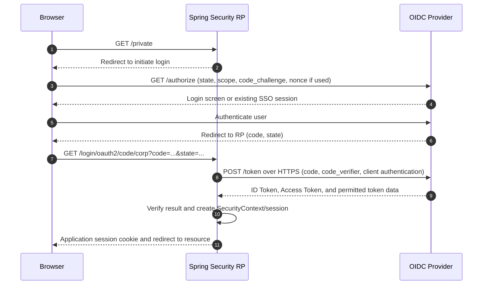
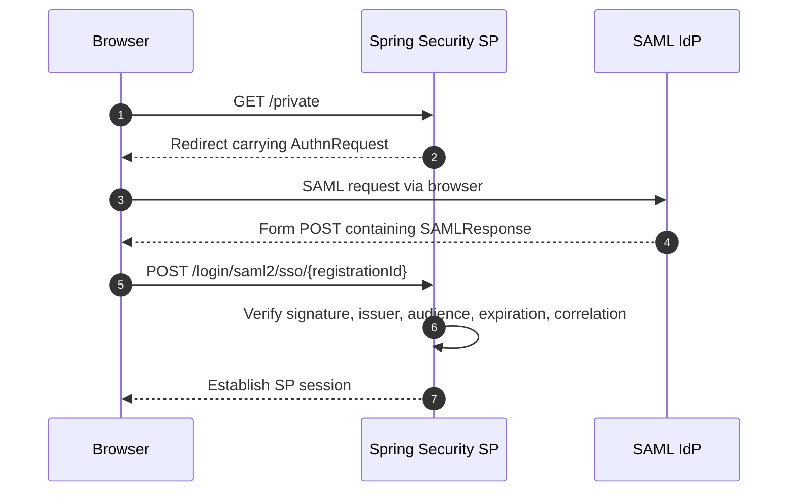

# Browser Exchanges and Server-to-Server Exchanges in SSO

## 1. Context and Learning Objectives

In Single Sign-On (SSO), a user logs in at an identity system and then accesses another application based on a trust relationship between the two parties. To achieve this, federation protocols typically combine two exchange paths:

- **Front-channel (via the browser):** messages are transported through the user's user-agent, usually via HTTP redirects or HTML form POSTs. The browser relays messages across domains, but it is not a trusted party to validate their contents.
- **Back-channel (directly between servers):** the application backend calls the identity server's endpoint over the process's own network connection, usually HTTPS; the browser does not transport messages in this step.

This lesson focuses on distinguishing the two channels by **message path**, explaining why OIDC/OAuth 2.0 and SAML 2.0 use them differently, and connecting them to Spring Security. After this lesson, learners should be able to read an SSO login diagram, point out where sensitive data is handled, and diagnose errors occurring on each channel.

## 2. Roles in an SSO Session

- **User / Browser:** the user and the browser. The browser sends requests, follows redirects, submits forms, and holds session cookies per domain according to browser rules.
- **Identity-consuming application:** called **Relying Party (RP)** in OpenID Connect (OIDC), or **Service Provider (SP)** in SAML. In Spring Security Servlet, this is typically an application using `oauth2Login` or `saml2Login`.
- **Identity server:** called **OpenID Provider (OP)** in OIDC, or **Identity Provider (IdP) / Asserting Party** in SAML. This party authenticates the user and issues the authentication result.
- **Authorization Server / Token Endpoint:** in OIDC, the OP also acts as the Authorization Server for code and token issuance. Interactions with the Authorization Endpoint and Token Endpoint have distinct semantics.

**SSO does not mean every request goes through the IdP.** After successful authentication, the application can maintain its login session using its own cookie; the browser sends that cookie to the application on subsequent requests. The party receiving the federation result must verify it before creating a session.

## 3. Comparing Front-Channel and Back-Channel

| Criterion | Front-channel: via browser | Back-channel: server-to-server |
| --- | --- | --- |
| Who transports the message? | Browser following redirects, URLs, or form POSTs | Backend process communicating directly with another server |
| Observable signs | Browser Network tab shows navigation and requests across domains | Backend outbound HTTP logs/traces and target server logs |
| Typical contents | OIDC authorization request, authorization code, `state`; SAML AuthnRequest/Response | OIDC token request/response, UserInfo, JWKS; SAML Artifact Resolution |
| Data security | URLs, bodies, and navigation history can be observed in the browser or logging layers; never treat the browser as a confidential channel | Tokens and client authentication credentials can stay on the backend; still requires TLS, log controls, and peer authentication |
| Result verification | The application must verify correlation codes, signatures, and protocol constraints upon receipt | The application must verify server identity, responses, and data usage conditions |
| Limitations | Depends on browser navigation, cookies, redirect policies; parameter leakage risk | Depends on backend connectivity, DNS, TLS, firewalls, proxies, timeouts, and endpoint config |

Do not confuse **front-channel with unencrypted HTTP** or **back-channel with a trusted internal network**: both usually use HTTPS over the Internet. "Back-channel" also does not mean the entire SSO flow needs no browser. Classification must be per exchange step, not by the label of the overall application.

A SPA or mobile app is a *public client* that may call the Token Endpoint directly from its own environment; in that case, it is **not a traditional web app backend-to-backend exchange**. PKCE protects the authorization code flow, yet does not enable browser-running code to hold a client secret.

## 4. Typical Example: OIDC Authorization Code Flow

OIDC builds on OAuth 2.0 to provide **identity authentication** information via the `ID Token` and related endpoints. In a web application with a backend (confidential client), the front-channel takes the user to the OP and brings the **authorization code** back to the application; the back-channel exchanges the code for tokens.



**Step-by-step walkthrough:**

1. The browser visits a login-protected URL on the RP. Spring Security creates the authorization request and correlation data for this login attempt.
2. The RP directs the browser to the OP's **Authorization Endpoint**. Typically the request includes `client_id`, `redirect_uri`, `response_type=code`, `scope=openid`, `state`, and—when PKCE applies—`code_challenge`/`code_challenge_method=S256`. OIDC may use `nonce` to bind the ID Token to the current request.
3. The OP authenticates the user, potentially leveraging an existing SSO session on the IdP domain. This part depends on the browser, cookies, and the OP's login policy.
4. The OP redirects the browser to the registered `redirect_uri` with a **short-lived, single-use code** and `state`. An authorization code **is not an Access Token or ID Token** and must not be treated as valid login proof before being redeemed and matched.
5. The RP backend matches `state` against the initial request, then makes a **direct POST to the Token Endpoint**. If PKCE is enabled, it sends the `code_verifier` matching the challenge; a confidential client also authenticates itself using its registered method.
6. The OP validates the code, redirect URI, client, and PKCE per the protocol and returns tokens. The RP verifies the ID Token (signature, `iss`, `aud`, expiration, `nonce` if used, and related constraints), then creates the principal and application session.
7. The browser receives the **RP's** cookie, without needing to see the Access Token/Refresh Token in this backend pattern. Subsequent requests can rely solely on the RP session; when the RP calls token-protected APIs, that is a separate flow.

**Why does this design have two channels?** The browser is suited for interactive login and cross-domain redirects. The backend is suited for sending client credentials, redeeming codes, holding tokens, and verifying returned data. Authorization Code + PKCE is the modern secure path; the Implicit mechanism returning Access Tokens directly in the authorization response should not be used in new designs per OAuth 2.0 Security BCP (RFC 9700).

### Distinct Roles of `state`, `nonce`, and PKCE

- **`state`:** connects the callback to the login transaction initiated by the RP itself; the value must be unpredictable, bound to the session/transaction, and verified before accepting the result. It primarily serves as protection against login CSRF.
- **`nonce` (OIDC):** when sent, the OP embeds the matching nonce into the ID Token and the RP must match it. It helps detect replayed ID Tokens or tokens injected into the wrong transaction.
- **PKCE:** the RP creates a secret `code_verifier` per transaction and sends `code_challenge` (typically S256) when opening the authorization request. The Token Endpoint exchanges the code only upon receiving the matching verifier. Public clients must use PKCE; confidential clients should use it too. PKCE **does not replace** verifying the ID Token, issuer, audience, TLS, or redirect URI.

These three components address different risks; do not lump them together as "verification codes" or skip binding them to the exact transaction.

## 5. Spring Security Servlet Application with OIDC

In a **Spring Boot 3.x / Spring Security 6.x / Java 17+** application, add the following dependencies to a project already configured with Spring Boot and Java:

```groovy
dependencies {
    implementation 'org.springframework.boot:spring-boot-starter-web'
    implementation 'org.springframework.boot:spring-boot-starter-security'
    implementation 'org.springframework.boot:spring-boot-starter-oauth2-client'
}
```

The `application.yml` configuration uses an OIDC Provider supporting discovery. Values in the three environment variables are supplied by the identity provider; never store secrets in source code:

```yaml
spring:
  security:
    oauth2:
      client:
        registration:
          corp:
            provider: corp
            client-id: ${SSO_CLIENT_ID}
            client-secret: ${SSO_CLIENT_SECRET}
            authorization-grant-type: authorization_code
            scope:
              - openid
              - profile
        provider:
          corp:
            issuer-uri: ${SSO_ISSUER_URI}
```

The Java snippet below is **a complete class** placed at `src/main/java/demo/federation/FederationApplication.java` in a Spring Boot project with those dependencies. It creates two endpoints and explicitly enables PKCE even for confidential clients via `OAuth2AuthorizationRequestCustomizers.withPkce()`:

```java
package demo.federation;

import java.util.Map;

import org.springframework.boot.SpringApplication;
import org.springframework.boot.autoconfigure.SpringBootApplication;
import org.springframework.context.annotation.Bean;
import org.springframework.security.config.annotation.web.builders.HttpSecurity;
import org.springframework.security.core.annotation.AuthenticationPrincipal;
import org.springframework.security.oauth2.client.registration.ClientRegistrationRepository;
import org.springframework.security.oauth2.client.web.DefaultOAuth2AuthorizationRequestResolver;
import org.springframework.security.oauth2.client.web.OAuth2AuthorizationRequestCustomizers;
import org.springframework.security.oauth2.core.oidc.user.OidcUser;
import org.springframework.security.web.SecurityFilterChain;
import org.springframework.web.bind.annotation.GetMapping;
import org.springframework.web.bind.annotation.RestController;

@SpringBootApplication
@RestController
public class FederationApplication {

    public static void main(String[] args) {
        SpringApplication.run(FederationApplication.class, args);
    }

    @GetMapping("/")
    public String home() {
        return "Public page";
    }

    @GetMapping("/private")
    public Map<String, String> privatePage(@AuthenticationPrincipal OidcUser user) {
        return Map.of(
                "subject", user.getSubject(),
                "issuer", user.getIdToken().getIssuer().toString()
        );
    }

    @Bean
    SecurityFilterChain securityFilterChain(
            HttpSecurity http,
            ClientRegistrationRepository registrations) throws Exception {

        var resolver = new DefaultOAuth2AuthorizationRequestResolver(
                registrations, "/oauth2/authorization");
        resolver.setAuthorizationRequestCustomizer(
                OAuth2AuthorizationRequestCustomizers.withPkce());

        return http
                .authorizeHttpRequests(auth -> auth
                        .requestMatchers("/").permitAll()
                        .anyRequest().authenticated())
                .oauth2Login(oauth2 -> oauth2
                        .authorizationEndpoint(endpoint -> endpoint
                                .authorizationRequestResolver(resolver)))
                .build();
    }
}
```

**How to observe:** configure the three environment variables and register redirect URI `http://localhost:8080/login/oauth2/code/corp` at the OP **for local development only**. Run `./gradlew bootRun` in a project with the Gradle wrapper; open `http://localhost:8080/` to view the public page, then open `http://localhost:8080/private` to start login. After a successful callback, `/private` returns JSON containing `subject` and `issuer` from the OIDC principal. There is no fixed stdout: redirect addresses, authentication pages, and results depend on the connected OP.

In the Network tab, you can see the redirect from the RP to the OP and the callback to `/login/oauth2/code/corp`. **POST /token is emitted by the JVM backend**, so it does not appear as a webpage request in the browser's Network tab. Observe outbound requests via safe server-side telemetry/logs; do not enable logging of raw token bodies, client secrets, cookies, or authorization codes.

Spring Security provides `OAuth2LoginAuthenticationFilter` to process callbacks and populate `SecurityContext`. In practice, additional backend steps may fetch discovery/JWKS and UserInfo; key fetching is usually cached so it does not necessarily repeat on every login. The configuration above is for an **OIDC RP with sessions**, and does not turn the application into an Authorization Server or OAuth2 Resource Server.

**Deployment notes:** the RP's redirect URI must match the registration on the OP, especially when deployed behind a reverse proxy / HTTPS ingress. Verify how Spring Boot accepts forwarded headers from trusted proxies; never blindly trust `X-Forwarded-*` headers spoofed by external clients. Use `Secure`, `HttpOnly` session cookies and a `SameSite` policy appropriate for the actual flow; enable HTTPS in deployed environments.

## 6. SAML 2.0: Most Web Browser SSO Is Front-Channel

In the common **SAML 2.0 Web Browser SSO** model, the SP sends `AuthnRequest` via the browser (typically HTTP-Redirect binding), and the IdP authenticates the user and returns `SAMLResponse`/assertion via **HTTP-POST binding** to the SP's Assertion Consumer Service (ACS). SAML does not necessarily have a "fetch token at Token Endpoint" step analogous to the OIDC code flow.



Key differences worth noting:

- **SAMLResponse can contain assertions holding user identity and attributes**, even though it travels through the browser. Base64 or an HTML form **is not security encryption**. Use signatures to verify authenticity/integrity, use assertion encryption when content confidentiality is required, and always use HTTPS.
- The SP must verify the trusted signature, `Issuer`, `Destination`/`Recipient`, `AudienceRestriction`, `NotBefore`/`NotOnOrAfter`, `InResponseTo` for SP-initiated flows, `SubjectConfirmation` conditions, and application replay-prevention policy. A valid signature **is not enough** if the assertion was sent to the wrong SP or has expired.
- In Spring Security, `saml2Login` and `RelyingPartyRegistration` configure SP integration; common endpoints are `/saml2/authenticate/{registrationId}` to initiate and `/login/saml2/sso/{registrationId}` to receive SAMLResponse. This is a different mechanism from `oauth2Login` and cannot be replaced by calling `/token`.

### SAML Artifact Variant: Combining Both Channels

Some deployments support **HTTP-Artifact binding**: the IdP passes a short **artifact/reference** through the browser (front-channel); the SP sends the artifact directly to the IdP's Artifact Resolution Service over the back-channel, typically using SOAP over HTTPS, to retrieve the corresponding SAML message. This reduces assertion payloads passing through the browser, but requires both sides to support the binding, secure the resolution endpoint, and validate the message as usual. **Do not assume a standard `saml2Login` configuration enables artifact resolution by default.**

## 7. SSO Logout, UserInfo, and APIs: Don't Confuse Channels with Features

- **OIDC UserInfo/JWKS/Token Endpoint:** these calls typically belong to the RP backend's back-channel. JWKS is a set of public keys for signature verification, not a place to send client secrets or arbitrary user tokens.
- **Front-channel logout:** may rely on browser redirects or iframes to notify sessions of logout. Completion depends on cookie policies, third-party cookies, and the browser; you cannot rely solely on an iframe having loaded.
- **Back-channel logout (if supported by OP/RP):** the OP calls the RP's backend endpoint with a verifiable logout token; the RP must validate the token, identify the right session, and prevent replay per the specification. This is a different flow from POST /token during login.
- **Client credentials (machine-to-machine):** a service can obtain an Access Token via `client_credentials` without a user or browser. This is machine-to-machine authorization, **not user SSO**. A Resource Server accepting bearer tokens also does not automatically become an RP with `oauth2Login`.

## 8. Secure Design Per Channel

### For the Front-Channel

1. **Accept only valid registered redirect URIs/ACSs.** Avoid open redirects, broad wildcard domains, mixing development and production environments, and `http`/`https` mismatches from proxies.
2. **Bind callbacks to the actual initiation.** Use `state` and/or PKCE binding, and nonce as required by each protocol; for SAML, verify `InResponseTo`, response destination/recipient, and replay.
3. **Keep secrets and long-lived session tokens out of URLs.** URLs can enter browser history, proxies, analytics, logs, or referers; use short-lived single-use authorization codes and an appropriate `Referrer-Policy`. With SAML POST, the body remains visible in the browser.
4. **Never trust data solely because the request came from the browser to your callback.** Codes, assertions, signatures, issuer/audience, timestamps, and permissions must be verified by the RP/SP. Never use arbitrary URL data as user permissions.
5. **Evaluate cookies and CSRF realistically.** OP and RP cookies belong to two different domains; `SameSite`, `Secure`, `HttpOnly`, domain/path, and CSRF policy must fit the actual POST callbacks or navigations in use. Never disable CSRF globally just to make SSO work.

### For the Back-Channel

1. **Authenticate peer endpoints** via trusted issuer/metadata configuration, TLS, certificate validation, and DNS/network policy. Never accept dynamic token/JWKS URLs from untrusted input as that can open SSRF vulnerabilities.
2. **Protect client credentials and tokens** in a server-side secret store; never embed client secrets in JavaScript, HTML, or logs. Use an OP-approved client authentication method such as `client_secret_basic`, `private_key_jwt`, or mTLS depending on design.
3. **Apply PKCE and verify tokens in the right context.** Check issuer, audience, expiration, signature, and valid keys; check nonce if sent. An Access Token is not automatically an ID Token; a token for API A must not be used as login proof for application B.
4. **Bound connections and error handling:** timeouts, controlled retries that avoid repeating single-use code redemption, monitoring for TLS/proxy/5xx errors, and clock synchronization for checking token `exp`/`nbf`.
5. **Limit observable data:** traces should record endpoint, correlation ID, error type, status, and duration; mask authorization codes, access/refresh/id tokens, cookies, authorization headers, and PII.

## 9. Diagnosing by Error Location

| Symptom | Channel to check first | Verification direction |
| --- | --- | --- |
| Cannot open IdP login page, redirect loop | Front-channel | Authorization Endpoint, redirect URI, `state`, cookies across domains, HTTPS/proxy |
| Callback receives code but fails to create session | Front → back boundary | `state`, used/expired code, redirect URI; next check Token Endpoint |
| Browser callback arrives but server times out | Back-channel | DNS, firewall, outbound proxy, TLS, token endpoint, timeout |
| OP returns token yet login is rejected | Backend verification | Signature/JWKS, issuer, audience, expiration, nonce, and token type |
| SAML POST reaches ACS yet is rejected | Front-channel and SP validation | Binding, signature, certificate, recipient/destination, audience, timestamps, InResponseTo |
| Browser sees only redirect, no token fetch request | Normal for backend RP | Token request runs in JVM/backend; check secret-redacted server telemetry |

**Applied scenario:** A user reports "after logging in at the IdP, the app comes back and shows an error." Determine whether the callback reached the RP. If it did not arrive, check the browser path and registration. If the callback arrived with a valid code yet the backend could not call the Token Endpoint, that is a back-channel connectivity error. If tokens arrived and the RP rejected them, focus on token verification and session correlation instead of blindly tweaking redirects.

## 10. Knowledge Self-Check

1. **In the OIDC code flow of a Spring Boot app with a backend, does the browser need to receive the ID Token?** No. The browser typically carries the authorization code; the backend redeems the code and processes the ID Token.
2. **Why does a SAMLResponse sent via form POST still require signature and audience verification?** Because the browser is an untrusted relay; POST/Base64 does not guarantee origin, integrity, or the intended recipient.
3. **Does PKCE replace checking `state`, `nonce`, issuer, and audience?** No. PKCE mitigates authorization code theft/abuse; the other checks protect distinct transaction and token constraints.
4. **Why doesn't POST /token appear in the browser's Developer Tools?** In the backend RP pattern, that call is sent directly from the application server to the OP.

## 11. Reference Standards for Cross-Checking

- [OpenID Connect Core 1.0 – Authorization Code Flow](https://openid.net/specs/openid-connect-core-1_0.html#CodeFlowAuth)
- [OAuth 2.0 Security Best Current Practice – RFC 9700](https://www.rfc-editor.org/rfc/rfc9700.html)
- [Spring Security – OAuth 2.0 Login, Servlet](https://docs.spring.io/spring-security/reference/servlet/oauth2/login/index.html)
- [Spring Security – OAuth2AuthorizationRequestCustomizers.withPkce()](https://docs.spring.io/spring-security/reference/api/java/org/springframework/security/oauth2/client/web/OAuth2AuthorizationRequestCustomizers.html)
- [Spring Security – SAML 2.0 Login Overview](https://docs.spring.io/spring-security/reference/servlet/saml2/login/overview.html)
